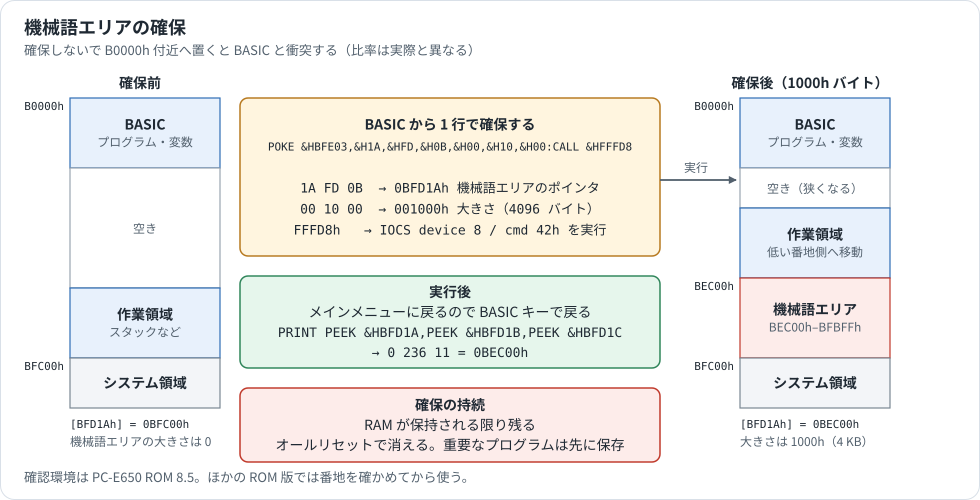
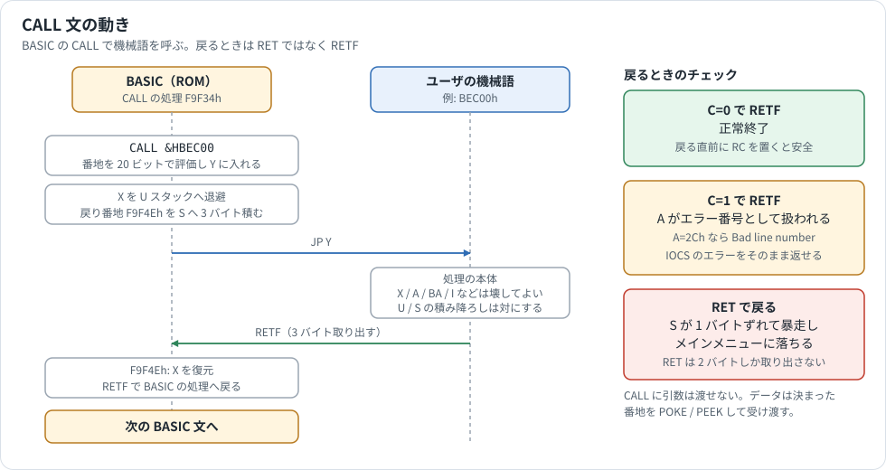
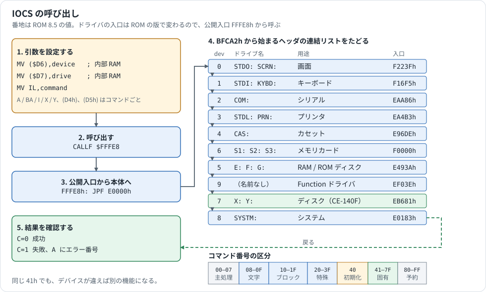
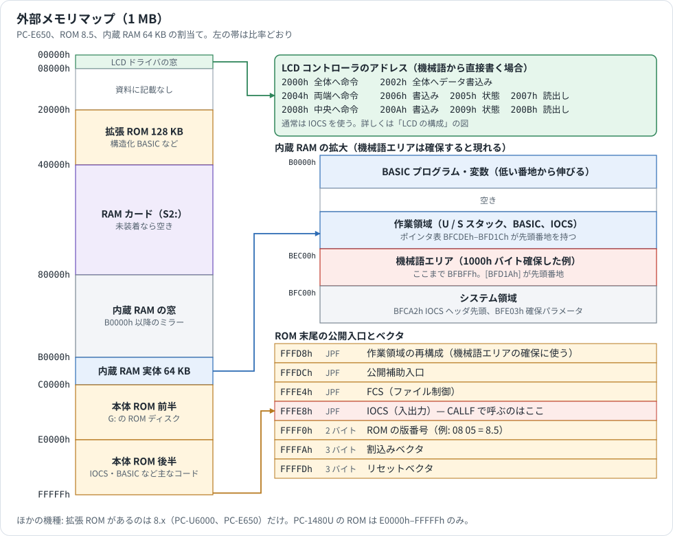

# アセンブラマニュアル

PC-E500 シリーズで機械語プログラムを書いて動かすための手引きです。本プロジェクトのアセンブラ `e500asm` と逆アセンブラ `e500dasm` の使い方、機械語を RAM に置いて BASIC から呼ぶ手順、サンプルをまとめました。

レジスタ、アドレッシング、全命令、オペコード表は [SC62015.md](SC62015.md) にあります。

## 1. 記法（e500asm）

```asm
; コメントは ; から行末まで
        ORG   $BEC00            ; 配置アドレス
COUNT   EQU   10                 ; 定数（"COUNT = 10" も可）
start:  MV    A,0                ; ラベルは行頭に置き : を付ける
loop:   ADD   A,IL
        DEC   IL
        JRNZ  loop
        RETF
table:  DB    "TEXT",13,10,0     ; 文字列と数値
        DW    $1234              ; 2 バイト（下位が先）
        DP    $B8000             ; 3 バイト
        DS    16                 ; 16 バイト確保
        END
```

- 数値: `$BEC00` / `&BEC00` / `0xBEC00` / `0BEC00h`（16 進）、`0b1010`（2 進）、`'A'`（文字）。`$` または `*` 単独は現在のアドレス。`h` で終わる数値は 16 進として読む（`0B8H` も 16 進）。
- 式: `+ - * / % & | ^ << >>`、単項 `- ~`、括弧、`LOW(x)`、`HIGH(x)`、`BANK(x)`（bit19–16）。
- 疑似命令: `ORG`, `EQU`, `DB`/`DEFB`/`BYTE`, `DW`/`DEFW`/`WORD`, `DP`, `DS`/`DEFS`/`SPACE`, `ALIGN`, `INCLUDE`, `INCBIN`, `ASSERT`, `END`。先頭に `.` を付けてもよい。
- 分岐先: `JR label` のようにラベルを書けば変位は自動計算。`JR +5` / `JR -3` の直接指定も可。
- `PRE 21h` のように PRE を明示することもできるが、通常は不要。
- 大文字・小文字は区別しない。

コマンドライン:

```text
e500asm  prog.asm -o prog.bin -l prog.lst -s prog.sym      # 生バイナリ + リスト + シンボル
e500asm  prog.asm -f hex                                    # Intel HEX
e500dasm prog.bin -f raw --org 0BEC00h -o prog.asm          # 逆アセンブル（生バイナリ）
e500dasm PROG.BIN -f ce140f -o prog.asm                     # SAVE M 形式（16 バイトヘッダ付き）
```

## 2. 開発の流れ

1. `ORG` に配置先（機械語エリアの先頭、§3.2）を書いてソースを作る。VS Code に `VSCodeExtensions/` の拡張（Pocket BASIC / ASM Linter）を入れると、`.asm` の編集中に `e500asm` と同じエラー（未知の命令、オペランドの組合せ、未定義シンボル、`JR` の範囲など）が表示される。
2. `e500asm prog.asm -o prog.bin -l prog.lst` でアセンブルし、リストでバイト列を確認する。
3. 実機／エミュレータへ入れる。方法は 3 つ:
   - **POKE**: 短いプログラムなら `POKE 先頭,バイト,…` を数行。リストから 10 進または `&H` 16 進で書く。
   - **LOAD M**: `ce140conv bin2bas --addr 0xBEC00 prog.bin PROG.BIN` で SAVE M 形式（16 バイトヘッダ付き）にし、CE-140F（エミュレータでは X: フォルダ）へ置いて `LOAD M "X:PROG.BIN"`。ヘッダの番地へ読み込まれる。
   - **エミュレータの BIN 書込み**: メモリ欄から生バイナリを指定番地へ書く。
4. `CALL 先頭番地` で実行する（`CALL &HBEC00` または 10 進 `CALL 781312`）。
5. 逆アセンブルで確認するときは `e500dasm`。ROM の解析には [ROM_VERSIONS_MAP.md](ROM_VERSIONS_MAP.md) の入口表を使う。

## 3. 実機で機械語を動かす

この章の手順は、全機種で同じです。全 11 本の ROM（2.1、2.2、3.2、5.3、6.2、6.3、6.4、7.2、7.5、8.4、8.5）をエミュレータで動かし、機械語エリアの確保（`BEC00h` になること）と、§4 のサンプル 3 本の結果が同じになることを確かめました。内蔵 RAM は、256 KB の ROM では 32 KB と 64 KB、384 KB の ROM では 64 KB で試しています。

ROM の中の番地（`F9F34h` など）は、ROM の版で変わります。本文の値は ROM 8.5 の例です。公開入口の `FFFD8h`、`FFFE4h`、`FFFE8h` は全機種で同じ番地から呼べます。各 ROM の値は [ROM_VERSIONS_MAP.md](ROM_VERSIONS_MAP.md) にあります。


### 3.1 RAM の構成と機械語エリア

ROM は内蔵 RAM の上端（BFC00h 直下）に 21 個の作業領域を持ち、その先頭番地を **BFCDEh から 3 バイトずつ** のポインタ表に置く（技術資料 p.77）。

| ポインタの番地 | 領域 |
|---|---|
| BFCDEh | U スタック |
| BFCE1h | S スタック |
| BFCE4h–BFD0Bh | 予約 |
| BFD0Eh | BASIC 作業領域 |
| BFD11h, BFD14h | 予約 |
| BFD17h | IOCS 作業領域（内部 RAM E6h にも同じ値） |
| BFD1Ah | **機械語エリア**。この番地の値から BFBFFh までがユーザ用 |

電源投入直後は `[BFD1Ah] = 0BFC00h`、つまり機械語エリアの大きさは 0。BASIC プログラムや変数は RAM の下端から伸びるので、確保せずに B0000h 付近へ機械語を置くと BASIC と衝突する。

### 3.2 機械語エリアの確保（検証済み）



IOCS device 8（SYSTM:）command 42h「作業領域確保」を、公開入口 FFFD8h 経由で BASIC から呼ぶ。FFFD8h は `[BFE03h]` を X（ポインタ表の番地）、`[BFE06h]` を Y（確保するバイト数）として command 42h を実行し、そのままメインメニューへ戻る。

```basic
POKE &HBFE03,&H1A,&HFD,&H0B, &H00,&H10,&H00 : CALL &HFFFD8
```

- 先頭 3 バイト `1A FD 0B` = 0BFD1Ah（機械語エリアのポインタ、下位から）。
- 続く 3 バイト = 大きさ（下位から）。例は 1000h = 4096 バイト。
- 実行後はメインメニューに戻るので `BASIC` キーで戻る。
- 確認: `PRINT PEEK &HBFD1A, PEEK &HBFD1B, PEEK &HBFD1C` → `0 236 11` = 0BEC00h。機械語エリアは **BEC00h–BFBFFh**。

`&H` が打ちにくい環境では 10 進で `POKE 785923,26,253,11,0,16,0:CALL 1048536` と書いても同じ。ROM はこの処理で BASIC 作業領域・スタック等のポインタを確保分だけ下へずらす（U/S スタックの内容も移動する）。確保した状態は RAM が保持される限り残り、オールリセット（RAM 初期化）で消える。既存の BASIC プログラムがある状態でも動作するが、重要なプログラムは先に保存しておくこと。

技術資料 p.85 には同じ方法で IOCS 作業領域（BFD17h）を広げる BASIC プログラム例がある。

### 3.3 CALL 文の規約（検証済み）



`CALL addr` は次のように動く（番地は ROM 8.5 の例。`F9F34h`）:

1. 引数を 20 bit 番地として評価し Y に入れる。
2. X を U スタックに退避し、**戻り番地 3 バイト**（F9F4Eh）を `MV [--S],X` で S スタックに積む。
3. `JP Y` でユーザ機械語へ飛ぶ。
4. 戻った先で X を復元し、`RETF` で BASIC へ帰る。

したがってユーザプログラムは:

- **`RETF` で戻る**（3 バイト取り出す）。`RET` だと S が 1 バイトずれて暴走し、メインメニューに落ちる（エミュレータで確認）。
- **C=0 で戻れば正常終了。C=1 で戻ると A がエラー番号として扱われ、BASIC のエラー表示になる**（例: A=2Ch で "Bad line number"、A=3Eh で "UNTIL without REPEAT"）。演算の最後にキャリーが残っていると意図せずエラーになるので、戻る直前に `RC` を置くのが安全。IOCS のエラーをそのまま BASIC に返したいときは C と A を触らずに `RETF` する。
- 引数はない。`CALL addr` の後にカンマで値を書く形式は受け付けない。データの受渡しは決まった番地を `POKE`/`PEEK` する。

呼出し時のレジスタ・内部 RAM の観測値（ROM 8.5、64 KB、参考値であり保証されない）:

| 項目 | 値 |
|---|---|
| Y | 呼出し先番地 |
| X | 戻り番地 F9F4Eh |
| U / S | RAM 内（例: BE691h / BE84Dh）。そのまま使える |
| BP (ECh) | ROM の値（例: BEh）。変更したら戻す |
| IMR (FBh) | E3h（割込み許可、キー・タイマ有効） |
| A, BA, I | 不定 |

ROM は X しか保存しない。他のレジスタは壊してよいが、U/S の積み降ろしは対にする。

### 3.4 内部 RAM と割込みの扱い

- CPU にとってはただの RAM だが、ROM は 00h–EBh を BASIC と IOCS の作業に使う。機械語が使う番地は入口で外部メモリへ `MVL` で退避し、出口で戻す（§4.3 の例）。BP（ECh）、PX、PY を変えたら戻す。
- 割込みは許可されたまま入ってくる。時間のかかる処理でキー割込みを止めたいときは `PUSHU IMR`（自動で IRM=0）… `POPU IMR`。ROM の割込み処理はタイマでキーを走査し、S スタックを 5 バイト以上使う。
- 長い `MVL`/`WAIT` は割込みを遅らせる。
- ブザー（XOUT）は SCR（FDh）の bit6–4。`AND (0FDh),8Fh` で止まる。

### 3.5 IOCS の呼び方



```asm
        MV   ($D6),device      ; (cl) デバイス番号
        MV   ($D7),drive       ; (ch) ドライブ番号
        MV   IL,command         ; コマンド番号
        ; A / BA / I / X / Y / ($D4),($D5) はコマンドごとの引数
        CALLF $FFFE8
        JRC  error              ; C=1: A にエラー番号
```

引数に使う内部 RAM の番地と、技術資料の名前の対応は次のとおりです（ROM で確認）。技術資料の `(cx) = 0008h` は「D6h に 08h、D7h に 00h」を意味します（`MVW (D6h),0008h`）。

| 番地 | 技術資料の名前 | 用途 |
|---|---|---|
| D4h | (bl) | x 座標など |
| D5h | (bh) | y 座標など |
| D6h | (cl) | IOCS デバイス番号 |
| D7h | (ch) | IOCS ドライブ番号 |

デバイス番号、コマンド範囲、各ドライバの入口は [IOCS_REFERENCE.md](IOCS_REFERENCE.md)。LCD（device 0）の主なコマンド（技術資料 pp.32–41）:

| cmd | 機能 | 引数 |
|---|---|---|
| 40h | 初期化 | A = 0 全リセット / 1 リセット / 2 OFF / 3 ON |
| 41h | 1 文字表示 | (D4h)=x, (D5h)=y, A=文字。表示後 x+1 |
| 42h | 文字列表示 | (D4h)=x, (D5h)=y, X=文字列先頭, Y=長さ。右端で止まり C=1 |
| 44h | カーソル位置設定 | (D4h)=x, (D5h)=y |
| 45h | カーソル種別 | A（bit5 表示、bit3 点滅、bit2–0 形） |
| 47h / 48h | n 行スクロール上／下 | |
| 49h | 行クリア | |
| 4Ah / 4Bh | 8 ドットパターン表示／読出し | |
| 4Ch / 4Dh | 1 ドット表示／読出し | |
| 4Eh / 4Fh | 直線／矩形塗り | |
| 51h / 52h | 画面クリア | |
| 55h / 56h | 1 行ドットパターン読出し／書込み | |

IOCS が壊すレジスタは公開されていない。必要なものは呼出し前後で `PUSHU`/`POPU` する。

### 3.6 SAVE M / LOAD M

```basic
SAVE M "X:PROG.BIN",&HBEC00,&HBEC3F     ' 機械語エリアの内容を保存
LOAD M "X:PROG.BIN"                     ' ヘッダの番地へ戻す
```

ファイル先頭には 16 バイトのヘッダ（`FF 00 06 01 10 長さ3 開始3 FF FF FF 00 0F`）が付く。`ce140conv bin2bas --addr` が同じヘッダを生成し、`e500dasm -f ce140f` がそれを読む。詳細は `FileConverter/README.md`。

### 3.7 外部メモリの割当て

CPU が決めていない範囲の割当ては機種の設計によります（[SC62015.md](SC62015.md) §5.3）。図は PC-E650（ROM 8.5、内蔵 RAM 64 KB）の例です。



| CPU アドレス | 内容 | 機種による違い |
|---|---|---|
| 00000h–07FFFh | LCD ドライバの窓 | |
| 10000h–1FFFFh | ROM カード | |
| 20000h–3FFFFh | 拡張 ROM（128 KB） | PC-E650、PC-U6000 だけ |
| 40000h–7FFFFh | RAM カード（S2:）。未装着なら空き | |
| 80000h–BFFFFh | 内蔵 RAM の窓。下位は実体のミラー | 実体は 32 KB なら B8000h–BFFFFh、64 KB なら B0000h–BFFFFh |
| BFC00h–BFFFFh | システム領域。IOCS ヘッダ先頭ポインタ BFCA2h、作業領域ポインタ表 BFCDEh–BFD1Ch、機械語エリア確保用パラメータ BFE03h など | 同じ番地 |
| C0000h–DFFFFh | 本体 ROM 前半。G: の ROM ディスク | PC-1480U は G: がなく、後半の写し |
| E0000h–FFFFFh | 本体 ROM 後半。主なコード | 中の番地は ROM の版で変わる |
| FFFD8h, FFFDCh, FFFE4h, FFFE8h | 公開入口。FFFE8h = IOCS、FFFE4h = FCS、FFFD8h = 作業領域再構成 | 飛び先は版で変わる。呼ぶ番地は同じ |

ROM の中の配置は [ROM_VERSIONS_MAP.md](ROM_VERSIONS_MAP.md)、IOCS の入口は [IOCS_REFERENCE.md](IOCS_REFERENCE.md) にあります。

## 4. サンプルプログラム

いずれも §3.2 で 1000h バイト確保した BEC00h に置き、`CALL &HBEC00`（= `CALL 781312`）で実行した。全 11 本の ROM で同じ結果になる（エミュレータ）。

### 4.1 2 バイトの加算

```asm
; [$BED00] + [$BED01] → [$BED02]
        ORG  $BEC00
        MV   A,[$BED00]
        MV   IL,[$BED01]     ; IH は 0 になる
        ADD  A,IL
        MV   [$BED02],A
        RETF                  ; C は ADD の結果のまま返る
        END
```

```basic
POKE &HBEC00,&H88,&H00,&HED,&H0B,&H89,&H01,&HED,&H0B,&H46,&H01,&HA8,&H02,&HED,&H0B,&H07
POKE &HBED00,3,4 : CALL &HBEC00 : PRINT PEEK &HBED02      → 7
POKE &HBED00,200,100 : CALL &HBEC00                        → "Bad line number"
```

2 つ目は 300 で桁上げが出て C=1 のまま戻ったため、A=2Ch がエラー番号として表示された（§3.3）。ゼロクリアしたければ `RETF` の前に `RC` を入れる。

### 4.2 IOCS で文字列を表示

```asm
; IOCS (device 0: LCD, command $42) で最下行に文字列を表示する
        ORG  $BEC00
IOCS    EQU  $FFFE8
BL      EQU  $D4              ; x 座標 (0-39)
BH      EQU  $D5              ; y 座標 (0-3)
CL      EQU  $D6              ; device
CH      EQU  $D7              ; drive
start:  MV   (CL),0            ; device 0 = LCD
        MV   (CH),0            ; drive 0
        MV   (BL),0            ; x = 0
        MV   (BH),3            ; y = 3
        MV   IL,$42            ; 指定位置へ n 文字表示
        MV   X,msg             ; 文字列先頭
        MV   Y,msg_end-msg     ; 長さ
        CALLF IOCS             ; C=1 なら A にエラー番号
        RETF                   ; C と A をそのまま BASIC へ返す
msg:    DB   "HELLO, PC-E500!"
msg_end:
        END
```

`CLS : CALL &HBEC00` で 4 行目に `HELLO, PC-E500!` が出る。42h は制御コード（CR/LF）を解釈せず、そのグリフを表示する。

### 4.3 内部 RAM を退避して BCD 加算

```asm
; 内部 RAM $20-$2F を退避し、DADL で 4 バイト BCD 加算を行う
        ORG  $BEC00
WORK    EQU  $20               ; 内部 RAM $20-$2F を作業に使う
SAVE    EQU  $BEF00            ; 退避先（機械語エリア内）
RESULT  EQU  $BED00            ; 結果の書出し先
start:  PUSHU X
        PUSHU I
        MV   I,16
        MVL  [SAVE],(WORK)     ; 内部 RAM $20-$2F を退避
        MV   X,operands
        MV   I,8
        MVL  (WORK),[X]        ; 被加数 4 バイト + 加数 4 バイト
        MV   I,4
        DADL (WORK+3),(WORK+7) ; 10 進加算。最下位バイトを指定し、下位番地へ進む
        MV   I,4
        MVL  [RESULT],(WORK)   ; 結果 ($20-$23) を外部メモリへ
        MV   I,16
        MVL  (WORK),[SAVE]     ; 内部 RAM を復帰
        POPU I
        POPU X
        RC
        RETF
operands:
        DB   $00,$12,$34,$56   ; 00123456（上位桁が先頭）
        DB   $00,$00,$99,$99   ; 00009999
        END
```

`CALL &HBEC00 : PRINT PEEK &HBED00,PEEK &HBED01,PEEK &HBED02,PEEK &HBED03` → `0 19 52 85` = 00 13 34 55（00123456 + 00009999 = 00133455）。復帰後も BASIC は正常に動く。

生成されるコードのうち注目点: `MVL [SAVE],(WORK)` は `30 DB 00 EF 0B 20`（内部 RAM オペランドが 1 つなので PRE 30h）、`DADL (WORK+3),(WORK+7)` は `32 C4 23 27`（両方絶対番地なので PRE 32h）、`MVL (WORK),[X]` は `30 56 84 20 00`（`[X]` が `[X+0]` に置き換わる）。

サンプルのソースは [asm_samples/](asm_samples/) にある。

## 5. よくある落とし穴

| 症状 | 原因 | 対処 |
|---|---|---|
| CALL 後にメインメニューへ落ちる | `RET` で戻った | `RETF` |
| CALL 後に BASIC のエラーが出る | C=1 で戻った | `RC` してから `RETF`、または意図したエラー番号を A に |
| キーが効かなくなる／時計が止まる | IMR を落としたまま、または長い `MVL`/`WAIT` | `PUSHU IMR`/`POPU IMR` を対にする |
| BASIC が壊れる | 内部 RAM を戻していない、BP を変えた、確保していない領域へ書いた | §3.2 と §3.4 |
| `MV A,IL` がアセンブルできない | 命令が存在しない | 内部 RAM 経由 |
| `MV S,[X]` がアセンブルできない | S の間接指定は不可 | `MV S,[lmn]` または `MV S,(n)` |
| `JR` が範囲外 | ±255 を超えた、またはセグメントを跨いだ | `JP`/`JPF` |
| `SHR` で上位に 1 が入る | C が回り込む 9 bit 回転 | 先に `RC` |
| `ADCL` と `DADL` で結果が逆 | 進む方向が違う（2 進は上へ、10 進は下へ） | [SC62015.md](SC62015.md) §14.2 |
| PRE 付き命令のサイクルが表と違う | `(BP+n)` 以外は +1 | [SC62015.md](SC62015.md) §15 |
| `(n)` のつもりが `(BP+n)` になっている | ROM の逆アセンブル出力は BP 相対が既定 | `e500dasm` の表示どおりに読む |
