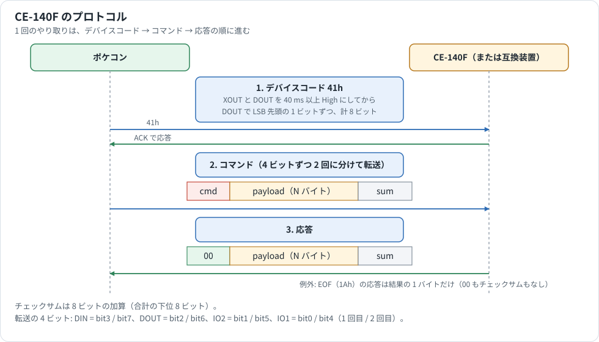

# CE-140F プロトコル解析

ポケットディスクドライブ CE-140F と PC-E500 シリーズの通信手順をまとめた資料です。ファイル形式は [Guide/file-formats.md](../Guide/file-formats.md)、BASIC の命令の書式は [BASIC_REFERENCE.md](BASIC_REFERENCE.md) を参照してください。

## 情報源と確度

| 表記 | 情報源 | 確度 |
|---|---|---|
| **サービスマニュアル** | CE-140F サービスマニュアル 6.4 節（[Sharp_ce140f_emul の protocol.md](https://github.com/ffxx68/Sharp_ce140f_emul/blob/main/protocol.md) の抜粋） | デバイスコードと 4 ビット転送の仕様。コマンドの内容は書かれていない |
| **SD.EXE** | PC 用の互換ソフト TransDrive（SL-16、1992 年 CardWare）の `SD.EXE` の逆アセンブル | コマンドの仕様。ポケコンの相手をするプログラムの実装で、CE-140F 本体の内部を読んだものではない |
| **実機ダンプ** | PC-E650 で `SAVE M` したファイル 5 本 | ヘッダの構造を確定 |
| **ROM** | ROM のドライバの逆アセンブル（番地は 8.5。3.2 は 2E4h 足した番地） | ポケコンが送るものと、応答の読み方 |
| **実験** | エミュレータの CPU で ROM 3.2、7.2、8.4、8.5 を動かし、機器の側を本資料どおりに作って動かしたもの | 手順全体と、状態のバイトの意味 |

**SD.EXE から読み取ったコマンドのうち、4 章の EOF、LOC、LOF、OPEN、NAME、SET、COPY は実機で試していません。**

解析した `SD.EXE` は 5,935 バイト（MD5 `6221359ccfbdf578fd615af13e275fa6`）で、LZEXE で圧縮されています。展開後は 14,928 バイトです。本文のオフセットは、展開後のコード上の位置です。

## 1. 通信の全体像



| 層 | 内容 | 根拠 |
|---|---|---|
| デバイス選択 | 11 ピンコネクタにつながる機器のうち 1 台を、デバイスコードで選ぶ。CE-140F は `41h` | サービスマニュアル、SD.EXE |
| バイト転送 | 1 バイトを 4 ビットずつ 2 回に分け、BUSY と ACK でハンドシェイクする | サービスマニュアル |
| コマンド | コマンドコード、引数、チェックサムを送り、応答を受け取る | SD.EXE |

### デバイスコードの送信

1. ポケコンが XOUT と DOUT を 40 ms 以上 High にします。
2. 機器が ACK を High にします。ACK は各機器のワイヤード OR です。
3. ポケコンが DOUT にデバイスコードを LSB から 1 ビットずつ出し、BUSY を High にします。
4. 機器は BUSY の High を見て DOUT を読み、ACK を Low にします。ポケコンは ACK の Low を見て BUSY を Low にします。
5. 機器は受信を終えると ACK を High にして、次のビットを待ちます。これを 8 ビット繰り返します。

BUSY を High にしてから 5 ms 以内に ACK が High にならなければ、ポケコンはエラーとします。

### データの転送

データ転送中の XOUT は Low です。1 バイトを次のように 2 回に分けます。

| 端子 | 1 回目 | 2 回目 |
|---|---|---|
| DIN | bit3 | bit7 |
| DOUT | bit2 | bit6 |
| IO2 | bit1 | bit5 |
| IO1 | bit0 | bit4 |

| 方向 | 手順 |
|---|---|
| ポケコン → CE-140F | ポケコンがデータを出して BUSY を High にし、CE-140F が ACK で応答する |
| CE-140F → ポケコン | CE-140F は処理後、ACK を 10 ms 以上 Low にしてからデータを出し、ACK を High にする。ACK を Low にしてから 50 ms 以内に送る。ポケコンは ACK の High を見て 4 ビットを読み、BUSY で応答する |

### コマンドと応答の形式

```text
送信: コマンド(1) + 引数(N) + チェックサム(1)
応答: 00h(1) + データ(N) + チェックサム(1)
```

チェックサムは 8 ビットの加算（合計の下位 8 ビット）です。応答のチェックサムは `00h` の後のバイトだけを足します。データのない応答は `00h` の 1 バイトだけです。

パケットの終わりを示す印はありません。機器は、バスが止まったことか、コマンドごとの長さで判断します。

応答の 1 バイト目は状態です。成功は `00h` で、エラーの値は 3 章にあります。エラーのときは状態の 1 バイトだけを返します（ROM）。

## 2. コマンド一覧

`SD.EXE` のディスパッチ処理（オフセット `1D0h` 以降）から取り出した 25 個です。送信と応答の形は ROM のドライバから読みました（`08h`、`09h` は ROM にだけあります）。

「名前」は 3 章の 14 バイトのブロックです。「番号」はファイル番号です。送信と応答の欄では、最後のチェックサムと、先頭のコマンドコードを省きました。

| コード | 処理の位置 | 内容 | 送信 | 応答 |
|---|---|---|---|---|
| `03h` | `0638h` | OPEN | 名前、モード、番号 | 状態 |
| `04h` | `06E3h` | CLOSE | 番号（`FFh` はすべて） | 状態 |
| `05h` | `0A24h` | FILES | 名前（パターン） | `00h`、件数、和 |
| `06h` | `0AACh` | FILES（次へ） | なし | `00h`、ドライブ、`:`、13 文字、和 |
| `07h` | `0AEFh` | FILES（前へ） | なし | `06h` と同じ |
| `08h` | | INIT | 1 バイト | 状態 |
| `09h` | | INIT | なし | 状態 |
| `0Ah` | `0E1Fh` | KILL | 名前 | 状態 |
| `0Bh` | `0DD6h` | NAME | 名前、名前 | 状態 |
| `0Ch` | `0EBCh` | SET | 名前、2 バイト | 状態 |
| `0Dh` | `0D47h` | COPY | 名前、名前 | 状態 |
| `0Eh` | `0741h` | LOAD | 名前 | `00h`、属性、長さ 3 バイト、和 |
| `0Fh` | `0867h` | LOAD（バイナリ） | 1 バイト | `00h`、データ（4 章）、`00h` |
| `10h` | `08C1h` | SAVE | 名前、`00h` | 状態 |
| `11h` | `0970h` | SAVE（サイズとデータ） | 属性、長さ 3 バイト | 状態。続けてブロックごとに状態（4 章） |
| `12h` | `07FEh` | LOAD（ASCII） | 番号 | `00h`、1 行、和、`00h` |
| `13h` | `0B70h` | INPUT | 番号 | `00h`、文字、`00h`、和、`00h` |
| `14h` | `0BB1h` | INPUT | 番号 | `13h` と同じ |
| `15h` | `0AF6h` | PRINT | 番号 | 状態。続けて、文字、`00h`、和 → 状態 |
| `16h` | `08F7h` | SAVE（ASCII） | 番号 | 状態。続けて、文字、和 → 状態 |
| `17h` | `07CEh` | LOAD（1 バイト読み出し） | 番号 | `00h`、1 バイト、和 |
| `1Ah` | `0FF2h` | EOF | 番号 | **結果の 1 バイトのみ** |
| `1Bh` | `0F6Eh` | LOF | 番号 | `00h`、3 バイト、和 |
| `1Ch` | `0F0Ch` | LOC | 番号 | `00h`、2 バイト、和 |
| `1Dh` | `0E46h` | DSKF | ドライブ | `00h`、3 バイト、和 |
| `1Fh` | `0BEAh` | INPUT 系 | 番号 | `13h` と同じ形 |
| `20h` | `0C5Bh` | INPUT | 番号 | `13h` と同じ形 |

### protocol.md の一覧との違い

| コード | 違い |
|---|---|
| `03h`、`1Bh` | `SD.EXE` にあるが、protocol.md の一覧にはない |
| `08h`、`09h`（INIT） | protocol.md と ROM にあるが、`SD.EXE` にはない |
| `FEh`、`FFh` | protocol.md の実装上の区分。`SD.EXE` では `11h` の処理の中で受信している |

## 3. 共通の仕組み

### ドライブとファイル名

ファイル名を伴うコマンドは、全体で 14 バイトのブロックを送ります（ROM `EC241h`）。

```text
ドライブ(1) + ':'(1) + ファイル名(12)
```

ファイル名は `NAME    .EXT` のように空白で埋めた 12 文字です。ブロックの先頭が `'Y'`（`59h`）なら Y:、それ以外は X: です。

`SD.EXE` は 14 バイトを受け取ったあと、その 3 バイト目から 12 バイトをファイル名として使います。名前が 2 つあるコマンドでは、2 つ目のブロックはすぐ後ろ（1 つ目の先頭から 14 バイト目）に続きます。

### ファイル番号

開いたファイルの表は 8 項目で、番号 `fn` は 0〜7 です。8 以上や、開いていない番号はエラーになります。

**番号 1 は `LOAD` と `SAVE` の転送用です。** `0Eh` と `10h` で開くのはこのファイルで、ROM は `17h`、`12h`、`16h` に番号 1 を付けて送ります。ASCII の `SAVE` は `03h` で番号 1 を開きます。BASIC の番号は 2 からです（実験）。

### 状態のバイト

ROM の判定（`EC26Fh`）は、`10h` 未満と `FFh` を**成功**として扱います。`FFh` を返しても、エラーになりません。

`10h` 以上は表でエラーになります。各値を機器から返して、BASIC の表示を確かめました（実験）。表そのものは ROM 2.1〜8.5 の 7 本で同じです。

| 状態 | BASIC のエラー |
|---|---|
| `30h` | File already open |
| `21h`、`31h`、`3Ch` | Syntax error |
| `32h` | File not found |
| `15h`、`33h`、`41h` | File write protected |
| `34h`、`37h`、`39h` | Disk full |
| `35h` | NAME error |
| `3Eh` | Mode error |
| そのほかの `10h`〜`3Fh`、`40h` | I/O error |

### ACK の待ち時間

機器 → ポケコンの 1 バイトのうち、最初の 4 ビットを待つ ROM の処理（`EC19Dh`、`EC1A1h`）には時間切れがなく、`BREAK` でだけ抜けます。2 回目以降の ACK は最大 `D4C0h` 回見ます。

## 4. コマンドの詳細

### LOAD と SAVE はヘッダを解釈しない

`SAVE M` / `LOAD M` 専用のコマンドはありません。`SD.EXE` は受け取ったバイト列をそのままファイルへ書き、読むときもそのまま返します。

| 操作 | 動き |
|---|---|
| `17h` | ファイルから 1 バイト読んで返す。ヘッダの生成も解釈もしない |
| `11h` | サイズ 3 バイトを受け取り、256 バイトごとに受信してファイルへ書く。ブロックごとに `00h` を返し、端数は別に処理する |

`SAVE` の本体はデバイスコードをはさまずに続きます。1 ブロックは、データ（256 バイト、最後は端数）とその和で、応答は状態です。

`0Fh` の応答の本体は、256 バイトごとにその和が入り、最後の端数のあとにも和が入ります。ちょうど 256 バイトで終わるときの和は 1 回だけです。最後に状態の `00h` が来ます。ROM は `0Fh` の状態を読んだあと、本体を何回かに分けて読むことがあり、最後まで読まないこともあります。読むのを待つ間、機器は ACK を High にしたまま止まります。

256 バイトちょうどと 1280 バイトの `SAVE M` と `LOAD M` は、ヘッダを含めて正しく往復しました（実験）。

つまり、**ファイル先頭の 16 バイトのヘッダは、ポケコンが作ったものです。** 構造は [ファイル形式](../Guide/file-formats.md#機械語ファイルload-m--save-m)にあります。TransDrive の説明には「先頭 17 バイトを削除」とありますが、実機のダンプでは 16 バイトでした。

protocol.md によると、LOAD の流れは次のとおりです。

1. `0Eh` でファイル名を送り、サイズを受け取る。
2. `17h` を 16 回送り、ヘッダを 1 バイトずつ受け取る。
3. 本体をまとめて受け取る。

### EOF（`1Ah`）

```text
送信: fn + チェックサム
応答: 現在位置がファイル末尾以上なら 1、それ以外は 0
```

**応答は結果の 1 バイトだけで、先頭の `00h` もチェックサムもありません。** ほかのコマンドと同じ形で返すと動きません。`SD.EXE` の応答処理（`486h`）は `00h` の送信とチェックサムの初期化を兼ねており、EOF だけがこれを呼ばないためです。

### LOC（`1Ch`）

現在位置を 256 バイト単位で返します。`(位置 >> 8) + 1` を 16 ビット（下位から）で送ります。

### LOF（`1Bh`）

ファイルの長さを 24 ビット（下位から）で返します。

### OPEN（`03h`）

```text
送信: 名前(14) + モード(1 / 2 / 3) + fn + チェックサム
```

| モード | 内容 |
|---|---|
| 1 | INPUT。読み出しで開く |
| 2 | OUTPUT。新しく作る |
| 3 | APPEND。書き込みで開いて末尾へ移動 |

### NAME（`0Bh`）と COPY（`0Dh`）

```text
送信: 名前(14) + 名前(14) + チェックサム
```

どちらもファイル名を 2 回受け取ります。NAME は旧名と新名、COPY はコピー元とコピー先です。ROM はダミーを送らず、チェックサムで終わります。SD.EXE がダミーとして受け取るのが、このチェックサムです。

### SET（`0Ch`）

```text
送信: 名前(14) + 2 バイト + チェックサム
```

2 バイト目の bit0 が 1 なら書き込み禁止です。`SET "X:FILE.BAS","P"` に対応します。

### ASCII ファイル

読むとき（`12h`）は、`0Dh` か `1Ah` までを 1 回の応答で返します。次の応答の先頭の `0Ah` は ROM が読み飛ばします（`EBDA0h`）。ファイルの終わりは機器が `1Ah` を返します。ファイルの中に `1Ah` があれば、そこを終わりとして 1 回だけ返します。`Sharp_ce140f_emul` は自分で `1Ah` を送るので、ファイルにも `1Ah` があると 2 回届いて、I/O エラーになります。

書くとき（`16h`）は、1 行ごとに `16h` と文字のパケットを送ります。最後は `1Ah` 1 文字のパケットで、そのあと CLOSE は来ません（実験）。

## 5. ROM 側のドライバ

X: と Y: は IOCS の device 7 です（[IOCS_REFERENCE.md](IOCS_REFERENCE.md)）。デバイスコードからコマンドの送受信まで、通信はこのドライバが本体の ROM だけで行います（ROM、実験）。

| 項目 | 内容 |
|---|---|
| ヘッダ | ROM 8.5 で `DF89Ch`、属性 `00h`、入口 `EB681h` |
| ROM 版による違い | 入口は 2.1 が `EB965h` で、ほかは `EB681h`（[ROM_VERSIONS_DRIVERS.md](ROM_VERSIONS_DRIVERS.md)） |
| デバイスコード | `EC03Bh` |
| 1 バイト送る | `EC0E6h` |
| 1 バイト受け取る | `EC19Dh`（チェックサムに足す）、`EC1A1h`（足さない） |
| 名前のブロックを送る | `EC241h` |
| 状態の判定 | `EC26Fh` |
| 同名のドライブ | 同じドライブ名のヘッダが追加されると、後から組み込まれたほうが選ばれる |

BASIC では、`SAVE M` / `LOAD M` はキーワードではなく、`SAVE` / `LOAD` の修飾子として解析されます。この点も、機械語専用のコマンドがないことと一致します。

## 6. 未確定の項目

| 項目 | 状況 |
|---|---|
| 実機での確認 | 4 章の EOF、LOC、LOF、OPEN、NAME、SET、COPY は `SD.EXE` から読んだもので、実機では試していない |
| `1Fh` | INPUT 系。ROM の受け取り方は `13h` と同じ。BASIC のどの命令が使うかは未解析 |
| `08h`、`09h` | `SD.EXE` にはない。実機の CE-140F でどう動くかは未確認 |

## 謝辞

- Simon Lehmayr: TransDrive（SL-16）
- CardWare, Novi Sad: `SD.EXE` の開発元
- Remy: PockEmul の作者。`SD.EXE` を最初に解析した
- Fabio Fumi（ffxx68）: [Sharp_ce140f_emul](https://github.com/ffxx68/Sharp_ce140f_emul) の作者
