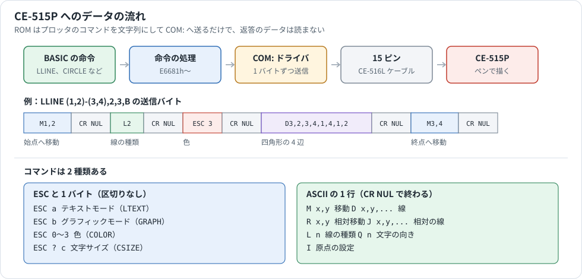
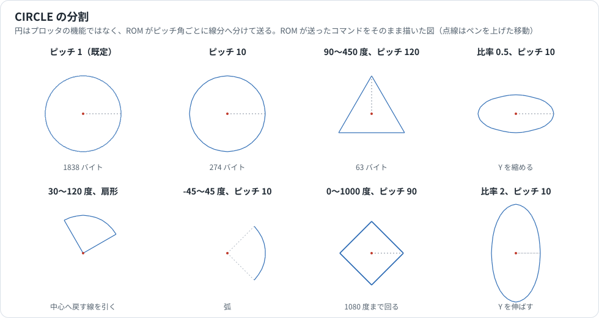
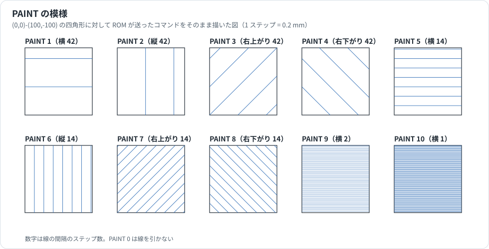

# CE-515P カラープロッタの解析

CE-515P カラープロッタプリンタを動かす BASIC の命令（`GRAPH`、`LLINE`、`CIRCLE` など）が、ROM の中で何をしているかをまとめた資料です。ROM から分かるのは **PC-E500 が送るデータ** までで、CE-515P 本体の動作は分かりません。BASIC の命令の書式は [BASIC_REFERENCE.md](BASIC_REFERENCE.md)、シリアルの信号線と設定は [SERIAL_PORT.md](SERIAL_PORT.md) を参照してください。

## 情報源と確度

| 表記 | 情報源 | 内容 |
|---|---|---|
| **マニュアル** | PC-E500 Operation Manual | 命令の書式、色、ステップの大きさ |
| **コード** | ROM 8.5 と 3.2 の逆アセンブル | 引数の検査、計算、送る順序 |
| **実験** | エミュレータの作業用コピー | UART の送信レジスタへの書き込みをすべて記録した。ROM 11 本で試した |
| **推定** | 上の組み合わせから推し量ったもの | 本文に「推定」と書く |

**試していないこと**

- 実機の CE-515P。本資料はプロッタが動いた結果を見ていません。図は送ったコマンドを計算で描いたものです。
- 実機のシリアル接続。エミュレータの UART にはビットの波形がないので、送信の時間は計算です。
- CE-515P の取扱説明書は手元にありません。コマンドの意味は、そのコマンドを送る BASIC 命令の説明からの推定です。

番地は ROM 8.5 のものです。ROM 3.2 では、プロッタの命令の処理（`E6681h`〜）は 3Ch 引いた番地に、COM のドライバ（`EA452h`、`EAAD6h`）は 2E4h 足した番地にあります。

## 1. 全体像



CE-515P はシリアルポートにつなぎます（ケーブルは CE-516L。マニュアル）。ROM の処理は次のような作りです。

- **コマンドを文字列にして `COM:` へ送るだけです。** 返答のデータは読みません。プロッタを止める手段は `CS` 信号などのフロー制御です（[SERIAL_PORT.md](SERIAL_PORT.md) §5）。
- **モードを覚えていません。** `GRAPH` は `ESC b` を送るだけで、`LTEXT` の状態でも `LLINE` は同じバイトを送ります（実験）。マニュアルには、テキストモードでグラフィックの命令を使うと、コマンドが文字として印字されるとあります。
- **`OPEN` していないと、エラーを出さずに何も送りません**（実験）。処理の入口（`EA452h`）は COM が閉じていると内部エラー 54h を返しますが、命令の処理はこれを無視します（`E6916h`）。プログラムは何も描かずに最後まで進みます。
- **プロッタの命令は CE-126P には送りません。** CE-126P をつないでいて COM が閉じていれば、`LPRINT` だけが CE-126P へ行きます。COM を開くと `LPRINT` も COM へ行きます（実験）。

### 座標

1 ステップは 0.2 mm です（マニュアル）。X は右が正、Y は上が正です。用紙の外は描かずに座標だけを動かす「シザリング」はプロッタ側の機能です（マニュアル）。

## 2. コマンドの一覧

ROM が送るコマンドはこれですべてです（コード、実験）。

| コマンド | バイト | 終わり | 送る命令 | 意味 |
|---|---|---|---|---|
| `ESC a` | `1B 61` | なし | `LTEXT` | テキストモード |
| `ESC b` | `1B 62` | なし | `GRAPH` | グラフィックモード |
| `ESC 0`〜`ESC 3` | `1B 30`〜`1B 33` | なし | `COLOR` | 色 |
| 同上 | 同上 | CR NUL | `LLINE`、`RLINE`、`CIRCLE`、`PAINT` | 色 |
| `ESC ? c` | `1B 3F c` | なし | `CSIZE` | 文字サイズ（§3.2） |
| LF | `0A` | なし | `LF n`（n が正） | 紙を 1 行送る |
| VT | `0B` | なし | `LF n`（n が負） | 紙を 1 行戻す |
| `Mx,y` | ASCII | CR NUL | `GLCURSOR` ほか | 絶対座標へ移動 |
| `Rx,y` | ASCII | CR NUL | `RLINE`、`CIRCLE`、`PAINT` | 相対座標で移動 |
| `Dx,y[,x,y...]` | ASCII | CR NUL | `LLINE`、`CIRCLE`、`PAINT` | 絶対座標へ線を引く |
| `Jx,y[,x,y...]` | ASCII | CR NUL | `RLINE`、`CIRCLE`、`PAINT` | 相対座標で線を引く |
| `Ln` | ASCII | CR NUL | `LLINE`、`RLINE`、`CIRCLE`、`PAINT` | 線の種類（0〜15） |
| `Qn` | ASCII | CR NUL | `CROTATE` | 文字の向き（0〜3） |
| `I` | ASCII | CR NUL | `SORGN` | 今のペンの位置を原点にする |

`M` と `R` のペンを上げた移動か、`D` と `J` の線かという区別は、命令の使い分けから判断しました（推定）。

数値は 10 進数で、負なら `-` を付けます。先頭に 0 や空白は付けません（`E7B8Ch`）。

**終わりの CR NUL は OPEN の設定によりません。** `LPRINT` の行末はデリミタの設定で CR、LF、CR+LF に変わりますが、グラフィックのコマンドは常に `0D 00` です（実験）。COM ドライバはデリミタが CR か LF のとき、CR を受けても次のバイトが来るまで送りません（[SERIAL_PORT.md](SERIAL_PORT.md) §4）。NUL は、この CR を押し出すために付けていると見られます（推定）。CE-515P が NUL をどう扱うかは分かりません。

このほかのコマンドが CE-515P にあるかどうかは、ROM からは分かりません。

## 3. 命令ごとの動作

処理の番地は [BASIC_REFERENCE.md](BASIC_REFERENCE.md) の表と同じです。

| 命令 | 中間コード | 処理 | 範囲（超えると `Syntax error`） |
|---|---|---|---|
| `LTEXT` | 40h | `E6681h` | |
| `GRAPH` | 41h | `E669Ah` | |
| `LF [n]` | 42h | `E66A9h` | -999〜999。省略すると 1 |
| `CSIZE n[,A\|K]` | 43h | `E6721h` | §3.2 |
| `COLOR n` | 44h | `E67E7h` | 0〜3 |
| `GLCURSOR (x,y)` | 6Ch | `E6827h` | x、y は -999〜999 |
| `SORGN` | 6Dh | `E6896h` | |
| `CROTATE n` | 6Eh | `E68A9h` | 0〜3 |
| `LLINE` | 6Ah | `E6922h` | §4 |
| `RLINE` | 6Bh | `E6BFBh` | §4 |
| `CIRCLE` | 6Fh | `E6CAFh` | §5 |
| `PAINT n[,色]` | 70h | `E6FC2h` | n は 0〜10、色は 0〜3 |

小数は切り捨てて送ります。`GLCURSOR (1.9,-1.9)` は `M1,-1` です（実験）。

### 3.1 簡単な命令の送信例

| 命令 | 送信バイト |
|---|---|
| `GRAPH` | `ESC b` |
| `LTEXT` | `ESC a` |
| `LF 2` | `0A 0A` |
| `LF -1` | `0B` |
| `COLOR 3` | `ESC 3` |
| `GLCURSOR (10,-20)` | `M10,-20 CR NUL` |
| `SORGN` | `I CR NUL` |
| `CROTATE 2` | `Q2 CR NUL` |

色は 0 黒、1 青、2 緑、3 赤です（マニュアル）。`LF n` は 1 行分を n 回送ります。`LF 999` は 999 バイトです（実験）。

### 3.2 CSIZE と、マニュアルにない K 指定

`ESC ?` のあとの 1 文字でサイズを送ります。マニュアルの書式は `CSIZE n`（1〜15）だけですが、コードには `,A` と `,K` の指定があります（`E6743h`〜）。

| 書き方 | n の範囲 | 3 バイト目 | 例 |
|---|---|---|---|
| `CSIZE n`、`CSIZE n,A` | 1〜15 | 60h + n（`a`〜`o`） | `CSIZE 2` は `ESC ? b` |
| `CSIZE n,K` | 0〜25 | 40h + n（`@`〜`Y`） | `CSIZE 2,K` は `ESC ? B` |

指定は覚えていて、`CSIZE 2,K` のあとの `CSIZE 3` は `ESC ? C` になり、`,A` で元に戻ります（実験。`[($D1)+47h]` のビット 7）。**`K` の意味は分かりません。** マニュアルにも記載がなく、CE-515P の取扱説明書で確かめる必要があります。

## 4. LLINE と RLINE

```basic
LLINE [(x1,y1)]-(x2,y2)[-(x3,y3)...][,種類][,色][,B]
RLINE [(x1,y1)]-(x2,y2)[-(x3,y3)...][,種類][,色][,B]
```

| 項目 | 内容 | 根拠 |
|---|---|---|
| 座標 | -999〜999 | コード、実験 |
| 種類 | 0〜15。省略すると 0 | コード、実験 |
| 色 | 0〜3。省略すると前の色のまま | コード、実験 |
| 点の数 | `-(x,y)` は 5 個まで | 実験 |
| `B` | 四角形。最初の座標が必要 | コード、実験 |

送る順序は常に、移動、線の種類、色、線です。種類は省略しても `L0` を送ります。色は指定したときだけ送ります。

| 命令 | 送信バイト |
|---|---|
| `LLINE (1,2)-(3,4)` | `M1,2` `L0` `D3,4` |
| `LLINE -(5,6)` | `L0` `D5,6` |
| `LLINE (1,2)-(3,4),2,3` | `M1,2` `L2` `ESC 3` `D3,4` |
| `LLINE (0,0)-(1,1)-(2,2)-(3,3)` | `M0,0` `L0` `D1,1,2,2,3,3` |
| `LLINE (1,2)-(3,4),2,3,B` | `M1,2` `L2` `ESC 3` `D3,2,3,4,1,4,1,2` `M3,4` |
| `RLINE (1,2)-(3,4)` | `R1,2` `L0` `J3,4` |
| `RLINE (1,2)-(3,4),2,3,B` | `R1,2` `L2` `ESC 3` `J3,0,0,4,-3,0,0,-4` `R3,4` |

（各コマンドのあとに CR NUL が付きます。）

- **四角形の B** は 4 辺を 1 回で描き、最後に対角の点へペンを動かします。
- **`RLINE -(x,y)`** はマニュアルでは省略できないとされていますが、受け付けて `L0` `J x,y` を送ります（実験）。`B` を付けると、`LLINE` と同様に `Syntax error` です。
- **途中でエラーになっても、それまでの分は送られています。** `LLINE (0,0)-(1,1),16` は `Syntax error` ですが、`M0,0` はすでに送っているので、ペンは動きます（実験）。

線の種類の形はプロッタ側にあり、ROM には入っていません。マニュアルの `LLINE` の項に一覧があります。

## 5. CIRCLE



```basic
CIRCLE (x,y),半径[,色][,開始角][,終了角][,比率][,ピッチ][,扇形]
```

| 引数 | 範囲 | 省略時 | 根拠 |
|---|---|---|---|
| x、y | -999〜999 | | コード、実験 |
| 半径 | 1〜499 | | コード、実験 |
| 色 | 0〜3 | 前の色のまま | コード、実験 |
| 開始角、終了角 | -2047〜2047（度） | 0、360 | コード、実験 |
| 比率 | 0.01〜20.47 | 1 | コード、実験 |
| ピッチ | 1〜2047（度） | 1 | コード、実験 |
| 扇形 | 0 弧、1 扇形 | 0 | コード、実験 |

マニュアルに比率の範囲はありません。比率は 100 倍して整数で持ちます（`BFE4Ch`）。角度は `DEGREE` や `RADIAN` の設定によらず常に度です（マニュアル）。

**円はプロッタの機能ではなく、ROM が線分に分けて送ります。** プロッタに円のコマンドは送りません。

### 送る順序

```text
L0                   線の種類は常に実線
ESC c                色を指定したときだけ
Mx,y                 中心へ移動
Rdx,dy               弧の始点へ移動（扇形なら J で線を引く）
Jdx,dy,dx,dy,...     1 行に最大 10 点
J...
Dx,y                 扇形のときだけ、中心へ線を引く
Mx,y                 弧のときは中心へ戻る
```

ペンは最後に必ず中心へ戻ります。

`CIRCLE (240,-100),100,0,90,450,1,120,0` の実際の送信です（実験。CR NUL は省略）。

```text
L0 / ESC 0 / M240,-100 / R0,100 / J-87,-150,174,0,-87,150 / M240,-100
```

### 座標の計算

ROM は 0〜45 度の表を持ちます。`E73EEh` が cos、`E744Ah` が sin で、それぞれ 46 個の 16 ビット値です（値は 32768 倍。例：cos 1 度 = 32763、sin 1 度 = 572）。ほかの角度は象限で折り返します。ピッチは整数の度なので、表だけで計算できます。

各点の座標は次のとおりです。R は比率を 100 倍した整数です。

```text
X = 半径 × cos θ を四捨五入
Y = 半径 × sin θ を四捨五入
比率が 1 でないとき:
    M = Y × R ÷ 128（切り捨て）
    Y = M + (28 × M + 50) ÷ 100（切り捨て）
```

比率の計算は Y × R ÷ 100 を整数で近似したもの（1 / 128 × 1.28）で、少し小さめに出ます。`比率 0.5` で Y = 50 なら、正しくは 25 ですが 24 になります。

この式で計算した点は、記録した 11 種類の `CIRCLE`（既定のピッチ 1 の 361 点を含む）で 1 点も違いませんでした（実験）。送る値は前の点からの差分です。

| 動作 | 内容 | 根拠 |
|---|---|---|
| 回る向き | 終了角が開始角より大きければ反時計回り、小さければ時計回り | コード、実験 |
| 割り切れないとき | 終了角を超えるまで進む。`0〜1000 度、ピッチ 90` は 1080 度で止まる | 実験 |
| 同じ点 | 差分が 0 の点は送らない | コード |

既定のピッチ 1 は 1 度ごとに点を送るので、データが大きくなります。半径 100 で 1838 バイトでした（実験）。§8 の計算では送信だけで約 23 秒です。ピッチを 10 にすると 274 バイトになります。

## 6. PAINT



```basic
PAINT n[,色]
```

直前に `B` 付きで描いた四角形を、線を引いて網掛けします。プロッタに塗りつぶしの機能を頼むのではなく、ROM が線を 1 本ずつ送ります。

| n | 方向 | 間隔（ステップ） | 間隔（mm） |
|---|---|---|---|
| 0 | 線を引かない | | |
| 1 | 横 | 42 | 8.4 |
| 2 | 縦 | 42 | 8.4 |
| 3 | 右上がり | 42 | 8.4 |
| 4 | 右下がり | 42 | 8.4 |
| 5 | 横 | 14 | 2.8 |
| 6 | 縦 | 14 | 2.8 |
| 7 | 右上がり | 14 | 2.8 |
| 8 | 右下がり | 14 | 2.8 |
| 9 | 横 | 2 | 0.4 |
| 10 | 横 | 1 | 0.2 |

間隔の値は `E70C4h`〜`E7108h` にあります（コード）。mm はマニュアルの 0.2 mm から計算しました。

`(0,0)-(100,-100)` の四角形に `PAINT 1` を実行すると、次のように送ります（実験）。

```text
L0 / M0,-58 / D100,-58 / M0,-16 / D100,-16 / M100,-100
```

- 線の種類は常に実線（`L0`）です。
- 色を指定すると、最初に `ESC n CR NUL` を送ります。`PAINT 0,2` は色だけを変えます。
- 最後にペンを四角形の 2 番目の点へ動かします。
- 四角形の 2 点を入れ替えて指定しても、同じ模様になります（実験）。
- `RLINE` の四角形では、`R` と `J` の相対座標で送ります（実験）。

### PAINT が働く条件

四角形の座標は作業域に残り（`[($D1)+37h]` から 14 バイト）、`PAINT` はそれを使います。

| 直前の命令 | `PAINT` の動作 | 根拠 |
|---|---|---|
| `LLINE ...,B`、`RLINE ...,B` | 網掛けする | 実験 |
| `PAINT` | もう一度同じ四角形を網掛けする | 実験 |
| `COLOR`、`CSIZE`、`LF`、`LPRINT`、`SORGN` | 四角形を覚えたまま網掛けする | 実験 |
| エラーになった命令 | 四角形を覚えたまま網掛けする | 実験 |
| `LLINE`（`B` なし）、`GLCURSOR` | 何も送らない | 実験 |
| `CIRCLE` | 網掛けせず、色を送って中心へ移動する（`M`） | 実験 |

`SORGN` のあとでも、`PAINT` は覚えている座標をそのまま送ります。原点が動いているので、四角形とはずれた場所に線が引かれると見られます（推定）。

## 7. LPRINT、LLIST、CLOSE

`LPRINT` は、文字列をそのまま送ります（実験）。グラフィックモードで文字を印字するときに `LPRINT "PABCDEF"` と書くのは（マニュアル）、`P` がプロッタの文字印字のコマンドだからで、ROM は `P` を特別に扱いません（`P` の意味は推定）。

| 命令 | 送信バイト（デリミタ C） |
|---|---|
| `LPRINT "PABC"` | `PABC CR` |
| `LPRINT "AB";` | `AB` |
| `LPRINT` | `CR` |
| `LPRINT 12` | `20 31 32 20 0D` |

このことから、`LPRINT` を使えば、ROM の命令にないコマンドも送れます。たとえば `LPRINT "M10,10"` は `M10,10 CR` を送ります。ただし、命令の場合の CR NUL とは違い、NUL は付きません。

- **`LPRINT` の行末はデリミタの設定に従います。** `OPEN` の設定を `L` にすると `CR LF`、`F` にすると `LF` です。CE-515P がどの行末を受け付けるかは分かりません。既定の `C` が無難です。
- **`LLIST` はモードを切り替えません。** マニュアルには `LLIST` で自動的にテキストモードになるとありますが、ROM 3.2 と 8.5 の `LLIST` は `ESC a` を送らず、リストだけを送りました（実験）。プロッタ側で切り替わるのかは分かりません。
- **`CLOSE` は EOF コードを送ります。** 既定で `1Ah` です（実験）。`RUN` で閉じるときも同じでした（実験）。`END` でも閉じます（[SERIAL_PORT.md](SERIAL_PORT.md) §2）。

## 8. 送信の時間と BREAK

### 1 バイトごとの送信

プロッタの命令は 1 バイトずつ `EAAD6h` を呼んで送ります。この処理は毎回、次のことをします（コード）。

1. `BFD38h` の信号（既定で ER と RS）を上げる
2. `BFD39h`（既定で 2 ms）待つ
3. 1 バイト送る（`CS` が Low なら High になるまで待つ）
4. 送り終わるのを待ち、`BFD39h` 待つ
5. 信号を下げる

1200 bps、8N1 では、1 バイトあたり 8.3 ms（10 ビット）+ 4 ms で約 12.3 ms です（計算）。`CIRCLE` の既定のピッチでは半径 100 で 1838 バイト、約 23 秒です。プロッタが動く時間は含みません。

ROM はコマンドの間で待ちません。プロッタの処理が追いつかないときは、`CS` を下げて止めていると見られます（推定）。`BFD31h` が既定の FFFFh なら待ち時間に上限はないので、プロッタがつながっていないと `BREAK` を押すまで止まりません（[SERIAL_PORT.md](SERIAL_PORT.md) §5）。

### BREAK

線のコマンドの送信中に `BREAK` を押すと、`Break` を表示して止まり、ROM は少し待ってから `CR CR` を送ります（`E7572h`、実験）。行の途中で切れたコマンドを終わらせるためと見られます（推定）。マニュアルは、このあと `LPRINT` を実行するよう書いています。これも `CR` を送るだけです（実験）。

## 9. 作業域

| 番地 | 内容 | 根拠 |
|---|---|---|
| `BFE34h` | bit0: `LLINE`（1）か `RLINE`（0）か。bit1: 後半の処理の選択 | コード |
| `BFE40h`〜`BFE47h` | 座標（16 ビット、4 個） | コード |
| `BFE48h` / `BFE4Ah` | 開始角 / 終了角 | コード |
| `BFE4Ch` | 比率 × 100 | コード |
| `BFE4Eh` | ピッチ | コード |
| `BFE50h` | 扇形 | コード |
| `BFE52h` | バッファの点の数（10 で送る） | コード |
| `BFE5Ah` / `BFE5Ch` | 線の種類または `PAINT` の番号 / 色 | コード |
| `BFE60h` | `B` の指定（42h） | コード |
| `BFE71h` | 線のコマンドのバッファ | コード |
| `BFEB9h` | 移動のコマンドのバッファ | コード |
| `BFED2h` | 短いコマンドのバッファ | コード |
| `[($D1)+45h]` | `PAINT` の条件。bit1: 図形がある、bit2: 四角形、bit0: 絶対座標 | コード、実験 |
| `[($D1)+47h]` | bit7: `CSIZE` の K 指定 | コード、実験 |
| `[($D1)+37h]`〜 | `BFE40h` からの 14 バイトの控え。`PAINT` が使う | コード |

命令の引数でエラーになると、`BFE40h`〜`BFEFEh` を 20h で埋めます（`E68FBh`）。控えは消えないので、次の `PAINT` は動きます。

## 10. ROM の版による違い

27 個の命令（§3〜§6 の主な形。エラーを含む）を 11 本の ROM で実行し、送信バイトを比べました。**すべて同じでした**（実験）。

コードの位置は版で変わります。cos の表の位置は次のとおりです。

| ROM | cos の表 |
|---|---|
| 8.5 | `E73EEh` |
| 3.2、7.2、6.2、7.5 | `E73B2h` |
| 5.3、6.3 | `E73BCh` |
| 2.2 | `E749Bh` |
| 6.4、8.4 | `E71D8h` |
| 2.1 | `E7367h` |

ROM 2.2 から 3.2 での変更は、機能を変えないコードの縮小です（[ROM_VERSIONS_BASIC.md](ROM_VERSIONS_BASIC.md)）。

ROM 3.2 と 8.5 の G: ドライブ（`C0000h`〜`DFFFFh`）には、`LLINE`、`CIRCLE` の中間コードがありません。添付ソフトはこれらの命令で CE-515P に描いていないと見られます（推定）。

## 11. 分かっていないこと

ROM だけでは次のことが分かりません。CE-515P の取扱説明書か、実機があれば確かめられます。

| 項目 | 内容 |
|---|---|
| コマンドの全体 | ROM が送らないコマンドが CE-515P にあるか |
| `CSIZE n,K` | K の意味と、`ESC ? @`〜`ESC ? Y` のサイズ |
| 線の種類 | 0〜15 の実際の寸法（マニュアルには図のみ） |
| NUL | CE-515P が CR のあとの NUL をどう扱うか |
| 通信条件 | CE-515P が受け付けるボーレートと設定。ROM はプロッタの命令で通信条件を確かめません |
| 信号線 | CE-516L の配線と、CE-515P がどの信号で止めるか |
| 返答 | CE-515P が何か送り返すか |
| `LLIST` | マニュアルの「自動的にテキストモードになる」がプロッタ側の動作か |
