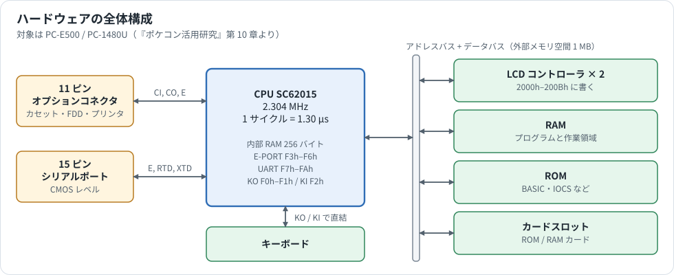

# ハードウェアの全体像とキーボード

PC-E500 シリーズのハードウェアの案内です。部分ごとの説明は次の資料にあります。

| 部分 | 資料 |
|---|---|
| CPU | [SC62015.md](SC62015.md) |
| メモリ | [MEMORY.md](MEMORY.md) |
| 15 ピン（シリアルポート） | [PORT_15PIN.md](PORT_15PIN.md) |
| 11 ピン（オプションコネクタ、テープ） | [PORT_11PIN.md](PORT_11PIN.md) |
| カードスロット | [CARD_SLOT.md](CARD_SLOT.md) |
| LCD | [LCD.md](LCD.md) |
| IC チップ（CPU、ROM、RAM、LCD コントローラ） | [IC_CHIPS.md](IC_CHIPS.md) |
| 部品、CPU のピン、消費電流 | [CIRCUIT_AND_SERVICE.md](CIRCUIT_AND_SERVICE.md) |

キーボードだけはここで説明します。出典は書籍『ポケコン活用研究』第 10 章（pp.200–209）で、対象は PC-E500 と PC-1480U です。IOCS の使い方は [IOCS_REFERENCE.md](IOCS_REFERENCE.md) を参照してください。

## 1. 全体構成

- CPU は **SC62015** です。キーボードは CPU の KO/KI ポートに直結しています。
- 11 ピンと 15 ピンのコネクタは、CPU の E ポートと UART（CI、CO、E、RTD、XTD 端子）につながっています。
- LCD コントローラ、RAM、ROM、カードスロットは外部メモリ空間（アドレスバス、データバス）にあります。

## 2. キーボード

キーボードは CPU の KO/KI ポートに直結しており、内部 RAM の F0h–F2h に対応する。

- **F0h（KO0–KO7）、F1h ビット 0–2（KO8–KO10）** に適当な値を書き（該当ビットを 1 = H レベルにする）、
- **F2h（KI0–KI7）** を読むと、押されているキーに対応するビットが 1 になる。

BASIC の PEEK/POKE でも確認できる。通常のキー入力には IOCS コールを使うこと。

### キーマトリクス

行 = KI（F2h のビット）、列 = KO（F1h ビット 2–0、F0h ビット 7–0）。

| KI＼KO | F1.2 | F1.1 | F1.0 | F0.7 | F0.6 | F0.5 | F0.4 | F0.3 | F0.2 | F0.1 | F0.0 |
|---|---|---|---|---|---|---|---|---|---|---|---|
| **0** | P | ) | ↕(左右) | CA/C.CE | STO | RCL | I | Y | R | W | ▲▼ |
| **1** | 2ndF | FSE | tan | cos | sin | hyp | O | U | T | E | Q |
| **2** | PF5 | 1/x | log | ln | →DEG | →HEX | K | H | F | S | MENU |
| **3** | PF4 | ( | x² | √ | yˣ | EXP | L | J | G | D | A |
| **4** | PF3 | DEL | ÷ | 9 | 8 | 7 | , | N | V | X | BASIC |
| **5** | PF2 | BS | × | 6 | 5 | 4 | ; | M | B | C | Z |
| **6** | PF1 | INS | − | 3 | 2 | 1 | ▶ | ↑ | SPACE | CAPS | SHIFT |
| **7** | | = | + | | +/− | 0 | ⏎(RETURN) | ◀ | ↓ | カナ | CTRL |

（KI0 行の F1.0 は「↕」、F0.0 は「▲▼」と印字されたキー。KI7 行の F1.2 と F0.7 は空き。）

OFF キーはこの表の外で、KO11 と KI0 の間にあります。カードスロットのカバーのスイッチは、OFF キーと並列につながっています（[CARD_SLOT.md](CARD_SLOT.md) §5）。

### 同時押し（ゴースト）の注意

この方法では複数キーを同時に読めるが、**押されていないキーが押されていると判定される**ことがある。

例：KO1 を H、KO0 を L にして W / ▲▼ / Q の 3 キーを同時に押すと、KO1 → W → KI0 → ▲▼ → KO0 → Q → KI1 と電流が回り込み、KO1 列を読んでいるのに E キーに対応する KI1 も H になってしまう。
