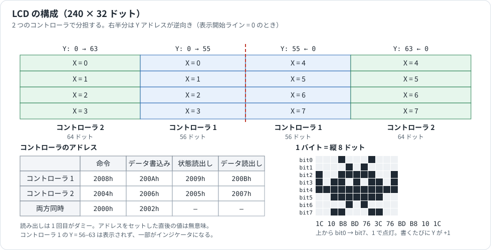

# LCD（液晶表示部）

PC-E500 シリーズの液晶と、それを動かす 2 つの LCD コントローラの資料です。部品と配線、番地、命令、表示 RAM の並び、インジケータ、作業域、操作例をまとめました。

ふつうの表示には IOCS を使います（[IOCS_REFERENCE.md](IOCS_REFERENCE.md)）。ゲームなどで速く描きたいときは、ここにある方法でコントローラを直接操作します。文字のドットは [CHARACTER_FONT.md](CHARACTER_FONT.md) にあります。

## 情報源と確度

| 表記 | 情報源 |
|---|---|
| **書籍** | 『ポケコン活用研究』第 10 章（pp.200–209）。PC-E500 と PC-1480U を対象にしています |
| **公式** | PC-E500 Technical Reference Manual（p.41〜42）、PC-E500 / PC-E500S Service Manual |
| **回路図** | Service Manual の回路図と LCD の配線図を読んだもの |
| **手引書** | Systemhandbuch（ドイツ語、Fischel GmbH） |
| **実験** | エミュレータで読んだ値 |

特に断りのない番地と命令は書籍の値で、実機で確かめたものではありません。

## 1. 全体像



| 項目 | 内容 | 根拠 |
|---|---|---|
| 表示 | 240×32 ドット。文字は 40 桁 × 4 行 | 公式 |
| カラムドライバ | HD61202 × 2（仕様は [IC_CHIPS.md](IC_CHIPS.md) §5） | 回路図 |
| コモンドライバ | HD61203 | 回路図 |
| 液晶 | LF7448G（PC-E500）、FSTN の LF7766Q（PC-E500S） | ブロック図、回路図 |

## 2. 配線

HD61202 の端子は次のようにつながっています（回路図）。

| HD61202 の端子 | IC5（`Y1`〜`Y64`） | IC6（`Y'1`〜`Y'56`、`Y'64`） |
|---|---|---|
| `CS3`（High で選択） | A13 | A13 |
| `CS2`（Low で選択） | A12 | A12 |
| `CS1`（Low で選択） | A3 | A2 |
| `R/W` | A0 | A0 |
| `D/I` | A1 | A1 |
| `E` | CE5 | CE5 |
| `DB0`〜`DB7` | データバス | データバス |

この配線から、番地の意味が読めます。

| 番地のビット | 意味 |
|---|---|
| A0 | 1 で読み出し |
| A1 | 1 で表示データ、0 で命令 |
| A2 | 0 で IC6 を選ぶ |
| A3 | 0 で IC5 を選ぶ |
| A12、A13 | `A13=1`、`A12=0` のとき有効 |

- 本資料の「コントローラ 1」（`2008h`）は IC6、「コントローラ 2」（`2004h`）は IC5 です。サービスマニュアルの ① が IC5、② が IC6 なので、番号が逆です。
- **CE5 の範囲は `00000h`〜`03FFFh` と `08000h`〜`0BFFFh` です**（公式）。`2000h` の代わりに `A000h` でも同じコントローラが見えるはずです。ROM は起動時に `0A000h` へ `3Eh` を書いて表示を止めます（[SYSTEM_INTERNALS.md](SYSTEM_INTERNALS.md) §2）。
- CPU の資料には、LCD の窓のアクセスが遅くなるとあります（[SC62015.md](SC62015.md) §5.3）。

**表示の電源（回路図）**

| 部分 | 内容 |
|---|---|
| Q3（DTA114YK） | CPU の VDD（5 番ピン）で VCC から VCC' を作る |
| Q1、T1 | VCC' からトランスで VEE を作る |
| VR1 | コントラストの調整 |
| V1〜V6 | 抵抗の分圧で作る液晶の電圧 |

## 3. 番地

表示は LCD コントローラにデータを送ることで行います。画面を 2 つのコントローラで分担していて、命令は外部メモリの次の番地へ書きます（または読みます）。

| # | 命令 | コントローラ 1 | コントローラ 2 | 同時アクセス |
|---|---|---|---|---|
| 1 | 表示 ON/OFF | 2008h | 2004h | 2000h |
| 2 | 表示開始ライン | 2008h | 2004h | 2000h |
| 3 | ページ（X アドレス）セット | 2008h | 2004h | 2000h |
| 4 | Y アドレスセット | 2008h | 2004h | 2000h |
| 5 | ステータスリード | 2009h | 2005h | — |
| 6 | 表示データ書き込み | 200Ah | 2006h | 2002h |
| 7 | 表示データ読み出し | 200Bh | 2007h | — |

## 4. 命令

| # | 命令 | DB7 | DB6 | DB5 | DB4 | DB3 | DB2 | DB1 | DB0 | 16進 | 機能 |
|---|---|---|---|---|---|---|---|---|---|---|---|
| 1 | 表示 ON/OFF | 0 | 0 | 1 | 1 | 1 | 1 | 1 | 1/0 | 3Fh / 3Eh | 全表示の ON(1)/OFF(0)。表示 RAM の内容と内部状態は変化しない |
| 2 | 表示開始ライン | 1 | 1 | ←開始ライン (0–63)→ | | | | | | C0h + L | 表示の最上段に表示される RAM のラインを決める |
| 3 | ページセット | 1 | 0 | 1 | 1 | 1 | ←ページ (0–7)→ | | | B8h + X | RAM のページ（X アドレス）をページレジスタにセット |
| 4 | Y アドレスセット | 0 | 1 | ←Y アドレス (0–63)→ | | | | | | 40h + Y | RAM の Y アドレスを Y アドレスカウンタにセット |
| 5 | ステータスリード | BUSY | 0 | ON/OFF | RESET | 0 | 0 | 0 | 0 | — | BUSY 1: 内部動作中 / 0: READY。ON/OFF 1: 表示 OFF / 0: 表示 ON。RESET 1: リセット / 0: ノーマル（PC-E500 では常に 0） |
| 6 | 表示データ書き込み | ←Write Data→ | | | | | | | | — | DB0(LSB)–DB7(MSB) を、指定アドレスの表示 RAM に書く。アクセス後 Y アドレスは +1 |
| 7 | 表示データ読み出し | ←Read Data→ | | | | | | | | — | 表示 RAM のデータを読み出す。アクセス後 Y アドレスは +1 |

- BUSY が 1 のときに送った命令は無視される。厳密には BUSY=0 を確認してから送るべきだが、実用上あまり厳密でなくてもよい。
- **表示データ読み出しは、X/Y アドレスをセットした直後の 1 回目は無意味なデータが返る**ので、ダミーリード（空読み）が 1 回必要（このとき Y アドレスはインクリメントされない）。

## 5. 表示 RAM

- データ 1 バイトは縦 8 ドット分。**上から下へ ビット 0 → ビット 7** の順。1 = 点灯、0 = 消灯。
- 1 コントローラにつきページ（X アドレス）は 0–7 の 8 ページ、Y アドレスは 0–63。
- 画面（240×32 ドット）の割り当ては §1 の図のとおりです（表示開始ライン = 0 のとき）。
- コントローラ 2 は画面の**両端 64 ドットずつ**、コントローラ 1 は**中央の 56 ドットずつ**を担当。
- 画面左半分は X = 0–3、右半分は X = 4–7。右半分では Y アドレスが**逆方向**（右端が Y=0）に並ぶ。
- コントローラ 1 の Y = 56–63 は画面には表示されない。ただし一部が画面上部の**インジケータ**に割り当てられている（下記）。

## 6. 表示開始ライン

コントローラは縦方向に 1 ドット単位で画面をずらせる。「表示開始ライン」は画面の一番上に表示される RAM のラインを指定する（0–63 でラップ）。BASIC 等が動作した後は開始ラインが 0 とは限らないので、位置を固定して描画したいときは先に `C0h` を書いて開始ライン = 0 にしておく。開始ラインが変わるとインジケータの割り当てアドレスも変わる。

## 7. インジケータ

開始ライン = 0 のとき、Y アドレスはすべて 63 です。

| ビット＼ページ X | 0 | 4 | 5 | 6 |
|---|---|---|---|---|
| 0 | BUSY | 小文字 | PRINT | BATT |
| 1 | RUN | カナ | E | |
| 2 | PRO | HYP | RAD | |
| 3 | DBL | CAPS | G | |
| 4 | | 2ndF | DE | |

インジケータは通常のドットと同じに扱われる（ページ X、Y=63 の該当ビットを 1 にすると点灯）。

`LOGIC`、`ASMBL`、`TEXT`、`Sign` の記号は液晶の配線図にありますが、PC-E500 では使っていません（公式）。

## 8. 操作例

### 8.1 BASIC

```basic
' 表示 OFF / ON
POKE &2000,&3E      ' OFF（キー入力は可能）
POKE &2000,&3F      ' ON

' コントローラ1のページ0, Y=0 から黒い棒を書く
10 POKE &2008,&B8   ' ページ(Xアドレス)=0
20 POKE &2008,&40   ' Yアドレス=0
30 FOR I=0 TO 63
40 POKE &200A,&FF   ' 書き込むデータ（Yは自動で+1）
50 NEXT

' 読み出し（ダミーリードが必要）
10 POKE &2008,&B8
20 POKE &2008,&40
30 PRINT HEX PEEK &200B   ' ダミーリード
40 PRINT HEX PEEK &200B   ' 読みたい値

' 画面全体の塗りつぶし
10 POKE &2000,&B8
20 POKE &2000,&40
30 FOR J=0 TO 7
40 POKE &2000,&B8+J
50 FOR I=0 TO 63
60 POKE &2002,&FF   ' 両コントローラに同時書き込み
70 NEXT
80 NEXT
```

ビットパターン例（インベーダー 11×8 ドット）を表示するには、`1Ch, 10h, B8h, BDh, 76h, 3Ch, 76h, BDh, B8h, 10h, 1Ch` を順に 200Ah（または 2006h / 2002h）へ書く。

### 8.2 機械語

画面の塗りつぶし：

```asm
        MV   A,40H          ; Yアドレス=0
        MV   [2000H],A
        MV   A,8            ; 8ページ
L1:     MV   B,A
        OR   A,0B8H         ; ページセット命令 B8h + X（下記注）
        MV   [2000H],A
        MV   IL,64
        MV   A,0FFH
L2:     MV   [2002H],A      ; 両コントローラへ同時書き込み
        DEC  IL
        JRNZ L2
        EX   A,B
        DEC  A
        JRNZ L1
        RETF
```

注：原著の掲載どおり。A=8 のとき `OR A,0B8H` は B8h（ビット 3 が重なる）となり、以降 7,6,…,1 を OR してページ 7→1 と進む。

スクロール（表示開始ラインを 1 ずつ進める。BREAK キーで終了）：

```asm
        PUSHU IMR
        PRE  30H
        AND  (0FBH),0FDH    ; IMR ビット1 をクリア（割込みマスク）
        MV   A,00H
        MV   X,0C0H         ; ループ回数
L1:     OR   A,0C0H         ; 表示開始ライン命令 C0h + line
        MV   [2000H],A
        INC  A
        PRE  30H
        TEST (0FFH),08H     ; BREAK キー（FFh ビット3）
        JRNZ END
        MV   IL,00H
        WAIT
        DEC  X
        JRNZ L1
END:    POPU IMR
        RETF
```

表示 ON/OFF の点滅（BASIC）：

```basic
10 FOR I=0 TO 9
20 POKE &2000,&3E
30 FOR J=0 TO 100:NEXT
40 POKE &2000,&3F
50 FOR J=0 TO 100:NEXT
60 NEXT
```

## 9. 作業域

ROM が画面に使う番地です。値は ROM 3.2、32 KB の起動直後です（実験）。出典の p は Technical Reference Manual です。

| 番地 | 内容 | 値 |
|---|---|---|
| `BFC9Bh`、`BFC9Ch` | カーソルの x、y | 0、0 |
| `BFC9Dh`、`BFC9Eh` | 画面の幅、高さ（文字） | 28h、04h |
| `BFC27h`、`BFC28h` | 画面のカーソルの x、y | 0、0 |
| `BFCA1h` | LCD のモード。bit6 が反転。手引書は 00h で白地に黒、FFh で黒地に白 | 00h |
| `BFC96h` | 点の操作。0 点灯、1 消去、2 反転 | 01h |
| `BFC2Ah` | 線の 16 ドットのパターン（2 バイト） | 9Fh 9Fh |
| `BFC29h` | bit6 で制御コードを表示 | |
| `BFC97h` | `BATT` の表示（00h、01h。手引書） | |
| `BFC99h` | bit3 が `CAPS`（手引書） | |
| `BFC9Ah` | bit0 が `PRINT`（手引書） | |

カーソルの形と LCD の表示開始オフセットは IOCS の作業域にあります（[MEMORY.md](MEMORY.md) §5）。
