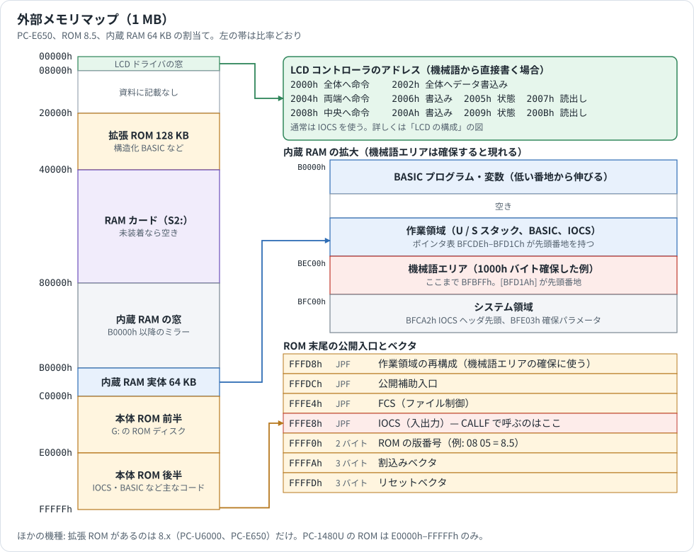
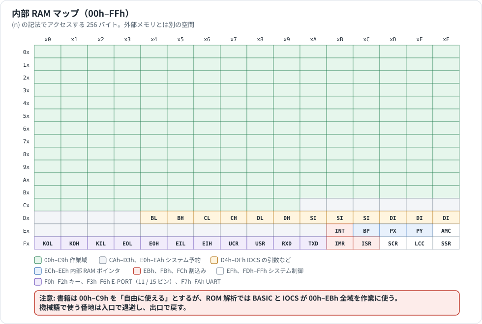
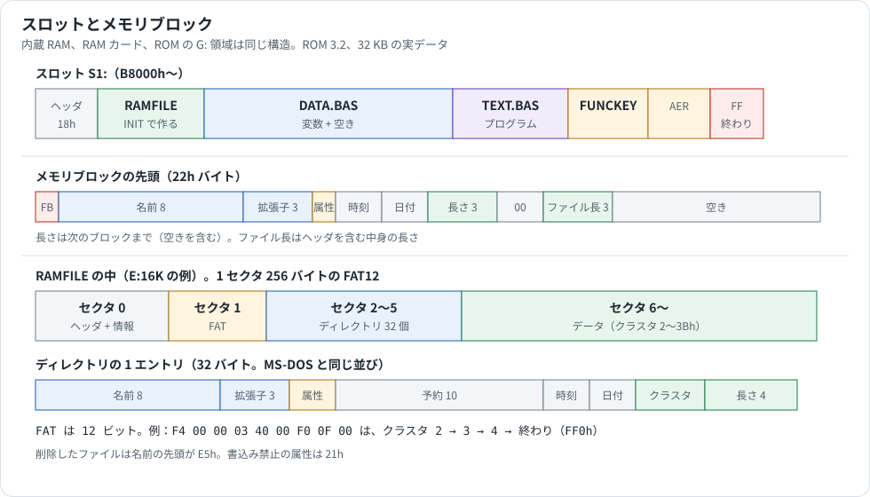

# メモリ

PC-E500 シリーズのメモリの資料です。番地の割当て、内部 RAM の使い方、スロット、メモリブロック、作業域、RAM ディスク（`E:`、`F:`）の中身を説明します。CPU から見たメモリ空間は [SC62015.md](SC62015.md) §5、§6、カードは [CARD_SLOT.md](CARD_SLOT.md)、変数の形式は [BASIC_INTERNALS.md](BASIC_INTERNALS.md) を参照してください。

## 情報源と確度

| 表記 | 情報源 |
|---|---|
| **公式** | PC-E500 Technical Reference Manual（p.4、p.67〜77、p.85〜90）、Operation Manual、Service Manual |
| **実験** | エミュレータで、ファイルや変数を作ったあとのメモリを読んだ。主に ROM 3.2、32 KB。一部は ROM 8.5 |
| **コード** | ROM の逆アセンブル |
| **手引書** | Systemhandbuch（ドイツ語、Fischel GmbH）。シャープの資料ではなく、欧州版の ROM を調べた解析書 |
| **推定** | 上から推し量ったもの |

実機のメモリは読んでいません。

## 1. 全体像

### 1.1 外部メモリ



RAM は読み書きでき、ユーザーのプログラムや作業域が置かれます。ROM は電源が切れても消えず、BASIC などのシステムが入っています。チップセレクトと番地の関係は [CIRCUIT_AND_SERVICE.md](CIRCUIT_AND_SERVICE.md) §3.2、版ごとの違いは [ROM_VERSIONS_MAP.md](ROM_VERSIONS_MAP.md) にあります。

### 1.2 内部 RAM



CPU 内に 256 バイトの内部 RAM がある。CPU にとっての区分は [SC62015.md](SC62015.md) §6 のとおりで、ここでは ROM の使い方を示す。**CAh–FFh は I/O ポート等のシステム領域**で、不用意に書くと暴走する。それ以外は自由に使える。

| 番地 | 名称 | 内容 |
|---|---|---|
| 00h–C9h | WORK | レジスタの代わり、ワークエリア等に自由に使える |
| CAh–D3h, E0h–EAh | SYSTEM RESERVED | 将来の拡張用にシステムが使うワークエリア |
| D4h–DFh | BX, CX, DX, SI, DI | IOCS 等でレジスタが多数必要なときのレジスタ代用。IOCS 呼出し時にここへパラメータを設定する場合がある（D4h=BL, D5h=BH, D6h=CL, D7h=CH, D8h=DL, D9h=DH, DAh–DCh=SI, DDh–DFh=DI） |
| ECh | BP | ベースポインタ。内部 RAM のアドレス指定（`(BP+n)` アドレッシング）に使う |
| EDh, EEh | PX, PY | PX/PY ポインタ。BP と同じく内部 RAM のアドレス指定に使う |
| EBh, FBh, FCh | INTERRUPT | 割込みの制御、状態チェック（FBh = IMR） |
| F0h, F1h, F2h | KEY | キー関係ポート。F0h/F1h = KEY OUTPUT BUFFER（KO）、F2h = KEY INPUT BUFFER（KI） |
| F3h–F6h | E-PORT | CPU の E-PORT（I/O ポート）制御。11ピン・オプションコネクタや 15ピン・シリアルポートに接続 |
| F7h–FAh | UART | シリアルポートの制御 |
| EFh, FDh–FFh | SYSTEM | システムコントロールポート。**FFh のビット 3 が BREAK キー検出**（押されていると 1）。他はとりあえず使うことはない |

### 1.3 スロット



内蔵 RAM、RAM カード、ROM の G: 領域は、どれも**スロット**という同じ構造です。スロットの中に、名前の付いた**メモリブロック**が並びます。プログラムも変数も、RAM ディスクも、すべてメモリブロックです（公式 p.90）。

## 2. スロット

| スロット | 名前 | 場所 | 容量の例 |
|---|---|---|---|
| 0 | `S1:` | 内蔵 RAM | 32 KB（`B8000h` から）、64 KB（`B0000h` から） |
| 1 | `S2:` | RAM カード | `40000h` から |
| 2 | `S3:` | 内蔵 ROM | `C0000h` から 128 KB。ROM 2.1 だけ `10000h` を調べます（[CARD_SLOT.md](CARD_SLOT.md) §10.1） |

場所と容量は作業域にあります（公式 p.74）。容量の単位は 2 KB で、下の値は実験で読みました。

| 番地 | 長さ | 内容 | ROM 3.2、32 KB | ROM 8.5、64 KB |
|---|---|---|---|---|
| `BFC09h` | 3 | S3 の先頭 | `C0000h` | `C0000h` |
| `BFC0Ch` | 2 | S3 の容量 | 40h（128 KB） | 40h |
| `BFC0Fh` | 3 | S2 の先頭 | `40000h` | `40000h` |
| `BFC12h` | 2 | S2 の容量 | 0（カードなし） | 0 |
| `BFC15h` | 3 | S1 の先頭 | `B8000h` | `B0000h` |
| `BFC18h` | 2 | S1 の容量 | 10h（32 KB） | 20h（64 KB） |
| `BFCDEh` | 3 | S1 の最後の番地 + 1 | `BF21Bh` | `BF21Bh` |

### スロットのヘッダ

スロットの先頭 18h（24）バイトがヘッダです（公式 p.74、実験）。

| オフセット | 値 | 内容 |
|---|---|---|
| `+00`、`+01` | `10 12` | 印。起動時に ROM がこの 2 バイトを確かめる（3.2 は `C0000h` を `F11D3h`、カードを `F11FCh` で） |
| `+02`、`+03` | | 容量（2 KB 単位） |
| `+05` | | 01h は単独、02h は `MEM$="B"` のペア（[CARD_SLOT.md](CARD_SLOT.md) §6.3）。公式の図は 02h |
| `+11` | 2xh | ビット 0 が書込み禁止 |
| `+12`〜`+14` | `18 00 00` | 最初のブロックの位置（スロット先頭から） |

ブロックの終わりには `FFh` を置きます。残りは空き領域です。

### MEM$ による切り替え

`MEM$` はプログラムと変数を置く場所を選びます（公式）。カードを認識する手順と `B` の仕組み（AMC）は [CARD_SLOT.md](CARD_SLOT.md) §6、§7 にあります。

| 値 | プログラムと変数 | `F:` | 備考 |
|---|---|---|---|
| `S1` | 内蔵 RAM | 使える | 既定 |
| `S2` | RAM カード | 使える | `FUNCKEY` と `AER` は内蔵 RAM に残る |
| `B` | 内蔵 RAM + カード | 使えない | カードが空でないと `Illegal function call` |

実験では、`MEM$="S2"` で `TEXT` と `DATA` がカードの `RAMFILE` の後ろへ移り、内部 RAM の `CBh`、`CEh` のポインタもカードの番地（`42018h`、`4204Eh`）に変わりました。

容量ごとの使える量と、`B` のときの S1 の先頭は [CARD_SLOT.md](CARD_SLOT.md) §7 にあります。

## 3. メモリブロック

各ブロックの先頭 34 バイト（22h）がヘッダです（公式 p.74、実験）。

| オフセット | 長さ | 内容 |
|---|---|---|
| `+00` | 1 | `FBh` |
| `+01` | 8 | 名前（余りは 20h） |
| `+09` | 3 | 拡張子 |
| `+0C` | 1 | 属性（通常 20h。`TEXT` にパスワードがあると 22h） |
| `+0D` | 2 | 時刻（試した範囲では 0） |
| `+0F` | 2 | 日付（試した範囲では 0） |
| `+11` | 3 | このブロックの先頭から次のブロックまでの長さ |
| `+14` | 2 | 00h |
| `+16` | 3 | ファイルの長さ（ヘッダを含む） |
| `+19` | 3 | 空き領域のポインタ 0（公式）。実験では `+11` と同じ値 |
| `+1C` | 3 | 空き領域のポインタ 1（公式） |
| `+1F` | 3 | 同上 |

`+11` の長さには空き領域も入ります。`DATA` は `+11` が 713Ch、`+16` が 184h で、差の分が変数とプログラムの空き領域です（実験）。プログラムを入れると、`TEXT` が前へ広がり、`DATA` の `+11` が小さくなります。

### 起動直後のブロック

ROM 3.2、32 KB の RUN モードです（実験）。

| 位置 | 名前 | ブロックの長さ | 内容 |
|---|---|---|---|
| `0018h` | `DATA.BAS` | 713Ch | 変数（[BASIC_INTERNALS.md](BASIC_INTERNALS.md)） |
| `7154h` | `TEXT.BAS` | 36h | プログラム |
| `718Ah` | `FUNCKEY.` | 69h | PF キーの割り当て |
| `71F3h` | `AER.` | 27h | AER の式 |
| `721Ah` | | | 終わりの `FFh` |

公式の図（p.90）は RUN モードと PRO モードで `DATA` の場所が変わるとしていますが、プログラムがない状態の実験では、モードを切り替えても並びは同じでした。

全体の並びは、前から `RAMFILE`（`E:`）、`DATA`、`TEXT`、`FUNCKEY`、`AER`、`ENG.$$$`（ENG のソフトの実行中だけ）、システム領域、機械語エリア、`BFC00h` からのシステム番地です。前の 2 つが増えると `B8018h` を基準に、後ろのブロックが増えると `BF21Bh` を基準に、`TEXT` の使える領域が狭くなります（手引書）。

`FILES "S1:"` で、これらのブロックが見えます（公式）。

### ファイルの先頭の形式

ヘッダのあと（`+22`）の先頭 4 バイトで、中身を区別します（実験）。

| 先頭 | ブロック |
|---|---|
| `FF 00 00 00` | `TEXT`（`CSAVE` の本体、`SAVE` のバイナリも同じ） |
| `FF 00 01 00` | `DATA` |
| `FF 00 02 00` | `FUNCKEY` |
| `FF 00 04 01` | `AER` |
| `FF 00 06 01` | `SAVE M` のファイル（[CE-140F_PROTOCOL.md](CE-140F_PROTOCOL.md)） |
| `FF 00 07 01` | `RAMFILE` |

`TEXT` の `+04` と `+07` はブロック先頭からの位置です。`+04` がプログラムの先頭（`0Dh`）、`+07` が終わり（`FFh`）を指します。

## 4. 作業域のポインタ

21 個のポインタが `BFCDEh` から 3 バイトずつ並びます（公式 p.77）。IOCS の `(cx)=0008h`、`i=42h` で大きさを変えられます。

| 番地 | 内容 | ROM 3.2 の値 |
|---|---|---|
| `BFCDEh` | U スタック | `BF21Bh` |
| `BFCE1h` | S スタック | `BF6A0h` |
| `BFCE4h`〜`BFD0Bh` | 予約 | `BF858h` |
| `BFD0Eh` | BASIC の作業域 | `BF858h` |
| `BFD11h`、`BFD14h` | 予約 | `BF9B4h` |
| `BFD17h` | IOCS の作業域 | `BF9B4h` |
| `BFD1Ah` | 機械語エリア | `BFC00h` |

各領域は、そのポインタの値から次のポインタの値までです。機械語エリアの確保は [ASSEMBLER_MANUAL.md](ASSEMBLER_MANUAL.md) §3.2 にあります。

内部 RAM には次のポインタがあります（実験、公式）。

| 内部 RAM | 内容 | ROM 3.2 の値 |
|---|---|---|
| `CBh` | `TEXT` ブロックの先頭 | `BF154h` |
| `CEh` | `DATA` ブロックの先頭 | `B8018h` |
| `D1h` | BASIC の作業域 | `BF858h` |
| `E6h` | IOCS の作業域 | `BF9B4h` |

## 5. IOCS の作業域

`P` を `E6h`（`BFD17h` と同じ値）の指す番地とします（公式 p.86、実験）。

| 番地 | 内容 | ROM 3.2 の値 |
|---|---|---|
| `P+08h` | LCD の表示開始オフセット（約 5 分ごとに設定） | |
| `P+09h` | カーソルの形。bit0〜2: 0 下線、1 二重下線、2 塗り、3 空白、4 挿入。bit3: 点滅 | |
| `P+0Bh`、`0Ch` | カーソルのバッファ内の位置 | |
| `P+0Eh`、`0Fh` | 電源オン中に増えるカウンタ（遅いタイマごと） | |
| `P+10h`、`11h` | キーボードバッファの位置 | 60h |
| `P+14h` | キーボードバッファの大きさ | 20h（32） |
| `P+16h`、`17h` | シリアルバッファの位置 | 80h |
| `P+1Ch`、`1Dh` | シリアルバッファの大きさ | 14h（20） |
| `P+1Eh`、`1Fh` | シリアルの制御を始める量 | 0Ch（12） |
| `P+25h`、`26h` | FCB の位置 | 94h |
| `P+27h` | 同時に開けるファイル数 | 5 |
| `P+28h`、`29h` | その他のバッファの位置 | 12Fh |
| `P+2Bh`、`2Ch` | その他の作業域の位置 | 234h |

作業域の全体は 24Ch バイトでした（公式は「一般に 246h」）。

**シリアルバッファと FCB は広げられます**（公式 p.85）。`BFD17h` の領域を IOCS `i=42h` で広げ、`P+1Ch` や `P+27h` を書き換えます。公式資料に、同時に開けるファイル数を 10 にする BASIC の例があります。キーボードバッファの項目は、手元のスキャンでは手書きで消されています。

## 6. RAM ディスク

`E:`（S1）、`F:`（S2）、`G:`（S3）は、スロットの中の `RAMFILE` というメモリブロックです（公式 p.67）。**中身は FAT12 形式のディスク**でした（実験）。`G:` のファイルの一覧は [GDRIVE.md](GDRIVE.md) にあります。

`INIT "E:16K"` のあとの実データです。

### 6.1 配置

1 セクタは 256 バイトで、ブロックの先頭を 0 番のセクタとします。

| セクタ | 内容 |
|---|---|
| 0 | メモリブロックのヘッダ（34 バイト）とディスクの情報 |
| 1 | FAT |
| 2〜 | ディレクトリ（1 エントリ 32 バイト） |
| その後 | データ（クラスタ番号は 2 から。1 クラスタ = 1 セクタ） |

### 6.2 ディスクの情報

ヘッダの直後に並びます。

| オフセット | `E:4K` | `E:16K` | 内容 | 確度 |
|---|---|---|---|---|
| `+22` | `FF 00 07 01` | 同じ | ファイルの種類 | 実験 |
| `+26` | 10h | 40h | セクタ数（4 バイト） | 実験 |
| `+2A` | F1h | F4h | メディアの種類。FAT の先頭と同じ | 実験 |
| `+2B` | `00 01` | 同じ | セクタの大きさ（256）。`G:` は `40 00`（64） | 実験 |
| `+2D` | `07 03` | 同じ | 不明。`G:` は `01 01`。手引書も値だけです | 実験 |
| `+34` | 08h | 20h | ディレクトリのエントリ数 | 実験 |
| `+36` | 03h | 06h | データの最初のセクタ | 実験 |
| `+38` | 0Eh | 3Bh | 最後のクラスタ番号（2 バイト） | 実験 |
| `+3A` | 01h | 01h | FAT のセクタ数 | 実験 |
| `+3B` | 02h | 02h | ディレクトリの最初のセクタ | 実験 |

`DSKF` の値は（最後のクラスタ番号 - 1）× 256 です（手引書の表とも合います）。4 KB なら D00h です。

エントリ数はマニュアルのファイル数の上限（3〜4 KB で 8、13〜16 KB で 32）と合います。

`G:` も同じ形で、セクタの大きさだけが 64 バイトです。エントリ数 46h、データは 52h セクタ目、FAT は 2Eh セクタ、ディレクトリは 2Fh セクタ目で、[GDRIVE.md](GDRIVE.md) の番地（`C0058h`、`C0BD8h`、`C1498h`）と一致します。

**容量ごとの値**です。2、4、8、12、16、20、30、42〜46、50、63 KB を実験で確かめました。それ以外は手引書の表です。

| 容量 | メディア | エントリ数 | データの最初のセクタ | FAT のセクタ数 |
|---|---|---|---|---|
| 2 KB | F0h | 5 | 3 | 1 |
| 3〜4 KB | F1h | 8 | 3 | 1 |
| 5〜8 KB | F2h | 16 | 4 | 1 |
| 9〜12 KB | F3h | 24 | 5 | 1 |
| 13〜16 KB | F4h | 32 | 6 | 1 |
| 17〜20 KB | F5h | 40 | 7 | 1 |
| 21〜24 KB | F6h | 48 | 8 | 1 |
| 25〜28 KB | F7h | 56 | 9 | 1 |
| 29〜44 KB | F8h | 64 | 10 | 1 |
| 45 KB〜 | F9h | 64 | 11 | 2 |

手引書は 42 KB までしか確かめていないと書いていて、45 KB 以上の行はありません。1 セクタの FAT は 170 個分なので、そこで FAT が 2 セクタになると見られます（推定）。`F:` はカードの容量より 1 KB 少ない大きさまでです（公式、手引書）。

### 6.3 FAT

12 ビットの FAT です。先頭 3 バイトはメディアの種類です。2 つの値を 3 バイトに詰める形式です。

712 バイトのファイルを保存した実例（`E:16K`）:

```text
F4 00 00  03 40 00  F0 0F 00
          |         |
          |         クラスタ 4 → FF0h（終わり）
          クラスタ 2 → 003h、クラスタ 3 → 004h
```

ファイルの終わりは `FF0h` でした。空きは 0 です。

### 6.4 ディレクトリ

MS-DOS と同じ並びです。

| オフセット | 長さ | 内容 |
|---|---|---|
| `+00` | 8 | 名前。削除すると先頭が `E5h` |
| `+08` | 3 | 拡張子 |
| `+0B` | 1 | 属性。通常 20h、`SET "...","P"` で 21h |
| `+16` | 2 | 時刻（試した範囲では 0） |
| `+18` | 2 | 日付（試した範囲では 0） |
| `+1A` | 2 | 最初のクラスタ |
| `+1C` | 4 | ファイルの長さ |

```text
41 20 20 20 20 20 20 20 42 41 53 21 00 ... 02 00 24 00 00 00   A.BAS  属性 21h  クラスタ 2  36 バイト
E5 20 20 20 20 20 20 20 42 41 53 20 00 ... 04 00 24 00 00 00   削除したファイル
```

ファイルの中身は `SAVE` のバイナリそのものです。テキストで保存すると、`1Ah` で終わり、残りは未使用のままです。

**`KILL` のあとのデータは残ります。** FAT の鎖は 0 になり、名前の先頭は `E5h` になりますが、ディレクトリの他の項目とデータはそのままです。最初のクラスタと長さが残るので、FAT を作り直せば復元できます。名前の先頭を戻すだけでは足りません（手引書。消し方は実験と一致します）。

空いたクラスタは次の保存で使われるので、ファイルは連続しないことがあります（手引書）。

## 7. ファイルハンドルと FCB

ファイルハンドル表は `BFC6Dh` から 16 バイトです（公式 p.4）。値は FCB の番号で、未使用は `FFh` です。起動直後は `00 01 02 FF ...` でした（実験）。

| ハンドル | 内容 |
|---|---|
| 0 | LCD（`stdo:`） |
| 1 | キー（`stdi:`） |
| 2 | プリンタ（`stdl:`） |

FCB は 1 個 31 バイト（1Fh）で、`P+25h` の位置に並びます（公式）。起動直後の FCB 0 は次のとおりです（実験）。

```text
00 00 49 29 0F A2 02 ...
```

`+02` からの 3 バイトが装置の入口（`F2949h`）、`+05` が属性（A2h。IOCS ヘッダの値と同じ）と見られます（推定）。IOCS ヘッダの表は [IOCS_REFERENCE.md](IOCS_REFERENCE.md) にあります。

## 8. システム番地

`BFC00h`〜`BFFFFh` は作業用の固定の番地です。値は ROM 3.2、32 KB の起動直後です（実験）。出典の p は Technical Reference Manual です。

**画面**は [LCD.md](LCD.md) §9 にあります。

**文字のフォント（公式 p.42）**。1 文字 6 バイトです（[CHARACTER_FONT.md](CHARACTER_FONT.md)）。

| 番地 | 文字コード | 3.2 の値 |
|---|---|---|
| `BFC87h` | 00h〜1Fh | `F21A5h` |
| `BFC90h` | 20h〜7Fh | `F2265h` |
| `BFC8Ah` | 80h〜9Fh | `F24A5h` |
| `BFC93h` | A0h〜CFh | `F2565h` |
| `BFC8Dh` | E0h〜F0h | `F26E5h` |

欧州版は 80h 以上の文字に 2 組の文字セットを持ち、これらの番地で切り替えます。ENG のメニューを進めると 2 組目に変わります（手引書。`BFC8Ah`、`BFC8Dh`、`BFC93h` の順に、第 1 組は `F2455h`、`F2695h`、`F2515h`、第 2 組は `DFD00h`、`DFF40h`、`DFDC0h`）。日本語版の ROM では試していません。

**キー（公式 p.48〜49）**。流れは [SYSTEM_INTERNALS.md](SYSTEM_INTERNALS.md) §9 にあります。

| 番地 | 内容 | 値 |
|---|---|---|
| `BFCBAh` | リピートの待ち（16 ms 単位） | 2Bh |
| `BFCBBh` | リピートの間隔（16 ms 単位） | 04h |
| `BFCBCh` | 自動電源オフの初期値（2 バイト、単位は約 0.5 秒） | 04B0h |
| `BFCBEh` | SOFTINT。bit7 が BREAK、bit6 が電池低下 | 00h |
| `BFCBFh` | bit7 がリピート、bit4 がクリック音。起動直後は bit7 が 0 ですが、リピートの動作とは比べていません | 50h |
| `BFCC0h` | ハードコードからマトリクスコードへの表（3 バイト） | `F36BEh` |
| `BFCC3h` | キーの処理のフック（3 バイト） | `F16F2h` |
| `BFC41h` | キーの処理のフック（3 バイト） | `F1B48h` |
| `BFC45h` | `FUNCKEY` のスロット番号。公式は「0 で `S1:`」と書きますが、`S1:` にある起動直後の実験値は 01h でした | 01h |
| `BFC46h`〜`BFC51h` | `FUNCKEY` のファイル名。公式の説明は 9 バイトで、番地の幅（12 バイト）と合いません | `FUNCKEY` |
| `BFC3Fh` | bit2 でファンクションキーの表示を禁止 | |

**BASIC（手引書）**

| 番地 | 内容 | 確かめた結果 |
|---|---|---|
| `BFC5Ch` | 角度の単位。bit0 が DEG、bit1 が GRAD、どちらも 0 で RAD | `DEGREE` 99h、`RADIAN` 98h、`GRAD` 9Ah |
| `BFD25h` | `CONSOLE` の値 | 起動直後 27h、`CONSOLE 20` で 14h |
| `BF8E2h` | `WAIT` の値（2 バイト） | `WAIT 100` で `64 00` |
| `BF87Fh` | `AUTO` の増分（2 バイト）と開始行（2 バイト） | 起動直後 `0A 00 0A 00` |
| `BFC1Bh` | システム領域の先頭（3 バイト） | `BF21Bh` |
| `BFD1Ah` | 機械語エリアの下限（3 バイト。§4） | `BFC00h` |
| `BFD1Dh` | CE-126P の有無で変わる値（2 バイト）。手引書は、なしで `00 0C`、ありで `02 14`。意味の説明はありません | `02 14`。接続の有無では試していません |
| `BFD33h`、`34h`、`3Bh`、`3Ch` | `OPEN` の値の控え。既定は 3Ch、21h、01h、1Ah。書き換えるだけでは効きません | 未確認 |

`BF87Fh`、`BF8E2h` は BASIC の作業域の中です。作業域を動かすと番地も変わります（§4）。

## 9. 内蔵 RAM の増設

本体の SRAM を載せ替える改造が知られています。**メーカーの保証する方法ではなく、改造すると内蔵のファイルは初期化されます。**

| 方法 | 内容 | 出典 |
|---|---|---|
| 32 KB → 128 KB、64 KB → 256 KB | 62256 を 628128（SOP）に載せ替える | 個人 |
| 256 KB 化、128 KB 化 | 改造代行とパーツ販売がある | 販売店 |
| 実例 | PC-E500 128 KB、PC-E500S 256 KB。カードスロットはそのまま使える | 個人 |
| 空き番地の利用 | `20000h`〜`3FFFFh` と `10000h`〜`1FFFFh` に SRAM を追加し、合計 704 KB とした記録。カードのコネクタは外している | 個人 |
| 自作の 256 KB カード | 回路図と KiCad のデータが公開されている（[CARD_SLOT.md](CARD_SLOT.md) §11.3） | 個人 |

内蔵 RAM を 256 KB にしても、RAM カードは使えます（販売店）。動作クロックを上げた状態でのカードの使用は勧められていません（販売店）。

改造の詳しい報告は [CIRCUIT_AND_SERVICE.md](CIRCUIT_AND_SERVICE.md) §6 にあります。出典は [PERIPHERALS.md](PERIPHERALS.md) §10 にあります。
