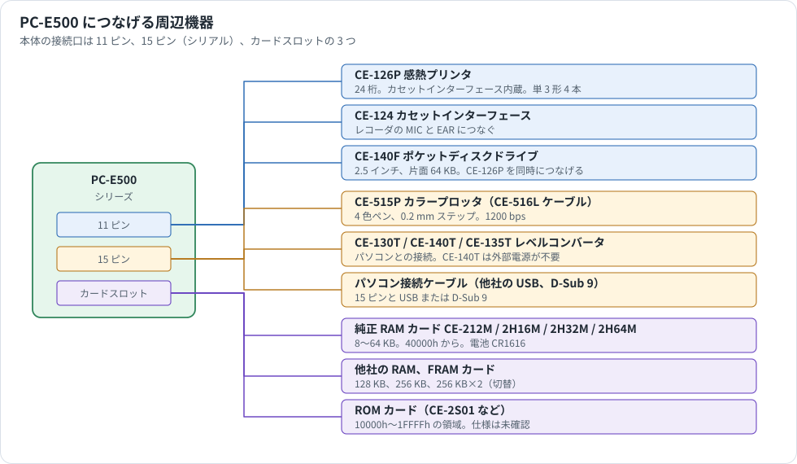

# PC-E500 シリーズの周辺機器

PC-E500 シリーズにつなげる周辺機器と RAM カードの仕様を集めた資料です。通信手順やデータの形は、それぞれの解析資料を参照してください。

| 機器 | 解析資料 |
|---|---|
| CE-140F | [CE-140F_PROTOCOL.md](CE-140F_PROTOCOL.md) |
| CE-515P | [CE-515P_PLOTTER.md](CE-515P_PLOTTER.md) |
| カセット（CE-124、CE-126P） | [TAPE_FORMAT.md](TAPE_FORMAT.md) |
| シリアルポート | [SERIAL_PORT.md](SERIAL_PORT.md) |

## 情報源と確度

周辺機器の実物は調べていません。**本資料の値は資料の転記で、実機で測ったものではありません。** 2026-11-06 に集めました。

| 表記 | 情報源 | 確度 |
|---|---|---|
| **公式** | シャープの操作マニュアル、テクニカルリファレンス、サービスマニュアル | 高い |
| **公式 OCR** | シャープのマニュアルのうち、ManualsLib の OCR 文字で読んだもの | 数字の読み違いがありえる |
| **個人** | 愛好家のサイト、博物館のページ | 実物に基づくものが多いが、裏付けは取っていない |
| **百科事典** | Wikipedia | 出典の確認が必要 |
| **販売店** | 高松製作所の商品ページ | 現行品の仕様 |

出典の一覧は §10 にあります。資料どうしの食い違いは §9 にまとめました。

## 1. 全体像

本体の接続口は 3 つです。

| 接続口 | 形 | つながる機器 |
|---|---|---|
| 11 ピン（本体の左側） | 2.54 mm ピッチ | CE-126P、CE-124、CE-140F |
| 15 ピン（シリアル） | ハーフピッチ | CE-515P、レベルコンバータ、パソコン |
| RAM カードスロット（裏面） | | RAM カード、ROM カード |

本体のシステム構成図に載っている純正の機器は次のとおりです（公式）。

| 種類 | 型番 |
|---|---|
| プリンタとカセット | CE-126P |
| カセット | CE-124 |
| ディスク | CE-140F |
| プロッタ | CE-515P（PC-E500 の図のみ。PC-E500S の図にはない） |
| RAM カード | CE-212M、CE-2H16M、CE-2H32M、CE-2H64M |
| レベルコンバータ | CE-135T（PC-E500S の図のみ。「MAC」と注記） |

### 対応する本体

周辺機器の接続口は、シリーズで共通と紹介されています（販売店、個人）。

| 機種 | 内蔵 RAM | 発売年 | 備考 |
|---|---|---|---|
| PC-E500 | 32 KB | 1988 / 1989 | |
| PC-E500PJ | 32 KB | 1990 | |
| PC-E500S | 32 KB | 1995 | 英語版 |
| PC-E550 | 64 KB | 1990 | |
| PC-E650 | 64 KB | 1993 | 構造化 BASIC |
| PC-1480U | 32 KB | 1988 | |
| PC-1490U | 32 KB | 1990 | |
| PC-1490UII | 64 KB | 1991 | |
| PC-U6000 | 64 KB | 1993 | |

内蔵 RAM と発売年は百科事典の値です。ROM の違いは [ROM_VERSIONS_MODELS.md](ROM_VERSIONS_MODELS.md) を参照してください。

## 2. 接続口のピン配置

### 2.1 11 ピン

個人サイトの表です。信号名はサービスマニュアルの CPU 端子の説明（DIN、DOUT、IO1、IO2、ACK、BUSY）と合います。

| ピン | 端子 | 信号 | 本体から見た向き |
|---|---|---|---|
| 1 | | MTout2 | 入力 |
| 2 | GND | GND（+6V） | |
| 3 | VGG | VGG（0V） | |
| 4 | FO1 | Busy | 出力 |
| 5 | FO2 | Din | 出力 |
| 6 | Xin | MTin | 入力 |
| 7 | Xout | MTout1 | 出力 |
| 8 | IB8 | Dout | 入力（I/O） |
| 9 | IB7 | ACK | 入力（I/O） |
| 10 | IB6 | SEL2 | 出力（I/O） |
| 11 | IB5 | SEL1 | 出力（I/O） |

ピン番号は本体の上から数えた番号です。資料によっては、シールドを 1 番、SEL1 を 2 番、MTout2 を 12 番と数えます。電源の表記（GND が +6V、VGG が 0V）は、この機種の電源の名前によるものです。**配線するときは、自分の機器で確かめてください。**

本体の電池が切れても、CE-126P をつないでいれば CE-126P から電源が供給され、本体の電池の消費が減ります（公式）。

### 2.2 15 ピン

テクニカルリファレンス p.59 の表です。6、9、12、15 番は公式の表になく、個人サイトの表で補いました。

| ピン | 記号 | 向き | 内容 | 出典 |
|---|---|---|---|---|
| 1 | FG | | フレームグラウンド | 公式 |
| 2 | SD（TXD） | 出力 | 送信データ | 公式 |
| 3 | RD（RXD） | 入力 | 受信データ | 公式 |
| 4 | RS（RTS） | 出力 | 送信要求 | 公式 |
| 5 | CS（CTS） | 入力 | 送信可 | 公式 |
| 6 | | | 未接続 | 個人 |
| 7 | SG | | 信号用接地 | 公式 |
| 8 | CD | 入力 | キャリア検出 | 公式 |
| 9 | | | 未接続 | 個人 |
| 10 | VC | | 電源電圧 | 公式 |
| 11 | RR | 出力 | 受信可 | 公式 |
| 12 | PAC | 入力 | ペリフェラル応答。サービスマニュアルは「未使用」 | 個人 |
| 13 | VC | | 電源電圧 | 公式 |
| 14 | ER（DTR） | 出力 | OPEN 中に High | 公式 |
| 15 | PRQ | 出力 | ペリフェラル要求。サービスマニュアルは「未使用」 | 個人 |

信号は CMOS レベル（4〜6 V）です（公式）。範囲を超える電圧をかけると壊れるので、RS-232C に直結してはいけません（公式）。

## 3. プリンタ

### 3.1 CE-126P 感熱プリンタ / カセットインターフェース

11 ピンのプリンタです。カセットインターフェースも内蔵しています。もとは PC-1250 などの時代の機器で、サービスマニュアルは 1983 年のものです（公式 OCR）。

| 項目 | 値 | 出典 |
|---|---|---|
| 印字方式 | ドットマトリクス感熱（MTP-201） | 公式 OCR |
| 桁数 | 24 桁 | 公式 |
| 文字 | 5×7 ドット、固定の文字のみ | 個人、百科事典 |
| 印字速度 | 約 0.8 行/秒 | 公式 OCR |
| 紙 | EA-1250P。幅 58 mm、外径 18 mm 以下 | 公式 OCR |
| 電源 | 単 3 形 4 本、AC アダプタ EA-23E、充電池 EA-27B | 公式 OCR |
| 消費電力 | 3 W | 公式 OCR |
| 電池での印字量 | マンガン 約 2000 行、SUM3 約 3000 行、EA-27B 約 5000 行 | 公式 OCR |
| 充電時間 | 約 15 時間（EA-27B） | 公式 OCR |
| 大きさ | 140.5（幅）×116（奥行）×23（高さ）mm | 公式 OCR |
| カセット端子 | MIC、EAR、REM | 公式、個人 |
| 接続 | 本体に固定のケーブル | 個人 |

### 3.2 CE-515P カラープロッタプリンタ

4 色のペンで描く X/Y プロッタです。取扱説明書の値です（公式 OCR）。BASIC の命令との関係は [CE-515P_PLOTTER.md](CE-515P_PLOTTER.md) にあります。

| 項目 | 値 |
|---|---|
| 方式 | X/Y プロッタ |
| ペン | 4 色（黒、青、緑、赤）。8 本付属（各色 2 本） |
| 最小移動量 | 0.2 mm |
| 文字サイズ | 15 種類（0.8×1.2 mm〜12×18 mm） |
| 桁数 | 最大 160 桁（レターサイズ、最小文字） |
| 印字速度 | 10 文字/秒（最小の英数字の平均） |
| ロール紙 | 幅 114 mm、外径 25 mm 以下、内径 8 mm。EA-515P |
| 単票 | 厚さ 70〜400 µm |
| インターフェース | シリアル（RS-232C）、パラレル（セントロニクス準拠、TTL） |
| 電源 | AC アダプタ EA-57A |
| 消費電力 | 14 W |
| 動作温度 | 5〜40 °C |
| 大きさ | 330（幅）×160（奥行）×75（高さ）mm |
| 重さ | 1.4 kg |
| 付属品 | EA-57A、カバー、ロール紙、単票 10 枚、ペン 8 本、説明書 |

**シリアルの条件**

| 項目 | 値 |
|---|---|
| 速度 | 1200 bps（ほかの値の記載なし） |
| データ | 7 または 8 ビット（DIP スイッチ SW1） |
| パリティ | なし |
| ストップ | 7 ビットのとき 2、8 ビットのとき 1 |
| 入力レベル | RS-232C か TTL（DIP スイッチ SW5） |

| ピン | 名前 | 向き |
|---|---|---|
| 1 | +12V | |
| 2 | BUSY | 出力 |
| 3 | SIGNAL GND | |
| 4 | DATA | 入力 |

PC-E500 の `OPEN` の既定値 `1200,N,8,1` は、この条件と合います。行末コードは CR です。

PC-E500 とつなぐケーブルは CE-516L です（公式）。配線は確かめられていません（§9）。

### 3.3 その他のプリンタ

| 機種 | 内容 | 出典 |
|---|---|---|
| SM1-21 | PC-E500 シリーズ用の小型プリンタ。詳細は未確認 | 販売店 |

## 4. ディスク

### 4.1 CE-140F ポケットディスクドライブ

| 項目 | 値 | 出典 |
|---|---|---|
| メディア | 2.5 インチ両面ディスク CE-1650F（10 枚入り） | 公式 OCR |
| 容量 | 片面 64 KB、両面 128 KB | 公式 OCR |
| 使える容量 | 片面 62464 バイト | 公式 OCR |
| 記録方式 | GCR（4/5） | 公式 OCR |
| 構成 | 16 トラック/面、8 セクタ/トラック、512 バイト/セクタ | 公式 OCR |
| 電源 | 単 3 形 5 本（7.5 V）、AC アダプタ EA-160（8.4 V、1.0 A、センターマイナス） | 公式 OCR、個人 |
| 消費電力 | 2.5 W | 公式 OCR |
| 電池の持ち | マンガン 約 60 分、アルカリ 約 200 分 | 公式 OCR |
| 動作環境 | 10〜35 °C、湿度 20〜80 % | 公式 OCR |
| 大きさ | 118（幅）×145（奥行）×39（高さ）mm | 公式 OCR |
| 重さ | 約 650 g（電池込み） | 公式 OCR |
| 付属品 | ディスク 1 枚、電池 5 本、説明書 | 公式 OCR |
| 発売 | 1987 年、49,800 円 | 個人 |

- ディスクは面ごとに扱います。裏面は別のディスクとして `INIT "X:"` します（個人）。
- 書込み禁止の設定は面ごとにあります（個人）。
- ファイル名は 8+3 文字です。
- CE-126P をつなぐ端子があり、同時に使えます（個人）。
- PC-E500 シリーズのほか、PC-1280、PC-1360/60K、PC-1425、PC-1460、PC-1470U、PC-1475 で使えます（個人）。

メディアは現在入手しにくいとされています（個人）。

## 5. カセット

| 機器 | 内容 | 出典 |
|---|---|---|
| CE-124 | カセットインターフェース。モノラルミニプラグ 2 本。リモートの線はない（Systemhandbuch） | 公式、百科事典 |
| CE-126P | プリンタ内蔵。リモート端子あり | 公式 |

レコーダの条件はマニュアルに次のようにあります（公式）。

| 項目 | 条件 |
|---|---|
| 種類 | 標準またはマイクロカセット |
| 入力端子 | MIC ミニジャック（AUX は不可） |
| 入力インピーダンス | 200〜1000 Ω |
| 最低入力レベル | 3 mV（-50 dB）以下 |
| 出力端子 | EXT、MONITOR、EAR のミニジャック |
| 出力インピーダンス | 10 Ω 以下 |
| 出力レベル | 1 V 以上 |
| 歪み | 15 % 以内（2〜4 kHz） |
| ワウフラッター | 0.3 % 以下 |

## 6. シリアル接続の機器

| 型番 | 内容 | 電源 | フロー制御 | 出典 |
|---|---|---|---|---|
| CE-130T | RS-232C レベルコンバータ。パソコン側は DB-25。RS-232C ケーブルは別途必要 | あり（下記） | 信号線あり | 公式 OCR、個人、百科事典 |
| CE-140T | RS-232C レベルコンバータ。ケーブル一体型 | 不要（DTR から取る） | XON/XOFF のみ | 個人、百科事典 |
| CE-135T | Macintosh 接続用のレベルコンバータ。ケーブル一体型 | | | 公式（型番と MAC の注記）、百科事典 |
| CE-516L | CE-515P 用のケーブル。シリアルにつなぐ（Systemhandbuch） | | | 公式 |
| EA-129C | ポケコンどうしをつなぐケーブル | | | 個人、百科事典 |

CE-130T のサービスマニュアルからは、充電池（約 15 時間充電）、AC アダプタ、88×110×62 mm という値が読めますが、OCR が崩れているので確度は低いです。

シリアルを 19200 bps で動かす例が個人サイトにあります（`BFD33h` の上位ビットを `0111` にする）。公式の仕様は 9600 bps までです。

### 他社の製品

| 製品 | 内容 | 出典 |
|---|---|---|
| パソコン接続ケーブル（USB） | 15 ピンと USB。CE-140T 相当 | 販売店 |
| パソコン接続ケーブル（D-Sub 9） | 15 ピンと D-Sub 9 | 販売店 |
| PC-E500 - PC-E500 接続ケーブル | 15 ピンどうし、約 50 cm | 販売店 |
| ポケコン接続ケーブル | 11 ピンどうし、約 50 cm。EA-129C 相当 | 販売店 |
| PC-G850/PC-E200 接続ケーブル | 11 ピンと 15 ピン、約 1 m | 販売店 |
| 測量機接続ケーブル | ニコン、ペンタックス、ライカ、トプコン、ソキア | 販売店 |
| SYS TECH POCKET Link 500 | パソコン用のシリアルケーブル（D-Sub 9） | 個人 |

## 7. RAM カードと ROM カード

### 7.1 純正の RAM カード

PC-E500 シリーズに付けられるのは、ハーフサイズのカードだけです。

| 型番 | 容量 | PC-E500 の資料 |
|---|---|---|
| CE-212M | 8 KB | 公式 |
| CE-2H16M | 16 KB | 公式 |
| CE-2H32M | 32 KB | 公式 |
| CE-2H64M | 64 KB | 公式 |
| CE-210M | 2 KB | 百科事典のみ（§9） |
| CE-211M | 4 KB | 百科事典のみ（§9） |

フルサイズの純正カード（CE-201M 8 KB、CE-202M 16 KB、CE-203M 32 KB）は、PC-E500 シリーズには付けられません。

共通の仕様は次のとおりです。

| 項目 | 値 | 出典 |
|---|---|---|
| バックアップ電池 | CR1616 | 個人、百科事典 |
| 電池の持ち | 本体に装着 5 年以上、外して約 12 か月 | 個人 |
| 電源 | 3 V。装着中は本体の電池を使う | 個人 |
| 動作温度 | 0〜40 °C | 個人 |
| 大きさ | 54×42×2.8 mm | 個人 |

容量ごとの使える量と電池の持ちは [MEMORY_AND_FILES.md](MEMORY_AND_FILES.md) §6.5 にあります。

### 7.2 番地と使い方

カードは `40000h` から入ります。小さいカードは先頭の範囲だけです（公式）。

| 容量 | 範囲 |
|---|---|
| 8 KB | `40000h`〜`41FFFh` |
| 16 KB | `40000h`〜`43FFFh` |
| 32 KB | `40000h`〜`47FFFh` |
| 64 KB | `40000h`〜`4FFFFh` |

使い方は 3 通りです（公式）。

1. 本体のメモリを増やす
2. RAM ディスク `F:` としてプログラムを置く
3. `MEM$="S2"` でプログラムとデータの領域にする

PC-E650 と PC-U6000 は、CE-2H64M をつけて最大 128 KB です（百科事典）。

RAM ディスク `F:` のファイル数の上限は、ディスクの大きさで決まります（公式。スキャンの並びから対応づけました）。

| ディスクの大きさ | ファイル数 |
|---|---|
| 2 KB | 5 |
| 3〜4 KB | 8 |
| 5〜8 KB | 16 |
| 9〜12 KB | 24 |
| 13〜16 KB | 32 |
| 17〜20 KB | 40 |
| 21〜24 KB | 48 |
| 25〜28 KB | 56 |
| 29 KB 以上 | 64 |

### 7.3 扱いの注意（公式）

- 新しいカードを入れると、電源を入れたときに `S2(CARD):NEW CARD` と表示されます。PF1 で初期化し、PF2 で初期化しません。
- **本体の電池を交換するときは、RAM カードを先に外します。** 入れたままだとカードの内容が消えます。
- スロットのカバーをロックしないと、本体は動きません。

### 7.4 他社の RAM カード

高松製作所の製品です。対応機種は PC-E500、E550、1480U、1490U、1490UII、E650、U6000 です（販売店）。カードは `S2:` になり、`F:` かプログラム・データ領域として使います。

| 製品 | 容量 | 電池 | 大きさ | 重さ |
|---|---|---|---|---|
| RAM カード 256 KB（販売終了） | 256 KB | CR1616 | 42×54×3.5 mm | 約 10 g |
| RAM カード 512 KB | 256 KB×2 | CR1616 | 42×54×3.5 mm | 約 10 g |
| FRAM カード 128 KB | 128 KB | 不要 | | |
| FRAM カード 256 KB | 256 KB | 不要 | 42×54×3 mm | 約 8 g |

- 512 KB のカードは、256 KB の領域 2 つをスイッチで切り替えます。同時には使えません。
- 電池の持ちは、装着して約 5 年、外して約 1 年です。
- RAM カードにはスイッチの書込み保護があります。
- FRAM でも、プログラムの暴走で内容が消えることはあります。

### 7.5 内蔵 RAM の増設

本体の SRAM を載せ替える改造が知られています。**メーカーの保証する方法ではなく、改造すると内蔵のファイルは初期化されます。**

| 方法 | 内容 | 出典 |
|---|---|---|
| 32 KB → 128 KB、64 KB → 256 KB | 62256 を 628128（SOP）に載せ替える | 個人 |
| 256 KB 化、128 KB 化 | 改造代行とパーツ販売がある | 販売店 |
| 実例 | PC-E500 128 KB、PC-E500S 256 KB。カードスロットはそのまま使える | 個人 |
| 空き番地の利用 | `20000h`〜`3FFFFh` と `10000h`〜`1FFFFh` に SRAM を追加し、合計 704 KB とした記録。カードのコネクタは外している | 個人 |
| 自作の 256 KB カード | 回路図と KiCad のデータが公開されている（[EXTERNAL_RESOURCES.md](EXTERNAL_RESOURCES.md)） | 個人 |

内蔵 RAM を 256 KB にしても、RAM カードは使えます（販売店）。動作クロックを上げた状態でのカードの使用は勧められていません（販売店）。

### 7.6 ROM カード

`10000h`〜`1FFFFh` に 64 KB の ROM カード用の領域があります（公式、個人）。

| 型番 | 内容 | 出典 |
|---|---|---|
| CE-2S01 | 実機の PC-E650 で動作し、挿すと `GRAPH CARD` と表示される | 本リポジトリの作者の記録 |

CE-2S01 の仕様は確かめられていません。

## 8. 電源と消耗品

| 型番 | 内容 | 使う機器 | 出典 |
|---|---|---|---|
| 単 4 形 4 本 | 本体の電源（DC 6 V） | 本体 | 公式 |
| CR2016 | 本体のメモリのバックアップ | 本体 | 公式 |
| CR1616 | RAM カードのバックアップ | RAM カード | 個人、百科事典 |
| EA-23E | AC アダプタ（8.5 V、350 mA） | CE-126P | 公式 OCR、百科事典 |
| EA-27B | 充電池 | CE-126P | 公式 OCR |
| EA-160 | AC アダプタ（8.4 V、1.0 A） | CE-140F | 公式 OCR、個人 |
| EA-57A | AC アダプタ | CE-515P | 公式 OCR |
| EA-1250P | 感熱紙 | CE-126P | 公式 OCR |
| EA-515P | ロール紙 | CE-515P | 公式 OCR |
| EA-850C | 4 色ペン | CE-515P | 検索結果の部品一覧のみ（未確認） |
| CE-1650F | 2.5 インチディスク | CE-140F | 公式 OCR |

## 9. 資料の食い違いと未確認の点

| 項目 | 内容 |
|---|---|
| CE-210M、CE-211M | 百科事典は PC-E500 シリーズ用に 6 種類（2 KB〜64 KB）を挙げますが、マニュアルは「8 KB から 64 KB」、サービスマニュアルの図は 4 種類です。ただしサービス用の検査ソフトのメニューには 2 KB と 4 KB があります。2 KB と 4 KB のカードで動くかは確かめていません |
| CE-135T | 百科事典の英語版は RS-232、日本語版は RS-422 としています。サービスマニュアルの図には「MAC」とだけあります |
| CE-133T | 博物館のページは「Sharp Organizer 用」としていて、PC-E500 で使える根拠がないので一覧から外しました |
| CE-516L の接続先 | マニュアルの本文はシリアルと書きますが、同じマニュアルの機器の表は 11 ピンと書いています。プロッタの解析（ROM が `COM:` へ送る）と Systemhandbuch（p.7）はシリアルです。11 ピンの記述は誤りと見られます |
| CE-516L の配線 | PC-1350 のサービスマニュアルに回路図がありますが、OCR で読めません。CE-515P の説明書は別の CE-515L（PC-1500 用など）を挙げています |
| PC-E500S と CE-515P | PC-E500S のサービスマニュアルのシステム構成図に CE-515P はありませんが、同じマニュアルのテスト手順には CE-515P が出てきます |
| PC-E500 の寸法 | 公式は 200×100×14 mm、個人サイトの実測は 199×99×15 mm です。PC-E500S は別の筐体です |
| PC-E500S の重さと消費電力 | 百科事典は 340 g、0.09 W です。公式の PC-E500 は 250 g、0.07 W です |
| 読めなかった資料 | シャープの 1987 年カタログ（大きすぎて取得不可）、CE-133T の仕様、高松製作所の旧サイト |

## 10. 出典

手元の資料（リポジトリには含まれません）:

- PC-E500 Operation Manual
- PC-E500 Technical Reference Manual（p.50〜66、p.91）
- PC-E500 / PC-E500S Service Manual
- Systemhandbuch（ドイツ語、Fischel GmbH。[Forth500 の resources](https://github.com/Robert-van-Engelen/Forth500/tree/main/resources)）

ネットの資料:

| 内容 | URL |
|---|---|
| CE-515P 取扱説明書 | https://www.manualslib.com/manual/3383039/Sharp-Ce-515p.html |
| CE-140F サービスマニュアル | https://www.manualslib.com/manual/3508196/Sharp-Ce-140f.html |
| CE-126P サービスマニュアル | https://www.manualslib.com/manual/2779331/Sharp-Ce-126p.html |
| CE-130T サービスマニュアル | https://www.manualslib.com/manual/1661698/Sharp-Ce-130t.html |
| PC-1350 サービスマニュアル（CE-516L を含む） | https://www.manualslib.com/manual/4372299/Sharp-Pc-1350.html |
| PC-E500 の使い方、ピン配置 | https://ht-deko.com/pce500/ |
| CE-140F の使い方 | https://ht-deko.com/pokecom/ce140f.html |
| CE-140F の紹介 | https://arnowelzel.de/en/projects/technology-museum/pocket-computers/sharp-ce-140f |
| CE-126P の紹介 | https://arnowelzel.de/en/projects/technology-museum/pocket-computers/sharp-ce-126p |
| RAM カードの一覧 | https://sharppocketcomputers.com/ram_cards.htm |
| PC-E500 の紹介と増設の例 | https://www.thimet.de/CalcCollection/Calculators/Sharp-PC-E500/Contents.htm |
| 内蔵 RAM の増設 | https://www.oit.ac.jp/rd/labs/kobayashi-lab/~yagshi/old_web/misc/pocketcom/memup/index.html |
| 内蔵 RAM の増設 | https://g-shoes.net/blog/index.php/view/229 |
| 他社の製品 | https://tmfg.jp/products/list?category_id=17 |
| PC-E500S | https://en.wikipedia.org/wiki/Sharp_PC-E500S |
| ポケットコンピュータの製品一覧 | https://ja.wikipedia.org/wiki/%E3%83%9D%E3%82%B1%E3%83%83%E3%83%88%E3%82%B3%E3%83%B3%E3%83%94%E3%83%A5%E3%83%BC%E3%82%BF%E3%81%AE%E8%A3%BD%E5%93%81%E4%B8%80%E8%A6%A7 |
| CE-133T | https://computermuseum.uwaterloo.ca/index.php/Detail/objects/2459 |
