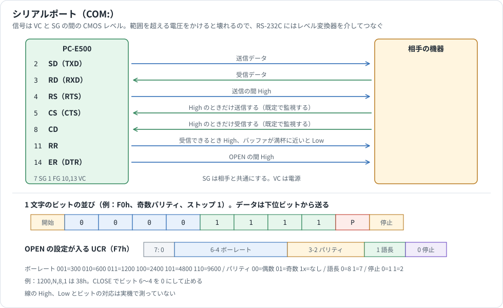

# 15 ピン（シリアルポート）

15 ピンのコネクタと、そこで動くシリアルポート（`COM:`）の資料です。ピン配置、信号線、`OPEN` の設定、文字の変換、フロー制御を説明します。BASIC の命令の書式は [BASIC_REFERENCE.md](BASIC_REFERENCE.md)、IOCS の呼び方は [IOCS_REFERENCE.md](IOCS_REFERENCE.md)、つなぐ機器は [PERIPHERALS.md](PERIPHERALS.md) §6、11 ピンとテープは [PORT_11PIN.md](PORT_11PIN.md) を参照してください。

## 情報源と確度

| 表記 | 情報源 | 内容 |
|---|---|---|
| **公式資料** | PC-E500 Technical Reference Manual（p.50〜59、p.91） | ドライバの呼び方、作業域、ピン配置、割込み |
| **マニュアル** | PC-E500 Operation Manual | 命令の書式 |
| **コード** | ROM 8.5 と 3.2 の逆アセンブル | 公式資料にない処理の流れ |
| **回路図** | PC-E500 Service Manual の回路図を読んだもの | 線と CPU のつながり |
| **個人** | 愛好家のサイト | 公式の表にないピン |
| **実験** | エミュレータの作業用コピー | UART の送信レジスタへの書き込みを記録し、受信割込みでデータを入れた。ROM 3.2 と 8.5 で試した |

**試していないこと**

- シリアルの実機接続。エミュレータの UART はビットの波形を持たないので、実験は UART レジスタへの書き込みと受信割込みまでです。

番地は ROM 8.5 のものです。COM のドライバ（`EAA86h`〜）は、ROM 3.2 では 2E4h 足した番地にあります。受信割込みは 8.5 の `F5A2Fh`、3.2 の `F614Ch` です。ほかの版は [ROM_VERSIONS_DRIVERS.md](ROM_VERSIONS_DRIVERS.md) を参照してください。

## ピン配置

テクニカルリファレンス p.59 の表です。6、9、12、15 番は公式の表になく、個人サイトの表で補いました。

| ピン | 記号 | 向き | 内容 | 出典 |
|---|---|---|---|---|
| 1 | FG | | フレームグラウンド | 公式 |
| 2 | SD（TXD） | 出力 | 送信データ | 公式 |
| 3 | RD（RXD） | 入力 | 受信データ | 公式 |
| 4 | RS（RTS） | 出力 | 送信要求 | 公式 |
| 5 | CS（CTS） | 入力 | 送信可 | 公式 |
| 6 | | | 未接続 | 個人 |
| 7 | SG | | 信号用接地 | 公式 |
| 8 | CD | 入力 | キャリア検出 | 公式 |
| 9 | | | 未接続 | 個人 |
| 10 | VC | | 電源電圧 | 公式 |
| 11 | RR | 出力 | 受信可 | 公式 |
| 12 | PAC | 入力 | ペリフェラル応答。サービスマニュアルは「未使用」 | 個人 |
| 13 | VC | | 電源電圧 | 公式 |
| 14 | ER（DTR） | 出力 | OPEN 中に High | 公式 |
| 15 | PRQ | 出力 | ペリフェラル要求。サービスマニュアルは「未使用」 | 個人 |

**CPU とのつながり（回路図）**

| ピン | 信号 | CPU | 内部 RAM |
|---|---|---|---|
| 2 | SD | TXD | `FAh` が送信データ |
| 3 | RD | RXD | `F9h` が受信データ |
| 4 | RS | KO12 | `F1h` ビット 4 |
| 5 | CS | E2 | `F5h` ビット 2 |
| 8 | CD | E1 | `F5h` ビット 1 |
| 10、13 | VC | VCC | |
| 11 | RR | KO13 | `F1h` ビット 5 |
| 12 | PAC | E0 | |
| 14 | ER | KO14 | `F1h` ビット 6 |
| 15 | PRQ | KO15 | `F1h` ビット 7 |

回路図の 2 番の記号は `CD` と印刷されていますが、線は TXD につながっています。12 番は回路図では `PAR`、15 番と 12 番はサービスマニュアルの説明では「未使用」です。

**電気的な条件**

信号は CMOS レベル（4〜6 V）です（公式）。範囲を超える電圧をかけると壊れるので、RS-232C に直結してはいけません（公式）。RS-232C のパソコンとつなぐには、レベルコンバータを使います（[PERIPHERALS.md](PERIPHERALS.md) §6）。

## 1. 全体像



UART を使う調歩同期の通信です。テープと違い、ヘッダもブロックも検査値もなく、テキストをそのまま流します。CE-515P プロッタもこのポートを使います（[CE-515P_PLOTTER.md](CE-515P_PLOTTER.md)）。

## 2. OPEN の設定

```basic
OPEN "COM:ボーレート,パリティ,語長,ストップ,A,デリミタ,EOF,XON,シフト" AS #n
```

| 項目 | 値 | 入る場所 |
|---|---|---|
| ボーレート | 300、600、1200、2400、4800、9600 | `BFD33h` ビット 6〜4 |
| パリティ | `N`、`E`、`O` | `BFD33h` ビット 3〜2 |
| 語長 | 7、8 | `BFD33h` ビット 1 |
| ストップビット | 1、2 | `BFD33h` ビット 0 |
| コード | `A`（ASCII のみ） | |
| デリミタ | `C` CR、`F` LF、`L` CR+LF | `BFD3Bh` |
| EOF コード | `&H00`〜`&HFF` | `BFD3Ch` |
| XON | `N`、`X` | `BFD34h` ビット 2、1 |
| シフト | `S`、`N` | `BFD34h` ビット 0 |

`OPEN` の実行で `BFD33h` の値が UCR（`F7h`）に入ります。エミュレータで読んだ値は次のとおりです（実験）。

| OPEN | `F7h` | `BFD34h` | `BFD3Bh` | `BFD3Ch` |
|---|---|---|---|---|
| `1200,N,8,1,A,C,&H1A,N,S` | 38h | A1h | 01h | 1Ah |
| `300,E,7,2,A,F,&H0B,X,N` | 13h | A6h | 02h | 0Bh |
| `9600,O,8,1,A,L,&H1A,N,N` | 64h | A0h | 03h | 1Ah |
| `4800,N,7,1,A,C,&H1A,N,S` | 5Ah | A1h | 01h | 1Ah |
| `600,N,8,2,A,C,&H1A,N,N` | 29h | A0h | 01h | 1Ah |

`BFD34h` のビット 7 は開いている間だけ立ちます。`CLOSE` で `F7h` のビット 6〜4 が 0 になり、`F1h` の信号も下がります。プログラムの `RUN` でも閉じます（マニュアル、実験）。

## 3. ポート

| ポート | ビット | 内容 | 根拠 |
|---|---|---|---|
| `F7h` UCR | 上の表 | ボーレート、パリティ、語長、ストップ | 公式資料、実験 |
| `F8h` USR | 3、4 | 送信できる状態。両方 1 で送る（`EB047h`） | コード |
| `F8h` USR | 0〜2 | 受信の状態。受信データと一緒に保存する | コード |
| `F9h` | | 受信データ | コード |
| `FAh` | | 送信データ | コード、実験 |
| `F1h` | 6、5、4 | ER、RR、RS の出力 | 公式資料、コード |
| `F5h` | 2、1 | CS、CD の入力 | コード |
| `FCh` | 5 | 受信の割込み要因 | 公式資料、実験 |

## 4. 文字の変換

送るときに、内部の表現を設定に合わせて変えます。`A$=CHR$(200)+"A"+CHR$(201)+"B"` を `PRINT #1,A$` して `CLOSE` したときの送信バイトです（実験）。

| OPEN | 送信バイト |
|---|---|
| `1200,N,8,1,A,C,&H1A,N,S` | `C8 41 C9 42 0D 1A` |
| `1200,N,7,1,A,C,&H1A,N,S` | `0E 48 0F 41 0E 49 0F 42 0D 1A` |
| `1200,N,8,1,A,F,&H1A,N,N` | `C8 41 C9 42 0A 1A` |
| `1200,N,8,1,A,L,&H09,N,N` | `C8 41 C9 42 0D 0A 09` |

- **デリミタ**: 内部の `0Dh 0Ah` を、指定の行末に変えます。受信では逆に変えます（公式資料 p.55）。
- **EOF**: 内部の終わりは常に `1Ah` で、送受信で指定のコードに変えます。
- **シフト**: 語長 7 ビットで `S` のとき、80h 以上の文字を `0Eh`（SO）のあとに下位 7 ビットで送り、続いて `0Fh`（SI）を送ります。語長 8 ビットでは使いません。語長 7 ビットで `N` だと、`C8h` がそのまま送信レジスタに書かれます。

## 5. フロー制御

既定の作業域は、信号線とソフトウェアの両方の制御を持ちます（公式資料 p.53〜58）。

| 方向 | 条件 | 動作 |
|---|---|---|
| 送信 | `CS` が Low | High になるまで待つ（`BFD37h` のビット 2 が既定で立っている） |
| 送信 | XON 指定で `13h` を受信 | `11h` を受けるまで止まる |
| 受信 | `CD` が Low | 受信したデータを捨てる（`BFD35h` のビット 1 が既定で立っている） |
| 受信 | バッファが満杯に近い | `RR` を Low にし、XON 指定なら `13h` を送る |
| 受信 | バッファが空になる | `RR` を High にし、XON 指定なら `11h` を送る |

**待ち時間の上限は既定でありません**（`BFD31h`=FFFFh）。相手がつながっていないと `CS` が Low のままなので、`SAVE "COM:"` は `BREAK` を押すまで止まりません（マニュアル、実験）。

実験では、送信の途中で `13h` を入れると送信が止まり、`11h` を入れると再開しました。

**受信バッファは小さく、既定で 10 文字分です。** 受信割込み（8.5 `F5A2Fh`）が状態とデータの 2 バイトを 1 組にしてリングバッファに入れます。バッファの大きさは 14h バイト、`RR` を下げるしきい値は 0Ch バイト（6 文字分）でした（実験。`[E6h]` が指す領域の `+1Ch`、`+1Eh`）。あふれるとオーバーフローの印が立ち、受信したデータを失います。相手には `RR` か XON/XOFF で止まってもらう必要があります。作業域を広げれば、バッファも大きくできます（公式資料 p.85。[MEMORY.md](MEMORY.md) §5）。

## 6. プログラムの転送

`SAVE "COM:"` と `LOAD "COM:"` は ASCII のプログラムを流すだけです。`10 PRINT "HI"` と `20 END` を既定の設定で `SAVE "COM:"` すると、次のバイト列になります（実験）。

```text
31 30 20 50 52 49 4E 54 20 22 48 49 22 0D 32 30 20 45 4E 44 0D 1A
1  0     P  R  I  N  T     "  H  I  "  CR 2  0     E  N  D  CR EOF
```

`LOAD "COM:"` に同じ形のバイト列を入れると、プログラムとして取り込めました（実験）。デリミタと EOF は設定で変わります（`L`、`&H09` での受信も確かめました）。検査値はないので、誤りは検出できません。パリティで見つけるか、読み込んだあとで確かめます。

## 7. 作業域

| 番地 | 既定値 | 内容 |
|---|---|---|
| `BFD31h` | FFFFh | 待ち時間の上限（n × 0.5 秒。FFFFh は無制限） |
| `BFD33h` | 3Ch | ボーレート、パリティ、語長、ストップ |
| `BFD34h` | 21h | ビット 6 開始時の送信、4 終了時の送信、2 受信の X 制御、1 送信の X 制御、0 シフト |
| `BFD35h` | 02h | 受信の条件（ビット 2 CS、1 CD） |
| `BFD36h` | DFh | バッファ満杯で下げる信号（ビット 0 にした信号を下げる。6 ER、5 RR、4 RS） |
| `BFD37h` | 04h | 送信の条件（ビット 2 CS、1 CD） |
| `BFD38h` | 50h | 送信の前後で上げ下げする信号（6 ER、5 RR、4 RS） |
| `BFD39h` | 01h | 送信の前後の待ち（n × 2 ms） |
| `BFD3Bh` | 01h | デリミタ（01 CR、10 LF、11 CR+LF） |
| `BFD3Ch` | 1Ah | EOF コード |
| `BFD40h` | 04h | 開始後と終了前の待ち（レベル変換器のため） |
| `BFD41h` | 60h | OPEN で上げる信号（6 ER、5 RR、4 RS） |
| `BFD60h` | 00h | 送信の 1 バイトごとの待ち（n × 2 ms） |
| `BFD61h` / `BFD62h` | 11h / 13h | 開始時 / 終了時に送るバイト |

既定値は、リセット後のエミュレータの値です。`BFD41h` は公式資料では 41h ですが、ROM 3.2 と 8.5 の実験では 60h でした。ROM の版によるシリアルの違いは [ROM_VERSIONS_DRIVERS.md](ROM_VERSIONS_DRIVERS.md) §3.3 にあります。

## 8. IOCS からの呼び方

シリアルは IOCS の device 2 です（公式資料 p.50〜52）。`(cx)=0002h` として呼びます。

| i | 内容 | 入力 | 戻り |
|---|---|---|---|
| 3Fh | パラメータとバッファを初期化する | | |
| 40h | 初期化 | a: 0 全リセット、1 リセット、2 off、3 on | |
| 41h | 1 バイト送る（変換なし） | a: データ | C=1 のとき a: 00h 時間切れ、FEh 電池切れ、FFh BREAK |
| 42h | 1 バイト受ける（変換なし） | | C=0 のとき a: データ。C=1 は同上 |
| 43h | 作業域の設定をハードウェアへ反映する | | |
| 44h / 45h | RS を High / Low にする | | |
| 46h / 47h | RR を High / Low にする | | |
| 48h / 49h | ER を High / Low にする | | |
| 4Ah / 4Bh | CS / CD を読む | | C=1 で High |

`BFD33h` などを書き換えたあとは、43h を呼びます（公式資料 p.53）。
