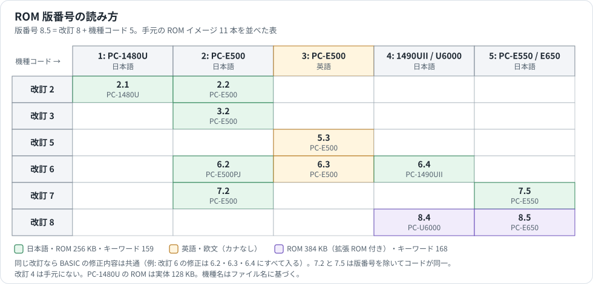

# PC-E500 シリーズ ROM 版ごとの BASIC の違い

手元の ROM イメージ 11 本（`Emulator/app/rom/`）を比較し、BASIC（インタプリタ、トークン化、BASIC 命令・関数）に関わる違いだけをまとめたもの。IOCS、表示・キー入力、AER モード、ファイル装置ドライバの違いは扱わない（§6 に除外した範囲を記す）。番地はとくに断らない限り CPU アドレス。

## 確度の表し方

| 表記 | 意味 |
|---|---|
| **実験** | 新旧の ROM で同じ BASIC をエミュレータ（`Emulator/bin/e500core.dll`）上で実行し、結果の違いを確認した |
| **コード** | 逆アセンブルの差分で変更を確認した。挙動の違いは再現していない、または試していない |
| **推定** | コードの形から目的を推し量ったもの |

## 1. 対象 ROM と版番号

版番号は本体 ROM の `FFFF0h`（上位）と `FFFF1h`（下位）にある。例: PC-E650 は `08 05` で 8.5。

| ファイル | 版 | 容量 | キーワード | 処理表 | 辞書 | リセット | 備考 |
|---|---|---|---|---|---|---|---|
| PC-1480U(2.1) | 2.1 | 256 KB | 159 | `F55D0h` | `F58DBh` | `F1031h` | 実体 128 KB を 2 回並べたイメージ。E0000h–FFFFFh のみ |
| PC-E500(2.2) | 2.2 | 256 KB | 159 | `F57CFh` | `F5ADAh` | `F10BDh` | |
| PC-E500(3.2) | 3.2 | 256 KB | 159 | `F57D1h` | `F5ADCh` | `F10BDh` | |
| PC-E500(5.3) | 5.3 | 256 KB | 159 | `F5781h` | `F5A8Ch` | `F10C2h` | |
| PC-E500(6.3) | 6.3 | 256 KB | 159 | `F5781h` | `F5A8Ch` | `F10C2h` | |
| PC-E500PJ(6.2) | 6.2 | 256 KB | 159 | `F57D1h` | `F5ADCh` | `F10BDh` | 未使用域が `9Fh` 埋め |
| PC-E500(7.2) | 7.2 | 256 KB | 159 | `F57D1h` | `F5ADCh` | `F10BDh` | 未使用域が `9Fh` 埋め |
| PC-E550(7.5) | 7.5 | 256 KB | 159 | `F57D1h` | `F5ADCh` | `F10BDh` | 未使用域が `9Fh` 埋め。コードは 7.2 と同一 |
| PC-1490UII(6.4) | 6.4 | 256 KB | 159 | `F5801h` | `F5B0Ch` | `F10BDh` | |
| PC-U6000(8.4) | 8.4 | 384 KB | 168 | `F504Ch` | `F5357h` | `F10BEh` | 拡張 ROM（20000h–3FFFFh）付き |
| PC-E650(8.5) | 8.5 | 384 KB | 168 | `F5029h` | `F5334h` | `F10BEh` | 拡張 ROM（20000h–3FFFFh）付き |

処理表は `token × 3` で引く 3 バイトの処理レコード表、辞書は `[長さ][名前][token]` のキーワード辞書（形式は [BASIC_REFERENCE.md](BASIC_REFERENCE.md)）。どちらも処理表の直後 11 バイトのポインタを挟んで辞書が続く配置で、全版共通である。C0000h–DFFFFh は ROM 内蔵の RAMFILE（G: ドライブ）で、BASIC の比較対象から外した。

### 1.1 版番号の読み方



版番号の上位桁は **BASIC を含む共通ソースの改訂番号**、下位桁は **機種コード** と判断できる。

- 改訂 6 の修正 5 件（§3.4）は 6.2・6.3・6.4 の 3 機種すべてと 7.x・8.x に入っており、5.3 以前にはない。
- 改訂 5 の修正（§3.3）は 5.3 以降の全機種に入っており、3.2 以前にはない。
- 同じ改訂 7 の 7.2（PC-E500）と 7.5（PC-E550）は、版番号を除きコードが 1 バイトも違わない。

機種コードとファイル名の対応は次のとおり。どの販売機種かはファイル名に従っており、ROM の内容から確かめたものではない。

| 機種コード | ファイル名 | 手元の版 |
|---|---|---|
| 1 | PC-1480U | 2.1 |
| 2 | PC-E500（6.2 は PC-E500PJ） | 2.2、3.2、6.2、7.2 |
| 3 | PC-E500 | 5.3、6.3 |
| 4 | PC-1490UII、PC-U6000 | 6.4、8.4 |
| 5 | PC-E550、PC-E650 | 7.5、8.5 |

機種コード 3 は、2 と比べて Shift-JIS の 1 バイト目を判定する処理（3.2 の `F6B75h`）を持たないなど、機種コード 2 とは別の機種向けである（§4）。

### 1.2 改訂の系統

| 改訂 | 機種 1 | 機種 2 | 機種 3 | 機種 4 | 機種 5 |
|---|---|---|---|---|---|
| 2 | 2.1 | 2.2 | | | |
| 3 | | 3.2 | | | |
| 4 | | | | | |
| 5 | | | 5.3 | | |
| 6 | | 6.2 | 6.3 | 6.4 | |
| 7 | | 7.2 | | | 7.5 |
| 8 | | | | 8.4 | 8.5 |

改訂 4 の ROM は手元にない。改訂 3→5 の差（§3.3）には改訂 4 の変更も含まれている可能性がある。

## 2. BASIC の互換性

- キーワード辞書は、改訂 2〜7 の全 9 本で 159 語、並び順・token 値とも完全に一致する。
- 改訂 8（8.4、8.5）は次の 9 語を追加して 168 語になる。既存 159 語の token 値は変わらない。処理入口は拡張 ROM にあり、8.4 と 8.5 で番地も同じである。

| キーワード | token | 処理入口 |
|---|---|---|
| ENDIF | 4Dh | `30FE0h` |
| REPEAT | 4Eh | `3114Fh` |
| UNTIL | 4Fh | `31165h` |
| WHILE | 7Ah | `30FF4h` |
| WEND | 7Bh | `31081h` |
| SWITCH | 7Ch | `311A9h` |
| CASE | 7Dh | `313ABh` |
| DEFAULT | 7Eh | `313D5h` |
| ENDSWITCH | 7Fh | `3144Ah` |

- 処理表の各レコードの分類フラグ（上位 4 bit）は全版で同じで、処理入口は版ごとのコードのずれに応じて動いている（機種 1 だけは MERGE・LOAD・CHAIN・INIT などの処理の置き場所が他機種と違う）。
- したがって中間コードの互換性は、キーワード表の上では全版で保たれている。改訂 8 の 9 語を使ったプログラムだけが改訂 7 以前で動かない。ファイルの相互 LOAD は確かめていない。

## 3. 改訂ごとの BASIC の変更

### 3.1 改訂 2 → 3（2.2 → 3.2）

改訂の中でいちばん修正が多い。番地は 3.2 のもの（括弧内は 2.2）。

| # | 対象 | 番地 | 変更 | 旧版での症状 | 確度 |
|---|---|---|---|---|---|
| 1 | VAL・READ（数値文字列の読取り） | `F6663h`（`F6661h`） | 読み取った値の符号を、先頭の `-` があるときだけ反転するよう変更。旧版は値の符号をいったん消し、`-` があれば負にしていた | `VAL("&HFFFFFFFFFF")` が `1`（新版 `-1`）。`VAL("-&HFFFFFFFFFF")` が `-1`（新版 `1`）。`DATA &HFFFFFFFFFF,-&HFFFFFFFFFF` を READ しても同じく `1`・`-1`（新版 `-1`・`1`）。INPUT で `&HFFFFFFFFFF` を入れたときは全版 `-1` で、INPUT は別の経路である | 実験 |
| 2 | VAL | `EEFB7h`（なし） | 文字列の先頭が `1Dh` / `1Fh`（中間コードの数値定数・行番号定数の印）なら 0 を返す判定を追加 | `VAL(CHR$(29)+"ABCDEFGH")` が 2.1 で `4.3444546474813616531D+66`（後続バイトを内部形式の数値として読む）、2.2 では表示が化ける。新版は `0` | 実験 |
| 3 | 同上 | `F66AEh`（`F66AAh`） | `1Fh` の経路の整数→実数変換を `CALL $FEEB`（同じ F セグメントの FFEEBh を呼ぶ誤り）から `CALLF EFE40h`（E セグメントの正しい処理）に修正 | `CHR$(31)` で始まる文字列を読むときに通る。`VAL(CHR$(31)+CHR$(1)+CHR$(0))` は 2.2 で表示が化ける | 実験 |
| 4 | LEN | `EEF79h`（`EF02Eh`） | 引数が数値のときのエラー出口を、評価スタック（U）の後始末（`EF3D8h`）をする共通の出口 `EF03Fh` に統合。旧版の専用出口（`EF04Ch`）は後始末をせずに戻っていた | 直接実行の `PRINT LEN(5)` が `Type mismatch in 65531`（ありもしない行番号が付く）。新版は `Type mismatch` | 実験 |
| 5 | LINE …,B | `FDCBEh`、`FDCC6h` | 枠の 4 辺の向きを決める座標の大小比較を、符号なし（`CMPW`）から符号付き（上位バイトに 80h を足してから `CMPW`）に変更 | 座標の正負が混じる枠で 1 ドット余分に打つ。`LINE (-5,5)-(30,20),B` で (31,20)、`LINE (5,-5)-(30,20),B` で (5,21) | 実験 |
| 6 | トークン化（THEN・GOTO などの後の数値を行番号定数にする判定） | `F4DDBh` | 数値の直後が ELSE かどうかを、綴り `E` `L` `S` `E` の文字比較から、キーワード辞書の照合（token 76h）に変更 | `IF A=0 THEN 20 EL.30` のように ELSE を省略形で書くと、RUN 時に `Syntax error`。新版は正しく実行 | 実験 |
| 7 | SAVE（ASCII 形式でないとき） | `FE016h` → `EC5C1h` | 書き込み処理を新設の `EC5C1h` に置換。書き込み後、装置のフラグ `[BFC83h]` bit0 が立っていれば読み戻して照合し、不一致なら最大 3 回まで書き直す | — | コード |
| 8 | AND・OR・XOR の被演算子 | `EFA72h` | 被演算子の前の `-` による符号反転を、値が 0 でないときだけ行う | — | コード |
| 9 | MDF・AER | `EF09Ah` | 丸め処理に、作業値 `(BP+10h)` の bit7 が立っているときの分岐（`(BP+0Fh)` からの 3 バイトを 0 にして `ECE84h` を呼ぶ）を追加 | 試した値（`MDF(1E-99)` など）では差なし | コード |
| 10 | NPR・NCR | `EE8A6h`、`EE92Dh` | 計算途中の桁あふれ判定とエラー出口を変更 | `NPR(70,70)`、`NCR(100,50)` では差なし | コード |
| 11 | EVAL | `EF231h` | 型が合わないときの出口を、#4 と同じ共通出口 `EF03Fh` に変更 | `EVAL(5)` は新旧とも `Type mismatch` | コード |
| 12 | `&H` 定数の読取り | `EFC29h` | 16 進の読取りでエラーのとき、ループに戻らずに戻る | — | コード |
| 13 | BASIC・TEXT（モード切替） | `F90CEh`、`F9155h` | U スタックの `POPU X` を、成功・失敗の両方の経路で実行される位置へ移動 | 旧版は片方の経路だけで取り出していた | コード |
| 14 | FILES | `F8D68h` | 表示件数カウンタの減算を、1 件読んだ後に行うよう移動 | 9 ファイルの X: で LFILES の印字、FILES の上下スクロールを 2.2・3.2・7.2 で比べたが差なし | コード |
| 15 | BEEP | `F8089h` | 引数を読んだ後、条件によりエラーを返す判定を追加 | `BEEP 0`、`BEEP 1,256` では差なし | コード |
| 16 | トークン化 | `F5017h` | 数字の判定の前に `.`（2Eh）を特別扱いする判定を追加 | — | コード |

このほか、3.2 には **機能を変えないコード縮小** が多い。プロッタ命令（LTEXT・GRAPH・LF・CSIZE・COLOR・GLCURSOR・SORGN・CROTATE・LLINE・RLINE・CIRCLE・PAINT、`E66D9h`〜`E7D41h`）で `CALLF EA833h` / `CALLF FB98Eh` を近くの共通スタブへの `CALL` に置き換え、`CALL`＋`RET` を `JP` にまとめている。RENUM の ERL 比較（`F96B4h`、`JRNZ`＋`JR` を `JRZ` に）、KEY の型検査（`FAFFAh`、別の箇所での検査に一本化）も同様で、`KEY 1,5` は新旧とも `Type mismatch` になる。上の修正を入れる場所を空けるための縮小と見られる（推定）。

### 3.2 改訂 3 → 5（3.2 → 5.3）

5.3 は機種コードも違うため、3.2 との差の大半は機種差（§4）である。改訂 5 以降の **全機種** に入っている変更は次の 2 件。

| # | 対象 | 番地 | 変更 | 確度 |
|---|---|---|---|---|
| 1 | 行エディタ（BASIC のプログラム入力にも使う） | 3.2 の `F3D52h` | 現在桁から目標の桁まで空白を出すループで、回数が 0 のとき（`SUB IL,A` の結果が 0）に抜ける判定を追加。旧版は 0 回のとき `DEC IL` で 255 に回り込み、256 個の空白を出す。全機種で末尾の空き領域へ飛ぶパッチとして入っている（下表） | コード |
| 2 | INPUT の入力行解析 | 3.2 の `F5FA7h` | `[BFCBEh]` bit6 が立っているときの経路（制御スタックの種別 06h を探して続行）を削除し、エラー 63h で抜けるよう変更。6.2 では削除跡が `NOP` で埋まっている | コード |

#1 は `[($D1)+9Fh]` bit0 が立っているときだけ通る経路で、BASIC 専用の処理ではない。この bit は行エディタのキー処理（3.2 の `F3926h`、キーコード 2Dh）で切り替わる。エミュレータで全キーを押して確かめると、切り替えるのは SHIFT＋ENTER（P↔NP、計算結果をプリンタにも印字する印字モード）だった（実験）。印字モードでは入力行と、24 桁に右寄せした結果を印字する。入力が 23・24・25 文字の計算を印字モードで試したが、2.2・3.2・5.3・6.2・7.2 で印字内容と所要時間に違いはなく、空白が 256 個になる条件はまだ特定できていない（エミュレータの CE-126P は 24 桁を超える文字と行末の空白を記録しないため、印字内容だけでは見えない場合がある）。パッチの位置:

| 版 | 飛び元 | パッチ |
|---|---|---|
| 5.3 | `F3D02h` | `FFF4Dh` |
| 6.3 | `F3D02h` | `FFF5Dh` |
| 6.2、7.2、7.5 | `F3D52h` | `FFFBBh` |
| 6.4 | `F3D82h` | `FFECAh` |
| 8.4 | `F3592h` | `FF889h` |
| 8.5 | `F356Fh` | `FF989h` |

### 3.3 改訂 5 → 6（5.3 → 6.3、3.2 → 6.2）

機種 2 と機種 3 の両方で同じ修正が入っている。番地は 6.2 のもの（括弧内は 6.3）。

| # | 対象 | 番地 | 変更 | 確度 |
|---|---|---|---|---|
| 1 | 文字列変数への代入（LET・READ・INPUT） | `FB24Fh`（`FB1DEh`） | 空きが足りないとき `FA467h`（文字列領域の詰め直しと見られる）を呼んだ後に変数の番地を求め直す処理で、配列かどうかの判定を `CMP A,40h`（値が 40h と一致）から `TEST A,40h`（bit6）に修正 | コード |
| 2 | 同上 | `FB8D1h`〜`FB8E5h`（`FB860h`〜） | `FA467h` の前後で `($D4)` を保存・復元し、`($D5)-($D4)` だけ代入元のポインタ（X）を補正する処理を追加 | コード |
| 3 | 式の評価スタックの移動 | `EF470h`（`EF45Dh`） | U スタック上の文字列を 40h バイト上へずらす転送を、前から（`[X++]`→`[Y++]`）から後ろから（`[--X]`→`[--Y]`）に変更。旧版は 64 バイトを超える文字列では転送元と転送先が重なり、内容が壊れる | コード |
| 4 | AND・OR・XOR の被演算子 | `EFA73h`（`EFA5Eh`） | 被演算子の評価がエラー（C=1）なら、符号処理をせずにすぐ戻る | コード |

#1〜#3 は、次の試験では違いが再現できなかった。発生条件は未特定である。

- #1・#2: 3000 回の連結・切り詰めで空きを使い切る代入、文字列配列との代入の繰り返し、数値配列で空きを減らした状態での代入（2.1〜8.5 の全版、または 3.2・5.3・6.2・6.3）。FRE で調べると、文字列を短くしたときの余りはその場で返される（10 文字の `A$` を空にすると FRE が 10 増える）ため、`FA467h` の詰め直しが走る状態をこの方法では作れなかった。
- #3: 100 文字の文字列と、SIN・EVAL・POL・NCR・FACT・MDF・AND・OR・XOR・NOT・括弧を組み合わせた式 20 通り（5.3・6.3）。`EF441h` の呼出し元には ROT・AER の処理があり、CAL・AER モード側の操作で通る経路と見られる（推定）。

### 3.4 改訂 6 → 7（6.2 → 7.2）

BASIC の変更はない。6.2 と 7.2 の違いは AER モードの式入力処理（`E557Bh`、`E57B0h` の入力桁数 4Fh→50h と、`E5712h` から空き領域 `EFFB0h` へのパッチ）だけで、BASIC 外である。7.2（PC-E500）と 7.5（PC-E550）はコードが同一で、違いは版番号の 1 バイト（`FFFF1h`）と、7.2 の `FFFF2h` が `77h`（7.5 は `9Fh`）であることだけである。

### 3.5 改訂 7 → 8（7.5 → 8.5、6.4 → 8.4）

番地は 8.5 のもの。

| # | 対象 | 番地 | 変更 | 旧版での症状 | 確度 |
|---|---|---|---|---|---|
| 1 | 構造化構文 | 拡張 ROM `30FE0h`〜 | WHILE・WEND・REPEAT・UNTIL・SWITCH・CASE・DEFAULT・ENDSWITCH・ENDIF の 9 語を追加（§2） | — | コード |
| 2 | RETURN | `FD028h` | GOSUB の枠（種別 04h）を探して制御スタックを遡るとき、種別 07h・08h・09h の枠を読み飛ばす判定を追加 | — | コード |
| 3 | RESUME | `FD253h`、`FD289h` | 同様に 07h・08h・09h の枠を読み飛ばす。続きの処理は拡張 ROM（`JPF 31494h`）へ | — | コード |
| 4 | AHS | `EE2D7h`、`EE2FBh` | 引数の符号を外して絶対値で計算し、最後に符号を戻す | `AHS(-1E20)` が `Illegal function call`（新版 `-46.74484904`）。`AHS(-100)` が `-5.298342367` で `AHS(100)` の `5.298342366` と符号以外も違う（新版は `-5.298342366`） | 実験 |
| 5 | REC・POL | `EE742h`、`EE83Dh` | 結果を変数 Y・Z へ入れる前に、値を整える処理（`EF24Ah`、`EF205h`）を追加 | `A=REC(2,30)` の後の `Y` が `1.732050807`（戻り値 A は `1.732050808`）。新版は Y も `1.732050808` | 実験 |
| 6 | INPUT の作業領域 | `F605Ch`〜 | BP 相対の作業領域を 1 バイト広げ、以降の項目の位置を 1 つずつずらす | — | コード |
| 7 | ELSE・GOSUB | `FCE09h`、`FCECEh` | 処理の入口を移動・追加（構造化構文の追加に伴うもの） | — | コード |

#2・#3 の 07h〜09h は、追加された WHILE・REPEAT・SWITCH が制御スタックに積む枠の種別と見られる（推定）。GOSUB の中で WHILE などを抜けずに RETURN するときに必要になる。

LINE の比較処理（§3.1 #5）は 8.x で別の番地に移っただけで、中身は同じである。表示・キー入力（F0000h〜F4FFFh 帯）にも多くの変更があるが、BASIC 外として扱っていない。8.4 と 8.5 の拡張 ROM は約 6.5 KB 違い、まだ比べていない。

### 3.6 変わっていないことの確認

上の修正以外に挙動の違いがないかを見るため、関数・演算・書式・文字列処理の境界値を 80 項目、全 11 本で実行して結果を比べた（実験）。違ったのは版番号を読む `PRINT PEEK &HFFFF0;PEEK &HFFFF1` だけで、ほかはエラーの種類まで含めて全版一致した。

試した項目の例: `SQR 2`、三角・逆三角・対数・双曲線関数、`FACT 69`・`FACT 70`（Overflow）、`NCR(5,6)`（Illegal function call）、`AHC 1E20`、`DMS -1.5`、`HEX$ -1`、`&H7FFFFFFFFF`（Overflow）、`VAL "1.2.3"`、`STR$ 1E-5`、`MID$`・`LEFT$`・`RIGHT$` の範囲外、`CHR$ 256`、文字列の大小比較、`1/3*3=1`、`1E99*10`、`1E-99/10`、`PRINT USING` の各書式と書式あふれ、`AND`・`OR`・`XOR`・`NOT` の範囲外、`EVAL`、`DECI`、`POL`・`REC`、`MDF`、`1/0`、`0^0`、`(-2)^0.5`、`LOG 0`、`TAN 90`（DEGREE・RADIAN・GRAD）、`SIN 1E10`、80 文字を超える入力行（Line buffer overflow）、配列の添字範囲外。

AHS の負の引数（§3.5 #4）のように、引数の範囲や符号の組合せによっては、この 80 項目に入っていない違いが残っている可能性はある。

## 4. 機種による違い（同じ改訂の中で）

| 比較 | 違い | 確度 |
|---|---|---|
| 2.1（機種 1）と 2.2（機種 2） | §3.1 の旧版の症状はすべて 2.1 にもある。今回の試験で BASIC の結果に違いは出なかった。ROM は 128 KB で RAMFILE を持たず、MERGE・LOAD・CHAIN・INIT などの処理の置き場所が違う | 実験（症状の一致） |
| 機種 2 と機種 3 | 機種 3 は Shift-JIS の 1 バイト目（81h〜9Fh、E0h〜EFh）を判定する処理（3.2 の `F6B75h`）を持たない。機種 2 ではプログラムを走査する処理（GOSUB・ON・DATA・RESUME などが使う）がこの範囲のバイトを 2 バイト文字の先頭として扱う | コード |
| 7.2（機種 2）と 7.5（機種 5） | コード同一（§3.4） | コード |
| 6.2・6.3・6.4 | 今回の試験で BASIC の結果に違いは出なかった | 実験 |
| 8.4（機種 4）と 8.5（機種 5） | 今回の試験で BASIC の結果に違いは出なかった。拡張 ROM の差は [ROM_VERSIONS_MAP.md](ROM_VERSIONS_MAP.md) §9 | 実験 |

## 5. 早見表

○は修正済み、×は旧版の症状あり。

| 修正 | 2.1 | 2.2 | 3.2 | 5.3 | 6.3 | 6.2 | 7.2 | 7.5 | 6.4 | 8.4 | 8.5 |
|---|---|---|---|---|---|---|---|---|---|---|---|
| VAL の `&H` 負数の符号（§3.1 #1） | × | × | ○ | ○ | ○ | ○ | ○ | ○ | ○ | ○ | ○ |
| VAL の 1Dh・1Fh（§3.1 #2） | × | × | ○ | ○ | ○ | ○ | ○ | ○ | ○ | ○ | ○ |
| LEN のエラー行番号（§3.1 #4） | × | × | ○ | ○ | ○ | ○ | ○ | ○ | ○ | ○ | ○ |
| LINE …,B の余分なドット（§3.1 #5） | × | × | ○ | ○ | ○ | ○ | ○ | ○ | ○ | ○ | ○ |
| `THEN n EL.m` の Syntax error（§3.1 #6） | × | × | ○ | ○ | ○ | ○ | ○ | ○ | ○ | ○ | ○ |
| 行エディタの空白詰め（§3.2 #1） | × | × | × | ○ | ○ | ○ | ○ | ○ | ○ | ○ | ○ |
| 文字列代入の番地再計算（§3.3 #1・#2） | × | × | × | × | ○ | ○ | ○ | ○ | ○ | ○ | ○ |
| AHS の負の引数（§3.5 #4） | × | × | × | × | × | × | × | × | × | ○ | ○ |
| REC・POL の Y・Z（§3.5 #5） | × | × | × | × | × | × | × | × | × | ○ | ○ |
| 構造化構文 9 語（§3.5 #1） | − | − | − | − | − | − | − | − | − | ○ | ○ |

§3.1 #1〜#6 と §3.5 は実験、§3.2・§3.3 の行はコード中の修正の有無で判定した。

## 6. 扱わなかった範囲

次の違いは BASIC 外としてこの資料では扱わない。

- `E0000h`〜`E4FFFh` 帯（IOCS、装置ドライバ）、`F0000h`〜`F4FFFh` 帯（リセット、割込み、表示、キー入力、行エディタ。§3.2 #1 を除く）→ [ROM_VERSIONS_SYSTEM.md](ROM_VERSIONS_SYSTEM.md)
- `E8000h`〜`EBFFFh` 帯のうち BASIC 命令から到達しない処理、プリンタの文字変換表など → [ROM_VERSIONS_DRIVERS.md](ROM_VERSIONS_DRIVERS.md)。BASIC のエラーメッセージ表もこの帯にあり、改訂 8 での追加はそちらの §2.2 に記した。
- `E5000h`〜`E66xxh` 帯の AER モードの式入力処理。2.2→3.2 で大きく書き換えられ、6.2→7.2 でも修正がある（未調査）。
- C0000h–DFFFFh の RAMFILE（G: ドライブ）の内容 → [ROM_VERSIONS_MODELS.md](ROM_VERSIONS_MODELS.md)（言語・カナ・添付ソフトの違いもこちら）。

## 7. 調べ方

1. 各 ROM の E0000h–FFFFFh を `DisAssembler/app/e500dasm.exe`（`--format raw --org E0000`）で逆アセンブルした。
2. 命令列のうち番地のオペランドを伏せて、版どうしの差分（Python の `difflib`）を取った。番地のずれだけの違い（ジャンプ表など）は、前後の対応から求めたずれ量と一致するものを除いた。
3. 差分の箇所から呼出し元を遡り、どの BASIC 命令の処理から使われるかを処理表（§1）で引いた。
4. 修正の有無はバイト列の照合で全 ROM を横断して調べた。
5. 挙動は `Emulator/tests/rom_harness.py` と同じ方法で `e500core.dll` を動かし、液晶の 6×8 ドットを文字に読み戻して比べた。起動 → PF1 で初期化 → BASIC の RUN モード、の後に直接実行またはプログラムを入れて RUN した。

§5 の実験の行を再現する BASIC:

```basic
PRINT VAL("&HFFFFFFFFFF")
PRINT VAL(CHR$(29)+"ABCDEFGH")
PRINT LEN(5)
LINE (-5,5)-(30,20),B
10 IF A=0 THEN 20 EL.30
20 PRINT "B":END
30 PRINT "C"
PRINT AHS(-1E20)
A=REC(2,30):PRINT A;Y;Z
```
