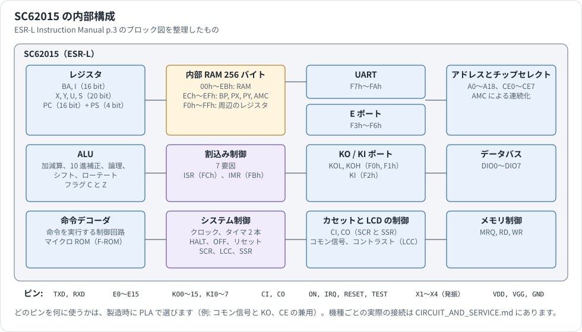
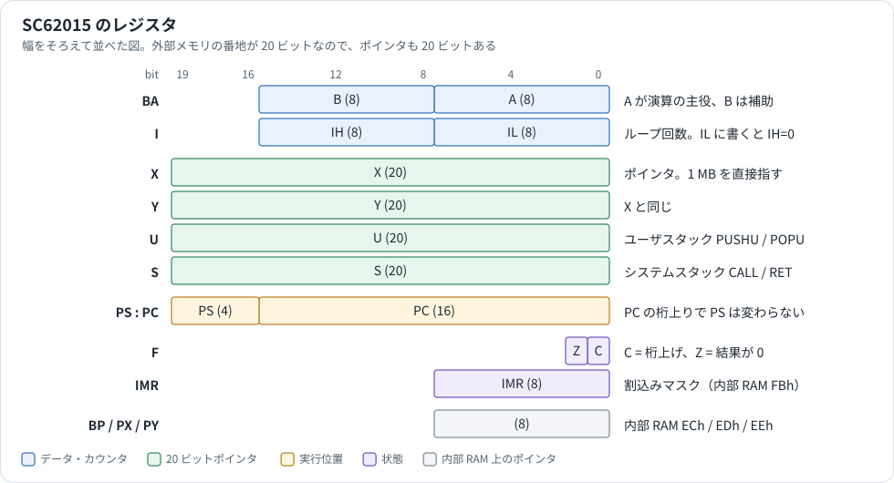
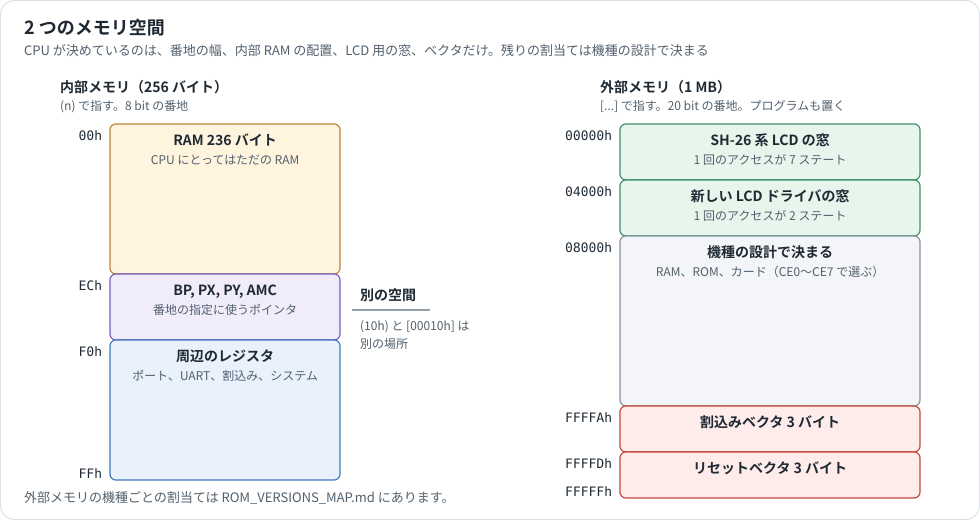
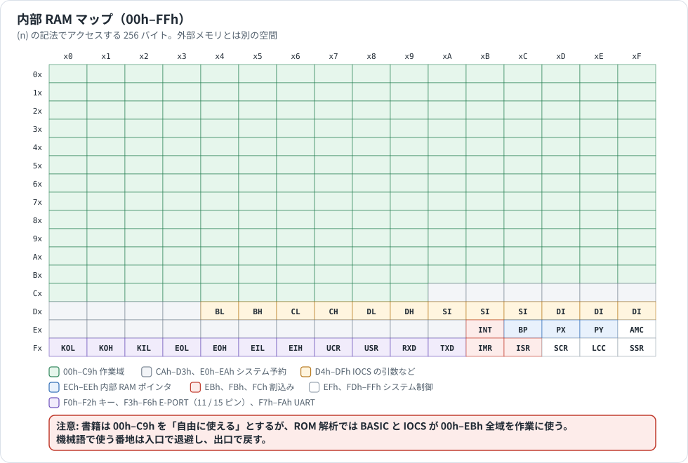
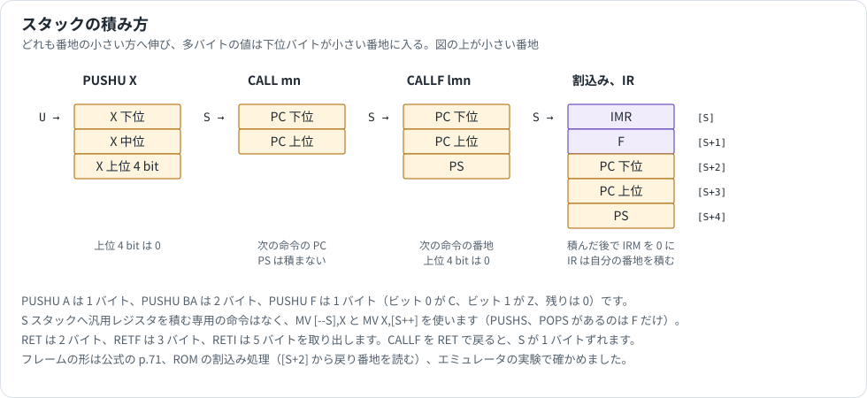
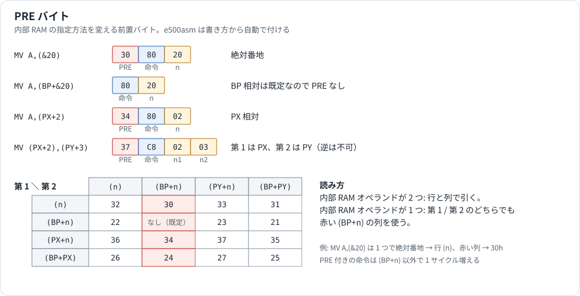

# SC62015（ESR-L）CPU 解説

PC-E500 シリーズの全機種が使っている CPU、SC62015 の資料です。機種によらない内容だけをまとめました。シャープの社内名は ESR-L、PC-E500 の部品名は SC62015B01 です（[CIRCUIT_AND_SERVICE.md](CIRCUIT_AND_SERVICE.md)）。

関連する資料は次のとおりです。

| 知りたいこと | 資料 |
|---|---|
| 機械語の書き方、実機での動かし方 | [ASSEMBLER_MANUAL.md](ASSEMBLER_MANUAL.md) |
| 外部メモリの割当てと ROM の違い | [ROM_VERSIONS_MAP.md](ROM_VERSIONS_MAP.md) |
| ROM がどう CPU を使っているか（起動、割込みの振り分け） | [SYSTEM_INTERNALS.md](SYSTEM_INTERNALS.md) |
| ピンと周辺回路 | [CIRCUIT_AND_SERVICE.md](CIRCUIT_AND_SERVICE.md)、[HARDWARE_REFERENCE.md](HARDWARE_REFERENCE.md) |
| メモリの割当てと内部 RAM の使い方 | [MEMORY.md](MEMORY.md) |
| LCD の操作 | [LCD.md](LCD.md) |
| カードスロット | [CARD_SLOT.md](CARD_SLOT.md) |
| シリアルポートの使い方 | [PORT_15PIN.md](PORT_15PIN.md) |
| 11 ピンとテープ | [PORT_11PIN.md](PORT_11PIN.md) |

## 情報源と確度

| 表記 | 情報源 |
|---|---|
| 表記なし、**公式** | SHARP ESR-L Instruction Manual（[Forth500 の resources](https://github.com/Robert-van-Engelen/Forth500/tree/main/resources) で公開されているスキャン）。ページは印刷の番号 |
| **コード** | ROM の逆アセンブル |
| **実験** | エミュレータ（PockEmul 由来の CPU 実装）で、自作の ROM を動かして確かめた |

実機では測っていません。実験は「エミュレータの実装がそう動く」ことの確認で、LSI の動作を証明するものではありません。公式とエミュレータが食い違う点は [§16](#16-公式とエミュレータの違い) にまとめました。

## 1. 概要

| 項目 | 内容 |
|---|---|
| CPU | 8 bit、CMOS |
| メモリ空間 | データは 1 MB の連続空間、プログラムは 64 KB × 16 セグメント |
| 内部 RAM | 256 バイトの別の空間。236 バイトが RAM、20 バイトがポインタと周辺のレジスタ |
| レジスタ | A、B、IL、IH（8 bit）、X、Y、U、S（20 bit）、PC（16 bit）、PS（4 bit） |
| フラグ | C と Z の 2 つ |
| 主クロック | セラミック発振 2.304 MHz。1 実行サイクル 1.30 µs |
| サブクロック | CR 発振 標準 40 kHz、または水晶 32.768 kHz |
| 割込み | 7 要因（タイマ 2、キー 2、UART 2、外部 1）とソフトウェア割込み |
| UART | 300〜19200 bps、パリティ偶数/奇数/なし、7/8 ビット、ストップ 1/2 ビット |
| ポート | KO 16 本、KI 8 本、E 16 本、CI、CO |
| LCD | コモン信号（1/16 デューティ。ピンは 14 本）、電圧の生成、コントラスト 32 段階 |
| 省電力 | `HALT`（主クロックだけ停止）、`OFF`（両方停止） |

一般仕様の p.1 はボーレートの上限を 9600 と書いていますが、p.11 と p.35 は 19200 まで載せています。

チップの機能の一部は、製造時に **PLA** で選びます。クロックの周波数、ピンの兼用（コモン信号と KO、CE など）、プルアップとプルダウン、割込みに使う KI のピンなどです。つまり、資料の「選べる」は機種の設計で決まる内容で、プログラムからは変えられません。

### 1.1 使っている機種

本リポジトリで ROM を調べた 11 本は、すべてこの CPU の命令で動いています。

| 機種 | ROM の版 |
|---|---|
| PC-1480U | 2.1 |
| PC-E500、PC-E500PJ | 2.2、3.2、5.3、6.3、7.2、6.2 |
| PC-1490UII | 6.4 |
| PC-E550 | 7.5 |
| PC-U6000 | 8.4 |
| PC-E650 | 8.5 |

命令、レジスタ、内部 RAM は全機種で同じです。機種で違うのは外部メモリの割当てと ROM の中身です（[ROM_VERSIONS_MAP.md](ROM_VERSIONS_MAP.md)）。外部の資料によると、シャープの IQ-7000 系などにも同じ CPU が使われています（[EXTERNAL_RESOURCES.md](EXTERNAL_RESOURCES.md)。本リポジトリでは未確認）。

## 2. クロックと実行時間

| 項目 | 値 |
|---|---|
| 主クロック | 2.304 MHz。PLA で 1.536 MHz、3.072 MHz も選べる |
| 1 実行サイクル | クロック 3 周期。2.304 MHz で 1.30 µs（768 kHz）、1.536 MHz で 1.95 µs、3.072 MHz で 0.98 µs |
| サブクロック | 表示クロックとタイマに使う |

実行時間は `サイクル数 × 1.30 µs` です。公式は 1 サイクルを「ステート」と呼びます。PC-E500 の主クロックは 2.304 MHz です（[SYSTEM_INTERNALS.md](SYSTEM_INTERNALS.md) §1）。

外部メモリの LCD の窓は、アクセスが遅くなります（§5.3）。そのほかの外部メモリは、1 回のアクセスが 1 ステートです。

## 3. レジスタ

### 3.1 一覧

| 記号 | 幅 | 役割 |
|---|---|---|
| A | 8 bit | アキュムレータ。8 bit 演算の中心 |
| B | 8 bit | A の補助。単独で使えるのは `MV A,B`、`MV B,A`、`EX A,B` だけ |
| BA | 16 bit | B が上位、A が下位 |
| IL、IH | 8 bit | I の下位と上位。単独で使えるのは IL だけ |
| I | 16 bit | ループカウンタ。`MVL`、`ADCL` など末尾が `L` の命令が回数に使う |
| X、Y | 20 bit | ポインタ。外部メモリ 1 MB を直接指す |
| U | 20 bit | ユーザスタックポインタ。`PUSHU`、`POPU` が使う。ポインタとしても使える |
| S | 20 bit | システムスタックポインタ。`CALL`、`RET`、割込みが使う。ポインタとしても使える |
| PC | 16 bit | プログラムカウンタ |
| PS | 4 bit | ページセグメント。PC と合わせて 20 bit の実行番地を作る |
| F | 2 bit | フラグ。ビット 0 が C、ビット 1 が Z |

IMR は内部 RAM の FBh にある割込みマスクです（§6）。レジスタではありませんが、`PUSHU IMR`、`POPU IMR` で積み降ろしできます。

### 3.2 命令の中のレジスタコード

| 記号 | レジスタ | コード |
|---|---|---|
| r1 | A、IL | A=0、IL=1 |
| r2 | BA、I | BA=2、I=3 |
| r3 | X、Y、U、S | X=4、Y=5、U=6、S=7 |
| r | 上のすべて | 0〜7 |

### 3.3 細かい動作

| 動作 | 結果 | 根拠 |
|---|---|---|
| IL に書く（`MV IL,n`、`MV IL,(n)`、`POPU IL` など） | IH が 0 になる | 公式 p.47、p.66、実験 |
| A に書く | B は変わらない | 公式 p.47、実験 |
| `MV A,IL`、`MV IL,A` | 命令がない。内部 RAM を経由する | 公式 p.47 |
| 16 bit ← 20 bit（`MV BA,X`） | 下位 16 bit が入る | 公式 p.48、実験 |
| 20 bit ← 16 bit（`MV X,BA`） | 上位 4 bit は 0 | 公式 p.50、実験 |
| `EX BA,X` | BA に X の下位 16 bit、X に BA。X の上位 4 bit は 0 | 公式 p.55、実験（X=FFFFFh、BA=1234h → BA=FFFFh、X=01234h） |
| 20 bit レジスタを 3 バイト書く | 上位 4 bit は 0 で書く | 実験（`BCDEFh` → `EF CD 0B`） |
| 3 バイトを 20 bit レジスタへ読む | 上位 4 bit は無視する | 公式 p.22、実験（`EF CD FB` → `BCDEFh`） |
| ループ命令で I=0 | 65536 回。実行後の I は 0 | 公式 p.52 |
| `MV X,X` のように番地に使うレジスタへ転送する | できる | 公式 p.50 |

### 3.4 PC と PS

PC は命令のバイトを読むごとに 1 増えます。`FFFFh` の次は `0000h` に戻り、PS は変わりません。64 KB の境界を越えて実行は続きません（公式 p.5、実験: `CFFFFh` の `NOP` の次は `C0000h`）。

PS が変わるのは、`JPF`、`CALLF`、`RETF`、`JP r3`、`JP (n)`、`RETI`、割込み、リセットです。相対ジャンプの計算も PC の 16 bit の中で行います（公式 p.68）。

### 3.5 S の制限

外部メモリとの転送で S を使うときは、`[lmn]` の絶対番地だけが使えます（公式 p.50、p.51）。`MV S,[X]` や `MV [X],S` はありません。ポインタとして `[S++]`、`[--S]`、`[S+n]` を使うことはできます。

## 4. フラグ

条件分岐は、C と Z だけで決まります（公式 p.24）。

| 命令 | C | Z |
|---|---|---|
| `ADD`、`SUB`、`ADC`、`SBC` | 変わる | 変わる |
| `ADCL`、`SBCL`、`DADL`、`DSBL` | 変わる | 全バイトが 0 のとき 1 |
| `CMP`、`CMPW`、`CMPP` | 変わる（借り） | 等しいとき 1 |
| `AND`、`OR`、`XOR`、`TEST` | 変わらない | 変わる |
| `INC`、`DEC` | 変わらない | 変わる |
| `SWAP A` | 変わらない | 変わる |
| `ROR`、`ROL`、`SHR`、`SHL` | 押し出されたビット | 変わる |
| `DSRL`、`DSLL` | 変わらない | 全バイトが 0 のとき 1 |
| `SC`、`RC` | 1、0 | 変わらない |
| `POPU F`、`POPS F`、`RETI` | 戻す | 戻す |
| `MV` 系、`EX` 系、`PUSH`、`POP`、`PMDF`、`WAIT`、分岐 | 変わらない | 変わらない |

レジスタ間の加減算の C は、転送先の最上位ビットから出ます。X なら bit 19 です（公式 p.57、実験: `X=FFFFFh` に 1 を足すと X=0、C=1、Z=1）。

`INC`、`DEC` が C を変えないので、`DEC IL` と `JRNZ` のループの中で多バイトの桁上げを持ち越せます。

## 5. メモリ空間

### 5.1 2 つの空間

| 空間 | 大きさ | 書き方 | 番地の指定 |
|---|---|---|---|
| 内部メモリ | 256 バイト | `(n)` | 8 bit のポインタ BP、PX、PY か即値 |
| 外部メモリ | 1 MB | `[...]` | 20 bit のレジスタ、3 バイトの即値、内部 RAM のポインタ |

2 つは別の空間です。`(10h)` と `[00010h]` は別の場所を指します。

### 5.2 バイトの順序

多バイトの値は、下位バイトを小さい番地に置きます。ただし 10 進の連続演算（`DADL`、`DSBL`）は、最下位バイトの番地を指定して番地を減らしながら進むので、BCD の数は上位桁を小さい番地に置きます（§14.2）。

### 5.3 CPU が決めている番地

外部メモリのうち、CPU が役割を決めているのは次の範囲だけです（公式 p.22、p.23）。残りの割当ては機種の設計で決まります（[ROM_VERSIONS_MAP.md](ROM_VERSIONS_MAP.md)）。

| 番地 | 役割 | アクセス |
|---|---|---|
| `00000h`〜`03FFFh` | LCD ドライバ SH-26 の窓 | 1 回 7 ステート |
| `04000h`〜`07FFFh` | 新しい LCD ドライバ LH-5073A1 の窓 | 1 回 2 ステート |
| `FFFFAh`〜`FFFFCh` | 割込みベクタ（PC 下位、PC 上位、PS） | |
| `FFFFDh`〜`FFFFFh` | リセットベクタ（PC 下位、PC 上位、PS） | |

### 5.4 チップセレクトと AMC

外部メモリのデコードは、CE0〜CE7 のピンで行います。範囲は PLA で決まります。

カードスロットが 2 つあると、差したカードの容量によってカードの番地が連続しなくなります。**AMC**（`EFh`）は、これを連続に見せる機能です（公式 p.8、p.9）。CE1 側の末尾に CE0 側の先頭をつなげて見せます。

| ビット | 名前 | 内容 |
|---|---|---|
| 7 | AME | 1 で機能を有効にする。リセットで 0 |
| 5〜0 | AM5〜AM0 | CE0 側のカードの容量。`000000` 2 KB、`000001` 4 KB、`000011` 8 KB、`000111` 16 KB、`001111` 32 KB、`011111` 64 KB、`111111` 128 KB |

CE0 と CE1 の範囲は PLA で 32、64、128、256 KB のいずれかにし、CE0 の最後の番地は `XFFFFh` でなければなりません。

PC-E500 シリーズの ROM は、`MEM$="B"` でこの機能を使います。内蔵 RAM が CE0、カードが CE1 です（[CARD_SLOT.md](CARD_SLOT.md) §7.3）。

## 6. 内部 RAM

公式 p.7〜21 のとおりです。読み書きの欄の R は読むだけ、W は書くだけです。

| 番地 | 名前 | | 内容 |
|---|---|---|---|
| `00h`〜`EBh` | RAM | | 236 バイトの RAM |
| `ECh` | BP | | ベースポインタ。`(BP+n)`、`(BP+PX)`、`(BP+PY)` の基準 |
| `EDh` | PX | | ポインタ。`(PX+n)`、`(BP+PX)` |
| `EEh` | PY | | ポインタ。第 2 オペランドの `(PY+n)`、`(BP+PY)` |
| `EFh` | AMC | | §5.4 |
| `F0h` | KOL | | KO0〜KO7 の出力 |
| `F1h` | KOH | | KO8〜KO15 の出力 |
| `F2h` | KI | R | KI0〜KI7 の入力 |
| `F3h` | EOL | | E0〜E7 の出力 |
| `F4h` | EOH | | E8〜E15 の出力 |
| `F5h` | EIL | R | E0〜E7 の入力 |
| `F6h` | EIH | R | E8〜E15 の入力 |
| `F7h` | UCR | | UART の制御（§8） |
| `F8h` | USR | R | UART の状態（§8） |
| `F9h` | RXD | R | UART の受信バッファ |
| `FAh` | TXD | W | UART の送信バッファ |
| `FBh` | IMR | | 割込みマスク（§10） |
| `FCh` | ISR | | 割込み要因（§10） |
| `FDh` | SCR | | システム制御（§9.1） |
| `FEh` | LCC | | コントラストなど（§9.2） |
| `FFh` | SSR | R | システムの状態（§9.3） |

CPU にとって `00h`〜`EBh` はただの RAM です。ROM（BASIC、IOCS）がこの範囲をどう使うかは CPU の話ではなく、[MEMORY.md](MEMORY.md) §1.2 と [ASSEMBLER_MANUAL.md](ASSEMBLER_MANUAL.md) §3.4 にあります。たとえば `EBh` は、ROM が処理中の割込み要因を記録するのに使います（コード）。

## 7. ポート

### 7.1 KO と KI

KO は出力だけ、KI は入力だけのポートです。キーボードのスキャンに使います。

- KOL、KOH のビットを 1 にすると、対応するピンが High になります。
- KO の Low 側の出力抵抗は高くしてあります（標準 100 kΩ。High 側は最大 5 kΩ）。複数のキーを押したときに、電源とグラウンドがショートしないようにするためです。
- `LCC` の KSD を 1 にすると、バッファの内容によらず全ピンが Low になります。バッファ自体は普通に使えます。
- KI のピンが High になると、ISR の KEYI が 1 になり、`HALT`、`OFF` からも戻ります。どのピンで反応するかは PLA で選びます。

### 7.2 E ポート

16 本の汎用ポートです。PLA で、入力専用、出力専用、入出力を選びます（公式 p.27）。

入出力にしたときは、Low 側の出力抵抗を高く（標準 125 kΩ）して、Low を出している間は外から入力できるようにします。High を出している間は入力できません。抵抗が高いので応答は遅くなります。

PC-E500 シリーズでは、11 ピンのコネクタ（CE-140F など）につながっています（[PORT_11PIN.md](PORT_11PIN.md)）。

### 7.3 CI と CO

カセットの入出力です。

- **CI** は入力専用で、ゼロクロス検出器を持ちます。`SCR` の BZ2 を 1 にすると入力できます。検出器は数百 µA を消費するので、必要なときだけ有効にします。
- **CO** は出力専用で、`SCR` の BZ2〜BZ0 で選びます（§9.1）。

PC-E500 シリーズのブザーはこの出力です（[SYSTEM_INTERNALS.md](SYSTEM_INTERNALS.md) §5）。

### 7.4 ON と IRQ

- **ON** は入力専用で、プルダウン（標準 125 kΩ）付きです。High の間は SSR の ONK が 1 です。High になると ISR の ONKI が 1 になり、`HALT`、`OFF` から戻ります。
- **IRQ** は外部割込みの入力です。極性とプルアップ、プルダウンは PLA で選びます。ISR の EXI が 1 になり、`SCR` の ISE が 1 なら `HALT`、`OFF` からも戻ります。

## 8. UART

動作は [PORT_15PIN.md](PORT_15PIN.md) にもあります。ここでは CPU のレジスタを説明します（公式 p.11〜15、p.35〜36）。

### 8.1 UCR（F7h）

| ビット | 名前 | 内容 |
|---|---|---|
| 7 | BOE | 1 の間、TXD に 0 を出す（ブレーク） |
| 6〜4 | BR2〜BR0 | ボーレート。`000` で停止して UART の内部をリセット |
| 3〜2 | PA1、PA0 | パリティ。`00` 偶数、`01` 奇数、`1x` なし |
| 1 | DL | データ長。0 で 8 ビット、1 で 7 ビット |
| 0 | ST | ストップビット。0 で 1 ビット、1 で 2 ビット |

| BR2〜BR0 | 000 | 001 | 010 | 011 | 100 | 101 | 110 | 111 |
|---|---|---|---|---|---|---|---|---|
| bps | 停止 | 300 | 600 | 1200 | 2400 | 4800 | 9600 | 19200 |

UART のクロックは主クロックから作るので、`HALT`、`OFF` の間は動きません。

### 8.2 USR（F8h）

| ビット | 名前 | 内容 |
|---|---|---|
| 5 | RXR | 1 文字の受信が終わると 1。`RXD` を読むと 0 |
| 4 | TXE | 送信中は 0、それ以外は 1 |
| 3 | TXR | `TXD` に書くと 0。データが送信部へ渡ると 1 |
| 2 | FE | フレーミングエラー。受信ごとに更新 |
| 1 | OE | オーバーランエラー。RXR が 1 のまま次の受信が終わると 1 |
| 0 | PE | パリティエラー。受信ごとに更新 |

### 8.3 注意

- **OE と RXD を読む順序:** OE は 1 文字の受信が終わる少し前（1 ビットの時間の半分ほど）に 1 になります。USR を読んでから続けて RXD を読みます。
- **TXR と TXE を同時に調べない:** 書き込んだデータが送信部へ渡るとき、TXR が 1 になるのと TXE が 0 になるのは、前後に 1 ステートずれることがあります。
- **続けて送る:** 送信中でも `TXD` に書けます。TXR で空きを確かめて書けば、前の文字が終わったらすぐ次を送ります。
- **7 ビットのとき:** `RXD` の最上位ビットは常に 0 です。

割込みは、RXR が 1 になると RXRI、TXR が 1 になると TXRI が立ちます（PLA による）。

## 9. システムのレジスタ

### 9.1 SCR（FDh）

| ビット | 名前 | 内容 |
|---|---|---|
| 7 | ISE | 1 なら IRQ で `HALT`、`OFF` から戻る |
| 6〜4 | BZ2〜BZ0 | CO と CI（下の表） |
| 3 | VDDC | VDD のピン。0 で Low（VCC）、1 で High（GND）。SC62015B01 では 1 にするとサブクロックも止まる |
| 2 | STS | サブクロックのタイマの周期 |
| 1 | MTS | 主クロックのタイマの周期。0 で短い方、1 で長い方 |
| 0 | DISC | DIS のピン。1 で表示 ON、0 で表示 OFF |

| BZ2〜BZ0 | CO | CI |
|---|---|---|
| 000 | Low | 入力しない（0） |
| 001 | High | 入力しない（0） |
| 010 | 2 kHz | 入力しない（0） |
| 011 | 4 kHz | 入力しない（0） |
| 100 | Low | 入力する |
| 101 | High | 入力する |
| 11x | CI の状態 | 入力する |

周期を変えると分周のつなぎが変わって一瞬乱れるので、STS と MTS は、対応する割込みが立った直後か `TCL` の直後に変えます（公式 p.18）。

**STS の向き:** 公式の CPU マニュアル（p.18）は「0 が長い方、1 が短い方」と書き、PC-E500 の技術資料（p.91 付近）は「0 で約 0.5 秒」と書いていて、逆に読めます。[SYSTEM_INTERNALS.md](SYSTEM_INTERNALS.md) §4 を参照してください。

**DISC の使い方:** LCD ドライバの表示カウンタは、DIS の立ち上がりで同期します。公式 p.19 は、表示クロックの 1 周期より長く待って DISC を 1 にし、また待って 0 にする手順を示し、キー入力時と 10 秒ごとにも同期するよう書いています。

### 9.2 LCC（FEh）

| ビット | 名前 | 内容 |
|---|---|---|
| 7〜3 | LCC4〜LCC0 | コントラスト。0 が最小、31 が最大 |
| 2 | KSD | 1 で全 KO を Low にする（§7.1） |
| 1 | STCL | 1 の状態で `TCL` を実行するとサブクロックのタイマをリセット |
| 0 | MTCL | 1 の状態で `TCL` を実行すると主クロックのタイマをリセット |

### 9.3 SSR（FFh）

| ビット | 名前 | 内容 |
|---|---|---|
| 3 | ONK | ON ピンの状態 |
| 2 | RSF | RESET ピンが High のとき 0、`HALT`、`OFF` が働くと 1 |
| 1 | CI | CI ピンの状態 |
| 0 | TEST | TEST ピンの状態 |

ビットの配置は p.20 の図によります。p.28 は CI を「bit 2」と書いていますが誤りと見られます。ROM のテープの処理は `TEST (FFh),02h` で CI を読みます（コード、3.2 の `EA22Dh`）。

### 9.4 タイマ

タイマは 2 本で、どちらも周期が来ると ISR のビットを立てます。

| タイマ | クロック | ISR | 選択 | 止まるとき |
|---|---|---|---|---|
| MSEC タイマ | 主クロック | MTI（ビット 0） | MTS | `HALT`、`OFF` |
| SEC タイマ | サブクロック | STI（ビット 1） | STS | `OFF` |

PC-E500 シリーズでの周期は [SYSTEM_INTERNALS.md](SYSTEM_INTERNALS.md) §4 にあります（速いタイマ 4 ms か 16 ms、遅いタイマ約 0.5 秒か約 2 秒）。

## 10. 割込み

### 10.1 要因

| ビット | ISR | IMR | 要因 |
|---|---|---|---|
| 7 | | IRM | 全体の許可。0 で全要因を禁止 |
| 6 | EXI | EXM | IRQ ピン |
| 5 | RXRI | RXRM | UART の受信完了 |
| 4 | TXRI | TXRM | UART の送信バッファの空き |
| 3 | ONKI | ONKM | ON ピンが High |
| 2 | KEYI | KEYM | KI のピンが High |
| 1 | STI | STM | サブクロックのタイマ |
| 0 | MTI | MTM | 主クロックのタイマ |

ISR のビットは、要因が消えても 1 のままで、ソフトウェアが 0 を書くまで残ります。

### 10.2 受け付けの条件

ISR のあるビットが 1 で、IMR の同じビットと IRM がどちらも 1 なら、**次の命令を実行する前に**割込みます。1 命令の実行中は割込みません（公式 p.52、p.72）。`MVL` や `WAIT` を大きな I で実行すると、その間は割込みが待たされます。

割込みの処理の先頭は、ベクタの 1 か所だけです。どの要因かはソフトウェアが ISR と IMR を見て判断します。ROM の振り分けは [SYSTEM_INTERNALS.md](SYSTEM_INTERNALS.md) §3 にあります。

### 10.3 スタックに積むもの

受け付けると、次の順に処理します（公式 p.37、p.71）。

1. S スタックに 5 バイト積む。
2. IMR の IRM を 0 にする。
3. `FFFFAh` からの 3 バイトを PC と PS に読む。

積んだ後の形は次のとおりです。ROM の割込み処理は `MV X,[S+02h]` で戻り番地を読むので、この形と一致します（コード、3.2 の `F207Fh`）。

| 番地 | 内容 |
|---|---|
| `[S]` | IMR（積む前の値） |
| `[S+1]` | F（ビット 0 が C、ビット 1 が Z、残りは 0） |
| `[S+2]`〜`[S+4]` | PC 下位、PC 上位、PS |

`RETI` は 5 バイトを取り出して IMR、F、PC、PS に戻します。

p.37 は順序を「PCL、PCH、PS、F、IMR」、IRM を「1 にする」と書いていますが、p.15 と p.71 の説明および ROM の処理と合いません。p.37 は、順序を番地の並びとして、IRM を誤記として読むのが自然です。

### 10.4 IR 命令

`IR`（`FEh`、公式は `int`）は、割込みと同じ形でスタックに積んでベクタへ飛びます。IMR の値によらず実行します（実験）。

**積む戻り番地は、次の命令ではなく `IR` 自身の番地です**（実験）。そのまま `RETI` で戻ると、また `IR` を実行します。ROM の割込み処理は、要因が見つからないときに戻り番地の 1 バイトを読み、`FEh` なら戻り番地を 1 進めてソフトウェア割込みとして処理します（コード、3.2 の `F207Fh`〜`F2088h`）。

公式の p.71 は積んだ後に IRM を 0 にすると書いていますが、エミュレータの `IR` は IRM を変えません（§16）。

### 10.5 割込みを書くときの注意

**IMR を変えた直後の割込み:** 判定は次の命令の読み出し中に行われるので、IMR を変える命令の直後の割込みは、変える前の IMR で判定されます。`AND (FBh),n` で要因を禁止しても、直後にその要因で割り込むことがあります。その場合、割込み処理が ISR と IMR を見ても要因が見つかりません。**対象の要因が見つからなければ、何もせずに戻る**ように書きます（公式 p.16、p.38）。

**続けて割り込む:** `RETI` の直後にも割込みが入れます。要求が続くと、メインの処理がまったく進まなくなることがあります（公式 p.38）。

**ISR を消す:** ビットは自動では消えません。処理した要因のビットに 0 を書きます。

**RETI か RETF か:** ハードウェアの割込みの出口は `RETI` です。PC-E500 シリーズで RAM のベクタに登録する処理は、ROM の振り分けから呼ばれるので `RETF` で終わります（[SYSTEM_INTERNALS.md](SYSTEM_INTERNALS.md) §3.4）。

## 11. HALT、OFF、RESET

### 11.1 HALT

`HALT` は主クロックを止めます。サブクロックは動いています。次のどれかで戻ります（公式 p.31）。

1. ON ピンが High になる
2. KI のピンが High になる（どのピンかは PLA で選ぶ。公式は「K0 to K7」と書いている）
3. サブクロックのタイマで STI が 1 になる
4. IRQ に入力があり、ISE が 1（PLA で選ぶ）
5. RESET ピンが High になる

1〜4 では `HALT` の次の命令から再開します。再開までに数ミリ秒かかります（PLA による）。5 はリセットです。

実行前に 1〜4 のどれかがすでに起きていると、止まらず、2 ステートの `NOP` として次へ進みます。

### 11.2 OFF

`OFF` は主クロックとサブクロックの両方を止めます。戻る条件は、`HALT` の 3（タイマ）を除いたものです。実行前に条件が起きているか、STI がすでに 1 のときは、止まらずに次へ進みます（公式 p.32）。

### 11.3 RESET

RESET ピンを High にすると初期化して再起動します。`HALT`、`OFF` の間でもリセットできます。

`RESET` 命令は、`FFFFDh`〜`FFFFFh` の 3 バイトを PC と PS に読みます（公式 p.33、p.71）。

### 11.4 残る値

公式 p.34 の表です。

| | HALT | OFF | RESET |
|---|---|---|---|
| レジスタ | 保持 | 保持 | PC と PS だけが変わり、他は保持 |
| フラグ | 不定 | 不定 | 保持 |
| 内部メモリ | USR のビット 0〜2、5 を 0、ビット 3、4 を 1、SSR のビット 2 を 1。他は保持 | HALT と同じ | AMC のビット 7、UCR、USR のビット 0〜2、5、IMR、SCR、SSR のビット 2 を 0、USR のビット 3、4 を 1。他は保持 |

公式の表はリセットの行を `ACM (FEH) bit 7`、`IMR (FCH)` と書いていますが、それぞれ AMC（`EFh`）、IMR（`FBh`）の誤記と見られます。

**内部 RAM とレジスタはリセットで消えません。** ROM の起動処理が初期化します（[SYSTEM_INTERNALS.md](SYSTEM_INTERNALS.md) §2）。

**HALT、OFF から戻ったらフラグは不定です。** 実行の前後でフラグに頼らないようにします。

## 12. TEST ピン

TEST は通常 VGG につなぎます。High にするとハードウェアの試験モードに入ります（公式 p.33）。

| TEST | RESET | ON | モード | 内容 |
|---|---|---|---|---|
| 0 | 0 | x | 通常 | 通常の実行 |
| 0 | 1 | x | リセット | リセット |
| 1 | 0 | 0 | タイマの確認 | タイマの設定を短くする |
| 1 | 0 | 1 | タイマの同期 | クロックを同期する |
| 1 | 1 | x | F-ROM のダンプ | 実行中の F-ROM のデータを A0〜A16、CE0〜CE4 に出す |

詳しい説明は公式にもありません。

## 13. アドレッシングモード

### 13.1 データ幅

| 記法 | 幅 | 備考 |
|---|---|---|
| A, IL / n | 1 バイト | |
| BA, I / mn | 2 バイト | 下位が先（リトルエンディアン） |
| X, Y, U, S / lmn | 3 バイト（20 bit 有効） | 上位 4 bit は無視、または 0 |

レジスタを含まないメモリ間の転送・比較は、ニーモニックの末尾で幅を示す: `MV`（1）、`MVW`（2）、`MVP`（3）、`MVL`（I バイト）。

### 13.2 即値

`MV A,12h`、`MV BA,1234h`、`MV X,$B0000`。転送先の幅の分だけ命令に埋め込まれる。

### 13.3 内部 RAM `(…)`

| 記法 | 実効アドレス | 用途 |
|---|---|---|
| `(n)` | n | 絶対番地。周辺のレジスタや固定の作業領域に使う |
| `(BP+n)` | BP + n | 相対。ROM はこれを既定にしている。n は ±（8 bit）。 |
| `(PX+n)` / `(PY+n)` | PX + n / PY + n | 表引きや二重ポインタ。 |
| `(BP+PX)` / `(BP+PY)` | BP + PX / BP + PY | ループ内で PX/PY を進めながらアクセス。 |

どのモードを使うかは、命令の前に置く **PRE バイト**（§13.5）で決まる。`e500asm` はオペランドの書き方から自動で PRE を付ける。オペランドが 2 つとも内部 RAM のときは、第 1 オペランドが PX、第 2 オペランドが PY を使う（逆は不可）。

### 13.4 外部メモリ `[…]`

| 記法 | 実効アドレス | 用途 |
|---|---|---|
| `[lmn]` | 20 bit 絶対 | 固定番地。 |
| `[r3]` | r3 | ポインタ経由。 |
| `[r3+n]` / `[r3-n]` | r3 ± n（n は 0–255） | 構造体のメンバ、スタックフレーム。 |
| `[r3++]` | r3 を使ってから、データ幅ぶん加算 | 順方向走査、PUSH の逆。 |
| `[--r3]` | データ幅ぶん減算してから使う | PUSH 相当（`MV [--S],X` など）。 |
| `[(n)]` | 内部 RAM n から 3 バイトを読んだ値 | 内部 RAM に置いた 20 bit ポインタの間接参照。 |
| `[(n)+m]` / `[(n)-m]` | 上記 ± m | 間接参照＋変位。 |

番地の計算は次のとおりです（実験）。

- 内部 RAM は 8 bit で回ります。BP = F0h の `(BP+20h)` は 10h です。
- `[(n)]` のポインタは 3 バイトで、上位 4 bit は無視します（公式 p.45）。
- `[r3++]`、`[--r3]` はデータの幅だけ動きます。`MV [X++],BA` は X を 2 進めます。
- `[r3±n]`、`[(n)±m]` の変位は 0〜255 で、r3 自身は変わりません。

r3 は X, Y, U, S のみ。**S を転送先／転送元にするときは `[lmn]` の絶対アドレスしか使えない**（`MV S,[X]` などは存在しない）。

### 13.5 PRE バイト

命令の直前に 1 バイト置き、内部 RAM オペランドのモードを変える。第 1 オペランドは PX、第 2 オペランドは PY を使う。

| 第 1 ＼ 第 2 | `(n)` | `(BP+n)` | `(PY+n)` | `(BP+PY)` |
|---|---|---|---|---|
| `(n)` | 32h | **30h** | 33h | 31h |
| `(BP+n)` | 22h | なし（既定） | 23h | 21h |
| `(PX+n)` | 36h | **34h** | 37h | 35h |
| `(BP+PX)` | 26h | **24h** | 27h | 25h |

内部 RAM オペランドが 1 つだけの命令は、そのオペランドが第 1・第 2 のどちらに書かれていても **`(BP+n)` の列（太字）** を使う。例: `MV A,(20h)` → `30 80 20`、`MV [X],(PX+2)` → `34 E8 04 02`。

`e500asm` は `(n)` を絶対番地、`(BP+n)` を BP 相対と解釈して PRE を自動生成する。ROM のコードは既定が BP 相対なので、逆アセンブル結果に `(BP+…)` が多く現れる。

## 14. 命令リファレンス

各命令について、書式、動作、フラグ（C/Z: 変化、-: 変化なし、1/0: その値になる）、符号化（PRE を除いたバイト列）を示す。サイクル数は §15 のオペコード表を参照してください。内部 RAM オペランドが `(BP+n)` 以外のときは、PRE の 1 バイトと 1 サイクルが加わります。

符号化の記号: `n`, `m`, `l` = 1 バイト値、`mn` = 2 バイト即値（下位が先）、`lmn` = 3 バイト（下位が先）、`r` 等 = レジスタコード、`(m)` `(n)` = 内部 RAM 番地の 1 バイト、`d` = 変位 1 バイト。

### 14.1 転送

#### MV — 転送

| 書式 | 動作 | 符号化 |
|---|---|---|
| `MV r,n` / `MV r2,mn` / `MV r3,lmn` | レジスタ ← 即値 | `08+r` 即値 |
| `MV A,B` / `MV B,A` | A ↔ B の片方向転送 | `74` / `75` |
| `MV r2,r2'` / `MV r3,r3'` / `MV r2,r3` / `MV r3,r2` | レジスタ間転送。幅が違うときは下位 16 bit を渡し、20 bit 側の上位 4 bit は 0 | `FD` `(r<<4)+r'` |
| `MV r,(n)` | レジスタ ← 内部 RAM（幅はレジスタに従う） | `80+r` n |
| `MV (n),r` | 内部 RAM ← レジスタ | `A0+r` n |
| `MV r,[lmn]` / `MV [lmn],r` | 絶対番地 | `88+r` lmn / `A8+r` lmn |
| `MV r,[r3]` / `MV [r3],r` | レジスタ間接 | `90+r` `0r3` / `B0+r` `0r3` |
| `MV r,[r3++]` / `MV r,[--r3]` | 後置加算／前置減算 | `90+r` `2r3` / `90+r` `3r3`（格納は `B0+r`） |
| `MV r,[r3+d]` / `MV r,[r3-d]` | 変位付き | `90+r` `8r3` d / `90+r` `Cr3` d |
| `MV r,[(n)]` / `MV r,[(n)±d]` | 内部 RAM 間接 | `98+r` `00` n / `98+r` `80`または`C0` n d（格納は `B8+r`） |
| `MV (m),n` / `MVW (l),mn` / `MVP (k),lmn` | 内部 RAM ← 即値 | `CC` m n / `CD` l mn / `DC` k lmn |
| `MV (m),(n)` / `MVW` / `MVP` | 内部 RAM 間（1/2/3 バイト） | `C8`/`C9`/`CA` m n |
| `MV (k),[lmn]` / `MVW` / `MVP` | 内部 RAM ← 外部絶対 | `D0`/`D1`/`D2` k lmn |
| `MV [klm],(n)` / `MVW` / `MVP` | 外部絶対 ← 内部 RAM | `D8`/`D9`/`DA` klm n |
| `MV (n),[r3]` / `MV (n),[r3++]` / `MV (n),[--r3]` / `MV (n),[r3±d]` 系 | 内部 RAM ← 外部間接（1/2/3 バイト） | `E0–E2` `0r3` n / `2r3` n / `3r3` n / `8r3`または`Cr3` n d |
| `MV [r3],(n)` / `MV [r3++],(n)` / `MV [--r3],(n)` / `MV [r3±d],(n)` 系 | 外部間接 ← 内部 RAM（1/2/3 バイト） | `E8–EA` `0r3` n / `2r3` n / `3r3` n / `8r3`または`Cr3` n d |
| `MV (m),[(n)]` / `MV (m),[(n)±d]` 系 | 内部 RAM ← 内部 RAM 間接 | `F0–F2` `00` m n / `80`または`C0` m n d |
| `MV [(l)],(n)` / `MV [(l)±d],(n)` 系 | 内部 RAM 間接 ← 内部 RAM | `F8–FA` `00` l n / `80`または`C0` l n d |

フラグ: 変化なし。

用途と注意:
- 8/16/20 bit の全転送の基本。`MV IL,x` は IH を 0 にするので、`MV IL,n` は「I に 0–255 を入れる」の短縮形として使う。
- **`MV A,IL` と `MV IL,A` は存在しない**。A ↔ IL の値渡しは `MV (n),A` → `MV IL,(n)` などで行う。
- `MV [--S],X` / `MV X,[S++]` が S スタックへの PUSH/POP になる（`PUSHS`/`POPS` は F しか扱えない）。
- 20 bit レジスタを 3 バイトメモリへ書くと上位 4 bit は 0 で書かれる。

#### MVL / MVLD — ブロック転送

| 書式 | 動作 | 符号化 |
|---|---|---|
| `MVL (m),(n)` | I バイトを n→m へ、番地を増やしながら | `CB` m n |
| `MVLD (m),(n)` | I バイトを n→m へ、番地を減らしながら | `CF` m n |
| `MVL (k),[lmn]` / `MVL [klm],(n)` | 外部絶対との間 | `D3` k lmn / `DB` klm n |
| `MVL (n),[r3++]` / `MVL [r3++],(n)` | 外部間接（r3 は転送後に I バイト進む） | `E3` `2r3` n / `EB` `2r3` n |
| `MVL (m),[r3±d]` / `MVL [r3±d],(n)` | 変位付き。`[r3]` は `[r3+0]` として符号化される | `56` `8r3`または`Cr3` m d / `5E` `8r3`または`Cr3` n d |
| `MVL (n),[--r3]` / `MVL [--r3],(n)` | 特殊: `[--r3]` 側は指定番地の 1 つ手前から下向き、他方は上向き | `E3`/`EB` `3r3` n |
| `MVL (m),[(n)]` / `MVL [(l)±d],(n)` 系 | 内部 RAM 間接 | `F3` / `FB` |

フラグ: 変化なし。実行後 I = 0。I = 0 で実行すると 65536 バイト。

用途: 内部 RAM の退避・復帰（[ASSEMBLER_MANUAL.md](ASSEMBLER_MANUAL.md) §3.4）、外部メモリ間のコピー（内部 RAM を経由する。外部→外部の直接形はない）、画面バッファの転送。重なった領域を上位へずらすときは `MVLD` を使う（`MVL` だと未転送データを上書きする）。

#### EX / EXW / EXP / EXL / SWAP — 交換

| 書式 | 動作 | フラグ | 符号化 |
|---|---|---|---|
| `EX A,B` | A ↔ B | - | `DD` |
| `EX r2,r2'` / `EX r3,r3'` | レジスタ交換（同じ幅どうし。幅違いは 16 bit 側に下位が入り、20 bit 側の上位 4 bit は 0） | - | `ED` `(r<<4)+r'` |
| `EX (m),(n)` / `EXW` / `EXP` | 内部 RAM 1/2/3 バイト交換 | - | `C0`/`C1`/`C2` m n |
| `EXL (m),(n)` | I バイト交換（番地は増加） | - | `C3` m n |
| `SWAP A` | A の上位・下位ニブル交換 | Z | `EE` |

用途: `SWAP A` は BCD の桁取出し、`EX X,Y` はポインタの入替え。

### 14.2 算術

#### ADD / SUB — 加算・減算

| 書式 | 動作 | 符号化 |
|---|---|---|
| `ADD A,n` / `SUB A,n` | A ← A ± n | `40` n / `48` n |
| `ADD (m),n` / `SUB (m),n` | 内部 RAM ← 内部 RAM ± n | `41` m n / `49` m n |
| `ADD A,(n)` / `SUB A,(n)` | A ← A ± (n) | `42` n / `4A` n |
| `ADD (n),A` / `SUB (n),A` | (n) ← (n) ± A | `43` n / `4B` n |
| `ADD r1,r1'` / `SUB` | 8 bit レジスタ間（A, IL） | `46`/`4E` `(r<<4)+r'` |
| `ADD r2,r'` / `SUB` | BA, I ← ± （A, IL, BA, I） | `44`/`4C` `(r2<<4)+r'` |
| `ADD r3,r'` / `SUB` | X, Y, U, S ← ± 任意のレジスタ | `45`/`4D` `(r3<<4)+r'` |

フラグ: C（転送先の最上位ビットからの桁上げ／借り。20 bit なら bit19）、Z。転送先は転送元と同じか大きい幅でなければならない。狭い転送元の上位ビットは 0 として扱う。

用途: `ADD X,A` / `ADD Y,BA` は「ポインタ＋インデックス」の常套手段。`SUB BA,BA` のように自分自身を引いてゼロクリアにも使う（ROM でも多用）。

#### ADC / SBC — キャリー付き加減算

| 書式 | 符号化 |
|---|---|
| `ADC A,n` / `ADC (m),n` / `ADC A,(n)` / `ADC (n),A` | `50`–`53` |
| `SBC A,n` / `SBC (m),n` / `SBC A,(n)` / `SBC (n),A` | `58`–`5B` |

フラグ: C, Z。用途: 8 bit 単位で多バイト加減算をつなぐ。レジスタ間形はないので、多バイトは `ADCL`/`SBCL` の方が簡単。

#### ADCL / SBCL — 多バイト 2 進加減算

| 書式 | 動作 | 符号化 |
|---|---|---|
| `ADCL (m),(n)` / `SBCL (m),(n)` | I バイト分、(m) ← (m) ± (n)。指定番地から **番地を増やしながら**（下位バイトが先） | `54` m n / `5C` m n |
| `ADCL (n),A` / `SBCL (n),A` | 最初の 1 バイトに A を足し／引き、2 バイト目以降はキャリーだけを伝える | `55` n / `5D` n |

フラグ: C（最終桁上げ）、Z（全バイトが 0 のとき 1）。**最初のバイトには実行前の C を含めません**（公式 p.58。実験でも C=1 の `00h + 00h` は 00h で、C=0、Z=1）。実行後 I = 0。

用途: 16/24/32 bit 整数の加減算。数値はリトルエンディアン（下位バイトが小さい番地）に置く。

#### DADL / DSBL — 多バイト BCD 加減算

| 書式 | 動作 | 符号化 |
|---|---|---|
| `DADL (m),(n)` / `DSBL (m),(n)` | I バイト分の 10 進（パック BCD）加減算。指定番地から **番地を減らしながら** | `C4` m n / `D4` m n |
| `DADL (n),A` / `DSBL (n),A` | 最初の 1 バイトに A（BCD）を足し／引く | `C5` n / `D5` n |

フラグ: C, Z（全バイトが 0 のとき 1）。実行後 I = 0。

用途: BASIC の数値（BCD 仮数）の加工。**BCD 数は上位桁を小さい番地に置き、最下位バイトの番地を指定する**（2 進の ADCL とは逆方向）。[ASSEMBLER_MANUAL.md](ASSEMBLER_MANUAL.md) §4.3 に例があります。

#### INC / DEC — インクリメント・デクリメント

| 書式 | 符号化 |
|---|---|
| `INC r` / `DEC r`（A, IL, BA, I, X, Y, U, S） | `6C` r / `7C` r |
| `INC (n)` / `DEC (n)` | `6D` n / `7D` n |

フラグ: Z のみ（C は不変）。用途: カウンタ、ポインタ。`DEC IL` + `JRNZ` は短いループの定番。

#### PMDF — ポインタ修正

| 書式 | 動作 | 符号化 |
|---|---|---|
| `PMDF (m),n` | (m) ← (m) + n、フラグ不変 | `47` m n |
| `PMDF (n),A` | (n) ← (n) + A、フラグ不変 | `57` n |

用途: BP、PX、PY を相対的にずらす。ROM は `PMDF (ECh),0FCh` のように BP を動かしてローカル変数領域を作る。演算中のフラグを壊さない加算としても使える。

### 14.3 論理・比較・テスト

#### AND / OR / XOR

| 書式 | 符号化（AND / OR / XOR） |
|---|---|
| `op A,n` | `70` / `78` / `68` n |
| `op (m),n` | `71` / `79` / `69` m n |
| `op [lmn],n` | `72` / `7A` / `6A` lmn n |
| `op (n),A` | `73` / `7B` / `6B` n |
| `op (m),(n)` | `76` / `7E` / `6E` m n |
| `op A,(n)` | `77` / `7F` / `6F` n |

フラグ: Z のみ（C 不変）。外部メモリ形は絶対番地だけ。

用途: I/O レジスタのビット操作（`AND (FDh),8Fh` でブザー停止、`OR (FBh),80h` で割込み許可）、外部メモリのフラグ直接操作（`OR [0BFC52h],80h`）。ISR（FCh）に `AND` でビットを落とすときは、命令完了前に割込み判定が行われる場合があるので、割込みルーチン側は要因が見つからなくても正常に戻るようにする。

#### TEST — ビットテスト

| 書式 | 符号化 |
|---|---|
| `TEST A,n` / `TEST (m),n` / `TEST [lmn],n` / `TEST (n),A` | `64` / `65` / `66` / `67` |

動作: AND した結果を捨てて Z だけ変える（結果 0 → Z=1）。C 不変。用途: `TEST (FCh),04h` / `JRNZ` のようなビット判定。`JRZ` は「ビットが立っていない」に飛ぶことに注意。

#### CMP / CMPW / CMPP — 比較

| 書式 | 動作 | 符号化 |
|---|---|---|
| `CMP A,n` / `CMP (m),n` / `CMP [lmn],n` / `CMP (n),A` | 1 バイトの dest − src、結果は捨てる | `60` / `61` / `62` / `63` |
| `CMP (m),(n)` | 内部 RAM 1 バイト間 | `B7` m n |
| `CMPW (m),(n)` / `CMPP (m),(n)` | 2 / 3 バイト比較。指定番地が最下位、上の番地が上位 | `C6` m n / `C7` m n |
| `CMPW (m),r2` / `CMPP (m),r3` | 内部 RAM とレジスタ | `D6` r2 m / `D7` r3 m |

フラグ: C = 借りが出た（dest < src）、Z = 等しい。多バイトの比較は、指定した番地が最下位で、番地が大きいほど上位です（公式 p.61 の前半は「小さい番地」と読めますが、同じ段落の説明とエミュレータの実験は上の向きです）。`CMPP (m),r3` の比較の幅は §16 を参照してください。したがって `CMP A,n` の後、`JRC` = A < n、`JRZ` = A = n、`JRNC` = A ≥ n（符号なし）。

#### SC / RC — キャリー操作

`SC`（`97`）: C ← 1。`RC`（`9F`）: C ← 0。Z 不変。

用途: サブルーチンの戻り値（C=1 でエラー）を作る。IOCS も BASIC の `CALL` もこの規約（[ASSEMBLER_MANUAL.md](ASSEMBLER_MANUAL.md) §3.3）。

### 14.4 シフト・ローテート

| 書式 | 動作 | フラグ | 符号化 |
|---|---|---|---|
| `ROR A` / `ROR (n)` | 8 bit 右回転。bit0 → bit7、C ← bit0 | C, Z | `E4` / `E5` n |
| `ROL A` / `ROL (n)` | 8 bit 左回転。bit7 → bit0、C ← bit7 | C, Z | `E6` / `E7` n |
| `SHR A` / `SHR (n)` | C を含む 9 bit 右回転: bit7 ← C、C ← bit0 | C, Z | `F4` / `F5` n |
| `SHL A` / `SHL (n)` | C を含む 9 bit 左回転: bit0 ← C、C ← bit7 | C, Z | `F6` / `F7` n |
| `DSRL (n)` | I バイトを 4 bit（1 桁）右へ。指定番地から **番地を増やしながら**。前のバイトの下位桁が次のバイトの上位桁へ | Z（C 不変） | `FC` n |
| `DSLL (n)` | I バイトを 4 bit 左へ。指定番地から **番地を減らしながら** | Z（C 不変） | `EC` n |

注意: `SHR`/`SHL` は純粋なシフトではなく C が入ってくる。0 を詰めたいときは先に `RC` する。用途: 乗除算、ビット送出、BCD の桁寄せ（DSRL/DSLL）。

### 14.5 スタック

| 書式 | 動作 | 符号化 |
|---|---|---|
| `PUSHU r` / `POPU r`（A, IL, BA, I, X, Y） | U を減らして格納／取り出して U を増やす | `28+r` / `38+r` |
| `PUSHU F` / `POPU F` | フラグ（bit0=C, bit1=Z） | `2E` / `3E` |
| `PUSHU IMR` / `POPU IMR` | IMR（FBh）。**PUSHU IMR は積んだ後に IRM（bit7）を 0 にして割込みを禁止する** | `2F` / `3F` |
| `PUSHS F` / `POPS F` | S スタックにフラグ | `4F` / `5F` |
| `MV [--S],r` / `MV r,[S++]` | S スタックへの汎用 PUSH/POP（§14.1） | |

フラグ: `POPU F`/`POPS F` 以外は不変。`POPU IL` は IH を 0 にする。

用途: `PUSHU IMR` … `POPU IMR` で割込み禁止区間を作る。U は ROM から呼ばれる時点で有効な RAM 内アドレスになっているので、機械語でもそのまま使える。

### 14.6 分岐

| 書式 | 動作 | 符号化 |
|---|---|---|
| `JP mn` | セグメント内ジャンプ（PC ← mn、PS 不変） | `02` mn |
| `JPF lmn` | 1 MB 内ジャンプ（PC, PS ← lmn） | `03` lmn |
| `JP (n)` | 内部 RAM n の 3 バイトへ far ジャンプ | `10` n |
| `JP r3` | X/Y/U/S の値へ far ジャンプ | `11` r3 |
| `JPZ` / `JPNZ` / `JPC` / `JPNC mn` | 条件付きセグメント内ジャンプ | `14`–`17` mn |
| `JR ±n` | 相対ジャンプ（命令番地 + 2 ± n、n = 0–255） | `12` n（+）/ `13` n（−） |
| `JRZ` / `JRNZ` / `JRC` / `JRNC ±n` | 条件付き相対ジャンプ | `18/19`, `1A/1B`, `1C/1D`, `1E/1F` n |
| `CALL mn` | 次命令の PC（2 バイト）を S に積んでセグメント内呼出し | `04` mn |
| `CALLF lmn` | 次命令の 20 bit 番地（3 バイト、上位 4 bit は 0）を積んで far 呼出し | `05` lmn |
| `RET` | S から 2 バイト取り出して PC へ | `06` |
| `RETF` | S から 3 バイト取り出して PC, PS へ | `07` |
| `RETI` | S から IMR, F, PC, PS（5 バイト）を戻す | `01` |

フラグ: 不変（RETI は復元）。条件が成立しないときは NOP と同じ。

注意:
- `JP`/`CALL`/`JR` は PS を変えない。相対ジャンプは 64 KB セグメントを跨げない。`e500asm` は跨ぐ場合をエラーにする。
- 機械語エリア（B セグメント）から ROM（E/F セグメント）を呼ぶには `CALLF`、戻るには `RETF`。BASIC の `CALL` から戻るのも **`RETF`**（[ASSEMBLER_MANUAL.md](ASSEMBLER_MANUAL.md) §3.3）。
- `JP r3` と `JP (n)` はジャンプテーブルや「戻り先を計算して飛ぶ」に使う。

### 14.7 CPU 制御

| 書式 | 動作 | 符号化 |
|---|---|---|
| `NOP` | 1 サイクル何もしない | `00` |
| `WAIT` | I を 0 まで減らしながら待つ（I+1 サイクル）。割込みは入らない | `EF` |
| `HALT` | メインクロック停止。復帰の条件は §11 | `DE` |
| `OFF` | メイン・サブクロック停止。復帰の条件は §11 | `DF` |
| `TCL` | LCC（FEh）の STCL/MTCL が 1 のタイマをクリア | `CE` |
| `IR` | ソフトウェア割込み。公式の表記は `int`。割込みと同じ形で 5 バイト積み、FFFFAh のベクタへ（§10.3） | `FE` |
| `RESET` | FFFFDh のリセットベクタへ。PC と PS だけが変わる（§11） | `FF` |

用途: `HALT`/`OFF` は ROM の電源管理（IOCS device 8 command 41h）が行うので、ユーザプログラムから直接使うことは少ない。`WAIT` は短い時間待ち。

### 14.8 未使用オペコード

`20h`（PRE の既定の組合せの位置）と `BFh`（`MV [(n)],S` の位置。S の間接指定はありません）は、公式の命令表にありません。`e500asm` は生成せず、`e500dasm` は `DB` にします。エミュレータはどちらも 1 バイトの何もしない命令として動きますが（実験）、実機の動作は分かりません。`97h`、`9Fh`（`MV S,[r3]`、`MV S,[(n)]` の位置）は `SC`、`RC` に、`B7h` は `CMP (m),(n)` に割り当てられています。

## 15. オペコード表（00h〜FFh）

バイト数は PRE を含みません。サイクル数は公式 p.74〜87 の表の値で、条件分岐は「成立/不成立」、ループ命令は I に依存します。内部 RAM オペランドが `(BP+n)` 以外なら 1 を足します。`r` はレジスタコード（§3.2）、`r3` は X、Y、U、S です。

第 2 バイトで形が決まる命令（90h〜96h、98h〜9Eh、B0h〜B6h、B8h〜BEh、E0h〜E3h、E8h〜EBh、6Ch、7Ch、EDh、FDh、44h〜46h、4Ch〜4Eh）は、代表の形を載せています。E0h〜E2h は「内部 RAM ← 外部」、E8h〜EAh は「外部 ← 内部 RAM」で、`[r3]`、`[r3++]`、`[--r3]`、`[r3±n]` の別は第 2 バイトで決まります。形によるサイクル数の違いは次の表のとおりです（公式 p.74〜79。`レジスタ/内部 RAM` の順）。

| 外部メモリの指定 | 1 バイト | 2 バイト | 3 バイト |
|---|---|---|---|
| `[r3]` | 4 / 6 | 5 / 7 | 6 / 8 |
| `[r3++]` | 4 / 6 | 5 / 7 | 7 / 9 |
| `[--r3]` | 5 / 7 | 6 / 10 | 8 / 10 |
| `[r3±n]` | 6 / 8 | 7 / 9 | 8 / 10 |
| `[(n)]` | 9 / 11 | 10 / 12 | 11 / 13 |
| `[(n)±m]` | 11 / 13 | 12 / 14 | 13 / 15 |

レジスタの欄は A と X など幅の基本の値で、1 バイトの `IL` は 1 を足します（`[lmn]` は足しません）。

この表は最初『ポケコン活用研究』の値から作ったものです。公式の表と比べて、83h、89h、8Bh、93h、94h〜96h、9Bh、EAh の値と、DSRL、DSLL の式を直し、空欄だった IR（12）と RESET（6）を埋めました。エミュレータとの違いは §16 にあります。

| op | ニーモニック | オペランド | バイト | サイクル |
|---|---|---|---|---|
| 00h | NOP | - | 1 | 1 |
| 01h | RETI | - | 1 | 7 |
| 02h | JP | mn | 3 | 4 |
| 03h | JPF | lmn | 4 | 5 |
| 04h | CALL | mn | 3 | 6 |
| 05h | CALLF | lmn | 4 | 8 |
| 06h | RET | - | 1 | 4 |
| 07h | RETF | - | 1 | 5 |
| 08h | MV | A, n | 2 | 2 |
| 09h | MV | IL, n | 2 | 3 |
| 0Ah | MV | BA, mn | 3 | 3 |
| 0Bh | MV | I, mn | 3 | 3 |
| 0Ch | MV | X, lmn | 4 | 4 |
| 0Dh | MV | Y, lmn | 4 | 4 |
| 0Eh | MV | U, lmn | 4 | 4 |
| 0Fh | MV | S, lmn | 4 | 4 |
| 10h | JP | (n) | 2 | 6 |
| 11h | JP | r3 | 2 | 4 |
| 12h | JR | +n | 2 | 3 |
| 13h | JR | -n | 2 | 3 |
| 14h | JPZ | mn | 3 | 4/3 |
| 15h | JPNZ | mn | 3 | 4/3 |
| 16h | JPC | mn | 3 | 4/3 |
| 17h | JPNC | mn | 3 | 4/3 |
| 18h | JRZ | +n | 2 | 3/2 |
| 19h | JRZ | -n | 2 | 3/2 |
| 1Ah | JRNZ | +n | 2 | 3/2 |
| 1Bh | JRNZ | -n | 2 | 3/2 |
| 1Ch | JRC | +n | 2 | 3/2 |
| 1Dh | JRC | -n | 2 | 3/2 |
| 1Eh | JRNC | +n | 2 | 3/2 |
| 1Fh | JRNC | -n | 2 | 3/2 |
| 20h | （未使用: 既定組合せ） | - | - | - |
| 21h | PRE | (n)(BP+PY) | 1 | 1 |
| 22h | PRE | (BP+n)(n) | 1 | 1 |
| 23h | PRE | (BP+n)(PY+n) | 1 | 1 |
| 24h | PRE | (BP+PX)(BP+n) | 1 | 1 |
| 25h | PRE | (BP+PX)(BP+PY) | 1 | 1 |
| 26h | PRE | (BP+PX)(n) | 1 | 1 |
| 27h | PRE | (BP+PX)(PY+n) | 1 | 1 |
| 28h | PUSHU | A | 1 | 3 |
| 29h | PUSHU | IL | 1 | 3 |
| 2Ah | PUSHU | BA | 1 | 4 |
| 2Bh | PUSHU | I | 1 | 4 |
| 2Ch | PUSHU | X | 1 | 5 |
| 2Dh | PUSHU | Y | 1 | 5 |
| 2Eh | PUSHU | F | 1 | 3 |
| 2Fh | PUSHU | IMR | 1 | 3 |
| 30h | PRE | (m)(BP+n) | 1 | 1 |
| 31h | PRE | (m)(BP+PY) | 1 | 1 |
| 32h | PRE | (m)(n) | 1 | 1 |
| 33h | PRE | (m)(PY+n) | 1 | 1 |
| 34h | PRE | (PX+m)(BP+n) | 1 | 1 |
| 35h | PRE | (PX+m)(BP+PY) | 1 | 1 |
| 36h | PRE | (PX+m)(n) | 1 | 1 |
| 37h | PRE | (PX+m)(PY+n) | 1 | 1 |
| 38h | POPU | A | 1 | 2 |
| 39h | POPU | IL | 1 | 3 |
| 3Ah | POPU | BA | 1 | 3 |
| 3Bh | POPU | I | 1 | 3 |
| 3Ch | POPU | X | 1 | 4 |
| 3Dh | POPU | Y | 1 | 4 |
| 3Eh | POPU | F | 1 | 2 |
| 3Fh | POPU | IMR | 1 | 2 |
| 40h | ADD | A, n | 2 | 3 |
| 41h | ADD | (m), n | 3 | 4 |
| 42h | ADD | A, (n) | 2 | 4 |
| 43h | ADD | (n), A | 2 | 4 |
| 44h | ADD | r2, r1' / r2, r2' | 2 | 5 |
| 45h | ADD | r3, r' | 2 | 7 |
| 46h | ADD | r1, r1' | 2 | 3 |
| 47h | PMDF | (m), n | 3 | 4 |
| 48h | SUB | A, n | 2 | 3 |
| 49h | SUB | (m), n | 3 | 4 |
| 4Ah | SUB | A, (n) | 2 | 4 |
| 4Bh | SUB | (n), A | 2 | 4 |
| 4Ch | SUB | r2, r1' / r2, r2' | 2 | 5 |
| 4Dh | SUB | r3, r' | 2 | 7 |
| 4Eh | SUB | r1, r1' | 2 | 3 |
| 4Fh | PUSHS | F | 1 | 3 |
| 50h | ADC | A, n | 2 | 3 |
| 51h | ADC | (m), n | 3 | 4 |
| 52h | ADC | A, (n) | 2 | 4 |
| 53h | ADC | (n), A | 2 | 4 |
| 54h | ADCL | (m), (n) | 3 | 5+2×I |
| 55h | ADCL | (n), A | 2 | 4+I |
| 56h | MVL | (m), [r3±n] | 4 | 5+2×I |
| 57h | PMDF | (n), A | 2 | 4 |
| 58h | SBC | A, n | 2 | 3 |
| 59h | SBC | (m), n | 3 | 4 |
| 5Ah | SBC | A, (n) | 2 | 4 |
| 5Bh | SBC | (n), A | 2 | 4 |
| 5Ch | SBCL | (m), (n) | 3 | 5+2×I |
| 5Dh | SBCL | (n), A | 2 | 4+I |
| 5Eh | MVL | [r3±m], (n) | 4 | 5+2×I |
| 5Fh | POPS | F | 1 | 2 |
| 60h | CMP | A, n | 2 | 3 |
| 61h | CMP | (m), n | 3 | 4 |
| 62h | CMP | [klm], n | 5 | 6 |
| 63h | CMP | (n), A | 2 | 4 |
| 64h | TEST | A, n | 2 | 3 |
| 65h | TEST | (m), n | 3 | 4 |
| 66h | TEST | [klm], n | 5 | 6 |
| 67h | TEST | (n), A | 2 | 4 |
| 68h | XOR | A, n | 2 | 3 |
| 69h | XOR | (m), n | 3 | 4 |
| 6Ah | XOR | [klm], n | 5 | 7 |
| 6Bh | XOR | (n), A | 2 | 4 |
| 6Ch | INC | r | 2 | 3 |
| 6Dh | INC | (m) | 2 | 3 |
| 6Eh | XOR | (m), (n) | 3 | 6 |
| 6Fh | XOR | A, (n) | 2 | 4 |
| 70h | AND | A, n | 2 | 3 |
| 71h | AND | (m), n | 3 | 4 |
| 72h | AND | [klm], n | 5 | 7 |
| 73h | AND | (n), A | 2 | 4 |
| 74h | MV | A, B | 1 | 1 |
| 75h | MV | B, A | 1 | 1 |
| 76h | AND | (m), (n) | 3 | 6 |
| 77h | AND | A, (n) | 2 | 4 |
| 78h | OR | A, n | 2 | 3 |
| 79h | OR | (m), n | 3 | 4 |
| 7Ah | OR | [klm], n | 5 | 7 |
| 7Bh | OR | (n), A | 2 | 4 |
| 7Ch | DEC | r | 2 | 3 |
| 7Dh | DEC | (m) | 2 | 3 |
| 7Eh | OR | (m), (n) | 3 | 6 |
| 7Fh | OR | A, (n) | 2 | 4 |
| 80h | MV | A, (n) | 2 | 3 |
| 81h | MV | IL, (n) | 2 | 4 |
| 82h | MV | BA, (n) | 2 | 4 |
| 83h | MV | I, (n) | 2 | 4 |
| 84h | MV | X, (n) | 2 | 5 |
| 85h | MV | Y, (n) | 2 | 5 |
| 86h | MV | U, (n) | 2 | 5 |
| 87h | MV | S, (n) | 2 | 5 |
| 88h | MV | A, [lmn] | 4 | 6 |
| 89h | MV | IL, [lmn] | 4 | 6 |
| 8Ah | MV | BA, [lmn] | 4 | 7 |
| 8Bh | MV | I, [lmn] | 4 | 7 |
| 8Ch | MV | X, [lmn] | 4 | 8 |
| 8Dh | MV | Y, [lmn] | 4 | 8 |
| 8Eh | MV | U, [lmn] | 4 | 8 |
| 8Fh | MV | S, [lmn] | 4 | 8 |
| 90h | MV | A, [r3] | 2 | 4 |
| 91h | MV | IL, [r3] | 2 | 5 |
| 92h | MV | BA, [r3] | 2 | 5 |
| 93h | MV | I, [r3] | 2 | 5 |
| 94h | MV | X, [r3] | 2 | 6 |
| 95h | MV | Y, [r3] | 2 | 6 |
| 96h | MV | U, [r3] | 2 | 6 |
| 97h | SC | - | 1 | 1 |
| 98h | MV | A, [(n)] | 3 | 9 |
| 99h | MV | IL, [(n)] | 3 | 10 |
| 9Ah | MV | BA, [(n)] | 3 | 10 |
| 9Bh | MV | I, [(n)] | 3 | 10 |
| 9Ch | MV | X, [(n)] | 3 | 11 |
| 9Dh | MV | Y, [(n)] | 3 | 11 |
| 9Eh | MV | U, [(n)] | 3 | 11 |
| 9Fh | RC | - | 1 | 1 |
| A0h | MV | (n), A | 2 | 3 |
| A1h | MV | (n), IL | 2 | 3 |
| A2h | MV | (n), BA | 2 | 4 |
| A3h | MV | (n), I | 2 | 4 |
| A4h | MV | (n), X | 2 | 5 |
| A5h | MV | (n), Y | 2 | 5 |
| A6h | MV | (n), U | 2 | 5 |
| A7h | MV | (n), S | 2 | 5 |
| A8h | MV | [lmn], A | 4 | 5 |
| A9h | MV | [lmn], IL | 4 | 5 |
| AAh | MV | [lmn], BA | 4 | 6 |
| ABh | MV | [lmn], I | 4 | 6 |
| ACh | MV | [lmn], X | 4 | 7 |
| ADh | MV | [lmn], Y | 4 | 7 |
| AEh | MV | [lmn], U | 4 | 7 |
| AFh | MV | [lmn], S | 4 | 7 |
| B0h | MV | [r3], A | 2 | 4 |
| B1h | MV | [r3], IL | 2 | 4 |
| B2h | MV | [r3], BA | 2 | 5 |
| B3h | MV | [r3], I | 2 | 5 |
| B4h | MV | [r3], X | 2 | 6 |
| B5h | MV | [r3], Y | 2 | 6 |
| B6h | MV | [r3], U | 2 | 6 |
| B7h | CMP | (m),(n) | 3 | 6 |
| B8h | MV | [(n)], A | 3 | 9 |
| B9h | MV | [(n)], IL | 3 | 9 |
| BAh | MV | [(n)], BA | 3 | 10 |
| BBh | MV | [(n)], I | 3 | 10 |
| BCh | MV | [(n)], X | 3 | 11 |
| BDh | MV | [(n)], Y | 3 | 11 |
| BEh | MV | [(n)], U | 3 | 11 |
| BFh | （未使用） | - | - | - |
| C0h | EX | (m), (n) | 3 | 7 |
| C1h | EXW | (m), (n) | 3 | 10 |
| C2h | EXP | (m), (n) | 3 | 13 |
| C3h | EXL | (m), (n) | 3 | 5+3×I |
| C4h | DADL | (m), (n) | 3 | 5+2×I |
| C5h | DADL | (n), A | 2 | 4+I |
| C6h | CMPW | (m), (n) | 3 | 8 |
| C7h | CMPP | (m), (n) | 3 | 10 |
| C8h | MV | (m), (n) | 3 | 6 |
| C9h | MVW | (m), (n) | 3 | 8 |
| CAh | MVP | (m), (n) | 3 | 10 |
| CBh | MVL | (m), (n) | 3 | 5+2×I |
| CCh | MV | (m), n | 3 | 3 |
| CDh | MVW | (l), mn | 4 | 4 |
| CEh | TCL | - | 1 | 1 |
| CFh | MVLD | (m), (n) | 3 | 5+2×I |
| D0h | MV | (k), [lmn] | 5 | 7 |
| D1h | MVW | (k), [lmn] | 5 | 8 |
| D2h | MVP | (k), [lmn] | 5 | 9 |
| D3h | MVL | (k), [lmn] | 5 | 6+2×I |
| D4h | DSBL | (m), (n) | 3 | 5+2×I |
| D5h | DSBL | (n), A | 2 | 4+I |
| D6h | CMPW | (m), r2 | 3 | 7 |
| D7h | CMPP | (m), r3 | 3 | 9 |
| D8h | MV | [klm], (n) | 5 | 6 |
| D9h | MVW | [klm], (n) | 5 | 7 |
| DAh | MVP | [klm], (n) | 5 | 8 |
| DBh | MVL | [klm], (n) | 5 | 6+2×I |
| DCh | MVP | (k), lmn | 5 | 5 |
| DDh | EX | A, B | 1 | 3 |
| DEh | HALT | - | 1 | 1 |
| DFh | OFF | - | 1 | 2 |
| E0h | MV | (n), [r3] | 3 | 6 |
| E1h | MVW | (n), [r3] | 3 | 7 |
| E2h | MVP | (n), [r3] | 3 | 8 |
| E3h | MVL | (n), [r3++] | 3 | 5+2×I |
| E4h | ROR | A | 1 | 2 |
| E5h | ROR | (n) | 2 | 3 |
| E6h | ROL | A | 1 | 2 |
| E7h | ROL | (n) | 2 | 3 |
| E8h | MV | [r3], (n) | 3 | 6 |
| E9h | MVW | [r3], (n) | 3 | 7 |
| EAh | MVP | [r3], (n) | 3 | 8 |
| EBh | MVL | [r3++], (n) | 3 | 5+2×I |
| ECh | DSLL | (n) | 2 | 4+I |
| EDh | EX | r2, r2' | 2 | 4 |
| EEh | SWAP | A | 1 | 3 |
| EFh | WAIT | - | 1 | 1+I |
| F0h | MV | (m), [(n)] | 4 | 11 |
| F1h | MVW | (m), [(n)] | 4 | 12 |
| F2h | MVP | (m), [(n)] | 4 | 13 |
| F3h | MVL | (m), [(n)] | 4 | 10+2×I |
| F4h | SHR | A | 1 | 2 |
| F5h | SHR | (n) | 2 | 3 |
| F6h | SHL | A | 1 | 2 |
| F7h | SHL | (n) | 2 | 3 |
| F8h | MV | [(l)±m], (n) | 5 | 13 |
| F9h | MVW | [(l)±m], (n) | 5 | 14 |
| FAh | MVP | [(l)±m], (n) | 5 | 15 |
| FBh | MVL | [(l)±m], (n) | 5 | 12+2×I |
| FCh | DSRL | (n) | 2 | 4+I |
| FDh | MV | r2, r2' / r3, r3' | 2 | 2 |
| FEh | IR | - | 1 | 12 |
| FFh | RESET | - | 1 | 6 |

## 16. 公式とエミュレータの違い

公式の記述と、エミュレータの実験が合わない点です。実機でどちらが正しいかは確かめていません。ROM のコードで判断できたものは、その旨を書きました。

| 項目 | 公式 | エミュレータ | 備考 |
|---|---|---|---|
| `IR` の後の IRM | 0 にする（p.71） | 変えない | ハードウェアの割込みでは、エミュレータも 0 にする |
| `IR`、`RESET` のサイクル数 | 12、6（p.87） | 1、1 | |
| `CMPP (n),r3` の比較の幅 | 24 ビット。レジスタの上位 4 bit は 0 として比べる（p.62） | 20 ビット | `FFFFFFh` と `FFFFFh` が、エミュレータでは等しくなる |
| ループ命令のサイクル数 | `MVL` は `5+2×I` など（p.80〜83） | 少ない（I=2 で `MVL (m),(n)` が 7） | 公式の式では 9 |
| `[(l)±m]` 系のサイクル数 | `MV [(l)±m],(n)` は 13 など（p.74） | 第 2 バイトが `[(l)]` の形で測って 11 | 形が違うので、公式の `[(l)]` の 11 とは一致 |
| 外部メモリの LCD の窓の待ち | 7 ステート、2 ステート（p.22） | 試していない | |

エミュレータの主クロックは 1.024 MHz 相当で動き、実機の 768 kHz より速いので、エミュレータの時間から実機の時間は求められません（[SYSTEM_INTERNALS.md](SYSTEM_INTERNALS.md) §1）。

公式の中で矛盾している点も並べます。

| 項目 | 記述 | 判断 |
|---|---|---|
| 割込みで積む順序（§10.3） | p.37「PCL、PCH、PS、F、IMR」、p.71「PS、PC、F、IMR」 | p.71。ROM のコードと実験も同じ |
| 割込みの IRM（§10.3） | p.37「1」、p.15 と p.71「0」 | 0。ROM が前提にしている動作とも合う |
| CI のビット（§9.3） | p.20 の図はビット 1、p.28 は「bit 2」 | ビット 1。ROM のコードと同じ |
| 多バイト比較の番地（§14.3） | p.61 前半「小さい番地」、後半「大きい番地が上位」 | 指定の番地が最下位。実験も同じ |
| STS の向き（§9.1） | CPU マニュアルと PC-E500 の技術資料で逆に読める | 未確認 |

`B7h` の `CMP (m),(n)` は公式の p.84 の表にあります。Andrew Woods の表が `MV` と書いているのは誤記と見られます（[EXTERNAL_RESOURCES.md](EXTERNAL_RESOURCES.md)）。

## 17. 調べ方

- **公式の読み取り:** スキャンの OCR を読み、表と怪しい箇所はページの画像で確かめました。
- **実験:** e500asm で命令を組み立て、ROM の先頭に置いて、エミュレータの DLL で 1 命令ずつ実行しました。レジスタ、フラグ、内部 RAM、メモリ、サイクル数を読み取っています。
- **サイクル数:** オペコード表の全行を 1 命令ずつ実行してエミュレータの値と比べ、違った行は公式の表で確かめました。
- **ROM のコード:** `e500dasm` で ROM を逆アセンブルして読みました。
