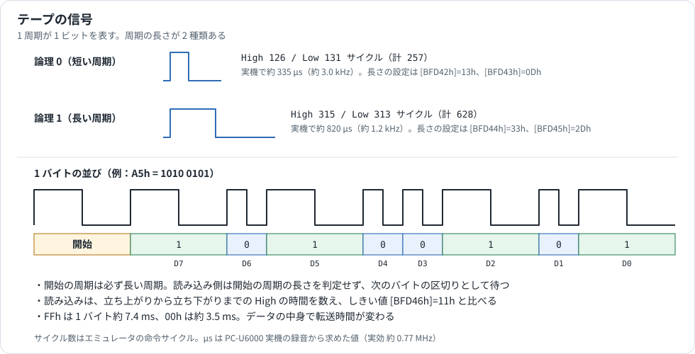
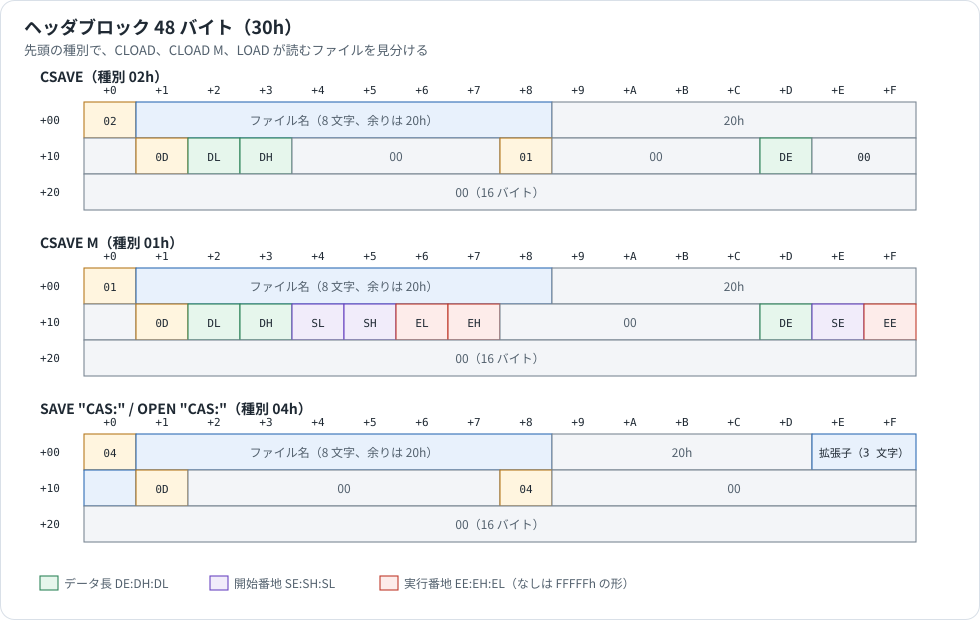
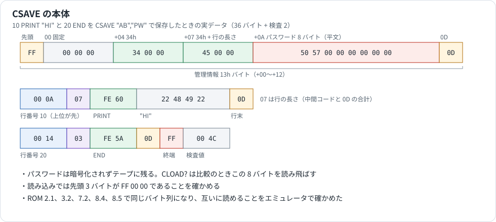

# テープの解析

カセットテープ（`CAS:`）で、データがどの形で流れるかをまとめた資料です。`CSAVE`、`CLOAD`、`CSAVE M`、`CLOAD M` の仕様と、テープ上のデータの持ち方を中心に説明します。BASIC の命令の書式は [BASIC_REFERENCE.md](BASIC_REFERENCE.md)、IOCS の呼び方は [IOCS_REFERENCE.md](IOCS_REFERENCE.md)、シリアルポートは [SERIAL_PORT.md](SERIAL_PORT.md) を参照してください。

## 情報源と確度

| 表記 | 情報源 | 内容 |
|---|---|---|
| **公式資料** | PC-E500 Technical Reference Manual（p.62〜66、p.87） | ドライバの呼び方、作業域、ヘッダの形 |
| **マニュアル** | PC-E500 Operation Manual | 命令の書式、レコーダの条件 |
| **コード** | ROM 8.5 と 3.2 の逆アセンブル | 公式資料にない処理の流れ |
| **実験** | エミュレータの作業用コピー | XOUT の変化をサイクル単位で記録し、記録した波形を CI に入れて読ませた。主に ROM 3.2 で試し、2.1、7.2、8.4、8.5 でも確かめた |
| **実機** | PC-U6000 の `CSAVE M` のブザー音の録音 | 周期の実時間だけに使った |

**試していないこと**

- カセットレコーダ、CE-124、CE-126P を使った保存と読み込み。実機の録音で確かめたのは保存側の音だけで、実機の `CLOAD` は試していません。
- `CLOAD @` の読み込み（§6）。

番地は ROM 8.5 のものです。カセットのドライバ（`E96DEh`〜`EA4B2h`）は、ROM 3.2 では 2E4h 足した番地にあります。ほかの版は [ROM_VERSIONS_DRIVERS.md](ROM_VERSIONS_DRIVERS.md) を参照してください。

## 1. 命令の一覧

| 命令 | 内容 | ヘッダの種別 | 根拠 |
|---|---|---|---|
| `CSAVE ["名前"][,"パスワード"]` | BASIC プログラムを保存する | 02h | マニュアル、実験 |
| `CLOAD ["名前"]` | 種別 02h を読み込む | 02h | マニュアル、実験 |
| `CLOAD? ["名前"]` | 種別 02h をメモリのプログラムと比べる | 02h | マニュアル、実験 |
| `CSAVE M ["名前",]開始,終了[,実行]` | メモリの範囲をそのまま保存する | 01h | コード、実験 |
| `CLOAD M ["名前"][,番地]`、`CLOAD M 番地` | 種別 01h を読み込む。番地を書くとそこへ読む | 01h | コード、実験 |
| `CLOAD @ ["名前"]` | 旧形式のテープを読む（§6） | なし | コード。受け付けるところまで実験 |
| `SAVE "CAS:名前"` | プログラムを ASCII で保存する | 04h | マニュアル、実験 |
| `LOAD "CAS:名前"` | 種別 04h を読み込む | 04h | マニュアル、実験 |
| `OPEN "CAS:名前" FOR OUTPUT / INPUT AS #n` | データを読み書きする | 04h | マニュアル、実験 |

`CSAVE M` と `CLOAD M` は操作マニュアルに載っていません。公式資料にはヘッダの形だけがあります。`SAVE M "CAS:..."` と `LOAD M "CAS:..."` は使えず、`Bad drive name` になります（実験）。

読み込む命令は種別が違うブロックを読み飛ばします。たとえば `CSAVE M` のテープに `CLOAD` をかけると、エラーを出さずに次のファイルを探し続けます（実験）。止めるには `BREAK` を押します。

## 2. 信号



1 周期が 1 ビットを表します。ブザーと同じ XOUT の信号を High と Low に切り替えて作るので、保存の音はブザーからも聞こえます（`CSAVE M` で確認。実機）。

| | 論理 0 | 論理 1 | 根拠 |
|---|---|---|---|
| High のサイクル数 | 126 | 315 | 実験 |
| Low のサイクル数 | 131 | 313 | 実験 |
| 実機の周期 | 約 329〜335 µs | 約 820 µs | 実機 |
| 周波数 | 約 3.0 kHz | 約 1.2 kHz | 実機 |

サイクル数はバイトの区切りやビットの種類で少し変わります（データ中の短い周期の Low は 117〜178）。上の表は搬送音と、同期の長い周期の値です。

エミュレータは 1.024 MHz で動くので周波数は実機より高く出ます。実機の録音の周期とサイクル数から求めた実効速度は約 0.77 MHz で、CPU の資料の 1 実行サイクル 1.30 µs（2.304 MHz ÷ 3 = 768 kHz）と合います。本資料の秒数はこの値で換算しました。この換算で保存開始までの無音は 8.3 秒になり、マニュアルの「約 8 秒」と合います。

### 1 バイト

開始の長い周期 1 個のあとに、データ 8 ビットを上位から並べます。1 バイトは FFh で約 7.4 ms、00h で約 3.5 ms です。ROM 全 256 KB の保存は約 21.7 分でした（実験の 996,558,990 サイクルを換算。PC-U6000 の録音と一致）。

### 作業域

長さは RAM の作業域にあり、値を変えられます。起動時に ROM の表（8.5 `E9726h`）からコピーします。表の中身は 11 本の ROM すべてで同じです。

| 番地 | 既定値 | 内容 | 根拠 |
|---|---|---|---|
| `BFD42h` / `BFD43h` | 13h / 0Dh | 論理 0 の High / Low の長さ | 公式資料 |
| `BFD44h` / `BFD45h` | 33h / 2Dh | 論理 1 の High / Low の長さ | 公式資料 |
| `BFD46h` | 11h | 読み込みで 0 と 1 を分けるしきい値 | 公式資料 |
| `BFD47h` | 01h | bit0: リモート制御をする。bit7: 入力の極性を逆に読む | コード |
| `BFD48h` | 50h | ヘッダの前の無音 | 公式資料 |
| `BFD49h` | 14h | ヘッダのあとの無音 | 公式資料 |
| `BFD4Ah` | 2710h | ヘッダの搬送音の周期数（10000） | 公式資料 |
| `BFD4Ch` / `BFD4Dh` | 28h / 28h | ヘッダの同期の長い周期 / 短い周期の数（40） | 公式資料 |
| `BFD4Eh` | 2AF8h | 本体の搬送音の周期数（11000） | コード、実験 |
| `BFD50h` / `BFD51h` | 14h / 14h | 本体の同期の長い周期 / 短い周期の数（20） | 公式資料 |
| `BFD52h` | 28h | 本体のあとの無音 | 公式資料 |
| `BFD53h` | 1388h | 読み込みで搬送音と認める短い周期の数（5000） | 公式資料 |
| `BFD55h` / `BFD56h` | 78h / 3Ch | モーターの開始後 / 停止後の待ち時間 | コード |

公式資料は本体の搬送音を `BFD4Ah` と書いていますが、コード（`E9D71h`）は `BFD4Eh` を使い、実際に 11000 周期が出ます。

### 入出力のポート

| 動作 | ポート | 根拠 |
|---|---|---|
| 出力 | 内部 RAM `FDh`（SCR）のビット 4 を立てると High、ビット 4〜6 を消すと Low | コード、実験 |
| 入力 | 内部 RAM `FFh`（SSR）のビット 1 を読む | コード、実験 |
| リモート | CE-126P が選ばれていれば、デバイスコード 10h で開始、00h で停止を送る | コード |

読み込みの処理は `FDh` のビット 4〜6 をすべて立てます。この設定では CO の出力が CI と同じになるので、テープの音がそのままブザーへ出ます（CPU の資料。[SYSTEM_INTERNALS.md](SYSTEM_INTERNALS.md) §5）。テープの入出力中は割込みを止め、`BREAK` と電池切れをループの中で調べます。

0 と 1 の判定は、立ち上がりから立ち下がりまでの High の時間をループで数え、`BFD46h` と比べます（`E9F38h`）。Low の時間は判定に使いません。

## 3. ブロック


ファイルはヘッダブロック 1 個と本体ブロック 1 個以上からなります。

| 区間 | ヘッダ | 本体 | 実時間（換算） |
|---|---|---|---|
| 前の無音 | あり | なし | 8.3 秒 |
| 搬送音（短い周期） | 10000 | 11000 | 3.4 秒 / 3.7 秒 |
| 同期（長い周期） | 40 | 20 | |
| 同期（短い周期） | 40 | 20 | |
| 同期の終わり（長い周期） | 1 | 1 | |
| データ | 48 バイト | 任意 | |
| 検査値 | 2 バイト | 2 バイト | |
| 最後の長い周期 | 1 | 1 | |
| 後の無音 | あり | あり | 約 3.0 秒 / 約 5 秒 |

**検査値**はデータの中の 1 のビットの数を 16 ビットで数えたものです。上位バイト、下位バイトの順に置きます。すべての実験で一致しました。公式資料には検査値が 1 バイトとありますが、ROM は 2 バイト書いて 2 バイトとも比べます（`E9BFBh`）。

**読み込みの同期**は次の順です（`E9DB5h`）。途中で条件から外れると最初に戻ります（コード）。

1. 短い周期が `BFD53h` 個（5000 個）続くのを待つ
2. 最初の長い周期を待ち、指定の個数の長い周期を数える
3. 指定の個数の短い周期を数える
4. 長い周期を待ち、データを読み始める

**本体に番地やブロック番号はありません**。読み込みはヘッダの情報と順番だけを頼りにします。本体の途中で読み違えると検査値が合わず、`I/O error` になりますが、そこまでのバイトはすでにメモリへ書き込まれています（実験）。ビットを 1 個入れ替えるような、1 の数が変わらない誤りは検出できません。

## 4. ヘッダブロック



| オフセット | CSAVE（02h） | CSAVE M（01h） | SAVE、OPEN（04h） |
|---|---|---|---|
| `+00` | 02h | 01h | 04h |
| `+01`〜`+08` | 名前 | 名前 | 名前 |
| `+09`〜`+0D` | 20h | 20h | 20h |
| `+0E`〜`+10` | 20h | 20h | 拡張子（なければ 20h） |
| `+11` | 0Dh | 0Dh | 0Dh |
| `+12`、`+13` | 長さの下位 16 ビット | 長さの下位 16 ビット | 00h |
| `+14`、`+15` | 00h | 開始番地の下位 16 ビット | 00h |
| `+16`、`+17` | 00h | 実行番地の下位 16 ビット | 00h |
| `+18` | 01h | 00h | 04h |
| `+1D` | 長さの上位 | 長さの上位 | 00h |
| `+1E` | 00h | 開始番地の上位 | 00h |
| `+1F` | 00h | 実行番地の上位 | 00h |
| 残り | 00h | 00h | 00h |

名前は 8 文字までで、長い分は切り捨てられ、短い分は 20h で埋まります（実験）。`CSAVE` の名前に `.` や `*` を入れると `Syntax error` です。

公式資料の図では `CSAVE M` の `+0D`〜`+10` が 00h ですが、ROM は 20h を書きます（8.5 `EB4EBh`、実験）。

実例（`CSAVE M "CD",&HB8000,&HB800F`）:

```text
0000  01 43 44 20 20 20 20 20 20 20 20 20 20 20 20 20  .CD
0010  20 0D 10 00 00 80 FF FF 00 00 00 00 00 00 0B FF   ...............
0020  00 00 00 00 00 00 00 00 00 00 00 00 00 00 00 00
0030  00 34                                            検査値（1 のビット 34h 個）
```

長さ 10h、開始 `0B:8000h`、実行番地なし（`F:FFFFh`）を表します。`CSAVE M "A",&HC0000,&HFFFFF` なら、長さは `+12`=00h、`+13`=00h、`+1D`=04h（40000h）、開始は `+1E`=0Ch になります（実験）。

## 5. 本体の中身

### 5.1 CSAVE、CLOAD



本体はメモリ上のプログラム領域そのものです。先頭 13h バイトの管理情報のあとに、中間コードの行が続き、`FFh` で終わります。行の形は公式資料（p.87）のとおりで、行番号（上位バイトが先）、長さ、中間コード、`0Dh` です。

| オフセット | 内容 | 根拠 |
|---|---|---|
| `+00`〜`+03` | `FF 00 00 00` | 実験 |
| `+04`〜`+06` | プログラムの先頭（`+12` の `0Dh`）の位置。メモリブロックの先頭から数える（34h = 22h + 12h） | 実験 |
| `+07`〜`+09` | プログラムの終わりの位置（同じ数え方） | 実験 |
| `+0A`〜`+11` | パスワード（なければ 00h） | コード、実験 |
| `+12` | `0Dh`。プログラムの先頭の印 | 公式資料 |

パスワードは平文のまま本体に入るので、テープからそのまま読めます。

読み込みの動作は次のとおりです。

| 命令 | 動作 | 根拠 |
|---|---|---|
| `CLOAD` | 先頭 3 バイトが `FF 00 00` であることを確かめて読む（`E9B46h`） | コード、実験 |
| `CLOAD?` | メモリと 1 バイトずつ比べる。パスワードの 8 バイトは飛ばす（`E9B42h`）。違えば `Verify error` | コード、実験 |
| 名前が違う | エラーにせず次のヘッダを探し続ける | マニュアル、実験 |
| 空きが足りない | 読む前に長さで判定してエラーにする | コード |

### 5.2 CSAVE M、CLOAD M

本体は指定した範囲のメモリそのままです。管理情報はなく、長さの分のバイトと検査値だけが並びます。

```text
CSAVE M "CD",&HB8000,&HB800F の本体
0000  10 11 12 13 14 15 16 17 18 19 1A 1B 1C 1D 1E 1F
0010  00 30                                            検査値
```

| 書き方 | 読み込み先 | 実行 |
|---|---|---|
| `CLOAD M` | ヘッダの開始番地 | 実行番地があれば実行する |
| `CLOAD M "CD"` | ヘッダの開始番地 | 実行番地があれば実行する |
| `CLOAD M &HB8100` | 指定の番地 | しない |
| `CLOAD M "CD",&HB8100` | 指定の番地 | しない |

いずれも実験で確かめました。実行は `JP` で飛び、`RETF` で BASIC に戻ります（`EB654h`）。名前と番地の区切りは `,` か `;` です（コード）。

`CSAVE M` は `開始` より `終了` が小さいと `Data out of range`、`終了` がないと `Syntax error` です（実験）。

ROM の領域も指定できます。`CSAVE M "A",&HC0000,&HFFFFF` の音を波形からバイト列に戻すと、ROM 3.2 の 256 KB と完全に一致しました（実験）。プログラムを打ち込まずに、この 1 行で内容を外へ出せます。

### 5.3 SAVE、OPEN（種別 04h）

ファイル制御（FCS）を通るファイルは、本体を 256 バイトずつに分けます。`SAVE "CAS:AB"` の本体は ASCII のプログラムです。

```text
0000  31 30 20 50 52 49 4E 54 20 22 48 49 22 0D 0A 32  10 PRINT "HI"..2
0010  30 20 45 4E 44 0D 0A 1A ...                      0 END...
```

- 行末は `0Dh 0Ah`、ファイルの終わりは `1Ah` です。
- 最後の本体も 256 バイトで、`1Ah` より後ろには初期化していないバッファの内容がそのまま入ります（実験で、前のブロックの続きが残っていました）。読むときは `1Ah` までが中身です。
- 本体ごとに搬送音と無音が付くので遅くなります。約 1 KB のプログラムで本体 4 個、全体で約 42 秒でした（換算）。

`OPEN` は `PRINT #` の出力をそのまま並べます。`PRINT #2,"HELLO"` と `PRINT #2,123` の本体は `HELLO\r\n 123 \r\n` のあとに `1Ah` が続き、`INPUT #2,A$,B` で読み戻せました（実験）。`CAS:` は同時に 1 ファイルしか開けません（マニュアル）。

### 5.4 COM: を開いたままテープを使ったとき

テープの入出力を始める処理（`EA2F7h`）は、COM が開いていれば受信を止めてから割込みを止めます。`RR` などを下げ、XON/XOFF の指定があれば `13h` を送り、少し待ちます（コード）。信号の意味は [SERIAL_PORT.md](SERIAL_PORT.md) を参照してください。

## 6. CLOAD @

`CLOAD` の構文解析に `@` の分岐があり、`CLOAD @` と `CLOAD @"AB"` は受け付けられて入力待ちになります（実験）。`CSAVE @` は `Syntax error` です。コードから読み取れる形は本資料のほかの形式と別物で、種別 7xh を持つ旧形式です（`EA05Dh`）。

| 項目 | 内容 |
|---|---|
| ビット | 区間内の変化の数を数え、しきい値と比べて判定する（`EA3FFh` 付近） |
| 単位 | 4 ビットを 1 単位として読み、2 単位で 1 バイト |
| ヘッダ | `07h` のあとに 0〜3 の種別、名前 8 バイト（逆順）、検査値 |
| パスワード | 種別のビット 0 が立っていれば 8 バイト追加 |
| 本体 | 120 バイトごとに検査値が入り、`FFh` で終わる |
| 検査値 | 上下の 4 ビットを足し合わせる 8 ビット |

読み込んだ中間コードは変換します。マニュアルの `CLOAD?` の注記に「他のコンピュータで作ったテープの場合は PC-E500 のコードに変換する」とあり、これに当たると見られます（推定）。どの機種のテープかは確かめていません。実際のデータで試していないので、本節はコードの読み取りです。

## 7. IOCS からの呼び方

テープは IOCS の device 4 です（公式資料 p.62〜63）。`(cx)=0004h` として呼びます。

| i | 内容 | 入力 | 戻り |
|---|---|---|---|
| 3Fh | 作業域を初期化する | | |
| 40h | 初期化 | a: 0 全リセット、1 リセット、2 off、3 on | |
| 41h | 本体を書く | x: 番地、y: バイト数 | C=0 正常。x: 次の番地、y: 処理したバイト数 |
| 42h | 本体を読む | x: 番地、y: バイト数 | 同上 |
| 43h | 本体を比べる | x: 番地、y: バイト数 | 同上 |
| 44h | ヘッダを書く | x: ヘッダの番地 | C=1 のとき a: エラーコード |
| 45h | ヘッダを読む | x: ヘッダの番地 | 同上 |

エラーコードのうち、`FFh` は `BREAK`、`FEh` は電池切れ、`0Bh` は比較の不一致、`00h` は検査値の不一致や読み取りの失敗です（コード）。

ROM の中の入口は次のとおりです（8.5、遠い呼び出し `CALLF`）。

| 番地 | 内容 |
|---|---|
| `E9AB0h` / `E9AE0h` | ヘッダを書く / 読む（X: 番地、30h バイト） |
| `E9B12h` | 本体を書く（X: 番地、Y: バイト数） |
| `E9B5Ah` | 本体を読む |
| `E9B46h` | 本体を読む（`FF 00 00` を確かめる。`CLOAD`） |
| `E9B42h` | 本体を比べる（パスワードを飛ばす。`CLOAD?`） |
| `E9BB8h` | 本体を比べる |

BASIC の命令の処理は `CSAVE` が `FDFEFh`、`CLOAD` が `FE0D8h`、`CSAVE M` が `EB45Eh`、`CLOAD M` が `EB555h` です。
