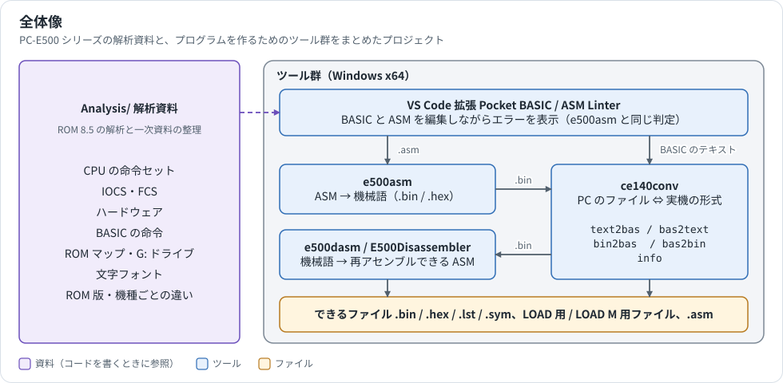

# PC-E500 Tools ガイド

ツールの使い方と、PC-E500 シリーズで機械語を動かすための基礎を、図を使って説明します。コマンドやオプションの一覧は各ツールの README に、命令や ROM の細かい情報は [Analysis/](../Analysis/) にあります。このガイドはそれらへの入口です。

## 読む順番

| 順 | 文書 | 内容 | こんな人に |
|---|---|---|---|
| 1 | [はじめに](getting-started.md) | 導入から、サンプルを実機で動かすまで | 初めて使う |
| 2 | [開発の流れ](workflows.md) | 機械語と BASIC の往路・復路、番地の決め方 | 自分のプログラムを作る |
| 3 | [ファイル形式](file-formats.md) | SD カード上の形式、ヘッダ、出力ファイルの中身 | ファイルの中身を確かめたい |
| 4 | [機械語の基礎](machine-language-primer.md) | CPU、メモリ、PRE、IOCS、CALL、LCD | 機械語を書き始める |
| 5 | [トラブルシューティング](troubleshooting.md) | エラーメッセージと症状ごとの対処 | うまく動かない |
| 6 | [ツールの内部構造](architecture.md) | ソースの依存関係、処理の流れ、テスト、図の編集方法 | ツールを改造する |

## やりたいことから探す

| やりたいこと | 読むもの |
|---|---|
| アセンブラの全オプション、文法、疑似命令を調べる | [Assembler/README.md](../Assembler/README.md) |
| 逆アセンブラの全オプション、GUI の使い方を調べる | [DisAssembler/README.md](../DisAssembler/README.md) |
| ファイル変換の全オプションを調べる | [FileConverter/README.md](../FileConverter/README.md) |
| VS Code 拡張の診断コードと設定を調べる | [pocket-basic-linter/README.md](../VSCodeExtensions/pocket-basic-linter/README.md) |
| 命令の動作、オペコード表、サンプルを調べる | [PC-E650_ASSEMBLER_MANUAL.md](../Analysis/PC-E650_ASSEMBLER_MANUAL.md) |
| 画面、キー、ファイルを機械語から使う | [IOCS_REFERENCE.md](../Analysis/IOCS_REFERENCE.md) |
| LCD、キーボード、ポートを直接操作する | [HARDWARE_REFERENCE.md](../Analysis/HARDWARE_REFERENCE.md) |
| CE-140F の通信手順を調べる | [CE-140F_PROTOCOL.md](../Analysis/CE-140F_PROTOCOL.md) |
| CE-515P へ送るコマンドを調べる | [CE-515P_PLOTTER.md](../Analysis/CE-515P_PLOTTER.md) |
| テープのデータの形を調べる | [TAPE_FORMAT.md](../Analysis/TAPE_FORMAT.md) |
| シリアルポートの設定と通信を調べる | [SERIAL_PORT.md](../Analysis/SERIAL_PORT.md) |
| 文字のドットパターンを調べる | [CHARACTER_FONT.md](../Analysis/CHARACTER_FONT.md) |
| BASIC の命令の書式を調べる | [BASIC_REFERENCE.md](../Analysis/BASIC_REFERENCE.md) |
| ROM の中を読む | [PC-E650_ROM_MAP.md](../Analysis/PC-E650_ROM_MAP.md)、[PC-E650_GDRIVE.md](../Analysis/PC-E650_GDRIVE.md) |
| 機種や ROM 版の違いを調べる | [BASIC](../Analysis/ROM_VERSIONS_BASIC.md)、[ドライバ](../Analysis/ROM_VERSIONS_DRIVERS.md)、[機種](../Analysis/ROM_VERSIONS_MODELS.md)、[システム](../Analysis/ROM_VERSIONS_SYSTEM.md) |

## 図の一覧

| 図 | 載っている文書 |
|---|---|
| [全体像](images/overview.svg) | このページ、ルートの README |
| [機械語の流れ](images/workflow-machine-code.svg)、[BASIC の流れ](images/workflow-basic.svg) | [開発の流れ](workflows.md) |
| [SD カード上の 2 つの形式](images/file-formats.svg) | [ファイル形式](file-formats.md)、FileConverter/README |
| [ハードウェア構成](images/hardware-block.svg)、[レジスタ](images/cpu-registers.svg) | [機械語の基礎](machine-language-primer.md)、Analysis の各資料 |
| [外部メモリマップ](images/memory-map-external.svg)、[内部 RAM マップ](images/memory-map-internal.svg) | 同上 |
| [PRE バイト](images/pre-byte.svg)、[IOCS の呼び出し](images/iocs-call.svg) | 同上 |
| [機械語エリアの確保](images/ml-area.svg)、[CALL 文の動き](images/basic-call.svg) | 同上 |
| [LCD の構成](images/lcd-layout.svg)、[ROM 版番号の読み方](images/rom-versions.svg) | 同上 |
| [依存関係](images/toolchain-architecture.svg)、[e500asm の処理](images/assembler-passes.svg) | [ツールの内部構造](architecture.md) |
| [e500dasm の照合](images/disassembler-verify.svg)、[VS Code 拡張の動き](images/vscode-diagnostics.svg) | 同上 |

## 確認の範囲

- PC 側のコマンドと、その出力例は実際に実行して確かめたものです。
- 実機での手順は [PC-E650_ASSEMBLER_MANUAL.md](../Analysis/PC-E650_ASSEMBLER_MANUAL.md) の検証結果（PC-E650、ROM 8.5）に基づきます。ほかの機種や ROM 版では、番地が違うことがあります。
