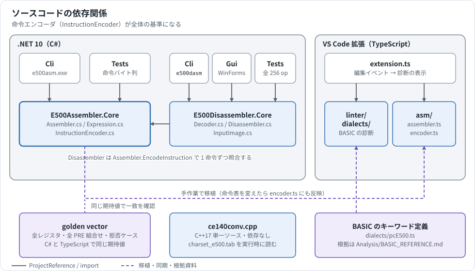
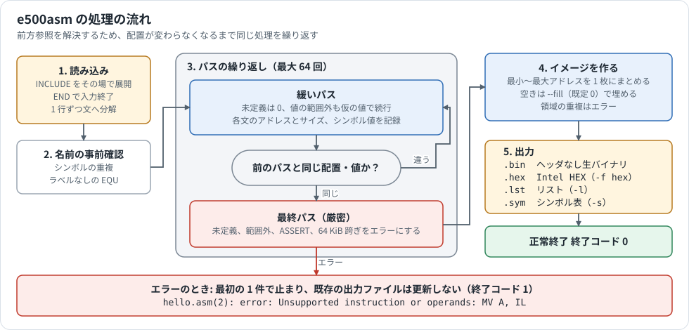
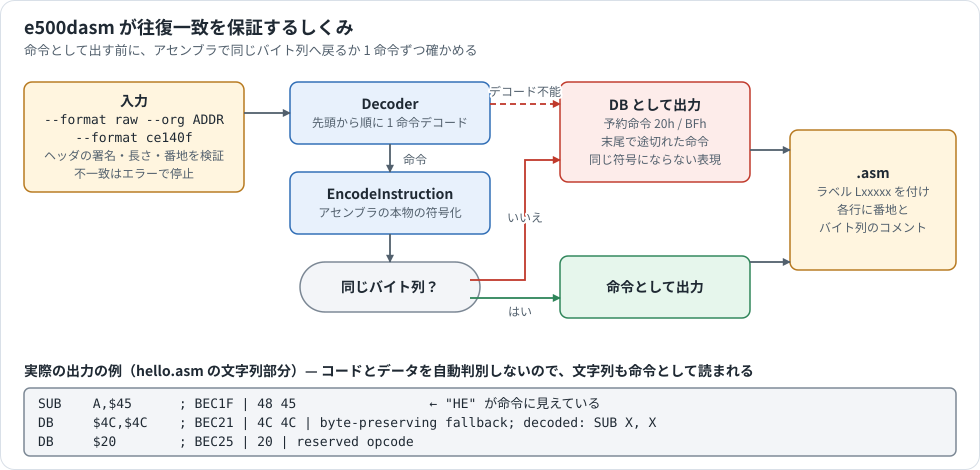
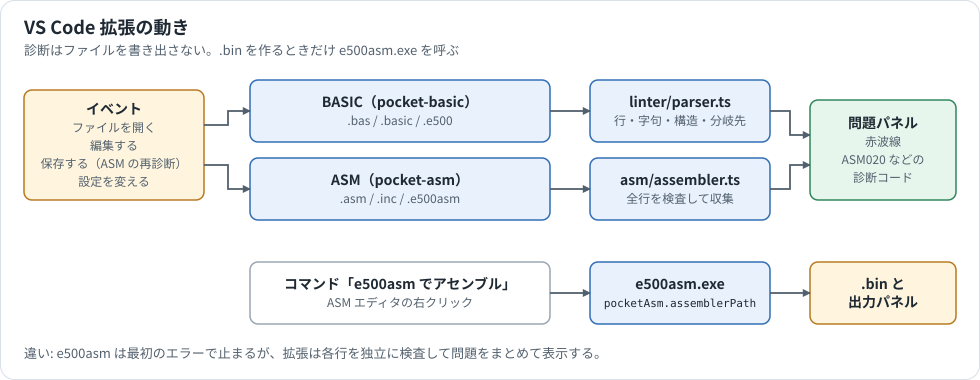

# ツールの内部構造

ツールを改造する人に向けて、ソースの構成、処理の流れ、テスト、変更時に合わせて直す場所を説明します。

[ガイドの目次へ戻る](README.md)

## 依存関係

| 場所 | 言語 | 内容 |
|---|---|---|
| `Assembler/src/E500Assembler.Core/` | C# | `Assembler.cs`（パス処理と疑似命令）、`Expression.cs`（式）、`InstructionEncoder.cs`（命令の符号化） |
| `Assembler/src/E500Assembler.Cli/` | C# | コマンドライン、ファイルの保存 |
| `DisAssembler/src/E500Disassembler.Core/` | C# | `Decoder.cs`（1 命令の解読）、`Disassembler.cs`（ラベルと出力）、`InputImage.cs`（入力形式） |
| `DisAssembler/src/E500Disassembler.Cli/`、`.Gui/` | C# | CLI と Windows Forms の GUI |
| `FileConverter/ce140conv.cpp` | C++17 | 単一ソースの変換ツール。他のツールに依存しない |
| `VSCodeExtensions/pocket-basic-linter/src/` | TypeScript | VS Code 拡張 |

**基準になるのは `InstructionEncoder.cs` です。** 逆アセンブラはこれを参照して出力を照合し、VS Code 拡張の `src/asm/encoder.ts` はこれを移植したものです。

## e500asm の処理

`Assembler.cs` の `Assemble` が中心です。

- **`ORG` や `DS` の式は後ろのラベルも参照できるので、番地は 1 度では決まりません。** そのため、前のパスの結果を使って配置を計算し、前回と同じになるまで繰り返します。
- 緩いパスでは未定義のシンボルを 0 として処理します。前方参照があるのは普通のことで、この段階ではエラーにしません。
- 配置が安定したら厳密なパスを 1 回実行し、ここで未定義シンボル、値の範囲、`ASSERT`、64 KiB 境界を判定します。このパスで配置が変わるとエラーです。
- 64 回で安定しないと `Assembly layout did not converge` で止まります。
- `INCLUDE` はパスの前に展開します。`INCBIN` はパスの中で 1 度だけ読みます。

## e500dasm の処理

出力が元のバイト列へ戻ることは、次のしくみで保証しています。

1. `Decoder.DecodeAt` が 1 命令を解読します。
2. `Decoder.Matches` が `Assembler.EncodeInstruction` を呼び、同じバイト列に戻るか確かめます。
3. 戻らないものは `DB` にします。解読できないもの（予約命令 `20h` / `BFh`、末尾で途切れた命令）も同じです。

先頭から順に解読するだけなので、コードとデータは区別しません。上の図の例のように、文字列も命令として読みます。区別が必要なら、生成後に手で `DB` へ直します。

ラベルは、分岐先が命令の先頭に一致するときだけ `Lxxxxx` の形で生成します。

リスト（`.lst`）のソース欄はファイル名だけを書きます。リストを公開しても、PC のフォルダ名やユーザー名が出ないようにするためです。

## VS Code 拡張の動き

| ファイル | 内容 |
|---|---|
| `src/extension.ts` | イベントの受付、診断の表示、コマンド |
| `src/linter/` | BASIC の診断（`parser.ts`、`text.ts`） |
| `src/dialects/` | BASIC の方言定義。`pcE500.ts` に予約語と構造の対応 |
| `src/asm/` | `E500Assembler.Core` の移植（`assembler.ts`、`encoder.ts`、`expression.ts`） |
| `syntaxes/` | シンタックスハイライトの文法 |

e500asm は最初のエラーで止まりますが、拡張はエラーのある行のサイズを直前のパスの値で補って続けるので、問題をまとめて表示できます。

## ce140conv

依存のない単一ソースです。ヘッダの固定部分は `HDR_SIG` と `HDR_TAIL` の定数で定義しています。文字コード表はコンパイルせず、実行時に `charset_e500.tab` を EXE と同じ場所かカレントフォルダから読みます。

## ビルドとテスト

| 対象 | コマンド | 確かめる内容 |
|---|---|---|
| アセンブラ | `Assembler\build.cmd`（`-TestOnly` でテストのみ） | 命令のバイト列、PRE の全組み合わせ、前方参照、Intel HEX など |
| アセンブラの EXE | `python Assembler\tests\cli_smoke.py` | EXE の統合テスト（Python 3） |
| 逆アセンブラ | `DisAssembler\build.cmd`（`-TestOnly` でテストのみ） | 全 256 オペコード、任意のバイト列、途切れた命令、往復一致 |
| ce140conv | `FileConverter\build.bat` | 自動テストはない |
| VS Code 拡張 | `npm test`（`VSCodeExtensions/pocket-basic-linter` で実行） | BASIC の診断と、アセンブラと同じ golden vector |
| VSIX の作成 | `npm run package` | `.vsix` を生成 |

## 変更するときに合わせて直す場所

| 変更 | 合わせて直す場所 |
|---|---|
| 命令表や符号化（`InstructionEncoder.cs`） | `src/asm/encoder.ts`、双方のテストの golden vector、[アセンブラマニュアル](../Analysis/PC-E650_ASSEMBLER_MANUAL.md) |
| 式や数値の書式（`Expression.cs`） | `src/asm/expression.ts`、[番地の書き方の比較](workflows.md#番地の書き方はツールごとに違う) |
| `--org` の書式（`Assembler.ParseAddress`） | e500asm と e500dasm が共用。`--help` の文面と[番地の書き方の比較](workflows.md#番地の書き方はツールごとに違う) |
| パス処理や診断（`Assembler.cs`） | `src/asm/assembler.ts`、拡張の診断コードの表 |
| ヘッダの形式 | `ce140conv.cpp`、`InputImage.cs`、[ファイル形式](file-formats.md)と図 |
| BASIC のキーワード | `src/dialects/pcE500.ts`、`syntaxes/pocket-basic.tmLanguage.json`、[BASIC_REFERENCE.md](../Analysis/BASIC_REFERENCE.md) |
| コマンドのオプション | 各ツールの README、[コマンド早見表](workflows.md#コマンド早見表) |

## 配布

`.NET` の EXE は自己完結型で 1 つ 70〜120 MB あるため、リポジトリに入れず [Releases](https://github.com/litchi-gh/pc-e500_tools/releases) で配布しています。

| 配布ファイル | 内容 |
|---|---|
| `e500asm-<版>-win-x64.zip` | `e500asm.exe` |
| `e500dasm-<版>-win-x64.zip` | `e500dasm.exe` |
| `E500Disassembler-<版>-win-x64.zip` | `E500Disassembler.exe` |
| `ce140conv-<版>-win-x64.zip` | `ce140conv.exe` と `charset_e500.tab` |
| `pocket-basic-linter-<版>.vsix` | VS Code 拡張 |

## 図を編集する

図は [images/](images/) にある SVG で、テキストエディタで直せます。追加するときは、次の決まりに合わせます。

| 項目 | 決まり |
|---|---|
| 背景 | 白で塗りつぶす。GitHub のダークモードでも読めるようにするため |
| 幅 | `viewBox` の幅を 980 にする |
| アクセシビリティ | `<title>` と `<desc>` を書く |
| 字体 | 本文は `.b` / `.s` などのクラス、コードは `.m` / `.ms`（等幅）。等幅の行には `xml:space="preserve"` を付ける |

色は意味で使い分けます。

| 色 | 塗り / 線 | 意味 |
|---|---|---|
| 青 | `#E8F1FC` / `#2F6DB5` | ツール、処理 |
| 黄 | `#FFF5DF` / `#B7791F` | ファイル、データ |
| 緑 | `#E6F6EC` / `#2F855A` | 実機、外部の機器、成功 |
| 紫 | `#F1ECFB` / `#6B4FBB` | 資料、状態 |
| 赤 | `#FDECEA` / `#C0392B` | 注意、エラー |
| 灰 | `#F3F5F8` / `#7B8794` | 背景のグループ、予約領域 |
