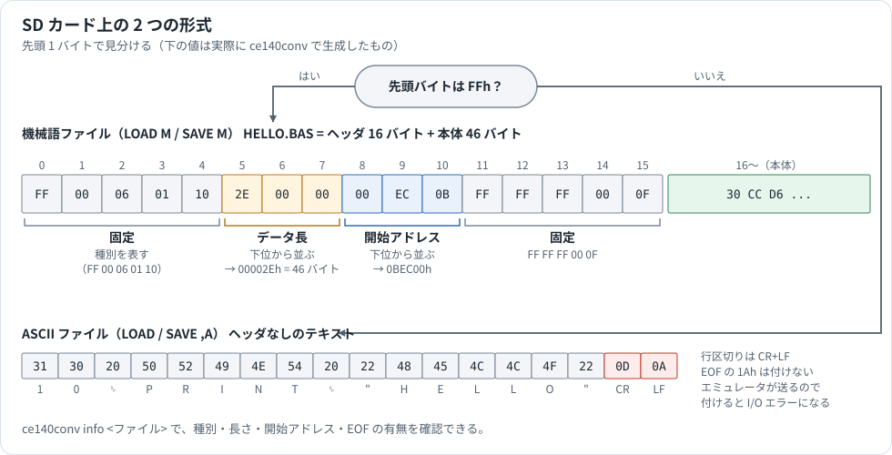

# ファイル形式

SD カードに置くファイルと、アセンブラが出力するファイルの中身を説明します。下の例は、[hello.asm](../Analysis/asm_samples/hello.asm) と `Assembler/examples/sum.asm` から実際に生成したものです。

[ガイドの目次へ戻る](README.md)

## SD カード上の 2 つの形式



先頭バイトが `FFh` なら機械語ファイル、それ以外なら ASCII です。CE-140F エミュレータも同じ方法で判定します。`ce140conv info` で確かめられます。

### 機械語ファイル（`LOAD M` / `SAVE M`）

16 バイトのヘッダのあとに本体が続きます。変化するのはデータ長と開始アドレスだけで、残りの 11 バイトは固定です。

| オフセット | 長さ | 内容 |
|---|---|---|
| 0–4 | 5 | `FF 00 06 01 10` 固定 |
| 5–7 | 3 | データ長（24 ビット、下位から） |
| 8–10 | 3 | 開始アドレス（24 ビット、下位から） |
| 11–15 | 5 | `FF FF FF 00 0F` 固定 |

この構造は PC-E650 実機の `SAVE M` ファイル 5 本で確かめてあり、`ce140conv bin2bas --addr` の出力はそれらとバイト単位で一致します。

ファイル名の拡張子に決まりはありません。実機のダンプには `S3A.ROM` のような名前もあります。このガイドでは `SAVE` の既定に合わせて `.BAS` にしています。

```text
> ce140conv info HELLO.BAS
size       : 62 bytes
first byte : 0xff
type       : BINARY (LOAD M) - has 16-byte header
payload    : 46 bytes (after 16-byte header)
header hex :
0000  ff 00 06 01 10 2e 00 00 00 ec 0b ff ff ff 00 0f  ................
length     : 0x00002E (46 bytes)
address    : 0xBEC00-0xBEC2D
```

### ASCII ファイル（`LOAD` / `SAVE ,A`）

ヘッダのないテキストです。文字は Sharp の文字コードで、行区切りは CR+LF です。

```text
> ce140conv info PROG.BAS
first byte : 0x31
type       : ASCII  (LOAD)
eof marker : no
head hex   :
0000  31 30 20 50 52 49 4e 54 20 22 48 45 4c 4c 4f 22  10 PRINT "HELLO"
0010  0d 0a 32 30 20 45 4e 44 0d 0a                    ..20 END..
```

**末尾に EOF（`1Ah`）を付けてはいけません。** `Sharp_ce140f_emul` はファイルの終わりで自分で `1Ah` を送るので、ファイルにもあると 2 回届いて I/O エラーになります。`text2bas` は既定で付けません。`eof marker` の行で確かめられます。

`SAVE` に `,A` を付けないと、中間コードの形式で保存されます。この形式は `ce140conv` の対象外です。

## アセンブラの出力

### 生バイナリ（`.bin`）

ヘッダのない機械語そのものです。番地の情報はありません。複数の `ORG` があるときは、最小から最大の番地までを 1 つにまとめ、間を `--fill`（既定は 0）で埋めます。

### Intel HEX（`.hex`）

`-f hex` で出力します。20 ビットの番地は、上位をレコード種別 04（拡張リニアアドレス）で表します。

```text
:02000004000BEF                         ← 上位の番地 000Bh
:0B8000000800090A46017C011B06066F       ← 8000h から 11 バイト
:00000001FF                             ← 終わり
```

### リスト（`.lst`）

番地、機械語、ソースの対応です。`-l` で出力します。ソース欄の先頭は `ファイル名(行番号):` です。`INCLUDE` したファイルの行は、そのファイルの名前になります。

```text
Address  Machine code              Source
B8000    08 00                     sum.asm(6):         MV A,0
B8002    09 0A                     sum.asm(7):         MV IL,COUNT
B8004                            sum.asm(8): loop:
B8004    46 01                     sum.asm(9):         ADD A,IL
```

### シンボル表（`.sym`）

`-s` で出力します。`EQU` の形なので、別のソースから `INCLUDE` して使えます。

```text
COUNT EQU $A
loop EQU $B8004
start EQU $B8000
```

## 文字コード表（`charset_e500.tab`）

`text2bas` と `bas2text` が実行時に読み込む対応表です。再コンパイルせずに編集できます。

```text
HH   U+XXXX      # Sharp のバイト HH を Unicode の XXXX に対応させる
HH   =           # 未定義と明示する
```

| 範囲 | 状態 |
|---|---|
| `20h`–`7Eh`（ASCII） | 確定 |
| `A1h`–`DFh`（半角カナ） | JIS X 0201 の配列を既定にしている。文字 ROM との照合は未実施 |
| その他の記号 | 判明した分を追加していく |

表にないバイト `HH` は Unicode の私用領域 `U+E000 + HH` と対応します。そのため、未対応の文字があっても `bas2text` → `text2bas` で元に戻ります。例外は次の 2 つです。

- 元のファイルの末尾に `1Ah` があったときは、`text2bas --eof` で一致します。
- 元のファイルの最後の行に改行がなかったときは、補われた改行の分だけ違います。
