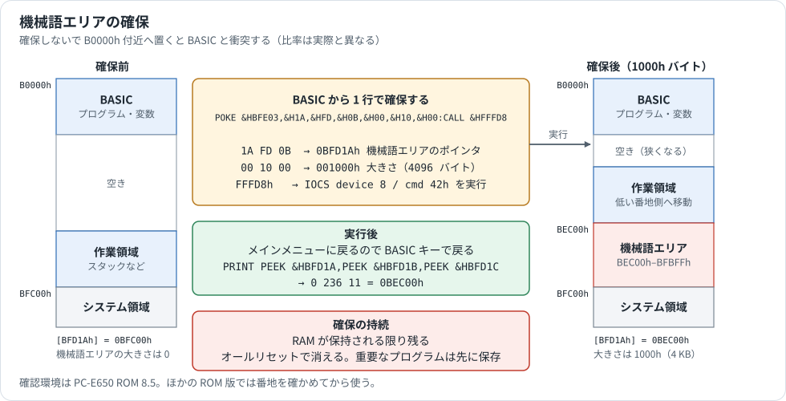

# はじめに

ツールを導入して、サンプル `hello.asm` を実機で動かすまでの手順です。PC 側だけなら 5 分ほどで終わります。

[ガイドの目次へ戻る](README.md)

## 1. 必要なもの

| 用途 | 必要なもの |
|---|---|
| ツールを動かす | Windows x64。追加のランタイムは不要 |
| 実機へ転送する | CE-140F、または互換の装置（例: 別プロジェクトの [Sharp_ce140f_emul](https://github.com/ffxx68/Sharp_ce140f_emul)） |
| 編集中にエラーを見る | VS Code（任意） |
| ソースからビルドする | .NET 10 SDK（アセンブラと逆アセンブラ）、C++17 コンパイラ（ce140conv）、Node.js（VS Code 拡張） |

対象機種は CPU に SC62015（ESR-L）を積んだ PC-E500 シリーズです。

## 2. ツールを入れる

リポジトリを取得します。

```powershell
git clone https://github.com/litchi-gh/pc-e500_tools.git
cd pc-e500_tools
```

`ce140conv.exe` はリポジトリに入っています。ほかのツールはサイズの都合で入っていないので、[Releases](https://github.com/litchi-gh/pc-e500_tools/releases) から取得して次の場所に置きます。

| ダウンロードするファイル | 置く場所 |
|---|---|
| `e500asm-*-win-x64.zip` の中の `e500asm.exe` | `Assembler/app/` |
| `e500dasm-*-win-x64.zip` の中の `e500dasm.exe` | `DisAssembler/app/` |
| `E500Disassembler-*-win-x64.zip` の中の `E500Disassembler.exe` | `DisAssembler/app/` |
| `pocket-basic-linter-*.vsix` | VS Code で「VSIX からのインストール」 |

ソースからビルドするときは、次のコマンドで `app/` に EXE ができます（.NET 10 SDK が必要）。

```powershell
.\Assembler\build.cmd
.\DisAssembler\build.cmd
```

動くか確かめます。

```powershell
.\Assembler\e500asm.cmd --version       # e500asm 0.2.0 (SC62015)
.\DisAssembler\e500dasm.cmd --version   # e500dasm 0.1.0 (SC62015)
```

## 3. サンプルをアセンブルする

リポジトリ直下で実行します。[hello.asm](../Analysis/asm_samples/hello.asm) は、画面の最下行に文字列を表示する 46 バイトのプログラムです。

```powershell
.\Assembler\e500asm.cmd Analysis\asm_samples\hello.asm -o hello.bin -l hello.lst
```

```text
OK: 46 bytes, origin=BEC00h -> ...\hello.bin
```

`origin=BEC00h` は、ソースの `ORG $BEC00` がそのまま反映された番地です。`hello.lst` を開くと、番地と機械語の対応を確認できます（下の例では、ソース欄のファイル名と行番号を省略しています）。

```text
BEC10    09 42          MV   IL,$42
BEC12    0C 1F EC 0B    MV   X,msg
BEC1A    05 E8 FF 0F    CALLF IOCS
BEC1E    07             RETF
```

## 4. SD カード用のファイルにする

`hello.bin` には番地の情報がありません。`LOAD M` で読めるように、番地入りの 16 バイトヘッダを付けます。

```powershell
.\FileConverter\ce140conv.exe bin2bas --addr 0xBEC00 hello.bin HELLO.BAS
.\FileConverter\ce140conv.exe info HELLO.BAS
```

```text
type       : BINARY (LOAD M) - has 16-byte header
payload    : 46 bytes (after 16-byte header)
length     : 0x00002E (46 bytes)
address    : 0xBEC00-0xBEC2D
```

`--addr` はソースの `ORG` と同じ値にします。違っていると、読み込まれた番地でプログラムが正しく動きません。

できた `HELLO.BAS` を SD カードへコピーし、CE-140F エミュレータに差して実機につなぎます。

## 5. 実機で動かす

BASIC モードで順に入力します。ここからは PC-E650（ROM 8.5）で確認された手順です。

**機械語エリアを確保します。** 実行するとメインメニューに戻るので、`BASIC` キーで戻ります。確保は 1 度だけで、オールリセットするまで残ります。

```basic
POKE &HBFE03,&H1A,&HFD,&H0B,&H00,&H10,&H00:CALL &HFFFD8
```



**読み込んで実行します。** `LOAD M` はヘッダの番地へ読み込みます。

```basic
LOAD M "X:HELLO.BAS"
CLS : CALL &HBEC00
```

4 行目に `HELLO, PC-E650!` と表示されれば成功です。

## 6. BASIC を送ってみる

テキストファイル `prog.txt` を作ります。

```basic
10 PRINT "HELLO"
20 END
```

変換して SD カードへコピーします。

```powershell
.\FileConverter\ce140conv.exe text2bas prog.txt PROG.BAS
```

実機で読み込んで実行します。

```basic
LOAD "X:PROG.BAS"
RUN
```

## 7. 逆アセンブルで往復を確かめる

`HELLO.BAS` をソースに戻し、再アセンブルして、元のバイナリと比べます。

```powershell
.\DisAssembler\e500dasm.cmd HELLO.BAS --format ce140f -o hello_dis.asm
.\Assembler\e500asm.cmd hello_dis.asm -o rebuilt.bin
fc.exe /b hello.bin rebuilt.bin
```

`fc.exe` が相違なしと報告すれば、バイト単位で一致しています。PowerShell では `fc` だけだと別のコマンドになるので、`.exe` まで書きます。

`hello_dis.asm` の末尾を見ると、文字列 `HELLO, PC-E650!` が命令として読まれています。逆アセンブラはコードとデータを自動では判別しないためです。詳しくは[ツールの内部構造](architecture.md#e500dasm-の処理)を参照してください。

## 8. VS Code で編集する（任意）

VSIX を入れると、編集中にエラーが表示されます。拡張子 `.asm` / `.inc` / `.e500asm` は ASM、`.bas` / `.basic` / `.e500` は BASIC として扱います。ほかの拡張子のファイルは、右クリックの「Pocket BASIC として開く」「PC-E500 アセンブリとして開く」で開けます。

右クリックの「e500asm でアセンブル」も使うには、設定に EXE の場所を指定します。

```json
{
  "pocketAsm.assemblerPath": "Assembler/app/e500asm.exe"
}
```

## 次に読むもの

- 自分のプログラムを作る: [開発の流れ](workflows.md)
- 機械語を書き始める: [機械語の基礎](machine-language-primer.md)
- 動かないとき: [トラブルシューティング](troubleshooting.md)
