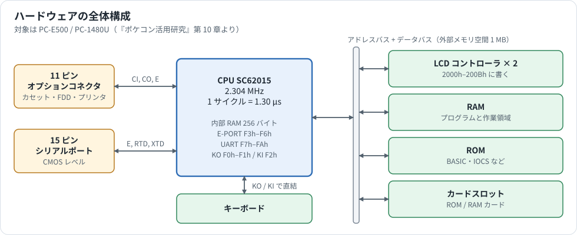
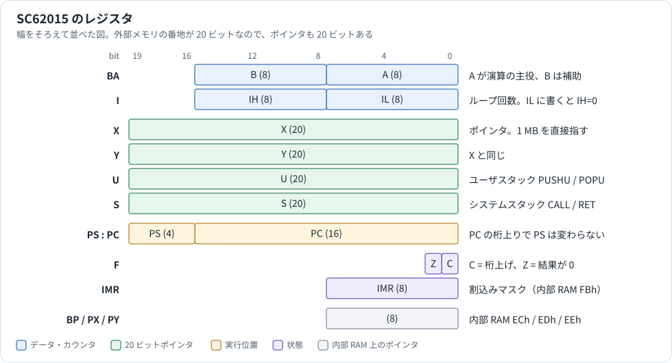
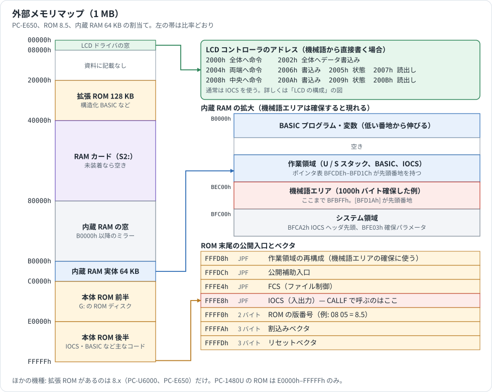
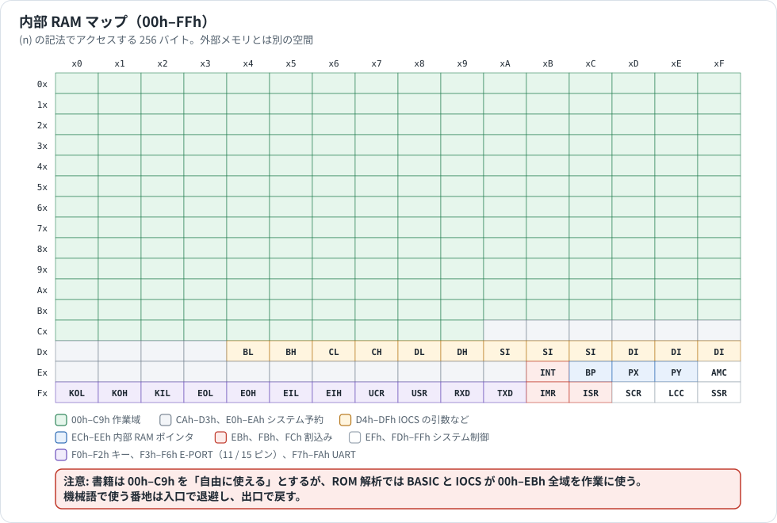
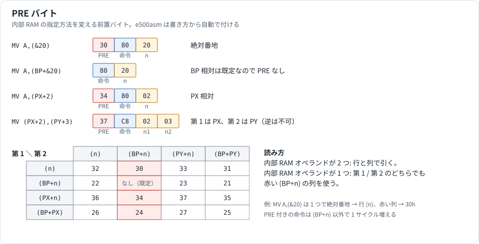
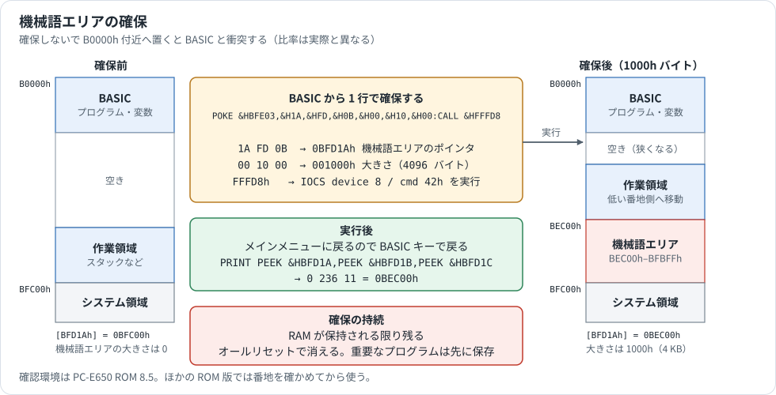
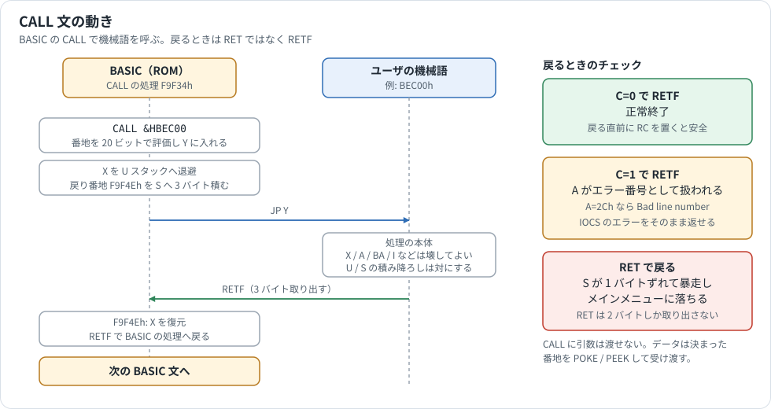
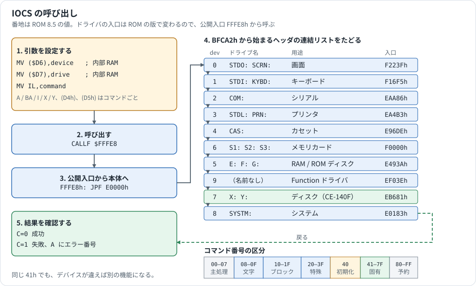
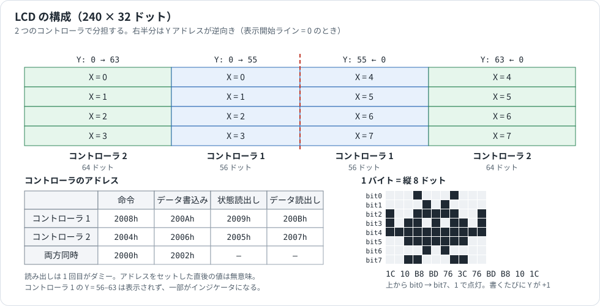
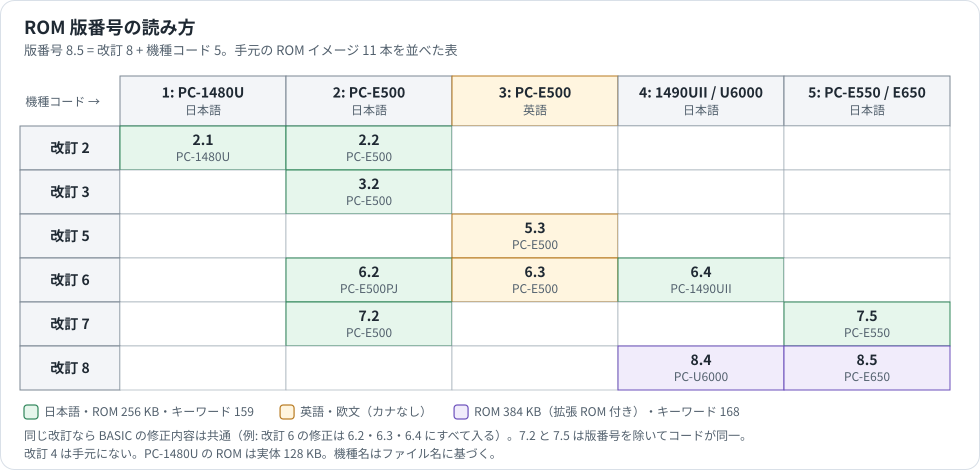

# 機械語の基礎

PC-E500 シリーズで機械語を書くために、最初に知っておきたいことを図で説明します。全命令や細かい規約は [PC-E650_ASSEMBLER_MANUAL.md](../Analysis/PC-E650_ASSEMBLER_MANUAL.md) と [HARDWARE_REFERENCE.md](../Analysis/HARDWARE_REFERENCE.md) にあります。

番地は PC-E650、ROM 8.5、内蔵 RAM 64 KB のものです。ほかの機種については[機種と ROM の版](#機種と-rom-の版)を参照してください。

[ガイドの目次へ戻る](README.md)

## ハードウェアの構成



押さえておきたいのは次の 2 点です。

- キーボードとコネクタは CPU のポートに直結で、**内部 RAM の番地**（F0h 以降）から操作します。
- LCD、RAM、ROM、カードは**外部メモリの番地**に並んでいます。

## レジスタ



よくつまずくのは次の点です。

- `IL` に書くと `IH` は 0 になります。
- `MV A,IL` と `MV IL,A` は CPU に存在せず、アセンブルエラーになります。
- `PC` が桁上りしても `PS` は変わりません。64 KB の境界を越えるには `JPF` / `CALLF` を使います。

## メモリは 2 つある

SC62015 には別々のメモリ空間が 2 つあり、書き方で区別します。

| 空間 | 大きさ | 記法 | 例 |
|---|---|---|---|
| 外部メモリ | 1 MB（20 ビット） | `[ ]` | `MV A,[$BED00]` |
| 内部 RAM | 256 バイト | `( )` | `MV A,($20)` |

### 外部メモリ



固定の番地を直接呼ばず、`FFFE8h` のような公開入口を使います。ROM の版が変わっても動くようにするためです。

### 内部 RAM



使うときの注意は図のとおり、**入口で退避して出口で戻す**ことです。[PC-E650_ASSEMBLER_MANUAL.md §8.3](../Analysis/PC-E650_ASSEMBLER_MANUAL.md) に、`MVL` で 16 バイトを退避する実例があります。

## PRE バイト



内部 RAM の指定方法は命令の前に付ける 1 バイトで決まります。`e500asm` はオペランドの書き方から自動で付けるので、通常は意識しなくて構いません。リストや逆アセンブル結果を読むときに、この図が役立ちます。

- `(n)` は絶対番地、`(BP+n)` は `BP` からの相対です。
- ROM のコードは `BP` 相対を既定にしています。逆アセンブル結果に `(BP+…)` が多いのはこのためです。

## 機械語エリアを確保する



BASIC のプログラムや変数は RAM の低い番地から伸びてきます。確保しないで置くと衝突して、プログラムが壊れます。

確保する大きさは `POKE` の後半 3 バイトで決まります。例えば 2000h バイトなら `&H00,&H20,&H00` です。機械語エリアは `BFBFFh` が末尾のまま先頭が下がるので、`[BFD1Ah]` を読んで先頭番地を確かめ、ソースの `ORG` をそれに合わせます。

## CALL 文で呼び出す



もっとも多い失敗は次の 2 つです。

- **`RET` で戻る。** S スタックがずれて暴走し、メインメニューへ落ちます。必ず `RETF` で戻ります。
- **キャリーが立ったまま戻る。** 演算の結果 `C=1` のまま戻ると、`A` の値がエラー番号として扱われ、BASIC のエラーが出ます。戻る直前に `RC` を置きます。

BASIC とのデータの受け渡しは、決まった番地を `POKE` / `PEEK` して行います。

```basic
POKE &HBED00,3,4 : CALL &HBEC00 : PRINT PEEK &HBED02
```

## IOCS で入出力する



画面、キー、ファイルなどの入出力は、ハードウェアを直接触らずに IOCS を呼びます。[hello.asm](../Analysis/asm_samples/hello.asm) の中心部分は次のとおりです。

```asm
        MV   ($D6),0           ; device 0 = LCD
        MV   ($D7),0           ; drive 0
        MV   ($D4),0           ; x 座標
        MV   ($D5),3           ; y 座標
        MV   IL,$42            ; 指定位置へ文字列を表示
        MV   X,msg             ; 文字列の先頭
        MV   Y,msg_end-msg     ; 長さ
        CALLF $FFFE8           ; C=1 なら A にエラー番号
```

- **コマンド番号の意味はデバイスごとに違います。** `42h` が文字列表示なのは device 0 の場合だけです。
- IOCS が壊すレジスタは公開されていません。必要なものは呼び出しの前後で `PUSHU` / `POPU` します。
- 図の入口番地は ROM 8.5 の値で、ROM の版が変わると変わります。入口へ直接飛ばないでください。

詳しくは [IOCS_REFERENCE.md](../Analysis/IOCS_REFERENCE.md) を参照してください。

## LCD を直接操作する



通常は IOCS で足りますが、ゲームなどで速く描きたいときは、コントローラを直接操作します。

```basic
10 POKE &H2008,&HB8   ' ページ(X)=0
20 POKE &H2008,&H40   ' Y=0
30 FOR I=0 TO 55
40 POKE &H200A,&HFF   ' 書くたびに Y が +1
50 NEXT
```

表示開始ラインは BASIC の動作後に 0 とは限りません。位置を固定して描くときは、先に `C0h` を書いて 0 に戻します。

機械語で 64 ドットぶん書く例や、インジケータの割当ては [HARDWARE_REFERENCE.md](../Analysis/HARDWARE_REFERENCE.md) にあります。

## タイミング

システムクロックは 2.304 MHz で、1 サイクルは約 1.30 µs です。命令のサイクル数は [オペコード表](../Analysis/PC-E650_ASSEMBLER_MANUAL.md) に載っています。

1 命令の実行中は割込みが入らないので、大きな `I` で `MVL` や `WAIT` を実行すると、その間はキー入力やタイマが止まります。

## 機種と ROM の版



版番号は本体 ROM の `FFFF0h`（上位）と `FFFF1h`（下位）にあり、BASIC から読めます。

```basic
PRINT PEEK &HFFFF0;PEEK &HFFFF1
```

機種ごとの違いは次の資料にまとめてあります。

| 資料 | 内容 |
|---|---|
| [ROM_VERSIONS_BASIC.md](../Analysis/ROM_VERSIONS_BASIC.md) | BASIC の修正点 |
| [ROM_VERSIONS_SYSTEM.md](../Analysis/ROM_VERSIONS_SYSTEM.md) | IOCS、FCS、表示、キー入力 |
| [ROM_VERSIONS_DRIVERS.md](../Analysis/ROM_VERSIONS_DRIVERS.md) | 行列演算、装置ドライバ、メッセージ表 |
| [ROM_VERSIONS_MODELS.md](../Analysis/ROM_VERSIONS_MODELS.md) | 言語、カナ入力、文字セット、添付ソフト |
