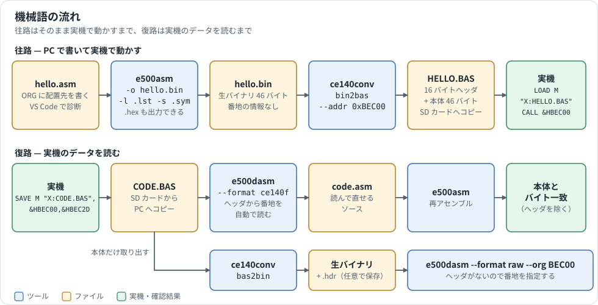
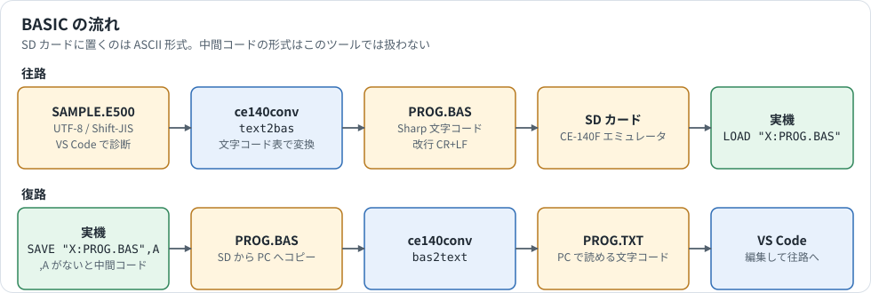

# 開発の流れ

機械語と BASIC のそれぞれについて、PC から実機へ送る往路と、実機のデータを PC で読む復路を説明します。

[ガイドの目次へ戻る](README.md)

## 機械語



### 往路: PC で書いて実機で動かす

**1. 配置先を決めます。** 機械語は、確保した機械語エリアの中に置きます。例えば 1000h バイト確保すると `BEC00h`〜`BFBFFh` が使えます（[機械語エリアの確保](machine-language-primer.md#機械語エリアを確保する)）。

**2. ソースを書きます。** 先頭の `ORG` に配置先を書きます。戻り方は `RET` ではなく `RETF` です（[CALL 文の動き](machine-language-primer.md#call-文で呼び出す)）。

```asm
        ORG  $BEC00
start:  MV   A,[$BED00]
        ; ...
        RC                ; C=1 のまま戻るとエラー表示になる
        RETF
        END
```

**3. アセンブルします。** リストとシンボル表も出しておくと、確認や POKE に使えます。

```powershell
.\Assembler\e500asm.cmd prog.asm -o prog.bin -l prog.lst -s prog.sym
```

**4. 実機へ入れます。** 方法は 2 つあります。

| 方法 | 向いている場面 | 手順 |
|---|---|---|
| `LOAD M` | 通常はこちら | `ce140conv bin2bas --addr 0xBEC00 prog.bin PROG.BAS` で変換し、SD カードから `LOAD M "X:PROG.BAS"` |
| `POKE` | 数十バイトまでの短いプログラム | `prog.lst` のバイト列を `POKE &HBEC00,&H88,&H00,...` と入力する |

**5. 実行します。** `CALL &HBEC00` または 10 進で `CALL 781312` です。

### 復路: 実機のデータを読む

実機でメモリを保存します。番地は開始と終了の両方を指定します。

```basic
SAVE M "X:CODE.BAS",&HBEC00,&HBEC2D
```

SD カードを PC に移し、逆アセンブルします。ヘッダから番地を読むので `--org` は要りません。

```powershell
.\DisAssembler\e500dasm.cmd CODE.BAS --format ce140f -o code.asm
```

本体だけを取り出したいときは `bas2bin` を使います。その場合は番地の情報がなくなるので、逆アセンブルに `--org` が必要です。

```powershell
.\FileConverter\ce140conv.exe bas2bin CODE.BAS code.bin --save-header code.hdr
.\DisAssembler\e500dasm.cmd code.bin --format raw --org BEC00 -o code.asm
```

GUI 版の `DisAssembler\E500Disassembler.cmd` でも同じことができます。ファイルをドロップすると形式を自動で判別します。

編集した `code.asm` を送り返すときは、往路の手順 3 に戻ります。

## BASIC



### 往路

VS Code で書いたテキストを、`LOAD` できる形式に変換します。

```powershell
.\FileConverter\ce140conv.exe text2bas SAMPLE.E500 PROG.BAS           # UTF-8 のソース
.\FileConverter\ce140conv.exe text2bas --sjis KANA.TXT KANA.BAS       # Shift-JIS のソース
```

実機では `LOAD "X:PROG.BAS"` で読み込みます。`LOAD "X:PROG.BAS",R` なら読み込み後すぐに実行します。

すべての行は行番号で始め、1 行は 256 バイト以内にします。守られていないと `LOAD` がエラーになります。

### 復路

**`SAVE` には `,A` を付けます。** 付けないと中間コードで保存され、`bas2text` では読めません。

```basic
SAVE "X:PROG.BAS",A
```

```powershell
.\FileConverter\ce140conv.exe bas2text PROG.BAS PROG.TXT
```

### カナや記号の扱い

文字の対応は [charset_e500.tab](../FileConverter/charset_e500.tab) で決まります。表にない文字コードは Unicode の私用領域（`U+E000 + コード`）へ写るので、未対応の文字があっても失われません。半角カナの配列は JIS X 0201 を既定にしており、実機の文字 ROM との照合は済んでいません。

## 番地の書き方はツールごとに違う

同じ番地でも、場所によって書き方が違います。

| 場所 | `BEC00h` の書き方 | 備考 |
|---|---|---|
| ASM ソース | `$BEC00`、`&BEC00`、`0xBEC00`、`0BEC00h` | 接頭辞がなければ 10 進数。`h` 形式は数字で始める |
| `e500asm --org`、`e500dasm --org` | `BEC00`、`$BEC00`、`&BEC00`、`0xBEC00`、`0BEC00h` | **常に 16 進数。`8000` は 8000h** |
| `ce140conv --addr` | `0xBEC00`、`781312` | `BEC00` はエラー。`&HBEC00` も使えるが、PowerShell では引用符が要る |
| 実機の BASIC | `&HBEC00`、`781312` | |

ASM ソースでは、`h` で終わる数値は 16 進数、`h` なしの `0b1010` は 2 進数です。`--fill` と `-D` の値は ASM ソースの数値と同じ規則で読みます。

PowerShell では `$` が変数記号、`&` が演算子なので、コマンドラインでは `BEC00` か `0xBEC00` が簡単です。

## コマンド早見表

| やりたいこと | コマンド |
|---|---|
| アセンブル | `e500asm prog.asm -o prog.bin` |
| リストとシンボルも出す | `e500asm prog.asm -o prog.bin -l prog.lst -s prog.sym` |
| Intel HEX で出す | `e500asm prog.asm -f hex -o prog.hex` |
| 生バイナリ → `LOAD M` 用 | `ce140conv bin2bas --addr 0xBEC00 prog.bin PROG.BAS` |
| `LOAD M` 用 → 生バイナリ | `ce140conv bas2bin PROG.BAS prog.bin` |
| テキスト → `LOAD` 用 | `ce140conv text2bas prog.txt PROG.BAS` |
| `SAVE ,A` のファイル → テキスト | `ce140conv bas2text PROG.BAS prog.txt` |
| ファイルの種類と中身を確認 | `ce140conv info PROG.BAS` |
| `SAVE M` のファイルを逆アセンブル | `e500dasm CODE.BAS --format ce140f -o code.asm` |
| 生バイナリを逆アセンブル | `e500dasm code.bin --format raw --org BEC00 -o code.asm` |

e500asm と e500dasm は、`Assembler\e500asm.cmd`、`DisAssembler\e500dasm.cmd` のラッパー経由でも、`app\` の EXE を直接でも実行できます。
