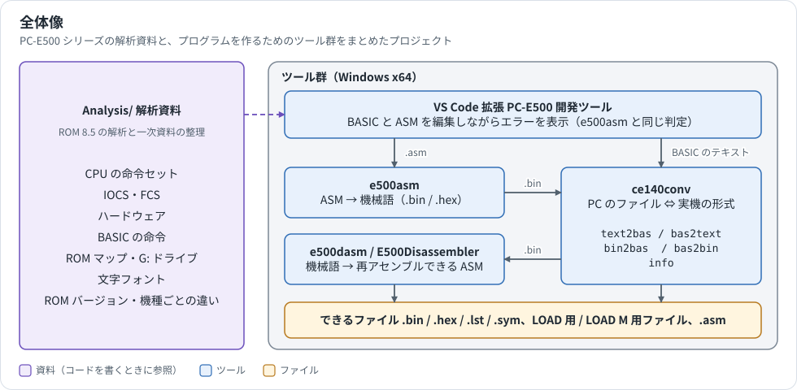
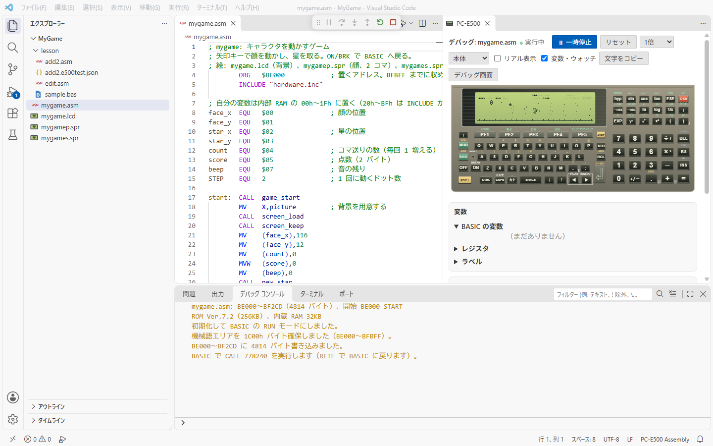
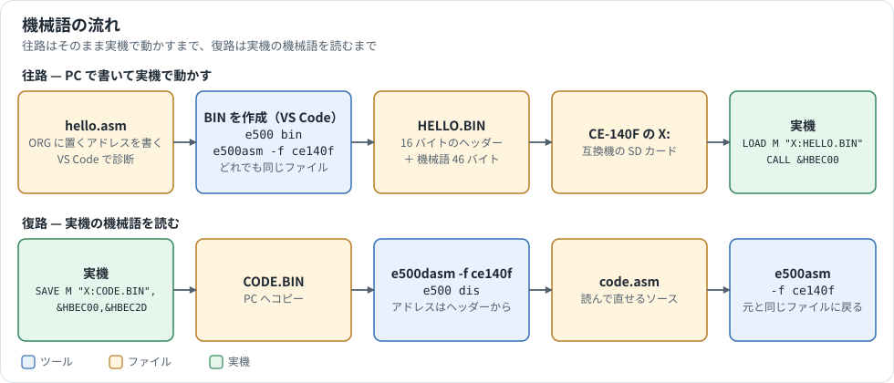
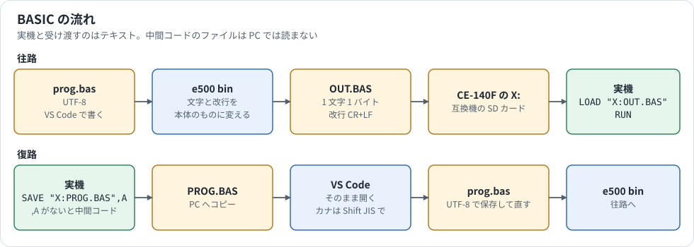

# PockeCom PC-E500 Tools

SHARP ポケットコンピュータ PC-E500 シリーズ（PC-E500 / PC-E500S / PC-E550 / PC-E650 / PC-1480U / PC-U6000 など、CPU に SC62015〔ESR-L〕を搭載した機種）のプログラムを PC で作るツールと、解析資料です。





## 文書

**初めての方は[クイックスタート](docs/manual/01_QUICKSTART.md)から読んでください。** 全部の文書の一覧は [docs/](docs/README.md) にあります。

| 文書 | 内容 |
|---|---|
| [クイックスタート](docs/manual/01_QUICKSTART.md) | 入れてから、ゲームを動かして実機へ送るまで（[Windows](docs/manual/01_QUICKSTART_WINDOWS.md)、[Linux](docs/manual/01_QUICKSTART_LINUX.md)、[macOS](docs/manual/01_QUICKSTART_MACOS.md)） |
| [アセンブラ入門](docs/manual/03_ASSEMBLER_TUTORIAL.md) | 機械語を 1 から。動く例題 12 本 |
| [アセンブラの文法](docs/manual/04_ASSEMBLER_REFERENCE.md)、[命令一覧](docs/manual/05_INSTRUCTIONS.md) | `e500asm` の全オプションと書き方、全命令 |
| [ゲームを作る](docs/manual/07_GAME.md) | 背景、キャラクタ、キー、当たり判定、音 |
| インストール | [Windows](docs/manual/02_INSTALL_WINDOWS.md)、[Linux](docs/manual/02_INSTALL_LINUX.md)、[macOS](docs/manual/02_INSTALL_MACOS.md) |
| コマンドで使う | [Windows](docs/manual/23_COMMAND_LINE_WINDOWS.md)、[Linux](docs/manual/24_COMMAND_LINE_LINUX.md)、[macOS](docs/manual/25_COMMAND_LINE_MACOS.md) |
| [コマンド e500 と AI](docs/manual/22_COMMAND_LINE_AI.md) | `e500` コマンドの働きと、Claude Code や Codex 用のスキル |
| [マニュアルの目次](docs/manual/README.md) | 全 25 章 |
| [サンプル](Samples/README.md) | 動くプログラム集 |
| [ハンドブック](docs/handbook/README.md) | 本体の使い方。電卓、統計、行列、BASIC、機械語の動かし方。全 22 章 |
| [解析資料](docs/analysis/README.md) | CPU、ハードウェア、ROM、BASIC、周辺機器。全 29 章 |
| [設計の目次](docs/design/README.md) | ソースの作り |

## 収録内容

| フォルダ | 内容 |
|---|---|
| [VSCodeExtensions/](VSCodeExtensions/pc-e500-devtools/) | VS Code 拡張「PC-E500 開発ツール」。編集、エミュレータでの実行とデバッグ、テスト、ドットエディタ、BIN 作成 |
| [Assembler/](Assembler/) | クロスアセンブラ `e500asm` |
| [DisAssembler/](DisAssembler/) | 逆アセンブラ `e500dasm`（コマンド）と `E500Disassembler`（画面、Windows） |
| [FileConverter/](FileConverter/) | CE-140F のファイル変換 `ce140conv` |
| [Samples/](Samples/README.md) | サンプル。アセンブラの例題とゲーム、BASIC のゲームなど |
| [docs/](docs/README.md) | ハンドブック、マニュアル、設計、解析資料 |

## はじめに

### Windows

[Releases](https://github.com/litchi-gh/pc-e500_tools/releases) から取得します。

| ファイル | 使い方 |
|---|---|
| `pc-e500-devtools-<バージョン>.vsix` | VS Code の「VSIX からのインストール」 |
| `e500asm-*-win-x64.zip` | `e500asm.exe` を `Assembler\app\` に置く |
| `e500dasm-*-win-x64.zip`、`E500Disassembler-*-win-x64.zip` | `DisAssembler\app\` に置く |

VS Code でフォルダを右クリック →「新しいプログラムを作成」→ `F5` で動きます（[クイックスタート](docs/manual/01_QUICKSTART_WINDOWS.md)）。コマンドだけで作ることもできます。PowerShell で、リポジトリのフォルダで打ちます。

```powershell
.\Assembler\e500asm.cmd Samples\Assembler\Basics\hello.asm -o hello_raw.bin
.\FileConverter\ce140conv.exe bin2bas --addr 0xBEC00 hello_raw.bin HELLO.BIN
```

1 行目はサンプルを機械語にし、2 行目は機械語にヘッダーを付けて、実機の `LOAD M` で読める `HELLO.BIN` を作ります。入れ方の全部の手順は[インストール](docs/manual/02_INSTALL_WINDOWS.md)にあります。

### Linux

[ソースから作って](docs/manual/02_INSTALL_LINUX.md)使います。

```sh
Assembler/app/e500asm Samples/Assembler/Basics/hello.asm -o hello_raw.bin
FileConverter/ce140conv bin2bas --addr 0xBEC00 hello_raw.bin HELLO.BIN
```

1 行目はサンプルを機械語にし、2 行目は実機の `LOAD M` で読める `HELLO.BIN` を作ります。コマンド `e500` なら、エミュレータでの実行とテストもできます（[Linux のコマンド](docs/manual/24_COMMAND_LINE_LINUX.md)）。

### macOS

[ソースから作って](docs/manual/02_INSTALL_MACOS.md)使います。

```sh
Assembler/app/e500asm Samples/Assembler/Basics/hello.asm -o hello_raw.bin
FileConverter/ce140conv bin2bas --addr 0xBEC00 hello_raw.bin HELLO.BIN
```

1 行目はサンプルを機械語にし、2 行目は実機の `LOAD M` で読める `HELLO.BIN` を作ります。VS Code での編集と、コマンド `e500` での文法チェック、エミュレータでの実行、BIN の作成もできます（[macOS のコマンド](docs/manual/25_COMMAND_LINE_MACOS.md)）。

### 実機で動かす（どの OS でも同じ）

`HELLO.BIN` を CE-140F 互換機（例: [Sharp_ce140f_emul](https://github.com/ffxx68/Sharp_ce140f_emul)）で実機へ渡し、BASIC で読み込みます（1 行目は最初の 1 回だけ。実行後に `BASIC` キーで戻ります）。

```basic
POKE &HBFE03,&H1A,&HFD,&H0B,&H00,&H10,&H00:CALL &HFFFD8
LOAD M "X:HELLO.BIN"
CLS : CALL &HBEC00
```

## 開発の流れ





## 解析資料

ROM の解析と一次資料からまとめた、全 29 章の本です。[目次](docs/analysis/README.md)から読めます。

| 部 | 章 | 内容 |
|---|---|---|
| 1 | 1〜9 | [ハードウェアの全体](docs/analysis/01_HARDWARE.md)、[CPU](docs/analysis/02_CPU.md)、[メモリ](docs/analysis/03_MEMORY.md)、[液晶](docs/analysis/04_LCD.md)、[カード](docs/analysis/05_CARD_SLOT.md)、[11 ピン](docs/analysis/06_PORT_11PIN.md)、[15 ピン](docs/analysis/07_PORT_15PIN.md)、[IC](docs/analysis/08_IC_CHIPS.md)、[回路](docs/analysis/09_CIRCUIT.md) |
| 2 | 10〜13 | [起動、割り込み、音](docs/analysis/10_SYSTEM.md)、[IOCS と FCS](docs/analysis/11_IOCS.md)、[機械語を実機で動かす](docs/analysis/12_MACHINE_CODE.md)、[フォント](docs/analysis/13_FONT.md) |
| 3 | 14〜15 | [BASIC の命令と関数](docs/analysis/14_BASIC_REFERENCE.md)、[BASIC の内部形式](docs/analysis/15_BASIC_INTERNALS.md) |
| 4 | 16〜20 | [周辺機器](docs/analysis/16_PERIPHERALS.md)、[CE-140F](docs/analysis/17_CE-140F_DISK.md)、[CE-126P](docs/analysis/18_CE-126P_PRINTER.md)、[CE-515P](docs/analysis/19_CE-515P_PLOTTER.md)、[カセット](docs/analysis/20_CASSETTE.md) |
| 5 | 21〜27 | [ROM マップ](docs/analysis/21_ROM_MAP.md)、[G: ドライブ](docs/analysis/22_ROM_GDRIVE.md)、バージョンの違い（[配置](docs/analysis/23_ROM_VERSIONS_MAP.md)、[BASIC](docs/analysis/24_ROM_VERSIONS_BASIC.md)、[ドライバ](docs/analysis/25_ROM_VERSIONS_DRIVERS.md)、[システム](docs/analysis/26_ROM_VERSIONS_SYSTEM.md)、[機種](docs/analysis/27_ROM_VERSIONS_MODELS.md)） |
| 付録 | 28〜29 | [外部資料](docs/analysis/28_RESOURCES.md)、[機種ガイド](docs/analysis/29_MODELS.md)（PC-E500S、PC-E650 などの違い） |

参照元の操作説明書や技術資料の PDF は、このリポジトリに含まれていません。

## 動作環境

| | Windows | Linux | macOS |
|---|---|---|---|
| OS | Windows 11 | Ubuntu 24.04 以降 | macOS 15 以降 |
| CPU | x64 | x64（`e500asm`、`e500dasm`、`ce140conv` のビルドは arm64 にも対応） | Apple シリコン、Intel |
| 動作を確かめた環境 | Windows 11 | Ubuntu 26.04（デスクトップ、WSL） | macOS 15（ビルドとテスト、ROM を使わない動作） |
| VS Code での編集、診断、ドットエディタ | ○ | ○ | ○ |
| VS Code の `F5`（実行、デバッグ）とテスト | ○ | − | − |
| コマンド `e500`（実行、テストを含む） | ○ | ○ | ○ |
| `e500asm`、`e500dasm`、`ce140conv` | ○（配布） | ○（ソースから作る） | ○（ソースから作る） |
| `E500Disassembler`（画面） | ○ | − | − |

| 使うもの | 要るソフト |
|---|---|
| VS Code 拡張 | VS Code 1.95 以降 |
| コマンド `e500` | Node.js 20.12 以降（Windows は VS Code だけでもよい） |
| エミュレータでの実行、デバッグ、テスト | .NET 10 ランタイム、PC-E500 エミュレータ、自分の ROM |
| ソースからのビルド | .NET 10 SDK、Node.js、C++17 のコンパイラ |

PC の性能やディスクの大きさは[インストールの「動作環境」](docs/manual/02_INSTALL.md#21-動作環境)にあります。

- ビルド済みの実行ファイル（`e500asm.exe`, `e500dasm.exe`, `E500Disassembler.exe`, `ce140conv.exe`）は Windows x64 用で、追加ランタイムは不要です。
- .NET 製の 3 つの EXE（`e500asm.exe`, `e500dasm.exe`, `E500Disassembler.exe`）は自己完結型で 1 ファイル 70〜120 MB あり GitHub の上限を超えるため、リポジトリには含めていません。[Releases](https://github.com/litchi-gh/pc-e500_tools/releases) からダウンロードして `Assembler/app/`、`DisAssembler/app/` に置くか、各フォルダの `build.cmd` でビルドしてください（`app/` に生成されます）。リポジトリに含まれている実行ファイルは `ce140conv.exe` だけです。VSIX も Releases から取得できます。
- ソースからビルドする手順は OS ごとに、[Windows](docs/manual/02_INSTALL_WINDOWS.md#29-ソースから作る必要な人だけ)、[Linux](docs/manual/02_INSTALL_LINUX.md#25-e500asme500dasmce140conv-を作る)、[macOS](docs/manual/02_INSTALL_MACOS.md#25-e500asme500dasmce140conv-を作る) にあります。

  | 作るもの | Windows | Linux | macOS |
  |---|---|---|---|
  | Assembler、DisAssembler | .NET 10 SDK、`build.cmd` | .NET 10 SDK、`build.sh` | .NET 10 SDK、`build.sh` |
  | FileConverter | MSVC、MinGW-w64、LLVM のどれか、`build.bat` | g++ か clang++、`build.sh` | clang++、`build.sh` |
  | VSCodeExtensions | Node.js、.NET 10 SDK | Node.js、.NET 10 SDK | Node.js、.NET 10 SDK |
- 実機での動作検証は限定的です。アセンブラ・逆アセンブラは SHARP ESR-L Instruction Manual と既存の SC62015 エミュレータを基準に検証しています。

## 参考資料

- [Sharp_ce140f_emul](https://github.com/ffxx68/Sharp_ce140f_emul) — CE-140F ディスクドライブエミュレータ

## ライセンス

[MIT License](LICENSE) です（`VSCodeExtensions/pc-e500-devtools` も同じ MIT で、著作権表示は同フォルダの [LICENSE](VSCodeExtensions/pc-e500-devtools/LICENSE) のとおりです）。

次のものは、このライセンスの対象ではありません。

- **ROM とマニュアル:** ROM の中身とシャープの資料の権利は、それぞれの権利者のものです。このリポジトリに ROM イメージは含めていません。吸い出した ROM は、公開や配布をしないでください。
- **参考資料の内容:** [解析資料](docs/analysis/) はマニュアル、書籍、公開プロジェクトなどを参考にしています（出典は各文書にあります）。元の資料の権利は、それぞれの権利者のものです。
- **製品名:** SHARP、PC-E500 などの名称は、それぞれの権利者の商標または製品名です。このプロジェクトはシャープとは関係ありません。
- **自己完結型の実行ファイル:** .NET ランタイムを含み、.NET のライセンス（MIT）とその第三者通知に従います。
