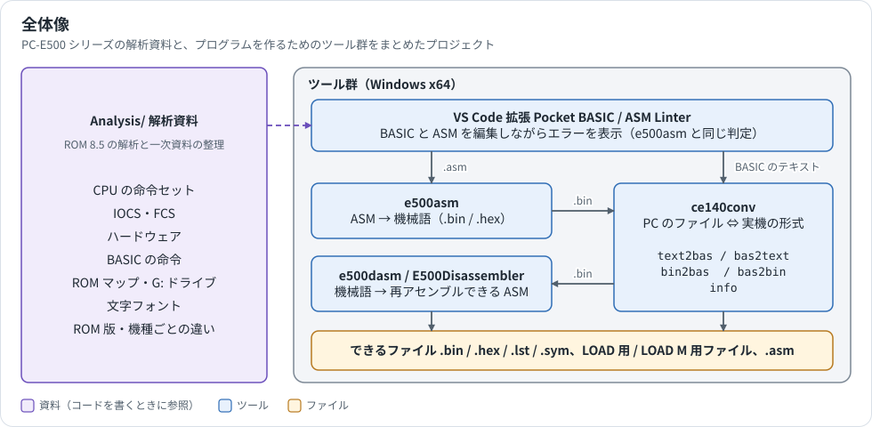
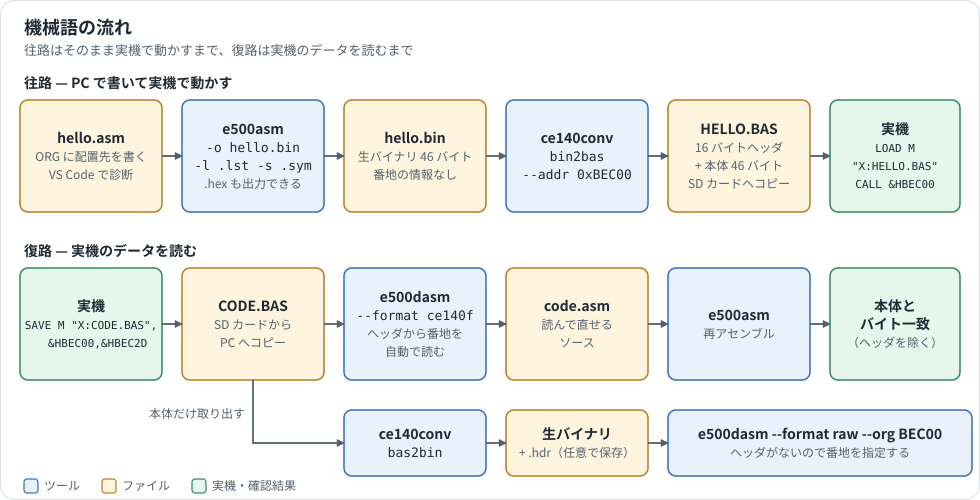
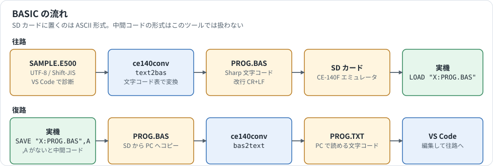

# PockeCom PC-E500 Tools

SHARP ポケットコンピュータ PC-E500 シリーズ（PC-E500 / PC-E550 / PC-E650 / PC-1480U など、CPU に SC62015〔ESR-L〕を搭載した機種）の解析結果と、アセンブラ、逆アセンブラ、便利なツール群をまとめたプロジェクトです。



## ドキュメント

図を使った説明は [Guide/](Guide/) にまとめています。初めての方は「はじめに」から読んでください。

| 文書 | 内容 |
|---|---|
| [はじめに](Guide/getting-started.md) | 導入から、サンプルを実機で動かすまで |
| [開発の流れ](Guide/workflows.md) | 機械語と BASIC の往路・復路、番地の書き方、コマンド早見表 |
| [ファイル形式](Guide/file-formats.md) | SD カード上の形式、16 バイトヘッダ、出力ファイルの中身 |
| [機械語の基礎](Guide/machine-language-primer.md) | レジスタ、メモリマップ、PRE、IOCS、CALL、LCD、ROM の版 |
| [トラブルシューティング](Guide/troubleshooting.md) | エラーメッセージと症状ごとの対処 |
| [ツールの内部構造](Guide/architecture.md) | ソースの依存関係、処理の流れ、テスト、変更時に直す場所 |

## クイックスタート

[Releases](https://github.com/litchi-gh/pc-e500_tools/releases) から `e500asm.exe` を取得して `Assembler/app/` に置くと、リポジトリ直下で次のように実行できます。

```powershell
# サンプルをアセンブルし、LOAD M 用のファイルにする
.\Assembler\e500asm.cmd Analysis\asm_samples\hello.asm -o hello.bin
.\FileConverter\ce140conv.exe bin2bas --addr 0xBEC00 hello.bin HELLO.BAS
```

Linux / macOS では、[ソースからビルド](Guide/getting-started.md#linux--macos-の場合)して次のように実行します。

```sh
Assembler/app/e500asm Analysis/asm_samples/hello.asm -o hello.bin
FileConverter/ce140conv bin2bas --addr 0xBEC00 hello.bin HELLO.BAS
```

`HELLO.BAS` は CE-140F の形式のファイルです。CE-140F 互換の装置（例: 別プロジェクトの [Sharp_ce140f_emul](https://github.com/ffxx68/Sharp_ce140f_emul)）で実機へ渡し、機械語エリアを確保してから読み込みます（1 行目は最初の 1 回だけ。実行後に `BASIC` キーで戻ります）。

```basic
POKE &HBFE03,&H1A,&HFD,&H0B,&H00,&H10,&H00:CALL &HFFFD8
LOAD M "X:HELLO.BAS"
CLS : CALL &HBEC00
```

## 収録内容

| フォルダ | 内容 |
|---|---|
| [Assembler/](Assembler/) | SC62015 用クロスアセンブラ `e500asm`（C# / .NET。Windows x64 用 EXE は Releases で配布。Linux / macOS はソースからビルド） |
| [DisAssembler/](DisAssembler/) | SC62015 用逆アセンブラ `e500dasm`（CLI）と `E500Disassembler`（GUI。Windows 専用） |
| [FileConverter/](FileConverter/) | CE-140F エミュレータ用ファイルコンバータ `ce140conv`（C++17 単一ソース） |
| [VSCodeExtensions/](VSCodeExtensions/) | VS Code 拡張 `Pocket BASIC / ASM Linter`（PC-E500 BASIC と `e500asm` 用 ASM の構文チェック・シンタックスハイライト） |
| [Analysis/](Analysis/) | ROM 8.5 解析結果および技術資料（BASIC 命令、IOCS、ハードウェア、CPU 命令セットなど） |
| [Guide/](Guide/) | 図を使った解説（使い方、ファイル形式、機械語の基礎、内部構造） |

## ワークフロー





1. **機械語を書く**: [Analysis/ASSEMBLER_MANUAL.md](Analysis/ASSEMBLER_MANUAL.md)、[Analysis/SC62015.md](Analysis/SC62015.md)、 [Analysis/IOCS_REFERENCE.md](Analysis/IOCS_REFERENCE.md) を参照しながら ASM ソースを書き（VS Code に `Pocket BASIC / ASM Linter` を入れると編集中に `e500asm` と同じエラーが表示されます）、`Assembler/e500asm.cmd` でアセンブルします。
2. **転送用ファイルにする**: `FileConverter/ce140conv.exe bin2bas --addr <ロードアドレス>` で 16 バイトヘッダ付きの `LOAD M` 用ファイルに変換し、CE-140F エミュレータの SD カードへ置きます。
3. **BASIC を書く**: VS Code に `Pocket BASIC / ASM Linter` を入れて編集し、`ce140conv text2bas` で `LOAD` 用ファイルに変換します。
4. **実機のデータを読む**: `SAVE M` したファイルは `DisAssembler/e500dasm.cmd --format ce140f` でそのまま逆アセンブルできます。出力は `e500asm` で再アセンブルするとバイト単位で元に戻ります。

詳しくは [開発の流れ](Guide/workflows.md) を参照してください。

## 各フォルダの詳細

### Assembler/ — クロスアセンブラ e500asm

SC62015 の全命令、内部 RAM アドレッシング（BP / PX / PY と PRE バイトの自動生成）、外部メモリの 20 ビットアドレッシングに対応したコマンドラインアセンブラです。機械語については解析資料を参照してください。

```powershell
cd Assembler
.\e500asm.cmd examples\sum.asm -o examples\sum.bin -l examples\sum.lst -s examples\sum.sym
```

| パス | 内容 |
|---|---|
| `app/e500asm.exe` | ビルド済み Windows x64 実行ファイル（.NET ランタイム不要）。リポジトリには含まれないため [Releases](https://github.com/litchi-gh/pc-e500_tools/releases) から取得するか `build.cmd` で生成 |
| `e500asm.cmd` | `app/e500asm.exe` を呼び出すラッパー |
| `src/E500Assembler.Core/` | アセンブラ本体（C# ライブラリ。逆アセンブラからも参照） |
| `src/E500Assembler.Cli/` | コマンドラインフロントエンド |
| `tests/E500Assembler.Tests/` | 自動テスト（命令バイト列、PRE 全組合せ、前方参照、Intel HEX など） |
| `tests/cli_smoke.py` | 実行ファイルの統合テスト（Python 3） |
| `examples/` | サンプルソースと生成結果（`sum.asm` → `.bin` / `.hex` / `.lst` / `.sym`） |
| `docs/SOURCES.md` | 仕様の参照元（SHARP ESR-L Instruction Manual のページ対応）と設計判断 |
| `build.cmd` / `build.ps1` | ビルドスクリプト（.NET 10 SDK が必要） |

出力形式はヘッダなし生バイナリと Intel HEX。詳細な文法・疑似命令・オプションは [Assembler/README.md](Assembler/README.md) を参照してください。

### DisAssembler/ — 逆アセンブラ e500dasm / E500Disassembler

機械語を `e500asm` で再アセンブル可能なソースへ戻します。各命令をアセンブラのエンコーダで照合してから出力するため、生成された ASM は元のバイナリと完全一致で往復できます。機械語については解析資料を参照してください。

```powershell
cd DisAssembler
.\e500dasm.cmd program.bin --format raw --org B8000 -o program.asm   # 生バイナリ
.\e500dasm.cmd CODE.BAS --format ce140f -o CODE.asm                  # SAVE M したファイル
.\E500Disassembler.cmd                                                # GUI
```

| パス | 内容 |
|---|---|
| `app/e500dasm.exe` | CLI 版（Windows x64、.NET ランタイム不要）。[Releases](https://github.com/litchi-gh/pc-e500_tools/releases) から取得するか `build.cmd` で生成 |
| `app/E500Disassembler.exe` | GUI 版（ファイルのドラッグ＆ドロップ、形式選択、プレビュー）。同上 |
| `e500dasm.cmd` / `E500Disassembler.cmd` | それぞれのラッパー |
| `src/E500Disassembler.Core/` | 逆アセンブラ本体 |
| `src/E500Disassembler.Cli/` | CLI |
| `src/E500Disassembler.Gui/` | Windows Forms GUI（Windows 専用） |
| `tests/E500Disassembler.Tests/` | 全 256 オペコード・ランダムバイト列・往復一致のテスト |
| `build.cmd` / `build.ps1` | ビルドスクリプト（.NET 10 SDK が必要） |

RAW 形式では `--org` で開始アドレスを指定し、CE-140F の `SAVE M` 形式では 16 バイトヘッダから自動で読み取ります。詳細は [DisAssembler/README.md](DisAssembler/README.md) を参照してください。

### FileConverter/ — ce140conv

CE-140F エミュレータの SD カードに置くファイルと PC 上のファイルを相互変換します。

| モード | 変換 |
|---|---|
| `text2bas` / `bas2text` | PC テキスト ⇔ ASCII BASIC（実機の `LOAD` / `SAVE`） |
| `bin2bas` / `bas2bin` | 生バイナリ ⇔ 16 バイトヘッダ付き機械語ファイル（実機の `LOAD M` / `SAVE M`） |
| `info` | ファイル種別の判定とヘッダの hex ダンプ |

| パス | 内容 |
|---|---|
| `ce140conv.cpp` | ソース（C++17。Linux / macOS の `--sjis` は iconv を使用） |
| `ce140conv.exe` | ビルド済み Windows 実行ファイル |
| `charset_e500.tab` | Sharp 文字コード ⇔ Unicode 対応表（実行時に読み込み。編集可） |
| `build.bat` | Windows 用ビルドスクリプト（`cl` → `g++` → `clang++` の順に探索） |
| `build.sh` | Linux / macOS 用ビルドスクリプト（`ce140conv` を生成） |

`SAVE M` が生成する 16 バイトヘッダの構造は実機 PC-E650 のダンプから確定しており、`bin2bas --addr` の出力は実機ファイルとバイト一致します。詳細は [FileConverter/README.md](FileConverter/README.md) を参照してください。

### VSCodeExtensions/ — Pocket BASIC / ASM Linter

PC-E500 シリーズの BASIC と、`e500asm` 用の SC62015 アセンブリソースを VS Code で編集するための拡張機能です。

- **BASIC** (`.bas` / `.basic` / `.e500`): 行番号の重複・並び順、未知の命令、`FOR/NEXT` などの対応、`GOTO` の分岐先の存在などを「問題」パネルに表示します。
- **ASM** (`.asm` / `.inc` / `.e500asm`): `E500Assembler.Core` を TypeScript に移植した診断エンジンで、未知のニーモニック、命令とオペランドの組合せ、未定義・重複シンボル、即値のビット幅、`JR` の変位範囲、セグメント境界、出力の重複、`INCLUDE` の未検出などを編集中に表示します。生成バイト列は `e500asm.exe` と一致します。設定 `pocketAsm.assemblerPath` に `Assembler/app/e500asm.exe` を指定すると、右クリックの「e500asm でアセンブル」で本物のアセンブラも実行できます。

| パス | 内容 |
|---|---|
| `pocket-basic-linter-0.2.1.vsix` | インストール用パッケージ。[Releases](https://github.com/litchi-gh/pc-e500_tools/releases) から取得するか、`npm run package` で生成し、VS Code の「VSIX からのインストール」で導入 |
| `pocket-basic-linter/src/` | 拡張本体（TypeScript）。`dialects/` に BASIC の機種別定義、`asm/` にアセンブラの移植 |
| `pocket-basic-linter/syntaxes/` | TextMate 文法（BASIC / ASM のシンタックスハイライト） |
| `pocket-basic-linter/examples/sample.e500`, `sample.asm` | サンプルソース |
| `pocket-basic-linter/README.md` | チェック項目・診断コード・設定・方言追加の手順 |

BASIC のキーワードセットは [Analysis/BASIC_REFERENCE.md](Analysis/BASIC_REFERENCE.md)（ROM 8.5 解析）、ASM の記法は [Assembler/README.md](Assembler/README.md) に基づいています。開発は `npm install` → `F5` で Extension Development Host が起動し、`npm test` でアセンブラ本体と同じ golden vector を実行します。`e500asm` の命令表を変更したときは `src/asm/encoder.ts` にも反映してください。

### Analysis/ — 解析資料

PC-E500 シリーズの ROM の解析と一次資料から整理した、機械語・BASIC プログラミング向けのリファレンスです。

| ファイル | 内容 |
|---|---|
| [SC62015.md](Analysis/SC62015.md) | CPU の解説。レジスタ、フラグ、メモリ空間、内部 RAM、ポート、UART、タイマ、割込み、アドレッシング、全命令、オペコード表 |
| [ASSEMBLER_MANUAL.md](Analysis/ASSEMBLER_MANUAL.md) | `e500asm` の記法、機械語の配置と呼び出し手順、サンプル、よくある落とし穴 |
| [IOCS_REFERENCE.md](Analysis/IOCS_REFERENCE.md) | IOCS / FCS の呼び出し方（`CALLF FFFE8h`）、コマンド番号、ROM 上の入口表 |
| [HARDWARE_REFERENCE.md](Analysis/HARDWARE_REFERENCE.md) | ハードウェアの全体像と各資料の案内、キーボード |
| [CE-140F_PROTOCOL.md](Analysis/CE-140F_PROTOCOL.md) | CE-140F ディスクドライブの通信手順。デバイスコード、4 ビット転送、コマンドと応答、`SAVE M` のヘッダ |
| [MEMORY.md](Analysis/MEMORY.md) | メモリマップ、内部 RAM、スロット、メモリブロック、作業域、RAM ディスク（FAT12）の構造 |
| [PORT_15PIN.md](Analysis/PORT_15PIN.md) | 15 ピンのピン配置とシリアルポート。`COM:` の信号線、設定、文字の変換、フロー制御 |
| [PORT_11PIN.md](Analysis/PORT_11PIN.md) | 11 ピンのピン配置とテープ。`CSAVE`、`CLOAD`、`CSAVE M`、`CLOAD M` の信号、ブロック、ヘッダ、本体の形 |
| [CARD_SLOT.md](Analysis/CARD_SLOT.md) | カードスロットの解析。33 本のピンと両端のバネ、番地、カバーのスイッチ、カードの認識、`MEM$` と AMC、書込み保護、`RESET.KEY`、ROM カード |
| [LCD.md](Analysis/LCD.md) | LCD の配線、コントローラの番地と命令、表示 RAM、インジケータ、作業域、操作例 |
| [BASIC_INTERNALS.md](Analysis/BASIC_INTERNALS.md) | 数値、変数、文字列、配列、プログラムの内部形式 |
| [SYSTEM_INTERNALS.md](Analysis/SYSTEM_INTERNALS.md) | リセット、割込み、タイマ、BEEP、自動電源オフ、電池の検出 |
| [IC_CHIPS.md](Analysis/IC_CHIPS.md) | IC チップの資料。CPU、ROM、RAM、LCD コントローラの型番、形、容量、機種の違い、ROM の型番と版の対応 |
| [CIRCUIT_AND_SERVICE.md](Analysis/CIRCUIT_AND_SERVICE.md) | 部品、CPU のピン、消費電流、サービス用の検査ソフト |
| [EXTERNAL_RESOURCES.md](Analysis/EXTERNAL_RESOURCES.md) | 外部の解析資料とツールの一覧 |
| [PERIPHERALS.md](Analysis/PERIPHERALS.md) | 周辺機器の仕様。プリンタ、ディスク、カセット、レベルコンバータ |
| [CE-515P_PLOTTER.md](Analysis/CE-515P_PLOTTER.md) | CE-515P カラープロッタの解析。`GRAPH`、`LLINE`、`CIRCLE`、`PAINT` などが送るコマンド、円の計算、網掛けの模様 |
| [BASIC_REFERENCE.md](Analysis/BASIC_REFERENCE.md) | BASIC 全 168 キーワードの索引（中間コード token、分類、ROM 処理入口）と各命令の書式・引数 |
| [ROM_VERSIONS_BASIC.md](Analysis/ROM_VERSIONS_BASIC.md) | ROM 版（2.1〜8.5、11 本）ごとの BASIC の違い。版番号の読み方、改訂ごとの修正点、修正の有無の早見表 |
| [ROM_VERSIONS_DRIVERS.md](Analysis/ROM_VERSIONS_DRIVERS.md) | 同じく E8000h〜EBFFFh 帯（行列演算、CAS・PRN・COM・X:Y: のドライバ、プリンタの文字変換、エラーメッセージ表）の違い |
| [ROM_VERSIONS_MAP.md](Analysis/ROM_VERSIONS_MAP.md) | 同じく ROM の配置、公開入口、IOCS の入口、フォント、拡張 ROM、G: の番地、カードの処理の比較 |
| [ROM_VERSIONS_MODELS.md](Analysis/ROM_VERSIONS_MODELS.md) | 同じく機種ごとの言語・カナ入力・文字セット・メインメニュー・添付ソフト（エンジニアソフト、GRAPH、TIMER、G: のソフト集）の違い |
| [ROM_VERSIONS_SYSTEM.md](Analysis/ROM_VERSIONS_SYSTEM.md) | 同じく IOCS・FCS（E0000h〜E4FFFh）と表示・キー入力・行エディタ・フォント（F0000h〜F4FFFh）の違い |
| [CHARACTER_FONT.md](Analysis/CHARACTER_FONT.md) | キャラクタフォント（6×8 ドット）の ROM 上の格納形式とポインタ |
| [ROM_MAP.md](Analysis/ROM_MAP.md) | ROM 全 11 本の領域の説明（ファイルオフセットと CPU アドレスの対応、固定入口、システムと BASIC の領域） |
| [GDRIVE.md](Analysis/GDRIVE.md) | G: ドライブ（ROM 内蔵エンジニアソフト）のファイルシステム構造 |
| `asm_samples/` | `e500asm` でアセンブルできる小さなサンプル（`hello.asm`: IOCS で文字列表示、`add.asm`: メモリ加算、`bcd.asm`: DADL による BCD 加算） |

各資料は解析時点の記録です。参照元の操作説明書・技術資料の PDF 類は本リポジトリに含まれていません。

## 動作環境

| 環境 | 状態 |
|---|---|
| Windows x64 | ビルド済みの実行ファイルを配布。追加ランタイムは不要 |
| Linux x64 | ソースからビルド。Ubuntu 26.04（WSL）でテストと動作を確認 |
| Linux arm64、macOS | ソースからビルド。ビルドスクリプトは対応していますが、実機では未確認 |

GUI の `E500Disassembler` は Windows Forms 製なので Windows 専用です。ほかの環境では CLI の `e500dasm` を使います。VS Code 拡張の診断は環境を問いません。

- ビルド済みの実行ファイル（`e500asm.exe`, `e500dasm.exe`, `E500Disassembler.exe`, `ce140conv.exe`）は Windows x64 用で、追加ランタイムは不要です。
- .NET 製の 3 つの EXE（`e500asm.exe`, `e500dasm.exe`, `E500Disassembler.exe`）は自己完結型で 1 ファイル 70〜120 MB あり GitHub の上限を超えるため、リポジトリには含めていません。[Releases](https://github.com/litchi-gh/pc-e500_tools/releases) からダウンロードして `Assembler/app/`、`DisAssembler/app/` に置くか、各フォルダの `build.cmd` でビルドしてください（`app/` に生成されます）。リポジトリに含まれている実行ファイルは `ce140conv.exe` だけです。VSIX も Releases から取得できます。
- ソースからビルドする場合:
  - Assembler / DisAssembler: .NET 10 SDK。Windows は `build.cmd`、Linux / macOS は `build.sh`
  - FileConverter: C++17 対応コンパイラ（Windows は MSVC / MinGW-w64 / LLVM のいずれかで `build.bat`、Linux / macOS は g++ / clang++ で `build.sh`）
  - VSCodeExtensions: Node.js と npm
- 実機での動作検証は限定的です。アセンブラ・逆アセンブラは SHARP ESR-L Instruction Manual と既存の SC62015 エミュレータを基準に検証しています。

## 参考資料

- [Sharp_ce140f_emul](https://github.com/ffxx68/Sharp_ce140f_emul) — CE-140F ディスクドライブエミュレータ

## ライセンス

[MIT License](LICENSE) です（`VSCodeExtensions/pocket-basic-linter` も同じ MIT で、著作権表示は同フォルダの [LICENSE](VSCodeExtensions/pocket-basic-linter/LICENSE) のとおりです）。

次のものは、このライセンスの対象ではありません。

- **ROM とマニュアル:** ROM の中身とシャープの資料の権利は、それぞれの権利者のものです。このリポジトリに ROM イメージは含めていません。吸い出した ROM は、公開や配布をしないでください。
- **参考資料の内容:** [Analysis/](Analysis/) はマニュアル、書籍、公開プロジェクトなどを参考にしています（出典は各文書にあります）。元の資料の権利は、それぞれの権利者のものです。
- **製品名:** SHARP、PC-E500 などの名称は、それぞれの権利者の商標または製品名です。このプロジェクトはシャープとは関係ありません。
- **自己完結型の実行ファイル:** .NET ランタイムを含み、.NET のライセンス（MIT）とその第三者通知に従います。
