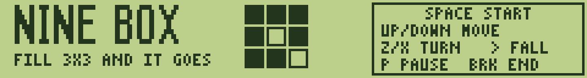
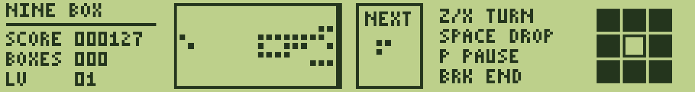
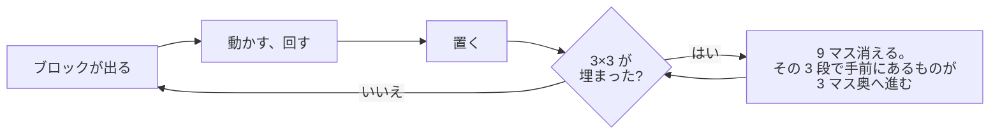

# ナインボックス

右へ落ちてくる 1〜3 マスの小さなブロックを積み、**縦 3 × 横 3 の 9 マス**を埋めて消すパズルゲームです。LCD のコントローラを直接操作するので、IOCS の表示ルーチンを使わないプログラムの見本になります。タイマー割り込みを使わない 64 Hz の進行、キーの読み取り、フレームバッファ、数字の描画も入っています。





## 遊び方

画面の左からブロックが現れ、右の壁へ向かって落ちます。場所は縦 9 段、奥行き 18 マスです。



- ブロックは 5 種類です。点（1 マス）、2 マス、斜め（2 マス）、棒（3 マス）、かぎ（3 マス）。5 種類を 1 回ずつ出してから、次の 5 個を選びます。
- 3×3 はどこにできても消えます。横の 1 列や縦の 1 列がそろっても消えません。
- 消えたあとに進んだブロックで次の 3×3 ができると、続けて消えます。1 回で消えた数が増えるほど、1 個あたりの点が増えます（90、180、270…）。
- 10 個消すごとに落ちるのが速くなります（レベル 1〜9）。
- 出てくる場所がふさがると終わりです。

| キー | 働き |
|---|---|
| SPACE / ENTER | 始める、終わったあともう一度。遊んでいる間は一気に落とす（1 マス 1 点） |
| ▲ ▼ | 上下に動かす。押し続けると続けて動く |
| X、◀ | 右回りに回す |
| Z | 左回りに回す |
| ▶ | 速く落とす |
| P | 止める、続ける |
| ON/BRK | BASIC に戻る |

`SCORE` は 6 桁、`BOXES` は消した数 3 桁、`LV` はレベル、`NEXT` は次のブロックです。点は 999999、消した数は 999 で止まります。音は出ません。

## 動かす

VS Code で `ninebox.asm` を開いて `F5` を押します。実機では、[NINEBOX.BIN](NINEBOX.BIN)（9,336 バイト）を送ります（[実機へ送る](../../../docs/manual/14_TRANSFER.md)）。アドレスは `BD000h`〜`BF467h` で、機械語エリアの中なので、BASIC のプログラムと一緒に使えます。

```basic
POKE &HBFE03,&H1A,&HFD,&H0B,&H00,&H2C,&H00:CALL &HFFFD8
LOAD M "X:NINEBOX.BIN"
CALL &HBD000
```

1 行目は機械語エリアを確保します。最初に 1 回だけ行い、メインメニューに戻ったら `BASIC` キーで入り直します。`CALL` したときに押していた ENTER では、タイトルは飛びません。

## 中身

| ファイル | 内容 |
|---|---|
| [ninebox.asm](ninebox.asm) | ゲーム本体と数字のパターン |
| `tiles.inc` | ブロックを置く場所の表（フレームバッファのバイトとビット） |
| `assets/*.lcd` | 画面の絵（タイトル、ゲーム、一時停止、終わり）。VS Code で開いて描き直せる |
| [ninebox.e500test.json](ninebox.e500test.json) | テスト エクスプローラーのテスト |
| `test.ps1`、`test_runner.cpp` | 細かい検証（[TESTING.md](TESTING.md)） |
| `NINEBOX.BIN` | 「PC-E500: BIN を作成」で作る、`LOAD M` 用のファイル |

### 場所の表し方

場所は 1 マス 1 バイト、9 × 18 = 162 バイトの配列 `board` です。0 は空、1〜5 はブロックの種類です。並びは奥行きが先で、`board + 9 × 奥行き + 段` になります。

```text
         奥行き 0   1   2  …  17
段 0   [  0][  9][ 18]    [153]
段 1   [  1][ 10][ 19]    [154]
 …
段 8   [  8][ 17][ 26]    [161]
        落ち始め →→→ 壁
```

### 3×3 を探す

`clear_boxes` は、奥（奥行き 15〜17）から手前へ、段 0 から順に 3×3 の左上を動かして、9 マスがすべて 0 以外かどうかを見ます。見つかると `remove_box` が、その 3 段だけ、手前の行を 3 つ奥へコピーします。ほかの段は動きません。コピーしたあとは最初から探し直すので、連続して消えるのも同じ処理で済みます。

### 画面

1 コマは、絵（1024 バイト）をフレームバッファにコピーし、ブロックを `tiles.inc` の表で置き、数字を描き、最後に LCD のコントローラ 2 個へまとめて送ります。コントローラの並びは[LCD](../../../docs/analysis/04_LCD.md)にあります。

### 終わり方

始めに内部 RAM の `20h`〜`EFh`（208 バイト）とレジスタを保存し、終わりに戻してから `RETF` します。ON/BRK を離すまで待ってから戻るので、BASIC が BREAK になりません。

## 作り変える

| 変えたいこと | 場所 |
|---|---|
| ブロックの形 | `shapes`（1 種類に 4 つの向き、1 つの向きに 3 マス。少ないときは同じマスを繰り返す） |
| 落ちる速さ | `new_game` の `drop_ticks`（64 分の何秒ごとに 1 マス）と、`count_box` の `SUB (drop_ticks),4` |
| 点 | `clear_boxes` の 90 と、`hard_drop` の 1 |
| 絵 | `assets/*.lcd` |
