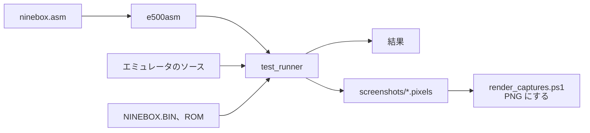

# ナインボックスの検証

`test.ps1` は、リポジトリの隣にあるエミュレータのソース（`Emulator/src/native`）を Visual Studio C++ x64 ビルドツールでコンパイルし、アセンブルした機械語をそのまま動かして確かめます。先に「PC-E500: BIN を作成」で `NINEBOX.BIN` を作り直します。独立した RAM と読み取り専用の仮想ディスクを使うので、起動中のエミュレータや保存した状態は変わりません。



## 環境

- ROM: `PC-E500(7.2).ROM`、内蔵 RAM 32 KB、RAM カードなし
- `X:` は、このフォルダを読み取り専用で割り当てる

## 結果（2026-11-25）

```text
PASS pixel reference + gameplay tests
PASS 120 physical-key drop cycles, 5 game-over retries
PASS 122667 checks; ROM LOAD M/CALL/exit/re-entry, silence, all 7680 pixels, gameplay
```

チェックの数には、RAM の各バイトや参照画像の境界の確認も含みます。

| 対象 | 確認したこと |
|---|---|
| BIN | 16 バイトのヘッダー、中身がアセンブル結果と一致、32 KB RAM に収まる |
| タイトル | LCD の 7,680 ドットが `assets/title.lcd` と一致 |
| ゲーム画面 | 絵、場所、動かしているブロック、次のブロック、数字を別に合成して、全ドットを比較 |
| 境界の描画 | 162 マスすべてを埋め、コントローラの切り替わりと 8 ドットのページの境を確認 |
| 入力 | SPACE で開始、上下、Z/X で回転、一気に落とす、P で停止と再開 |
| 進行 | 64 Hz のタイマーで自然に落ちる。停止中は動かない。置くと、ブロックのマスの数だけ増える |
| 消去 | 3×3 が 112 通りのどの場所でも消える。手前が 3 マス進む。ほかの段は動かない。2 個続くと 90 + 180 点 |
| 得点 | 10 個でレベルが上がる。999999 点で止まる |
| 抽選 | 5 種類が 1 回ずつ出る |
| 連続動作 | キーマトリクスから 120 回落とし、終わったら SPACE で再開。毎回、全ドットを比較 |
| メモリ | 画面の外に描かない。場所の値は 0〜5。コードと絵が変わらない |
| 無音 | 発音中の SCR から始めても発音ビットが消え、終わったあとも戻らない |
| ROM | 機械語エリアの確保 → `LOAD M` → 全バイト一致 → `CALL` → 開始 → ON/BRK で終了 → `1+2` が動く → もう一度 `CALL` |

`ninebox.e500test.json` の 5 つのテストは、エミュレータの全 13 種類の ROM（PC-E500 2.2〜7.3、E500PJ、E500S、E550、E650、1480U、1490UII、U6000）で通ります。

## 画像

`screenshots/*.pixels` はエミュレータの LCD 出力（240 × 32 の 0/1）、`*-1x.png` は原寸、そのほかの PNG は 6 倍です。

- `01-title`、`02-start`: 機械語を直接置いて始めたところ
- `03-game`、`04-pause`、`05-game-over`: 場所と数字を決めて、実際の描画ルーチンで描いたもの
- `06-two-boxes`: 2 個続けて消したあと
- `07-rom-load-title`、`08-rom-game`、`09-rom-return`: ROM から読み込み、始め、終えたところ
- `10-continuous-play`: キー入力だけで進めたところ
