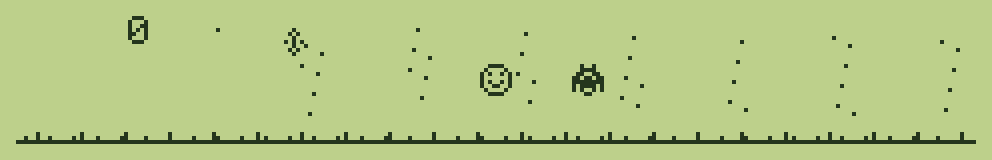

# スターキャッチ

矢印キーで顔を動かし、星を取ります。右から飛んでくる敵に当たるとゲームオーバーです。[ゲームを作る](../../../docs/manual/07_GAME.md)で、テンプレートから作っていく手順を説明しています。

| キー | 働き |
|---|---|
| ◀ ▶ ▲ ▼ | 動く |
| SPACE | ゲームオーバーから、もう一度 |
| ON/BRK | BASIC に戻る |

| ファイル | 内容 |
|---|---|
| [starcatch.asm](starcatch.asm) | プログラム（`BE000h` から） |
| `starcatch.lcd` | 背景 |
| `face.spr`、`star.spr`、`enemy.spr` | 顔（2 コマ）、星（4 コマ）、敵 |
| [starcatch.e500test.json](starcatch.e500test.json) | テスト |

## 見どころ

| 処理 | 場所 | 使っている INCLUDE |
|---|---|---|
| 準備と後始末 | `start`、`quit` | `game.inc` |
| キーの同時読み取り | `loop`、`move` | `pad.inc` |
| 背景に戻して全部描く | `loop`、`draw` | `screen.inc`、`sprite.inc`、`text.inc` |
| 当たり判定 | `take`、`crash` | `sprite.inc` |
| 乱数で出る場所を決める | `new_star`、`enemy_1` | `random.inc` |
| 音を鳴らす長さ | `sound` | `game.inc` |

## 変えてみる

| 変えること | 場所 |
|---|---|
| 速さ | `STEP EQU 2`、`enemy` の `3` |
| ゲームの速さ | `game_wait` の前の `MV A,3` |
| 絵 | `.spr` と `.lcd` をドットエディタで開く |
| 当たりの厳しさ | `crash` の `hit_aw`、`hit_ah` |
