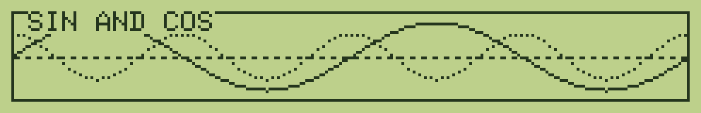

# 曲線

サインとコサインの曲線を描きます。



| キー | 働き |
|---|---|
| 何かのキー | 終わる |

## プログラム

[CURVES.BAS](CURVES.BAS)

```basic
10 REM *** CURVES ***
20 DEGREE:CLS
30 LINE (0,0)-(239,31),S,&HFFFF,B
40 LINE (0,16)-(239,16),&H6666
50 FOR X=0 TO 239
60 Y=16-12*SIN (X*3)
70 PSET (X,Y)
80 NEXT X
90 FOR X=0 TO 239 STEP 2
100 Y=16-8*COS (X*6)
110 PSET (X,Y)
120 NEXT X
130 LOCATE 1,0:PRINT "SIN AND COS";
140 IF INKEY$="" THEN 140
150 END
```

## 説明

| 行 | 内容 |
|---|---|
| 30 | `LINE …,S,&HFFFF,B` で枠を描く。`S` は点灯、`&HFFFF` は実線、`B` は四角 |
| 40 | `&H6666` は破線の模様 |
| 50〜80 | 1 ドットずつ `PSET`。`DEGREE` なので角度は度。`X*3` で 120 ドットが 1 周期 |
| 130 | 文字は `LOCATE` で置く。後ろの `;` で改行しない |

## 変えてみる

- `X*3` を変えて周期を変える
- `EXP` を掛けて、だんだん小さくなる波にする
