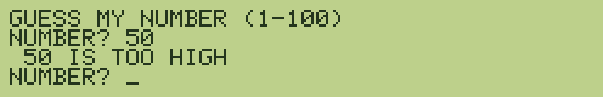

# 数当て

1〜100 の数を当てます。大きいか小さいかを教えてくれます。何回で当てたかの記録が残ります。



| キー | 働き |
|---|---|
| 数字と RETURN | 答える |
| Y / N | もう一度 / 終わる |

## プログラム

[HIGHLOW.BAS](HIGHLOW.BAS)

```basic
10 REM *** HIGH AND LOW ***
20 RANDOMIZE:B=99
100 N=RND 100:C=0:CLS
110 PRINT "GUESS MY NUMBER (1-100)"
120 INPUT "NUMBER? ";G
130 C=C+1
140 IF G=N THEN 200
150 IF G<N THEN PRINT G;"IS TOO LOW":BEEP 1,120,100
160 IF G>N THEN PRINT G;"IS TOO HIGH":BEEP 1,40,100
170 GOTO 120
200 PRINT "RIGHT! TRIES:";C:BEEP 3,10,80
210 IF C<B THEN B=C:PRINT "NEW RECORD"
220 PRINT "AGAIN? (Y/N)"
230 K$=INKEY$:IF K$="Y" THEN 100
240 IF K$<>"N" THEN 230
250 END
```

## 説明

| 行 | 内容 |
|---|---|
| 20 | `RANDOMIZE` で乱数の並びを変える。`B` は一番少ない回数 |
| 100 | `RND 100` は 1〜100 の整数 |
| 120 | `INPUT "…";G` は、文字の右に続けて入力する |
| 140〜160 | 比べて、低い音か高い音を鳴らす |
| 230 | キーが押されるまで、同じ行を繰り返す |

## 変えてみる

- 上限を 1000 にする（100、110 行）
- 7 回で終わりにする（130 行の後に `IF C>=7 THEN …`）
