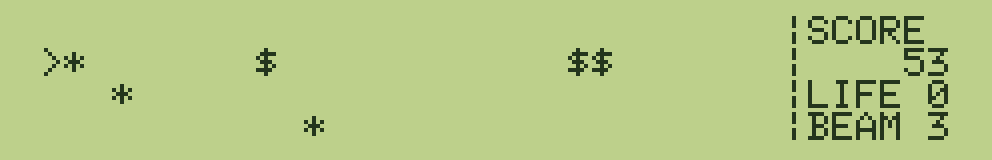

# スターランナー

右から流れてくる隕石（`*`）をよけながら進みます。`$` はボーナスで、ビームが 1 発増えます。ビームで隕石を壊すこともできます。




| キー | 働き |
|---|---|
| ▲ ▼（8、2） | 動く |
| SPACE | ビーム（残りがあるとき） |
| Y / N | もう一度 / 終わる |

## しくみ

| 変数 | 内容 |
|---|---|
| `R$(0)`〜`R$(3)` | 4 行の画面。1 行 32 文字 |
| `Y` | 自分の行（0〜3） |
| `S`、`H` | 点数、最高点 |
| `L`、`E` | 残り、ビームの残り |
| `K` | 隕石の出やすさ（だんだん増える） |

| 行 | 内容 |
|---|---|
| 200〜235 | キーを読む。SPACE は押した瞬間だけ（`Q$` に前のキーを覚えておく） |
| 240 | 4 行を 1 文字ずつ左へずらす。`MID$(R$(I),2,31)+" "` |
| 250〜270 | 乱数で、右端に隕石かボーナスを置く |
| 300〜345 | 自分の場所に何かあれば、当たり判定 |
| 350〜360 | 自分（`>`）を入れて 4 行をまとめて表示し、元に戻す |
| 370〜390 | 点数を増やし、10 回ごとに表示、100 回ごとに難しくする |
| 600〜660 | ビーム。`FOR` で右へ調べ、最初の隕石を消す |
| 800〜860 | タイトル |

4 行を文字列で持ち、まとめて `PRINT` するのが、BASIC で速く動かすこつです。

## プログラム

[STARRUN.BAS](STARRUN.BAS)

```basic
10 REM *** STAR RUNNER  PC-E500 ***
20 CLEAR:RANDOMIZE:DIM R$(3)*32:H=0
30 B$="                                "
40 M$="------------------------------"
50 GOSUB 800
100 CLS:S=0:L=3:Y=1:E=3:K=3:T=0:V=0:Q$=""
110 FOR I=0 TO 3:R$(I)=B$:LOCATE 32,I:PRINT "|";:NEXT I
120 LOCATE 33,0:PRINT "SCORE";:GOSUB 700:GOSUB 950
200 K$=INKEY$
210 IF (K$=CHR$ 4 OR K$="8") AND Y>0 THEN Y=Y-1
220 IF (K$=CHR$ 5 OR K$="2") AND Y<3 THEN Y=Y+1
230 IF K$=" " AND Q$<>" " AND E>0 THEN GOSUB 600
235 Q$=K$
240 FOR I=0 TO 3:R$(I)=MID$(R$(I),2,31)+" ":NEXT I
250 J=RND 20:IF J>K AND J<20 THEN 300
260 C=RND 4-1:N$="*":IF J=20 THEN N$="$"
270 R$(C)=LEFT$(R$(C),31)+N$
300 X$=MID$(R$(Y),2,1):IF X$=" " THEN 350
310 R$(Y)=LEFT$(R$(Y),1)+" "+MID$(R$(Y),3,30)
320 IF X$="$" THEN 340
330 L=L-1:BEEP 1,200,60:GOSUB 700:IF L=0 THEN 500
335 GOTO 350
340 S=S+50:BEEP 1,5,200:IF E<9 THEN E=E+1
345 GOSUB 700
350 W$=R$(Y):R$(Y)=LEFT$(W$,1)+">"+MID$(W$,3,30)
360 FOR I=0 TO 3:LOCATE 0,I:PRINT R$(I);:NEXT I:R$(Y)=W$
370 S=S+1:T=T+1:IF T<10 THEN 200
380 T=0:V=V+1:IF V>=10 AND K<12 THEN V=0:K=K+1
390 GOSUB 700:GOTO 200
500 REM GAME OVER
510 LOCATE 1,Y:PRINT "X";:BEEP 1,150,300:BEEP 1,220,300
520 IF S>H THEN H=S
530 CLS:LOCATE 15,0:PRINT "GAME OVER";
540 LOCATE 8,1:PRINT "SCORE";S;"  HI";H;
550 LOCATE 6,3:PRINT "PLAY AGAIN?  (Y/N)";:GOSUB 950
560 K$=INKEY$:IF K$="Y" THEN 100
570 IF K$<>"N" THEN 560
580 CLS:END
600 REM LASER
610 E=E-1:GOSUB 700:P=0
620 FOR I=3 TO 32:IF MID$(R$(Y),I,1)="*" THEN P=I:I=32
630 NEXT I
640 IF P=0 THEN LOCATE 2,Y:PRINT M$;:BEEP 1,20,150:RETURN
650 LOCATE 2,Y:PRINT LEFT$(M$,P-3);"#";:BEEP 1,40,150
660 R$(Y)=LEFT$(R$(Y),P-1)+" "+MID$(R$(Y),P+1,32):S=S+10:RETURN
700 REM STATUS
710 LOCATE 33,1:PRINT RIGHT$("     "+STR$ S,6);
720 LOCATE 33,2:PRINT "LIFE";L;
730 LOCATE 33,3:PRINT "BEAM";E;:RETURN
800 REM TITLE
810 CLS:LOCATE 10,0:PRINT "*** STAR RUNNER ***";
820 LOCATE 0,1:PRINT "UP/DOWN:MOVE  SPACE:BEAM  $:BONUS";
830 LOCATE 0,2:PRINT "HI-SCORE";H;
840 LOCATE 0,3:PRINT "PUSH SPACE KEY";:GOSUB 950
850 IF INKEY$<>" " THEN 850
860 RETURN
950 IF INKEY$<>"" THEN 950
960 RETURN
```
