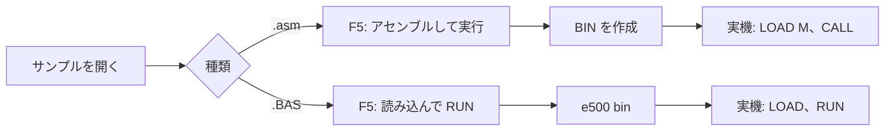

# サンプル

PC-E500 シリーズで動くプログラムを集めました。VS Code 拡張「PC-E500 開発ツール」で開いて `F5` を押すと、エミュレータで動きます（[クイックスタート](../docs/manual/01_QUICKSTART.md)）。

ゲームは別のリポジトリ [PC-E500 ゲーム集](https://github.com/litchi-gh/pc-e500_games)にあります。

## アセンブラ

| 画面 | サンプル | 内容 | 大きさ |
|---|---|---|---|
|  | [Tutorial](Assembler/Tutorial/README.md) | [アセンブラ入門](../docs/manual/03_ASSEMBLER_TUTORIAL.md)の例題 12 本 | 2〜84 バイト |
|  | [Basics](Assembler/Basics/README.md) | 表示、足し算、10 進の足し算 | 15〜80 バイト程度 |
| | [Recipes](Assembler/Recipes/README.md) | 掛け算、割り算、文字の変換など 25 のルーチン（[逆引きレシピ](../docs/manual/20_RECIPES.md)） | 約 900 バイト |

## BASIC

| 画面 | サンプル | 内容 | 主に使う命令 |
|---|---|---|---|
|  | [Curves](BASIC/Curves/README.md) | サインとコサインのグラフ | `LINE` `PSET` `SIN` |
| | [MachineCode](BASIC/MachineCode/README.md) | BASIC から機械語を呼ぶ | `POKE` `CALL` `PEEK` `DATA` |

## 動かし方

| したいこと | 方法 |
|---|---|
| エミュレータで動かす | VS Code で開いて `F5` |
| 途中で止めて調べる | 行番号の左をクリックして `F5`（[デバッグ](../docs/manual/10_DEBUG.md)） |
| 自動で確かめる | テスト エクスプローラー（[テスト](../docs/manual/11_TESTS.md)） |
| 実機で動かす | [実機へ送る](../docs/manual/14_TRANSFER.md) |
| 自分用に変える | フォルダごとコピーして、名前を変える |
