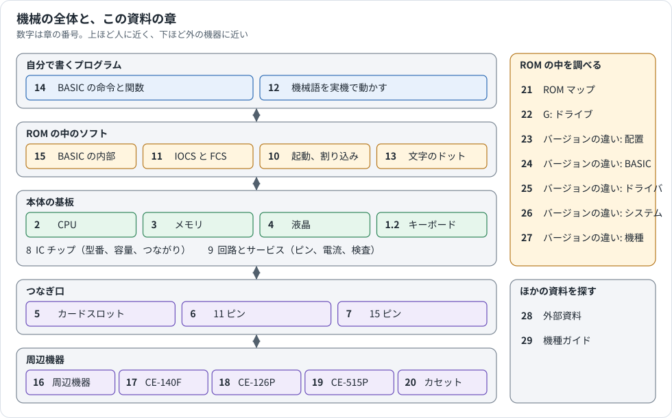
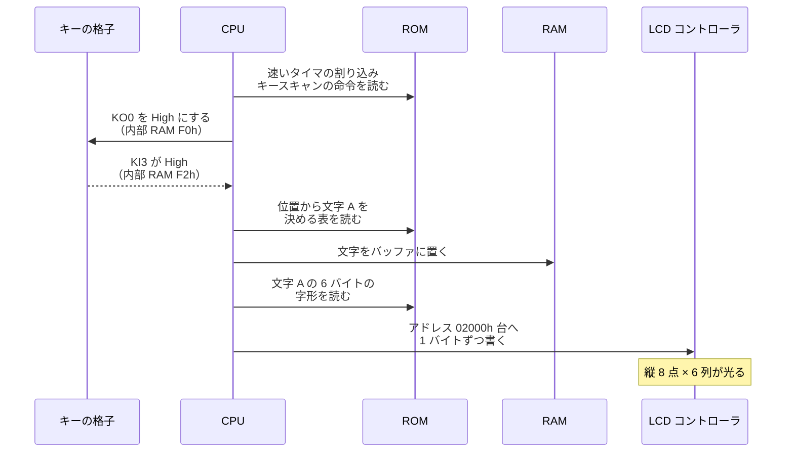
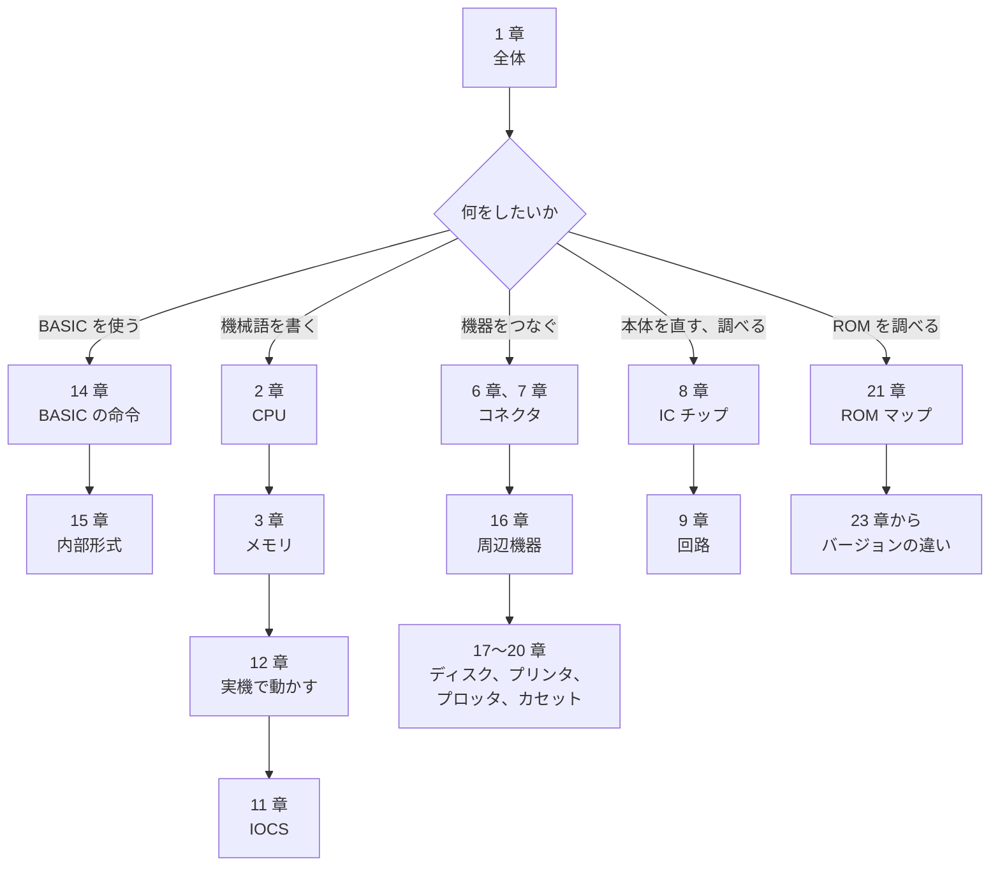
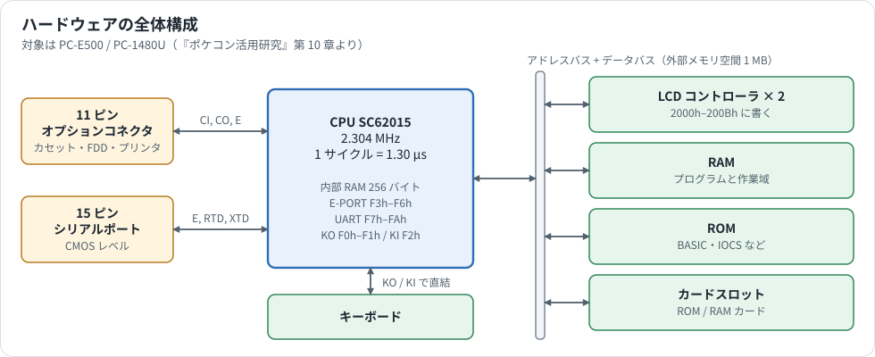
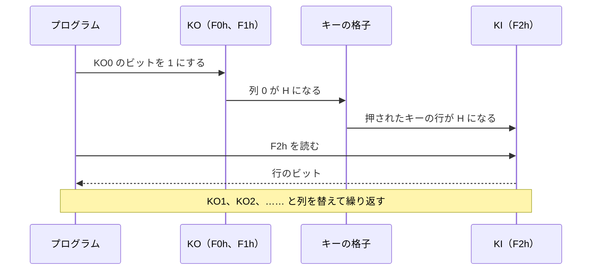
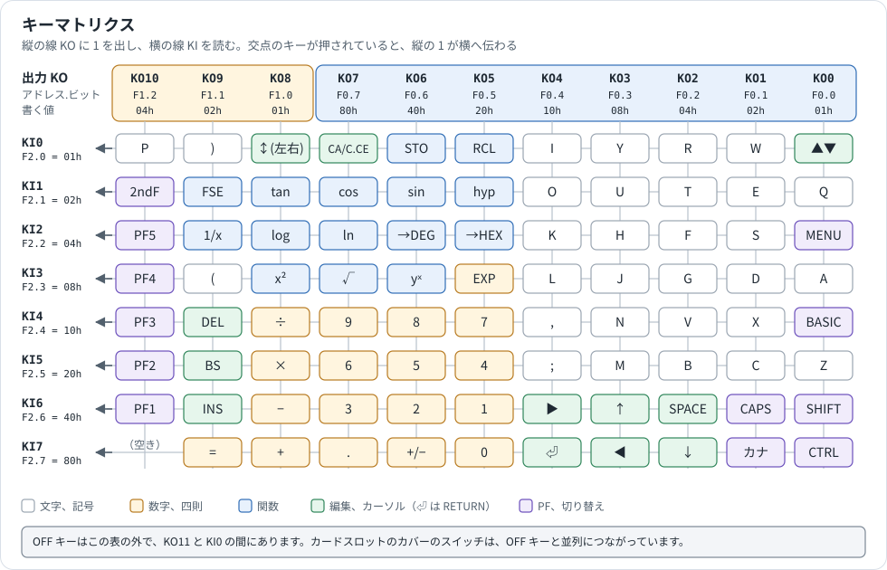
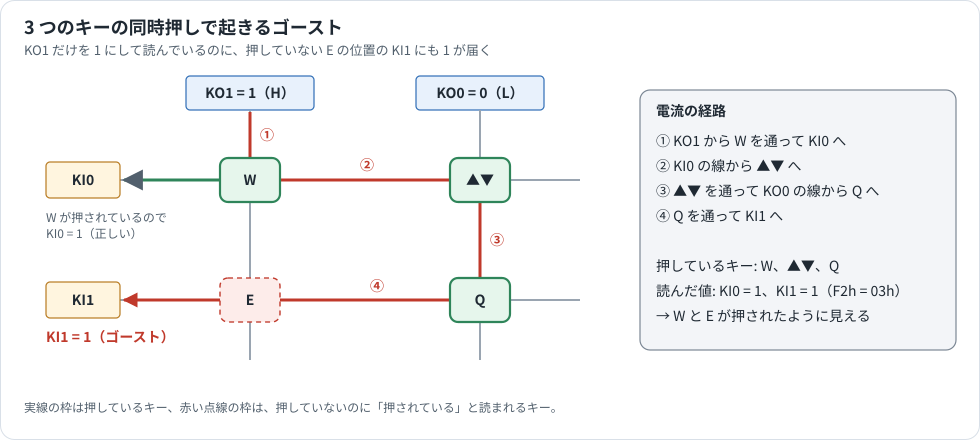

# 1. ハードウェアの全体

この章は PC-E500 シリーズのハードウェア全体を 1 枚のマップとして見せる案内役です。機械の部品がどうつながり、1 つのキーを押してから画面に文字が出るまでに何が起きるのかを、細部に入る前に見渡します。ほかの章にないキーボードだけは、回路図の行列と読み方、同時押しの落とし穴まで、ここで詳しく説明します。

[目次へ戻る](README.md)

## この章で分かること

- PC-E500 がどの部品の組み合わせで動いているか
- キーを 1 つ押したときに、どの部品が働くか
- CPU と部品をつなぐ 2 種類の道（CPU のポートと、アドレスバス、データバス）
- 部分ごとの説明がどの章にあるか、どの順に読むとよいか
- キーボードの読み方と、88 のキー位置の表
- 3 つのキーを同時に押したときに起きる「ゴースト」の理由

## はじめに

ポケットコンピュータは電卓の大きさに収めた 1 台のコンピュータです。中身を大きく分けると、次の 5 つの層になります。

1. 自分で書くプログラム: BASIC と機械語。
2. ROM の中のソフト: BASIC のインタプリタ、入出力を受け持つ IOCS、文字の形など。電源を切っても消えない ROM に入っています。
3. 本体の基板: CPU、メモリ、液晶（LCD）、キーボード。
4. つなぎ口: カードスロット、11 ピン、15 ピンのコネクタ。
5. 周辺機器: ディスク、プリンタ、プロッタ、カセットレコーダなど。

BASIC で `PRINT` を実行すると、1 から順に下の層へ仕事が渡り、最後は LCD の IC に 1 バイトずつ書き込まれます。この資料の各章はどれかの層の説明です。次の図で章の場所を確かめてください。



| 部分 | 資料 |
|---|---|
| CPU | [CPU（SC62015）](02_CPU.md) |
| メモリ | [メモリ](03_MEMORY.md) |
| 15 ピン（シリアルポート） | [15 ピン（シリアル）](07_PORT_15PIN.md) |
| 11 ピン（オプションコネクタ、テープ） | [11 ピン（テープ、周辺機器）](06_PORT_11PIN.md) |
| カセットのつなぎ方と操作 | [カセットインターフェース](20_CASSETTE.md) |
| カードスロット | [カードスロット](05_CARD_SLOT.md) |
| LCD | [液晶（LCD）](04_LCD.md) |
| IC チップ（CPU、ROM、RAM、LCD コントローラ） | [IC チップ](08_IC_CHIPS.md) |
| 部品、CPU のピン、消費電流 | [回路とサービス](09_CIRCUIT.md) |

### キーを 1 つ押したとき

BASIC の画面で `A` を押し、画面に `A` が出るまでを、部品の順に追ってみます。マップの見方の練習です。



キースキャンは [起動、割り込み、タイマ、音](10_SYSTEM.md) §10.3、字形は [フォント](13_FONT.md)、液晶は [液晶（LCD）](04_LCD.md) で、それぞれ詳しく説明しています。

### 読む順番

目的でエントリが変わります。全部を順に読む必要はありません。



## 1.1 全体構成

機械の中心は CPU です。CPU は 2 種類の道で部品とつながっています。

**CPU のポート**は CPU のピンに直接つながる線です。プログラムは CPU の中にある内部 RAM の決まったアドレス（`F0h` から）を読み書きして、この線を動かします。キーボード、11 ピン、15 ピンがこの道を使います。

**アドレスバスとデータバス**は多くの IC が共有する線です。CPU がアドレスバスにアドレスを出すと、そのアドレスを受け持つ IC だけが答え、1 バイトがデータバスを通ります。ROM、RAM、LCD コントローラ、カードスロットがこの道を使います。どのアドレスをどの IC が受け持つかは、チップセレクトという線で決まります（[回路とサービス](09_CIRCUIT.md) §9.3.2）。



- CPU は SC62015 です。キーボードは CPU の KO/KI ポートに直結しています。
- 11 ピンと 15 ピンのコネクタは CPU の E ポートと UART（CI、CO、E、RTD、XTD 端子）につながっています。UART は 1 バイトを 1 ビットずつの列に直して送り、受けた列を 1 バイトに戻す回路です。
- LCD コントローラ、RAM、ROM、カードスロットは外部メモリ空間（アドレスバス、データバス）にあります。

部品をつながり方で並べると次のようになります。

| 部品 | CPU とのつながり | プログラムから見える場所 | 章 |
|---|---|---|---|
| キーボード | KO/KI ポート | 内部 RAM の F0h〜F2h | §1.2 |
| 11 ピン | E ポート、CI、CO | 内部 RAM の F3h〜F6h、FDh、FFh | [6 章](06_PORT_11PIN.md) |
| 15 ピン | E ポート、UART | 内部 RAM の F3h〜FAh | [7 章](07_PORT_15PIN.md) |
| LCD コントローラ | バス | 外部メモリ | [4 章](04_LCD.md) |
| RAM、ROM | バス | 外部メモリ | [3 章](03_MEMORY.md) |
| カードスロット | バス | 外部メモリ | [5 章](05_CARD_SLOT.md) |

ポートの 1 ビットずつの用途は [回路とサービス](09_CIRCUIT.md) §9.3.3 に、レジスタの意味は [CPU（SC62015）](02_CPU.md) §2.7〜§2.9 にあります。

## 1.2 キーボード

### 考え方

キーが 80 個あまりあっても、CPU に 80 本の線を引く必要はありません。線を縦と横の格子に並べ、交点にキーを 1 つずつ置けば、線の数は「縦 + 横」で済みます。これを**キーマトリクス**といいます。PC-E500 では、縦の線が CPU の出力 KO、横の線が入力 KI です。

読むときは縦の線を 1 本だけ 1（H レベル）にします。その列のキーが押されていれば、1 がキーを通って横の線に届きます。これを列の数だけ繰り返すと、全部のキーの状態が分かります。この動作を**キースキャン**といいます。



キーボードは CPU の KO/KI ポートに直結しており、内部 RAM の F0h–F2h に対応します。

F0h（KO0–KO7）、F1h ビット 0–2（KO8–KO10）に適当な値を書き（該当ビットを 1 = H レベルにする）、F2h（KI0–KI7）を読むと、押されているキーに対応するビットが 1 になります。

`F1h` の上位のビットはシリアルの制御に使われています（[回路とサービス](09_CIRCUIT.md) §9.3.3）。

BASIC の PEEK/POKE でも確認できます。通常のキー入力には IOCS コールを使ってください。ROM は速いタイマの割り込みでキースキャンを続けているからです（[起動、割り込み、タイマ、音](10_SYSTEM.md) §10.3.1）。IOCS の使い方は [IOCS と FCS](11_IOCS.md) を参照してください。

### キーマトリクス

行 = KI（F2h のビット）、列 = KO（F1h ビット 2–0、F0h ビット 7–0）です。



同じ内容を表にしました。

| KI＼KO | F1.2 | F1.1 | F1.0 | F0.7 | F0.6 | F0.5 | F0.4 | F0.3 | F0.2 | F0.1 | F0.0 |
|---|---|---|---|---|---|---|---|---|---|---|---|
| **0** | P | ) | ↕(左右) | CA/C.CE | STO | RCL | I | Y | R | W | ▲▼ |
| **1** | 2ndF | FSE | tan | cos | sin | hyp | O | U | T | E | Q |
| **2** | PF5 | 1/x | log | ln | →DEG | →HEX | K | H | F | S | MENU |
| **3** | PF4 | ( | x² | √ | yˣ | EXP | L | J | G | D | A |
| **4** | PF3 | DEL | ÷ | 9 | 8 | 7 | , | N | V | X | BASIC |
| **5** | PF2 | BS | × | 6 | 5 | 4 | ; | M | B | C | Z |
| **6** | PF1 | INS | − | 3 | 2 | 1 | ▶ | ↑ | SPACE | CAPS | SHIFT |
| **7** | | = | + | . | +/− | 0 | ⏎(RETURN) | ◀ | ↓ | カナ（ANS） | CTRL |

（KI0 行の F1.0 は「↕」、F0.0 は「▲▼」と印字されたキー。KI7 行の F1.2 は空き。KI7 行の F0.1 は、日本語の機種ではカナ、英語の PC-E500 では ANS です。）

KI7 行の F0.7 の `.` は書籍の表にありませんが、PC-E500（p.11）と PC-E500S（p.16）の回路図の行列には、どちらも `.` とあります（公式）。エミュレータの CPU で ROM 7.2 を動かし、この位置だけを押すと `.` が入力されました（実験）。

カナと ANS は同じ場所のキーです。PC-E500 のサービスマニュアルの回路図は ANS、E650 と U6000 を含む PC-E500S のサービスマニュアルの回路図は「カナ」と書いています（公式）。キーの使い方はハンドブックの [キーボード](../handbook/02_KEYBOARD.md) にあります。

OFF キーはこの表の外で、KO11 と KI0 の間にあります。カードスロットのカバーのスイッチは OFF キーと並列につながっています（[カードスロット](05_CARD_SLOT.md) §5.5）。回路図の名前は S1（RAM card SW）です。カバーのロックを外すとこのスイッチが閉じ、OFF キーを押し続けているのと同じになります（回路図から推定）。

### 例: 表から書く値と読む値を求める

列の見出しの `F0.n` は「`F0h` のビット n を 1 にする」という意味です。書く値は 2 の n 乗、読む値は 2 の（KI の番号）乗になります。

| キー | 表の位置 | 書く値 | 読む値（そのキーだけ押したとき） |
|---|---|---|---|
| `A` | KI3、F0.0 | `F0h` に 01h | `F2h` が 08h |
| `7` | KI4、F0.5 | `F0h` に 20h | `F2h` が 10h |
| `RETURN` | KI7、F0.4 | `F0h` に 10h | `F2h` が 80h |
| `PF1` | KI6、F1.2 | `F1h` のビット 2 を 1 に（04h） | `F2h` が 40h |

機械語なら、`A` のキーは次のように調べられます（`e500asm` の書き方）。

```asm
        MV    ($F0),$01         ; KO0 だけを 1 にする
        MV    A,($F2)           ; KI を読む
        TEST  A,$08             ; KI3 のビット
        JRNZ  pressed           ; 1 なら A が押されている
```

同じ列のキーは同時に読めます。KO0 の列で `A`（08h）と `Z`（20h）を押していれば、`F2h` は 28h です。列を複数同時に 1 にすると、どの列のキーかは区別できませんが、「どれかのキーが押されたか」を 1 回で調べられます。

### 同時押し（ゴースト）の注意

この方法では複数キーを同時に読めますが、**押されていないキーが押されていると判定される**ことがあります。これを**ゴースト**と呼びます。

例：KO1 を H、KO0 を L にして W / ▲▼ / Q の 3 キーを同時に押すと、KO1 → W → KI0 → ▲▼ → KO0 → Q → KI1 と電流が回り込み、KO1 列を読んでいるのに E キーに対応する KI1 も H になってしまいます。



ゴーストが起きるのは、押した 3 つのキーが長方形の 3 つの角になるときです。残りの 1 つの角が押されたように見えます。2 つまでの同時押しでは起きません。ゲームのように複数のキーを同時に使うプログラムでは、長方形にならない位置のキーを選ぶと避けられます。

電流が L の線へ回り込んでも電源がショートしないのは、KO の Low 側の出力抵抗を高くしてあるからです（[CPU（SC62015）](02_CPU.md) §2.7.1）。

## まとめ

| 覚えること | 内容 |
|---|---|
| CPU | SC62015。キーボード、11 ピン、15 ピンはポートで直結 |
| バスにあるもの | LCD コントローラ、RAM、ROM、カードスロット |
| キーの出力 | `F0h`（KO0–KO7）、`F1h` ビット 0–2（KO8–KO10）。1 にした列が H |
| キーの入力 | `F2h`（KI0–KI7）。押された行が 1 |
| OFF キー | KO11 と KI0 の間。カバーのスイッチと並列 |
| ゴースト | 長方形の 3 つの角を押すと、4 つ目も 1 になる |
| ふつうの入力 | IOCS コールを使う |

## 情報源

キーボードの出典は書籍『ポケコン活用研究』第 10 章（pp.200–209）で、対象は PC-E500 と PC-1480U です。行列は PC-E500 サービスマニュアル p.11 と PC-E500S サービスマニュアル p.16 の回路図とも照合しました。

## 次に読むもの

- [機種ガイド](29_MODELS.md): 機種ごとの部品と違い（PC-E500S、PC-E650 など）
- [CPU（SC62015）](02_CPU.md): レジスタ、命令、ポート、割り込み
- [メモリ](03_MEMORY.md): アドレスの割当てと、スロットの仕組み
- [IOCS と FCS](11_IOCS.md): キー入力や表示を ROM に頼む方法
- [回路とサービス](09_CIRCUIT.md): ピンの割り当てと電流
