# 2. CPU（SC62015）

この章は、PC-E500 シリーズの心臓である CPU、SC62015 の説明書です。「`MV A,(BP+20h)` の括弧は何か」「`ADCL` はどちらへ進むのか」「割り込みが起きるとスタックに何が積まれるのか」といった、機械語を読み書きするときの疑問に、この 1 章で答えられるようにしました。

初めての人は「はじめに」から順に、機械語の経験がある人は §2.14 の早見表から読んでください。どの機種でも CPU は同じなので、ここに書いたことは全機種に当てはまります。シャープの社内名は ESR-L、部品名は PC-E500 が SC62015B01、PC-E500S が SC62015C01 です（[IC チップ](08_IC_CHIPS.md) §8.2）。

[目次へ戻る](README.md)

## この章で分かること

- レジスタとフラグの役割、幅の違う値を移したときの決まり
- 2 つのメモリ空間（内部メモリと外部メモリ）と、アドレスの作り方の全種類
- キー、ポート、UART、タイマ、表示を動かす、内部 RAM のレジスタのビット
- 割り込みが起きてから戻るまでの動きと、スタックの中身
- 全命令の動作、符号化、フラグ、サイクル数
- 公式の資料とエミュレータが食い違う点
- 命令のフラグとサイクル数を、エミュレータで 1 つずつ測った結果

## はじめに

### CPU が行うこと

CPU は、メモリから命令を 1 つ読み、そのとおりに値を動かしたり計算したりして、次の命令へ進みます。これを 1 秒に何十万回も繰り返します。プログラムを書く人から見ると、CPU は次の 4 つの組み合わせです。

| 部分 | 役割 | 節 |
|---|---|---|
| レジスタとフラグ | 計算の途中の値と、結果の印を持つ | §2.3、§2.4 |
| メモリ空間 | 命令とデータを置く。SC62015 には 2 つある | §2.5、§2.6 |
| 周辺の回路 | キー、UART、タイマ、音、表示の制御。CPU の中に入っている | §2.7〜§2.9 |
| 割り込みと省電力 | 外の出来事に応える、止まって待つ | §2.10、§2.11 |

SC62015 の特徴は 3 つあります。

1. **ポインタが 20 ビット。** 外部メモリの 1 MB を、セグメントを意識せずに 1 本のレジスタで指せます。
2. **内部 RAM が 256 バイト。** レジスタが少ない代わりに、CPU の中の 256 バイトを速い作業域として使います。命令の多くは「内部 RAM とメモリ」「内部 RAM と内部 RAM」で計算できます。
3. **まとめて処理する命令。** 回数を I に入れておけば、転送、加減算、10 進の計算、交換を 1 命令で I バイト分行います（名前の末尾が `L` の命令）。

### 読み方の案内

| 知りたいこと | 読む所 |
|---|---|
| 初めて機械語を書く | §2.3 → §2.4 → §2.5 → §2.13 → §2.14 |
| 入出力を直接動かす | §2.6 → §2.7〜§2.9 |
| 割り込みを使う | §2.10 → §2.11 |
| 逆アセンブル結果を読む | §2.13.5 の PRE バイト → §2.15 |

ほかの章の関連する資料は次のとおりです。

| 知りたいこと | 資料 |
|---|---|
| 機械語の書き方、実機での動かし方 | [機械語を実機で動かす](12_MACHINE_CODE.md) |
| 外部メモリの割当てと ROM の違い | [ROM バージョンの違い: 配置](23_ROM_VERSIONS_MAP.md) |
| ROM がどう CPU を使っているか（起動、割り込みの振り分け） | [起動、割り込み、タイマ、音](10_SYSTEM.md) |
| ピンと周辺回路 | [回路とサービス](09_CIRCUIT.md)、[ハードウェアの全体](01_HARDWARE.md) |
| メモリの割当てと内部 RAM の使い方 | [メモリ](03_MEMORY.md) |
| LCD の操作 | [液晶（LCD）](04_LCD.md) |
| カードスロット | [カードスロット](05_CARD_SLOT.md) |
| シリアルポートの使い方 | [15 ピン（シリアル）](07_PORT_15PIN.md) |
| 11 ピンとテープ | [11 ピン（テープ、周辺機器）](06_PORT_11PIN.md) |

### 表記

- `(…)` は内部メモリ、`[…]` は外部メモリです。括弧の形で空間が決まります。
- 16 進の数は `12h`、`BEC00h` のように書きます。`asm` と書いた枠の中の例は `e500asm` の書き方で、`$12` と `12h` は同じです。
- 印のない記述と **公式** はシャープの資料、**コード** は ROM の逆アセンブル、**実験** はエミュレータでの確認によります（章末の[情報源と確度](#情報源と確度)）。

## 2.1 概要

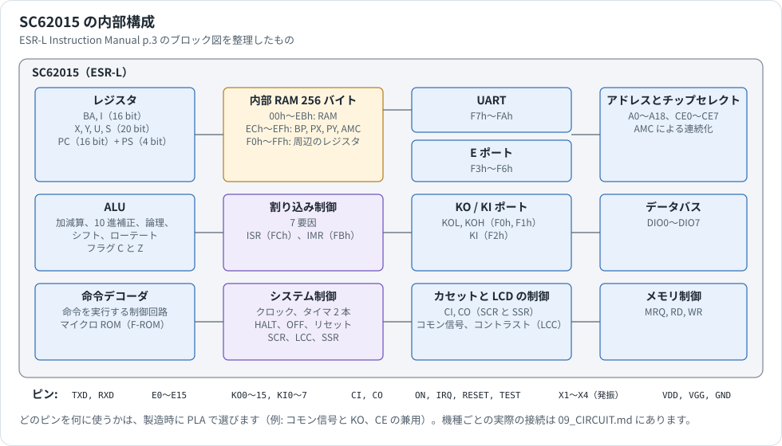

SC62015 は、計算をする部分だけでなく、キーの走査、シリアル通信、タイマ、カセットの入出力、LCD の電圧の調整までを 1 個に収めた CPU です。このため、本体の基板のほかの主な IC は ROM、RAM、LCD のドライバだけです（[IC チップ](08_IC_CHIPS.md) §8.1）。

| 項目 | 内容 |
|---|---|
| CPU | 8 bit、CMOS |
| メモリ空間 | データは 1 MB の連続空間、プログラムは 64 KB × 16 セグメント |
| 内部 RAM | 256 バイトの別の空間。236 バイトが RAM、20 バイトがポインタと周辺のレジスタ |
| レジスタ | A、B、IL、IH（8 bit）、X、Y、U、S（20 bit）、PC（16 bit）、PS（4 bit） |
| フラグ | C と Z の 2 つ |
| 主クロック | セラミック発振 2.304 MHz。1 実行サイクル 1.30 µs |
| サブクロック | CR 発振 標準 40 kHz、または水晶 32.768 kHz |
| 割り込み | 7 要因（タイマ 2、キー 2、UART 2、外部 1）とソフトウェア割り込み |
| UART | 300〜19200 bps、パリティ偶数/奇数/なし、7/8 ビット、ストップ 1/2 ビット |
| ポート | KO 16 本、KI 8 本、E 16 本、CI、CO |
| LCD | コモン信号（1/16 デューティ。ピンは 14 本）、電圧の生成、コントラスト 32 段階 |
| 省電力 | `HALT`（主クロックだけ停止）、`OFF`（両方停止） |

一般仕様の p.1 はボーレートの上限を 9600 と書いていますが、p.11 と p.35 は 19200 まで載せています。

チップの機能の一部は、製造時に **PLA** で選びます。PLA は、工場で配線の組み合わせを決める回路です。クロックの周波数、ピンの兼用（コモン信号と KO、CE など）、プルアップとプルダウン、割り込みに使う KI のピンなどが PLA で決まります。つまり、資料の「選べる」は機種の設計で決まる内容で、プログラムからは変えられません。

### 2.1.1 使っている機種

本リポジトリで ROM を調べた 13 本は、すべてこの CPU の命令で動いています。たとえば割り込みのエントリの処理 172 バイトは、13 本で（自分の戻り先のアドレスを除いて）1 バイトも違いません（[ROM マップ](21_ROM_MAP.md) §21.3）。

| 機種 | ROM バージョン |
|---|---|
| PC-1480U | 2.1 |
| PC-E500 | 2.2、3.2、5.3、6.3、7.2、7.3 |
| PC-E500PJ | 6.2 |
| PC-E500S | 8.3 |
| PC-1490UII | 6.4 |
| PC-E550 | 7.5 |
| PC-U6000 | 8.4 |
| PC-E650 | 8.5 |

命令、レジスタ、内部 RAM は全機種で同じです。機種で違うのは外部メモリの割当てと ROM の中身です（[ROM バージョンの違い: 配置](23_ROM_VERSIONS_MAP.md)）。外部資料によると、シャープの IQ-7000 系などにも同じ CPU が使われています（[外部資料](28_RESOURCES.md)）。

## 2.2 クロックと実行時間

CPU はクロックの刻みに合わせて動きます。SC62015 には、命令を実行するための速い**主クロック**と、表示や遅いタイマのための遅い**サブクロック**があります。主クロックを止めても、サブクロックが動いていれば表示とタイマは続きます（§2.11）。

| 項目 | 値 |
|---|---|
| 主クロック | 2.304 MHz。PLA で 1.536 MHz、3.072 MHz も選べる |
| 1 実行サイクル | クロック 3 周期。2.304 MHz で 1.30 µs（768 kHz）、1.536 MHz で 1.95 µs、3.072 MHz で 0.98 µs |
| サブクロック | 表示クロックとタイマに使う |

実行時間は `サイクル数 × 1.30 µs` です。公式は 1 サイクルを「ステート」と呼びます。PC-E500 の主クロックは 2.304 MHz です（[起動、割り込み、タイマ、音](10_SYSTEM.md) §10.1）。

外部メモリの LCD のウィンドウは、アクセスが遅くなります（§2.5.3）。そのほかの外部メモリは、1 回のアクセスが 1 ステートです。

### 例: 時間を計算する

| 命令 | サイクル | 時間 |
|---|---|---|
| `NOP` | 1 | 1.30 µs |
| `MV A,[X]` | 4 | 5.2 µs |
| `CALLF lmn` と `RETF` | 8 + 5 = 13 | 16.9 µs |
| `MV I,768` と `WAIT` | 3 + 769 = 772 | 約 1 ms |

`WAIT` は I+1 サイクルなので、1 ms ほど待つには I に 768 を入れます（768 kHz では 1 ms が 768 サイクル）。サイクル数は §2.15 の表にあります。

## 2.3 レジスタ

レジスタは CPU の中にある、名前の付いた小さな入れ物です。SC62015 のレジスタは、計算に使う A、B、I、アドレスを持つ X、Y、U、S、実行の場所を示す PC、PS に分かれます。

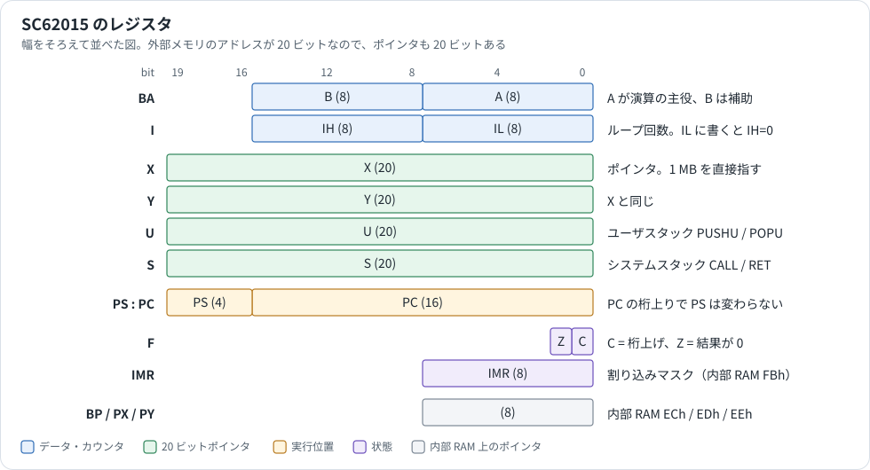

### 2.3.1 一覧

| 記号 | 幅 | 役割 |
|---|---|---|
| A | 8 bit | アキュムレータ。8 bit 演算の中心 |
| B | 8 bit | A の補助。単独で使えるのは `MV A,B`、`MV B,A`、`EX A,B` だけ |
| BA | 16 bit | B が上位、A が下位 |
| IL、IH | 8 bit | I の下位と上位。単独で使えるのは IL だけ |
| I | 16 bit | ループカウンタ。`MVL`、`ADCL` など末尾が `L` の命令が回数に使う |
| X、Y | 20 bit | ポインタ。外部メモリ 1 MB を直接指す |
| U | 20 bit | ユーザスタックポインタ。`PUSHU`、`POPU` が使う。ポインタとしても使える |
| S | 20 bit | システムスタックポインタ。`CALL`、`RET`、割り込みが使う。ポインタとしても使える |
| PC | 16 bit | プログラムカウンタ |
| PS | 4 bit | ページセグメント。PC と合わせて 20 bit の実行アドレスを作る |
| F | 2 bit | フラグ。ビット 0 が C、ビット 1 が Z |

IMR は内部 RAM の FBh にある割り込みマスクです（§2.6）。レジスタではありませんが、`PUSHU IMR`、`POPU IMR` で積み降ろしできます。

> [!TIP]
> レジスタの数が少ないので、計算の途中の値は内部 RAM に置くのがふつうです。内部 RAM は `MV`、`ADD`、`CMP` などの命令から直接使えます。ROM も同じ場所を使うので、使う前に退避して最後に戻します（[機械語を実機で動かす](12_MACHINE_CODE.md) §12.3.4）。

### 2.3.2 命令の中のレジスタコード

機械語の中では、レジスタは 0〜7 の数で表されます。オペコードの下位 3 ビットや、第 2 バイトの 4 ビットに現れます。

| 記号 | レジスタ | コード |
|---|---|---|
| r1 | A、IL | A=0、IL=1 |
| r2 | BA、I | BA=2、I=3 |
| r3 | X、Y、U、S | X=4、Y=5、U=6、S=7 |
| r | 上のすべて | 0〜7 |

コードの並びは幅の順です。0〜1 が 8 bit、2〜3 が 16 bit、4〜7 が 20 bit なので、コードが分かれば幅も分かります。

**例:** `ADD X,BA` は `45` のあとに `(r3<<4)+r'` を置きます。X は 4、BA は 2 なので、`45 42` です。`INC X` は `6C 04`、`DEC IL` は `7C 01` です（`e500asm` の出力）。

### 2.3.3 細かい動作

幅の違うレジスタの間や、レジスタとメモリの間で値を移すと、足りない桁や余る桁が出ます。その扱いの決まりです。

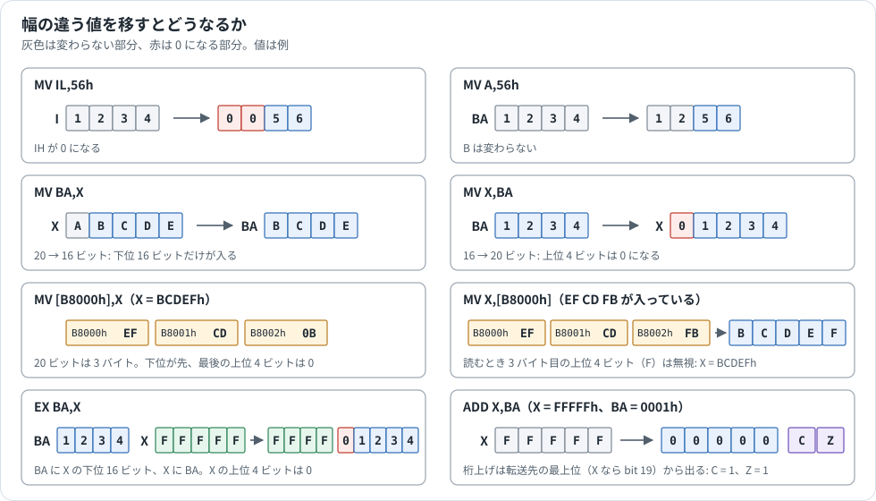

| 動作 | 結果 | 根拠 |
|---|---|---|
| IL に書く（`MV IL,n`、`MV IL,(n)`、`POPU IL` など） | IH が 0 になる | 公式 p.47、p.66、実験 |
| A に書く | B は変わらない | 公式 p.47、実験 |
| IL の計算（`ADD IL,A`、`INC IL`、`DEC IL` など） | IH が 0 になる | 実験（I=12FFh で `INC IL`、`ADD IL,A`（A=1）→ どちらも I=0000h） |
| `MV A,IL`、`MV IL,A` | 命令がない。内部 RAM を経由する | 公式 p.47 |
| 16 bit ← 20 bit（`MV BA,X`） | 下位 16 bit が入る | 公式 p.48、実験 |
| 20 bit ← 16 bit（`MV X,BA`） | 上位 4 bit は 0 | 公式 p.50、実験 |
| `EX BA,X` | BA に X の下位 16 bit、X に BA。X の上位 4 bit は 0 | 公式 p.55、実験（X=FFFFFh、BA=1234h → BA=FFFFh、X=01234h） |
| 20 bit レジスタを 3 バイト書く | 上位 4 bit は 0 で書く | 実験（`BCDEFh` → `EF CD 0B`） |
| 3 バイトを 20 bit レジスタへ読む | 上位 4 bit は無視する | 公式 p.22、実験（`EF CD FB` → `BCDEFh`） |
| ループ命令で I=0 | 65536 回。実行後の I は 0 | 公式 p.52 |
| `MV X,X` のようにアドレスに使うレジスタへ転送する | できる | 公式 p.50 |

**A の値を IL に移す例**（直接の命令がないので、内部 RAM の 1 バイトを経由します）:

```asm
        MV    ($20),A           ; 30 A0 20
        MV    IL,($20)          ; 30 81 20  I = 00xx になる
```

> [!WARNING]
> ループ命令を I=0 で実行すると、0 回ではなく 65536 回です。回数が計算で決まるときは、0 でないことを先に確かめます。

### 2.3.4 PC と PS

次に実行する命令のアドレスは、PS（4 bit）と PC（16 bit）を並べた 20 bit です。PS が 64 KB のセグメントを選び、PC がその中の位置を示します。

PC は命令のバイトを読むごとに 1 増えます。`FFFFh` の次は `0000h` に戻り、PS は変わりません。64 KB の境界を越えて実行は続きません（公式 p.5、実験: `CFFFFh` の `NOP` の次は `C0000h`）。

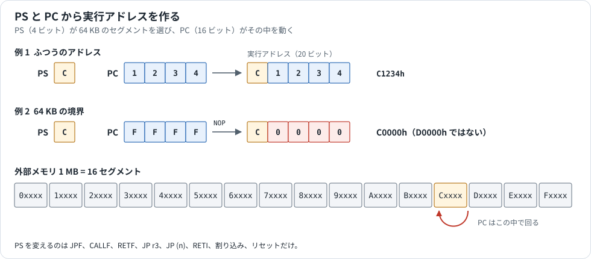

PS が変わるのは、`JPF`、`CALLF`、`RETF`、`JP r3`、`JP (n)`、`RETI`、割り込み、リセットです。相対ジャンプの計算も PC の 16 bit の中で行います（公式 p.68）。

これはプログラムの話で、データのアドレスには当てはまりません。X、Y、U、S は 20 bit のまま増減するので、`[X++]` はセグメントの境界を越えて進みます。たとえば `BFFFFh` の次は `C0000h` です。

### 2.3.5 S の制限

外部メモリとの転送で S を使うときは、`[lmn]` の絶対アドレスだけが使えます（公式 p.50、p.51）。`MV S,[X]` や `MV [X],S` はありません。ポインタとして `[S++]`、`[--S]`、`[S+n]` を使うことはできます。

| 書き方 | 使えるか |
|---|---|
| `MV S,[0BFCE1h]`、`MV [0BFCE1h],S` | 使える（`[lmn]`） |
| `MV S,[X]`、`MV [X],S` | ない |
| `MV [--S],X`、`MV X,[S++]`、`MV A,[S+2]` | 使える（S はポインタ） |

## 2.4 フラグ

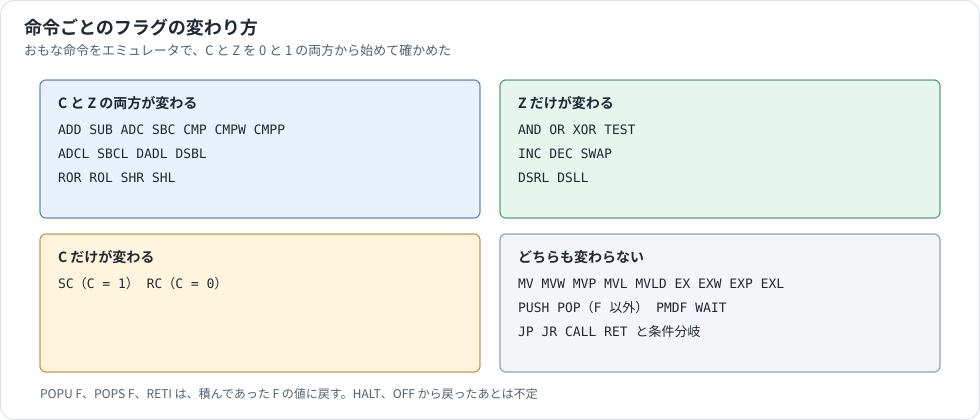

フラグは、直前の計算の結果を 1 ビットで覚えておく印です。条件分岐は、C と Z だけで決まります（公式 p.24）。**C（キャリー）** は桁上げや借りが出たこと、**Z（ゼロ）** は結果が 0 になったことを示します。符号や溢れを示すフラグはありません。

| 命令 | C | Z |
|---|---|---|
| `ADD`、`SUB`、`ADC`、`SBC` | 変わる | 変わる |
| `ADCL`、`SBCL`、`DADL`、`DSBL` | 変わる | 全バイトが 0 のとき 1 |
| `CMP`、`CMPW`、`CMPP` | 変わる（借り） | 等しいとき 1 |
| `AND`、`OR`、`XOR`、`TEST` | 変わらない | 変わる |
| `INC`、`DEC` | 変わらない | 変わる |
| `SWAP A` | 変わらない | 変わる |
| `ROR`、`ROL`、`SHR`、`SHL` | 押し出されたビット | 変わる |
| `DSRL`、`DSLL` | 変わらない | 全バイトが 0 のとき 1 |
| `SC`、`RC` | 1、0 | 変わらない |
| `POPU F`、`POPS F`、`RETI` | 戻す | 戻す |
| `MV` 系、`EX` 系、`PUSH`、`POP`、`PMDF`、`WAIT`、分岐 | 変わらない | 変わらない |

レジスタ間の加減算の C は、転送先の最上位ビットから出ます。X なら bit 19 です（公式 p.57、実験: `X=FFFFFh` に 1 を足すと X=0、C=1、Z=1）。

上の表のおもな命令は、C と Z を両方 0、両方 1 にした状態から実行し、エミュレータで確かめました（実験）。次の表は、間違えやすい所の結果です。

| 命令と実行前 | 結果 | C | Z |
|---|---|---|---|
| `INC X`（X = FFFFFh） | X = 00000h | 変わらない | 1 |
| `DEC A`（A = 00h） | A = FFh | 変わらない（借りは出ない） | 0 |
| `PMDF (20h),FFh`（(20h) = 01h） | (20h) = 00h | 変わらない | 変わらない |
| `SWAP A`（A = 12h） | A = 21h | 変わらない | 0 |
| `MVL`、`EXL`、`MVLD` | I = 0 になる | 変わらない | 変わらない |
| `SUB X,A`（X = 00000h、A = 1） | X = FFFFFh | 1（bit 19 から） | 0 |
| `ADD BA,I`（FFFFh + 1） | BA = 0000h | 1（bit 15 から） | 1 |
| `ADC A,FFh`（A = 0、C = 1） | A = 00h | 1 | 1 |
| `SHR A`（A = 01h、C = 0） | A = 00h | 1 | 1 |
| `SHR A`（A = 01h、C = 1） | A = 80h | 1 | 0 |
| `WAIT`（I = 5） | I = 0 | 変わらない | 変わらない |

`INC`、`DEC` が C を変えないので、`DEC IL` と `JRNZ` のループの中で多バイトの桁上げを持ち越せます。

### 例: 計算とフラグ

| 実行前 | 命令 | 結果 | C | Z |
|---|---|---|---|---|
| A = 90h | `ADD A,90h` | A = 20h（90h + 90h = 120h） | 1 | 0 |
| A = 80h | `ADD A,80h` | A = 00h（100h） | 1 | 1 |
| A = 05h | `CMP A,0Ah` | A は変わらない | 1（5 < 10） | 0 |
| A = 0Ah | `CMP A,0Ah` | A は変わらない | 0 | 1 |
| A = 0Ch | `CMP A,0Ah` | A は変わらない | 0（12 ≥ 10） | 0 |
| A = F0h、C = 1 | `AND A,0Fh` | A = 00h | 1 のまま | 1 |
| A = FFh、C = 0 | `INC A` | A = 00h | 0 のまま | 1 |

`CMP A,n` のあとの分岐は、`JRC` が A < n、`JRZ` が A = n、`JRNC` が A ≥ n です（符号なし）。

## 2.5 メモリ空間

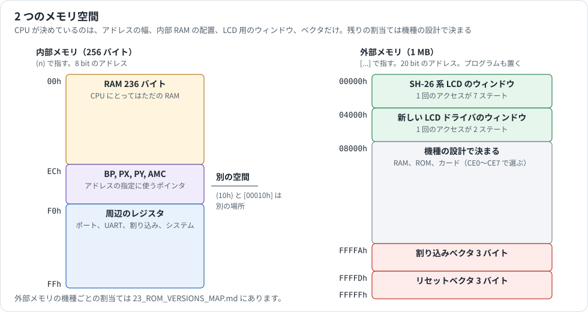

### 2.5.1 2 つの空間

| 空間 | 大きさ | 書き方 | アドレスの指定 |
|---|---|---|---|
| 内部メモリ | 256 バイト | `(n)` | 8 bit のポインタ BP、PX、PY か即値 |
| 外部メモリ | 1 MB | `[...]` | 20 bit のレジスタ、3 バイトの即値、内部 RAM のポインタ |

2 つは別の空間です。`(10h)` と `[00010h]` は別の場所を指します。

内部メモリは CPU の中にあり、外部メモリは基板の ROM、RAM、LCD コントローラ、カードです。手元の机（内部メモリ）と、部屋の本棚（外部メモリ）の関係に似ています。机は狭いけれど手が届き、ほとんどの計算は机の上で行います。

### 2.5.2 バイトの順序

多バイトの値は、下位バイトを小さいアドレスに置きます（リトルエンディアン）。ただし 10 進の連続演算（`DADL`、`DSBL`）は、最下位バイトのアドレスを指定してアドレスを減らしながら進むので、BCD の数は上位桁を小さいアドレスに置きます（§2.14.2）。

```text
BA = 1234h を [B8000h] に書く        BCD の 12345678 を 4 バイトに置く
  B8000h  34   下位                    20h  12   上位の桁
  B8001h  12   上位                    21h  34
                                       22h  56
X = BE691h を [B8000h] に書く          23h  78   最下位の桁（DADL で指定するアドレス）
  B8000h  91
  B8001h  E6
  B8002h  0B   上位 4 bit は 0
```

BCD（2 進化 10 進）は、10 進の 1 桁を 4 ビットで表す方法です。`12h` と書いた 1 バイトが 10 進の 12 を表します。BASIC の数値がこの形です。

### 2.5.3 CPU が決めているアドレス

外部メモリのうち、CPU が役割を決めているのは次の範囲だけです（公式 p.22、p.23）。残りの割当ては機種の設計で決まります（[ROM バージョンの違い: 配置](23_ROM_VERSIONS_MAP.md)）。

| アドレス | 役割 | アクセス |
|---|---|---|
| `00000h`〜`03FFFh` | LCD ドライバ SH-26 のウィンドウ | 1 回 7 ステート |
| `04000h`〜`07FFFh` | 新しい LCD ドライバ LH-5073A1 のウィンドウ | 1 回 2 ステート |
| `FFFFAh`〜`FFFFCh` | 割り込みベクタ（PC 下位、PC 上位、PS） | |
| `FFFFDh`〜`FFFFFh` | リセットベクタ（PC 下位、PC 上位、PS） | |

ベクタは「この出来事が起きたら、ここへ飛ぶ」というアドレスを書いておく場所です。1 MB の最後の 6 バイトにあります。たとえば ROM 3.2 のリセット処理は `F10BDh` から始まるので（[起動、割り込み、タイマ、音](10_SYSTEM.md) §10.2）、リセットベクタの並びは次のようになります。

```text
FFFFDh  BD   PC 下位
FFFFEh  10   PC 上位
FFFFFh  0F   PS
```

### 2.5.4 チップセレクトと AMC

外部メモリのデコードは、CE0〜CE7 のピンで行います。範囲は PLA で決まります。CPU があるアドレスを読み書きすると、そのアドレスを受け持つ CE のピンだけが動き、つながった IC が答えます。PC-E500 シリーズでの受け持ちは [回路とサービス](09_CIRCUIT.md) §9.3.2 の図のとおりです。

カードスロットが 2 つあると、差したカードの容量によってカードのアドレスが連続しなくなります。**AMC**（`EFh`）は、これを連続に見せる機能です（公式 p.8、p.9）。CE1 側の末尾に CE0 側の先頭をつなげて見せます。

| ビット | 名前 | 内容 |
|---|---|---|
| 7 | AME | 1 で機能を有効にする。リセットで 0 |
| 5〜0 | AM5〜AM0 | CE0 側のカードの容量。`000000` 2 KB、`000001` 4 KB、`000011` 8 KB、`000111` 16 KB、`001111` 32 KB、`011111` 64 KB、`111111` 128 KB |

CE0 と CE1 の範囲は PLA で 32、64、128、256 KB のいずれかにし、CE0 の最後のアドレスは `XFFFFh` でなければなりません。

PC-E500 シリーズの ROM は、`MEM$="B"` でこの機能を使います。内蔵 RAM が CE0、カードが CE1 です（[カードスロット](05_CARD_SLOT.md) §5.7.3）。

**例:** ROM は内蔵 RAM が 32 KB のとき AMC に 8Fh、64 KB のとき 9Fh を書きます。2 進に直すと、ビット 7 の AME が 1、下位 6 ビットが容量の表の値になっています。

| AMC | 2 進 | AME | AM5〜AM0 | 容量 |
|---|---|---|---|---|
| 8Fh | `1 0 001111` | 1 | `001111` | 32 KB |
| 9Fh | `1 0 011111` | 1 | `011111` | 64 KB |

## 2.6 内部 RAM

内部 RAM の 256 バイトは、236 バイトの作業域と、20 バイトの特別なアドレスに分かれます。特別なアドレスは、読み書きするとポインタになったり、周辺の回路が動いたりします。ほかの CPU でいう「I/O ポート」が、ここに置かれていると考えると分かりやすくなります。

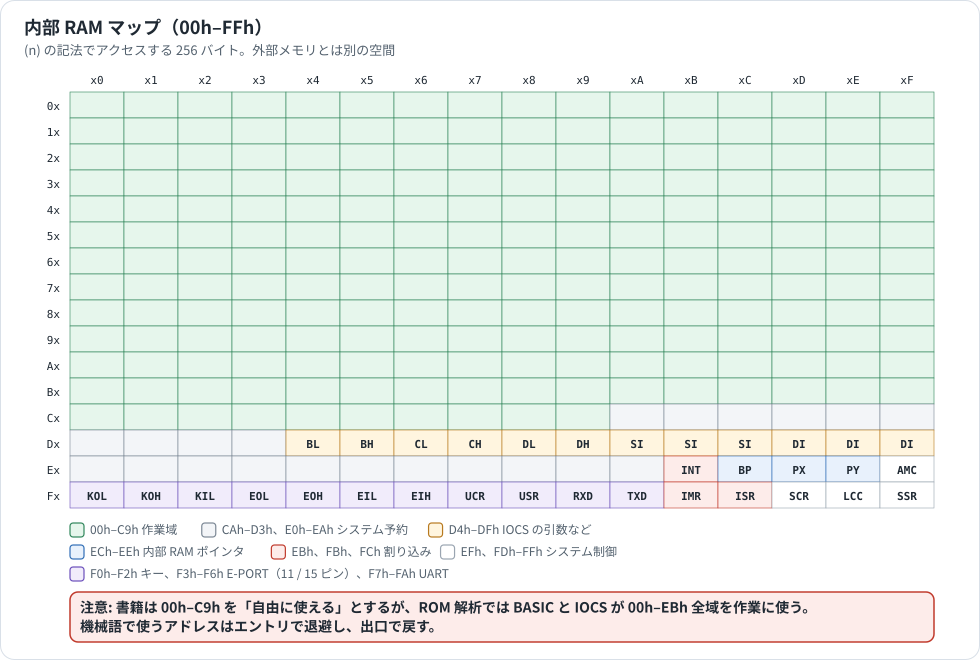

公式 p.7〜21 のとおりです。読み書きの欄の R は読むだけ、W は書くだけです。

| アドレス | 名前 | | 内容 |
|---|---|---|---|
| `00h`〜`EBh` | RAM | | 236 バイトの RAM |
| `ECh` | BP | | ベースポインタ。`(BP+n)`、`(BP+PX)`、`(BP+PY)` の基準 |
| `EDh` | PX | | ポインタ。`(PX+n)`、`(BP+PX)` |
| `EEh` | PY | | ポインタ。第 2 オペランドの `(PY+n)`、`(BP+PY)` |
| `EFh` | AMC | | §2.5.4 |
| `F0h` | KOL | | KO0〜KO7 の出力 |
| `F1h` | KOH | | KO8〜KO15 の出力 |
| `F2h` | KI | R | KI0〜KI7 の入力 |
| `F3h` | EOL | | E0〜E7 の出力 |
| `F4h` | EOH | | E8〜E15 の出力 |
| `F5h` | EIL | R | E0〜E7 の入力 |
| `F6h` | EIH | R | E8〜E15 の入力 |
| `F7h` | UCR | | UART の制御（§2.8） |
| `F8h` | USR | R | UART の状態（§2.8） |
| `F9h` | RXD | R | UART の受信バッファ |
| `FAh` | TXD | W | UART の送信バッファ |
| `FBh` | IMR | | 割り込みマスク（§2.10） |
| `FCh` | ISR | | 割り込み要因（§2.10） |
| `FDh` | SCR | | システム制御（§2.9.1） |
| `FEh` | LCC | | コントラストなど（§2.9.2） |
| `FFh` | SSR | R | システムの状態（§2.9.3） |

CPU にとって `00h`〜`EBh` はただの RAM です。ROM（BASIC、IOCS）がこの範囲をどう使うかは CPU の話ではなく、[メモリ](03_MEMORY.md) §3.1.2 と [機械語を実機で動かす](12_MACHINE_CODE.md) §12.3.4 にあります。たとえば `EBh` は、ROM が処理中の割り込み要因を記録するのに使います（コード）。

> [!NOTE]
> 周辺のレジスタは絶対アドレス `(n)` で指します。既定の `(BP+n)` で書くと、BP の値だけずれた別の場所を読み書きしてしまいます（§2.13.3）。`e500asm` では `MV A,($F2)` と書けば、絶対アドレスの PRE が自動で付きます。

## 2.7 ポート

ポートは、CPU のピンの電圧をプログラムから読み書きする窓口です。出力は「ビットを 1 にするとピンが High になる」、入力は「ピンが High ならビットが 1 になる」と読みます。

| ポート | 向き | 本数 | 内部 RAM | PC-E500 シリーズでの用途 |
|---|---|---|---|---|
| KO | 出力 | 16 | F0h、F1h | キーの列、シリアルの制御 |
| KI | 入力 | 8 | F2h | キーの行 |
| E | PLA で選ぶ | 16 | F3h〜F6h | 11 ピン、15 ピン、電源の制御 |
| CI | 入力 | 1 | FFh（SSR） | カセットの入力 |
| CO | 出力 | 1 | FDh（SCR） | カセットの出力、ブザー |
| ON、IRQ | 入力 | 各 1 | FFh（SSR）、FCh（ISR） | ON キー、電池検出 |

ピン番号とビットごとの用途は [回路とサービス](09_CIRCUIT.md) §9.3 にあります。

### 2.7.1 KO と KI

KO は出力だけ、KI は入力だけのポートです。キーボードのスキャンに使います。仕組みとキーの配置は [ハードウェアの全体](01_HARDWARE.md) §1.2 を参照してください。

- KOL、KOH のビットを 1 にすると、対応するピンが High になります。
- KO の Low 側の出力抵抗は高くしてあります（標準 100 kΩ。High 側は最大 5 kΩ）。複数のキーを押したときに、電源とグラウンドがショートしないようにするためです。
- `LCC` の KSD を 1 にすると、バッファの内容によらず全ピンが Low になります。バッファ自体は普通に使えます。
- KI のピンが High になると、ISR の KEYI が 1 になり、`HALT`、`OFF` からも戻ります。どのピンで反応するかは PLA で選びます。

抵抗の意味を、2 つのキーを同じ行で同時に押した場合で考えます。High の KO と Low の KO が 1 本の KI でつながると、電流が High から Low へ流れます。両方の抵抗が低ければ大きな電流になりますが、Low 側が 100 kΩ なら電流はわずかで、KI の電圧は High に近いままです。

### 2.7.2 E ポート

16 本の汎用ポートです。PLA で、入力専用、出力専用、入出力を選びます（公式 p.27）。

入出力にしたときは、Low 側の出力抵抗を高く（標準 125 kΩ）して、Low を出している間は外から入力できるようにします。High を出している間は入力できません。抵抗が高いので応答は遅くなります。

```text
E ポートを入力に使うとき（入出力に選んだピン）
  1. EOL / EOH のビットを 0 にする   … Low を弱く出す（125 kΩ）
  2. 外の機器が High を出せば、弱い Low に勝ってピンは High
  3. EIL / EIH を読む
```

PC-E500 シリーズでは、11 ピンのコネクタ（CE-140F など）につながっています（[11 ピン（テープ、周辺機器）](06_PORT_11PIN.md)）。

### 2.7.3 CI と CO

カセットの入出力です。

- **CI** は入力専用で、ゼロクロス検出器を持ちます。`SCR` の BZ2 を 1 にすると入力できます。検出器は数百 µA を消費するので、必要なときだけ有効にします。
- **CO** は出力専用で、`SCR` の BZ2〜BZ0 で選びます（§2.9.1）。

ゼロクロス検出器は、音のように上下に揺れる信号が中央の高さを横切るたびに 0 と 1 を切り替える回路です。カセットの再生音から、0 と 1 の波形を取り出すために使います。

PC-E500 シリーズのブザーはこの出力です（[起動、割り込み、タイマ、音](10_SYSTEM.md) §10.5）。

### 2.7.4 ON と IRQ

- **ON** は入力専用で、プルダウン（標準 125 kΩ）付きです。プルダウンは、何もつながっていないときに Low へ引いておく抵抗です。High の間は SSR の ONK が 1 です。High になると ISR の ONKI が 1 になり、`HALT`、`OFF` から戻ります。
- **IRQ** は外部割り込みの入力です。極性とプルアップ、プルダウンは PLA で選びます。ISR の EXI が 1 になり、`SCR` の ISE が 1 なら `HALT`、`OFF` からも戻ります。

## 2.8 UART

UART は、1 バイトを 1 ビットずつ決まった速さで送り、受けたビットの列を 1 バイトに戻す回路です。送る側と受ける側が、速さ（ボーレート）、データの長さ、パリティ、ストップビットを同じに設定します。1 文字は次の形で送られます。

```text
 開始 | データ 7 か 8 ビット | パリティ（偶数、奇数、なし） | ストップ 1 か 2 ビット
```

パリティは、1 の数が偶数（または奇数）になるように足す確認用のビットです。文字の長さは設定で変わります。8 ビット、パリティ偶数、ストップ 1 ビットなら 1 + 8 + 1 + 1 = 11 ビットで、9600 bps では 1 文字が約 1.15 ms です（11 ÷ 9600）。

動作は [15 ピン（シリアル）](07_PORT_15PIN.md) にもあります。ここでは CPU のレジスタを説明します（公式 p.11〜15、p.35〜36）。

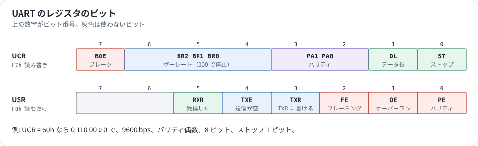

### 2.8.1 UCR（F7h）

| ビット | 名前 | 内容 |
|---|---|---|
| 7 | BOE | 1 の間、TXD に 0 を出す（ブレーク） |
| 6〜4 | BR2〜BR0 | ボーレート。`000` で停止して UART の内部をリセット |
| 3〜2 | PA1、PA0 | パリティ。`00` 偶数、`01` 奇数、`1x` なし |
| 1 | DL | データ長。0 で 8 ビット、1 で 7 ビット |
| 0 | ST | ストップビット。0 で 1 ビット、1 で 2 ビット |

| BR2〜BR0 | 000 | 001 | 010 | 011 | 100 | 101 | 110 | 111 |
|---|---|---|---|---|---|---|---|---|
| bps | 停止 | 300 | 600 | 1200 | 2400 | 4800 | 9600 | 19200 |

UART のクロックは主クロックから作るので、`HALT`、`OFF` の間は動きません。

**例: UCR の値を組み立てる**

| 設定 | 2 進 | UCR |
|---|---|---|
| 9600 bps、偶数、8 ビット、ストップ 1 | `0 110 00 0 0` | 60h |
| 1200 bps、なし、8 ビット、ストップ 1 | `0 011 10 0 0` | 38h |
| 4800 bps、奇数、7 ビット、ストップ 2 | `0 101 01 1 1` | 57h |

「なし」は `1x` なので、PA0 は 0 でも 1 でも同じです。上の例では 0 にしました。

### 2.8.2 USR（F8h）

| ビット | 名前 | 内容 |
|---|---|---|
| 5 | RXR | 1 文字の受信が終わると 1。`RXD` を読むと 0 |
| 4 | TXE | 送信中は 0、それ以外は 1 |
| 3 | TXR | `TXD` に書くと 0。データが送信部へ渡ると 1 |
| 2 | FE | フレーミングエラー。受信ごとに更新 |
| 1 | OE | オーバーランエラー。RXR が 1 のまま次の受信が終わると 1 |
| 0 | PE | パリティエラー。受信ごとに更新 |

3 つのエラーの意味は次のとおりです。

| エラー | 起きること | よくある原因 |
|---|---|---|
| フレーミング | ストップビットの位置が 1 になっていない | 速さや文字の長さの設定違い |
| オーバーラン | 読む前に次の文字が届いた | 受信の処理が遅い |
| パリティ | 1 の数が設定と合わない | 設定違い、雑音 |

### 2.8.3 注意

- **OE と RXD を読む順序:** OE は 1 文字の受信が終わる少し前（1 ビットの時間の半分ほど）に 1 になります。USR を読んでから続けて RXD を読みます。
- **TXR と TXE を同時に調べない:** 書き込んだデータが送信部へ渡るとき、TXR が 1 になるのと TXE が 0 になるのは、前後に 1 ステートずれることがあります。
- **続けて送る:** 送信中でも `TXD` に書けます。TXR で空きを確かめて書けば、前の文字が終わったらすぐ次を送ります。
- **7 ビットのとき:** `RXD` の最上位ビットは常に 0 です。

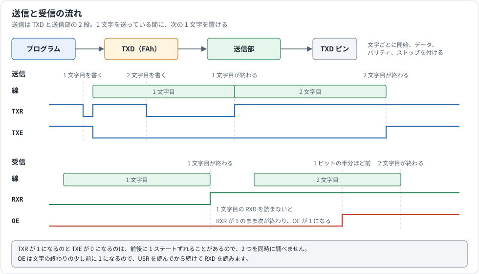

**例: 1 文字を送る**（A に文字が入っているとき）

```asm
wait:   TEST  ($F8),$08         ; USR の TXR
        JRZ   wait              ; 0 の間は空きを待つ
        MV    ($FA),A           ; TXD に書く
```

割り込みは、RXR が 1 になると RXRI、TXR が 1 になると TXRI が立ちます（PLA による）。

## 2.9 システムのレジスタ

ここでは、残りの制御用のレジスタ SCR、LCC、SSR を説明します。図には §2.5.4 の AMC も並べました。

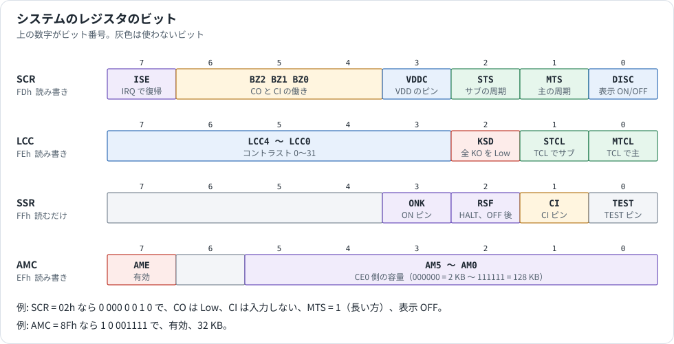

### 2.9.1 SCR（FDh）

| ビット | 名前 | 内容 |
|---|---|---|
| 7 | ISE | 1 なら IRQ で `HALT`、`OFF` から戻る |
| 6〜4 | BZ2〜BZ0 | CO と CI（下の表） |
| 3 | VDDC | VDD のピン。0 で Low（VCC）、1 で High（GND）。SC62015B01 では 1 にするとサブクロックも止まる |
| 2 | STS | サブクロックのタイマの周期。PC-E500 では 0 で約 0.5 秒、1 で約 2 秒 |
| 1 | MTS | 主クロックのタイマの周期。0 で短い方、1 で長い方 |
| 0 | DISC | DIS のピン。1 で表示 ON、0 で表示 OFF |

| BZ2〜BZ0 | CO | CI |
|---|---|---|
| 000 | Low | 入力しない（0） |
| 001 | High | 入力しない（0） |
| 010 | 2 kHz | 入力しない（0） |
| 011 | 4 kHz | 入力しない（0） |
| 100 | Low | 入力する |
| 101 | High | 入力する |
| 11x | CI の状態 | 入力する |

BZ の 3 ビットは「CO に何を出すか」と「CI を受けるか」を合わせて選びます。BZ2 が 1 の 3 組が、CI を受ける設定です。

**例: ほかのビットを変えずにブザーの端子を切り替える**

```asm
        AND   ($FD),$8F         ; BZ を 000 に（CO = Low、止める）
        OR    ($FD),$10         ; BZ を 001 に（CO = High）
        AND   ($FD),$8F         ; BZ を 000 に戻す
        OR    ($FD),$20         ; BZ を 010 に（CO = 2 kHz）
```

`8Fh` は `1000 1111` で、ビット 6〜4 だけを 0 にします。SCR には表示やタイマの設定も入っているので、`MV` で全体を書き換えずに `AND` と `OR` で必要なビットだけを変えます。

周期を変えると分周のつなぎが変わって一瞬乱れるので、STS と MTS は、対応する割り込みが立った直後か `TCL` の直後に変えます（公式 p.18）。

**STS の向き:** 公式の CPU マニュアル（p.18）は「0 が長い方、1 が短い方」、PC-E500 の技術資料（p.92）は「0 で約 0.5 秒、1 で約 2 秒」と書いていて、逆です。ROM は STS = 0 で使い、その 1200 回分が実機の自動電源オフ（約 11 分）になるので、技術資料のほうが正しいと分かります（[起動、割り込み、タイマ、音](10_SYSTEM.md) §10.4）。

**DISC の使い方:** LCD ドライバの表示カウンタは、DIS の立ち上がりで同期します。公式 p.19 は、表示クロックの 1 周期より長く待って DISC を 1 にし、また待って 0 にする手順を示し、キー入力時と 10 秒ごとにも同期するよう書いています。

### 2.9.2 LCC（FEh）

| ビット | 名前 | 内容 |
|---|---|---|
| 7〜3 | LCC4〜LCC0 | コントラスト。0 が最小、31 が最大 |
| 2 | KSD | 1 で全 KO を Low にする（§2.7.1） |
| 1 | STCL | 1 の状態で `TCL` を実行するとサブクロックのタイマをリセット |
| 0 | MTCL | 1 の状態で `TCL` を実行すると主クロックのタイマをリセット |

コントラストは上位 5 ビットにあるので、値を 8 倍した数を書きます。コントラスト 16 なら 16 × 8 = 128 で、下位 3 ビットが 0 なら LCC は 80h です。

### 2.9.3 SSR（FFh）

| ビット | 名前 | 内容 |
|---|---|---|
| 3 | ONK | ON ピンの状態 |
| 2 | RSF | RESET ピンが High のとき 0、`HALT`、`OFF` が働くと 1 |
| 1 | CI | CI ピンの状態 |
| 0 | TEST | TEST ピンの状態 |

ビットの配置は p.20 の図によります。p.28 は CI を「bit 2」と書いていますが誤りと見られます。ROM のテープの処理は `TEST (FFh),02h` で CI を読みます（コード、3.2 の `EA22Dh`）。

### 2.9.4 タイマ

タイマは 2 本で、どちらも周期が来ると ISR のビットを立てます。

| タイマ | クロック | ISR | 選択 | 止まるとき |
|---|---|---|---|---|
| MSEC タイマ | 主クロック | MTI（ビット 0） | MTS | `HALT`、`OFF` |
| SEC タイマ | サブクロック | STI（ビット 1） | STS | `OFF` |

PC-E500 シリーズでの周期は [起動、割り込み、タイマ、音](10_SYSTEM.md) §10.4 にあります（速いタイマ 4 ms か 16 ms、遅いタイマ約 0.5 秒か約 2 秒）。

2 本の使い分けはクロックから決まります。MSEC タイマは主クロックで動くので細かい周期を作れますが、`HALT` で止まります。SEC タイマは `HALT` の間も動くので、止まって待つときの目覚ましになります（§2.11.1 の 3）。

## 2.10 割り込み

割り込みは、CPU が今の仕事を一度止めて、別の処理を先に行い、終わったら元へ戻る仕組みです。電話が鳴ったら本にしおりを挟み、用件を済ませてから読みかけのページに戻るのに似ています。しおりに当たるのが、S スタックに積む 5 バイトです。

### 2.10.1 要因

| ビット | ISR | IMR | 要因 |
|---|---|---|---|
| 7 | | IRM | 全体の許可。0 で全要因を禁止 |
| 6 | EXI | EXM | IRQ ピン |
| 5 | RXRI | RXRM | UART の受信完了 |
| 4 | TXRI | TXRM | UART の送信バッファの空き |
| 3 | ONKI | ONKM | ON ピンが High |
| 2 | KEYI | KEYM | KI のピンが High |
| 1 | STI | STM | サブクロックのタイマ |
| 0 | MTI | MTM | 主クロックのタイマ |

**ISR** は「何が起きたか」、**IMR** は「何に応えるか」です。2 つのビットの並びは同じなので、ビットごとに見比べれば済みます。

ISR のビットは、要因が消えても 1 のままで、ソフトウェアが 0 を書くまで残ります。

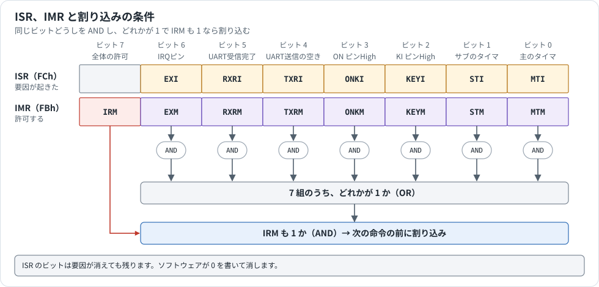

**例:** IMR = 83h は `1000 0011` で、IRM、STM、MTM が 1 です。2 本のタイマだけに応えます。この状態で ISR が 04h（KEYI）になっても割り込みません。ISR が 05h（KEYI と MTI）なら、MTI で割り込みます。

### 2.10.2 受け付けの条件

ISR のあるビットが 1 で、IMR の同じビットと IRM がどちらも 1 なら、**次の命令を実行する前に**割り込みます。1 命令の実行中は割り込みません（公式 p.52、p.72）。`MVL` や `WAIT` を大きな I で実行すると、その間は割り込みが待たされます。

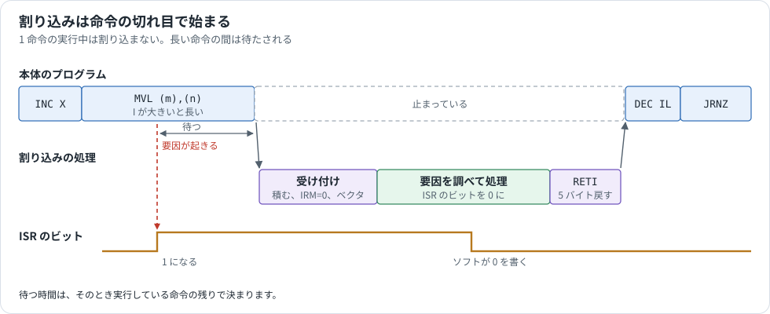

**例: どれだけ待たされるか。** `MVL (m),(n)` は公式の式で 5+2×I サイクルです。I=200 なら 405 サイクル、約 0.53 ms です。`WAIT` を I=65535 で実行すると 65536 サイクルで、約 85 ms の間、割り込みが入りません。速いタイマの周期（4 ms か 16 ms）より長いので、何回分かのキースキャンを飛ばすことになります。

割り込みの処理の先頭は、ベクタの 1 か所だけです。どの要因かはソフトウェアが ISR と IMR を見て判断します。ROM の振り分けは [起動、割り込み、タイマ、音](10_SYSTEM.md) §10.3 にあります。

### 2.10.3 スタックに積むもの

スタックは、最後に積んだものを最初に取り出す置き場です。S スタックはアドレスの小さい方へ伸びます。積むと S が減り、取り出すと S が増えます。

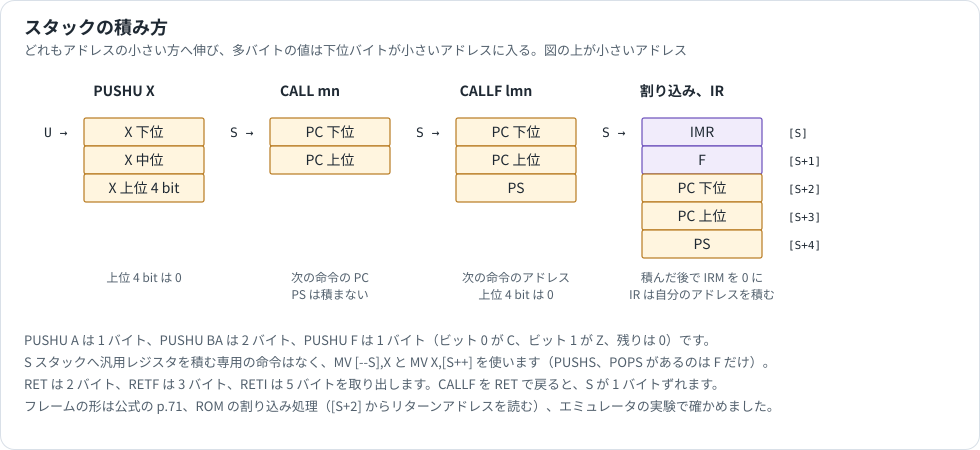

受け付けると、次の順に処理します（公式 p.37、p.71）。

1. S スタックに 5 バイト積みます。
2. IMR の IRM を 0 にします。
3. `FFFFAh` からの 3 バイトを PC と PS に読みます。

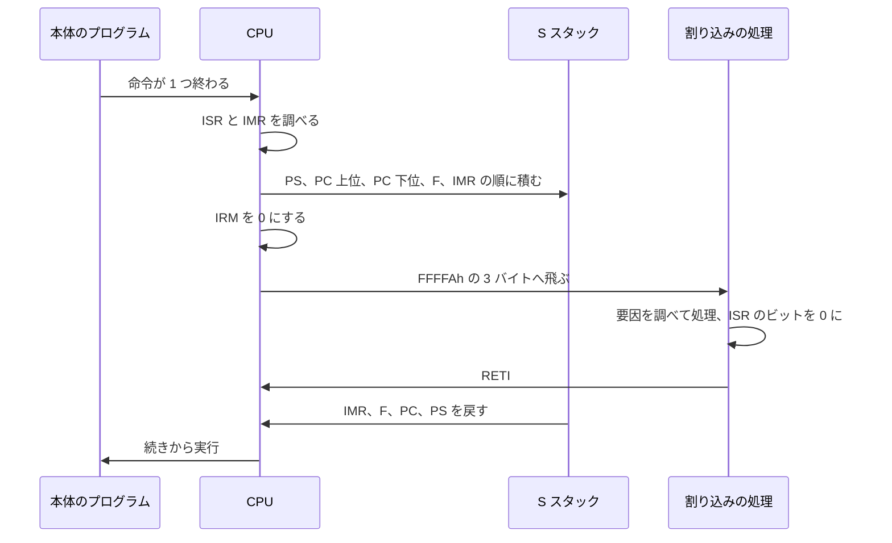

積んだ後の形は次のとおりです。ROM の割り込み処理は `MV X,[S+02h]` でリターンアドレスを読むので、この形と一致します（コード、3.2 の `F207Fh`）。

| アドレス | 内容 |
|---|---|
| `[S]` | IMR（積む前の値） |
| `[S+1]` | F（ビット 0 が C、ビット 1 が Z、残りは 0） |
| `[S+2]`〜`[S+4]` | PC 下位、PC 上位、PS |

`RETI` は 5 バイトを取り出して IMR、F、PC、PS に戻します。積んだ IMR は IRM を 0 にする前の値なので、`RETI` で許可の状態も元に戻ります。

`CALL`、`CALLF` と比べると、積むバイト数と中身が違います。次の図は、`BEC10h` に命令があり、実行前の S が `BE900h` の場合の例です。

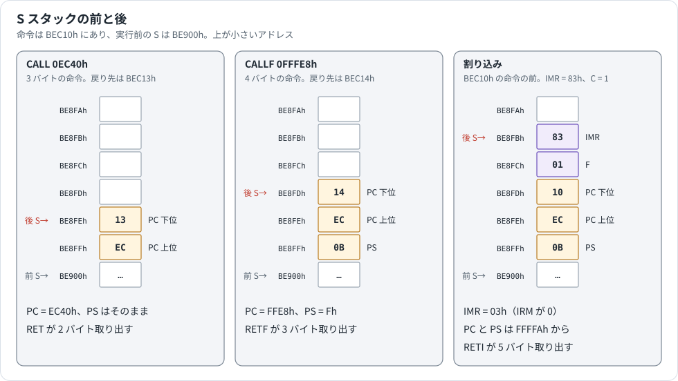

| 呼び方 | 積むバイト数 | 積むアドレス | 戻る命令 |
|---|---|---|---|
| `CALL mn` | 2（PC） | 次の命令 | `RET` |
| `CALLF lmn` | 3（PC、PS） | 次の命令 | `RETF` |
| 割り込み | 5（IMR、F、PC、PS） | これから実行する命令 | `RETI` |
| `IR` | 5（IMR、F、PC、PS） | `IR` 自身（§2.10.4） | `RETI` |

呼び方と戻り方の組を間違えると、S がずれて、でたらめなアドレスへ飛びます。

p.37 は順序を「PCL、PCH、PS、F、IMR」、IRM を「1 にする」と書いていますが、p.15 と p.71 の説明および ROM の処理と合いません。p.37 は、順序をアドレスの並びとして、IRM を誤記として読むのが自然です。

### 2.10.4 IR 命令

`IR`（`FEh`、公式は `int`）は、割り込みと同じ形でスタックに積んでベクタへ飛びます。IMR の値によらず実行します（実験）。

**積むリターンアドレスは、次の命令ではなく `IR` 自身のアドレスです**（実験）。そのまま `RETI` で戻ると、また `IR` を実行します。ROM の割り込み処理は、要因が見つからないときにリターンアドレスの 1 バイトを読み、`FEh` ならリターンアドレスを 1 進めてソフトウェア割り込みとして処理します（コード、3.2 の `F207Fh`〜`F2088h`）。

公式の p.71 は積んだ後に IRM を 0 にすると書いていますが、エミュレータの `IR` は IRM を変えません（§2.16）。

### 2.10.5 割り込みを書くときの注意

**IMR を変えた直後の割り込み:** 判定は次の命令の読み出し中に行われるので、IMR を変える命令の直後の割り込みは、変える前の IMR で判定されます。`AND (FBh),n` で要因を禁止しても、直後にその要因で割り込むことがあります。その場合、割り込み処理が ISR と IMR を見ても要因が見つかりません。**対象の要因が見つからなければ、何もせずに戻る**ように書きます（公式 p.16、p.38）。

**続けて割り込む:** `RETI` の直後にも割り込みが入れます。要求が続くと、メインの処理がまったく進まなくなることがあります（公式 p.38）。

**ISR を消す:** ビットは自動では消えません。処理した要因のビットに 0 を書きます。`AND ($FC),$FE` なら MTI（ビット 0）だけを 0 にします。消し忘れると、戻った直後に同じ要因でまた割り込みます。

**RETI か RETF か:** ハードウェアの割り込みの出口は `RETI` です。PC-E500 シリーズで RAM のベクタに登録する処理は、ROM の振り分けから呼ばれるので `RETF` で終わります（[起動、割り込み、タイマ、音](10_SYSTEM.md) §10.3.4）。

処理の組み立てを流れにすると、次のようになります。

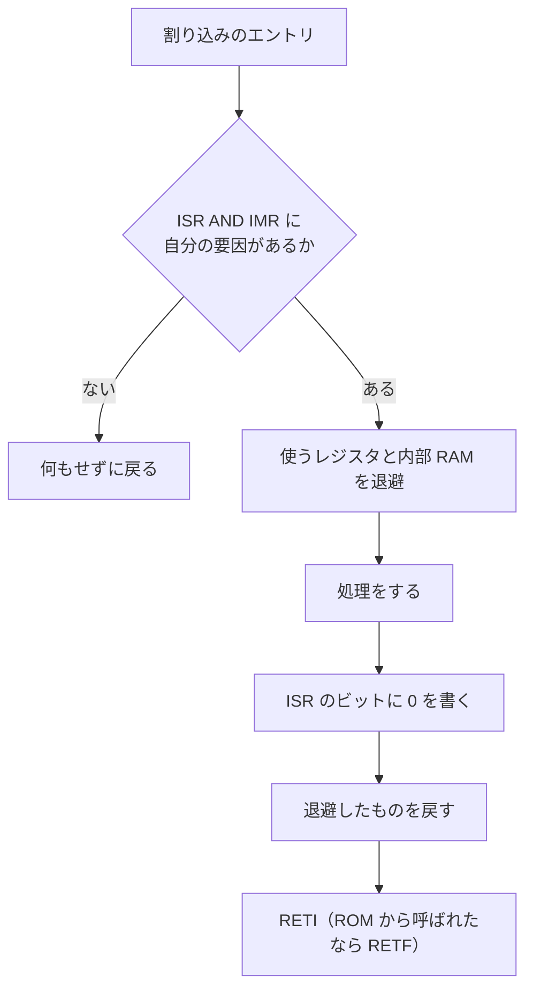

## 2.11 HALT、OFF、RESET

電池で動く機械では、仕事のない間は CPU を止めて電流を減らします。止め方は 2 つあり、どのクロックを止めるかと、何で起きるかが違います。

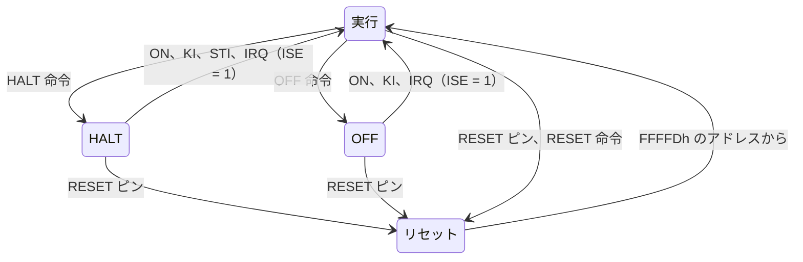

| | 主クロック | サブクロック | タイマの STI で戻るか |
|---|---|---|---|
| 実行中 | 動く | 動く | |
| `HALT` | 止まる | 動く | 戻る |
| `OFF` | 止まる | 止まる | 戻らない |

### 2.11.1 HALT

`HALT` は主クロックを止めます。サブクロックは動いています。次のどれかで戻ります（公式 p.31）。

1. ON ピンが High になる
2. KI のピンが High になる（どのピンかは PLA で選ぶ。公式は「K0 to K7」と書いている）
3. サブクロックのタイマで STI が 1 になる
4. IRQ に入力があり、ISE が 1（PLA で選ぶ）
5. RESET ピンが High になる

1〜4 では `HALT` の次の命令から再開します。再開までに数ミリ秒かかります（PLA による）。5 はリセットです。

実行前に 1〜4 のどれかがすでに起きていると、止まらず、2 ステートの `NOP` として次へ進みます。

### 2.11.2 OFF

`OFF` は主クロックとサブクロックの両方を止めます。戻る条件は、`HALT` の 3（タイマ）を除いたものです。実行前に条件が起きているか、STI がすでに 1 のときは、止まらずに次へ進みます（公式 p.32）。

### 2.11.3 RESET

RESET ピンを High にすると初期化して再起動します。`HALT`、`OFF` の間でもリセットできます。

`RESET` 命令は、`FFFFDh`〜`FFFFFh` の 3 バイトを PC と PS に読みます（公式 p.33、p.71）。

### 2.11.4 残る値

公式 p.34 の表です。

| | HALT | OFF | RESET |
|---|---|---|---|
| レジスタ | 保持 | 保持 | PC と PS だけが変わり、他は保持 |
| フラグ | 不定 | 不定 | 保持 |
| 内部メモリ | USR のビット 0〜2、5 を 0、ビット 3、4 を 1、SSR のビット 2 を 1。他は保持 | HALT と同じ | AMC のビット 7、UCR、USR のビット 0〜2、5、IMR、SCR、SSR のビット 2 を 0、USR のビット 3、4 を 1。他は保持 |

公式の表はリセットの行を `ACM (FEH) bit 7`、`IMR (FCH)` と書いていますが、それぞれ AMC（`EFh`）、IMR（`FBh`）の誤記と見られます。

リセットの行をレジスタごとに書き直すと、次のようになります。

| レジスタ | リセット後 | 意味 |
|---|---|---|
| AMC | ビット 7 が 0 | カードの連続化を使わない |
| UCR | 0 | UART は停止 |
| USR | ビット 0〜2、5 が 0、3、4 が 1 | 受信なし、エラーなし、送信できる |
| IMR | 0 | 割り込みを禁止 |
| SCR | 0 | CO は Low、CI は入力しない、表示 OFF |
| SSR | ビット 2 が 0 | リセットが働いた |

**内部 RAM とレジスタはリセットで消えません。** ROM の起動処理が初期化します（[起動、割り込み、タイマ、音](10_SYSTEM.md) §10.2）。

**HALT、OFF から戻ったらフラグは不定です。** 実行の前後でフラグに頼らないようにします。

## 2.12 TEST ピン

TEST は通常 VGG につなぎます。High にするとハードウェアの試験モードに入ります（公式 p.33）。工場での検査のための端子で、TEST、RESET、ON の 3 本の組み合わせでモードが決まります。

| TEST | RESET | ON | モード | 内容 |
|---|---|---|---|---|
| 0 | 0 | x | 通常 | 通常の実行 |
| 0 | 1 | x | リセット | リセット |
| 1 | 0 | 0 | タイマの確認 | タイマの設定を短くする |
| 1 | 0 | 1 | タイマの同期 | クロックを同期する |
| 1 | 1 | x | F-ROM のダンプ | 実行中の F-ROM のデータを A0〜A16、CE0〜CE4 に出す |

F-ROM は、命令の実行の手順を持つ CPU 内部の ROM（マイクロ ROM）です。詳しい説明は公式にもありません。

## 2.13 アドレッシングモード

アドレッシングモードは、命令が使う値の「場所の書き方」です。SC62015 では、値の場所は次の 4 種類です。

| 種類 | 書き方 | 節 |
|---|---|---|
| レジスタ | `A`、`BA`、`X` など | §2.3 |
| 即値（命令の中の数） | `12h`、`1234h` | §2.13.2 |
| 内部 RAM | `(…)` | §2.13.3、§2.13.5 |
| 外部メモリ | `[…]` | §2.13.4 |

### 2.13.1 データ幅

| 記法 | 幅 | 備考 |
|---|---|---|
| A, IL / n | 1 バイト | |
| BA, I / mn | 2 バイト | 下位が先（リトルエンディアン） |
| X, Y, U, S / lmn | 3 バイト（20 bit 有効） | 上位 4 bit は無視、または 0 |

幅はレジスタで決まります。`MV A,[X]` は 1 バイト、`MV BA,[X]` は 2 バイト、`MV Y,[X]` は 3 バイトを読みます。

レジスタを含まないメモリ間の転送・比較は、ニーモニックの末尾で幅を示します。`MV`（1）、`MVW`（2）、`MVP`（3）、`MVL`（I バイト）です。

### 2.13.2 即値

`MV A,12h`、`MV BA,1234h`、`MV X,$B0000` のように、値を命令に書きます。転送先の幅の分だけ命令に埋め込まれます。

| 命令 | 機械語 | 埋め込まれる値 |
|---|---|---|
| `MV A,12h` | `08 12` | 1 バイト |
| `MV BA,1234h` | `0A 34 12` | 2 バイト。下位が先 |
| `MV X,$B0000` | `0C 00 00 0B` | 3 バイト。下位が先 |

### 2.13.3 内部 RAM `(…)`

| 記法 | 実効アドレス | 用途 |
|---|---|---|
| `(n)` | n | 絶対アドレス。周辺のレジスタや固定の作業域に使う |
| `(BP+n)` | BP + n | 相対。ROM はこれを既定にしている。n は ±（8 bit）。 |
| `(PX+n)` / `(PY+n)` | PX + n / PY + n | 表引きや二重ポインタ。 |
| `(BP+PX)` / `(BP+PY)` | BP + PX / BP + PY | ループ内で PX/PY を進めながらアクセス。 |

実効アドレスは、計算のあとで実際に読み書きするアドレスのことです。

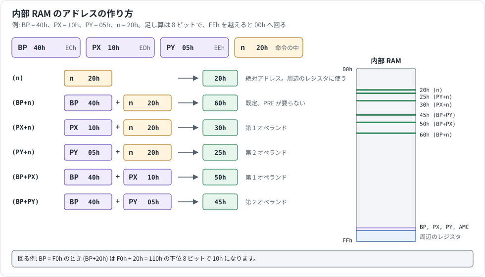

`(BP+n)` は、BP を「自分の作業域の先頭」にして、そこからの距離で変数を指す書き方です。サブルーチンに入るときに BP を減らし、出るときに戻せば、呼び出しごとに別の変数の場所を持てます。ROM は `PMDF ($EC),$FC` のように BP に −4（FCh）を足して場所を作ります。

どのモードを使うかは、命令の前に置く **PRE バイト**（§2.13.5）で決まります。`e500asm` はオペランドの書き方から自動で PRE を付けます。オペランドが 2 つとも内部 RAM のときは、第 1 オペランドが PX、第 2 オペランドが PY を使います（逆は不可）。

### 2.13.4 外部メモリ `[…]`

| 記法 | 実効アドレス | 用途 |
|---|---|---|
| `[lmn]` | 20 bit 絶対 | 固定アドレス。 |
| `[r3]` | r3 | ポインタ経由。 |
| `[r3+n]` / `[r3-n]` | r3 ± n（n は 0–255） | 構造体のメンバ、スタックフレーム。 |
| `[r3++]` | r3 を使ってから、データ幅ぶん加算 | 順方向走査、PUSH の逆。 |
| `[--r3]` | データ幅ぶん減算してから使う | PUSH 相当（`MV [--S],X` など）。 |
| `[(n)]` | 内部 RAM n から 3 バイトを読んだ値 | 内部 RAM に置いた 20 bit ポインタの間接参照。 |
| `[(n)+m]` / `[(n)-m]` | 上記 ± m | 間接参照＋変位。 |

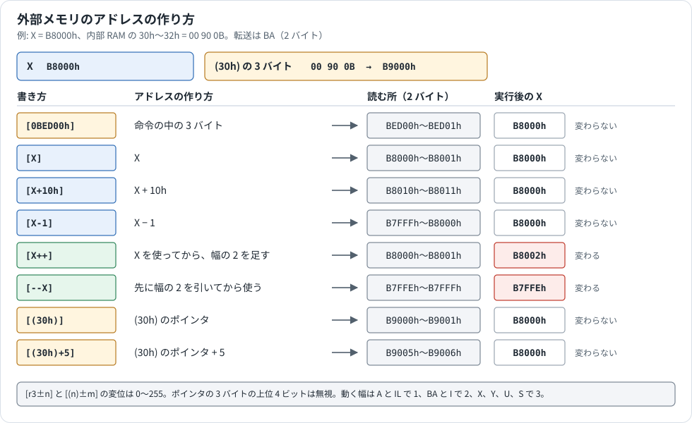

アドレスの計算は次のとおりです（実験）。

- 内部 RAM は 8 bit で回ります。BP = F0h の `(BP+20h)` は 10h です。
- `[(n)]` のポインタは 3 バイトで、上位 4 bit は無視します（公式 p.45）。
- `[r3++]`、`[--r3]` はデータの幅だけ動きます。`MV [X++],BA` は X を 2 進めます。
- `[r3±n]`、`[(n)±m]` の変位は 0〜255 で、r3 自身は変わりません。

r3 は X, Y, U, S のみです。**S を転送先／転送元にするときは `[lmn]` の絶対アドレスしか使えません**（`MV S,[X]` などは存在しません）。

**例: 書き方と機械語。** 外部メモリの間接の形は、第 2 バイトの上の桁で `[r3]`（0）、`[r3++]`（2）、`[--r3]`（3）、`[r3+n]`（8）、`[r3-n]`（C）を区別し、下の桁がレジスタのコードです。

| 命令 | 機械語 | 第 2 バイトの読み方 |
|---|---|---|
| `MV A,[X]` | `90 04` | 0 = そのまま、4 = X |
| `MV BA,[X++]` | `92 24` | 2 = 使ってから足す |
| `MV A,[--X]` | `90 34` | 3 = 引いてから使う |
| `MV A,[X+10h]` | `90 84 10` | 8 = 足す変位 |
| `MV A,[X-1]` | `90 C4 01` | C = 引く変位 |
| `MV [--S],X` | `B4 37` | 3 = 引いてから使う、7 = S |
| `MV X,[S++]` | `94 27` | 2 = 使ってから足す、7 = S |
| `MV A,[$BED00]` | `88 00 ED 0B` | （`[lmn]`。3 バイトのアドレス） |
| `MV X,[($30)]` | `30 9C 00 30` | 00 = 変位なし。先頭の 30 は PRE |
| `MV A,[($30)+5]` | `30 98 80 30 05` | 80 = 足す変位 |

### 2.13.5 PRE バイト

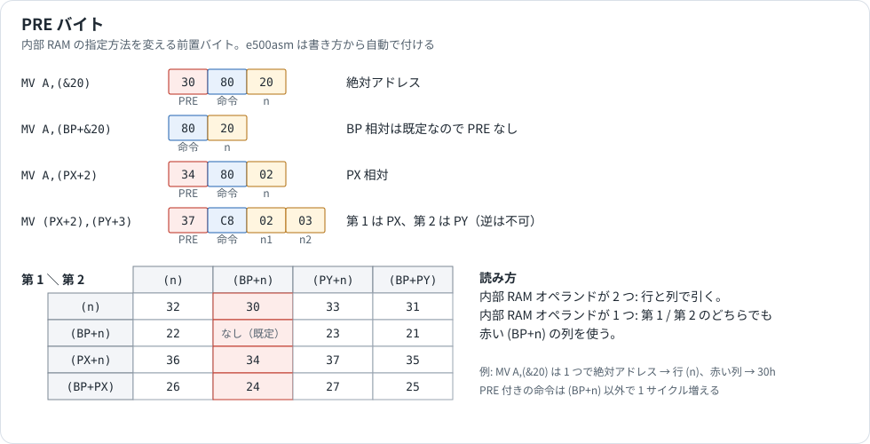

命令の直前に 1 バイト置き、内部 RAM オペランドのモードを変えます。第 1 オペランドは PX、第 2 オペランドは PY を使います。

| 第 1 ＼ 第 2 | `(n)` | `(BP+n)` | `(PY+n)` | `(BP+PY)` |
|---|---|---|---|---|
| `(n)` | 32h | **30h** | 33h | 31h |
| `(BP+n)` | 22h | なし（既定） | 23h | 21h |
| `(PX+n)` | 36h | **34h** | 37h | 35h |
| `(BP+PX)` | 26h | **24h** | 27h | 25h |

内部 RAM オペランドが 1 つだけの命令は、そのオペランドが第 1・第 2 のどちらに書かれていても **`(BP+n)` の列（太字）** を使います。例: `MV A,(20h)` → `30 80 20`、`MV [X],(PX+2)` → `34 E8 04 02`。

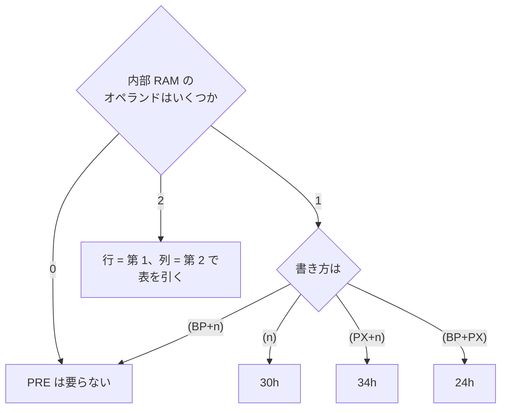

**例: PRE の有無と機械語**（`e500asm` の出力）

| 命令 | PRE | 機械語 |
|---|---|---|
| `MV A,(BP+$20)` | なし | `80 20` |
| `MV A,($20)` | 30h | `30 80 20` |
| `MV A,(PX+2)` | 34h | `34 80 02` |
| `MV A,(BP+PX)` | 24h | `24 80 00` |
| `MV ($20),($21)` | 32h | `32 C8 20 21` |
| `MV ($20),(BP+$21)` | 30h | `30 C8 20 21` |
| `MV (BP+$20),($21)` | 22h | `22 C8 20 21` |
| `MV (PX+2),(PY+3)` | 37h | `37 C8 02 03` |
| `MV (BP+1),(BP+PY)` | 21h | `21 C8 01 00` |
| `MV (BP+PX),(BP+PY)` | 25h | `25 C8 00 00` |

同じ `C8 20 21` でも、前の 1 バイトで指す場所が変わることが分かります。`(BP+PX)`、`(BP+PY)` では変位を使いませんが、その位置の 1 バイトは 0 で残ります。

`e500asm` は `(n)` を絶対アドレス、`(BP+n)` を BP 相対と解釈して PRE を自動生成します。ROM のコードは既定が BP 相対なので、逆アセンブル結果に `(BP+…)` が多く現れます。

## 2.14 命令リファレンス

全命令を、種類ごとにまとめた参照用の節です。順に読むより、早見表から必要な命令へ進んでください。命令ごとの使用例は [命令一覧](../manual/05_INSTRUCTIONS.md) にもあります。書式と機械語を一度に見たいときは、ニーモニック順の命令表（[2.14.9](#2149-命令表ニーモニック順)）を使ってください。

各命令について、書式、動作、フラグ（C/Z: 変化、-: 変化なし、1/0: その値になる）、符号化（PRE を除いたバイト列）を示します。サイクル数は §2.15 のオペコード表を参照してください。内部 RAM オペランドが `(BP+n)` 以外のときは、PRE の 1 バイトと 1 サイクルが加わります。

符号化の記号: `n`, `m`, `l` = 1 バイト値、`mn` = 2 バイト即値（下位が先）、`lmn` = 3 バイト（下位が先）、`r` 等 = レジスタコード、`(m)` `(n)` = 内部 RAM アドレスの 1 バイト、`d` = 変位 1 バイト。

### 早見表

| やりたいこと | 命令 | 節 |
|---|---|---|
| 値を移す | `MV`、`MVW`、`MVP` | [2.14.1](#2141-転送) |
| まとめて移す | `MVL`、`MVLD` | [2.14.1](#2141-転送) |
| 入れ替える | `EX`、`EXW`、`EXP`、`EXL`、`SWAP` | [2.14.1](#2141-転送) |
| 足す、引く | `ADD`、`SUB`、`ADC`、`SBC`、`ADCL`、`SBCL` | [2.14.2](#2142-算術) |
| 10 進で足す、引く | `DADL`、`DSBL` | [2.14.2](#2142-算術) |
| 1 増やす、1 減らす | `INC`、`DEC` | [2.14.2](#2142-算術) |
| フラグを変えずに足す | `PMDF` | [2.14.2](#2142-算術) |
| ビットを変える、調べる | `AND`、`OR`、`XOR`、`TEST` | [2.14.3](#2143-論理比較テスト) |
| 比べる | `CMP`、`CMPW`、`CMPP` | [2.14.3](#2143-論理比較テスト) |
| ビットや桁をずらす | `ROR`、`ROL`、`SHR`、`SHL`、`DSRL`、`DSLL` | [2.14.4](#2144-シフトローテート) |
| 積む、取り出す | `PUSHU`、`POPU`、`PUSHS`、`POPS` | [2.14.5](#2145-スタック) |
| 飛ぶ、呼ぶ、戻る | `JP`、`JPF`、`JR`、`CALL`、`CALLF`、`RET`、`RETF`、`RETI` | [2.14.6](#2146-分岐) |
| 待つ、止まる | `NOP`、`WAIT`、`HALT`、`OFF`、`TCL`、`IR`、`RESET` | [2.14.7](#2147-cpu-制御) |

### 2.14.1 転送

転送はフラグを変えません。計算の途中に挟んでも、C と Z は残ります。

#### MV — 転送

| 書式 | 動作 | 符号化 |
|---|---|---|
| `MV r,n` / `MV r2,mn` / `MV r3,lmn` | レジスタ ← 即値 | `08+r` 即値 |
| `MV A,B` / `MV B,A` | A ↔ B の片方向転送 | `74` / `75` |
| `MV r2,r2'` / `MV r3,r3'` / `MV r2,r3` / `MV r3,r2` | レジスタ間転送。幅が違うときは下位 16 bit を渡し、20 bit 側の上位 4 bit は 0 | `FD` `(r<<4)+r'` |
| `MV r,(n)` | レジスタ ← 内部 RAM（幅はレジスタに従う） | `80+r` n |
| `MV (n),r` | 内部 RAM ← レジスタ | `A0+r` n |
| `MV r,[lmn]` / `MV [lmn],r` | 絶対アドレス | `88+r` lmn / `A8+r` lmn |
| `MV r,[r3]` / `MV [r3],r` | レジスタ間接 | `90+r` `0r3` / `B0+r` `0r3` |
| `MV r,[r3++]` / `MV r,[--r3]` | 後置加算／前置減算 | `90+r` `2r3` / `90+r` `3r3`（格納は `B0+r`） |
| `MV r,[r3+d]` / `MV r,[r3-d]` | 変位付き | `90+r` `8r3` d / `90+r` `Cr3` d |
| `MV r,[(n)]` / `MV r,[(n)±d]` | 内部 RAM 間接 | `98+r` `00` n / `98+r` `80`または`C0` n d（格納は `B8+r`） |
| `MV (m),n` / `MVW (l),mn` / `MVP (k),lmn` | 内部 RAM ← 即値 | `CC` m n / `CD` l mn / `DC` k lmn |
| `MV (m),(n)` / `MVW` / `MVP` | 内部 RAM 間（1/2/3 バイト） | `C8`/`C9`/`CA` m n |
| `MV (k),[lmn]` / `MVW` / `MVP` | 内部 RAM ← 外部絶対 | `D0`/`D1`/`D2` k lmn |
| `MV [klm],(n)` / `MVW` / `MVP` | 外部絶対 ← 内部 RAM | `D8`/`D9`/`DA` klm n |
| `MV (n),[r3]` / `MV (n),[r3++]` / `MV (n),[--r3]` / `MV (n),[r3±d]` 系 | 内部 RAM ← 外部間接（1/2/3 バイト） | `E0–E2` `0r3` n / `2r3` n / `3r3` n / `8r3`または`Cr3` n d |
| `MV [r3],(n)` / `MV [r3++],(n)` / `MV [--r3],(n)` / `MV [r3±d],(n)` 系 | 外部間接 ← 内部 RAM（1/2/3 バイト） | `E8–EA` `0r3` n / `2r3` n / `3r3` n / `8r3`または`Cr3` n d |
| `MV (m),[(n)]` / `MV (m),[(n)±d]` 系 | 内部 RAM ← 内部 RAM 間接 | `F0–F2` `00` m n / `80`または`C0` m n d |
| `MV [(l)],(n)` / `MV [(l)±d],(n)` 系 | 内部 RAM 間接 ← 内部 RAM | `F8–FA` `00` l n / `80`または`C0` l n d |

フラグ: 変化なし。

用途と注意:
- 8/16/20 bit の全転送の基本。`MV IL,x` は IH を 0 にするので、`MV IL,n` は「I に 0–255 を入れる」の短縮形として使います。
- **`MV A,IL` と `MV IL,A` は存在しません**。A ↔ IL の値渡しは `MV (n),A` → `MV IL,(n)` などで行います。
- `MV [--S],X` / `MV X,[S++]` が S スタックへの PUSH/POP になります。`PUSHS X`、`POPS X` と書いても同じです（§2.14.5）。
- 20 bit レジスタを 3 バイトメモリへ書くと上位 4 bit は 0 で書かれます。

**例: ポインタの表から機械語エリアの先頭を読む**

```asm
        MV    X,[$BFD1A]        ; 8C 1A FD 0B  3 バイトのポインタを読む
        MV    A,[X++]           ; 90 24        そのアドレスの 1 バイト。X は 1 進む
        MV    BA,[X+4]          ; 92 84 04     4 つ先の 2 バイト。X は変わらない
```

#### MVL / MVLD — ブロック転送

| 書式 | 動作 | 符号化 |
|---|---|---|
| `MVL (m),(n)` | I バイトを n→m へ、アドレスを増やしながら | `CB` m n |
| `MVLD (m),(n)` | I バイトを n→m へ、アドレスを減らしながら | `CF` m n |
| `MVL (k),[lmn]` / `MVL [klm],(n)` | 外部絶対との間 | `D3` k lmn / `DB` klm n |
| `MVL (n),[r3++]` / `MVL [r3++],(n)` | 外部間接（r3 は転送後に I バイト進む） | `E3` `2r3` n / `EB` `2r3` n |
| `MVL (m),[r3±d]` / `MVL [r3±d],(n)` | 変位付き。`[r3]` は `[r3+0]` として符号化される | `56` `8r3`または`Cr3` m d / `5E` `8r3`または`Cr3` n d |
| `MVL (n),[--r3]` / `MVL [--r3],(n)` | 両方とも下向き。`[--r3]` 側は指定アドレスの 1 つ手前から、内部 RAM は n から下へ | `E3`/`EB` `3r3` n |
| `MVL (m),[(n)]` / `MVL [(l)±d],(n)` 系 | 内部 RAM 間接 | `F3` / `FB` |

フラグ: 変化なし。実行後 I = 0。I = 0 で実行すると 65536 バイト。

回数は I に入れます。外部メモリの 16 バイトを内部 RAM の 20h〜2Fh へコピーする例です。

```asm
        MV    X,$BED00
        MV    I,16
        MVL   ($20),[X++]       ; 30 E3 24 20  X は BED10h になる
```

`[--r3]` の形は、内部 RAM の並びを変えずにスタックへ積むのに使います。ROM の例です（7.2、実験でも同じ）。

```asm
        MV    IL,$4A            ; 09 4A     E0239h
        MVL   [--S],($49)       ; 30 EB 37 49  00h〜49h の 4Ah バイトを積む
```

49h から下へ 4Ah バイトなので、ちょうど 00h〜49h です。公式の p.53 は、本文が「内部 RAM の側は増える」、同じページの例（`mvl (23h),[--x]` で 21h〜23h に入る図）が「減る」と食い違っています。ROM、エミュレータ、『PC-E650 活用研究』（p.230）は例のほうと同じです。

用途: 内部 RAM の退避・復帰（[機械語を実機で動かす](12_MACHINE_CODE.md) §12.3.4）、外部メモリ間のコピー（内部 RAM を経由する。外部→外部の直接形はない）、画面バッファの転送。重なった領域を上位へずらすときは `MVLD` を使います（`MVL` だと未転送データを上書きします）。

#### EX / EXW / EXP / EXL / SWAP — 交換

| 書式 | 動作 | フラグ | 符号化 |
|---|---|---|---|
| `EX A,B` | A ↔ B | - | `DD` |
| `EX r2,r2'` / `EX r3,r3'` | レジスタ交換（同じ幅どうし。幅違いは 16 bit 側に下位が入り、20 bit 側の上位 4 bit は 0） | - | `ED` `(r<<4)+r'` |
| `EX (m),(n)` / `EXW` / `EXP` | 内部 RAM 1/2/3 バイト交換 | - | `C0`/`C1`/`C2` m n |
| `EXL (m),(n)` | I バイト交換（アドレスは増加） | - | `C3` m n |
| `SWAP A` | A の上位・下位ニブル交換 | Z | `EE` |

`SWAP A` は A = 12h を 21h にします。

用途: `SWAP A` は BCD の桁取出し、`EX X,Y` はポインタの入替え。

### 2.14.2 算術

1 バイトから 20 bit までは `ADD`、`SUB`、それより長い数は I に長さを入れて `ADCL`、`SBCL`（2 進）、`DADL`、`DSBL`（10 進）を使います。

#### ADD / SUB — 加算・減算

| 書式 | 動作 | 符号化 |
|---|---|---|
| `ADD A,n` / `SUB A,n` | A ← A ± n | `40` n / `48` n |
| `ADD (m),n` / `SUB (m),n` | 内部 RAM ← 内部 RAM ± n | `41` m n / `49` m n |
| `ADD A,(n)` / `SUB A,(n)` | A ← A ± (n) | `42` n / `4A` n |
| `ADD (n),A` / `SUB (n),A` | (n) ← (n) ± A | `43` n / `4B` n |
| `ADD r1,r1'` / `SUB` | 8 bit レジスタ間（A, IL） | `46`/`4E` `(r<<4)+r'` |
| `ADD r2,r'` / `SUB` | BA, I ← ± （A, IL, BA, I） | `44`/`4C` `(r2<<4)+r'` |
| `ADD r3,r'` / `SUB` | X, Y, U, S ← ± 任意のレジスタ | `45`/`4D` `(r3<<4)+r'` |

フラグ: C（転送先の最上位ビットからの桁上げ／借り。20 bit なら bit19）、Z。転送先は転送元と同じか大きい幅でなければなりません。狭い転送元の上位ビットは 0 として扱います。

用途: `ADD X,A` / `ADD Y,BA` は「ポインタ＋インデックス」の常套手段。`SUB BA,BA` のように自分自身を引いてゼロクリアにも使います（ROM でも多用）。

#### ADC / SBC — キャリー付き加減算

| 書式 | 符号化 |
|---|---|
| `ADC A,n` / `ADC (m),n` / `ADC A,(n)` / `ADC (n),A` | `50`–`53` |
| `SBC A,n` / `SBC (m),n` / `SBC A,(n)` / `SBC (n),A` | `58`–`5B` |

フラグ: C, Z。用途: 8 bit 単位で多バイト加減算をつなぎます。レジスタ間形はないので、多バイトは `ADCL`/`SBCL` の方が簡単。

#### ADCL / SBCL — 多バイト 2 進加減算

| 書式 | 動作 | 符号化 |
|---|---|---|
| `ADCL (m),(n)` / `SBCL (m),(n)` | I バイト分、(m) ← (m) ± (n)。指定アドレスから **アドレスを増やしながら**（下位バイトが先） | `54` m n / `5C` m n |
| `ADCL (n),A` / `SBCL (n),A` | 最初の 1 バイトに A を足し／引き、2 バイト目以降はキャリーだけを伝える | `55` n / `5D` n |

フラグ: C（最終桁上げ）、Z（全バイトが 0 のとき 1）。**最初のバイトには実行前の C を含めません**（公式 p.58。実験でも C=1 の `00h + 00h` は 00h で、C=0、Z=1。`SBCL`、`DADL`、`DSBL` と、A を足し引きする形の 8 つとも同じ）。実行後 I = 0。

用途: 16/24/32 bit 整数の加減算。数値はリトルエンディアン（下位バイトが小さいアドレス）に置きます。

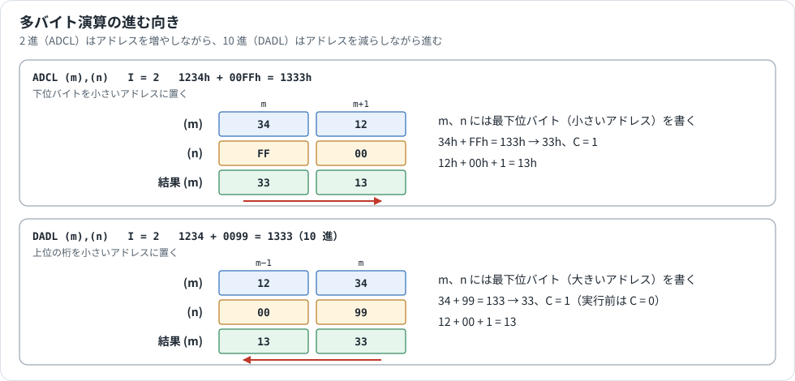

#### DADL / DSBL — 多バイト BCD 加減算

| 書式 | 動作 | 符号化 |
|---|---|---|
| `DADL (m),(n)` / `DSBL (m),(n)` | I バイト分の 10 進（パック BCD）加減算。指定アドレスから **アドレスを減らしながら** | `C4` m n / `D4` m n |
| `DADL (n),A` / `DSBL (n),A` | 最初の 1 バイトに A（BCD）を足し／引く | `C5` n / `D5` n |

フラグ: C, Z（全バイトが 0 のとき 1）。実行後 I = 0。最初のバイトに実行前の C を含めない点は `ADCL` と同じです（実験）。

| 実行前（I = 2） | 命令 | 結果 | C | Z |
|---|---|---|---|---|
| 99 99 と 00 01 | `DADL` | 00 00 | 1 | 1 |
| 00 00 と 00 01 | `DSBL` | 99 99 | 1 | 0 |
| 99 99 と A = 01 | `DADL (n),A` | 00 00 | 1 | 1 |
| 01 00 と A = 01 | `DSBL (n),A` | 00 99 | 0 | 0 |

用途: BASIC の数値（BCD 仮数）の加工。**BCD 数は上位桁を小さいアドレスに置き、最下位バイトのアドレスを指定します**（2 進の ADCL とは逆方向）。[機械語を実機で動かす](12_MACHINE_CODE.md) §12.4.3 に例があります。

#### INC / DEC — インクリメント・デクリメント

| 書式 | 符号化 |
|---|---|
| `INC r` / `DEC r`（A, IL, BA, I, X, Y, U, S） | `6C` r / `7C` r |
| `INC (n)` / `DEC (n)` | `6D` n / `7D` n |

フラグ: Z のみ（C は不変）。用途: カウンタ、ポインタ。`DEC IL` + `JRNZ` は短いループの定番です。

```asm
        MV    IL,5              ; 09 05   I = 5
loop:   MV    A,[X++]           ; 5 回繰り返す
        DEC   IL                ; 7C 01   0 になると Z = 1
        JRNZ  loop
```

#### PMDF — ポインタ修正

| 書式 | 動作 | 符号化 |
|---|---|---|
| `PMDF (m),n` | (m) ← (m) + n、フラグ不変 | `47` m n |
| `PMDF (n),A` | (n) ← (n) + A、フラグ不変 | `57` n |

用途: BP、PX、PY を相対的にずらします。ROM は `PMDF (ECh),0FCh` のように BP を動かしてローカル変数領域を作ります。演算中のフラグを壊さない加算としても使えます。

### 2.14.3 論理・比較・テスト

#### AND / OR / XOR

| 書式 | 符号化（AND / OR / XOR） |
|---|---|
| `op A,n` | `70` / `78` / `68` n |
| `op (m),n` | `71` / `79` / `69` m n |
| `op [lmn],n` | `72` / `7A` / `6A` lmn n |
| `op (n),A` | `73` / `7B` / `6B` n |
| `op (m),(n)` | `76` / `7E` / `6E` m n |
| `op A,(n)` | `77` / `7F` / `6F` n |

フラグ: Z のみ（C 不変）。外部メモリ形は絶対アドレスだけです。

用途: I/O レジスタのビット操作（`AND (FDh),8Fh` でブザー停止、`OR (FBh),80h` で割り込み許可）、外部メモリのフラグ直接操作（`OR [0BFC52h],80h`）。ISR（FCh）に `AND` でビットを落とすときは、命令完了前に割り込み判定が行われる場合があるので、割り込みルーチン側は要因が見つからなくても正常に戻るようにします。

ビットの操作は、3 つの命令の使い分けです。

| したいこと | 命令 | 例（A = 5Ah = `0101 1010`） |
|---|---|---|
| 一部を 0 にする | `AND`（残すビットを 1） | `AND A,0Fh` → 0Ah |
| 一部を 1 にする | `OR`（立てるビットを 1） | `OR A,80h` → DAh |
| 一部を反転する | `XOR`（反転するビットを 1） | `XOR A,FFh` → A5h |

#### TEST — ビットテスト

| 書式 | 符号化 |
|---|---|
| `TEST A,n` / `TEST (m),n` / `TEST [lmn],n` / `TEST (n),A` | `64` / `65` / `66` / `67` |

動作: AND した結果を捨てて Z だけ変える（結果 0 → Z=1）。C 不変。用途: `TEST (FCh),04h` / `JRNZ` のようなビット判定。`JRZ` は「ビットが立っていない」に飛ぶことに注意してください。

#### CMP / CMPW / CMPP — 比較

| 書式 | 動作 | 符号化 |
|---|---|---|
| `CMP A,n` / `CMP (m),n` / `CMP [lmn],n` / `CMP (n),A` | 1 バイトの dest − src、結果は捨てる | `60` / `61` / `62` / `63` |
| `CMP (m),(n)` | 内部 RAM 1 バイト間 | `B7` m n |
| `CMPW (m),(n)` / `CMPP (m),(n)` | 2 / 3 バイト比較。指定アドレスが最下位、上のアドレスが上位 | `C6` m n / `C7` m n |
| `CMPW (m),r2` / `CMPP (m),r3` | 内部 RAM とレジスタ | `D6` r2 m / `D7` r3 m |

フラグ: C = 借りが出た（dest < src）、Z = 等しい。多バイトの比較は、指定したアドレスが最下位で、アドレスが大きいほど上位です（公式 p.61 の前半は「小さいアドレス」と読めますが、同じ段落の説明とエミュレータの実験は上の向きです）。`CMPP (m),r3` の比較の幅は §2.16 を参照してください。したがって `CMP A,n` の後、`JRC` = A < n、`JRZ` = A = n、`JRNC` = A ≥ n（符号なし）。

#### SC / RC — キャリー操作

`SC`（`97`）: C ← 1。`RC`（`9F`）: C ← 0。Z 不変。

用途: サブルーチンの戻り値（C=1 でエラー）を作ります。IOCS も BASIC の `CALL` もこの規約です（[機械語を実機で動かす](12_MACHINE_CODE.md) §12.3.3）。

### 2.14.4 シフト・ローテート

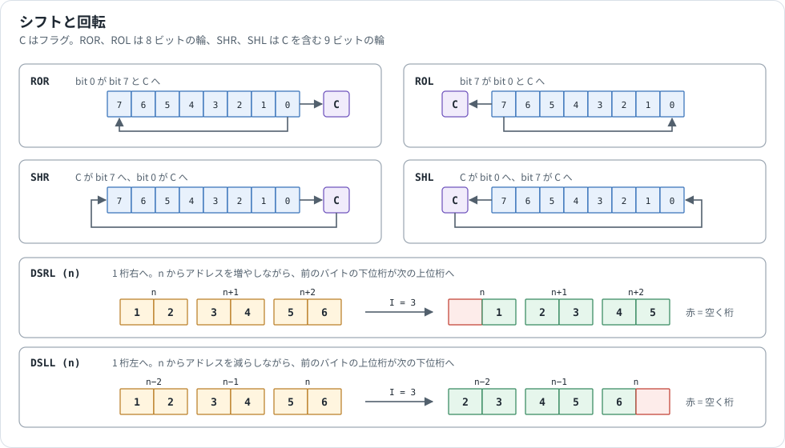

| 書式 | 動作 | フラグ | 符号化 |
|---|---|---|---|
| `ROR A` / `ROR (n)` | 8 bit 右回転。bit0 → bit7、C ← bit0 | C, Z | `E4` / `E5` n |
| `ROL A` / `ROL (n)` | 8 bit 左回転。bit7 → bit0、C ← bit7 | C, Z | `E6` / `E7` n |
| `SHR A` / `SHR (n)` | C を含む 9 bit 右回転: bit7 ← C、C ← bit0 | C, Z | `F4` / `F5` n |
| `SHL A` / `SHL (n)` | C を含む 9 bit 左回転: bit0 ← C、C ← bit7 | C, Z | `F6` / `F7` n |
| `DSRL (n)` | I バイトを 4 bit（1 桁）右へ。指定アドレスから **アドレスを増やしながら**。前のバイトの下位桁が次のバイトの上位桁へ | Z（C 不変） | `FC` n |
| `DSLL (n)` | I バイトを 4 bit 左へ。指定アドレスから **アドレスを減らしながら** | Z（C 不変） | `EC` n |

`DSRL` と `DSLL` の空いた桁には 0 が入ります。C = 1 にしてから 3 バイト `12 34 56` に使うと、`DSRL` で `01 23 45`、`DSLL` で `23 45 60` になりました（実験、エミュレータ、ROM 7.2、8.5）。

隣のアドレスの桁も入ってきません（`(1Fh)` や `(23h)` に 0 でない値を置いて実験）。

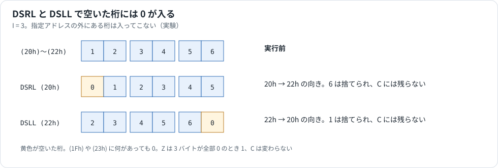

注意: `SHR`/`SHL` は純粋なシフトではなく C が入ってきます。0 を詰めたいときは先に `RC` します。用途: 乗除算、ビット送出、BCD の桁寄せ（DSRL/DSLL）。

| 実行前 | 命令 | 結果 |
|---|---|---|
| A = 85h（`1000 0101`） | `ROR A` | A = C2h（`1100 0010`）、C = 1 |
| A = 85h | `ROL A` | A = 0Bh（`0000 1011`）、C = 1 |
| A = 85h、C = 0 | `SHR A` | A = 42h（`0100 0010`）、C = 1 |
| A = 85h、C = 0 | `SHL A` | A = 0Ah（`0000 1010`）、C = 1 |

### 2.14.5 スタック

| 書式 | 動作 | 符号化 |
|---|---|---|
| `PUSHU r` / `POPU r`（A, IL, BA, I, X, Y） | U を減らして格納／取り出して U を増やす | `28+r` / `38+r` |
| `PUSHU F` / `POPU F` | フラグ（bit0=C, bit1=Z） | `2E` / `3E` |
| `PUSHU IMR` / `POPU IMR` | IMR（FBh）。**PUSHU IMR は積んだ後に IRM（bit7）を 0 にして割り込みを禁止する** | `2F` / `3F` |
| `PUSHS F` / `POPS F` | S スタックにフラグ | `4F` / `5F` |
| `PUSHS r` / `POPS r`（A, IL, BA, I, X, Y） | `MV [--S],r` / `MV r,[S++]` と同じ（§2.14.1） | `B0+r 37` / `90+r 27` |
| `PUSHS IMR` / `POPS IMR` | `MV [--S],(FBh)` / `MV (FBh),[S++]` と同じ | `30 E8 37 FB` / `30 E0 27 FB` |

`PUSHS` と `POPS` に専用の機械語があるのは F だけです。ほかは、アセンブラが `MV` に置き換えます（公式 p.67）。`PUSHS IMR` は `MV` なので IRM を変えません。

フラグ: `POPU F`/`POPS F` 以外は不変。`POPU IL`/`POPS IL` は IH を 0 にします。

スタックは 2 本あります。U はプログラムが自由に使う値の置き場、S は `CALL` と割り込みがリターンアドレスを積む場所です。

```asm
        PUSHU IMR               ; 積んでから IRM を 0 に（ここから割り込みなし）
        ; … 割り込まれたくない処理 …
        POPU  IMR               ; 元の許可の状態に戻す
```

用途: `PUSHU IMR` … `POPU IMR` で割り込み禁止区間を作ります。U は ROM から呼ばれる時点で有効な RAM 内アドレスになっているので、機械語でもそのまま使えます。

### 2.14.6 分岐

ジャンプ先の届く範囲で命令を選びます。

| 命令 | 届く範囲 | 長さ |
|---|---|---|
| `JR` と条件付きの `JR…` | 命令の前後 255 バイトほど（同じセグメントの中） | 2 バイト |
| `JP mn`、`CALL mn` | 同じ 64 KB のセグメントの中 | 3 バイト |
| `JPF lmn`、`CALLF lmn` | 1 MB のどこでも | 4 バイト |

| 書式 | 動作 | 符号化 |
|---|---|---|
| `JP mn` | セグメント内ジャンプ（PC ← mn、PS 不変） | `02` mn |
| `JPF lmn` | 1 MB 内ジャンプ（PC, PS ← lmn） | `03` lmn |
| `JP (n)` | 内部 RAM n の 3 バイトへ far ジャンプ | `10` n |
| `JP r3` | X/Y/U/S の値へ far ジャンプ | `11` r3 |
| `JPZ` / `JPNZ` / `JPC` / `JPNC mn` | 条件付きセグメント内ジャンプ | `14`–`17` mn |
| `JR ±n` | 相対ジャンプ（命令アドレス + 2 ± n、n = 0–255） | `12` n（+）/ `13` n（−） |
| `JRZ` / `JRNZ` / `JRC` / `JRNC ±n` | 条件付き相対ジャンプ | `18/19`, `1A/1B`, `1C/1D`, `1E/1F` n |
| `CALL mn` | 次命令の PC（2 バイト）を S に積んでセグメント内呼び出し | `04` mn |
| `CALLF lmn` | 次命令の 20 bit アドレス（3 バイト、上位 4 bit は 0）を積んで far 呼び出し | `05` lmn |
| `RET` | S から 2 バイト取り出して PC へ | `06` |
| `RETF` | S から 3 バイト取り出して PC, PS へ | `07` |
| `RETI` | S から IMR, F, PC, PS（5 バイト）を戻す | `01` |

フラグ: 不変（RETI は復元）。条件が成立しないときは NOP と同じです。

**例: 相対ジャンプの計算。** `BEC28h` の `19 06` は `JRZ -6` です。ジャンプ先は BEC28h + 2 − 6 = `BEC24h` になります。

注意:
- `JP`/`CALL`/`JR` は PS を変えません。相対ジャンプは 64 KB セグメントを跨げません。`e500asm` は跨ぐ場合をエラーにします。
- 機械語エリア（B セグメント）から ROM（E/F セグメント）を呼ぶには `CALLF`、戻るには `RETF`。BASIC の `CALL` から戻るのも **`RETF`**（[機械語を実機で動かす](12_MACHINE_CODE.md) §12.3.3）。
- `JP r3` と `JP (n)` はジャンプテーブルや「戻り先を計算して飛ぶ」に使います。

### 2.14.7 CPU 制御

| 書式 | 動作 | 符号化 |
|---|---|---|
| `NOP` | 1 サイクル何もしない | `00` |
| `WAIT` | I を 0 まで減らしながら待つ（I+1 サイクル）。割り込みは入らない | `EF` |
| `HALT` | メインクロック停止。復帰の条件は §2.11 | `DE` |
| `OFF` | メイン・サブクロック停止。復帰の条件は §2.11 | `DF` |
| `TCL` | LCC（FEh）の STCL/MTCL が 1 のタイマをクリア | `CE` |
| `IR` | ソフトウェア割り込み。公式の表記は `int`。割り込みと同じ形で 5 バイト積み、FFFFAh のベクタへ（§2.10.3） | `FE` |
| `RESET` | FFFFDh のリセットベクタへ。PC と PS だけが変わる（§2.11） | `FF` |

用途: `HALT`/`OFF` は ROM の電源管理（IOCS device 8 command 41h）が行うので、ユーザプログラムから直接使うことは少なくなります。`WAIT` は短い時間待ちに使います。

### 2.14.8 未使用オペコード

`20h`（PRE の既定の組合せの位置）と `BFh`（`MV [(n)],S` の位置。S の間接指定はありません）は、公式の命令表にありません。`e500asm` は生成せず、`e500dasm` は `DB` にします。エミュレータはどちらも 1 バイトの何もしない命令として動きますが（実験）、実機の動作は分かりません。`97h`、`9Fh`（`MV S,[r3]`、`MV S,[(n)]` の位置）は `SC`、`RC` に、`B7h` は `CMP (m),(n)` に割り当てられています。

### 2.14.9 命令表（ニーモニック順）

全命令を、書式ごとに 1 行にまとめた一覧です。書き方から機械語、長さ、サイクルを引くときに使います。機械語から引くときは §2.15 を使ってください。

| 記号 | 意味 |
|---|---|
| `r1`、`r2`、`r3`、`r` | レジスタ（§2.3.2）。`r4` は `X` `Y` `U`（`S` を除く） |
| `r'` | 2 つ目のレジスタ、または `[ ]` の中のレジスタ。`r3'` は `X` `Y` `U` `S` |
| `08+r` | 08h にレジスタコードを足したバイト |
| `0r`、`2r'`、`8r'/Cr'` | 上位の桁が 0、2、8 か C、下位の桁がレジスタコード。`/` の左が `+`、右が `−` |
| `rr'` | 上位の桁が左のレジスタ、下位の桁が右のレジスタ |
| `80/C0`、`12/13` | `/` の左が `+`、右が `−` |
| `n` `m` `l` `k` | 1 バイト。`mn` は 2 バイト、`lmn` `klm` は 3 バイトで、どれも下位が先 |
| C、Z | ○ は変わる、空欄は変わらない、0 と 1 はその値になる |

バイトとサイクルは PRE を含みません。内部 RAM を `(BP+n)` 以外で書くと、PRE（§2.13.5）の 1 バイトと 1 サイクルが加わります。`PUSHS IMR` と `POPS IMR` の行だけは、`(FBh)` を指す PRE を含んでいます。条件付きの分岐のサイクルは「飛ぶとき / 飛ばないとき」です。

#### MV: レジスタへ

| ニーモニック | 働き | C | Z | バイト | サイクル | 機械語 |
|---|---|---|---|---|---|---|
| `MV r1,n` | r1 ← n |  |  | 2 | 2（IL は 3） | `08+r n` |
| `MV r2,mn` | r2 ← mn |  |  | 3 | 3 | `08+r mn` |
| `MV r3,lmn` | r3 ← lmn |  |  | 4 | 4 | `08+r lmn` |
| `MV r1,(n)` | r1 ← (n) |  |  | 2 | 3（IL は 4） | `80+r n` |
| `MV r2,(n)` | r2 ← (n) から 2 バイト |  |  | 2 | 4 | `80+r n` |
| `MV r3,(n)` | r3 ← (n) から 3 バイト |  |  | 2 | 5 | `80+r n` |
| `MV r1,[lmn]` | r1 ← [lmn] |  |  | 4 | 6 | `88+r lmn` |
| `MV r2,[lmn]` | r2 ← [lmn] から 2 バイト |  |  | 4 | 7 | `88+r lmn` |
| `MV r3,[lmn]` | r3 ← [lmn] から 3 バイト |  |  | 4 | 8 | `88+r lmn` |
| `MV r1,[r3']` | r1 ← [r3'] |  |  | 2 | 4（IL は 5） | `90+r 0r'` |
| `MV r2,[r3']` | r2 ← [r3'] から 2 バイト |  |  | 2 | 5 | `90+r 0r'` |
| `MV r4,[r3']` | r4 ← [r3'] から 3 バイト |  |  | 2 | 6 | `90+r 0r'` |
| `MV r1,[r3'++]` | r1 ← [r3']、r3' を 1 増やす |  |  | 2 | 4（IL は 5） | `90+r 2r'` |
| `MV r2,[r3'++]` | r2 ← [r3'] から 2 バイト、r3' を 2 増やす |  |  | 2 | 5 | `90+r 2r'` |
| `MV r4,[r3'++]` | r4 ← [r3'] から 3 バイト、r3' を 3 増やす |  |  | 2 | 7 | `90+r 2r'` |
| `MV r1,[--r3']` | r1 ← [r3']（r3' を先に 1 減らす） |  |  | 2 | 5（IL は 6） | `90+r 3r'` |
| `MV r2,[--r3']` | r2 ← [r3'] から 2 バイト（r3' を先に 2 減らす） |  |  | 2 | 6 | `90+r 3r'` |
| `MV r4,[--r3']` | r4 ← [r3'] から 3 バイト（r3' を先に 3 減らす） |  |  | 2 | 8 | `90+r 3r'` |
| `MV r1,[r3'±n]` | r1 ← [r3'±n] |  |  | 3 | 6（IL は 7） | `90+r 8r'/Cr' n` |
| `MV r2,[r3'±n]` | r2 ← [r3'±n] から 2 バイト |  |  | 3 | 7 | `90+r 8r'/Cr' n` |
| `MV r4,[r3'±n]` | r4 ← [r3'±n] から 3 バイト |  |  | 3 | 8 | `90+r 8r'/Cr' n` |
| `MV r1,[(n)]` | r1 ← [(n)] |  |  | 3 | 9（IL は 10） | `98+r 00 n` |
| `MV r2,[(n)]` | r2 ← [(n)] から 2 バイト |  |  | 3 | 10 | `98+r 00 n` |
| `MV r4,[(n)]` | r4 ← [(n)] から 3 バイト |  |  | 3 | 11 | `98+r 00 n` |
| `MV r1,[(m)±n]` | r1 ← [(m)±n] |  |  | 4 | 11（IL は 12） | `98+r 80/C0 m n` |
| `MV r2,[(m)±n]` | r2 ← [(m)±n] から 2 バイト |  |  | 4 | 12 | `98+r 80/C0 m n` |
| `MV r4,[(m)±n]` | r4 ← [(m)±n] から 3 バイト |  |  | 4 | 13 | `98+r 80/C0 m n` |

#### MV: レジスタから

| ニーモニック | 働き | C | Z | バイト | サイクル | 機械語 |
|---|---|---|---|---|---|---|
| `MV (n),r1` | (n) ← r1 |  |  | 2 | 3 | `A0+r n` |
| `MV (n),r2` | (n) から 2 バイト ← r2 |  |  | 2 | 4 | `A0+r n` |
| `MV (n),r3` | (n) から 3 バイト ← r3 |  |  | 2 | 5 | `A0+r n` |
| `MV [lmn],r1` | [lmn] ← r1 |  |  | 4 | 5 | `A8+r lmn` |
| `MV [lmn],r2` | [lmn] から 2 バイト ← r2 |  |  | 4 | 6 | `A8+r lmn` |
| `MV [lmn],r3` | [lmn] から 3 バイト ← r3 |  |  | 4 | 7 | `A8+r lmn` |
| `MV [r3'],r1` | [r3'] ← r1 |  |  | 2 | 4 | `B0+r 0r'` |
| `MV [r3'],r2` | [r3'] から 2 バイト ← r2 |  |  | 2 | 5 | `B0+r 0r'` |
| `MV [r3'],r4` | [r3'] から 3 バイト ← r4 |  |  | 2 | 6 | `B0+r 0r'` |
| `MV [r3'++],r1` | [r3'] ← r1、r3' を 1 増やす |  |  | 2 | 4 | `B0+r 2r'` |
| `MV [r3'++],r2` | [r3'] から 2 バイト ← r2、r3' を 2 増やす |  |  | 2 | 5 | `B0+r 2r'` |
| `MV [r3'++],r4` | [r3'] から 3 バイト ← r4、r3' を 3 増やす |  |  | 2 | 7 | `B0+r 2r'` |
| `MV [--r3'],r1` | [r3'] ← r1（r3' を先に 1 減らす） |  |  | 2 | 5 | `B0+r 3r'` |
| `MV [--r3'],r2` | [r3'] から 2 バイト ← r2（r3' を先に 2 減らす） |  |  | 2 | 6 | `B0+r 3r'` |
| `MV [--r3'],r4` | [r3'] から 3 バイト ← r4（r3' を先に 3 減らす） |  |  | 2 | 8 | `B0+r 3r'` |
| `MV [r3'±n],r1` | [r3'±n] ← r1 |  |  | 3 | 6 | `B0+r 8r'/Cr' n` |
| `MV [r3'±n],r2` | [r3'±n] から 2 バイト ← r2 |  |  | 3 | 7 | `B0+r 8r'/Cr' n` |
| `MV [r3'±n],r4` | [r3'±n] から 3 バイト ← r4 |  |  | 3 | 8 | `B0+r 8r'/Cr' n` |
| `MV [(n)],r1` | [(n)] ← r1 |  |  | 3 | 9 | `B8+r 00 n` |
| `MV [(n)],r2` | [(n)] から 2 バイト ← r2 |  |  | 3 | 10 | `B8+r 00 n` |
| `MV [(n)],r4` | [(n)] から 3 バイト ← r4 |  |  | 3 | 11 | `B8+r 00 n` |
| `MV [(m)±n],r1` | [(m)±n] ← r1 |  |  | 4 | 11 | `B8+r 80/C0 m n` |
| `MV [(m)±n],r2` | [(m)±n] から 2 バイト ← r2 |  |  | 4 | 12 | `B8+r 80/C0 m n` |
| `MV [(m)±n],r4` | [(m)±n] から 3 バイト ← r4 |  |  | 4 | 13 | `B8+r 80/C0 m n` |

#### MV、EX、SWAP: レジスタどうし

| ニーモニック | 働き | C | Z | バイト | サイクル | 機械語 |
|---|---|---|---|---|---|---|
| `MV A,B` | A ← B |  |  | 1 | 1 | `74` |
| `MV B,A` | B ← A |  |  | 1 | 1 | `75` |
| `MV r2,r2'` | r2 ← r2' |  |  | 2 | 2 | `FD rr'` |
| `MV r3,r3'` | r3 ← r3' |  |  | 2 | 2 | `FD rr'` |
| `EX A,B` | A と B を交換 |  |  | 1 | 3 | `DD` |
| `EX r2,r2'` | r2 と r2' を交換 |  |  | 2 | 4 | `ED rr'` |
| `EX r3,r3'` | r3 と r3' を交換 |  |  | 2 | 4 | `ED rr'` |
| `SWAP A` | A の上位 4 ビットと下位 4 ビットを交換 |  | ○ | 1 | 3 | `EE` |

#### MV、MVW、MVP、MVL: 内部 RAM へ

| ニーモニック | 働き | C | Z | バイト | サイクル | 機械語 |
|---|---|---|---|---|---|---|
| `MV (m),n` | (m) ← n |  |  | 3 | 3 | `CC m n` |
| `MVW (l),mn` | (l) から 2 バイト ← mn |  |  | 4 | 4 | `CD l mn` |
| `MVP (k),lmn` | (k) から 3 バイト ← lmn |  |  | 5 | 5 | `DC k lmn` |
| `MV (m),(n)` | (m) ← (n)、1 バイト |  |  | 3 | 6 | `C8 m n` |
| `MVW (m),(n)` | (m) ← (n)、2 バイト |  |  | 3 | 8 | `C9 m n` |
| `MVP (m),(n)` | (m) ← (n)、3 バイト |  |  | 3 | 10 | `CA m n` |
| `MVL (m),(n)` | (m) ← (n)、I バイト（増やしながら） |  |  | 3 | 5+2×I | `CB m n` |
| `MVLD (m),(n)` | (m) ← (n)、I バイト（減らしながら） |  |  | 3 | 5+2×I | `CF m n` |
| `MV (k),[lmn]` | (k) ← [lmn]、1 バイト |  |  | 5 | 7 | `D0 k lmn` |
| `MVW (k),[lmn]` | (k) ← [lmn]、2 バイト |  |  | 5 | 8 | `D1 k lmn` |
| `MVP (k),[lmn]` | (k) ← [lmn]、3 バイト |  |  | 5 | 9 | `D2 k lmn` |
| `MVL (k),[lmn]` | (k) ← [lmn]、I バイト（増やしながら） |  |  | 5 | 6+2×I | `D3 k lmn` |
| `MV (n),[r3]` | (n) ← [r3]、1 バイト |  |  | 3 | 6 | `E0 0r n` |
| `MVW (n),[r3]` | (n) ← [r3]、2 バイト |  |  | 3 | 7 | `E1 0r n` |
| `MVP (n),[r3]` | (n) ← [r3]、3 バイト |  |  | 3 | 8 | `E2 0r n` |
| `MV (n),[r3++]` | (n) ← [r3]、r3 を進める、1 バイト |  |  | 3 | 6 | `E0 2r n` |
| `MVW (n),[r3++]` | (n) ← [r3]、r3 を進める、2 バイト |  |  | 3 | 7 | `E1 2r n` |
| `MVP (n),[r3++]` | (n) ← [r3]、r3 を進める、3 バイト |  |  | 3 | 9 | `E2 2r n` |
| `MVL (n),[r3++]` | (n) ← [r3]、r3 を進める、I バイト（増やしながら） |  |  | 3 | 5+2×I | `E3 2r n` |
| `MV (n),[--r3]` | (n) ← [r3]、r3 を先に戻す、1 バイト |  |  | 3 | 7 | `E0 3r n` |
| `MVW (n),[--r3]` | (n) ← [r3]、r3 を先に戻す、2 バイト |  |  | 3 | 10 | `E1 3r n` |
| `MVP (n),[--r3]` | (n) ← [r3]、r3 を先に戻す、3 バイト |  |  | 3 | 10 | `E2 3r n` |
| `MVL (n),[--r3]` | (n) ← [r3−1]、I バイト（**両方を減らしながら**） |  |  | 3 | 7+2×I | `E3 3r n` |
| `MV (m),[r3±n]` | (m) ← [r3±n]、1 バイト |  |  | 4 | 8 | `E0 8r/Cr m n` |
| `MVW (m),[r3±n]` | (m) ← [r3±n]、2 バイト |  |  | 4 | 9 | `E1 8r/Cr m n` |
| `MVP (m),[r3±n]` | (m) ← [r3±n]、3 バイト |  |  | 4 | 10 | `E2 8r/Cr m n` |
| `MVL (m),[r3±n]` | (m) ← [r3±n]、I バイト（増やしながら） |  |  | 4 | 5+2×I | `56 8r/Cr m n` |
| `MV (m),[(n)]` | (m) ← [(n)]、1 バイト |  |  | 4 | 11 | `F0 00 m n` |
| `MVW (m),[(n)]` | (m) ← [(n)]、2 バイト |  |  | 4 | 12 | `F1 00 m n` |
| `MVP (m),[(n)]` | (m) ← [(n)]、3 バイト |  |  | 4 | 13 | `F2 00 m n` |
| `MVL (m),[(n)]` | (m) ← [(n)]、I バイト（増やしながら） |  |  | 4 | 10+2×I | `F3 00 m n` |
| `MV (l),[(m)±n]` | (l) ← [(m)±n]、1 バイト |  |  | 5 | 13 | `F0 80/C0 l m n` |
| `MVW (l),[(m)±n]` | (l) ← [(m)±n]、2 バイト |  |  | 5 | 14 | `F1 80/C0 l m n` |
| `MVP (l),[(m)±n]` | (l) ← [(m)±n]、3 バイト |  |  | 5 | 15 | `F2 80/C0 l m n` |
| `MVL (l),[(m)±n]` | (l) ← [(m)±n]、I バイト（増やしながら） |  |  | 5 | 12+2×I | `F3 80/C0 l m n` |

#### MV、MVW、MVP、MVL: 外部メモリへ

| ニーモニック | 働き | C | Z | バイト | サイクル | 機械語 |
|---|---|---|---|---|---|---|
| `MV [klm],(n)` | [klm] ← (n)、1 バイト |  |  | 5 | 6 | `D8 klm n` |
| `MVW [klm],(n)` | [klm] ← (n)、2 バイト |  |  | 5 | 7 | `D9 klm n` |
| `MVP [klm],(n)` | [klm] ← (n)、3 バイト |  |  | 5 | 8 | `DA klm n` |
| `MVL [klm],(n)` | [klm] ← (n)、I バイト（増やしながら） |  |  | 5 | 6+2×I | `DB klm n` |
| `MV [r3],(n)` | [r3] ← (n)、1 バイト |  |  | 3 | 6 | `E8 0r n` |
| `MVW [r3],(n)` | [r3] ← (n)、2 バイト |  |  | 3 | 7 | `E9 0r n` |
| `MVP [r3],(n)` | [r3] ← (n)、3 バイト |  |  | 3 | 8 | `EA 0r n` |
| `MV [r3++],(n)` | [r3] ← (n)、r3 を進める、1 バイト |  |  | 3 | 6 | `E8 2r n` |
| `MVW [r3++],(n)` | [r3] ← (n)、r3 を進める、2 バイト |  |  | 3 | 7 | `E9 2r n` |
| `MVP [r3++],(n)` | [r3] ← (n)、r3 を進める、3 バイト |  |  | 3 | 9 | `EA 2r n` |
| `MVL [r3++],(n)` | [r3] ← (n)、r3 を進める、I バイト（増やしながら） |  |  | 3 | 5+2×I | `EB 2r n` |
| `MV [--r3],(n)` | [r3] ← (n)、r3 を先に戻す、1 バイト |  |  | 3 | 7 | `E8 3r n` |
| `MVW [--r3],(n)` | [r3] ← (n)、r3 を先に戻す、2 バイト |  |  | 3 | 10 | `E9 3r n` |
| `MVP [--r3],(n)` | [r3] ← (n)、r3 を先に戻す、3 バイト |  |  | 3 | 10 | `EA 3r n` |
| `MVL [--r3],(n)` | [r3−1] ← (n)、I バイト（**両方を減らしながら**） |  |  | 3 | 7+2×I | `EB 3r n` |
| `MV [r3±m],(n)` | [r3±m] ← (n)、1 バイト |  |  | 4 | 8 | `E8 8r/Cr n m` |
| `MVW [r3±m],(n)` | [r3±m] ← (n)、2 バイト |  |  | 4 | 9 | `E9 8r/Cr n m` |
| `MVP [r3±m],(n)` | [r3±m] ← (n)、3 バイト |  |  | 4 | 10 | `EA 8r/Cr n m` |
| `MVL [r3±m],(n)` | [r3±m] ← (n)、I バイト（増やしながら） |  |  | 4 | 5+2×I | `5E 8r/Cr n m` |
| `MV [(m)],(n)` | [(m)] ← (n)、1 バイト |  |  | 4 | 11 | `F8 00 m n` |
| `MVW [(m)],(n)` | [(m)] ← (n)、2 バイト |  |  | 4 | 12 | `F9 00 m n` |
| `MVP [(m)],(n)` | [(m)] ← (n)、3 バイト |  |  | 4 | 13 | `FA 00 m n` |
| `MVL [(m)],(n)` | [(m)] ← (n)、I バイト（増やしながら） |  |  | 4 | 10+2×I | `FB 00 m n` |
| `MV [(l)±m],(n)` | [(l)±m] ← (n)、1 バイト |  |  | 5 | 13 | `F8 80/C0 l n m` |
| `MVW [(l)±m],(n)` | [(l)±m] ← (n)、2 バイト |  |  | 5 | 14 | `F9 80/C0 l n m` |
| `MVP [(l)±m],(n)` | [(l)±m] ← (n)、3 バイト |  |  | 5 | 15 | `FA 80/C0 l n m` |
| `MVL [(l)±m],(n)` | [(l)±m] ← (n)、I バイト（増やしながら） |  |  | 5 | 12+2×I | `FB 80/C0 l n m` |

#### EX 系: 内部 RAM の交換

| ニーモニック | 働き | C | Z | バイト | サイクル | 機械語 |
|---|---|---|---|---|---|---|
| `EX (m),(n)` | (m) と (n) を 1 バイト交換 |  |  | 3 | 7 | `C0 m n` |
| `EXW (m),(n)` | (m) と (n) を 2 バイト交換 |  |  | 3 | 10 | `C1 m n` |
| `EXP (m),(n)` | (m) と (n) を 3 バイト交換 |  |  | 3 | 13 | `C2 m n` |
| `EXL (m),(n)` | (m) と (n) を I バイト交換 |  |  | 3 | 5+3×I | `C3 m n` |

#### 加算と減算

| ニーモニック | 働き | C | Z | バイト | サイクル | 機械語 |
|---|---|---|---|---|---|---|
| `ADD A,n` | A ← A + n | ○ | ○ | 2 | 3 | `40 n` |
| `ADD (m),n` | (m) ← (m) + n | ○ | ○ | 3 | 4 | `41 m n` |
| `ADD A,(n)` | A ← A + (n) | ○ | ○ | 2 | 4 | `42 n` |
| `ADD (n),A` | (n) ← (n) + A | ○ | ○ | 2 | 4 | `43 n` |
| `ADD r1,r1'` | r1 ← r1 + r1' | ○ | ○ | 2 | 3 | `46 rr'` |
| `ADD r2,r1'` | r2 ← r2 + r1' | ○ | ○ | 2 | 5 | `44 rr'` |
| `ADD r2,r2'` | r2 ← r2 + r2' | ○ | ○ | 2 | 5 | `44 rr'` |
| `ADD r3,r'` | r3 ← r3 + r' | ○ | ○ | 2 | 7 | `45 rr'` |
| `SUB A,n` | A ← A − n | ○ | ○ | 2 | 3 | `48 n` |
| `SUB (m),n` | (m) ← (m) − n | ○ | ○ | 3 | 4 | `49 m n` |
| `SUB A,(n)` | A ← A − (n) | ○ | ○ | 2 | 4 | `4A n` |
| `SUB (n),A` | (n) ← (n) − A | ○ | ○ | 2 | 4 | `4B n` |
| `SUB r1,r1'` | r1 ← r1 − r1' | ○ | ○ | 2 | 3 | `4E rr'` |
| `SUB r2,r1'` | r2 ← r2 − r1' | ○ | ○ | 2 | 5 | `4C rr'` |
| `SUB r2,r2'` | r2 ← r2 − r2' | ○ | ○ | 2 | 5 | `4C rr'` |
| `SUB r3,r'` | r3 ← r3 − r' | ○ | ○ | 2 | 7 | `4D rr'` |
| `ADC A,n` | A ← A + n + C | ○ | ○ | 2 | 3 | `50 n` |
| `ADC (m),n` | (m) ← (m) + n + C | ○ | ○ | 3 | 4 | `51 m n` |
| `ADC A,(n)` | A ← A + (n) + C | ○ | ○ | 2 | 4 | `52 n` |
| `ADC (n),A` | (n) ← (n) + A + C | ○ | ○ | 2 | 4 | `53 n` |
| `SBC A,n` | A ← A − n − C | ○ | ○ | 2 | 3 | `58 n` |
| `SBC (m),n` | (m) ← (m) − n − C | ○ | ○ | 3 | 4 | `59 m n` |
| `SBC A,(n)` | A ← A − (n) − C | ○ | ○ | 2 | 4 | `5A n` |
| `SBC (n),A` | (n) ← (n) − A − C | ○ | ○ | 2 | 4 | `5B n` |
| `ADCL (m),(n)` | (m) ← (m) + (n)、2 進 I バイト（増やしながら） | ○ | ○ | 3 | 5+2×I | `54 m n` |
| `ADCL (n),A` | (n) ← (n) + A、2 進 I バイト（増やしながら） | ○ | ○ | 2 | 4+I | `55 n` |
| `SBCL (m),(n)` | (m) ← (m) − (n)、2 進 I バイト（増やしながら） | ○ | ○ | 3 | 5+2×I | `5C m n` |
| `SBCL (n),A` | (n) ← (n) − A、2 進 I バイト（増やしながら） | ○ | ○ | 2 | 4+I | `5D n` |
| `DADL (m),(n)` | (m) ← (m) + (n)、BCD I バイト（減らしながら） | ○ | ○ | 3 | 5+2×I | `C4 m n` |
| `DADL (n),A` | (n) ← (n) + A、BCD I バイト（減らしながら） | ○ | ○ | 2 | 4+I | `C5 n` |
| `DSBL (m),(n)` | (m) ← (m) − (n)、BCD I バイト（減らしながら） | ○ | ○ | 3 | 5+2×I | `D4 m n` |
| `DSBL (n),A` | (n) ← (n) − A、BCD I バイト（減らしながら） | ○ | ○ | 2 | 4+I | `D5 n` |
| `INC r` | r ← r + 1 |  | ○ | 2 | 3 | `6C 0r` |
| `INC (m)` | (m) ← (m) + 1 |  | ○ | 2 | 3 | `6D m` |
| `DEC r` | r ← r − 1 |  | ○ | 2 | 3 | `7C 0r` |
| `DEC (m)` | (m) ← (m) − 1 |  | ○ | 2 | 3 | `7D m` |
| `PMDF (m),n` | (m) ← (m) + n |  |  | 3 | 4 | `47 m n` |
| `PMDF (n),A` | (n) ← (n) + A |  |  | 2 | 4 | `57 n` |

#### 論理と比較

| ニーモニック | 働き | C | Z | バイト | サイクル | 機械語 |
|---|---|---|---|---|---|---|
| `AND A,n` | A ← A AND n |  | ○ | 2 | 3 | `70 n` |
| `AND (m),n` | (m) ← (m) AND n |  | ○ | 3 | 4 | `71 m n` |
| `AND [klm],n` | [klm] ← [klm] AND n |  | ○ | 5 | 7 | `72 klm n` |
| `AND (n),A` | (n) ← (n) AND A |  | ○ | 2 | 4 | `73 n` |
| `AND A,(n)` | A ← A AND (n) |  | ○ | 2 | 4 | `77 n` |
| `AND (m),(n)` | (m) ← (m) AND (n) |  | ○ | 3 | 6 | `76 m n` |
| `OR A,n` | A ← A OR n |  | ○ | 2 | 3 | `78 n` |
| `OR (m),n` | (m) ← (m) OR n |  | ○ | 3 | 4 | `79 m n` |
| `OR [klm],n` | [klm] ← [klm] OR n |  | ○ | 5 | 7 | `7A klm n` |
| `OR (n),A` | (n) ← (n) OR A |  | ○ | 2 | 4 | `7B n` |
| `OR A,(n)` | A ← A OR (n) |  | ○ | 2 | 4 | `7F n` |
| `OR (m),(n)` | (m) ← (m) OR (n) |  | ○ | 3 | 6 | `7E m n` |
| `XOR A,n` | A ← A XOR n |  | ○ | 2 | 3 | `68 n` |
| `XOR (m),n` | (m) ← (m) XOR n |  | ○ | 3 | 4 | `69 m n` |
| `XOR [klm],n` | [klm] ← [klm] XOR n |  | ○ | 5 | 7 | `6A klm n` |
| `XOR (n),A` | (n) ← (n) XOR A |  | ○ | 2 | 4 | `6B n` |
| `XOR A,(n)` | A ← A XOR (n) |  | ○ | 2 | 4 | `6F n` |
| `XOR (m),(n)` | (m) ← (m) XOR (n) |  | ○ | 3 | 6 | `6E m n` |
| `TEST A,n` | A AND n の結果でフラグ |  | ○ | 2 | 3 | `64 n` |
| `TEST (m),n` | (m) AND n の結果でフラグ |  | ○ | 3 | 4 | `65 m n` |
| `TEST [klm],n` | [klm] AND n の結果でフラグ |  | ○ | 5 | 6 | `66 klm n` |
| `TEST (n),A` | (n) AND A の結果でフラグ |  | ○ | 2 | 4 | `67 n` |
| `CMP A,n` | A − n の結果でフラグ | ○ | ○ | 2 | 3 | `60 n` |
| `CMP (m),n` | (m) − n の結果でフラグ | ○ | ○ | 3 | 4 | `61 m n` |
| `CMP [klm],n` | [klm] − n の結果でフラグ | ○ | ○ | 5 | 6 | `62 klm n` |
| `CMP (n),A` | (n) − A の結果でフラグ | ○ | ○ | 2 | 4 | `63 n` |
| `CMP (m),(n)` | (m) − (n) の結果でフラグ | ○ | ○ | 3 | 6 | `B7 m n` |
| `CMPW (m),(n)` | 2 バイトの比較 | ○ | ○ | 3 | 8 | `C6 m n` |
| `CMPW (m),r2` | (m) から 2 バイト − r2 | ○ | ○ | 3 | 7 | `D6 0r m` |
| `CMPP (m),(n)` | 3 バイトの比較 | ○ | ○ | 3 | 10 | `C7 m n` |
| `CMPP (m),r3` | (m) から 3 バイト − r3 | ○ | ○ | 3 | 9 | `D7 0r m` |
| `SC` | C ← 1 | 1 |  | 1 | 1 | `97` |
| `RC` | C ← 0 | 0 |  | 1 | 1 | `9F` |

#### シフトと回転

| ニーモニック | 働き | C | Z | バイト | サイクル | 機械語 |
|---|---|---|---|---|---|---|
| `ROR A` | A を右回転（8 ビット）。C ← ビット 0 | ○ | ○ | 1 | 2 | `E4` |
| `ROR (n)` | (n) を右回転（8 ビット）。C ← ビット 0 | ○ | ○ | 2 | 3 | `E5 n` |
| `ROL A` | A を左回転（8 ビット）。C ← ビット 7 | ○ | ○ | 1 | 2 | `E6` |
| `ROL (n)` | (n) を左回転（8 ビット）。C ← ビット 7 | ○ | ○ | 2 | 3 | `E7 n` |
| `SHR A` | A をC を含む右回転（9 ビット） | ○ | ○ | 1 | 2 | `F4` |
| `SHR (n)` | (n) をC を含む右回転（9 ビット） | ○ | ○ | 2 | 3 | `F5 n` |
| `SHL A` | A をC を含む左回転（9 ビット） | ○ | ○ | 1 | 2 | `F6` |
| `SHL (n)` | (n) をC を含む左回転（9 ビット） | ○ | ○ | 2 | 3 | `F7 n` |
| `DSRL (n)` | I バイトを 4 ビット右へ（増やしながら） |  | ○ | 2 | 4+I | `FC n` |
| `DSLL (n)` | I バイトを 4 ビット左へ（減らしながら） |  | ○ | 2 | 4+I | `EC n` |

#### スタック

| ニーモニック | 働き | C | Z | バイト | サイクル | 機械語 |
|---|---|---|---|---|---|---|
| `PUSHU r1` | r1 を U スタックに積む |  |  | 1 | 3 | `28+r` |
| `PUSHU r2` | r2 を U スタックに積む |  |  | 1 | 4 | `28+r` |
| `PUSHU X/Y` | X、Y を U スタックに積む |  |  | 1 | 5 | `28+r` |
| `PUSHU F` | フラグを積む |  |  | 1 | 3 | `2E` |
| `PUSHU IMR` | IMR を積んで、IRM（ビット 7）を 0 にする |  |  | 1 | 3 | `2F` |
| `POPU r1` | r1 を U スタックから取り出す |  |  | 1 | 2（IL は 3） | `38+r` |
| `POPU r2` | r2 を U スタックから取り出す |  |  | 1 | 3 | `38+r` |
| `POPU X/Y` | X、Y を U スタックから取り出す |  |  | 1 | 4 | `38+r` |
| `POPU F` | フラグを戻す | ○ | ○ | 1 | 2 | `3E` |
| `POPU IMR` | IMR を戻す |  |  | 1 | 2 | `3F` |
| `PUSHS r1` | `MV [--S],r1` と同じ |  |  | 2 | 5 | `B0+r 37` |
| `PUSHS r2` | `MV [--S],r2` と同じ |  |  | 2 | 6 | `B0+r 37` |
| `PUSHS X/Y` | `MV [--S],X` と同じ |  |  | 2 | 8 | `B0+r 37` |
| `PUSHS F` | フラグを積む |  |  | 1 | 3 | `4F` |
| `PUSHS IMR` | `MV [--S],(FBh)` と同じ |  |  | 4 | 8 | `30 E8 37 FB` |
| `POPS r1` | `MV r1,[S++]` と同じ |  |  | 2 | 4（IL は 5） | `90+r 27` |
| `POPS r2` | `MV r2,[S++]` と同じ |  |  | 2 | 5 | `90+r 27` |
| `POPS X/Y` | `MV X,[S++]` と同じ |  |  | 2 | 7 | `90+r 27` |
| `POPS F` | フラグを戻す | ○ | ○ | 1 | 2 | `5F` |
| `POPS IMR` | `MV (FBh),[S++]` と同じ |  |  | 4 | 7 | `30 E0 27 FB` |

#### 分岐、呼び出し、戻り

| ニーモニック | 働き | C | Z | バイト | サイクル | 機械語 |
|---|---|---|---|---|---|---|
| `JP mn` | PC ← mn（同じ 64 KB の中） |  |  | 3 | 4 | `02 mn` |
| `JPF lmn` | PS、PC ← lmn |  |  | 4 | 5 | `03 lmn` |
| `JP (n)` | PS、PC ← (n) から 3 バイト |  |  | 2 | 6 | `10 n` |
| `JP r3` | PS、PC ← r3 |  |  | 2 | 4 | `11 0r` |
| `JPZ mn` | Z = 1 なら PC ← mn |  |  | 3 | 4 / 3 | `14 mn` |
| `JPNZ mn` | Z = 0 なら PC ← mn |  |  | 3 | 4 / 3 | `15 mn` |
| `JPC mn` | C = 1 なら PC ← mn |  |  | 3 | 4 / 3 | `16 mn` |
| `JPNC mn` | C = 0 なら PC ← mn |  |  | 3 | 4 / 3 | `17 mn` |
| `JR ±n` | PC ← 次の命令 ± n |  |  | 2 | 3 | `12/13 n` |
| `JRZ ±n` | Z = 1 なら PC ← 次の命令 ± n |  |  | 2 | 3 / 2 | `18/19 n` |
| `JRNZ ±n` | Z = 0 なら PC ← 次の命令 ± n |  |  | 2 | 3 / 2 | `1A/1B n` |
| `JRC ±n` | C = 1 なら PC ← 次の命令 ± n |  |  | 2 | 3 / 2 | `1C/1D n` |
| `JRNC ±n` | C = 0 なら PC ← 次の命令 ± n |  |  | 2 | 3 / 2 | `1E/1F n` |
| `CALL mn` | 戻り先を S に 2 バイト積んで、PC ← mn |  |  | 3 | 6 | `04 mn` |
| `CALLF lmn` | 戻り先を S に 3 バイト積んで、PS、PC ← lmn |  |  | 4 | 8 | `05 lmn` |
| `RET` | S から 2 バイト取り出して PC に |  |  | 1 | 4 | `06` |
| `RETF` | S から 3 バイト取り出して PC、PS に |  |  | 1 | 5 | `07` |
| `RETI` | S から IMR、F、PC、PS を戻す | ○ | ○ | 1 | 7 | `01` |

#### CPU の制御

| ニーモニック | 働き | C | Z | バイト | サイクル | 機械語 |
|---|---|---|---|---|---|---|
| `NOP` | 何もしない |  |  | 1 | 1 | `00` |
| `WAIT` | I が 0 になるまで待つ |  |  | 1 | 1+I | `EF` |
| `TCL` | タイマをクリア |  |  | 1 | 1 | `CE` |
| `HALT` | 主クロックを止める |  |  | 1 | 2（通過するとき） | `DE` |
| `OFF` | 主クロックとサブクロックを止める |  |  | 1 | 2（通過するとき） | `DF` |
| `IR` | ソフトウェア割り込み |  |  | 1 | 12 | `FE` |
| `RESET` | リセットベクタへ |  |  | 1 | 6 | `FF` |

書式、長さ、サイクル、フラグは『PC-E650 活用研究』第 11 章の命令表（pp.224〜231）と公式の表（pp.67、74〜87）を照らし合わせたものです。機械語は、表の全行をレジスタと符号の全部の組み合わせ（846 通り）に展開して `e500asm` に通し、同じになることを確かめました。本に見つけた誤植は次のとおりです。

| 本の記述 | 正しい値 | 根拠 |
|---|---|---|
| `MVW (l),mn` のオペランドが「l,m,n」の順 | l、n、m の順（下位が先） | 同じ行の機能欄、公式 p.76、ROM のコード |
| `JPZ ±n`（18h、19h） | `JRZ` | 本の対応表、公式 p.86 |
| `JR` の 2 進が `0010 001x`、`JRC` と `JRNC` が `0001 101x` | 12h/13h、1Ch/1Dh、1Eh/1Fh | 同じ行の 16 進の欄、公式 p.86 |
| 対応表の EAh が `MVW` | `MVP` | 本の命令表、公式 |
| `PUSHS IMR` の「IMR7 ← 0」 | IMR は変わらない | 同じ行の OP コード欄（`MV [--S],(IMR)`）、公式 p.67、実験 |

## 2.15 オペコード表（00h〜FFh）

機械語の 1 バイト目（オペコード）から命令を引くための表です。逆アセンブルの結果を確かめるときや、サイクル数を調べるときに使います。まず全体の並びをマップで示します。

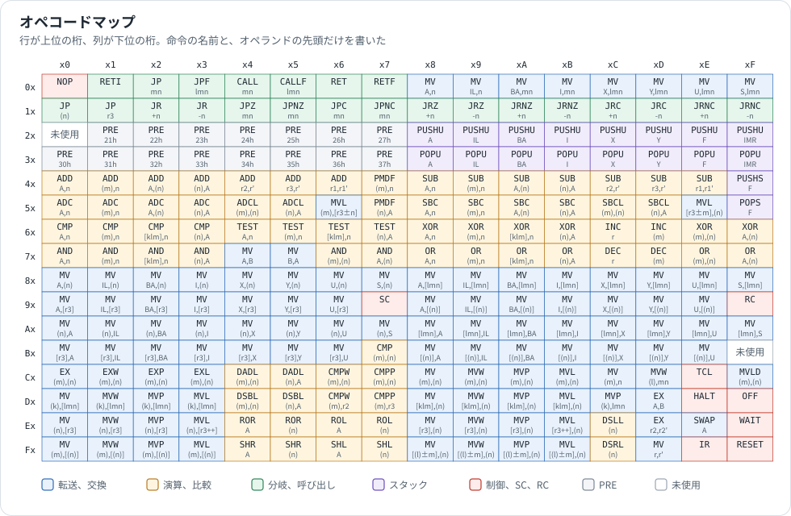

並びには規則があります。下位 3 ビットがレジスタコード（§2.3.2）になっている所が多く、`08h`〜`0Fh` は即値、`80h`〜`87h` は内部 RAM から、`88h`〜`8Fh` は絶対アドレスから、`A0h`〜`A7h` と `A8h`〜`AFh` はその逆向きの転送です。

### 表の読み方

バイト数は PRE を含みません。サイクル数は公式 p.74〜87 の表の値で、条件分岐は「成立/不成立」、ループ命令は I に依存します。内部 RAM オペランドが `(BP+n)` 以外なら 1 を足します。`r` はレジスタコード（§2.3.2）、`r3` は X、Y、U、S です。

第 2 バイトで形が決まる命令（90h〜96h、98h〜9Eh、B0h〜B6h、B8h〜BEh、E0h〜E3h、E8h〜EBh、6Ch、7Ch、EDh、FDh、44h〜46h、4Ch〜4Eh）は、代表の形を載せています。E0h〜E2h は「内部 RAM ← 外部」、E8h〜EAh は「外部 ← 内部 RAM」で、`[r3]`、`[r3++]`、`[--r3]`、`[r3±n]` の別は第 2 バイトで決まります。形によるサイクル数の違いは次の表のとおりです（公式 p.74〜79。`レジスタ/内部 RAM` の順）。

| 外部メモリの指定 | 1 バイト | 2 バイト | 3 バイト |
|---|---|---|---|
| `[r3]` | 4 / 6 | 5 / 7 | 6 / 8 |
| `[r3++]` | 4 / 6 | 5 / 7 | 7 / 9 |
| `[--r3]` | 5 / 7 | 6 / 10 | 8 / 10 |
| `[r3±n]` | 6 / 8 | 7 / 9 | 8 / 10 |
| `[(n)]` | 9 / 11 | 10 / 12 | 11 / 13 |
| `[(n)±m]` | 11 / 13 | 12 / 14 | 13 / 15 |

レジスタの欄は A と X など幅の基本の値で、`IL` に読むときは 1 を足します（`[lmn]` は足しません）。

この表は最初『ポケコン活用研究』の値から作ったものです。公式の表と比べて、83h、89h、8Bh、93h、94h〜96h、9Bh、EAh の値と、DSRL、DSLL の式を直し、空欄だった IR（12）と RESET（6）を埋めました。`HALT`、`OFF` の 2 は、止まらずに通過するときの値です（p.87）。エミュレータとの違いは §2.16 にあります。

**例: バイト列を読む。** `30 80 20` は、`30h` が PRE（`(n)` の指定）、`80h` が `MV A,(n)`、`20h` が n なので、`MV A,(20h)` です。サイクル数は 3 に PRE の 1 を足して 4 です。PRE の行（21h〜27h、30h〜37h）の組み合わせは、§2.13.5 の表で引いてください。

| 先頭 | 内容 | 先頭 | 内容 |
|---|---|---|---|
| 00h〜07h | 制御、ジャンプ、呼び出し | 80h〜8Fh | レジスタへの転送 |
| 08h〜0Fh | 即値の転送 | 90h〜9Fh | 外部間接からの転送、SC、RC |
| 10h〜1Fh | ジャンプ | A0h〜AFh | レジスタからの転送 |
| 20h〜2Fh | PRE、PUSHU | B0h〜BFh | 外部間接への転送、CMP |
| 30h〜3Fh | PRE、POPU | C0h〜CFh | 交換、10 進の加算、比較、内部 RAM の転送 |
| 40h〜4Fh | ADD、SUB、PMDF、PUSHS | D0h〜DFh | 10 進の減算、比較、絶対アドレス、HALT、OFF |
| 50h〜5Fh | ADC、SBC、ADCL、SBCL、POPS | E0h〜EFh | 外部間接、回転、交換、WAIT |
| 60h〜7Fh | 比較、論理、INC、DEC、`MV A,B` | F0h〜FFh | 内部 RAM 間接、シフト、IR、RESET |

### 一覧

| op | ニーモニック | オペランド | バイト | サイクル |
|---|---|---|---|---|
| 00h | NOP | - | 1 | 1 |
| 01h | RETI | - | 1 | 7 |
| 02h | JP | mn | 3 | 4 |
| 03h | JPF | lmn | 4 | 5 |
| 04h | CALL | mn | 3 | 6 |
| 05h | CALLF | lmn | 4 | 8 |
| 06h | RET | - | 1 | 4 |
| 07h | RETF | - | 1 | 5 |
| 08h | MV | A, n | 2 | 2 |
| 09h | MV | IL, n | 2 | 3 |
| 0Ah | MV | BA, mn | 3 | 3 |
| 0Bh | MV | I, mn | 3 | 3 |
| 0Ch | MV | X, lmn | 4 | 4 |
| 0Dh | MV | Y, lmn | 4 | 4 |
| 0Eh | MV | U, lmn | 4 | 4 |
| 0Fh | MV | S, lmn | 4 | 4 |
| 10h | JP | (n) | 2 | 6 |
| 11h | JP | r3 | 2 | 4 |
| 12h | JR | +n | 2 | 3 |
| 13h | JR | -n | 2 | 3 |
| 14h | JPZ | mn | 3 | 4/3 |
| 15h | JPNZ | mn | 3 | 4/3 |
| 16h | JPC | mn | 3 | 4/3 |
| 17h | JPNC | mn | 3 | 4/3 |
| 18h | JRZ | +n | 2 | 3/2 |
| 19h | JRZ | -n | 2 | 3/2 |
| 1Ah | JRNZ | +n | 2 | 3/2 |
| 1Bh | JRNZ | -n | 2 | 3/2 |
| 1Ch | JRC | +n | 2 | 3/2 |
| 1Dh | JRC | -n | 2 | 3/2 |
| 1Eh | JRNC | +n | 2 | 3/2 |
| 1Fh | JRNC | -n | 2 | 3/2 |
| 20h | （未使用: 既定組合せ） | - | - | - |
| 21h | PRE | (BP+n)(BP+PY) | 1 | 1 |
| 22h | PRE | (BP+n)(n) | 1 | 1 |
| 23h | PRE | (BP+n)(PY+n) | 1 | 1 |
| 24h | PRE | (BP+PX)(BP+n) | 1 | 1 |
| 25h | PRE | (BP+PX)(BP+PY) | 1 | 1 |
| 26h | PRE | (BP+PX)(n) | 1 | 1 |
| 27h | PRE | (BP+PX)(PY+n) | 1 | 1 |
| 28h | PUSHU | A | 1 | 3 |
| 29h | PUSHU | IL | 1 | 3 |
| 2Ah | PUSHU | BA | 1 | 4 |
| 2Bh | PUSHU | I | 1 | 4 |
| 2Ch | PUSHU | X | 1 | 5 |
| 2Dh | PUSHU | Y | 1 | 5 |
| 2Eh | PUSHU | F | 1 | 3 |
| 2Fh | PUSHU | IMR | 1 | 3 |
| 30h | PRE | (m)(BP+n) | 1 | 1 |
| 31h | PRE | (m)(BP+PY) | 1 | 1 |
| 32h | PRE | (m)(n) | 1 | 1 |
| 33h | PRE | (m)(PY+n) | 1 | 1 |
| 34h | PRE | (PX+m)(BP+n) | 1 | 1 |
| 35h | PRE | (PX+m)(BP+PY) | 1 | 1 |
| 36h | PRE | (PX+m)(n) | 1 | 1 |
| 37h | PRE | (PX+m)(PY+n) | 1 | 1 |
| 38h | POPU | A | 1 | 2 |
| 39h | POPU | IL | 1 | 3 |
| 3Ah | POPU | BA | 1 | 3 |
| 3Bh | POPU | I | 1 | 3 |
| 3Ch | POPU | X | 1 | 4 |
| 3Dh | POPU | Y | 1 | 4 |
| 3Eh | POPU | F | 1 | 2 |
| 3Fh | POPU | IMR | 1 | 2 |
| 40h | ADD | A, n | 2 | 3 |
| 41h | ADD | (m), n | 3 | 4 |
| 42h | ADD | A, (n) | 2 | 4 |
| 43h | ADD | (n), A | 2 | 4 |
| 44h | ADD | r2, r1' / r2, r2' | 2 | 5 |
| 45h | ADD | r3, r' | 2 | 7 |
| 46h | ADD | r1, r1' | 2 | 3 |
| 47h | PMDF | (m), n | 3 | 4 |
| 48h | SUB | A, n | 2 | 3 |
| 49h | SUB | (m), n | 3 | 4 |
| 4Ah | SUB | A, (n) | 2 | 4 |
| 4Bh | SUB | (n), A | 2 | 4 |
| 4Ch | SUB | r2, r1' / r2, r2' | 2 | 5 |
| 4Dh | SUB | r3, r' | 2 | 7 |
| 4Eh | SUB | r1, r1' | 2 | 3 |
| 4Fh | PUSHS | F | 1 | 3 |
| 50h | ADC | A, n | 2 | 3 |
| 51h | ADC | (m), n | 3 | 4 |
| 52h | ADC | A, (n) | 2 | 4 |
| 53h | ADC | (n), A | 2 | 4 |
| 54h | ADCL | (m), (n) | 3 | 5+2×I |
| 55h | ADCL | (n), A | 2 | 4+I |
| 56h | MVL | (m), [r3±n] | 4 | 5+2×I |
| 57h | PMDF | (n), A | 2 | 4 |
| 58h | SBC | A, n | 2 | 3 |
| 59h | SBC | (m), n | 3 | 4 |
| 5Ah | SBC | A, (n) | 2 | 4 |
| 5Bh | SBC | (n), A | 2 | 4 |
| 5Ch | SBCL | (m), (n) | 3 | 5+2×I |
| 5Dh | SBCL | (n), A | 2 | 4+I |
| 5Eh | MVL | [r3±m], (n) | 4 | 5+2×I |
| 5Fh | POPS | F | 1 | 2 |
| 60h | CMP | A, n | 2 | 3 |
| 61h | CMP | (m), n | 3 | 4 |
| 62h | CMP | [klm], n | 5 | 6 |
| 63h | CMP | (n), A | 2 | 4 |
| 64h | TEST | A, n | 2 | 3 |
| 65h | TEST | (m), n | 3 | 4 |
| 66h | TEST | [klm], n | 5 | 6 |
| 67h | TEST | (n), A | 2 | 4 |
| 68h | XOR | A, n | 2 | 3 |
| 69h | XOR | (m), n | 3 | 4 |
| 6Ah | XOR | [klm], n | 5 | 7 |
| 6Bh | XOR | (n), A | 2 | 4 |
| 6Ch | INC | r | 2 | 3 |
| 6Dh | INC | (m) | 2 | 3 |
| 6Eh | XOR | (m), (n) | 3 | 6 |
| 6Fh | XOR | A, (n) | 2 | 4 |
| 70h | AND | A, n | 2 | 3 |
| 71h | AND | (m), n | 3 | 4 |
| 72h | AND | [klm], n | 5 | 7 |
| 73h | AND | (n), A | 2 | 4 |
| 74h | MV | A, B | 1 | 1 |
| 75h | MV | B, A | 1 | 1 |
| 76h | AND | (m), (n) | 3 | 6 |
| 77h | AND | A, (n) | 2 | 4 |
| 78h | OR | A, n | 2 | 3 |
| 79h | OR | (m), n | 3 | 4 |
| 7Ah | OR | [klm], n | 5 | 7 |
| 7Bh | OR | (n), A | 2 | 4 |
| 7Ch | DEC | r | 2 | 3 |
| 7Dh | DEC | (m) | 2 | 3 |
| 7Eh | OR | (m), (n) | 3 | 6 |
| 7Fh | OR | A, (n) | 2 | 4 |
| 80h | MV | A, (n) | 2 | 3 |
| 81h | MV | IL, (n) | 2 | 4 |
| 82h | MV | BA, (n) | 2 | 4 |
| 83h | MV | I, (n) | 2 | 4 |
| 84h | MV | X, (n) | 2 | 5 |
| 85h | MV | Y, (n) | 2 | 5 |
| 86h | MV | U, (n) | 2 | 5 |
| 87h | MV | S, (n) | 2 | 5 |
| 88h | MV | A, [lmn] | 4 | 6 |
| 89h | MV | IL, [lmn] | 4 | 6 |
| 8Ah | MV | BA, [lmn] | 4 | 7 |
| 8Bh | MV | I, [lmn] | 4 | 7 |
| 8Ch | MV | X, [lmn] | 4 | 8 |
| 8Dh | MV | Y, [lmn] | 4 | 8 |
| 8Eh | MV | U, [lmn] | 4 | 8 |
| 8Fh | MV | S, [lmn] | 4 | 8 |
| 90h | MV | A, [r3] | 2 | 4 |
| 91h | MV | IL, [r3] | 2 | 5 |
| 92h | MV | BA, [r3] | 2 | 5 |
| 93h | MV | I, [r3] | 2 | 5 |
| 94h | MV | X, [r3] | 2 | 6 |
| 95h | MV | Y, [r3] | 2 | 6 |
| 96h | MV | U, [r3] | 2 | 6 |
| 97h | SC | - | 1 | 1 |
| 98h | MV | A, [(n)] | 3 | 9 |
| 99h | MV | IL, [(n)] | 3 | 10 |
| 9Ah | MV | BA, [(n)] | 3 | 10 |
| 9Bh | MV | I, [(n)] | 3 | 10 |
| 9Ch | MV | X, [(n)] | 3 | 11 |
| 9Dh | MV | Y, [(n)] | 3 | 11 |
| 9Eh | MV | U, [(n)] | 3 | 11 |
| 9Fh | RC | - | 1 | 1 |
| A0h | MV | (n), A | 2 | 3 |
| A1h | MV | (n), IL | 2 | 3 |
| A2h | MV | (n), BA | 2 | 4 |
| A3h | MV | (n), I | 2 | 4 |
| A4h | MV | (n), X | 2 | 5 |
| A5h | MV | (n), Y | 2 | 5 |
| A6h | MV | (n), U | 2 | 5 |
| A7h | MV | (n), S | 2 | 5 |
| A8h | MV | [lmn], A | 4 | 5 |
| A9h | MV | [lmn], IL | 4 | 5 |
| AAh | MV | [lmn], BA | 4 | 6 |
| ABh | MV | [lmn], I | 4 | 6 |
| ACh | MV | [lmn], X | 4 | 7 |
| ADh | MV | [lmn], Y | 4 | 7 |
| AEh | MV | [lmn], U | 4 | 7 |
| AFh | MV | [lmn], S | 4 | 7 |
| B0h | MV | [r3], A | 2 | 4 |
| B1h | MV | [r3], IL | 2 | 4 |
| B2h | MV | [r3], BA | 2 | 5 |
| B3h | MV | [r3], I | 2 | 5 |
| B4h | MV | [r3], X | 2 | 6 |
| B5h | MV | [r3], Y | 2 | 6 |
| B6h | MV | [r3], U | 2 | 6 |
| B7h | CMP | (m),(n) | 3 | 6 |
| B8h | MV | [(n)], A | 3 | 9 |
| B9h | MV | [(n)], IL | 3 | 9 |
| BAh | MV | [(n)], BA | 3 | 10 |
| BBh | MV | [(n)], I | 3 | 10 |
| BCh | MV | [(n)], X | 3 | 11 |
| BDh | MV | [(n)], Y | 3 | 11 |
| BEh | MV | [(n)], U | 3 | 11 |
| BFh | （未使用） | - | - | - |
| C0h | EX | (m), (n) | 3 | 7 |
| C1h | EXW | (m), (n) | 3 | 10 |
| C2h | EXP | (m), (n) | 3 | 13 |
| C3h | EXL | (m), (n) | 3 | 5+3×I |
| C4h | DADL | (m), (n) | 3 | 5+2×I |
| C5h | DADL | (n), A | 2 | 4+I |
| C6h | CMPW | (m), (n) | 3 | 8 |
| C7h | CMPP | (m), (n) | 3 | 10 |
| C8h | MV | (m), (n) | 3 | 6 |
| C9h | MVW | (m), (n) | 3 | 8 |
| CAh | MVP | (m), (n) | 3 | 10 |
| CBh | MVL | (m), (n) | 3 | 5+2×I |
| CCh | MV | (m), n | 3 | 3 |
| CDh | MVW | (l), mn | 4 | 4 |
| CEh | TCL | - | 1 | 1 |
| CFh | MVLD | (m), (n) | 3 | 5+2×I |
| D0h | MV | (k), [lmn] | 5 | 7 |
| D1h | MVW | (k), [lmn] | 5 | 8 |
| D2h | MVP | (k), [lmn] | 5 | 9 |
| D3h | MVL | (k), [lmn] | 5 | 6+2×I |
| D4h | DSBL | (m), (n) | 3 | 5+2×I |
| D5h | DSBL | (n), A | 2 | 4+I |
| D6h | CMPW | (m), r2 | 3 | 7 |
| D7h | CMPP | (m), r3 | 3 | 9 |
| D8h | MV | [klm], (n) | 5 | 6 |
| D9h | MVW | [klm], (n) | 5 | 7 |
| DAh | MVP | [klm], (n) | 5 | 8 |
| DBh | MVL | [klm], (n) | 5 | 6+2×I |
| DCh | MVP | (k), lmn | 5 | 5 |
| DDh | EX | A, B | 1 | 3 |
| DEh | HALT | - | 1 | 2 |
| DFh | OFF | - | 1 | 2 |
| E0h | MV | (n), [r3] | 3 | 6 |
| E1h | MVW | (n), [r3] | 3 | 7 |
| E2h | MVP | (n), [r3] | 3 | 8 |
| E3h | MVL | (n), [r3++] | 3 | 5+2×I |
| E4h | ROR | A | 1 | 2 |
| E5h | ROR | (n) | 2 | 3 |
| E6h | ROL | A | 1 | 2 |
| E7h | ROL | (n) | 2 | 3 |
| E8h | MV | [r3], (n) | 3 | 6 |
| E9h | MVW | [r3], (n) | 3 | 7 |
| EAh | MVP | [r3], (n) | 3 | 8 |
| EBh | MVL | [r3++], (n) | 3 | 5+2×I |
| ECh | DSLL | (n) | 2 | 4+I |
| EDh | EX | r2, r2' | 2 | 4 |
| EEh | SWAP | A | 1 | 3 |
| EFh | WAIT | - | 1 | 1+I |
| F0h | MV | (m), [(n)] | 4 | 11 |
| F1h | MVW | (m), [(n)] | 4 | 12 |
| F2h | MVP | (m), [(n)] | 4 | 13 |
| F3h | MVL | (m), [(n)] | 4 | 10+2×I |
| F4h | SHR | A | 1 | 2 |
| F5h | SHR | (n) | 2 | 3 |
| F6h | SHL | A | 1 | 2 |
| F7h | SHL | (n) | 2 | 3 |
| F8h | MV | [(l)±m], (n) | 5 | 13 |
| F9h | MVW | [(l)±m], (n) | 5 | 14 |
| FAh | MVP | [(l)±m], (n) | 5 | 15 |
| FBh | MVL | [(l)±m], (n) | 5 | 12+2×I |
| FCh | DSRL | (n) | 2 | 4+I |
| FDh | MV | r2, r2' / r3, r3' | 2 | 2 |
| FEh | IR | - | 1 | 12 |
| FFh | RESET | - | 1 | 6 |

## 2.16 公式とエミュレータの違い

公式の資料どうし、公式の資料とエミュレータで、書いてあることや動作が一致しない所を集めました。プログラムを書くときは、どちらの動作でも困らない書き方を選ぶと安全です（たとえば、`IR` のあとの IRM の値に頼らない、サイクル数だけで時間を測らない）。

公式の記述と、エミュレータの実験が合わない点です。ROM のコードで判断できたものは、その旨を書きました。

| 項目 | 公式 | エミュレータ | 備考 |
|---|---|---|---|
| `IR` の後の IRM | 0 にする（p.71） | 変えない | ハードウェアの割り込みでは、エミュレータも 0 にする |
| `IR`、`RESET` のサイクル数 | 12、6（p.87） | 1、1 | |
| `CMPP (n),r3` の比較の幅 | 24 ビット。レジスタの上位 4 bit は 0 として比べる（p.62） | 20 ビット | `FFFFFFh` と `FFFFFh` が、エミュレータでは等しくなる |
| ループ命令のサイクル数 | `MVL` は `5+2×I` など（p.80〜83） | 式の定数が違う（下の表） | I に掛かる係数は同じ |
| `WAIT` | I+1 | I | |
| `[(l)±m]` 系のサイクル数 | `MV [(l)±m],(n)` は 13、`[(l)]` は 11（p.74） | 同じ（13 と 11） | 一致 |
| 外部メモリの LCD のウィンドウの待ち | 7 ステート、2 ステート（p.22） | — | |

ループ命令は、I を 1、2、5、10 にして測りました（実験。PRE の 1 サイクルを除く）。

| 命令 | 公式 | エミュレータ |
|---|---|---|
| `MVL (m),(n)`、`MVLD` | 5+2×I | 3+2×I |
| `MVL (k),[lmn]`、`MVL [klm],(n)` | 6+2×I | 4+2×I |
| `MVL (n),[r3++]`、`MVL [r3++],(n)` | 5+2×I | 8+2×I |
| `MVL (n),[--r3]`、`MVL [--r3],(n)` | 7+2×I | 8+2×I |
| `MVL (m),[r3±n]`、`MVL [r3±m],(n)` | 5+2×I | 5+2×I |
| `MVL (m),[(n)]` | 10+2×I | 8+2×I |
| `MVL (m),[(n)±m]`、`MVL [(l)±m],(n)` | 12+2×I | 10+2×I |
| `EXL (m),(n)` | 5+3×I | 2+3×I |
| `ADCL`、`SBCL`、`DADL`、`DSBL` の `(m),(n)` | 5+2×I | 3+2×I |
| 同じ 4 つの `(n),A` | 4+I | 3+I |
| `DSRL`、`DSLL` | 4+I | 3+I |

差は 1 回の実行で数サイクルなので、I が大きいほど目立たなくなります。256 バイトの `MVL (m),(n)` では、公式の式で 517、エミュレータで 515 サイクルです。

そのほかの命令は、§2.15 の表の値と全部一致しました。

エミュレータは実機と同じ 768 kHz（1 秒あたりの実行サイクル数）で動きます。命令ごとのサイクル数には上の表の違いがあります（[起動、割り込み、タイマ、音](10_SYSTEM.md) §10.1）。

公式の中で矛盾している点も並べます。

| 項目 | 記述 | 判断 |
|---|---|---|
| 割り込みで積む順序（§2.10.3） | p.37「PCL、PCH、PS、F、IMR」、p.71「PS、PC、F、IMR」 | p.71。ROM のコードと実験も同じ |
| 割り込みの IRM（§2.10.3） | p.37「1」、p.15 と p.71「0」 | 0。ROM が前提にしている動作とも合う |
| CI のビット（§2.9.3） | p.20 の図はビット 1、p.28 は「bit 2」 | ビット 1。ROM のコードと同じ |
| `MVL` の `[--r3]` の向き（§2.14.1） | p.53 本文「内部 RAM の側は増える」、同じページの例「減る」 | 減る。ROM のコードと実験も同じ |
| 多バイト比較のアドレス（§2.14.3） | p.61 前半「小さいアドレス」、後半「大きいアドレスが上位」 | 指定のアドレスが最下位。実験も同じ |
| STS の向き（§2.9.1） | CPU マニュアル p.18「0 が長い方」、技術資料 p.92「0 で約 0.5 秒」 | 技術資料。ROM の使い方と自動電源オフの時間に合う |

`B7h` の `CMP (m),(n)` は公式の p.84 の表にあります。Andrew Woods の表が `MV` と書いているのは誤記と見られます（[外部資料](28_RESOURCES.md)）。

## 2.17 調べ方

- **公式の読み取り:** スキャンの OCR を読み、表と怪しい箇所はページの画像で確かめました。
- **実験:** e500asm で命令を組み立て、ROM の先頭に置いて、エミュレータの DLL で 1 命令ずつ実行しました。レジスタ、フラグ、内部 RAM、メモリ、サイクル数を読み取っています。
- **サイクル数:** オペコード表の全行（`HALT`、`OFF` を除く 254 行）を 1 命令ずつ実行し、サイクル数と命令の長さをエミュレータの値と比べました。長さは全部一致し、サイクル数が違ったのは §2.16 のループ命令と `IR`、`RESET` だけです。条件分岐は成立と不成立の両方を試しました。
- **フラグ:** 命令ごとに、C と Z を両方 0、両方 1 から始めて実行し、変わる、変わらないを分けました。
- **機械語の例:** この章の例と PRE の表の 47 通りは、`e500asm` に通して同じバイトになることを確かめました。
- **ROM のコード:** `e500dasm` で ROM を逆アセンブルして読みました。

## まとめ

| 項目 | 覚えること |
|---|---|
| レジスタ | 8 bit は A と IL、16 bit は BA と I、20 bit は X、Y、U、S。IL に書くと IH は 0 |
| 実行アドレス | PS（4 bit）と PC（16 bit）。PC は 64 KB の中で回る |
| フラグ | C と Z だけ。`INC`、`DEC`、論理演算、桁ずらしは C を変えない |
| 多バイト演算 | 最初のバイトに実行前の C を含めない。空いた桁には 0 が入る |
| メモリ | `(…)` は内部 256 バイト、`[…]` は外部 1 MB。多バイトは下位が先 |
| PRE | 内部 RAM の指定が `(BP+n)` でないときに付く 1 バイト。1 サイクル増える |
| 周辺 | 内部 RAM の `ECh`〜`FFh`。絶対アドレスで指す |
| ループ命令 | 回数は I。I=0 は 65536 回。実行後の I は 0 |
| スタック | `CALL` 2 バイト、`CALLF` 3 バイト、割り込みと `IR` 5 バイト |
| 割り込み | ベクタは `FFFFAh` の 1 つ。命令の切れ目で受け付ける。ISR はソフトウェアが消す |
| 省電力 | `HALT` は主クロックだけ、`OFF` は両方を止める。戻ったあとのフラグは不定 |
| 時間 | 1 サイクル 1.30 µs（768 kHz） |

## 情報源と確度

| 表記 | 情報源 |
|---|---|
| 表記なし、**公式** | SHARP ESR-L Instruction Manual（[Forth500 の resources](https://github.com/Robert-van-Engelen/Forth500/tree/main/resources) で公開されているスキャン）。ページは印刷の番号 |
| **コード** | ROM の逆アセンブル |
| **実験** | エミュレータ（PockEmul 由来の CPU 実装）で、自作の ROM を動かして確かめた |

実機では測っていません。実験は「エミュレータの実装がそう動く」ことの確認で、LSI の動作を証明するものではありません。公式とエミュレータが食い違う点は [§2.16](#216-公式とエミュレータの違い) にまとめました。

## 次に読むもの

- [機械語を実機で動かす](12_MACHINE_CODE.md) — 書いた機械語を RAM に置いて BASIC から呼ぶ手順
- [メモリ](03_MEMORY.md) — ROM が内部 RAM と外部メモリをどう使うか
- [起動、割り込み、タイマ、音](10_SYSTEM.md) — リセットと割り込みのあとに ROM が行うこと
- [命令一覧](../manual/05_INSTRUCTIONS.md) — 命令ごとの書き方と例
