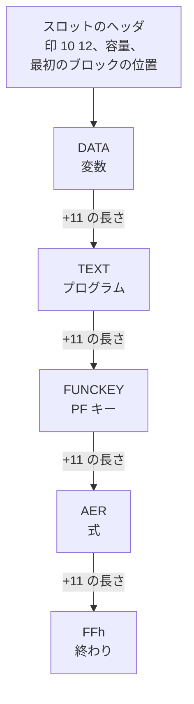
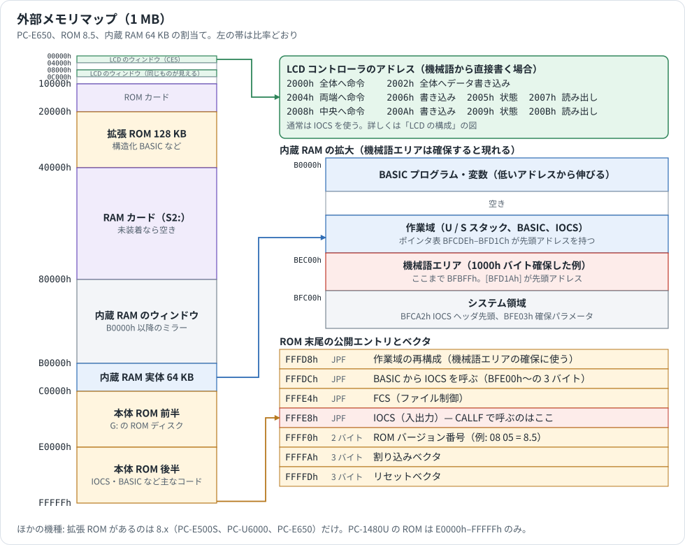
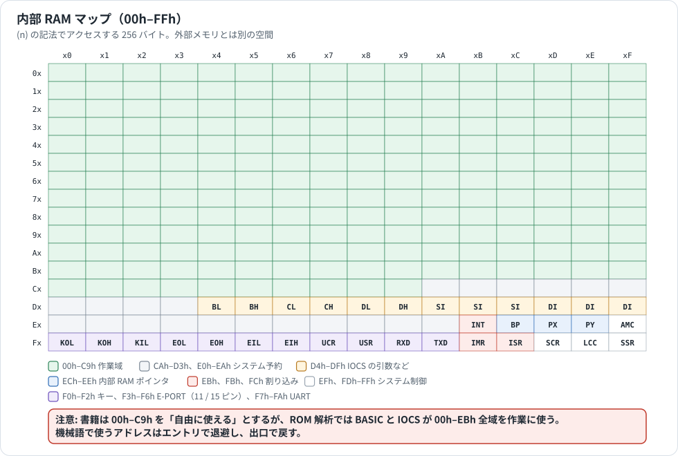
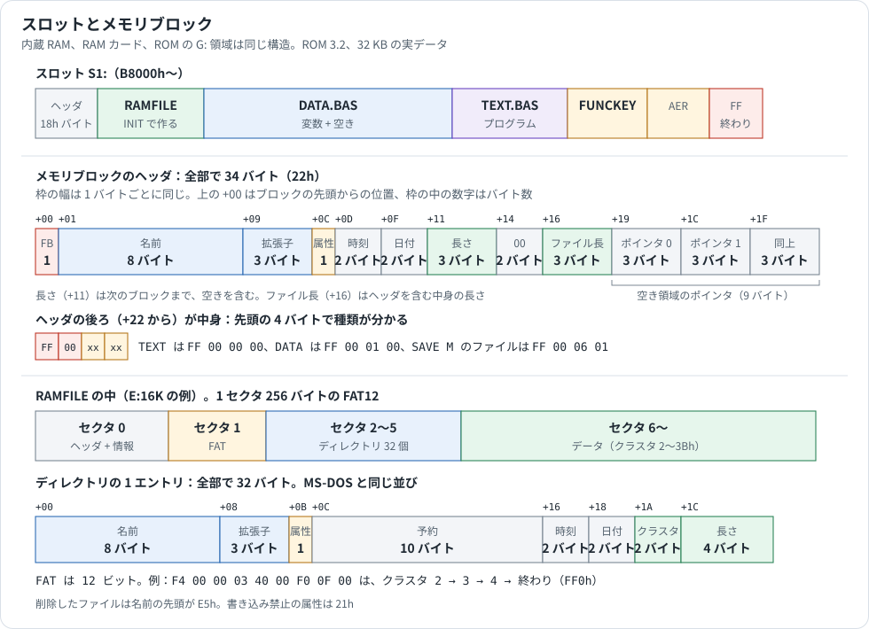
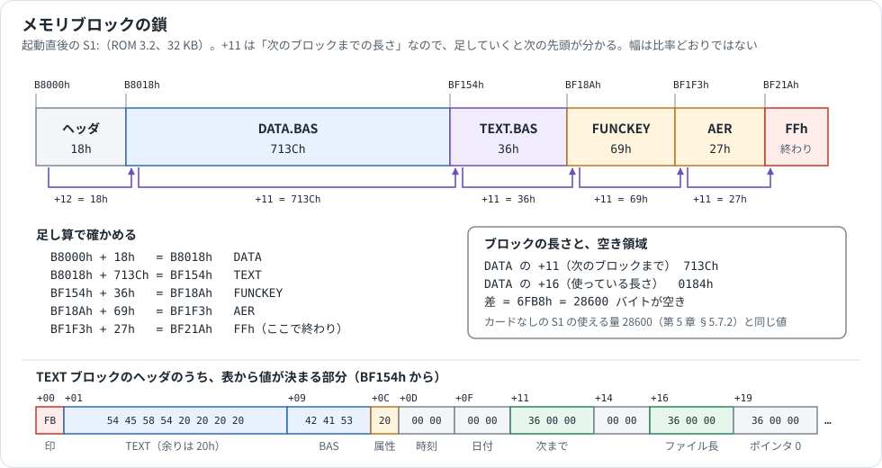
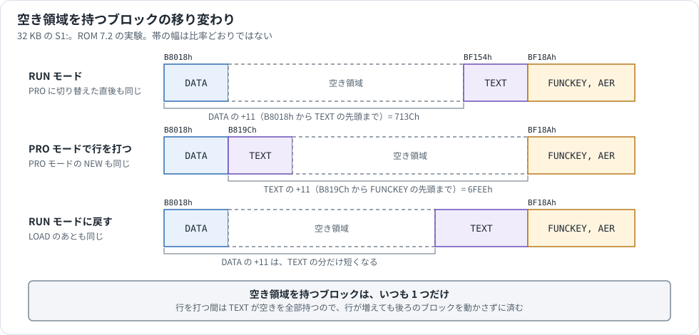
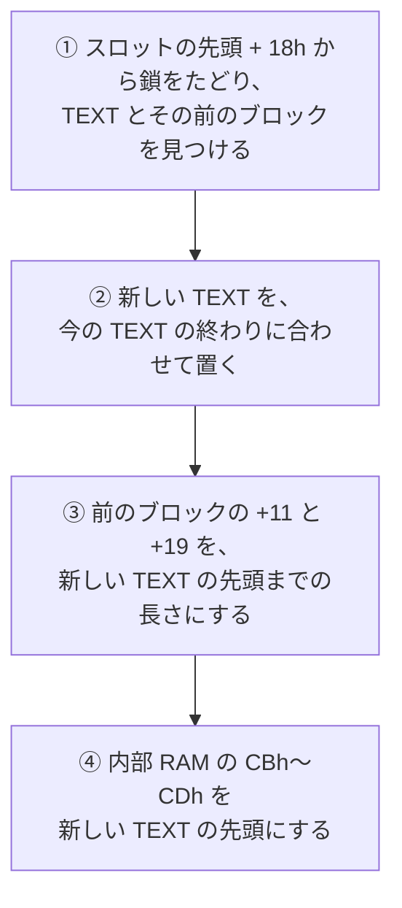
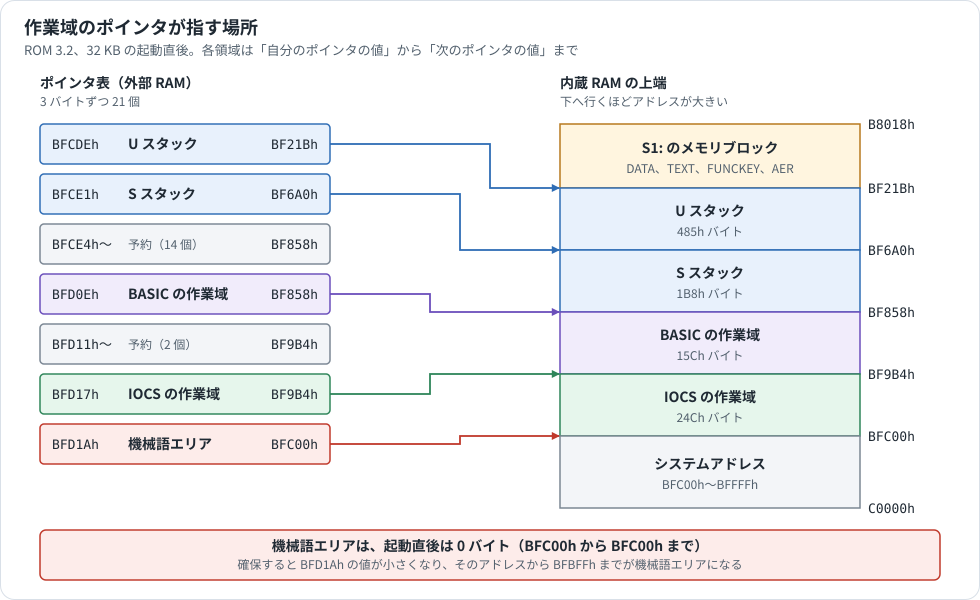
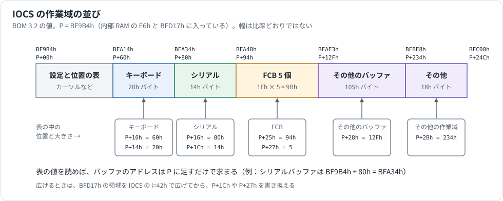
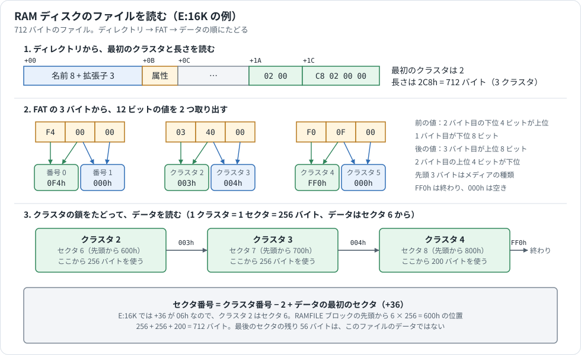

# 3. メモリ

この章は、PC-E500 シリーズのメモリのどこに何があるかを説明します。BASIC だけを使うなら知らなくても困りませんが、「変数を使い切ったら何が起きるのか」「`E:` はどこにあるのか」「機械語をどこに置けば安全か」といった疑問の答えは、すべてメモリの並びの中にあります。`FILES "S1:"` と打つと出てくる `TEXT` や `DATA` という名前が、この章の主役です。アドレスの割当て、内部 RAM の使い方、スロット、メモリブロック、作業域、RAM ディスク（`E:`、`F:`）の中身を順に見ていきます。

[目次へ戻る](README.md)

## この章で分かること

- 1 MB の外部メモリと 256 バイトの内部 RAM に、それぞれ何が置かれているか
- プログラム、変数、RAM ディスクがすべて「メモリブロック」という同じ形をしていること、その鎖のたどり方
- BASIC のプログラムの置き場所が、RUN モードと PRO モードで移り変わる理由
- 機械語から使う作業域と、その場所を示すポインタの表
- RAM ディスクの中身（FAT12）の読み方
- 画面、キー、BASIC などの設定が入っている固定のアドレス

## 3.0 はじめに

### 3 つの「メモリ」

この機械のメモリは、大きく 3 つに分けると見通しがよくなります。

| 種類 | 大きさ | 何に使うか | この章の節 |
|---|---|---|---|
| 内部 RAM | 256 バイト | CPU の中にある。レジスタの代わり、I/O ポート | §3.1.2 |
| 外部メモリの RAM | 32 KB、64 KB など | プログラム、変数、作業域、RAM ディスク | §3.2〜§3.8 |
| 外部メモリの ROM | 機種による | BASIC などのシステム | §3.1.1、[ROM バージョンの違い: 配置](23_ROM_VERSIONS_MAP.md) |

外部メモリの RAM は、置かれるものの性格でさらに 2 つに分かれます。前のほう（アドレスの小さい側）は**スロット**で、利用者のプログラム、変数、ファイルが入ります。後ろのほう（アドレスの大きい側）は**作業域**で、スタックや IOCS のバッファ、システムの設定が入ります。

### 本棚にたとえると

スロットは本棚、メモリブロックは本にあたります。本棚には背表紙の一覧はなく、1 冊目の場所だけが決まっています。どの本にも「次の本までの長さ」が書いてあるので、1 冊目から順にたどれば、どの本も見つかります。最後に「ここで終わり」の札（`FFh`）があります。



本文の（公式）、（実験）などは、その内容の根拠です。意味は章末の「情報源と確度」にあります。CPU から見たメモリ空間は [CPU（SC62015）](02_CPU.md) §2.5、§2.6、カードは [カードスロット](05_CARD_SLOT.md)、変数の形式は [BASIC の内部形式](15_BASIC_INTERNALS.md) を参照してください。

> [!NOTE]
> この章のアドレスと長さは、複数バイトのとき**下位のバイトが先**に並びます。たとえば 3 バイトの `18 00 00` は `000018h`、`3C 71 00` は `00713Ch` です。

## 3.1 全体像

### 3.1.1 外部メモリ

外部メモリは 1 MB（`00000h`〜`FFFFFh`）の空間です。アドレスの範囲ごとに、LCD、カード、内蔵 RAM、ROM といった相手が決まっています。



RAM は読み書きでき、ユーザーのプログラムや作業域が置かれます。ROM は電源が切れても消えず、BASIC などのシステムが入っています。チップセレクト（どのアドレスのときにどの部品を選ぶかを決める信号）とアドレスの関係は [回路とサービス](09_CIRCUIT.md) §9.3.2、バージョンごとの違いは [ROM バージョンの違い: 配置](23_ROM_VERSIONS_MAP.md) にあります。

### 3.1.2 内部 RAM

外部メモリとは別に、CPU の中に 256 バイトの内部 RAM があります。命令の中で `(nn)` と書いて使う、速くて小さなメモリです。



CPU にとっての区分は [CPU（SC62015）](02_CPU.md) §2.6 のとおりで、ここでは ROM の使い方を示します。**CAh–FFh は I/O ポート等のシステム領域**で、不用意に書くと暴走します。それ以外は自由に使えます。

| アドレス | 名称 | 内容 |
|---|---|---|
| 00h–C9h | WORK | レジスタの代わり、ワークエリア等に自由に使える |
| CAh–D3h, E0h–EAh | SYSTEM RESERVED | 将来の拡張用にシステムが使うワークエリア |
| D4h–DFh | BX, CX, DX, SI, DI | IOCS 等でレジスタが多数必要なときのレジスタ代用。IOCS 呼び出し時にここへパラメータを設定する場合がある（D4h=BL, D5h=BH, D6h=CL, D7h=CH, D8h=DL, D9h=DH, DAh–DCh=SI, DDh–DFh=DI） |
| ECh | BP | ベースポインタ。内部 RAM のアドレス指定（`(BP+n)` アドレッシング）に使う |
| EDh, EEh | PX, PY | PX/PY ポインタ。BP と同じく内部 RAM のアドレス指定に使う |
| EBh, FBh, FCh | INTERRUPT | 割り込みの制御、状態チェック（FBh = IMR） |
| F0h, F1h, F2h | KEY | キー関係ポート。F0h/F1h = KEY OUTPUT BUFFER（KO）、F2h = KEY INPUT BUFFER（KI） |
| F3h–F6h | E-PORT | CPU の E-PORT（I/O ポート）制御。11ピン・オプションコネクタや 15ピン・シリアルポートに接続 |
| F7h–FAh | UART | シリアルポートの制御 |
| EFh, FDh–FFh | SYSTEM | システムコントロールポート。**FFh のビット 3 が BREAK キー検出**（押されていると 1）。他はとりあえず使うことはない |

次の 3 つを覚えておくと、機械語を書くときに困りません。

- 自分の変数には `00h`〜`C9h` を使います。
- IOCS を呼ぶときの引数は `D4h`〜`DFh`（BL から DI まで）に入れます。呼ぶ前に、ここに自分の値を残していないかを確かめます。
- `CAh`〜`D3h` と `E0h`〜`EAh` には、後で出てくる大事なポインタ（`CBh` の `TEXT`、`CEh` の `DATA`、`E6h` の IOCS の作業域など。§3.4）が入っています。

### 3.1.3 スロット

内蔵 RAM、RAM カード、ROM の G: 領域は、どれも**スロット**という同じ構造です。スロットの中に、名前の付いた**メモリブロック**が並びます。プログラムも変数も、RAM ディスクも、すべてメモリブロックです（公式 p.90）。



図の上半分がスロットとブロックのヘッダ（§3.2、§3.3）、下半分が RAM ディスクの中身（§3.6）です。この章は、この 1 枚の図を細かく読み解いていく形になっています。

## 3.2 スロット

スロットは 3 つあります。BASIC の命令では `S1:`、`S2:`、`S3:` という名前で指定します。

| スロット | 名前 | 場所 | 容量の例 |
|---|---|---|---|
| 0 | `S1:` | 内蔵 RAM | 32 KB（`B8000h` から）、64 KB（`B0000h` から） |
| 1 | `S2:` | RAM カード | `40000h` から |
| 2 | `S3:` | 内蔵 ROM | `C0000h` から 128 KB。ROM 2.1 だけ `10000h` を調べます（[カードスロット](05_CARD_SLOT.md) §5.10.1） |

ROM は、どのスロットがどこにあり、どれだけの大きさかを作業域に保存しています（公式 p.74）。容量の単位は 2 KB で、下の値は実験で読みました。

| アドレス | 長さ | 内容 | ROM 3.2、32 KB | ROM 8.5、64 KB |
|---|---|---|---|---|
| `BFC09h` | 3 | S3 の先頭 | `C0000h` | `C0000h` |
| `BFC0Ch` | 2 | S3 の容量 | 40h（128 KB） | 40h |
| `BFC0Fh` | 3 | S2 の先頭 | `40000h` | `40000h` |
| `BFC12h` | 2 | S2 の容量 | 0（カードなし） | 0 |
| `BFC15h` | 3 | S1 の先頭 | `B8000h` | `B0000h` |
| `BFC18h` | 2 | S1 の容量 | 10h（32 KB） | 20h（64 KB） |
| `BFCDEh` | 3 | S1 の最後のアドレス + 1 | `BF21Bh` | `BF21Bh` |

**例**: ROM 8.5、64 KB の `S1:` は、先頭が `B0000h`、容量が 20h です。20h は 32 なので、32 × 2 KB = 64 KB、終わりは `B0000h` + `10000h` = `C0000h` です。このうちブロックが並ぶのは `BF21Bh` の手前までで、そこから上は作業域（§3.4）とシステムアドレス（§3.8）です。

### 3.2.1 スロットのヘッダ

スロットの先頭 18h（24）バイトがヘッダです（公式 p.74、実験）。

| オフセット | 値 | 内容 |
|---|---|---|
| `+00`、`+01` | `10 12` | 印。起動時に ROM がこの 2 バイトを確かめる（3.2 は `C0000h` を `F11D3h`、カードを `F11FCh` で） |
| `+02`、`+03` | | 容量（2 KB 単位） |
| `+05` | | 01h は単独、02h は `MEM$="B"` のペア（[カードスロット](05_CARD_SLOT.md) §5.6.3）。公式の図は 02h |
| `+11` | 2xh | ビット 0 が書き込み禁止 |
| `+12`〜`+14` | `18 00 00` | 最初のブロックの位置（スロット先頭から） |

ブロックの終わりには `FFh` を置きます。残りは空き領域です。

**例**: 内蔵 32 KB の `S1:` なら、`+12` の `18 00 00` から、最初のブロックは `B8000h` + `18h` = `B8018h` にあると分かります。カードのヘッダをバイトごとに描いた図は [カードスロット](05_CARD_SLOT.md) §5.6.3 にあります。

### 3.2.2 MEM$ による切り替え

`MEM$` はプログラムと変数を置く場所を選びます（公式）。カードを認識する手順と `B` の仕組み（AMC）は [カードスロット](05_CARD_SLOT.md) §5.6、§5.7 にあります。

| 値 | プログラムと変数 | `F:` | 備考 |
|---|---|---|---|
| `S1` | 内蔵 RAM | 使える | 既定 |
| `S2` | RAM カード | 使える | `FUNCKEY` と `AER` は内蔵 RAM に残る |
| `B` | 内蔵 RAM + カード | 使えない | カードが空でないと `Illegal function call`。256 KB のカードでは、`RESET` で内蔵 RAM の中身が失われる（[カードスロット](05_CARD_SLOT.md)） |

実験では、`MEM$="S2"` で `TEXT` と `DATA` がカードの `RAMFILE` の後ろへ移り、内部 RAM の `CBh`、`CEh` のポインタもカードのアドレス（`42018h`、`4204Eh`）に変わりました。

容量ごとの使える量と、`B` のときの S1 の先頭は [カードスロット](05_CARD_SLOT.md) §5.7 にあります。

## 3.3 メモリブロック

メモリブロックは、ヘッダと中身からなります。各ブロックの先頭 34 バイト（22h）がヘッダです（公式 p.74、実験）。

| オフセット | 長さ | 内容 |
|---|---|---|
| `+00` | 1 | `FBh` |
| `+01` | 8 | 名前（余りは 20h） |
| `+09` | 3 | 拡張子 |
| `+0C` | 1 | 属性（通常 20h。`TEXT` にパスワードがあると 22h） |
| `+0D` | 2 | 時刻（試した範囲では 0） |
| `+0F` | 2 | 日付（試した範囲では 0） |
| `+11` | 3 | このブロックの先頭から次のブロックまでの長さ |
| `+14` | 2 | 00h |
| `+16` | 3 | 空き領域 0 の始まり。ファイルの長さ（ヘッダを含む）と同じ値 |
| `+19` | 3 | 空き領域 0 の終わり。`+11` と同じ値 |
| `+1C` | 3 | 空き領域 1 の始まり |
| `+1F` | 3 | 空き領域 1 の終わり |

大事なのは `+11` と `+16` の 2 つの長さです。よく似ていますが、意味が違います。

| | 何の長さか | 空き領域を |
|---|---|---|
| `+11` | このブロックの先頭から次のブロックまで | 含む |
| `+16` | 実際に使っている分（ヘッダを含む） | 含まない |

`+11` の長さには空き領域も入ります。`DATA` は `+11` が 713Ch、`+16` が 184h で、差の分が変数とプログラムの空き領域です（実験）。空き領域を持つ（`+11` が `+16` より大きい）ブロックは、いつも 1 つだけです。どのブロックが持つかは、§3.3.2「プログラムを置く場所の移り変わり」のとおり変わります。

#### 空き領域 0 と 1

公式の図（p.74）は、`+16`〜`+1B` の 6 バイトを空き領域のポインタ 0、`+1C`〜`+21` の 6 バイトを空き領域のポインタ 1 としています。3 バイトずつの始まりと終わりの組です。メモリブロックの IOCS（[IOCS と FCS](11_IOCS.md) §11.11）で新しいブロックを作り、空き領域 1 を 40h、空き領域 0 を 100h にすると、ヘッダは次のようになりました（実験、ROM 7.2）。

```text
+00 FB 4D 59 42 4C 4B 20 20 20 20 20 20 20 00 00 00   .MYBLK
+10 00 62 01 00 00 00 62 00 00 62 01 00 00 00 00 40
+20 00 00
```


`+11` が 162h、`+16` が 62h（空き領域 0 の始まり）、`+19` が 162h（終わり）、`+1F` が 40h（空き領域 1 の大きさ）です。ふだん BASIC が使うブロックでは空き領域 1 はすべて 0 で、`+16` と `+19` だけを見れば足ります。

#### 増やせる TEXT と DATA

`BTEXT$="S1:名前"`、`BDATA$="S1:名前"` とすると、別の名前の `TEXT` や `DATA` のブロックが作られ、以後はそちらが使われます（[BASIC の命令と関数](14_BASIC_REFERENCE.md)）。1 台の中に何本ものプログラムを置いておけるのは、プログラムがただのブロックの 1 つだからです。

### 3.3.1 起動直後のブロック

ROM 3.2、32 KB の RUN モードです（実験）。位置はスロットの先頭（`B8000h`）からの距離です。

| 位置 | 名前 | ブロックの長さ | 内容 |
|---|---|---|---|
| `0018h` | `DATA.BAS` | 713Ch | 変数（[BASIC の内部形式](15_BASIC_INTERNALS.md)） |
| `7154h` | `TEXT.BAS` | 36h | プログラム |
| `718Ah` | `FUNCKEY.` | 69h | PF キーの割り当て |
| `71F3h` | `AER.` | 27h | AER の式 |
| `721Ah` | | | 終わりの `FFh` |

この表は、ヘッダの `+12` から始めて、各ブロックの `+11` を足していったものです。



**例（空き領域の計算）**: `DATA` の `+11` から `+16` を引くと、713Ch − 184h = 6FB8h、10 進で 28600 バイトです。[カードスロット](05_CARD_SLOT.md) §5.7.2 にある、カードなし、内蔵 32 KB の `S1` の使える量 28600 と同じ値になります。

公式の図（p.90）は RUN モードと PRO モードで `DATA` の場所が変わるとしていますが、プログラムがない状態の実験では、モードを切り替えても並びは同じでした。並びが変わるのは、PRO モードで行を打ったときです（次の項）。また、公式の図は `TEXT` を前、`DATA` を後ろに描いていますが、実際の並びは `DATA` が前、`TEXT` が後ろでした。

### 3.3.2 プログラムを置く場所の移り変わり

プログラムの編集中に 1 行増えるたびに、後ろにあるものを全部ずらしていては時間がかかります。そこで ROM は、行を打つ間だけ `TEXT` を空き領域の手前に移します。ROM 7.2、32 KB で、場面ごとにブロックの並びを読みました（実験）。

| 場面 | `DATA` | `TEXT` | 空き領域を持つブロック |
|---|---|---|---|
| RUN モード、PRO モードに切り替えた直後 | `B8018h`、`+11` = 713Ch | `FUNCKEY` の直前に詰めて置く（`+11` = `+16`） | `DATA` |
| PRO モードで行を打つ、PRO モードで `NEW` | `+11` = `+16`（184h） | `DATA` の直後（`B819Ch`）へ移り、`+11` = 6FEEh | `TEXT` |
| RUN モードに戻す、`LOAD`（どちらのモードでも） | `+11` = 713Ch から、`TEXT` が 36h より増えた分を引いた値 | 再び `FUNCKEY` の直前に詰めて置く | `DATA` |



行を打つ間だけ、プログラムが空き領域を全部持ち、行が増えても後ろのブロックを動かさずに済むようにしています。`RUN`、`SAVE`、変数の代入、メニューへの移動では並びは変わりませんでした。

**例（アドレスの確かめ）**: PRO モードで行を打つと、`TEXT` は `DATA` の使っている分の直後に来ます。`B8018h` + 184h = `B819Ch` で、表のアドレスと合います。`TEXT` の `+11` は 6FEEh なので、次のブロックは `B819Ch` + 6FEEh = `BF18Ah`。これは図の `FUNCKEY` のアドレスです。`FUNCKEY` が動いていないことが、計算からも分かります。

`TEXT` を動かすと、元の場所には古いバイトが残ります。たとえば、プログラムを `B819Ch` から上へ戻したあとも、`B819Ch` からは古い `TEXT` のヘッダや `FUNCKEY` の名前が読めます。空き領域の中のバイトなので、意味はありません。ブロックはヘッダの名前で探さず、スロットの先頭 + 18h から `+11` をたどって見つけます。

全体の並びは、前から `RAMFILE`（`E:`）、`DATA`、`TEXT`、`FUNCKEY`、`AER`、`ENG.$$$`（ENG のソフトの実行中だけ）、システム領域、機械語エリア、`BFC00h` からのシステムアドレスです。前の 2 つが増えると `B8018h` を基準に、後ろのブロックが増えると `BF21Bh` を基準に、`TEXT` の使える領域が狭くなります（手引書）。

```text
B8018h  RAMFILE（E: を作ったとき）   ┐ 増えると、下（アドレスの大きいほう）へ伸びる
        DATA                         ┘
        空き領域
        TEXT
        FUNCKEY                      ┐
        AER                          │ 増えると、上（アドレスの小さいほう）へ伸びる
        ENG.$$$（実行中だけ）        ┘
BF21Bh  システム領域（作業域、§3.4）
        機械語エリア（確保したとき）
BFC00h  システムアドレス（§3.8）
```

`FILES "S1:"` で、これらのブロックが見えます（公式）。

### 3.3.3 ファイルの先頭の形式

ヘッダのあと（`+22`）の先頭 4 バイトで、中身を区別します（実験）。

| 先頭 | ブロック |
|---|---|
| `FF 00 00 00` | `TEXT`（`CSAVE` の本体、`SAVE` のバイナリも同じ） |
| `FF 00 01 00` | `DATA` |
| `FF 00 02 00` | `FUNCKEY` |
| `FF 00 04 01` | `AER` |
| `FF 00 06 01` | `SAVE M` のファイル（[CE-140F の通信](17_CE-140F_DISK.md)） |
| `FF 00 07 01` | `RAMFILE` |

`TEXT` の `+04` と `+07` はブロック先頭からの位置です。`+04` がプログラムの先頭（`0Dh`）、`+07` が終わり（`FFh`）を指します。この `+04`、`+07` は、中身の先頭（`+22`）から数えた場所です。

**例**: 空の `TEXT` のブロックの長さは 36h でした（§3.3.1）。内訳は、ヘッダ 22h、中身の先頭から `0Dh` まで 13h、終わりの `FFh` 1 で、22h + 13h + 1 = 36h です。プログラムを含む実例は [11 ピン（テープ、周辺機器）](06_PORT_11PIN.md) §6.5.1 にあります。

`SAVE "X:..."` で CE-140F に書いたファイルは、`TEXT` ブロックの `+22` から終わりの `FFh` までと 1 バイトも違いませんでした（実験）。パスワードのあるプログラムは、`SAVE "X:..."` が `Invisible program` で断ります（実験）。

### 3.3.4 LOAD を使わずにプログラムを入れる

ここまで分かると、`SAVE` したファイルを、RAM へ直接書いて `LOAD` と同じ状態にできます。手順は次のとおりです（実験）。



1. スロットの先頭 + 18h からブロックをたどり、`TEXT` とその前のブロックを見つける。
2. 新しい `TEXT` の大きさ（22h + ファイルの長さ）を `+11`、`+16`、`+19` に入れ、ヘッダの残りは今の `TEXT` のまま、`+22` からファイルを置く。置く場所は、今の `TEXT` の終わり（次のブロックの先頭）から大きさの分だけ前。
3. 前のブロックの `+11` と `+19` を、新しい `TEXT` の先頭までの長さにする。前のブロックが空き領域を持っていない場合でも、`TEXT` が空き領域を持っていれば（PRO モードで行を打っていたとき）同じ手順でよい。
4. 内部 RAM の `CBh`〜`CDh` を新しい `TEXT` の先頭にする。

**例（計算）**: 起動直後の ROM 3.2、32 KB に、46h バイトのファイルを入れるとします。

| 項目 | 計算 | 値 |
|---|---|---|
| 新しい `TEXT` の大きさ | 22h + 46h | 68h |
| 今の `TEXT` の終わり | `BF154h` + 36h | `BF18Ah` |
| 新しい `TEXT` の先頭 | `BF18Ah` − 68h | `BF122h` |
| `DATA` の `+11`、`+19` | `BF122h` − `B8018h` | 710Ah |
| `CBh`〜`CDh` に書く値 | | `22 F1 0B` |

`LOAD` のあとと、この手順のあとで、ブロックの並び（各ブロックのアドレス、`+11`、使っている部分の中身）と `CBh` を比べると、バイト単位で同じでした。比べたのは ROM 7.2（8、32、64 KB、32 KB の RAM カード付き）、ROM 2.2、PC-1490UII の ROM 6.4、ROM 8.5（64 KB）で、それぞれ RUN モードと PRO モードからです。そのあとの `RUN` の表示、行を足してからの `SAVE` のファイル、`CONT`（どちらも `Can't continue`）も同じでした。`LOAD` は変数を消しません（代入しておいた変数は `LOAD` のあとも同じ値でした）。

ブロックの外では、`BF499h` 付近（最後に打った命令を中間コードにしたコピー）と入力行の領域だけが違いました。どちらも打った命令の違いによるものです。

エミュレータの「ファイル読込」はこの手順で読み込みます（`Emulator/src/desktop/BasicImage.cs`）。

## 3.4 作業域のポインタ

スロットの後ろには、スタックや IOCS のバッファなどの作業域が続きます。作業域の大きさは変えられるので、アドレスを決め打ちにはできません。どこから始まるかは、ポインタの表に入っています。

21 個のポインタが `BFCDEh` から 3 バイトずつ並びます（公式 p.77）。IOCS の `(cx)=0008h`、`i=42h` で大きさを変えられます。この呼び出しは、`S1:` の中に余りがないと C=1 で断られます。先にメモリブロックの 47h で詰めると、余りができます（[IOCS と FCS](11_IOCS.md) §11.13、実験）。BASIC から使う `CALL &HFFFD8` は、詰める所まで自分で行います。

| アドレス | 内容 | ROM 3.2 の値 |
|---|---|---|
| `BFCDEh` | U スタック | `BF21Bh` |
| `BFCE1h` | S スタック | `BF6A0h` |
| `BFCE4h`〜`BFD0Bh`（14 個） | 予約 | `BF858h` |
| `BFD0Eh` | BASIC の作業域 | `BF858h` |
| `BFD11h`、`BFD14h` | 予約 | `BF9B4h` |
| `BFD17h` | IOCS の作業域 | `BF9B4h` |
| `BFD1Ah` | 機械語エリア | `BFC00h` |

各領域は、そのポインタの値から次のポインタの値までです。機械語エリアの確保は [機械語を実機で動かす](12_MACHINE_CODE.md) §12.3.2 にあります。



**例**: U スタックの領域は `BF21Bh` から `BF6A0h` の手前までなので、`BF6A0h` − `BF21Bh` = 485h（1157）バイトです。IOCS の作業域は `BFC00h` − `BF9B4h` = 24Ch バイトで、§3.5 の「全体」と合います。

ポインタ表は外部 RAM にありますが、ROM がよく使うものは内部 RAM にもコピーがあります。内部 RAM には次のポインタがあります（実験、公式）。

| 内部 RAM | 内容 | ROM 3.2 の値 |
|---|---|---|
| `CBh` | `TEXT` ブロックの先頭 | `BF154h` |
| `CEh` | `DATA` ブロックの先頭 | `B8018h` |
| `D1h` | BASIC の作業域 | `BF858h` |
| `E6h` | IOCS の作業域 | `BF9B4h` |

`RUN` などはプログラムの場所を `CBh` から読み、ブロックの並びはたどりません（実験）。並びの中で `TEXT` を動かし、`CBh` を古いアドレスのままにすると、`RUN` は古い場所のバイトを行として読み、`Syntax error in 8224` になりました（8224 は 2020h で、空白を行番号として読んだ値）。PRO モードとの切り替えで ROM が `TEXT` を動かすと、`CBh` も新しいアドレスに直ります。

> [!TIP]
> 使い分けは次のとおりです。ブロックの全体を調べるツールは、鎖をたどります（§3.3）。今の BASIC プログラムだけが欲しい機械語は、`CBh` を読めば 1 回で着きます。プログラムを入れ替えるツールは、両方を正しく直します（§3.3.4）。

## 3.5 IOCS の作業域

IOCS（画面やキー、ファイルを扱うシステムの部品集）の作業域は、前の表の `BFD17h` が指す場所にあります。`P` を `E6h`（`BFD17h` と同じ値）の指すアドレスとします（公式 p.86、実験）。

この領域の前半は設定と「位置の表」、後半はバッファそのものです。位置の表には、各バッファが `P` から何バイト目にあるかが入っています。



| アドレス | 内容 | ROM 3.2 の値 |
|---|---|---|
| `P+06h`、`07h` | 自動電源オフまでの残り（遅いタイマごとに 1 減る。[起動、割り込み、タイマ、音](10_SYSTEM.md) §10.7） | |
| `P+08h` | LCD の表示開始オフセット（行の番号）。遅いタイマごと（約 0.5 秒）に液晶へ設定される | 00h |
| `P+09h` | カーソルの形。bit0〜2: 0 下線、1 二重下線、2 塗り、3 空白、4 挿入。bit3: 点滅。すべて 0 ならカーソルなし | |
| `P+0Bh`、`0Ch` | カーソルのバッファ内の位置 | |
| `P+0Eh`、`0Fh` | 電源オン中に増えるカウンタ（遅いタイマごと。5 秒で 10 増えた） | |
| `P+10h`、`11h` | キーボードバッファの位置 | 60h |
| `P+14h` | キーボードバッファの大きさ | 20h（32） |
| `P+16h`、`17h` | シリアルバッファの位置 | 80h |
| `P+1Ch`、`1Dh` | シリアルバッファの大きさ | 14h（20） |
| `P+1Eh`、`1Fh` | シリアルの制御を始める量 | 0Ch（12） |
| `P+25h`、`26h` | FCB の位置 | 94h |
| `P+27h` | 同時に開けるファイル数 | 5 |
| `P+28h`、`29h` | その他のバッファの位置 | 12Fh |
| `P+2Bh`、`2Ch` | その他の作業域の位置 | 234h |

作業域の全体は 24Ch バイトでした（公式は「一般に 246h」）。公式の図では先頭の「各パラメータ」が 5Ah バイトですが、実際のキーボードバッファは 60h から始まります（ROM 3.2、7.2、8.5）。大きさは決め打ちにせず、位置の表から求めます。

**公式の数字の読み方。** 公式の表（p.86）は、`P+08h` を「約 5 分ごと」、`P+0Eh` を「約 5 秒ごと」と印刷しています。ROM のコード（7.2 の `F215Ch`、`F2E3Ch`）は、どちらも遅いタイマの割り込みのたびに処理しています。`P+0Eh` はエミュレータで 5 秒に 10 増えたので、約 0.5 秒ごとです。p.92 の「通常は約 5 秒」も同じページの「0 で約 0.5 秒」と合わず、3 か所とも「.5」の点が落ちた誤植と見られます。`P+08h` の値は下位 3 ビットだけが使われ、`C0h + 値 × 8` が液晶の開始ラインになります（[液晶（LCD）](04_LCD.md) §4.6）。

**例（カーソルの形）**: `P+09h` は、下位 3 ビットが形、bit3 が点滅です。値が 0Ah なら、0Ah = 1010b なので、bit3 が 1 で点滅あり、下位 3 ビットが 010b = 2 で「塗り」です。

**例（バッファのアドレス）**: ROM 3.2 では `P` = `BF9B4h` です。FCB は `P` + 94h = `BFA48h` から並び、1 個が 1Fh バイト、5 個で 9Bh バイトなので、`BFA48h` + 9Bh = `BFAE3h` で終わります。これは「その他のバッファ」の位置 `P` + 12Fh と同じで、すき間なく並んでいます。

**シリアルバッファと FCB は広げられます**（公式 p.85）。`BFD17h` の領域を IOCS `i=42h` で広げ、`P+1Ch` や `P+27h` を書き換えます。公式資料に、同時に開けるファイル数を 10 にする BASIC の例があります。キーボードバッファの項目は、手元のスキャンでは手書きで消されています。シリアルバッファが小さいとどうなるかは [15 ピン（シリアル）](07_PORT_15PIN.md) §7.5 にあります。

### 3.5.1 例: 同時に開けるファイルを増やす

FCB は既定で 5 個です。3 個は標準の入出力が使うので、自分で開けるのは 2 個です。8 個に増やす手順は次のとおりで、ROM 7.2 で確かめました（公式 p.85 と同じ考え方です）。


増やすのは 3 個なので 3 × 1Fh = 5Dh（93）バイトです。作業域は 24Ch バイトから 24Ch + 5Dh = 2A9h（681 = 2 × 256 + 169）バイトになります。

```basic
POKE &HBFE03,&H17,&HFD,&HB,169,2,0:CALL &HFFFD8
```

メニューに変わったら `BASIC` キーで戻り、次の 3 つを打ちます。P は、動いたあとの `BFD17h` の値から求めます。

```basic
P=PEEK &HBFD17+PEEK &HBFD18*256+PEEK &HBFD19*65536
Q=PEEK (P+40)+PEEK (P+41)*256+93:R=PEEK (P+43)+PEEK (P+44)*256+93
POKE P+39,8:POKE P+40,Q AND 255,INT (Q/256):POKE P+43,R AND 255,INT (R/256)
```

| アドレス | 前 | 後 |
|---|---|---|
| P | `BF9B4h` | `BF957h`（5Dh 下へ） |
| `P+27h` | 05h | 08h |
| `P+28h`、`29h` | 012Fh | 018Ch |
| `P+2Bh`、`2Ch` | 0234h | 0291h |

最後に、リセットのアドレス（`FFFFDh` の 3 バイト）を `CALL` すると、新しい FCB の表が作られます。メニューに戻り、その後は 5 個のファイルを同時に開けて、6 個目が「開きすぎ」（A=04h）になりました。プログラムと `E:` は残ります。

シリアルの受信バッファを広げるときも同じで、`P+1Ch`（大きさ）と `P+1Eh`（止める量）を書き、後ろにある位置（`P+25h`、`P+28h`、`P+2Bh`）にも同じ分を足します。

## 3.6 RAM ディスク

`E:`（S1）、`F:`（S2）、`G:`（S3）は、スロットの中の `RAMFILE` というメモリブロックです（公式 p.67）。**中身は FAT12 形式のディスク**でした（実験）。`G:` のファイルの一覧は [G: ドライブ](22_ROM_GDRIVE.md) にあります。

FAT12 は、フロッピーディスクで広く使われた形式です。登場するのは次の 3 つです。

| 名前 | 役割 | たとえると |
|---|---|---|
| ディレクトリ | ファイルの名前、長さ、最初のクラスタの番号を並べた表 | 本の目次 |
| クラスタ | データを入れる区画。この機械では 256 バイト | 本のページ |
| FAT | 各クラスタの「次のクラスタ番号」の表 | 「○ページへ続く」の書き込み |

ファイルを読むときは、ディレクトリで最初のクラスタを知り、あとは FAT の「次」をたどります。

この節の値は、`INIT "E:16K"` のあとの実データです。

### 3.6.1 配置

1 セクタは 256 バイトで、ブロックの先頭を 0 番のセクタとします。

| セクタ | 内容 |
|---|---|
| 0 | メモリブロックのヘッダ（34 バイト）とディスクの情報 |
| 1 | FAT |
| 2〜 | ディレクトリ（1 エントリ 32 バイト） |
| その後 | データ（クラスタ番号は 2 から。1 クラスタ = 1 セクタ） |

**例**: `E:16K` は 16 KB = 16384 バイトなので、64（40h）セクタです。ディレクトリは 32 エントリ × 32 バイト = 1024 バイトで 4 セクタ（セクタ 2〜5）、データはセクタ 6 から始まります。

### 3.6.2 ディスクの情報

セクタ 0 の中で、ブロックのヘッダの直後に、ディスクの大きさなどが並びます。

| オフセット | `E:4K` | `E:16K` | 内容 | 確度 |
|---|---|---|---|---|
| `+22` | `FF 00 07 01` | 同じ | ファイルの種類 | 実験 |
| `+26` | 10h | 40h | セクタ数（4 バイト） | 実験 |
| `+2A` | F1h | F4h | メディアの種類。FAT の先頭と同じ | 実験 |
| `+2B` | `00 01` | 同じ | セクタの大きさ（256）。`G:` は `40 00`（64） | 実験 |
| `+2D` | 07h | 同じ | 1 セクタに入るディレクトリの数 − 1。`G:` は 01h | 公式 p.25、実験 |
| `+2E` | 03h | 同じ | その数の log2。`G:` は 01h | 公式 p.25、実験 |
| `+2F`、`+30` | 00h、01h | 同じ | 固定 | 公式 p.25、実験 |
| `+31` | 0001h | 同じ | 予約のセクタ数（= FAT の最初のセクタ）。2 バイト | 公式 p.25、実験 |
| `+33` | 01h | 同じ | 公式は 08h、ROM では 01h | 実験 |
| `+34` | 08h | 20h | ディレクトリのエントリ数 | 実験 |
| `+36` | 03h | 06h | データの最初のセクタ | 実験 |
| `+38` | 0Eh | 3Bh | 最後のクラスタ番号（2 バイト） | 実験 |
| `+3A` | 01h | 01h | FAT のセクタ数 | 実験 |
| `+3B` | 02h | 02h | ディレクトリの最初のセクタ | 実験 |

`DSKF` の値は（最後のクラスタ番号 - 1）× 256 です（手引書の表とも合います）。4 KB なら D00h です。

**例**: `E:16K` では最後のクラスタ番号が 3Bh = 59 なので、`DSKF` は（59 − 1）× 256 = 14848 バイトです。セクタの側から数えても、64 セクタ − 先頭の 6 セクタ = 58 セクタで、58 × 256 = 14848 と同じになります。

エントリ数はマニュアルのファイル数の上限（3〜4 KB で 8、13〜16 KB で 32）と合います。

`G:` も同じ形で、セクタの大きさだけが 64 バイトです。エントリ数 46h、データは 52h セクタ目、FAT は 2Eh セクタ、ディレクトリは 2Fh セクタ目で、[G: ドライブ](22_ROM_GDRIVE.md) のアドレス（`C0058h`、`C0BD8h`、`C1498h`）と一致します。

**例（G: のアドレス）**: `G:` のブロックはスロット `S3:` の先頭 + 18h = `C0018h` から始まります。

| 場所 | 計算 | アドレス |
|---|---|---|
| FAT（セクタ 1） | `C0018h` + 1 × 40h | `C0058h` |
| ディレクトリ（セクタ 2Fh） | `C0018h` + 2Fh × 40h | `C0BD8h` |
| データ（セクタ 52h） | `C0018h` + 52h × 40h | `C1498h` |

この情報は、IOCS の 11h が返す「メディアの情報」と同じもので、アドレスは `+2A` です。欄どうしの計算は [IOCS と FCS](11_IOCS.md) §11.10.3 にあります。

**容量ごとの値**です。2、4、8、12、16、20、30、42〜46、50、63 KB を実験で確かめました。それ以外は手引書の表です。

| 容量 | メディア | エントリ数 | データの最初のセクタ | FAT のセクタ数 |
|---|---|---|---|---|
| 2 KB | F0h | 5 | 3 | 1 |
| 3〜4 KB | F1h | 8 | 3 | 1 |
| 5〜8 KB | F2h | 16 | 4 | 1 |
| 9〜12 KB | F3h | 24 | 5 | 1 |
| 13〜16 KB | F4h | 32 | 6 | 1 |
| 17〜20 KB | F5h | 40 | 7 | 1 |
| 21〜24 KB | F6h | 48 | 8 | 1 |
| 25〜28 KB | F7h | 56 | 9 | 1 |
| 29〜44 KB | F8h | 64 | 10 | 1 |
| 45 KB〜 | F9h | 64 | 11 | 2 |

手引書は 42 KB までしか確かめていないと書いていて、45 KB 以上の行はありません。1 セクタの FAT は 170 個分なので、そこで FAT が 2 セクタになると見られます（推定）。`F:` はカードの容量より 1 KB 少ない大きさまでです（公式、手引書）。

**例（FAT が 2 セクタになる理由）**: FAT の 1 個は 12 ビット = 1.5 バイトなので、256 バイトには 170 個入ります。番号 0 と 1 はデータに使わないので、要る個数は「データのセクタ数 + 2」です。44 KB は 176 − 10 + 2 = 168 個で入りきりますが、45 KB は 180 − 10 + 2 = 172 個になり、1 セクタからはみ出します。

### 3.6.3 FAT

12 ビットの FAT です。先頭 3 バイトはメディアの種類です。2 つの値を 3 バイトに詰める形式です。

712 バイトのファイルを保存した実例（`E:16K`）:

```text
F4 00 00  03 40 00  F0 0F 00
          |         |
          |         クラスタ 4 → FF0h（終わり）
          クラスタ 2 → 003h、クラスタ 3 → 004h
```

ファイルの終わりは `FF0h` でした。空きは 0 です。

詰め方は少し変わっています。3 バイトを `b0 b1 b2` とすると、前の値は「`b1` の下位 4 ビット」を上位に、`b0` を下位に並べたもの、後の値は `b2` を上位に、「`b1` の上位 4 ビット」を下位に並べたものです。`03 40 00` なら、前は 0、03 → `003h`、後は 00、4 → `004h` です。



プログラムで n 番の値を取り出すときは、次のように計算します。

```text
p = n × 3 ÷ 2（小数点以下は切り捨て）
w = FAT[p] + FAT[p+1] × 256
n が偶数なら  値 = w の下位 12 ビット
n が奇数なら  値 = w の上位 12 ビット（w ÷ 16）

例：n = 3 → p = 4、w = 40h + 00h × 256 = 0040h、奇数なので 0040h ÷ 16 = 004h
```

### 3.6.4 ディレクトリ

MS-DOS と同じ並びです。1 エントリは 32 バイトです。

| オフセット | 長さ | 内容 |
|---|---|---|
| `+00` | 8 | 名前。削除すると先頭が `E5h` |
| `+08` | 3 | 拡張子 |
| `+0B` | 1 | 属性。通常 20h、`SET "...","P"` で 21h |
| `+16` | 2 | 時刻（試した範囲では 0） |
| `+18` | 2 | 日付（試した範囲では 0） |
| `+1A` | 2 | 最初のクラスタ |
| `+1C` | 4 | ファイルの長さ |

実際のバイトは次のとおりです。

```text
41 20 20 20 20 20 20 20 42 41 53 21 00 ... 02 00 24 00 00 00   A.BAS  属性 21h  クラスタ 2  36 バイト
E5 20 20 20 20 20 20 20 42 41 53 20 00 ... 04 00 24 00 00 00   削除したファイル
```

1 行目の末尾 `02 00 24 00 00 00` は、最初のクラスタが 2、長さが 24h = 36 バイトという意味です。属性 21h は 20h に書き込み禁止（`SET "...","P"`）の 01h が加わった値です。

ファイルの中身は `SAVE` のバイナリそのものです。テキストで保存すると、`1Ah` で終わり、残りは未使用のままです。

**`KILL` のあとのデータは残ります。** FAT の鎖は 0 になり、名前の先頭は `E5h` になりますが、ディレクトリの他の項目とデータはそのままです。最初のクラスタと長さが残るので、FAT を作り直せば復元できます。名前の先頭を戻すだけでは足りません（手引書。消し方は実験と一致します）。

空いたクラスタは次の保存で使われるので、ファイルは連続しないことがあります（手引書）。

| | 消す前 | `KILL` のあと | 復元に要ること |
|---|---|---|---|
| 名前の先頭 | 元の文字 | `E5h` | 元の文字に戻す |
| 最初のクラスタ、長さ | ある | 残る | そのまま使える |
| FAT の鎖 | つながっている | 0 | 作り直す |
| データ | ある | 残る（次の保存で上書きされうる） | 上書きの前に行う |

## 3.7 ファイルハンドルと FCB

ファイルを開くと、プログラムは**ハンドル**という番号を受け取ります。システムの側では、開いているファイルごとに **FCB**（ファイル制御ブロック。デバイスや位置などの保存データ）を 1 個使います。ハンドルから FCB へは、表を 1 回引いてたどります。


ファイルハンドル表は `BFC6Dh` から 16 バイトです（公式 p.4）。値は FCB の番号で、未使用は `FFh` です。起動直後は `00 01 02 FF ...` でした（実験）。

| ハンドル | 内容 |
|---|---|
| 0 | LCD（`stdo:`） |
| 1 | キー（`stdi:`） |
| 2 | プリンタ（`stdl:`） |

FCB は 1 個 31 バイト（1Fh）で、`P+25h` の位置に並びます（公式）。起動直後の FCB 0 は次のとおりです（実験）。

```text
00 00 49 29 0F A2 02 ...
```

`+02` からの 3 バイトがデバイスのエントリ（`F2949h`）、`+05` が属性（A2h。IOCS ヘッダの値と同じ）です。`E:` にファイルを作り、書き、位置を動かしながら FCB 3 を読むと、次の欄が分かりました（実験、ROM 7.2）。

| オフセット | 長さ | 内容 | 例 |
|---|---|---|---|
| `+00` | 1 | デバイス番号。未使用の FCB は `FFh` | 05h |
| `+01` | 1 | ドライブ番号 | 00h |
| `+02` | 3 | デバイスのエントリ | `E493Ah` |
| `+05` | 1 | デバイスの属性 | 83h |
| `+06` | 1 | 開き方。1 読む、2 書く、3 両方 | 03h |
| `+07` | 3 | メディアの情報のアドレス（§3.6.2 の `+2A`） | `B8042h` |
| `+0A` | 3 | ファイルの大きさ | 15h |
| `+0D` | 3 | 今の位置 | 0Fh |

FCS の 0Ah が返す開き方、属性、位置、大きさは、この表の値です。IOCS ヘッダの表とハンドルの使い方は [IOCS と FCS](11_IOCS.md) §11.3、§11.15 にあります。

## 3.8 システムアドレス

`BFC00h`〜`BFFFFh` は作業用の固定のアドレスです。前の節までの作業域と違って場所が動かないので、アドレスを直接書いて使えます。値は ROM 3.2、32 KB の起動直後です（実験）。出典の p は Technical Reference Manual です。

どの用途のアドレスがどこに載っているかを、先に示します。

| 知りたいこと | 場所 |
|---|---|
| 画面、カーソル、インジケータ | [液晶（LCD）](04_LCD.md) §4.9 |
| 文字のフォント | この節の「文字のフォント」 |
| キー、リピート、自動電源オフ、`FUNCKEY` | この節の「キー」 |
| 角度、`WAIT`、`AUTO`、`CONSOLE` | この節の「BASIC」 |
| スロットの場所と容量 | §3.2 |
| 作業域のポインタ | §3.4 |
| ハンドル表 | §3.7 |
| テープの信号の長さ | [11 ピン（テープ、周辺機器）](06_PORT_11PIN.md) §6.2 |
| シリアルの設定 | [15 ピン（シリアル）](07_PORT_15PIN.md) §7.7 |

**画面**は [液晶（LCD）](04_LCD.md) §4.9 にあります。

**文字のフォント（公式 p.42）**。1 文字 6 バイトです（[フォント](13_FONT.md)）。アドレスに入っているのは、その文字コードの範囲のドットが始まるアドレスです。

| アドレス | 文字コード | 3.2 の値 |
|---|---|---|
| `BFC87h` | 00h〜1Fh | `F21A5h` |
| `BFC90h` | 20h〜7Fh | `F2265h` |
| `BFC8Ah` | 80h〜9Fh | `F24A5h` |
| `BFC93h` | A0h〜DFh | `F2565h` |
| `BFC8Dh` | E0h〜FFh | `F26E5h` |
| `BFC84h` | 挿入カーソルの形（6 バイト） | `F293Dh` |

公式の表は A0h〜CFh、E0h〜F0h と印刷していますが、ROM の振り分け（7.2 の `F2B80h` 付近、8.5 の `F2445h`）は 80h、A0h、E0h の 3 か所で分けているので、上の範囲が正しい値です（コード）。`BFC84h` は、カーソルの形 4（挿入）のときだけ読まれます（コード、7.2 の `F2CF1h`）。

**例**: 文字 `A`（41h）のドットは、20h〜7Fh の組にあります。3.2 では `F2265h` +（41h − 20h）× 6 = `F2265h` + C6h = `F232Bh` から 6 バイトです。

欧州版は 80h 以上の文字に 2 組の文字セットを持ち、これらのアドレスで切り替えます。ENG のメニューを進めると 2 組目に変わります（手引書。`BFC8Ah`、`BFC8Dh`、`BFC93h` の順に、第 1 組は `F2455h`、`F2695h`、`F2515h`、第 2 組は `DFD00h`、`DFF40h`、`DFDC0h`）。同じ切り替えのプログラムは `G:` の中（`C19BCh`〜`C1AACh`）にあり、ROM 2.2、5.3、7.2、8.5 で同じでした（ROM）。日本語版にも同じ処理が入っているわけです。第 2 組の中身は [フォント](13_FONT.md) §13.6 にあります。

**キー（公式 p.48〜49）**。流れは [起動、割り込み、タイマ、音](10_SYSTEM.md) §10.9 にあります。

| アドレス | 内容 | 値 |
|---|---|---|
| `BFCBAh` | リピートの待ち（16 ms 単位） | 2Bh |
| `BFCBBh` | リピートの間隔（16 ms 単位） | 04h |
| `BFCBCh` | 自動電源オフの初期値（2 バイト、単位は約 0.5 秒） | 04B0h |
| `BFCBEh` | SOFTINT。bit7 が BREAK、bit6 が電池低下 | 00h |
| `BFCBFh` | bit7 がリピート中、bit4 がクリック音（公式は「repeat on」「click on」）。起動直後は bit7 が 0 | 50h |
| `BFCC0h` | ハードコードからマトリクスコードへの表（3 バイト） | `F36BEh` |
| `BFCC3h` | キーの処理のフック（3 バイト） | `F16F2h` |
| `BFC41h` | キーの処理のフック（3 バイト） | `F1B48h` |
| `BFC45h` | `FUNCKEY` のスロット番号。公式は「0 で `S1:`」と書きますが、`S1:` にある起動直後の実験値は 01h でした | 01h |
| `BFC46h`〜`BFC51h` | `FUNCKEY` のファイル名。公式の説明は 9 バイトですが、アドレスの幅は 12 バイトで、実際の中身も `FUNCKEY ` + 空白 3 + 00h の 12 バイトです（実験） | `FUNCKEY` |
| `BFC3Fh` | bit2 でファンクションキーの表示を禁止 | |
| `BFC2Dh`〜`BFC3Eh` | 行列コードから文字への表 6 枚のアドレス（3 バイト × 6。[IOCS と FCS](11_IOCS.md) §11.6.4） | `F3472h` ほか（7.2） |

**例（時間の換算）**: リピートの待ち 2Bh は 43 × 16 ms = 688 ms、間隔 04h は 4 × 16 ms = 64 ms です。自動電源オフの 04B0h は 1200 で、単位が約 0.5 秒なので約 600 秒、つまり約 10 分です。

**BASIC（手引書）**

| アドレス | 内容 | 確かめた結果 |
|---|---|---|
| `BFC5Ch` | 角度の単位。bit0 が DEG、bit1 が GRAD、どちらも 0 で RAD | `DEGREE` 99h、`RADIAN` 98h、`GRAD` 9Ah |
| `BFD25h` | `CONSOLE` の値 | 起動直後 27h、`CONSOLE 20` で 14h |
| `BF8E2h` | `WAIT` の値（2 バイト） | `WAIT 100` で `64 00` |
| `BF87Fh` | `AUTO` の増分（2 バイト）と開始行（2 バイト） | 起動直後 `0A 00 0A 00` |
| `BFC1Bh` | システム領域の先頭（3 バイト） | `BF21Bh` |
| `BFD1Ah` | 機械語エリアの下限（3 バイト。§3.4） | `BFC00h` |
| `BFD1Dh` | CE-126P の有無で変わる値（2 バイト）。手引書は、なしで `00 0C`、ありで `02 14`。意味の説明はありません | `02 14`。接続の有無では試していません |
| `BFD33h`、`34h`、`3Bh`、`3Ch` | `OPEN "COM:"` の値のバックアップ。書き換えたあと IOCS の 43h を呼ぶと効く（[15 ピン（シリアル）](07_PORT_15PIN.md) §7.7） | 起動直後 3Ch、21h、01h、1Ah（7.2、8.5） |

`BF87Fh`、`BF8E2h` は BASIC の作業域の中です。作業域を動かすとアドレスも変わります（§3.4）。

**例**: ROM 3.2 の BASIC の作業域は `BF858h` からなので、`AUTO` の値（`BF87Fh`）は作業域の先頭から 27h、`WAIT` の値（`BF8E2h`）は 8Ah の位置にあります。

**呼び出しの受け渡し（公式 p.31、p.79）**

| アドレス | 長さ | 内容 |
|---|---|---|
| `BFE00h` | 1 | `CALL &HFFFDC` のデバイス |
| `BFE01h` | 1 | 同、ドライブ |
| `BFE02h` | 1 | 同、コマンド |
| `BFE03h` | 3 | `CALL &HFFFD8` のポインタのアドレス（X） |
| `BFE06h` | 3 | 同、大きさ（Y） |
| `BFD2Fh` | 2 | 遅いタイマごとに 1 減る数。`FFFFh` は減らない（コード、7.2 の `F2180h`） |

## 3.9 内蔵 RAM の増設

本体の SRAM を載せ替える改造が知られています。**メーカーの保証する方法ではなく、改造すると内蔵のファイルは初期化されます。**

| 方法 | 内容 | 出典 |
|---|---|---|
| 32 KB → 128 KB、64 KB → 256 KB | 62256 を 628128（SOP）に載せ替える | 個人 |
| 256 KB 化、128 KB 化 | 改造代行とパーツ販売がある | 販売店 |
| 実例 | PC-E500 128 KB、PC-E500S 256 KB。カードスロットはそのまま使える | 個人 |
| 空きアドレスの利用 | `20000h`〜`3FFFFh` と `10000h`〜`1FFFFh` に SRAM を追加し、合計 704 KB とした記録。カードのコネクタは外している | 個人 |
| 自作の 256 KB カード | 回路図と KiCad のデータが公開されている（[カードスロット](05_CARD_SLOT.md) §5.11.3） | 個人 |

内蔵 RAM を 256 KB にしても、RAM カードは使えます（販売店）。動作クロックを上げた状態でのカードの使用は勧められていません（販売店）。

改造の詳しい報告は [回路とサービス](09_CIRCUIT.md) §9.6 にあります。出典は [周辺機器](16_PERIPHERALS.md) §16.10 にあります。

## まとめ

| 覚えること | 場所 |
|---|---|
| 自分の機械語が自由に使える内部 RAM は `00h`〜`C9h` | §3.1.2 |
| スロットの先頭は `10 12`。最初のブロックは先頭 + 18h | §3.2.1 |
| ブロックのヘッダは 22h バイト。`+11` をたどり、`FFh` で終わる | §3.3 |
| 空き領域を持つブロックは 1 つだけ。RUN では `DATA`、行を打つ間は `TEXT` | §3.3.2 |
| BASIC のプログラムの場所は内部 RAM の `CBh` | §3.4 |
| 作業域の境目は `BFCDEh` からのポインタ 21 個 | §3.4 |
| IOCS の作業域は `E6h` の指す場所。バッファの位置は表から求める | §3.5 |
| RAM ディスクは `RAMFILE` ブロックの中の FAT12。1 セクタ 256 バイト（`G:` は 64） | §3.6 |
| `KILL` しても、データと最初のクラスタ、長さは残る | §3.6.4 |
| 固定のアドレスは `BFC00h`〜`BFFFFh` | §3.8 |

## 情報源と確度

| 表記 | 情報源 |
|---|---|
| **公式** | PC-E500 Technical Reference Manual（p.4、p.24〜28、p.31、p.42、p.48、p.67〜77、p.85〜92）、Operation Manual、Service Manual |
| **実験** | エミュレータで、ファイルや変数を作ったあとのメモリを読んだ。主に ROM 3.2、32 KB。一部は ROM 8.5 |
| **コード** | ROM の逆アセンブル |
| **手引書** | Systemhandbuch（ドイツ語、Fischel GmbH）。シャープの資料ではなく、欧州版の ROM を調べた解析書 |
| **推定** | 上から推し量ったもの |

実機のメモリは読んでいません。

## 次に読むもの

- [BASIC の内部形式](15_BASIC_INTERNALS.md): `DATA` と `TEXT` の中身
- [カードスロット](05_CARD_SLOT.md): `S2:` と `MEM$="B"` の仕組み
- [機械語を実機で動かす](12_MACHINE_CODE.md): 機械語エリアの確保
- [G: ドライブ](22_ROM_GDRIVE.md): `S3:` の中のファイル
