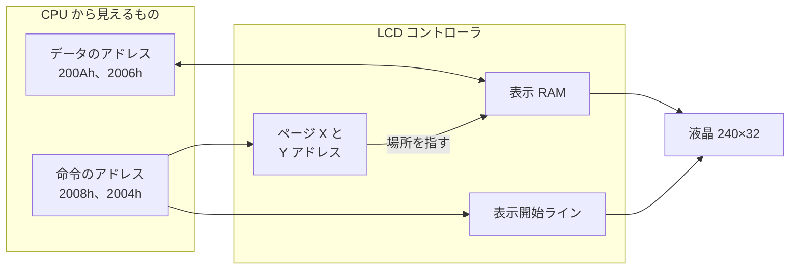
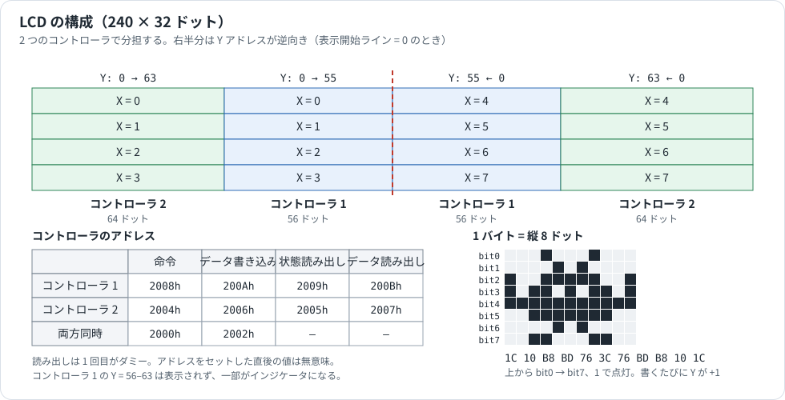
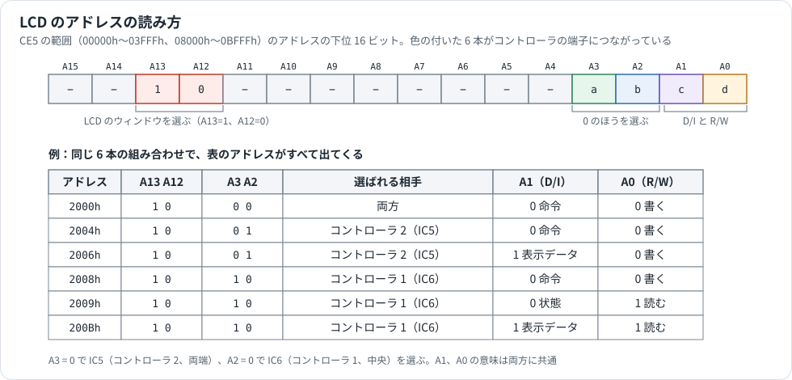
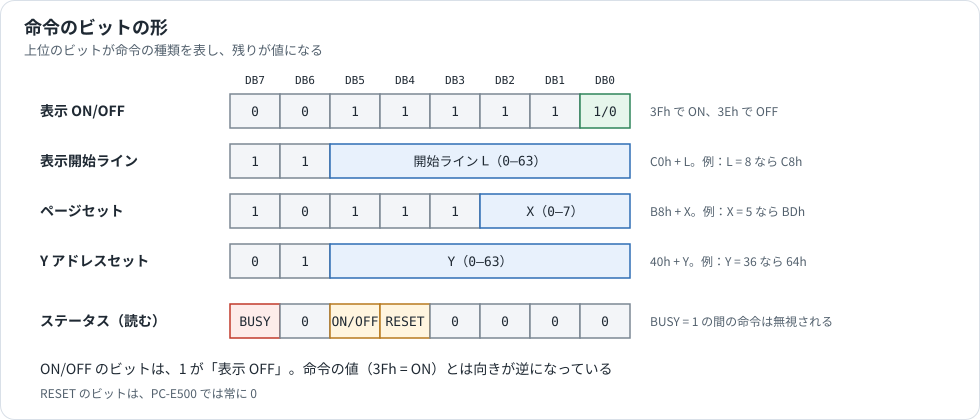
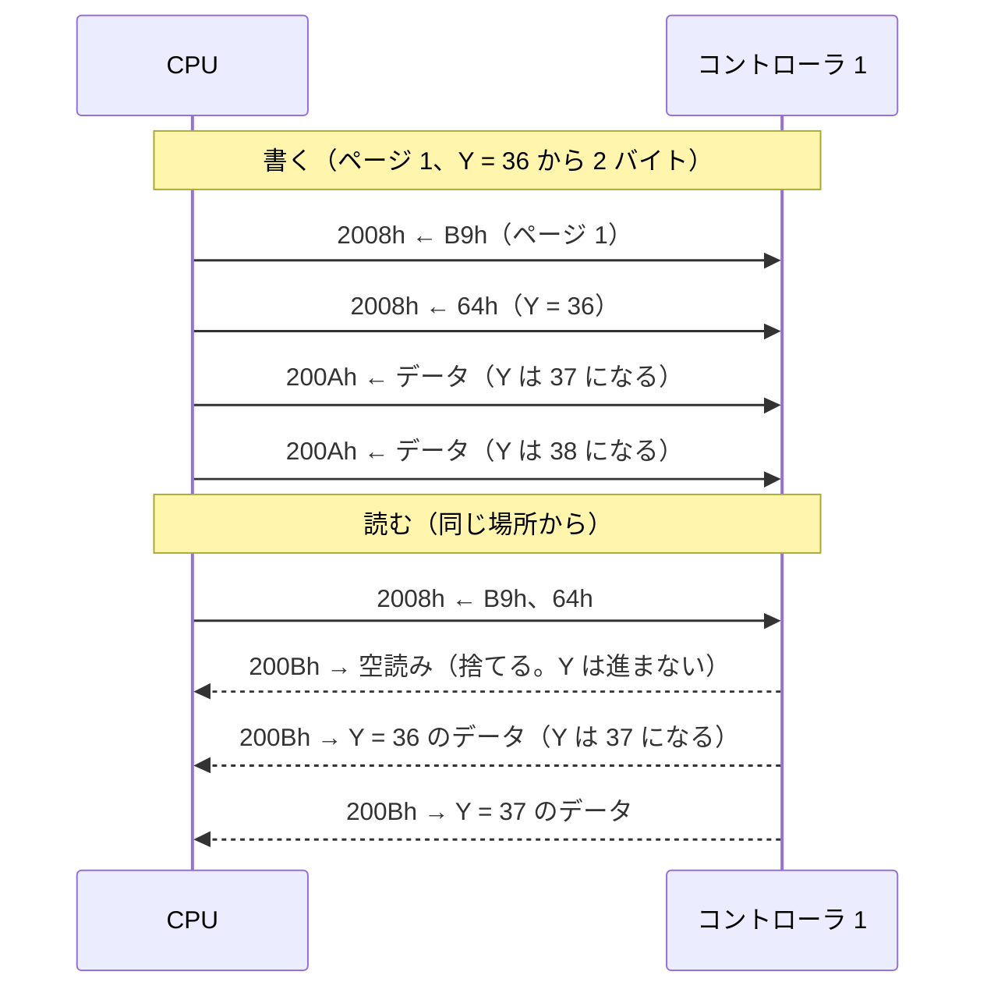
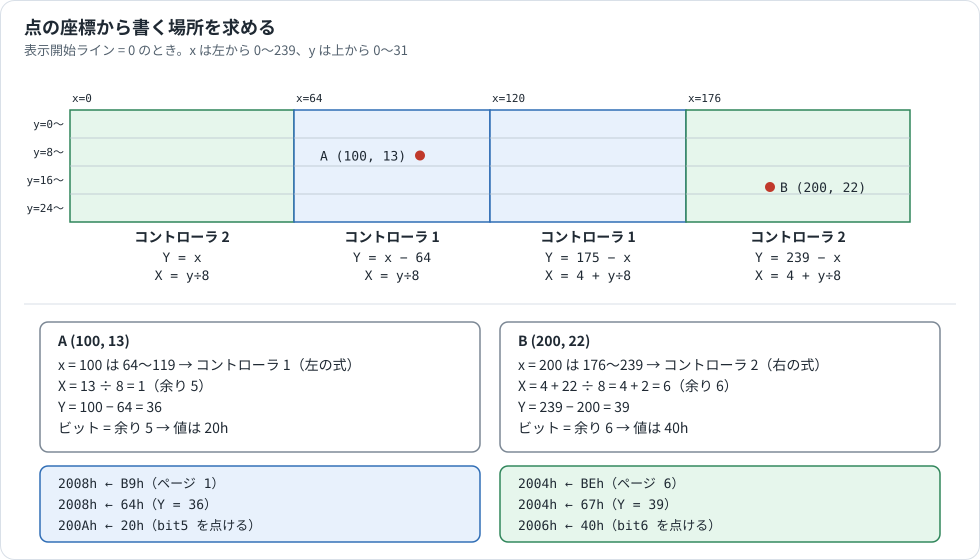
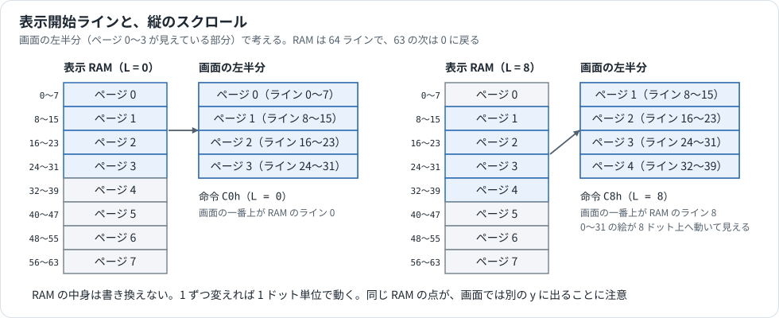
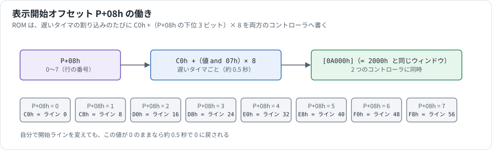
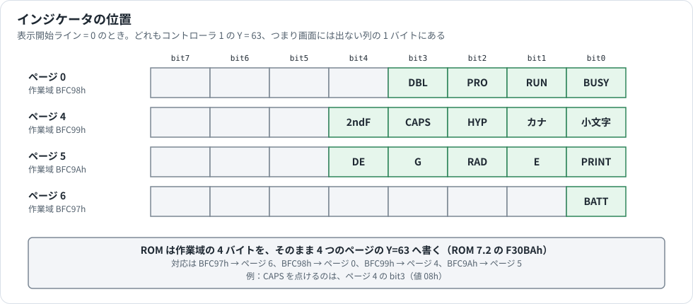

# 4. 液晶（LCD）

この章は、PC-E500 シリーズの液晶と、それを動かす 2 つの LCD コントローラを説明します。IOCS を使うより速く絵を動かしたいとき、避けて通れない部品です。順に読むと、BASIC の `POKE` 1 つで画面が消える理由から、好きな点を 1 つだけ光らせる計算、1 ドットずつ滑らかに動くスクロールまで分かります。部品と配線、アドレス、命令、表示 RAM の並び、インジケータ、作業域、操作例を説明します。

[目次へ戻る](README.md)

## この章で分かること

- 240×32 ドットの画面を、2 つのコントローラがどう分担しているか
- `2000h` 番台のアドレス 1 つ 1 つが、何を意味しているか
- 7 つの命令の形と、読み書きの手順（空読みが要る理由）
- 画面の点 (x, y) から、書くアドレス、ページ、Y アドレス、ビットを求める方法
- 表示開始ラインによるスクロールと、インジケータの点け方
- BASIC と機械語の操作例、ROM が使う作業域

## 4.0 はじめに

ふつうの表示には IOCS を使います（[IOCS と FCS](11_IOCS.md)）。ゲームなどで速く描きたいときは、ここにある方法でコントローラを直接操作します。文字のドットは [フォント](13_FONT.md) にあります。

### 「メモリに書けば映る」ではない

パソコンの多くは、画面の絵をメモリの中に持っていて、CPU がそこへ書くと画面に出ます。この機械は違います。画面の絵（表示 RAM）は**コントローラという別の部品の中**にあり、CPU からは小さな窓口しか見えません。窓口は、命令を出す口とデータを渡す口の 2 つです。

たとえるなら、倉庫の中に直接入るのではなく、受付の係に「3 番の棚の、左から 10 番目から」と場所を伝え、そのあと荷物を 1 個ずつ渡していく形です。係は荷物を受け取るたびに、次の場所へ自動で移ります。



### 言葉

| 言葉 | 意味 |
|---|---|
| コントローラ | 表示 RAM を持ち、液晶を動かす IC（HD61202）。2 つある |
| ページ（X アドレス） | 縦 8 ドットをひとまとまりにした段。0〜7 |
| Y アドレス | ページの中の横の位置。0〜63 |
| 表示開始ライン | 画面の一番上に出す RAM のライン。0〜63 |

> [!WARNING]
> コントローラの資料では、**X が縦の段、Y が横の位置**です。数学の座標や BASIC の (x, y) とは逆なので、この章では画面の座標を小文字の x、y、コントローラのアドレスを大文字の X、Y で書き分けます。

特に断りのないアドレスと命令は書籍の値で、実機で確かめたものではありません。（公式）（回路図）などの印の意味は、章末の「情報源と確度」にあります。

## 4.1 全体像

画面は横 240、縦 32 ドットで、左から右へ 4 つの帯に分かれます。両端の 64 ドットずつをコントローラ 2、中央の 56 ドットずつをコントローラ 1 が受け持ちます。



| 項目 | 内容 | 根拠 |
|---|---|---|
| 表示 | 240×32 ドット。文字は 40 桁 × 4 行 | 公式 |
| カラムドライバ | HD61202 × 2（仕様は [IC チップ](08_IC_CHIPS.md) §8.5） | 回路図 |
| コモンドライバ | HD61203 | 回路図 |
| 液晶 | LF7448G（PC-E500）、FSTN の LF7766Q（PC-E500S） | ブロック図、回路図 |

カラムドライバは縦の列を、コモンドライバは横の行を動かす部品です。HD61202 は列を動かしながら、その列に出す絵（表示 RAM）も自分で持っています。

## 4.2 配線

アドレスの意味は、配線を見ると分かります。覚えにくい `2008h` や `2006h` も、6 本の線の組み合わせにすぎません。

HD61202 の端子は次のようにつながっています（回路図）。

| HD61202 の端子 | IC5（`Y1`〜`Y64`） | IC6（`Y'1`〜`Y'56`、`Y'64`） |
|---|---|---|
| `CS3`（High で選択） | A13 | A13 |
| `CS2`（Low で選択） | A12 | A12 |
| `CS1`（Low で選択） | A3 | A2 |
| `R/W` | A0 | A0 |
| `D/I` | A1 | A1 |
| `E` | CE5 | CE5 |
| `DB0`〜`DB7` | データバス | データバス |

この配線から、アドレスの意味が読めます。

| アドレスのビット | 意味 |
|---|---|
| A0 | 1 で読み出し |
| A1 | 1 で表示データ、0 で命令 |
| A2 | 0 で IC6 を選ぶ |
| A3 | 0 で IC5 を選ぶ |
| A12、A13 | `A13=1`、`A12=0` のとき有効 |



**例**: `200Bh` を 2 進にすると、下位 4 ビットは 1011b です。A3 = 1（IC5 は選ばない）、A2 = 0（IC6 を選ぶ）、A1 = 1（表示データ）、A0 = 1（読む）なので、「コントローラ 1 の表示データを読む」アドレスだと分かります。`2000h` は A3 も A2 も 0 なので、両方のコントローラに同じ命令が届きます。

**番号の付け方に注意してください。** 本資料の「コントローラ 1」（`2008h`）は IC6、「コントローラ 2」（`2004h`）は IC5 です。サービスマニュアルの ① が IC5、② が IC6 なので、番号が逆です。

| 本資料 | IC | サービスマニュアル | 命令のアドレス | 受け持ち |
|---|---|---|---|---|
| コントローラ 1 | IC6 | ② | `2008h` | 中央 |
| コントローラ 2 | IC5 | ① | `2004h` | 両端 |

**ほかのアドレスにも見えるはずです。** **CE5 の範囲は `00000h`〜`03FFFh` と `08000h`〜`0BFFFh` です**（公式）。`2000h` の代わりに `A000h` でも同じコントローラが見えるはずです。ROM は起動時に `0A000h` へ `3Eh` を書いて表示を止め（[起動、割り込み、タイマ、音](10_SYSTEM.md) §10.2）、ふだんの表示の処理でも `0A000h`、`0A002h`、`0A006h` を使います（コード、7.2 の `F2E3Ch`〜`F2E90h`）。`0A000h` は A13 = 1、A12 = 0 なので、上の配線の表とも合います。

CPU の資料には、LCD のウィンドウのアクセスが遅くなるとあります（[CPU（SC62015）](02_CPU.md) §2.5.3）。

**表示の電源（回路図）**

液晶には、論理回路の電源のほかに、コントラストを決める電圧が要ります。次の部品が作っています。

| 部分 | 内容 |
|---|---|
| Q3（DTA114YK） | CPU の VDD（5 番ピン）で VCC から VCC' を作る |
| Q1、T1 | VCC' からトランスで VEE を作る |
| VR1 | コントラストの調整 |
| V1〜V6 | 抵抗の分圧で作る液晶の電圧 |

## 4.3 アドレス

表示は LCD コントローラにデータを送ることで行います。画面を 2 つのコントローラで分担していて、命令は外部メモリの次のアドレスへ書きます（または読みます）。

| # | 命令 | コントローラ 1 | コントローラ 2 | 同時アクセス |
|---|---|---|---|---|
| 1 | 表示 ON/OFF | 2008h | 2004h | 2000h |
| 2 | 表示開始ライン | 2008h | 2004h | 2000h |
| 3 | ページ（X アドレス）セット | 2008h | 2004h | 2000h |
| 4 | Y アドレスセット | 2008h | 2004h | 2000h |
| 5 | ステータスリード | 2009h | 2005h | — |
| 6 | 表示データ書き込み | 200Ah | 2006h | 2002h |
| 7 | 表示データ読み出し | 200Bh | 2007h | — |

「同時アクセス」のアドレスに書くと、2 つのコントローラに同じ値が届きます。画面全体を消す、塗るといった処理では、書く回数が半分で済みます。読み出しには同時のアドレスがありません。

## 4.4 命令

コントローラへの命令は 1 バイトで、7 種類あります。上位のビットが命令の種類、残りが値です。



| # | 命令 | DB7 | DB6 | DB5 | DB4 | DB3 | DB2 | DB1 | DB0 | 16進 | 機能 |
|---|---|---|---|---|---|---|---|---|---|---|---|
| 1 | 表示 ON/OFF | 0 | 0 | 1 | 1 | 1 | 1 | 1 | 1/0 | 3Fh / 3Eh | 全表示の ON(1)/OFF(0)。表示 RAM の内容と内部状態は変化しない |
| 2 | 表示開始ライン | 1 | 1 | ←開始ライン (0–63)→ | | | | | | C0h + L | 表示の最上段に表示される RAM のラインを決める |
| 3 | ページセット | 1 | 0 | 1 | 1 | 1 | ←ページ (0–7)→ | | | B8h + X | RAM のページ（X アドレス）をページレジスタにセット |
| 4 | Y アドレスセット | 0 | 1 | ←Y アドレス (0–63)→ | | | | | | 40h + Y | RAM の Y アドレスを Y アドレスカウンタにセット |
| 5 | ステータスリード | BUSY | 0 | ON/OFF | RESET | 0 | 0 | 0 | 0 | — | BUSY 1: 内部動作中 / 0: READY。ON/OFF 1: 表示 OFF / 0: 表示 ON。RESET 1: リセット / 0: ノーマル（PC-E500 では常に 0） |
| 6 | 表示データ書き込み | ←Write Data→ | | | | | | | | — | DB0(LSB)–DB7(MSB) を、指定アドレスの表示 RAM に書く。アクセス後 Y アドレスは +1 |
| 7 | 表示データ読み出し | ←Read Data→ | | | | | | | | — | 表示 RAM のデータを読み出す。アクセス後 Y アドレスは +1 |

使うときに気を付けることは 2 つです。

**1. BUSY。** BUSY が 1 のときに送った命令は無視されます。厳密には BUSY=0 を確認してから送るべきですが、実用上あまり厳密でなくてもかまいません。

**2. 空読み。** **表示データ読み出しは、X/Y アドレスをセットした直後の 1 回目は無意味なデータが返る**ので、ダミーリード（空読み）が 1 回必要です（このとき Y アドレスはインクリメントされません）。

書くときと読むときの手順を並べると、次のようになります。



**例（命令の値）**

| したいこと | 計算 | 書く値 |
|---|---|---|
| 表示を消す | | 3Eh |
| 開始ラインを 8 にする | C0h + 8 | C8h |
| ページを 5 にする | B8h + 5 | BDh |
| Y アドレスを 36 にする | 40h + 24h | 64h |

## 4.5 表示 RAM

表示 RAM は、縦 8 ドットを 1 バイトにした区画の集まりです。

- データ 1 バイトは縦 8 ドット分です。**上から下へ ビット 0 → ビット 7** の順です。1 = 点灯、0 = 消灯。
- 1 コントローラにつきページ（X アドレス）は 0–7 の 8 ページ、Y アドレスは 0–63 です。
- 画面（240×32 ドット）の割り当ては §4.1 の図のとおりです（表示開始ライン = 0 のとき）。
- コントローラ 2 は画面の**両端 64 ドットずつ**、コントローラ 1 は**中央の 56 ドットずつ**を担当します。
- 画面左半分は X = 0–3、右半分は X = 4–7 です。右半分では Y アドレスが**逆方向**（右端が Y=0）に並びます。
- コントローラ 1 の Y = 56–63 は画面には表示されません。ただし一部が画面上部の**インジケータ**に割り当てられています（§4.7）。

1 つのコントローラの表示 RAM は 8 ページ × 64 = 512 バイト、2 つで 1,024 バイトです。画面に見えるのは 240 × 32 ÷ 8 = 960 バイトなので、64 バイト分が余ります。コントローラ 1 の Y = 56〜63（8 × 8 ページ = 64 バイト）が、ちょうどその余りです。

### 4.5.1 点の場所を求める

点 (x, y) を描く場所は、x の範囲で 4 通りに分かれます（表示開始ライン = 0 のとき）。`÷` は小数点以下を切り捨てる割り算です。

| x | コントローラ | 命令 / データのアドレス | ページ X | Y アドレス |
|---|---|---|---|---|
| 0〜63 | 2 | `2004h` / `2006h` | y ÷ 8 | x |
| 64〜119 | 1 | `2008h` / `200Ah` | y ÷ 8 | x − 64 |
| 120〜175 | 1 | `2008h` / `200Ah` | 4 + y ÷ 8 | 175 − x |
| 176〜239 | 2 | `2004h` / `2006h` | 4 + y ÷ 8 | 239 − x |

ビットは y を 8 で割った余りです。1 バイトは縦 8 ドットをまとめて持っているので、1 点だけを変えるには、読んで、そのビットを変えて、書き戻します。



**例（端の点）**: 画面の四隅は次のとおりです。

| 点 | コントローラ | ページ X | Y アドレス | ビット |
|---|---|---|---|---|
| (0, 0) 左上 | 2 | 0 | 0 | 0 |
| (0, 31) 左下 | 2 | 3 | 0 | 7 |
| (239, 0) 右上 | 2 | 4 | 0 | 0 |
| (239, 31) 右下 | 2 | 7 | 0 | 7 |

左右の端がどちらも Y = 0 です。右半分では、書くたびに Y が進むと、画面では**左へ**進むことになります。文字や絵を右半分に出すときは、データを逆順に送るか、1 バイトごとに Y を設定し直します。IOCS で読んだ表示のデータでも、右半分の桁は逆順になっています（[IOCS と FCS](11_IOCS.md)）。

## 4.6 表示開始ライン

コントローラは縦方向に 1 ドット単位で画面をずらせます。「表示開始ライン」は画面の一番上に表示される RAM のラインを指定します（0–63 でラップ）。表示 RAM を書き換えずに済むので、縦のスクロールがとても軽くなります。



BASIC 等が動作した後は開始ラインが 0 とは限らないので、位置を固定して描画したいときは先に `C0h` を書いて開始ライン = 0 にしておきます。開始ラインが変わるとインジケータの割り当てアドレスも変わります。

**ROM も開始ラインを書きます。** ROM は、遅いタイマの割り込みのたび（約 0.5 秒ごと）に、IOCS の作業域の `P+08h`（[メモリ](03_MEMORY.md) §3.5）から開始ラインを作って、2 つのコントローラに書き直します（コード、7.2 の `F2E3Ch`）。



`P+08h` を 1 にして待つと、画面の文字が、左半分も右半分も 1 行ずつ上に動きました（実験、ROM 7.2）。1 ドット単位のスクロールを続けたいときは、自分の命令が 0.5 秒で上書きされないように、遅いタイマの割り込みを止めます（§4.8.2 のスクロールの例は、IMR のビット 1 を 0 にしています）。

**右半分はライン 32 から始まります。** 右半分はページ 4〜7、つまりライン 32〜63 です。開始ラインが L のとき、画面の上から y 番目（0〜31）に出るラインは次のとおりです。

| 半分 | 出るライン | L = 8 のときの一番下（y = 31） |
|---|---|---|
| 左（x = 0〜119） | (L + y) mod 64 | 39（ページ 4） |
| 右（x = 120〜239） | (32 + L + y) mod 64 | 71 mod 64 = 7（ページ 0） |

そのため、スクロールで画面の下から出てくるのは、左半分では「右半分の絵の左右を逆にしたもの」、右半分では「左半分の絵の左右を逆にしたもの」です。`L0`〜`L3` を左端、`R0`〜`R3` を右端に出して `P+08h` を 1 にすると、左下に `R0`、右下に `L0` が、どちらも鏡に映した向きで出ました（実験、ROM 7.2）。はみ出す所をあらかじめ消しておくか、送る前に書き換えておくと、きれいに動きます。

**例**: 開始ラインが L のとき、画面の上から y 番目に出るのは、左半分では RAM のライン (L + y) を 64 で割った余りです。L = 60 なら、画面の一番上がライン 60、4 ドット下がライン 0（60 + 4 = 64 → 0）になります。

## 4.7 インジケータ

画面の上に並ぶ `RUN`、`CAPS` などの記号も、コントローラ 1 の表示 RAM につながっています。開始ライン = 0 のとき、Y アドレスはすべて 63 です。



| ビット＼ページ X | 0 | 4 | 5 | 6 |
|---|---|---|---|---|
| 0 | BUSY | 小文字 | PRINT | BATT |
| 1 | RUN | カナ | E | |
| 2 | PRO | HYP | RAD | |
| 3 | DBL | CAPS | G | |
| 4 | | 2ndF | DE | |

インジケータは通常のドットと同じに扱われます（ページ X、Y=63 の該当ビットを 1 にすると点灯します）。

ROM は §4.9 の作業域 `BFC97h`〜`BFC9Ah` を 1 バイトずつ、ページ 6、0、4、5 の Y=63 にそのまま書きます（ROM 7.2 の `F30BAh`）。`BATT` は `BFC97h` の bit0 なので、ページ 6 の bit0 です。

**例（CAPS を点ける）**: ページ 4 の bit3 なので、次のように書きます。同じバイトの他のビット（`小文字`、`カナ`、`HYP`、`2ndF`）は 0 になって消えます。

```basic
10 POKE &2008,&BC   ' ページ = 4（B8h + 4）
20 POKE &2008,&7F   ' Y = 63（40h + 3Fh）
30 POKE &200A,&08   ' bit3 = CAPS
```

`LOGIC`、`ASMBL`、`TEXT`、`Sign` の記号は液晶の配線図にありますが、PC-E500 では使っていません（公式）。

## 4.8 操作例

### 4.8.1 BASIC

BASIC からは `POKE` と `PEEK` で操作できます。次の 4 つを順に読むと、表示の ON/OFF、書き込み、読み出し、全画面の塗りつぶしが分かります。

```basic
' 表示 OFF / ON
POKE &2000,&3E      ' OFF（キー入力は可能）
POKE &2000,&3F      ' ON

' コントローラ1のページ0, Y=0 から黒い棒を書く
10 POKE &2008,&B8   ' ページ(Xアドレス)=0
20 POKE &2008,&40   ' Yアドレス=0
30 FOR I=0 TO 63
40 POKE &200A,&FF   ' 書き込むデータ（Yは自動で+1）
50 NEXT

' 読み出し（ダミーリードが必要）
10 POKE &2008,&B8
20 POKE &2008,&40
30 PRINT HEX PEEK &200B   ' ダミーリード
40 PRINT HEX PEEK &200B   ' 読みたい値

' 画面全体の塗りつぶし
10 POKE &2000,&B8
20 POKE &2000,&40
30 FOR J=0 TO 7
40 POKE &2000,&B8+J
50 FOR I=0 TO 63
60 POKE &2002,&FF   ' 両コントローラに同時書き込み
70 NEXT
80 NEXT
```

2 番目の例は Y = 0 から 63 まで 64 バイトを書きます。コントローラ 1 で画面に見えるのは Y = 0〜55 の 56 バイトなので、棒の長さは 56 ドットです。残りの 8 バイトは画面の外で、最後の Y = 63 はページ 0 のインジケータの場所にあたります（§4.7）。全画面の塗りつぶしも、インジケータの場所まで FFh を書きます。

| 例 | アドレス | 見るところ |
|---|---|---|
| 表示 OFF / ON | `2000h` | 両方のコントローラに同時に効く。表示 RAM の中身は変わらない |
| 黒い棒 | `2008h`、`200Ah` | 場所を決めるのは 1 回だけ。Y は自動で進む |
| 読み出し | `200Bh` | 1 回目は捨てる |
| 塗りつぶし | `2000h`、`2002h` | ページを 0〜7 と変えながら、両方に 64 バイトずつ書く |

ビットパターンの例として、11×8 ドットの小さな家を描いてみます。`00h, 10h, F8h, FCh, 3Eh, 3Fh, 3Eh, FCh, F8h, 10h, 00h` を順に 200Ah（または 2006h / 2002h）へ書きます。

この 11 バイトを絵に直すと、次のようになります（`#` が点灯）。縦 1 列が 1 バイト、上がビット 0 です。

```text
        00 10 F8 FC 3E 3F 3E FC F8 10 00
bit0     .  .  .  .  .  #  .  .  .  .  .
bit1     .  .  .  .  #  #  #  .  .  .  .
bit2     .  .  .  #  #  #  #  #  .  .  .
bit3     .  .  #  #  #  #  #  #  #  .  .
bit4     .  #  #  #  #  #  #  #  #  #  .
bit5     .  .  #  #  #  #  #  #  #  .  .
bit6     .  .  #  #  .  .  .  #  #  .  .
bit7     .  .  #  #  .  .  .  #  #  .  .
```

右から 1 列目と左から 1 列目は 00h（何も点けない列）なので、家の左右に 1 ドットずつすき間ができます。屋根の先は中央の列の bit0、つまり一番上の点です。

**速さを体で知る。** 『ポケコン活用研究』（p.205）は、場所を決めずに書き続ける小さな例から始めています。同じ考え方の例です。

```basic
10 FOR I=0 TO 55
20 POKE &200A,&55     ' 中央（コントローラ 1）: 1 ドットおき
30 POKE &2006,&AA     ' 両端（コントローラ 2）: その逆
40 NEXT I
```

ページも Y アドレスも決めていないので、直前に ROM が文字を書いた続きの場所に出ます。走らせるたびに模様の場所が変わるのはそのためで、決まった場所に描くには、まず §4.4 の 3 と 4 の命令で場所を決めます。`&2002` に書けば、両方のコントローラへ一度に同じ値が入ります。

### 4.8.2 機械語

画面の塗りつぶし：

```asm
        MV   A,40H          ; Yアドレス=0
        MV   [2000H],A
        MV   A,8            ; 8ページ
L1:     MV   B,A
        OR   A,0B8H         ; ページセット命令 B8h + X（下記注）
        MV   [2000H],A
        MV   IL,64
        MV   A,0FFH
L2:     MV   [2002H],A      ; 両コントローラへ同時書き込み
        DEC  IL
        JRNZ L2
        EX   A,B
        DEC  A
        JRNZ L1
        RETF
```

注：原著の掲載どおりです。A=8 のとき `OR A,0B8H` は B8h（ビット 3 が重なる）となり、以降 7,6,…,1 を OR してページ 7→1 と進みます。

つまり、処理するページの順は 0、7、6、5、4、3、2、1 で、8 ページすべてが 1 回ずつ塗られます。

| 部分 | していること |
|---|---|
| 最初の 2 行 | Y アドレスを 0 にする（両方のコントローラ） |
| `L1` から | ページを選ぶ。A をループの数え方にも使うので、B に保存する |
| `L2` のループ | FFh を 64 回書く。Y は自動で進み、64 回で元の 0 に戻る |
| `EX A,B` から | 保存しておいた数を 1 減らし、0 になるまで繰り返す |

スクロール（表示開始ラインを 1 ずつ進める。BREAK キーで終了）：

```asm
        PUSHU IMR
        PRE  30H
        AND  (0FBH),0FDH    ; IMR ビット1 をクリア（割り込みマスク）
        MV   A,00H
        MV   X,0C0H         ; ループ回数
L1:     OR   A,0C0H         ; 表示開始ライン命令 C0h + line
        MV   [2000H],A
        INC  A
        PRE  30H
        TEST (0FFH),08H     ; BREAK キー（FFh ビット3）
        JRNZ END
        MV   IL,00H
        WAIT
        DEC  X
        JRNZ L1
END:    POPU IMR
        RETF
```

C0h（192）回のループで開始ラインは 64 で 1 周するので、BREAK を押さなければ 3 周します。`OR A,0C0H` は、A が FFh から 00h に戻ったときにも命令の形（上位 2 ビットが 11）を保つためです。

表示 ON/OFF の点滅（BASIC）：

```basic
10 FOR I=0 TO 9
20 POKE &2000,&3E
30 FOR J=0 TO 100:NEXT
40 POKE &2000,&3F
50 FOR J=0 TO 100:NEXT
60 NEXT
```

## 4.9 作業域

ROM が画面に使うアドレスです。コントローラを直接操作せず、ROM の表示と合わせたいときに使います。値は ROM 3.2、32 KB の起動直後です（実験）。出典の p は Technical Reference Manual です。

| アドレス | 内容 | 値 |
|---|---|---|
| `BFC9Bh`、`BFC9Ch` | カーソルの x、y | 0、0 |
| `BFC9Dh`、`BFC9Eh` | 表示できる桁数、行数。桁数を減らすと、IOCS の 41h はその外に出せない（57h は出せる） | 28h、04h |
| `BFC27h`、`BFC28h` | `STDO:`、`SCRN:` のデバイスが次に文字を出す x、y | 0、0 |
| `BFCA1h` | LCD のモード。bit6 を 1 にすると、その後に出す文字が反転（公式 p.41、実験）。手引書は 00h で白地に黒、FFh で黒地に白 | 00h |
| `BFC96h` | 点の操作。0 点灯、1 消去、2 反転 | 01h |
| `BFC2Ah` | 線と四角の 16 ドットのパターン（2 バイト）。描き終わると「次に使う所」になる | 9Fh 9Fh |
| `BFC29h` | bit6 を 1 にすると、制御コードを働かせずに字形として表示（公式 p.42、実験） | |
| `BFC97h` | `BATT` の表示（00h、01h。手引書） | |
| `BFC99h` | bit3 が `CAPS`（手引書） | |
| `BFC9Ah` | bit0 が `PRINT`（手引書） | |

**例**: 画面の幅 28h は 40 桁、高さ 04h は 4 行です。1 文字は幅 6 ドット（[フォント](13_FONT.md)）で 40 × 6 = 240、高さ 8 ドットで 4 × 8 = 32 となり、240×32 ドットの画面と合います。

カーソルの形と LCD の表示開始オフセットは IOCS の作業域にあります（[メモリ](03_MEMORY.md) §3.5）。

## まとめ

| 覚えること | 値 |
|---|---|
| 画面 | 240×32 ドット。両端 64 ドットずつがコントローラ 2、中央 56 ドットずつがコントローラ 1 |
| 命令のアドレス | コントローラ 1 は `2008h`、2 は `2004h`、両方は `2000h` |
| データのアドレス | 書き込みは `200Ah`、`2006h`、`2002h`。読み出しは `200Bh`、`2007h` |
| 命令 | 3Fh / 3Eh 表示、C0h + L 開始ライン、B8h + X ページ、40h + Y 横の位置 |
| 1 バイト | 縦 8 ドット。上がビット 0 |
| 右半分 | ページ 4〜7、Y は右端が 0 で逆向き |
| 読み出し | 場所を決めた直後の 1 回は捨てる |
| インジケータ | コントローラ 1 の Y = 63、ページ 0、4、5、6 |

## 情報源と確度

| 表記 | 情報源 |
|---|---|
| **書籍** | 『ポケコン活用研究』第 10 章（pp.200–209）。PC-E500 と PC-1480U を対象にしています。p.205 が表示 ON/OFF と書き込み、p.206 がページと開始ライン、p.207 が読み出し、ステータス、インジケータ、p.208 が命令の表、p.209 が例のプログラム |
| **公式** | PC-E500 Technical Reference Manual（p.41〜42）、PC-E500 / PC-E500S Service Manual |
| **回路図** | Service Manual の回路図と LCD の配線図を読んだもの |
| **手引書** | Systemhandbuch（ドイツ語、Fischel GmbH） |
| **実験** | エミュレータで読んだ値 |

特に断りのないアドレスと命令は書籍の値で、実機で確かめたものではありません。

## 次に読むもの

- [フォント](13_FONT.md): 画面に出す文字の絵
- [IOCS と FCS](11_IOCS.md): コントローラを直接触らずに描く方法
- [IC チップ](08_IC_CHIPS.md) §8.5: HD61202 と HD61203 の仕様
- [メモリ](03_MEMORY.md) §3.8: 画面以外の固定のアドレス
