# 5. カードスロット

この章は、PC-E500 シリーズの裏面にあるカードスロットを、端子から BASIC の使い方まで通して説明します。カードを自作したい人には端子と寸法、カードが認識されずに困っている人には ROM の判定の手順、メモリを増やして使いたい人には `MEM$` の 3 つの設定が役に立ちます。途中で、カードを挿し替えたとき内蔵 RAM まで消えてしまう場面も出てきます。その場面を知っておくだけでも、この章を読む価値があります。

[目次へ戻る](README.md)

## この章で分かること

- スロットの 33 本のピンと両端のバネ、カードが見えるアドレス
- カバーを外すと電源が切れる仕組み
- 取り付けと取り外し、電池交換、容量の大きいカードへの替え方
- 電源を入れるたびに ROM が行う、カードの判定と容量の測り方
- `MEM$` の 3 つの設定の違いと、`B` で 2 つのメモリがつながって見える理由
- 2 種類の書き込み保護と、起動の動作を変える `RESET.KEY`
- ROM カード、純正、他社、自作のカードの資料

## 5.0 はじめに

カードスロットは、名刺の半分ほどの薄いカードを挿して、メモリを増やすためのものです。RAM カードには電池が入っていて、本体から外しても内容が残ります。つまり RAM カードは、増設メモリであると同時に、持ち運べるディスクでもあります。

操作説明書は、カードの使い方を 3 つ挙げています（公式 p.20）。メモリを広げる、プログラムを入れて `F:` のカードとして持ち歩く、プログラムとデータを入れて `MEM$="S2"` で丸ごと切り替える、の 3 つです。次の表の 3 行がこれに当たります。

| 使い方 | BASIC から見ると | 節 |
|---|---|---|
| ファイルを保存する | ドライブ `F:` | §5.7 |
| プログラムと変数を置く | `MEM$="S2"` | §5.7 |
| 内蔵 RAM とつないで広く使う | `MEM$="B"` | §5.7.3 |
| ROM カードを挿す | アドレス `10000h` から | §5.10 |

カードを挿して電源を入れたあとの流れは、おおまかに次のとおりです。

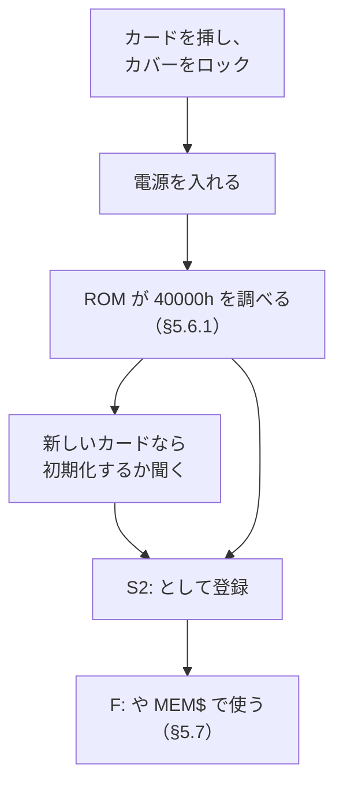

カードの中のブロックと RAM ディスク（`F:`）の形式は [メモリ](03_MEMORY.md) §3.3、§3.6、バージョンごとのアドレスは [ROM バージョンの違い: 配置](23_ROM_VERSIONS_MAP.md) §23.11 にあります。（公式）（実験）などの印の意味と、試していないことは、章末の「情報源と確度」にあります。アドレスは断らなければ ROM 5.3 のものです。

## 5.1 全体像

カードのピンは、アドレス、データ、書き込み、電源、そしてカードを選ぶ信号（チップセレクト）からなります。アドレスとデータの線は CPU のバスに直結していて、チップセレクトが出たときだけカードが応答します。

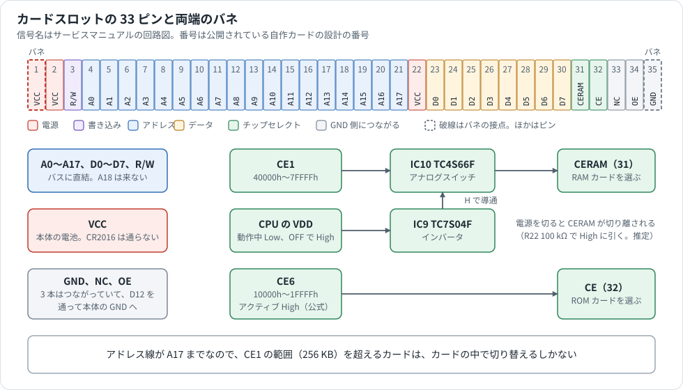

1 つのコネクタに、RAM カード用と ROM カード用の 2 本のチップセレクトが来ています。回路図の名前は「RAM / ROM CARD SLOT」です。

| 信号 | CPU のピン | 範囲 | 使う場面 |
|---|---|---|---|
| `CERAM` | CE1 | `40000h`〜`7FFFFh` | RAM カード。スロット `S2:`、ドライブ `F:` |
| `CE` | CE6 | `10000h`〜`1FFFFh` | ROM カード |

PC-E500 と PC-E500S の回路図で、端子の並びと CE1、CE6 のつなぎ方は同じです。PC-E650 と PC-U6000 は PC-E500S のサービスマニュアルに含まれています。

## 5.2 端子

ピンは 2〜34 番の 33 本です。両端の 1 番（VCC）と 35 番（GND）はピンではなく、カードに接触するバネです。バネの形は実機の持ち主の話で、分解して確かめてはいません。自作カードの設計でも、この 2 か所だけパッドが太くなっています。

信号名は回路図の表記、番号は自作カードの設計の番号です。回路図の並びと自作カードの並びは一致します。向きは本体から見ています。

| 番号 | 信号 | 向き | 内容 | 自作カードでの扱い |
|---|---|---|---|---|
| 1 | VCC | 出力 | 本体の電源。バネの接点 | ダイオードを通してカードの電源へ |
| 2 | VCC | 出力 | 本体の電源 | ダイオードを通してカードの電源へ |
| 3 | R/W | 出力 | Low で書き込み | スイッチと 47 kΩ のプルアップを通して `/WE` へ |
| 4〜20 | A0〜A16 | 出力 | アドレス | SRAM へ |
| 21 | A17 | 出力 | アドレス | HC138 で 2 個の SRAM を選ぶ |
| 22 | VCC | 出力 | 本体の電源 | 未接続 |
| 23〜30 | D0〜D7 | 入出力 | データ | SRAM へ |
| 31 | CERAM | 出力 | RAM カードの選択 | HC138 の `G1` へ。High で選択。47 kΩ で GND へ |
| 32 | CE | 出力 | ROM カードの選択（CE6） | 未接続 |
| 33 | NC | | 本体側は GND の線につながる | 未接続 |
| 34 | OE | | 本体側は GND の線につながる | 未接続。SRAM の `/OE` は GND に固定 |
| 35 | GND | | D12（RB400D）を通して本体の GND へ。バネの接点 | |

**CE6 の論理:** 2 冊のサービスマニュアルの端子の表は、どちらも CE6 を「ROM card chip select（Active High）」としています（PC-E500 p.4、PC-E500S p.4、公式）。[PockEmul](https://github.com/matsumo/PockEmul) のソースのコメントは負論理としていますが、これはエミュレータの注釈です。本書は公式の表（High で選択）を採ります。

**機械的な寸法**（自作カードのフットプリント）

| 項目 | 値 |
|---|---|
| ピンが当たるパッド（2〜34 番） | 33 個、ピッチ 1.27 mm、0.64×4.54 mm |
| バネが当たるパッド（1、35 番） | 8×3 mm。中心から ±22.86 mm |
| 基板 | 41.9×54.1×0.8 mm |
| 純正カードの大きさ | 54×42×2.8 mm（個人） |

> [!WARNING]
> **逆向きに挿してはいけません。** マニュアルは、反対の端を入れるとショートして本体が壊れることがあると書いています（公式）。

## 5.3 アドレス

### 5.3.1 RAM カード

カードのアドレスは `40000h` から始まります（公式）。容量が大きいほど、上のアドレスまで続きます。

| 容量 | 範囲 | ヘッダの容量（2 KB 単位） |
|---|---|---|
| 2 KB | `40000h`〜`407FFh` | 01h |
| 4 KB | `40000h`〜`40FFFh` | 02h |
| 8 KB | `40000h`〜`41FFFh` | 04h |
| 16 KB | `40000h`〜`43FFFh` | 08h |
| 32 KB | `40000h`〜`47FFFh` | 10h |
| 64 KB | `40000h`〜`4FFFFh` | 20h |
| 128 KB | `40000h`〜`5FFFFh` | 40h |
| 256 KB | `40000h`〜`7FFFFh` | 80h |

8〜64 KB の範囲はサービスマニュアルの図、2 KB と 4 KB は同じマニュアルの検査の説明にあります。128 KB と 256 KB は他社のカードの容量で、ヘッダの値は実験です。

**例**: 16 KB のカードは 16 ÷ 2 = 8 なので、ヘッダの容量は 08h です。終わりのアドレスは `40000h` + 16 × 400h − 1 = `43FFFh` です。

- 容量より上のアドレスには、同じ内容が繰り返し見えます（ミラー）。ROM はこれを利用して容量を測ります（§5.6.2）。
- **スロットに来るアドレスは A17 までです**（回路図）。CE1 の範囲も 256 KB なので、1 度に見えるのは 256 KB までです。512 KB の他社カードが 256 KB の領域をスイッチで切り替えるのは、このためと見られます（推定）。

A17 までということは、アドレスの線が A0 から A17 の 18 本あるということです。2 の 18 乗は 262144、つまり 256 KB で、CE1 の範囲とちょうど同じです。

### 5.3.2 ROM カード

`10000h`〜`1FFFFh` の 64 KB です。PC-E500S のサービスマニュアルは、メモリマップの図（p.3）でこの範囲を「64KB RAM card」と書いています。しかし同じマニュアルの端子の表（p.4）と PC-E500 の端子の表（p.4）は、どちらも CE6 = `10000h`〜`1FFFFh` を「ROM card」としています。ROM が RAM カードとして調べるのも `40000h` だけで、`10000h` に置いた 64 KB の RAM をカードとして使う処理はありません（コード）。**`10000h` は ROM カードのウィンドウ**で、図の「RAM」は誤りと見てよいでしょう。

## 5.4 電源

カードの中身は、挿している間は本体の電池、外している間はカード自身の電池が守ります。切り替えのために、CERAM の線には電源を切ると開くスイッチが入っています。

| 項目 | 内容 | 根拠 |
|---|---|---|
| カードの電源 | スロットの VCC は本体の電池の線です。CR2016 のバックアップの線にはつながっていません | 回路図 |
| カードのバックアップ | カード自身の電池（純正は CR1616）で保ちます | 公式、個人 |
| 電池の持ち（カードを外した状態） | 8 KB で約 15 か月、16、32 KB で約 14 か月、64 KB で約 12 か月 | 公式 |
| CERAM の切り離し | CE1 はアナログスイッチ IC10 を通ってスロットへ出ます。スイッチは CPU の VDD 出力をインバータ IC9 に通した信号で開閉します | 回路図 |

VDD は表示の電源を入れる PNP トランジスタ Q3 も制御しているので、Low で電源が入ると読めます。IC9 の入力は 100 kΩ で High に引かれているので、電源を切ると CERAM が切り離され、カードは自分のプルダウンで非選択になると見られます（いずれも推定）。IC9、IC10 はバックアップされた線で動きます（回路図）。PC-E500S は IC9 が TC7S02F（NOR）で、S2 も入力に入ります（§5.5）。

| 本体 | CPU の VDD | IC9 の出力 | IC10 | カードの CERAM |
|---|---|---|---|---|
| 動作中 | Low | High | つながる | CE1 がそのまま届く |
| 電源オフ | High | Low | 切れる | カードのプルダウンで非選択 |

（上の表は、前の段落の読み方（推定）を並べたものです。）

> [!WARNING]
> **本体の電池を交換するときは、カードを先に外します。** 入れたままだとカードの内容が消えます（公式）。理由はマニュアルに書かれていません。

## 5.5 カバーのスイッチ

マニュアルには「カバーをロックしないと本体は動かない」とあります。**回路図を見ると、その正体は OFF キーと並列のスイッチです。**

```text
KO11 ───┬── OFF キー ──┬── KI0
        └── S1（RAM card SW）──┘
```

キーボードは、出力（KO）と入力（KI）の線の交点にキーがあり、押すと 2 本がつながる仕組みです。S1 が閉じると、ROM からは OFF キーが押されているのと区別が付きません。

- カバーのロックを外すと S1 が閉じ、OFF キーを押し続けているのと同じになります（回路図から推定）。
- PC-E500S のサービスマニュアルの手順には「RAM カードのカバーのロックスイッチを外して電源を切る」とあります。
- エミュレータで OFF キーを押したままにすると、すぐに電源が切れ、ON キーを押しても入りません。離してから ON キーを押すと入ります（実験。ROM 5.3）。マニュアルの「ロックして、電源を切ってから入れ直す」と合います。
- PC-E500S の部品表には Lock knob、Lock pin、Card stopper、Card cover SP があり、Card cover SP は基板にはんだ付けします。これがスイッチの接点と見られます（推定）。

**S2 との関係。** 内蔵 RAM の**メモリ保護スイッチ S2**（`A`、`B`）は、カバーのスイッチ S1 とは別のものです。PC-E500 では S2 は内蔵 RAM の `CE0` を切るだけで、カードには関係しません。PC-E500S、PC-E650、PC-U6000 では、S2 が IC9 にも入っていて、`B` にするとカードの CE1 も切れます（回路図。[回路とサービス](09_CIRCUIT.md) §9.9）。

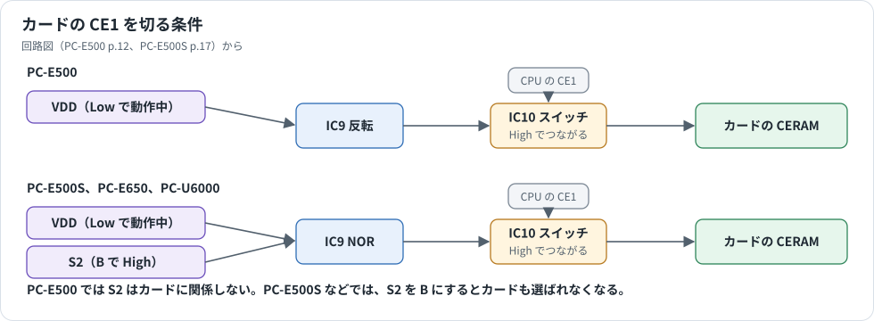

## 5.6 カードの認識

### 5.6.1 起動時の判定

ROM は電源を入れるたびに、`40000h` に「書けるか」「何が入っているか」を調べて、カードの状態を決めます。

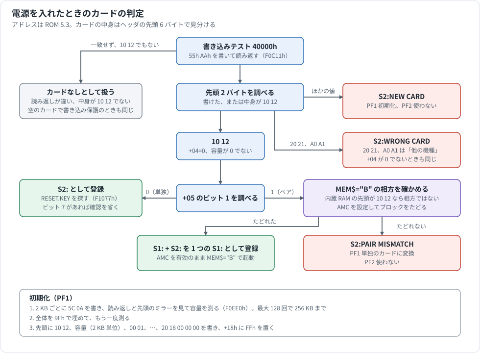

判定は `RESET` のあとだけでなく、電源を入れるたびに走ります。電源を切っている間に新しいカードを入れると、ON キーで `NEW CARD` の画面が出ます（実験）。

**書き込みテスト（`F0C11h`）**

メモリがあるかどうかは、書いて読み返せば分かります。大事なデータを壊さないように、元の値を取っておいて、あとで戻します。

```asm
        MV     BA,[X]        ; もとの 2 バイトを取っておく
        PUSHU  BA
        MV     BA,$AA55
        MV     [X],BA        ; 55h AAh を書いて
        MV     I,[X]         ; 読み返す
        SUB    I,BA
        POPU   BA
        JRNZ   not_ram
        MV     [X],BA        ; 書けたので元に戻す
        MV     A,$00         ; A=0、C=0: RAM
        RC
        RET
not_ram:
        MV     I,$1210       ; 書けないが中身が 10 12
        SUB    I,BA
        MV     A,$01         ; A=1、C=0: 読むだけのスロット
        JRZ    ok
        SC                   ; C=1: カードなし
        RET
```

| 読み返し | 中身の先頭 | A | C | 判断 |
|---|---|---|---|---|
| 書いた値と同じ | 問わない | 0 | 0 | RAM |
| 違う | `10 12` | 1 | 0 | 読むだけのスロット |
| 違う | それ以外 | 1 | 1 | カードなし |

コードの `$1210` と、メモリの中の `10 12` は同じものです。16 ビットの値は下位のバイトが先に並ぶからです。`$AA55` が `55h AAh` の順に書かれるのも同じ理由です。

書けない場合でも、中身が `10 12` ならカードとして扱います。**読むだけのカードに対応している**ということです。

**判定の結果**

| カードの状態 | 英語版の表示 | 日本語版の表示 | PF1 | PF2 |
|---|---|---|---|---|
| 何もない、書き込み保護された空のカード | なし（`S2:` なし） | | | |
| 新しいカード（下以外の値） | `S2(CARD):NEW CARD` | `S2(ｶｰﾄﾞ):ｱﾀﾗｼｲ ｶｰﾄﾞ ﾃﾞｽ` | 初期化 | 使わない |
| 先頭が `20 21` か `A0 A1` | `S2(CARD):WRONG CARD` | `S2(ｶｰﾄﾞ):ﾀﾉ ｷｼｭﾉ ｶｰﾄﾞ ﾃﾞｽ` | 初期化 | 使わない |
| 先頭が `10 12` で `+04` が 0 以外 | 同上 | 同上 | 初期化 | 使わない |
| 先頭が `10 12`、`+05` がペア、相方でない | `S2(CARD):PAIR MISMATCH` | `S2(ｶｰﾄﾞ):ﾍﾟｱ ﾐｽﾏｯﾁ ﾃﾞｽ` | 単独のカードに変換 | 使わない |
| 正しいカード | なし（`S2:` に登録） | | | |

日本語版の表示から、`20 21` と `A0 A1` は他の機種で初期化したカードの印と分かります（どの機種かは分かりません）。カードそのものは他の機種と共通です。販売店は CE-212M の対応機種に PC-1360 も挙げています。

`PF2` を押すと、カードには何も書きません。`S2:` は無効のままで、`FILES "F:"` は `Bad drive name` になります（実験）。

### 5.6.2 初期化と容量の測り方

`PF1` の処理は次のとおりです（コード `F1234h`、実験）。

1. **容量を測ります**（`F0EE0h`）。先頭に `A0 F5` を書き、2 KB ごとに `5C 0A` を書いて読み返します。読み返しが違うか、先頭の値が変わったら（ミラー）、そこで止めます。最大 128 回、つまり 256 KB までです。測ったあとは書いた場所を元に戻します。
2. **全体を `9Fh` で埋めます**（`F0DD9h`）。
3. **もう一度測ります。**
4. **ヘッダを書きます**（`F0E1Fh`）。

容量を教えてくれる信号はないので、ミラーを手がかりに測ります。8 KB のカードなら、13 本のアドレス線（A0〜A12）しか見ていないため、`42000h` に書いた値が `40000h` に現れます。

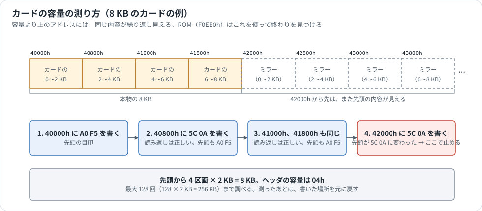

測り方が 2 KB 単位なので、**2 KB より細かい容量は扱えません。**

### 5.6.3 ヘッダ

スロットの共通の形は公式の図にあります（p.74）。初期化の直後は次の値でした（実験）。`cc` は容量です。

```text
+00  10 12 cc 00 00 01 00 00  00 00 00 00 00 00 00 00
+10  00 20 18 00 00 00 00 00  FF 9F 9F ...
```

| オフセット | 値 | 内容 | 根拠 |
|---|---|---|---|
| `+00`、`+01` | `10 12` | 印 | 公式、コード |
| `+02`、`+03` | `cc 00` | 容量（2 KB 単位） | 公式、実験 |
| `+04` | 00h | 0 以外なら `WRONG CARD` | コード、実験 |
| `+05` | 01h | 単独のカード。02h は `MEM$="B"` のペア。ビット 1 を調べる。公式の図は 02h | コード、実験 |
| `+11` | 20h | ビット 0 が保護の印（§5.8.2） | 公式、コード |
| `+12`〜`+14` | `18 00 00` | 最初のブロックの位置 | 公式、実験 |
| `+18` | FFh | ブロックの終わり | 公式、実験 |

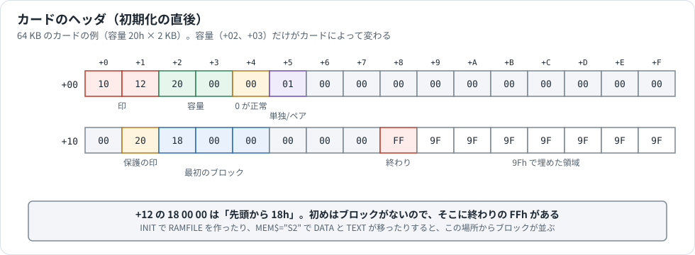

**例**: 16 KB のカードを初期化すると、先頭は `10 12 08 00 00 01` になります。`MEM$="B"` でペアにすると、6 バイト目の `01` が `02` に変わります（§5.7.3）。

### 5.6.4 ON キーを押しながらの RESET

ON キーを押しながら RESET を押して、RESET を先に離すと、カード、内蔵 RAM の順に消去を確かめられます（公式、実験）。

```text
S2(CARD):
   ALL CLEAR OK? (Y/N)
```

`N` で内容は残ります。ヘッダの保護の印が立っていると、1 行目に `PROTECTED CARD` が付きます（実験）。

## 5.7 MEM$ による使い分け

### 5.7.1 3 つの設定

`MEM$` は、プログラムと変数をどこに置くかを選ぶ設定です。

| `MEM$` | プログラムと変数 | `F:` | 別の本体で読めるか |
|---|---|---|---|
| `S1` | 内蔵 RAM | 使える | 読める |
| `S2` | カード | 使える | `E:` と AER を使っていなければ読める |
| `B` | 内蔵 RAM + カード | 使えない | 読めない |

アドレスで見ると、違いがはっきりします。

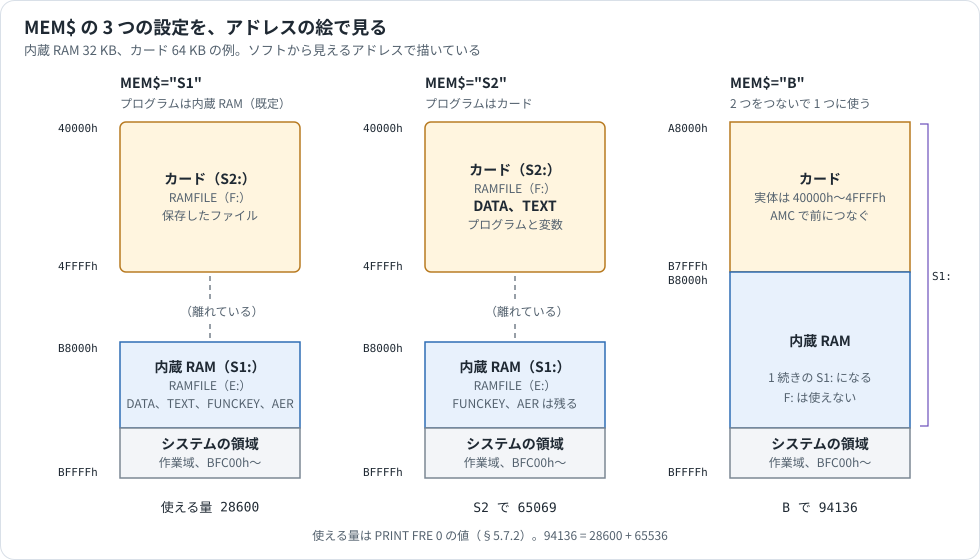

- `S1` と `S2`、`S1` と `B` の間で切り替えられます。`S2` から `B` へ直接は変えられません（公式）。
- `B` に変えるときは、カードが空でなければいけません（公式）。
- `S2` は `RESET` のあとも残ります。カードがないと `S1` に戻り、カードを戻しても `S1` のままです（実験）。

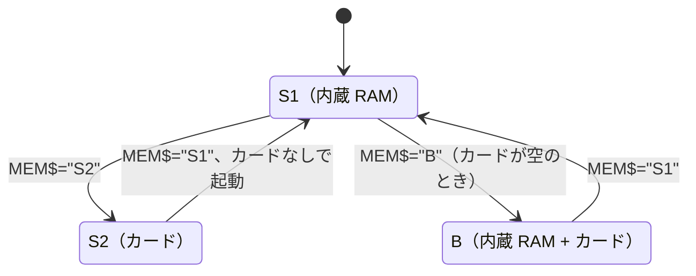

### 5.7.2 使える量

`S2`、`B` の列は `PRINT FRE 0` の値です。8〜64 KB、内蔵 32 KB の値はマニュアルの表と一致しました（公式、実験）。

| カード | 容量 | `S2` | `B`（内蔵 32 KB） | `B`（内蔵 64 KB） |
|---|---|---|---|---|
| CE-210M | 2 KB | 1581 | 30648 | 63416 |
| CE-211M | 4 KB | 3629 | 32696 | 65464 |
| CE-212M | 8 KB | 7725 | 36792 | 69560 |
| CE-2H16M | 16 KB | 15917 | 44984 | 77752 |
| CE-2H32M | 32 KB | 32301 | 61368 | 94136 |
| CE-2H64M | 64 KB | 65069 | 94136 | 126904 |
| 他社 | 128 KB | 130605 | 159672 | 192440 |
| 他社 | 256 KB | 261677 | 290744 | 323512 |

カードなしの `S1` は、内蔵 32 KB で 28600、64 KB で 61368 です。

**例（表の数字の仕組み）**: 表の値は、次の引き算で説明できます（計算）。

- `S2` は、どの容量でも「カードの容量 − 467」です。467 は 1D3h で、スロットのヘッダ 18h、空の `DATA` 184h、空の `TEXT` 36h、終わりの `FFh` 1 の合計（18h + 184h + 36h + 1 = 1D3h）と同じです。ブロックの大きさは [メモリ](03_MEMORY.md) §3.3.1 にあります。
- `B` は、カードなしの `S1` の値にカードの容量を足したものです。64 KB のカードと内蔵 32 KB なら、28600 + 65536 = 94136 です。

`F:` の大きさは 2 KB から（カードの容量 − 1）KB までです（公式）。2 KB のカードには `F:` を作れません（`INIT "F:1K"` は `Syntax error`。実験）。4 KB のカードの `INIT "F:3K"` は `DSKF` が 2304 でした（実験）。256 KB のカードでも `INIT "F:255K"` は受け付けます（実験）。

**例**: `INIT "F:3K"` は 3072 バイト = 12 セクタです。先頭の 3 セクタ（ヘッダと情報、FAT、ディレクトリ）を除いた 9 セクタ × 256 = 2304 が `DSKF` の値です（[メモリ](03_MEMORY.md) §3.6.2）。

ファイル数の上限は、ディスクの大きさで決まります（公式。スキャンの並びから対応づけました）。

| ディスクの大きさ | ファイル数 |
|---|---|
| 2 KB | 5 |
| 3〜4 KB | 8 |
| 5〜8 KB | 16 |
| 9〜12 KB | 24 |
| 13〜16 KB | 32 |
| 17〜20 KB | 40 |
| 21〜24 KB | 48 |
| 25〜28 KB | 56 |
| 29 KB 以上 | 64 |

### 5.7.3 MEM$="B" と AMC

`MEM$="B"` は、離れたアドレスにある 2 つのメモリを、1 続きに見せます。そのために CPU の **AMC**（`EFh`）を使って、カードを内蔵 RAM のすぐ前につながったアドレスに見せます（[CPU（SC62015）](02_CPU.md) §2.5.4）。

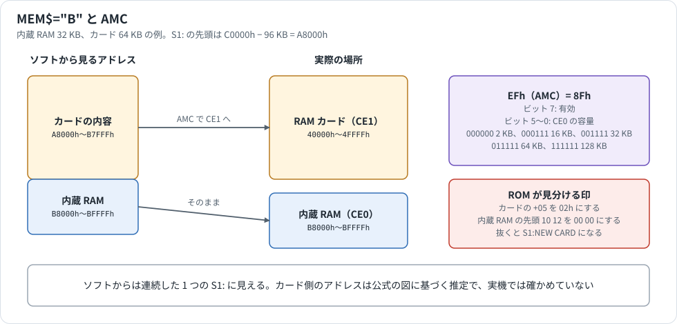

S1 の先頭は、容量の分だけ前に伸びます。

| カード | S1 の先頭（内蔵 32 KB） | S1 の先頭（内蔵 64 KB） |
|---|---|---|
| 8 KB | `B6000h` | `AE000h` |
| 16 KB | `B4000h` | `AC000h` |
| 32 KB | `B0000h` | `A8000h` |
| 64 KB | `A8000h` | `A0000h` |
| 128 KB | `98000h` | `90000h` |
| 256 KB | `78000h` | `70000h` |

**例**: 内蔵 32 KB、カード 8 KB なら、`C0000h` −（32 + 8）KB = `C0000h` − A000h = `B6000h` です。

**ROM の処理（コード `F0E56h`、実験）**

1. `80000h` から内蔵 RAM の容量を測ります。
2. 容量から AMC の値を作ります。32 KB で 8Fh、64 KB で 9Fh です。
3. S1 の先頭を「`C0000h` − 内蔵の容量 − カードの容量」にします。

**例（AMC の値を読む）**: 8Fh は 1000 1111b です。bit7 が 1 なので有効、bit5〜bit0 は 001111b = 15 なので、（15 + 1）× 2 KB = 32 KB。9Fh は 1001 1111b で、（31 + 1）× 2 KB = 64 KB です。

**ペアの印（実験）**

2 つのメモリが組であることは、カードと内蔵 RAM の両方に印を付けて覚えます。

| 場所 | 変化 |
|---|---|
| カードの `+05` | 01h から 02h へ |
| 内蔵 RAM の先頭 | `10 12` が `00 00` に変わる |
| `BFC15h`（S1 の表） | 先頭がカードのアドレスへ、属性が 02h へ |

ROM は、この 2 つの印で相方かどうかを判定します（§5.6.1）。

| 操作 | 結果（実験） |
|---|---|
| `RESET`、カードはそのまま | `B` のまま起動。AMC も有効 |
| カードを抜いて起動 | `S1(MAIN):NEW CARD`。AMC は 00h。**ここで PF1 を押すと内蔵 RAM を初期化します** |
| 抜いたカードを戻して起動 | `B` のまま起動 |
| 別の本体に入れて起動 | `S2(CARD):PAIR MISMATCH`。PF1 で `+05` が 01h に戻る |

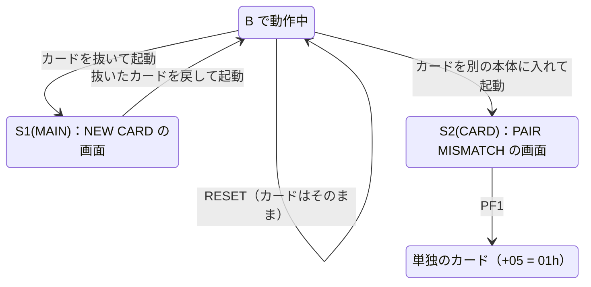

> [!WARNING]
> カードを抜いて起動したときの `S1(MAIN):NEW CARD` で PF1 を押すと、内蔵 RAM が初期化されます。電源を切り、カードを戻してから入れ直せば、`B` のまま起動します（実験）。

**実験の扱い:** 初めの実験は、AMC のないエミュレータの作業用コピーに次のモデルを足して行いました。AMC のないままで `MEM$="B"` を実行すると、`FRE 0` の値は正しく出ますが、カードに何も入らず（`+05` が 01h のまま）、`RESET` すると `MEMORY FAILURE` で止まります（ROM 5.3）。今のエミュレータの核は、CPU の資料（ESR-L p.8〜9）のとおりに AMC を実装しています。

```text
AME が 1 のとき、base = C0000h − (AM5〜AM0 + 1) × 2 KB
base − カードの容量 ≦ アドレス < base なら、40000h + (アドレス − (base − カードの容量)) を読み書きする
```

公式の図は「ソフトのアドレスを実際のアドレスへずらす」形なので、それに合わせました（推定）。このモデルで `FRE 0` はマニュアルの値と一致し、`DATA` ブロックが `40018h` に入り、`RESET` でも `B` のまま起動しました。

**例（モデルの計算）**: 内蔵 32 KB、カード 64 KB のとき、AMC は 8Fh なので base = `C0000h` − 32 KB = `B8000h`、カードの範囲は `A8000h`〜`B7FFFh` です。ソフトが `DATA` の先頭 `A8018h` を読むと、`40000h` +（`A8018h` − `A8000h`）= `40018h`、つまりカードの中を読みます。

**今の核での実験**（2026-11-25、実験）

| ROM、内蔵 RAM、カード | `MEM$="B"` の `FRE 0` | AMC | カードの先頭 | RESET のあと |
|---|---|---|---|---|
| 7.2、32 KB、64 KB | 94136 | 8Fh | `10 12 20 00 00 02` | `B` のまま。`FRE 0` は 94136 |
| 5.3、32 KB、8 KB | 36792 | 8Fh | `10 12 04 00 00 02` | `B` のまま。36792 |
| 8.5、64 KB、32 KB | 94136 | 9Fh | `10 12 10 00 00 02` | `B` のまま。94136 |
| 7.2、32 KB、256 KB | 290744 と表示 | 8Fh | `10 12 80 00 00 01`（印が変わらない） | **`S1` が新しいカードと判定され、初期化を求められる** |

**256 KB のカードで `MEM$="B"` を使ってはいけません。** S1 の先頭が `78000h` になり、CE0 の範囲（`80000h`〜）から外れて CE1 自身の範囲に入るためです。`FRE 0` は大きな値を表示しますが、カードに印が付かず、`BFC15h` の容量は 9F9Fh という無意味な値になり、RESET で内蔵 RAM の中身を失います（ROM 7.2、エミュレータ。実験）。S1 の先頭が `80000h` より前にならない組み合わせ、つまり「内蔵 + カード」が 256 KB 以下であることが条件です（計算）。

### 5.7.4 どの設定を選ぶか

カードの取り付け、初期化、プログラムを残したまま `B` に広げる手順、容量の大きいカードへの替え方は、ハンドブックの [RAM カード](../handbook/04_RAM_CARD.md) §4.3〜§4.5 にあります。選び方だけを図にすると、次のようになります。`B` で広げるより、`S1` のまま `F:` として使うほうが、カードを持ち替えられて便利だと、操作説明書は勧めています（p.22、公式）。

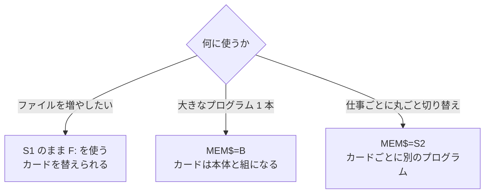

## 5.8 書き込み保護

書き込み保護には、カードのスイッチと、ヘッダの印の 2 種類があります。名前は似ていますが、まったく別のものです。

| | カードのスイッチ（§5.8.1） | ヘッダの印（§5.8.2） |
|---|---|---|
| 場所 | カードの回路 | カードの中身の `+11` |
| 効き方 | 書き込みがカードに届かない | ROM が印を見て判断する |
| ROM が書き込みテストをすると | 書けない | 書ける |

### 5.8.1 カードのスイッチ

他社のカードには書き込み保護のスイッチがあります（販売店）。自作カードの回路では、スイッチは R/W の線を切り、47 kΩ で High に引きます。カード側で書き込みが無視されるので、ROM の動きは次のようになります（実験。空のカードは全バージョン、ほかは ROM 5.3）。

| 状態 | 結果 |
|---|---|
| 初期化済みのカードを保護して起動 | `S2:` として使える。`FILES`、`LOAD` は動く |
| 保護したカードへ `SAVE "F:..."` | `File write protected` |
| 保護したカードで `MEM$="S2"` | `Illegal function call` |
| 空のカードを保護して起動 | カードなしと同じ。`F:` は `Bad drive name` |

初期化済みのカードなら、書けなくても中身の `10 12` で認識されます。空のカードにはその印がないので、カードがあることに気付けません（§5.6.1 の書き込みテスト）。

**新しいカードを初めて使うときは、保護を外します。**

### 5.8.2 ヘッダの保護の印

ヘッダの `+11` のビット 0 は、公式の図で「protect slot flag」です。立っていると次のようになります（実験）。

| 操作 | 結果 |
|---|---|
| ON + RESET | `S2(CARD):PROTECTED CARD` と表示する（実験）。表示だけで、`Y` を押すと消去へ進む（コード） |
| `INIT "F:4K"` | `File write protected` |

カードのスイッチとは別のものです。BASIC からこの印を立てる方法は見つかっていません。`SET "S2:","P"` は `File not found` でした（実験）。上の実験は、エミュレータのメモリに `+11` の値を直接入れて試しました。

## 5.9 RESET.KEY

起動時に、ROM は `RESET.KEY` という名前のメモリブロックを 3 か所で探します（`F1077h`）。**カードから起動の動作を変えられる仕組み**です。マニュアルには載っていません。

| 順 | 場所 | 条件 |
|---|---|---|
| 1 | `10000h`（ROM カード） | `10 12` の印を調べない。`+12` の位置だけを使う |
| 2 | `40000h`（RAM カード） | カードと認識したとき |
| 3 | S1 の先頭（内蔵 RAM） | |

見つかると、中身の先頭 1 バイトを内部 RAM の `E0h` に入れます。ヘッダを含むファイルの長さが 25h 未満のときだけです（長さ 24h で有効、25h で無効。実験）。起動の終わりに `BFC5Bh` にコピーします。

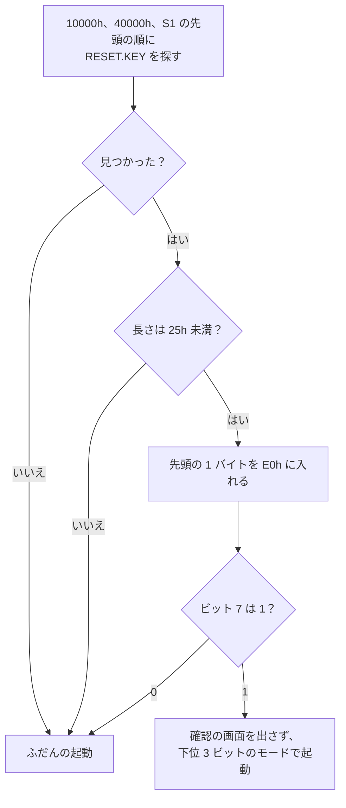

**値の意味**

| 値 | 動作 |
|---|---|
| ビット 7 が 0 | 起動はふだんと同じ（実験。ROM 5.3） |
| ビット 7 が 1 | 確認の画面を出さず、下位 3 ビットのモードで起動する |

**ビット 7 が 1 だと、確認の画面で初期化を選んだものとして進みます。** `10000h` にこの値があると、空のカードは何も聞かれずに初期化されました（実験。ROM 5.3）。ROM のコードでは、`S1:` の `NEW CARD` と `PAIR MISMATCH` も同じ扱いです（コード）。

下位 3 ビットとモードの対応は、メインメニューの並びに沿っています（実験、全バージョン）。

| 値 | 起動するモード |
|---|---|
| 80h | BASIC（`>`） |
| 81h | CAL |
| 82h | MATRIX |
| 83h | STAT |
| 84h | メニューの 5 番目。ENG。2.1 は TIMER、6.4 と 8.4 は GRAPH |
| 85h | AER |
| 86h | BASIC。6.4 と 8.4 は TIMER |
| 87h | メインメニュー。6.4 と 8.4 は BASIC |

メニューの違いは [ROM バージョンの違い: 機種](27_ROM_VERSIONS_MODELS.md) にあります。

**試した方法:** ヘッダに続けて次のブロックを置き、`RESET` しました（実験）。`10000h` は読むだけの領域なので、エミュレータのメモリに直接入れました。

```text
10 12 08 00 00 01 00 00 00 00 00 00 00 00 00 00
00 20 18 00 00 00 00 00
FB "RESET   " "KEY" ...         ; メモリブロックのヘッダ（第 3 章 §3.3）
80                              ; 中身の 1 バイト
FF                              ; 終わり
```

1、2 行目がカードのヘッダ（容量 08h = 16 KB）、3 行目がブロックのヘッダの始まり、`80` が値です。80h はビット 7 が 1、下位 3 ビットが 0 なので、確認なしで BASIC が起動します。

## 5.10 ROM カード

### 5.10.1 ROM がしていること

`10000h` から見える ROM カードを、本体の ROM はどう扱うのでしょうか。答えはバージョンによって違います。

| バージョン | `10000h` の扱い |
|---|---|
| 2.1 | **`S3:` として調べます**（書き込みテストと `10 12`）。`C0000h` は調べません。`10000h` にスロットの形のデータを置くと `BFC09h` が `10000h` になり、`FILES "S3:"` が動きました（実験） |
| 2.2 以降 | `S3:` は `C0000h` です。`10000h` は `RESET.KEY` を探すだけです |

`10000h` を直接指す命令は、どのバージョンも起動処理の 1 か所だけです（2.1 は `S3:` の判定を含めて 2 か所。コード）。`S2:` のように使う処理は見つかっていません。

バージョン 2.1 だけ起動時に `10000h` へ `55h AAh` を書きます。ROM カードなら無視されます。

### 5.10.2 CE-2S01

CE-2S01 はグラフ機能のカードです。対応機種は PC-1480U、PC-E500、PC-E500S、PC-E550、PC-E650、PC-U6000 と紹介されています（個人。[pocket.free.fr](http://pocket.free.fr/html/sharp/ce-2s01_e.html) の検索結果の抜粋のみで、本文は読めませんでした）。

本リポジトリの作者が実機の PC-E650 で確かめたことは次のとおりです。

- 挿して電源を入れると、一瞬 `GOTO*ST...` のような文字が見え、`GRAPH CARD` の専用画面になる
- `PEEK` で `10000h`〜`17FFFh` は E2h、`18000h`〜`1FFFFh` は E3h が読める
- 本体内蔵の「グラフ＆スウガク」とは別のもの

カードの中のプログラムは取り出せていません。`10000h` の 64 KB には見つかりませんでした。`10012h` の値をブロックの位置とみなした先（`3E2E2h`）は FFh でした。

**例（`3E2E2h` の計算）**: `10012h` から 3 バイトがどれも E2h なら、値は E2E2E2h です。ブロックの位置はスロットの先頭からの距離なので、`10000h` に足して E3E2E2h、アドレスに使う下位 20 ビットを取ると `3E2E2h` です。

**考えられること（推定）**

- `10000h` の値が一定なのは、プログラムがここにないからかもしれません。
- ROM には読むだけのカードを `40000h` で扱う処理（§5.6.1）と、カードから起動を変える処理（§5.9）がそろっています。カードが `CERAM` にも応答するなら、特別な処理なしで動きます。読むだけのカードに `RESET.KEY` を置くと、`>` のまま起動し、`FILES "S2:"` で一覧が見えました（実験。ROM 5.3）。

これを確かめるには、カードを挿した実機で `40000h` を読みます。読むだけなので安全です。

```basic
PRINT PEEK &40000,PEEK &40001,PEEK &40002
FILES "S2:"
```

`16 18` と容量（2 KB 単位）が見えて、`RESET.KEY` などが一覧に出れば、上の推定が正しいことになります。`16 18` は、印の `10 12` を `PRINT` が 10 進で表示したものです。`POKE` と `CALL` は実機が止まることがあるので試さないでください。

## 5.11 カードの種類

### 5.11.1 純正

PC-E500 シリーズに付けられるのは、ハーフサイズのカードだけです。フルサイズの CE-201M（8 KB）、CE-202M（16 KB）、CE-203M（32 KB）は付けられません。

| 型番 | 容量 | PC-E500 の資料 |
|---|---|---|
| CE-212M | 8 KB | 公式 |
| CE-2H16M | 16 KB | 公式 |
| CE-2H32M | 32 KB | 公式 |
| CE-2H64M | 64 KB | 公式 |
| CE-210M | 2 KB | 百科事典のほか、サービスマニュアルの検査のアドレス表にある |
| CE-211M | 4 KB | 同上 |

**2 KB と 4 KB のカード。** CE-210M と CE-211M は、操作説明書の表（8〜64 KB、p.18、p.21）と構成図にはありません。PC-E500 と同じ形（ハーフサイズ）のカードとして、カードの一覧に 2 KB、4 KB と載っています（[個人](https://sharppocketcomputers.com/ram_cards.htm)、百科事典）。サービスマニュアルのカードの検査は 2 冊とも 2 KB と 4 KB を選べ、アドレスの表もあります（公式）。ROM は 2 KB と 4 KB のカードも初期化して使えます（実験）。つまり、PC-E500 用の製品として案内されたのは 8 KB 以上ですが、本体は 2 KB と 4 KB も扱えるように作られています。

| 項目 | 値 | 出典 |
|---|---|---|
| 電源 | 3 V。装着中は本体の電池を使う | 個人 |
| バックアップ電池 | CR1616 | 個人、百科事典 |
| 電池の持ち | 本体に装着で 5 年以上 | 個人 |
| 動作温度 | 0〜40 °C | 個人 |
| 大きさ | 54×42×2.8 mm | 個人 |

### 5.11.2 他社

高松製作所の製品です。対応機種は PC-E500、E550、1480U、1490U、1490UII、E650、U6000 です（販売店）。

| 製品 | 容量 | 電池 | 大きさ | 重さ |
|---|---|---|---|---|
| RAM カード 256 KB | 256 KB | CR1616 | 42×54×3.5 mm | 約 10 g |
| RAM カード 512 KB | 256 KB×2 | CR1616 | 42×54×3.5 mm | 約 10 g |
| FRAM カード 128 KB | 128 KB | 不要 | 42×54×3 mm | 約 8 g |
| FRAM カード 256 KB | 256 KB | 不要 | 42×54×3 mm | 約 8 g |

- 512 KB のカードは、256 KB の領域 2 つをスイッチで切り替えます。同時には使えません。
- RAM カードにも FRAM カードにもスイッチの書き込み保護があります（§5.8.1）。
- 電池の持ちは、装着して約 5 年、外して約 1 年です。
- FRAM でも、プログラムの暴走で内容が消えることはあります。
- 動作クロックを上げた本体でのカードの使用は勧められていません。

FRAM は、電源がなくても内容が残るメモリです。電池が要らない代わりに、書き込みが簡単に通ることは RAM と変わりません。

### 5.11.3 自作

[cazacov/PocketComputers](https://github.com/cazacov/PocketComputers/tree/main/sharp-e500/RAM-card) に、256 KB のカードの回路図と KiCad のデータがあります。

| 部品 | 内容 |
|---|---|
| KM681000BLG × 2 | 128 KB の SRAM。`CS2` は VCC、`/OE` は GND に固定 |
| HC138 | `G1` に CERAM、`A0` に A17。`Y0`、`Y1` で SRAM を選ぶ |
| RB160M | スロットの VCC からカードへ。カードの電池が本体へ流れないように |
| 1N4148W | CR1216 から電源の線へ。逆流を防ぐ |
| R1 47 kΩ | R/W のプルアップ。スイッチを切ると読むだけになる |
| R2 47 kΩ、R3 470 kΩ | CERAM と A17 のプルダウン |

作者は CR1216 での保持を数か月と見積もっています。純正と他社のカードは CR1616 です。

部品のつながりを図にすると、次のようになります。

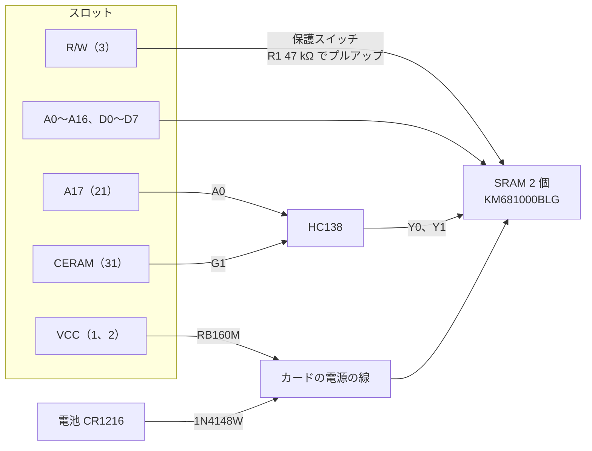

2 個の SRAM は 128 KB ずつで、A17 が 0 なら `40000h`〜`5FFFFh`、1 なら `60000h`〜`7FFFFh` の側が選ばれます。

## 5.12 版による違い

カードの処理は全 11 本で同じ動きでした。§5.6〜§5.9 の実験はすべてのバージョンで同じ結果です。違うのはアドレス、表示の言語、§5.10.1 の `10000h` の扱いです。アドレスの表は [ROM バージョンの違い: 配置](23_ROM_VERSIONS_MAP.md) §23.11 にあります。

## 5.13 分かっていないこと

| 項目 | 内容 |
|---|---|
| 何も挿さないときのバス | エミュレータは FFh を返す。実機は不明 |
| 電池交換でカードが消える理由 | マニュアルに説明がない（§5.4） |
| AMC の実際のアドレス変換 | CPU の資料の図に合わせたモデル（§5.7.3）。実機での測定はない |
| `20 21`、`A0 A1` の機種 | ROM は「他の機種」とだけ表示する |
| ヘッダの保護の印の立て方 | BASIC の命令では見つかっていない（§5.8.2） |
| CE-2S01 のプログラムの場所 | §5.10.2 |

## まとめ

| 覚えること | 値 | 節 |
|---|---|---|
| RAM カードのアドレス | `40000h` から。最大 256 KB | §5.3.1 |
| ROM カードのアドレス | `10000h`〜`1FFFFh` | §5.3.2 |
| カバーのスイッチ | OFF キーと並列。外すと電源が切れる | §5.5 |
| カードの印 | 先頭 `10 12`、容量は 2 KB 単位 | §5.6.3 |
| 判定 | 電源を入れるたびに、書いて読み返す | §5.6.1 |
| `MEM$` | `S1` 内蔵、`S2` カード、`B` 両方（AMC を使う） | §5.7 |
| `B` のカード | 抜いたまま PF1 を押さない。別の本体では読めない。256 KB のカードでは使わない | §5.7.3 |
| 保護 | スイッチ（書けない）とヘッダの印（ROM が見る）は別 | §5.8 |
| `RESET.KEY` | カードから起動の動作を変える。ビット 7 が 1 だと初期化も確認なし | §5.9 |
| 電池交換 | 本体の電池を換える前にカードを外す | §5.4 |

## 情報源と確度

| 表記 | 情報源 |
|---|---|
| **公式** | PC-E500 Operation Manual（p.18〜23）、Technical Reference Manual（p.74）、ESR-L CPU Technical Manual（p.8〜9） |
| **回路図** | PC-E500 と PC-E500S の Service Manual の回路図を読んだもの |
| **コード** | ROM の逆アセンブル。アドレスは断らなければ ROM 5.3 |
| **実験** | エミュレータの作業用コピーにバスの記録を足して動かした。全 11 本の ROM で試した |
| **自作カード** | [cazacov/PocketComputers](https://github.com/cazacov/PocketComputers/tree/main/sharp-e500/RAM-card) の 256 KB カードの設計（MIT ライセンス）。作者は実機で動くと書いている |
| **販売店** | [高松製作所](https://tmfg.jp/products/list?category_id=53)の商品ページ |
| **個人** | 愛好家のサイト |
| **推定** | 上から推し量ったもの |

**実験の条件**

- 実験は実機のカードの代わりにエミュレータのメモリを使いました。初めの実験では `AMC` を作業用コピーに足し、2026-11-25 の実験では核に入った `AMC` を使いました（§5.7.3）。

## 5.14 出典

手元の資料（リポジトリには含まれません）:

- PC-E500 Operation Manual（p.18〜23、p.348）
- PC-E500 Technical Reference Manual（p.74）
- PC-E500 Service Manual（メモリマップ、回路図、部品表）
- PC-E500S Service Manual（同上）
- ESR-L CPU Technical Manual（p.8〜9。[Forth500 の resources](https://github.com/Robert-van-Engelen/Forth500/tree/main/resources)）

## 次に読むもの

- [メモリ](03_MEMORY.md): スロット、メモリブロック、RAM ディスクの形式
- [CPU（SC62015）](02_CPU.md) §2.5.4: AMC
- [ROM バージョンの違い: 配置](23_ROM_VERSIONS_MAP.md) §23.11: バージョンごとのアドレス
- [回路とサービス](09_CIRCUIT.md): チップセレクトと電源
