# 6. 11 ピン（テープ、周辺機器）

この章は本体の左側にある 11 ピンのコネクタと、そこで動くカセットテープ（`CAS:`）のデータの形を説明します。前半では 11 本の線の名前と向き、CPU とのつながりを回路図から読みます。後半では `CSAVE`、`CLOAD`、`CSAVE M`、`CLOAD M` がテープに書くものを、波の 1 つから 48 バイトのヘッダまで順に組み立てます。機器を自作する人と、テープの音をパソコンで読み書きしたい人のための資料です。レコーダのつなぎ方や操作、うまくいかないときの調べ方は[カセットインターフェース](20_CASSETTE.md)にあります。

[目次へ戻る](README.md)

## この章で分かること

- 11 本のピンの役割と、CPU のどの端子につながるか
- 音の長さで 0 と 1 を表す仕組みと、1 ビットから 1 バイト、1 ブロックまでの組み立て
- ヘッダ 48 バイトと本体の中身を、バイトの単位で読む方法
- 保存と読み込みの流れ、検査値の計算
- `CSAVE M` と `CLOAD M`（操作マニュアルにない命令）の使い方
- IOCS と ROM のエントリ

## 6.0 はじめに

カセットテープは音を録音する機械です。パソコンのデータを音の高さに置き換えて録音し、再生した音からデータに戻します。この機械も同じ考えで、**短い波は 0、長い波は 1** という規約で音を作ります。

テープへ書く側から見ると、積み木は次の順に組み上がります。下の段ほど小さな単位です。

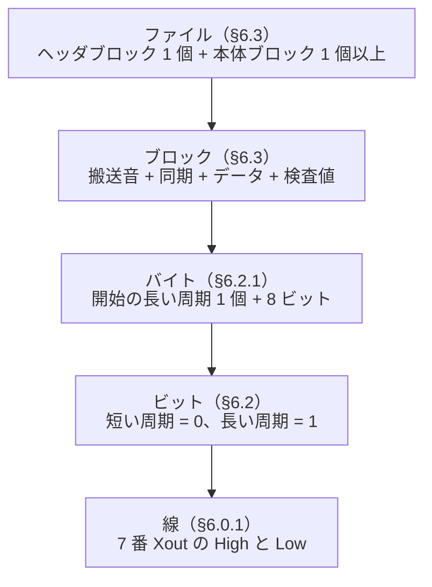

BASIC の命令の書式は [BASIC の命令と関数](14_BASIC_REFERENCE.md)、IOCS の呼び方は [IOCS と FCS](11_IOCS.md)、CE-140F の通信手順は [CE-140F の通信](17_CE-140F_DISK.md)、つなぐ機器は [周辺機器](16_PERIPHERALS.md)、シリアルは [15 ピン（シリアル）](07_PORT_15PIN.md) を参照してください。（公式資料）（コード）などの印の意味と、試していないことは、章末の「情報源と確度」にあります。

アドレスは ROM 8.5 のものです。カセットのドライバ（`E96DEh`〜`EA4B2h`）は、ROM 3.2 では 2E4h 足したアドレスにあります。ほかのバージョンは [ROM バージョンの違い: 行列演算とドライバ](25_ROM_VERSIONS_DRIVERS.md) を参照してください。

**例**: 8.5 の `E9F38h`（ビットの判定）は、ROM 3.2 では `E9F38h` + 2E4h = `EA21Ch` です。

### 6.0.1 ピン配置

カセットレコーダ、プリンタ、ポケットディスクをつなぐコネクタです。信号が CPU の E ポートに直接つながっているので、機械語から操作でき、自作の機器の制御にも使えます。

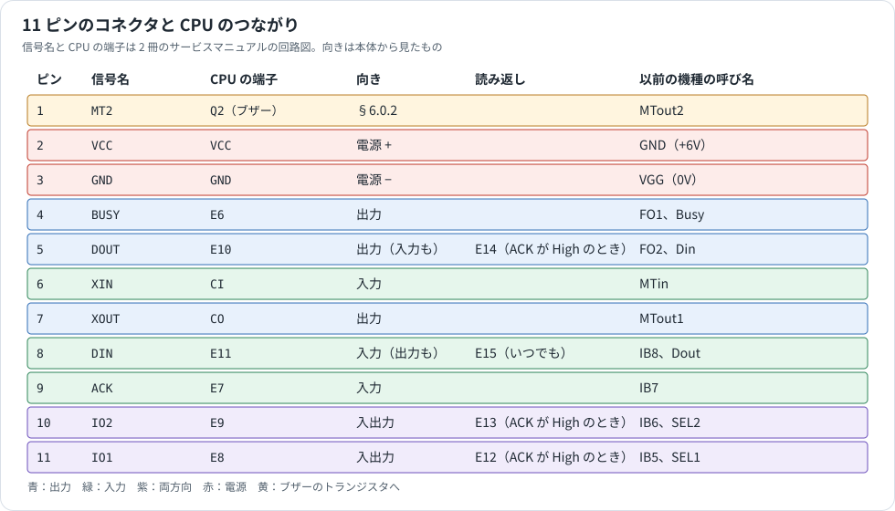

信号名は PC-E500 と PC-E500S のサービスマニュアルの回路図と CPU の端子の表のものです。2 冊で同じです（回路図、公式）。

| ピン | 信号 | CPU の端子 | 本体から見た向き | 役割 |
|---|---|---|---|---|
| 1 | MT2 | ブザーのトランジスタ | §6.0.2 | |
| 2 | VCC | VCC | 電源 + | |
| 3 | GND | GND | 電源 − | |
| 4 | BUSY | E6 | 出力 | 「出した」「受け取った」の合図 |
| 5 | DOUT | E10 | 出力（CE-140F とは両方向） | プリンタへのデータ、デバイスコード |
| 6 | XIN | CI | 入力 | テープの音 |
| 7 | XOUT | CO | 出力 | テープの音、ブザー、デバイスコードの印 |
| 8 | DIN | E11 | 入力（CE-140F とは両方向） | 機器からのデータ |
| 9 | ACK | E7 | 入力 | 機器の返事 |
| 10 | IO2 | E9 | 両方向 | CE-140F のデータ |
| 11 | IO1 | E8 | 両方向 | CE-140F のデータ |

ピン番号は本体の上から数えた番号です。資料によっては、シールドを 1 番、IO1 を 2 番、MT2 を 12 番と数えます。

**以前の機種の呼び名との対応。** 個人サイトには以前の機種の時代の名前で書かれた表もあります。2 つを対応させると、次のようになります。

| ピン | 回路図（PC-E500） | 個人サイトの表 |
|---|---|---|
| 1 | MT2 | MTout2（入力と記載） |
| 2 | VCC | GND（+6V） |
| 3 | GND | VGG（0V） |
| 4 | BUSY | FO1、Busy（出力） |
| 5 | DOUT | FO2、Din（出力） |
| 6 | XIN | MTin（入力） |
| 7 | XOUT | MTout1（出力） |
| 8 | DIN | IB8、Dout（入力、I/O） |
| 9 | ACK | IB7（入力、I/O） |
| 10 | IO2 | IB6、SEL2（出力、I/O） |
| 11 | IO1 | IB5、SEL1（出力、I/O） |

5 番と 8 番は、名前だけが入れ替わっていて、向きは同じです。**5 番は本体から出す線、8 番は本体が受ける線**で、PC-E500 の名前では DOUT と DIN です。この向きは次の 3 つの証拠で一致します。

- 2 冊の回路図とピンの表（5 番 DOUT = E10、8 番 DIN = E11。公式）。
- CE-126P のドライバ。`F4h` のビット 2（E10）にデータを出し、`F6h` のビット 7（E15、8 番の読み返し）を調べる（[CE-126P プリンタ](18_CE-126P_PRINTER.md) §18.3、ROM）。
- サービス用の検査の表。E10 と E11 を出力したときの読み返しの値（§6.0.3、公式）。

電源は、2 番が +、3 番が −です。消費電流の検査も「2 番に +5 V、3 番に 0 V」で行います（公式）。個人サイトの表の「GND が +6V」は、+ 側を基準と呼んでいた時代の名前です。

本体の電池が切れても、CE-126P をつないでいれば CE-126P から電源が供給され、本体の電池の消費が減ります（公式）。

用途ごとに見ると、ピンは 3 つの組に分かれます。

| 組 | ピン | 使い方 |
|---|---|---|
| テープの音 | 1、6、7 | 音の入出力。この章の後半の主役 |
| 機器の制御 | 4、5、8〜11 | プリンタ、ディスクとのデータと合図 |
| 電源 | 2、3 | 電圧と基準 |

### 6.0.2 CPU とのつながり（回路図）

E8〜E11 と E6 は **P チャネルのオープン出力**です（公式、端子の表）。High は自分で出せますが、Low は出せず、手を離すだけです。線を Low にするのは、機器の側の抵抗です。だから本体と機器のどちらが High にしても線は High になり、両方が同時に出しても電源がショートしません。1 本の線を両方向に使えるのは、このためです。

| ピン | 信号 | 出力 | 読み返し | 読み返しの条件 |
|---|---|---|---|---|
| 4 | BUSY | E6 | | |
| 5 | DOUT | E10 | E14 | ACK が High のとき |
| 8 | DIN | E11 | E15 | いつでも |
| 9 | ACK | | E7 | いつでも |
| 10 | IO2 | E9 | E13 | ACK が High のとき |
| 11 | IO1 | E8 | E12 | ACK が High のとき |

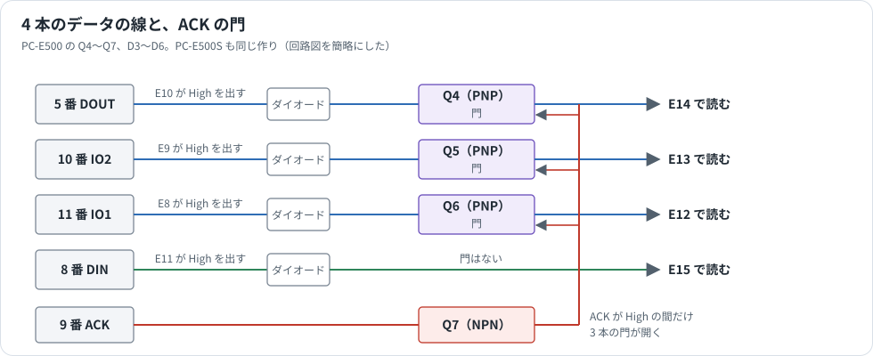

回路図を追うと、5、10、11 番の線はダイオード（D3、D5、D6）を通って PNP トランジスタ Q4〜Q6 に入り、E14、E13、E12 に届きます。3 個のベースは抵抗を通してまとめられ、NPN トランジスタ Q7 が GND へ引きます。Q7 を動かすのは ACK です。したがって、**ACK が High の間だけ DOUT、IO2、IO1 が読めます**。8 番の DIN だけはダイオード D4 から直接 E15 に入ります（PC-E500 p.11、PC-E500S p.16 の回路図）。

CE-140F のデータの転送では、機器が ACK を High にしてから 4 本を読みます（[CE-140F の通信](17_CE-140F_DISK.md) §17.1）。門が ACK で開く回路は、この手順に合っています。プリンタだけをつなぐときは DIN の 1 本で足りるので、門の影響を受けません。

**1 番の MT2** は CPU の端子にはつながりません。抵抗 R2（100 kΩ）を通してブザーのトランジスタ Q2 のベースに入り、同じベースに CO が R3（100 kΩ）を通して入ります（どちらの機種も同じ）。つまり、外から MT2 を High にするとブザーが動き、CO が High のときは MT2 に 100 kΩ を通した小さな電圧が出ます（[カセットインターフェース](20_CASSETTE.md) §20.8.1）。

### 6.0.3 検査の表から分かること

サービスマニュアルには 11 ピンに治具をつないで、出力の組み合わせごとに入力の値を確かめる検査があります（公式）。番号は出力の 5 ビット（BUSY、DIN、DOUT、IO2、IO1）、値は入力の 5 ビット（ACK、DIN、DOUT、IO2、IO1）です。

検査のプログラムは `F3h` のビット 6 に BUSY、`F4h` に下位 4 ビットを書き、`(F5h AND 80h)÷8 + (F6h AND F0h)÷16` を読みます（PC-E500 の検査ソフトの 440〜480 行）。つまり、値のビット 4 が ACK（E7）、ビット 3〜0 が E15〜E12 です。11 ピンの信号とビットの対応が、ここから直接確かめられます。

| 出力 | PC-E500 の値 | PC-E500S の値 |
|---|---|---|
| すべて 0 | 00 | 08 |
| IO1 | 13 | 19 |
| IO2 | 13 | 08 |
| DOUT | 1C | 00 |
| DIN | 1C | 08 |
| BUSY | 10 | 1A |
| BUSY、DIN、DOUT | 1C | 1E |
| すべて 1 | 1F | 1F |

2 冊で値が違うのは、治具の中が違うからです。PC-E500 の表は「DIN と DOUT、IO1 と IO2 がそれぞれつながり、どれかが High なら ACK も High」という治具の値です。PC-E500S の治具は p.10 に回路があり、反転する回路を使います。

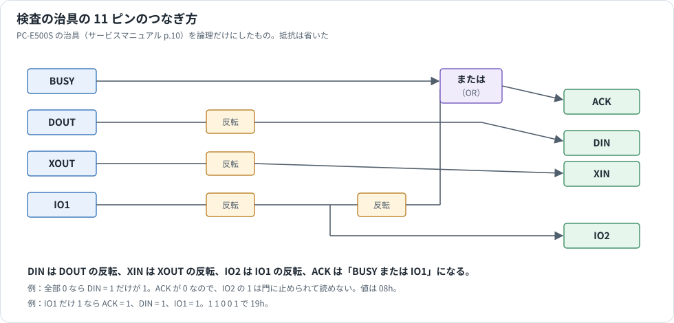

この治具の動きと §6.0.2 の ACK の門から 32 通りの値を計算すると、PC-E500S の表の「正しい値」の欄と 32 個とも一致しました（計算）。一方、同じ表の入力の 5 つの欄は PC-E500 の表と同じで、値の欄と合いません。入力の欄は前の機種の表のコピーで、値の欄が正しいと分かります。

**例: PC-E500S で DOUT だけを High にしたとき（番号 4）。** DIN は DOUT の反転で 0、IO1 は 0、ACK は BUSY と IO1 がどちらも 0 なので 0 です。門が閉じて DOUT、IO2、IO1 は読めず、値は 00h です。表の値と一致します。

E ポートのレジスタは [CPU（SC62015）](02_CPU.md) §2.7.2 にあります。

## 6.1 命令の一覧

テープを使う命令は 9 通りあります。どの命令もテープの先頭に書く**種別**（ヘッダの 1 バイト目）で自分のファイルを見分けます。

| 命令 | 内容 | ヘッダの種別 | 根拠 |
|---|---|---|---|
| `CSAVE ["名前"][,"パスワード"]` | BASIC プログラムを保存する | 02h | マニュアル、実験 |
| `CLOAD ["名前"]` | 種別 02h を読み込む | 02h | マニュアル、実験 |
| `CLOAD? ["名前"]` | 種別 02h をメモリのプログラムと比べる | 02h | マニュアル、実験 |
| `CSAVE M ["名前",]開始,終了[,実行]` | メモリの範囲をそのまま保存する | 01h | コード、実験 |
| `CLOAD M ["名前"][,アドレス]`、`CLOAD M アドレス` | 種別 01h を読み込む。アドレスを書くとそこへ読む | 01h | コード、実験 |
| `CLOAD @ ["名前"]` | 以前の機種のテープを読む（§6.6） | 70h〜73h | マニュアル、コード、実験 |
| `SAVE "CAS:名前"` | プログラムを ASCII で保存する | 04h | マニュアル、実験 |
| `LOAD "CAS:名前"` | 種別 04h を読み込む | 04h | マニュアル、実験 |
| `OPEN "CAS:名前" FOR OUTPUT / INPUT AS #n` | データを読み書きする | 04h | マニュアル、実験 |

`CSAVE M` と `CLOAD M` は操作マニュアルに載っていません。公式資料にはヘッダの形だけがあります。`SAVE M "CAS:..."` と `LOAD M "CAS:..."` は使えず、`Bad drive name` になります（実験）。

読み込む命令は種別が違うブロックを読み飛ばします。たとえば `CSAVE M` のテープに `CLOAD` をかけると、エラーを出さずに次のファイルを探し続けます（実験）。止めるには `BREAK` を押します。

種別で整理すると、組み合わせは次の 3 つです。

| 種別 | 保存 | 読み込み | 中身 |
|---|---|---|---|
| 01h | `CSAVE M` | `CLOAD M` | メモリの範囲そのまま |
| 02h | `CSAVE` | `CLOAD`、`CLOAD?` | プログラム（中間コード） |
| 04h | `SAVE "CAS:"`、`OPEN … FOR OUTPUT` | `LOAD "CAS:"`、`OPEN … FOR INPUT` | 文字（ASCII）のファイル |

## 6.2 信号

1 周期が 1 ビットを表します。ブザーと同じ XOUT の信号を High と Low に切り替えて作るので、保存の音はブザーからも聞こえます（`CSAVE M` で確認。実機）。

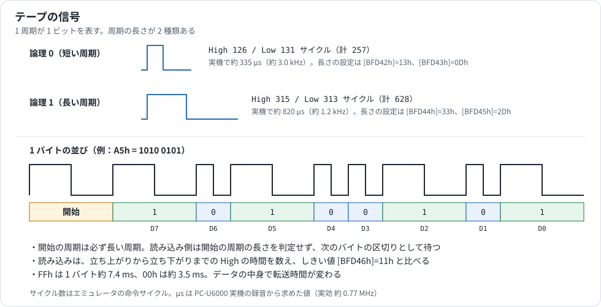

| | 論理 0 | 論理 1 | 根拠 |
|---|---|---|---|
| High のサイクル数 | 126 | 315 | 実験 |
| Low のサイクル数 | 131 | 313 | 実験 |
| 実機の周期 | 約 329〜335 µs | 約 820 µs | 実機 |
| 周波数 | 約 3.0 kHz | 約 1.2 kHz | 実機 |

サイクル数はバイトの区切りやビットの種類で少し変わります（データ中の短い周期の Low は 117〜178）。上の表は搬送音と、同期の長い周期の値です。

実機の録音の周期とサイクル数から求めた実効速度は約 0.77 MHz で、CPU の資料の 1 実行サイクル 1.30 µs（2.304 MHz ÷ 3 = 768 kHz）と合います。本資料の秒数はこの値で換算しました。この換算で保存開始から音が出るまでは 8.6 秒（モーターの待ち 0.6 秒 + 無音 8.0 秒）になり、マニュアルの「約 8 秒の無音」と合います。

**例（換算）**: 論理 0 は 126 + 131 = 257 サイクルなので、257 × 1.30 µs = 約 334 µs。論理 1 は 315 + 313 = 628 サイクルで、628 × 1.30 µs = 約 816 µs です。どちらも実機の録音の値（約 329〜335 µs、約 820 µs）とよく合います。

### 6.2.1 バイト

開始の長い周期 1 個のあとに、データ 8 ビットを上位から並べます。1 バイトは FFh で約 7.4 ms、00h で約 3.5 ms です。ROM 全 256 KB の保存は約 21.7 分でした（実験の 996,558,990 サイクルを換算。PC-U6000 の録音と一致）。

1 のビットほど音が長いので、保存にかかる時間はデータの中身で変わります。

| バイト | 長い周期 | 短い周期 | 時間（長い周期 820 µs、短い周期 335 µs で計算） |
|---|---|---|---|
| 00h | 1（開始） | 8 | 0.82 + 8 × 0.335 = 約 3.5 ms |
| A5h | 1 + 4 | 4 | 5 × 0.82 + 4 × 0.335 = 約 5.4 ms |
| FFh | 1 + 8 | 0 | 9 × 0.82 = 約 7.4 ms |

### 6.2.2 作業域

長さは RAM の作業域にあり、値を変えられます。起動時に ROM の表（8.5 `E9726h`）からコピーします。表の中身は 13 本の ROM すべてで同じです。

| アドレス | 既定値 | 内容 | 根拠 |
|---|---|---|---|
| `BFD42h` / `BFD43h` | 13h / 0Dh | 論理 0 の High / Low の長さ | 公式資料 |
| `BFD44h` / `BFD45h` | 33h / 2Dh | 論理 1 の High / Low の長さ | 公式資料 |
| `BFD46h` | 11h | 読み込みで 0 と 1 を分けるしきい値 | 公式資料 |
| `BFD47h` | 01h | bit0: リモート制御をする。bit7: 入力の極性を逆に読む | コード |
| `BFD48h` | 50h | ヘッダの前の無音 | 公式資料 |
| `BFD49h` | 14h | ヘッダのあとの無音 | 公式資料 |
| `BFD4Ah` | 2710h | ヘッダの搬送音の周期数（10000） | 公式資料 |
| `BFD4Ch` / `BFD4Dh` | 28h / 28h | ヘッダの同期の長い周期 / 短い周期の数（40） | 公式資料 |
| `BFD4Eh` | 2AF8h | 本体の搬送音の周期数（11000） | コード、実験 |
| `BFD50h` / `BFD51h` | 14h / 14h | 本体の同期の長い周期 / 短い周期の数（20） | 公式資料 |
| `BFD52h` | 28h | 本体のあとの無音 | 公式資料 |
| `BFD53h` | 1388h | 読み込みで搬送音と認める短い周期の数（5000） | 公式資料 |
| `BFD55h` / `BFD56h` | 78h / 3Ch | モーターの開始後 / 停止後の待ち時間 | コード |

**無音と待ち時間の単位。** `BFD48h`、`BFD49h`、`BFD52h` の値は、1 増やすごとに 76,650 サイクル（約 0.1 秒）、`BFD55h`、`BFD56h` は 1 あたり約 3,900 サイクル（約 5 ms）長くなります。無音の値の 0 は 256 として数えます（ROM 7.2 で値を変えて測定。実験）。

| アドレス | 既定値 | 計算した長さ |
|---|---|---|
| `BFD48h` | 50h（80） | 80 × 76,650 = 6,132,000 サイクル = 8.0 秒 |
| `BFD49h` | 14h（20） | 2.0 秒 |
| `BFD52h` | 28h（40） | 4.0 秒 |
| `BFD55h` | 78h（120） | 120 × 3,900 = 468,000 サイクル = 0.6 秒 |
| `BFD56h` | 3Ch（60） | 0.3 秒 |

波の長さの値も、変えて測ると直線の関係でした（実験）。0 の High は約 6 × `BFD42h` + 12、0 の Low は約 6 × `BFD43h` + 53、1 の High は約 6 × `BFD44h` + 9、1 の Low は約 6 × `BFD45h` + 43 サイクルです。しきい値 `BFD46h` は 1 あたり約 13 サイクルで、11h は 221 サイクルに当たります。

公式資料は本体の搬送音を `BFD4Ah` と書いていますが、コード（`E9D71h`）は `BFD4Eh` を使い、実際に 11000 周期が出ます。

表のうち `BFD42h` から `BFD46h` までが 1 ビットの形、`BFD48h` から `BFD52h` までがブロックの形、`BFD53h` は読み込みの条件です。既定値の 16 進は 2710h = 10000、2AF8h = 11000、1388h = 5000 と読み替えられます。

### 6.2.3 入出力のポート

| 動作 | ポート | 根拠 |
|---|---|---|
| 出力 | 内部 RAM `FDh`（SCR）のビット 4 を立てると High、ビット 4〜6 を消すと Low | コード、実験 |
| 入力 | 内部 RAM `FFh`（SSR）のビット 1 を読む | コード、実験 |
| リモート | CE-126P が選ばれていれば、デバイスコード 10h で開始、00h で停止を送る | コード |

読み込みの処理は `FDh` のビット 4〜6 をすべて立てます。この設定では CO の出力が CI と同じになるので、テープの音がそのままブザーへ出ます（CPU の資料。[起動、割り込み、タイマ、音](10_SYSTEM.md) §10.5）。テープの入出力中は割り込みを止め、`BREAK` と電池切れをループの中で調べます。

0 と 1 の判定は、立ち上がりから立ち下がりまでの High の時間をループで数え、`BFD46h` と比べます（`E9F38h`）。Low の時間は判定に使いません。

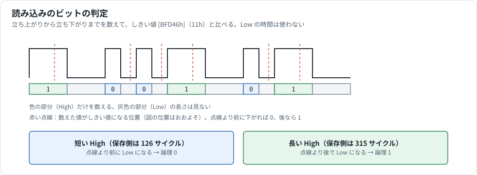

## 6.3 ブロック

テープは止まった状態から動き出すまでに時間がかかり、途中から再生されることもあります。そこで、データの前に長い一定の音（**搬送音**）と、決まった並びの印（**同期**）を置きます。読む側は搬送音で「ここから始まる」と気付き、同期でデータの始まりを正確に捉えます。

ファイルはヘッダブロック 1 個と本体ブロック 1 個以上からなります。

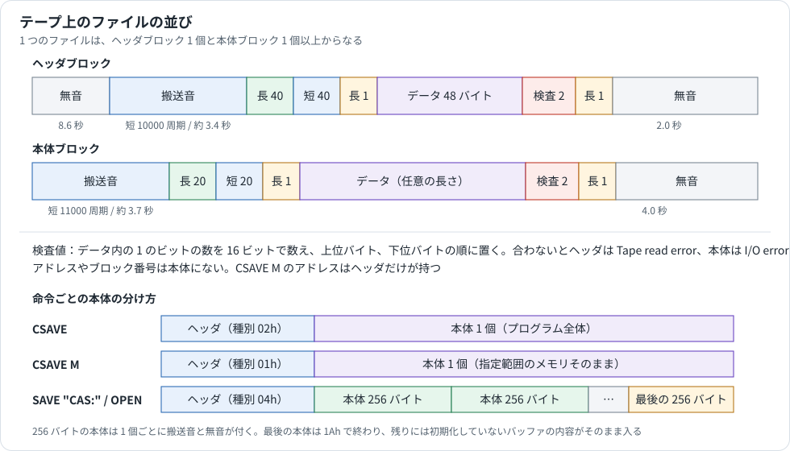

| 区間 | ヘッダ | 本体 | 実時間（換算） |
|---|---|---|---|
| 前の無音（モーターの待ちを含む） | あり | モーターの待ちだけ | 8.6 秒 / 0.6 秒 |
| 搬送音（短い周期） | 10000 | 11000 | 3.4 秒 / 3.7 秒 |
| 同期（長い周期） | 40 | 20 | |
| 同期（短い周期） | 40 | 20 | |
| 同期の終わり（長い周期） | 1 | 1 | |
| データ | 48 バイト | 任意 | |
| 検査値 | 2 バイト | 2 バイト | |
| 最後の長い周期 | 1 | 1 | |
| 後の無音 | あり | あり | 2.0 秒 / 4.0 秒。そのあとモーターを止めて待つ 0.3〜0.4 秒 |

**例（保存にかかる時間）**: 16 バイトを `CSAVE M` で保存すると、表の時間を足して、8.6 + 3.4 + 2.0 + 0.4 + 0.6 + 3.7 + 4.0 + 0.4 = 23.1 秒、そのほかに同期とヘッダ、データの音が約 0.7 秒で、全部で約 24 秒です。エミュレータで測った `RETURN` から `>` までは 24.0 秒でした（実験）。データの音はそのうち 0.3 秒ほどで、残りは無音と搬送音です。小さなファイルをたくさん保存すると、時間のほとんどが準備の音になります。

**検査値**はデータの中の 1 のビットの数を 16 ビットで数えたものです。上位バイト、下位バイトの順に置きます。すべての実験で一致しました。公式資料には検査値が 1 バイトとありますが、ROM は 2 バイト書いて 2 バイトとも比べます（`E9BFBh`）。

**例（検査値）**: `10 11 12 … 1F` の 16 バイトでは、どのバイトにも上位の 1 が 1 個あって合わせて 16 個、下位 4 ビットは 0〜15 が 1 回ずつで、1 のビットは 32 個です。合計 48 = 30h なので、検査値は `00 30` です（§6.5.2 の実例と一致します）。

**読み込みの同期**は次の順です（`E9DB5h`）。途中で条件から外れると最初に戻ります（コード）。

1. 短い周期が `BFD53h` 個（5000 個）続くのを待つ
2. 最初の長い周期を待ち、指定の個数の長い周期を数える
3. 指定の個数の短い周期を数える
4. 長い周期を待ち、データを読み始める

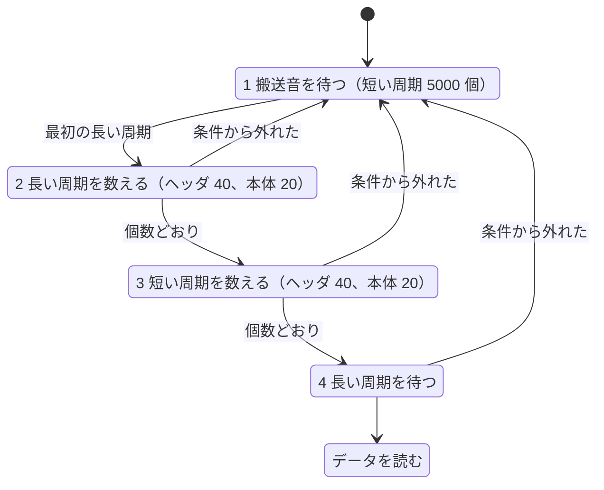

書くときの搬送音は 10000 個と 11000 個ですが、読むときは 5000 個で足ります。搬送音の初めの部分が少し欠けて再生されても、残りが 5000 個あれば読み始められます。

**本体にアドレスやブロック番号はありません**。読み込みはヘッダの情報と順番だけを頼りにします。本体の途中で読み違えると検査値が合わず、`I/O error` になりますが（ヘッダの読み違いは `Tape read error`。[カセットインターフェース](20_CASSETTE.md) §20.6.1）、そこまでのバイトはすでにメモリへ書き込まれています（実験）。ビットを 1 個入れ替えるような、1 の数が変わらない誤りは検出できません。

**例（検出できない誤り）**: `41h`（0100 0001b）が `81h`（1000 0001b）に化けても、1 の数はどちらも 2 個です。検査値は変わらないので、誤りに気付けません。

## 6.4 ヘッダブロック

ヘッダは 48 バイトで、種別、名前、長さ、アドレスが入ります。命令によって使う場所が違います。

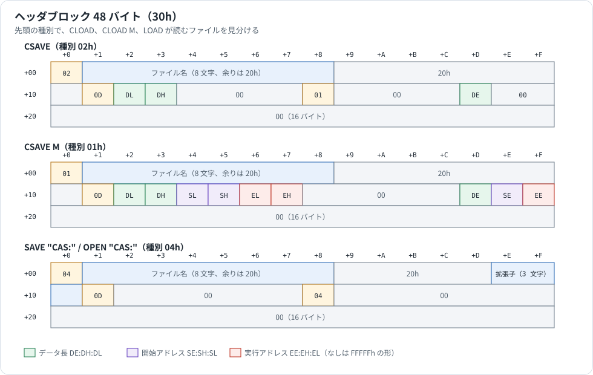

| オフセット | CSAVE（02h） | CSAVE M（01h） | SAVE、OPEN（04h） |
|---|---|---|---|
| `+00` | 02h | 01h | 04h |
| `+01`〜`+08` | 名前 | 名前 | 名前 |
| `+09`〜`+0D` | 20h | 20h | 20h |
| `+0E`〜`+10` | 20h | 20h | 拡張子（なければ 20h。`SAVE` は省くと `BAS`） |
| `+11` | 0Dh | 0Dh | 0Dh |
| `+12`、`+13` | 長さの下位 16 ビット | 長さの下位 16 ビット | 00h |
| `+14`、`+15` | 00h | 開始アドレスの下位 16 ビット | 00h |
| `+16`、`+17` | 00h | 実行アドレスの下位 16 ビット | 00h |
| `+18` | 01h | 00h | 04h |
| `+1D` | 長さの上位 | 長さの上位 | 00h |
| `+1E` | 00h | 開始アドレスの上位 | 00h |
| `+1F` | 00h | 実行アドレスの上位 | 00h |
| 残り | 00h | 00h | 00h |

名前は 8 文字までで、長い分は切り捨てられ、短い分は 20h で埋まります（実験）。`CSAVE` の名前に `.` や `*` を入れると `Syntax error` です。

公式資料の図では `CSAVE M` の `+0D`〜`+10` が 00h ですが、ROM は 20h を書きます（8.5 `EB4EBh`、実験）。

実例（`CSAVE M "CD",&HB8000,&HB800F`）:

```text
0000  01 43 44 20 20 20 20 20 20 20 20 20 20 20 20 20  .CD
0010  20 0D 10 00 00 80 FF FF 00 00 00 00 00 00 0B FF   ...............
0020  00 00 00 00 00 00 00 00 00 00 00 00 00 00 00 00
0030  00 34                                            検査値（1 のビット 34h 個）
```

長さ 10h、開始 `0B:8000h`、実行アドレスなし（`F:FFFFh`）を表します。`CSAVE M "A",&HC0000,&HFFFFF` なら、長さは `+12`=00h、`+13`=00h、`+1D`=04h（40000h）、開始は `+1E`=0Ch になります（実験）。

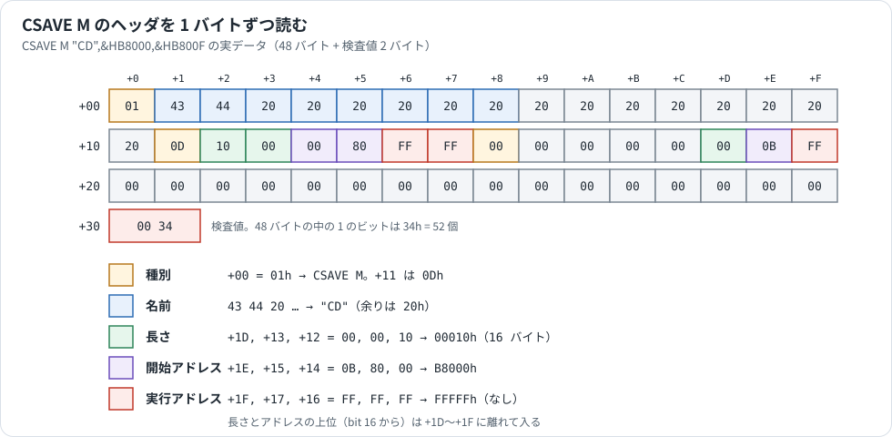

20 ビットの値が 2 か所に分かれているのが、この形の分かりにくいところです。下位 16 ビットは `+12`〜`+17` に、上位は `+1D`〜`+1F` にあります。

## 6.5 本体の中身

### 6.5.1 CSAVE、CLOAD

本体はメモリ上のプログラム領域そのものです。先頭 13h バイトの管理情報のあとに、中間コードの行が続き、`FFh` で終わります。行の形は公式資料（p.87）のとおりで、行番号（上位バイトが先）、長さ、中間コード、`0Dh` です。

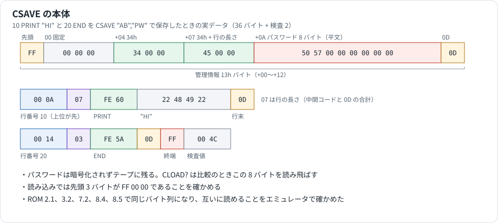

| オフセット | 内容 | 根拠 |
|---|---|---|
| `+00`〜`+03` | `FF 00 00 00` | 実験 |
| `+04`〜`+06` | プログラムの先頭（`+12` の `0Dh`）の位置。メモリブロックの先頭から数える（34h = 22h + 12h） | 実験 |
| `+07`〜`+09` | プログラムの終わりの位置（同じ数え方） | 実験 |
| `+0A`〜`+11` | パスワード（なければ 00h） | コード、実験 |
| `+12` | `0Dh`。プログラムの先頭の印 | 公式資料 |

この並びは RAM の中の `TEXT` ブロックの `+22` から先と同じです（[メモリ](03_MEMORY.md) §3.3.3）。`+04` と `+07` の位置がブロックの先頭（ヘッダ 22h バイトを含む）から数えてあるのは、そのためです。

**例（図の本体を読む）**: `10 PRINT "HI"` と `20 END` の本体は次のとおりです。

| バイト | 意味 |
|---|---|
| `FF 00 00 00` | 種類の印 |
| `34 00 00` | プログラムの先頭。34h − 22h = 12h、つまり `+12` |
| `45 00 00` | 終わり。45h − 22h = 23h、つまり `+23` の `FFh` |
| `50 57 00 00 00 00 00 00` | パスワード `PW` |
| `0D` | 先頭の印 |
| `00 0A` `07` `FE 60 22 48 49 22 0D` | 行 10、長さ 7、`PRINT` `"HI"` 行末 |
| `00 14` `03` `FE 5A 0D` | 行 20、長さ 3、`END` 行末 |
| `FF` | 終わり |

パスワードは平文のまま本体に入るので、テープからそのまま読めます。

読み込みの動作は次のとおりです。

| 命令 | 動作 | 根拠 |
|---|---|---|
| `CLOAD` | 先頭 3 バイトが `FF 00 00` であることを確かめて読む（`E9B46h`） | コード、実験 |
| `CLOAD?` | メモリと 1 バイトずつ比べる。パスワードの 8 バイトは飛ばす（`E9B42h`）。違えば `Verify error` | コード、実験 |
| 名前が違う | エラーにせず次のヘッダを探し続ける | マニュアル、実験 |
| 空きが足りない | 読む前に長さで判定してエラーにする | コード |

`CSAVE` から `CLOAD` までの流れを、テープを挟んで並べると次のようになります。

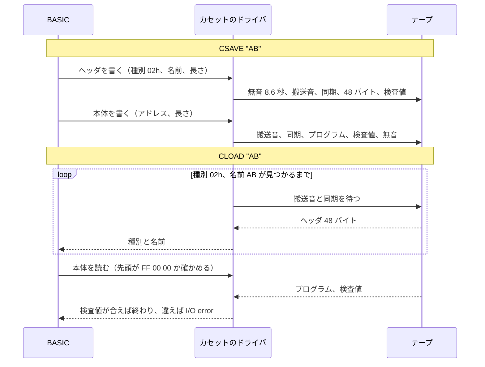

### 6.5.2 CSAVE M、CLOAD M

本体は指定した範囲のメモリそのままです。管理情報はなく、長さの分のバイトと検査値だけが並びます。

```text
CSAVE M "CD",&HB8000,&HB800F の本体
0000  10 11 12 13 14 15 16 17 18 19 1A 1B 1C 1D 1E 1F
0010  00 30                                            検査値
```

| 書き方 | 読み込み先 | 実行 |
|---|---|---|
| `CLOAD M` | ヘッダの開始アドレス | 実行アドレスがあれば実行する |
| `CLOAD M "CD"` | ヘッダの開始アドレス | 実行アドレスがあれば実行する |
| `CLOAD M &HB8100` | 指定のアドレス | しない |
| `CLOAD M "CD",&HB8100` | 指定のアドレス | しない |

いずれも実験で確かめました。実行は `JP` で飛び、`RETF` で BASIC に戻ります（`EB654h`）。名前とアドレスの区切りは `,` か `;` です（コード）。

> [!TIP]
> 読み込んだだけで動かしたくないときは、アドレスを書きます。アドレスを書いた `CLOAD M` は、ヘッダに実行アドレスがあっても実行しません。

`CSAVE M` は `開始` より `終了` が小さいと `Data out of range`、`終了` がないと `Syntax error` です（実験）。

ROM の領域も指定できます。`CSAVE M "A",&HC0000,&HFFFFF` の音を波形からバイト列に戻すと、ROM 3.2 の 256 KB と完全に一致しました（実験）。プログラムを打ち込まずに、この 1 行で内容を外へ出せます。

### 6.5.3 SAVE、OPEN（種別 04h）

ファイル制御（FCS）を通るファイルは、本体を 256 バイトずつに分けます。`SAVE "CAS:AB"` の本体は ASCII のプログラムです。

```text
0000  31 30 20 50 52 49 4E 54 20 22 48 49 22 0D 0A 32  10 PRINT "HI"..2
0010  30 20 45 4E 44 0D 0A 1A ...                      0 END...
```

- 行末は `0Dh 0Ah`、ファイルの終わりは `1Ah` です。
- 最後の本体も 256 バイトで、`1Ah` より後ろには初期化していないバッファの内容がそのまま入ります（実験で、前のブロックの続きが残っていました）。読むときは `1Ah` までが中身です。
- 本体ごとに搬送音と無音が付くので遅くなります。約 1.1 KB のプログラムで本体 5 個、全体で 65.7 秒でした（ROM 3.2、5.3、7.2、8.3、8.5。実験）。本体 1 個あたり約 10 秒です。

3 つの保存の形を比べると、次のようになります。

| | `CSAVE` | `CSAVE M` | `SAVE "CAS:"` |
|---|---|---|---|
| 本体の数 | 1 個 | 1 個 | 256 バイトごとに 1 個 |
| 中身 | 中間コード | メモリそのまま | 文字 |
| 長さの情報 | ヘッダ | ヘッダ | 終わりの `1Ah` |
| 誤りの範囲 | 全体が 1 つの検査値 | 全体が 1 つの検査値 | 256 バイトごとの検査値 |

`OPEN` は `PRINT #` の出力をそのまま並べます。`PRINT #2,"HELLO"` と `PRINT #2,123` の本体は `HELLO\r\n 123 \r\n` のあとに `1Ah` が続き、`INPUT #2,A$,B` で読み戻せました（実験）。`CAS:` は同時に 1 ファイルしか開けません（マニュアル）。

### 6.5.4 COM: を開いたままテープを使ったとき

テープの入出力を始める処理（`EA2F7h`）は、COM が開いていれば受信を止めてから割り込みを止めます。`RR` などを下げ、XON/XOFF の指定があれば `13h` を送り、少し待ちます（コード）。信号の意味は [15 ピン（シリアル）](07_PORT_15PIN.md) を参照してください。

テープの入出力中は割り込みが止まっています（§6.2.3）。シリアルの受信は割り込みで動くので、その間に届いたデータは受け取れません。先に相手へ止まるように伝えておく必要があるわけです。

## 6.6 CLOAD @

`CLOAD` の構文解析に `@` の分岐があり、`CLOAD @` と `CLOAD @"AB"` は受け付けられて入力待ちになります（実験）。`CSAVE @` は `Syntax error` です。コードから読み取れる形は本資料のほかの形式と別物で、種別 7xh を持つ以前の機種の形式です（`EA05Dh`）。

| 項目 | 内容 |
|---|---|
| ビット | 区間内の変化の数を数え、しきい値と比べて判定する（`EA3FFh` 付近） |
| 単位 | 4 ビットを 1 単位として読み、2 単位で 1 バイト |
| ヘッダ | `07h` のあとに 0〜3 の種別、名前 8 バイト（`F5h` と 7 文字。逆順）、検査値 |
| パスワード | 種別のビット 0 が立っていれば 8 バイト追加 |
| 本体 | 120 バイトごとに検査値が入り、`FFh` 2 個と検査値で終わる |
| 検査値 | 上下の 4 ビットを足し合わせる 8 ビット |

読み込んだ中間コードは PC-E500 のものに変換します。操作説明書の付録 G（p.353）によると、対象は PC-1401、PC-1402、PC-1403（H）、PC-1425、PC-1450、PC-1460、PC-1475、PC-1360 のプログラムです（マニュアル）。この形の波形を自分で作って読ませると、ROM 7.2 と 8.5 で読み込めました（実験）。信号、4 ビットの単位、名前の並び、検査値の数え方、変換の表は [カセットインターフェース](20_CASSETTE.md) §20.10 にまとめました。

§6.2〜§6.4 の形式との違いをまとめると、ビットの表し方（周期の長さではなく変化の数）、読む単位（8 ビットではなく 4 ビット）、検査値（1 の数ではなく 4 ビットの足し算）の 3 つです。

## 6.7 IOCS からの呼び方

機械語からは IOCS を通してテープを読み書きできます。テープは IOCS の device 4 です（公式資料 p.62〜63）。`(cx)=0004h` として呼びます。

| i | 内容 | 入力 | 戻り |
|---|---|---|---|
| 3Fh | 作業域を初期化する | | |
| 40h | 初期化 | a: 0 全リセット、1 リセット、2 off、3 on | |
| 41h | 本体を書く | x: アドレス、y: バイト数 | C=0 正常。x: 次のアドレス、y: 処理したバイト数 |
| 42h | 本体を読む | x: アドレス、y: バイト数 | 同上 |
| 43h | 本体を比べる | x: アドレス、y: バイト数 | 同上 |
| 44h | ヘッダを書く | x: ヘッダのアドレス | C=1 のとき a: エラーコード |
| 45h | ヘッダを読む | x: ヘッダのアドレス | 同上 |

エラーコードのうち、`FFh` は `BREAK`、`FEh` は電池切れ、`0Bh` は比較の不一致、`00h` は検査値の不一致や読み取りの失敗です（コード）。

呼ぶ順番は、保存なら 44h（ヘッダ）→ 41h（本体）、読み込みなら 45h（ヘッダ）→ 42h（本体）です。ヘッダの 48 バイトは呼ぶ側が用意するか、受け取って調べます。

ROM の中のエントリは次のとおりです（8.5、遠い呼び出し `CALLF`）。

| アドレス | 内容 |
|---|---|
| `E9AB0h` / `E9AE0h` | ヘッダを書く / 読む（X: アドレス、30h バイト） |
| `E9B12h` | 本体を書く（X: アドレス、Y: バイト数） |
| `E9B5Ah` | 本体を読む |
| `E9B46h` | 本体を読む（`FF 00 00` を確かめる。`CLOAD`） |
| `E9B42h` | 本体を比べる（パスワードを飛ばす。`CLOAD?`） |
| `E9BB8h` | 本体を比べる |

BASIC の命令の処理は `CSAVE` が `FDFEFh`、`CLOAD` が `FE0D8h`、`CSAVE M` が `EB45Eh`、`CLOAD M` が `EB555h` です。

## まとめ

| 覚えること | 値 |
|---|---|
| ビット | 短い周期（約 3.0 kHz）が 0、長い周期（約 1.2 kHz）が 1 |
| バイト | 開始の長い周期 1 個 + 8 ビット（上位から） |
| ブロック | 搬送音、同期（長、短、長 1）、データ、検査値 2 バイト、長 1 |
| 検査値 | データの中の 1 のビットの数（16 ビット、上位が先） |
| ヘッダ | 48 バイト。種別 01h `CSAVE M`、02h `CSAVE`、04h `SAVE`、`OPEN` |
| 長さとアドレス | 下位 16 ビットは `+12`〜`+17`、上位は `+1D`〜`+1F` |
| 信号の長さの設定 | `BFD42h`〜`BFD56h` |
| ポート | 出力は `FDh`、入力は `FFh` のビット 1 |
| 11 ピンの向き | 5 番 DOUT が出力、8 番 DIN が入力。DOUT、IO2、IO1 は ACK が High のとき読める |
| 読み込みの失敗 | `I/O error`（ヘッダは `Tape read error`）。途中までのバイトはメモリに書き込まれている |
| IOCS | device 4（`(cx)=0004h`） |

## 情報源と確度

| 表記 | 情報源 | 内容 |
|---|---|---|
| **公式資料** | PC-E500 Technical Reference Manual（p.62〜66、p.87） | ドライバの呼び方、作業域、ヘッダの形 |
| **公式** | PC-E500、PC-E500S のサービスマニュアル | 端子の表、検査の表、治具（PC-E500 p.3〜4、8〜10、PC-E500S p.3〜4、10〜11） |
| **マニュアル** | PC-E500 Operation Manual | 命令の書式、レコーダの条件 |
| **コード** | ROM 8.5 と 3.2 の逆アセンブル | 公式資料にない処理の流れ |
| **回路図** | PC-E500 Service Manual の回路図を読んだもの | 線と CPU のつながり |
| **実験** | エミュレータの作業用コピー | XOUT の変化をサイクル単位で記録し、記録した波形を CI に入れて読ませた。主に ROM 3.2 で試し、2.1、7.2、8.4、8.5 でも確かめた |
| **実機** | PC-U6000 の `CSAVE M` のブザー音の録音 | 周期の実時間だけに使った |

**試していないこと**

- カセットレコーダ、CE-124、CE-126P を使った保存と読み込み。実機の録音で確かめたのは保存側の音だけで、実機の `CLOAD` は試していません。

## 次に読むもの

- [カセットインターフェース](20_CASSETTE.md): つなぎ方、操作、エラー、`CLOAD @`
- [15 ピン（シリアル）](07_PORT_15PIN.md): もう 1 つの通信の口
- [CE-140F の通信](17_CE-140F_DISK.md)、[CE-126P プリンタ](18_CE-126P_PRINTER.md): 同じコネクタにつなぐ機器
- [BASIC の内部形式](15_BASIC_INTERNALS.md): 中間コード
- [起動、割り込み、タイマ、音](10_SYSTEM.md) §10.5: ブザーと CO の出力
