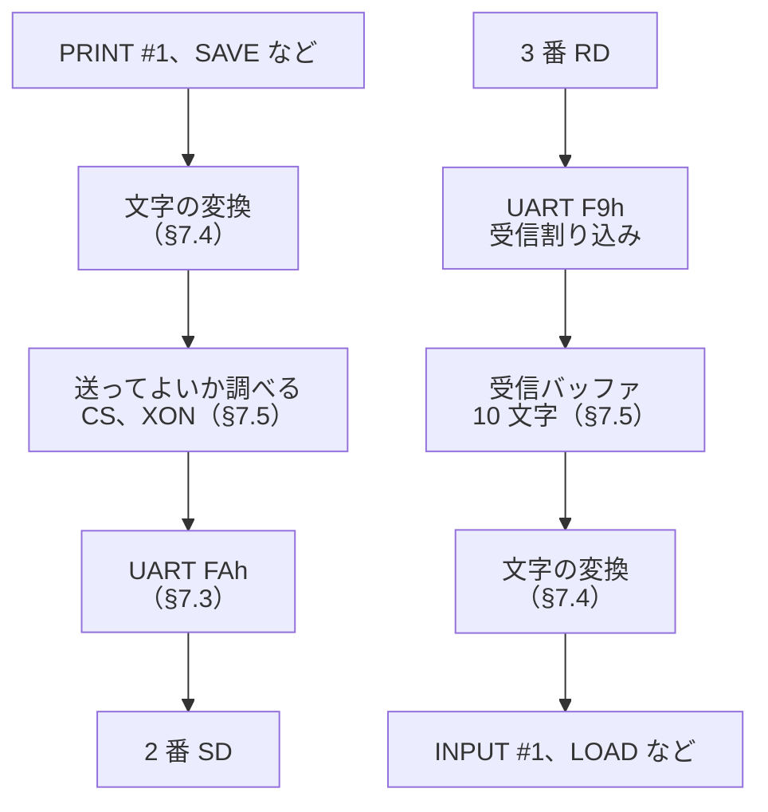
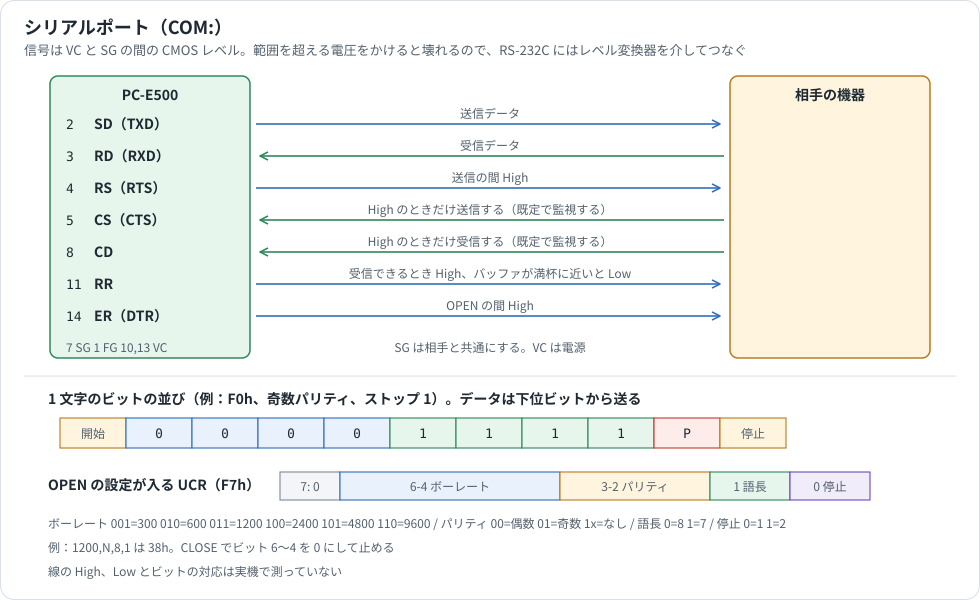
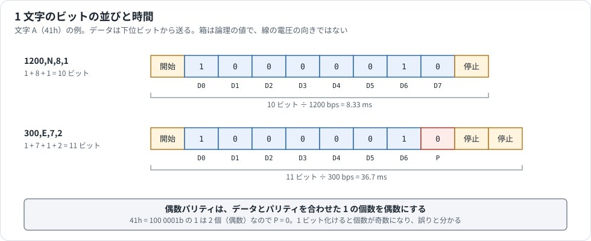
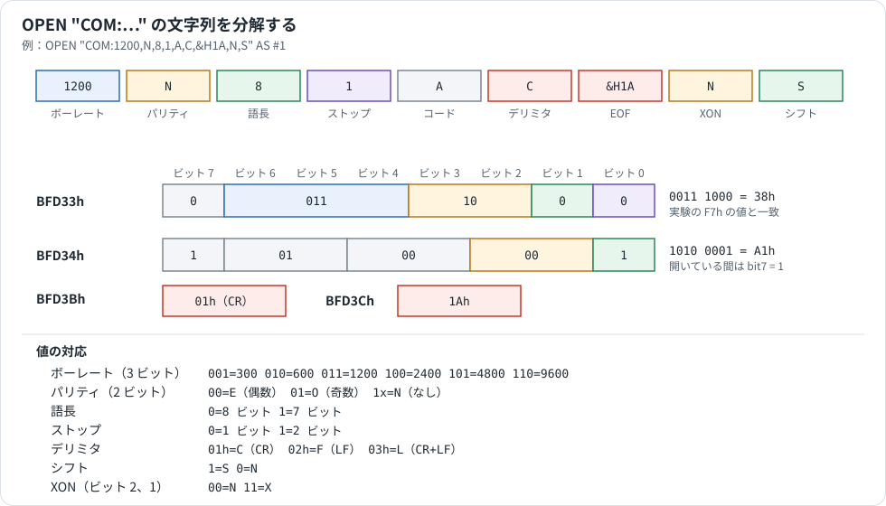
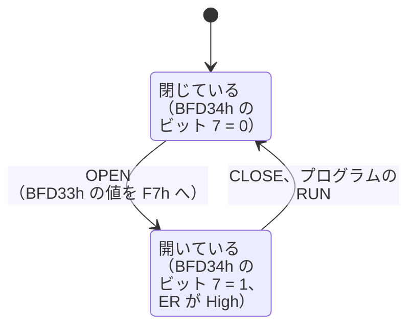
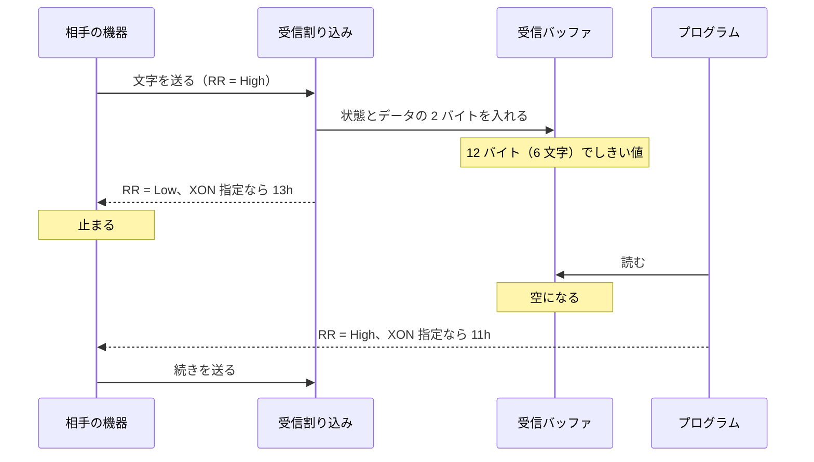
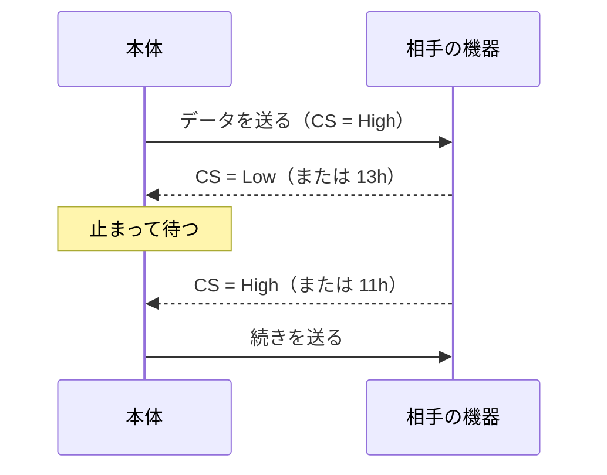
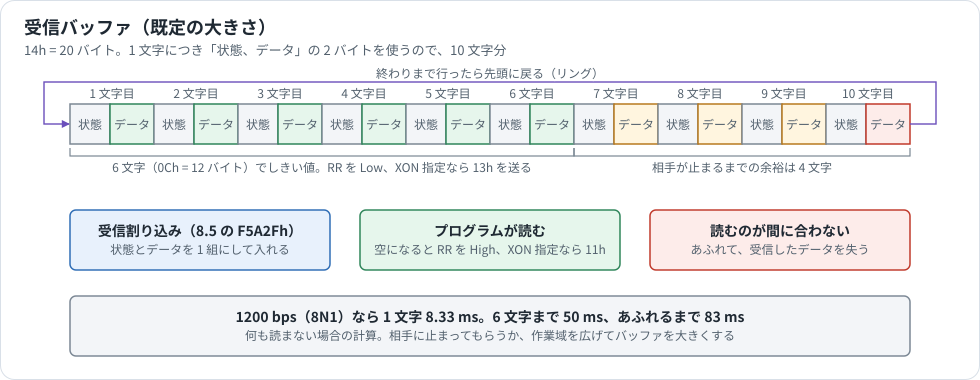
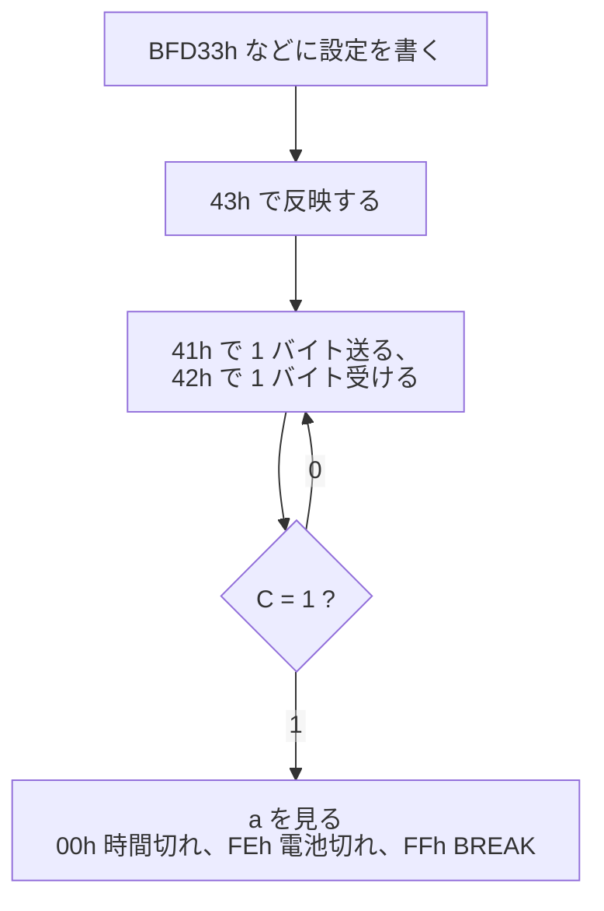

# 7. 15 ピン（シリアル）

この章はパソコンや別のポケコン、プロッタとつなぐための口を説明します。つないだのに 1 文字も届かない、途中から文字が化ける、最後まで終わらない、という 3 つの困りごとのどれに当たっても、原因を順に探せるようになることが目標です。15 ピンのコネクタと、そこで動くシリアルポート（`COM:`）の章です。ピン配置、信号線、`OPEN` の設定、文字の変換、フロー制御を説明します。

[目次へ戻る](README.md)

## この章で分かること

- 15 本のピンの役割と、CPU のどの端子につながるか
- `OPEN "COM:…"` の 9 つの項目の意味と、設定が入るアドレス
- 1 文字が何ビットになり、どれだけの時間がかかるか
- 行末、終わりの印、かなの送り方（文字の変換）
- 送りすぎ、受けそこないを防ぐフロー制御と、小さな受信バッファ
- IOCS から 1 バイトずつ送受信する方法

## 7.0 はじめに

シリアル通信は 8 ビットのデータを 1 本の線で 1 ビットずつ順番に送る方法です。線の数が少なくて済む代わりに、送る側と受ける側が同じ規約を守らなければなりません。規約は次の 4 つです。

| 規約 | 内容 | `OPEN` の項目 |
|---|---|---|
| 速さ | 1 秒に何ビット送るか | ボーレート |
| 1 文字の形 | データのビット数、パリティ、ストップビット | 語長、パリティ、ストップ |
| 文字の決まり | 行の終わり、ファイルの終わり、かなの送り方 | デリミタ、EOF、シフト |
| 止まってほしいときの合図 | 信号線か、特別な文字か | XON |

この章はこの順に説明していきます。



BASIC の命令の書式は [BASIC の命令と関数](14_BASIC_REFERENCE.md)、IOCS の呼び方は [IOCS と FCS](11_IOCS.md)、つなぐ機器は [周辺機器](16_PERIPHERALS.md) §16.6、11 ピンとテープは [11 ピン（テープ、周辺機器）](06_PORT_11PIN.md) を参照してください。（公式資料）（実験）などの印の意味と、試していないことは、章末の「情報源と確度」にあります。

アドレスは ROM 8.5 のものです。COM のドライバ（`EAA86h`〜）は、ROM 3.2 では 2E4h 足したアドレスにあります。受信割り込みは 8.5 の `F5A2Fh`、3.2 の `F614Ch` です。ほかのバージョンは [ROM バージョンの違い: 行列演算とドライバ](25_ROM_VERSIONS_DRIVERS.md) を参照してください。

### 7.0.1 ピン配置

テクニカルリファレンス p.59 の表です。6、9、12、15 番は公式の表になく、個人サイトの表で補いました。

| ピン | 記号 | 向き | 内容 | 出典 |
|---|---|---|---|---|
| 1 | FG | | フレームグラウンド | 公式 |
| 2 | SD（TXD） | 出力 | 送信データ | 公式 |
| 3 | RD（RXD） | 入力 | 受信データ | 公式 |
| 4 | RS（RTS） | 出力 | 送信要求。送っている間 High、終わると Low | 公式 |
| 5 | CS（CTS） | 入力 | 送信可 | 公式 |
| 6 | | | 未接続 | 個人 |
| 7 | SG | | 信号用接地 | 公式 |
| 8 | CD | 入力 | キャリア検出。Low の間は受け取らない（表の文は「送信」ですが、作業域の説明は受信の条件です） | 公式 |
| 9 | | | 未接続 | 個人 |
| 10 | VC | | 電源電圧 | 公式 |
| 11 | RR | 出力 | 受信可 | 公式 |
| 12 | PAC | 入力 | ペリフェラル応答。サービスマニュアルは「未使用」 | 個人 |
| 13 | VC | | 電源電圧 | 公式 |
| 14 | ER（DTR） | 出力 | OPEN 中に High | 公式 |
| 15 | PRQ | 出力 | ペリフェラル要求。サービスマニュアルは「未使用」 | 個人 |

線は 4 つの組に分けると覚えやすくなります。

| 組 | 線 | 役割 |
|---|---|---|
| データ | SD、RD | 送るデータ、受けるデータ |
| 送信の制御 | RS、CS | RS は送りたいという合図、CS は相手の「送ってよい」 |
| 受信の制御 | RR、CD | RR はこちらの「受けられる」、CD は相手がいる合図 |
| 状態と電源 | ER、FG、SG、VC | ER は開いている合図、SG は電圧の基準 |

### 7.0.2 CPU とのつながり（回路図）

制御の出力はキーボードのスキャンに使う KO の上位のピン（KO12〜KO15）から出ます。

| ピン | 信号 | CPU | 内部 RAM |
|---|---|---|---|
| 2 | SD | TXD | `FAh` が送信データ |
| 3 | RD | RXD | `F9h` が受信データ |
| 4 | RS | KO12 | `F1h` ビット 4 |
| 5 | CS | E2 | `F5h` ビット 2 |
| 8 | CD | E1 | `F5h` ビット 1 |
| 10、13 | VC | VCC | |
| 11 | RR | KO13 | `F1h` ビット 5 |
| 12 | PAC | E0 | |
| 14 | ER | KO14 | `F1h` ビット 6 |
| 15 | PRQ | KO15 | `F1h` ビット 7 |

回路図の 2 番の記号は `CD` と印刷されていますが、線は TXD につながっています。12 番は回路図では `PAR`、15 番と 12 番はサービスマニュアルの説明では「未使用」です。

### 7.0.3 電気的な条件

信号は CMOS レベル（4〜6 V）です（公式）。High は VC の電圧、Low は SG の電圧で、SG と VC の間を外れる電圧を入力に加えると、内部の CMOS の部品が壊れることがあります（公式 p.59）。範囲を超える電圧をかけると壊れるので、RS-232C に直結してはいけません（公式）。RS-232C のパソコンとつなぐには、レベルコンバータを使います（[周辺機器](16_PERIPHERALS.md) §16.6）。

> [!WARNING]
> 「シリアル」という名前が同じでも、RS-232C とは電圧が違います。コネクタの形が合っても、間にレベルコンバータが要ります。

## 7.1 全体像



UART を使う調歩同期の通信です。調歩同期とは、時計の線を使わず、1 文字ごとに開始の印（スタートビット）を付けて、そこから受ける側が自分の時計で数える方式です。UART は 8 ビットのデータを 1 ビットずつ順番に並べ替える回路で、CPU に入っています。

テープと違い、ヘッダもブロックも検査値もなく、テキストをそのまま流します。CE-515P プロッタもこのポートを使います（[CE-515P プロッタ](19_CE-515P_PLOTTER.md)）。

### 7.1.1 1 文字の形と時間

1 文字はスタートビット 1 個、データ（7 または 8 ビット。下位から）、パリティ（あれば 1 ビット）、ストップビット（1 または 2 個）の順に並びます。



1 文字のビット数が分かれば、送れる文字の数も計算できます。下の表はスタート 1 + データ 8 + ストップ 1 の 10 ビット（`N,8,1`）で計算した値です。

| ボーレート | 1 ビット | 1 文字 | 1 秒あたり | 10000 文字 |
|---|---|---|---|---|
| 300 | 3.33 ms | 33.3 ms | 30 文字 | 約 333 秒 |
| 600 | 1.67 ms | 16.7 ms | 60 文字 | 約 167 秒 |
| 1200 | 0.83 ms | 8.3 ms | 120 文字 | 約 83 秒 |
| 2400 | 0.42 ms | 4.2 ms | 240 文字 | 約 42 秒 |
| 4800 | 0.21 ms | 2.1 ms | 480 文字 | 約 21 秒 |
| 9600 | 0.10 ms | 1.0 ms | 960 文字 | 約 10 秒 |

**パリティ**は 1 文字の中の 1 の個数を偶数（`E`）または奇数（`O`）にそろえるための 1 ビットです。1 ビットだけの誤りなら見つけられますが、2 ビットが同時に化けると見逃します。

## 7.2 OPEN の設定

シリアルポートを使うには、`OPEN` で通信条件を決めます。

```basic
OPEN "COM:ボーレート,パリティ,語長,ストップ,A,デリミタ,EOF,XON,シフト" AS #n
```

| 項目 | 値 | 入る場所 |
|---|---|---|
| ボーレート | 300、600、1200、2400、4800、9600 | `BFD33h` ビット 6〜4 |
| パリティ | `N`、`E`、`O` | `BFD33h` ビット 3〜2 |
| 語長 | 7、8 | `BFD33h` ビット 1 |
| ストップビット | 1、2 | `BFD33h` ビット 0 |
| コード | `A`（ASCII のみ） | |
| デリミタ | `C` CR、`F` LF、`L` CR+LF | `BFD3Bh` |
| EOF コード | `&H00`〜`&HFF` | `BFD3Ch` |
| XON | `N`、`X` | `BFD34h` ビット 2、1 |
| シフト | `S`、`N` | `BFD34h` ビット 0 |



`OPEN` の実行で `BFD33h` の値が UCR（`F7h`）に入ります。エミュレータで読んだ値は次のとおりです（実験）。

| OPEN | `F7h` | `BFD34h` | `BFD3Bh` | `BFD3Ch` |
|---|---|---|---|---|
| `1200,N,8,1,A,C,&H1A,N,S` | 38h | A1h | 01h | 1Ah |
| `300,E,7,2,A,F,&H0B,X,N` | 13h | A6h | 02h | 0Bh |
| `9600,O,8,1,A,L,&H1A,N,N` | 64h | A0h | 03h | 1Ah |
| `4800,N,7,1,A,C,&H1A,N,S` | 5Ah | A1h | 01h | 1Ah |
| `600,N,8,2,A,C,&H1A,N,N` | 29h | A0h | 01h | 1Ah |

**例（表の値を読む）**: 2 行目の `300,E,7,2,A,F,&H0B,X,N` は `F7h` が 13h = 0001 0011b です。ビット 6〜4 が 001 で 300 bps、ビット 3〜2 が 00 で偶数パリティ、ビット 1 が 1 で 7 ビット、ビット 0 が 1 でストップ 2 です。`BFD34h` の A6h = 1010 0110b は、ビット 7 が 1（開いている）、ビット 2、1 が 11（XON 指定）、ビット 0 が 0（シフトなし）です。

**例（値を作る）**: `9600,O,8,1` なら、9600 の 110、奇数の 01、8 ビットの 0、ストップ 1 の 0 を並べて 0110 0100b = 64h。表の 3 行目と合います。

`BFD34h` のビット 7 は開いている間だけ立ちます。`CLOSE` で `F7h` のビット 6〜4 が 0 になり、`F1h` の信号も下がります。プログラムの `RUN` でも閉じます（マニュアル、実験）。



## 7.3 ポート

シリアルに関わる CPU のレジスタ（内部 RAM）は次のとおりです。ふつうは ROM のドライバが操作するので、直接触る必要はありません。

| ポート | ビット | 内容 | 根拠 |
|---|---|---|---|
| `F7h` UCR | 上の表 | ボーレート、パリティ、語長、ストップ | 公式資料、実験 |
| `F8h` USR | 3、4 | 送信できる状態。両方 1 で送る（`EB047h`） | コード |
| `F8h` USR | 0〜2 | 受信の状態。受信データと一緒に保存する | コード |
| `F9h` | | 受信データ | コード |
| `FAh` | | 送信データ | コード、実験 |
| `F1h` | 6、5、4 | ER、RR、RS の出力 | 公式資料、コード |
| `F5h` | 2、1 | CS、CD の入力 | コード |
| `FCh` | 5 | 受信の割り込み要因 | 公式資料、実験 |

## 7.4 文字の変換

送るときに内部の表現を設定に合わせて変えます。`A$=CHR$(200)+"A"+CHR$(201)+"B"` を `PRINT #1,A$` して `CLOSE` したときの送信バイトです（実験）。

| OPEN | 送信バイト |
|---|---|
| `1200,N,8,1,A,C,&H1A,N,S` | `C8 41 C9 42 0D 1A` |
| `1200,N,7,1,A,C,&H1A,N,S` | `0E 48 0F 41 0E 49 0F 42 0D 1A` |
| `1200,N,8,1,A,F,&H1A,N,N` | `C8 41 C9 42 0A 1A` |
| `1200,N,8,1,A,L,&H09,N,N` | `C8 41 C9 42 0D 0A 09` |

1 行目を左から読むと、`C8 41 C9 42` が 4 つの文字、`0D` が行末、`1A` が `CLOSE` で送られる終わりの印です。設定を変えると、次の 3 か所が変わります。

- デリミタ: 内部の `0Dh 0Ah` を、指定の行末に変えます。受信では逆に変えます（公式資料 p.55）。
- EOF: 内部の終わりは常に `1Ah` で、送受信で指定のコードに変えます。
- シフト: 語長 7 ビットで `S` のとき、80h 以上の文字を `0Eh`（SO）のあとに下位 7 ビットで送り、続いて `0Fh`（SI）を送ります。語長 8 ビットでは使いません。語長 7 ビットで `N` だと、`C8h` がそのまま送信レジスタに書かれます。

**例（シフトの読み方）**: 2 行目（語長 7、`S`）を分けて読むと、次のようになります。

| 送信バイト | 意味 |
|---|---|
| `0E` | ここから 80h 以上の文字（SO） |
| `48` | C8h の下位 7 ビット（C8h − 80h） |
| `0F` | ふつうの文字に戻す（SI） |
| `41` | `A` |
| `0E 49 0F` | C9h |
| `42` | `B` |
| `0D` | 行末（CR） |
| `1A` | 終わりの印 |

7 ビットでは 80h 以上を表せないので、前後に切り替えの印を付けて送るわけです。その代わり、80h 以上の文字は 1 文字が 3 バイトになり、時間も 3 倍かかります。

## 7.5 フロー制御

送る側が速すぎると、受ける側はデータを取りこぼします。そこで「待って」「送ってよい」を伝える仕組みが**フロー制御**です。方法は 2 つあります。

| 方法 | 使うもの | 伝え方 |
|---|---|---|
| 信号線による制御 | `CS`、`RR` などの線 | 線の High、Low |
| ソフトウェアによる制御（XON/XOFF） | データと同じ線 | `13h`（XOFF）で止まる、`11h`（XON）で再開 |

既定の作業域は信号線とソフトウェアの両方の制御を持ちます（公式資料 p.53〜58）。

| 方向 | 条件 | 動作 |
|---|---|---|
| 送信 | `CS` が Low | High になるまで待つ（`BFD37h` のビット 2 が既定で立っている） |
| 送信 | XON 指定で `13h` を受信 | `11h` を受けるまで止まる |
| 受信 | `CD` が Low | 受信したデータを捨てる（`BFD35h` のビット 1 が既定で立っている） |
| 受信 | バッファが満杯に近い | `RR` を Low にし、XON 指定なら `13h` を送る |
| 受信 | バッファが空になる | `RR` を High にし、XON 指定なら `11h` を送る |

この機械が受ける側のとき、やり取りは次のように進みます。



この機械が送る側のときは、相手が止める番です。



**待ち時間の上限は既定でありません**（`BFD31h`=FFFFh）。相手がつながっていないと `CS` が Low のままなので、`SAVE "COM:"` は `BREAK` を押すまで止まりません（マニュアル、実験）。

実験では、送信の途中で `13h` を入れると送信が止まり、`11h` を入れると再開しました。

### 7.5.1 受信バッファ

**受信バッファは小さく、既定で 10 文字分です。** 受信割り込み（8.5 `F5A2Fh`）が状態とデータの 2 バイトを 1 組にしてリングバッファに入れます。バッファの大きさは 14h バイト、`RR` を下げるしきい値は 0Ch バイト（6 文字分）でした（実験。`[E6h]` が指す領域の `+1Ch`、`+1Eh`）。あふれるとオーバーフローの印が立ち、受信したデータを失います。相手には `RR` か XON/XOFF で止まってもらう必要があります。作業域を広げれば、バッファも大きくできます（公式資料 p.85。[メモリ](03_MEMORY.md) §3.5）。



リングバッファは終わりまで使ったら先頭に戻って使い続ける入れ物です。入れる場所と取り出す場所を別々に覚えておくので、割り込みが入れている間に、プログラムは自分の速さで取り出せます。

**例（余裕の計算）**: 9600 bps の `N,8,1` では 1 文字が約 1.04 ms です。しきい値の 6 文字からあふれる 10 文字までは 4 文字分、約 4.2 ms しかありません。相手がこの間に止まれないと、データを失います。速い通信ほど、しきい値を下げるかバッファを広げる意味が大きくなります。

## 7.6 プログラムの転送

`SAVE "COM:"` と `LOAD "COM:"` は ASCII のプログラムを流すだけです。`10 PRINT "HI"` と `20 END` を既定の設定で `SAVE "COM:"` すると、次のバイト列になります（実験）。

```text
31 30 20 50 52 49 4E 54 20 22 48 49 22 0D 32 30 20 45 4E 44 0D 1A
1  0     P  R  I  N  T     "  H  I  "  CR 2  0     E  N  D  CR EOF
```

`LOAD "COM:"` に同じ形のバイト列を入れると、プログラムとして取り込めました（実験）。デリミタと EOF は設定で変わります（`L`、`&H09` での受信も確かめました）。検査値はないので、誤りは検出できません。パリティで見つけるか、読み込んだあとで確かめます。

**例（時間）**: 上のバイト列は 22 バイトです。1200 bps の `N,8,1` なら 22 × 10 ÷ 1200 = 約 0.18 秒です（送信の前後の待ちは含みません）。

パソコンとやり取りするときに合わせる項目は次のとおりです。

| 合わせるもの | パソコン側 | 合わないと |
|---|---|---|
| ボーレート、パリティ、語長、ストップ | 通信ソフトの設定 | 文字が化ける、受けられない |
| 行末 | ファイルの改行コードと `C`、`F`、`L` | 行の区切りが見つからない |
| 終わりの印 | ファイルの最後に EOF コードを置く | 終わりを待ち続ける |
| フロー制御 | 信号線、または XON/XOFF | 取りこぼす、または始まらない |

## 7.7 作業域

設定のバックアップは次のアドレスにあります。`OPEN` の項目にない設定（待ち時間や、どの線を見るか）も、ここで変えられます。

| アドレス | 既定値 | 内容 |
|---|---|---|
| `BFD31h` | FFFFh | 待ち時間の上限（n × 0.5 秒。FFFFh は無制限） |
| `BFD33h` | 3Ch | ボーレート、パリティ、語長、ストップ（ビット 7 は 0。ボーレート 000 は「なし」） |
| `BFD34h` | 21h | ビット 6 開くときに `BFD61h` の 1 バイトを送る、4 閉じるときに `BFD62h` の 1 バイトを送る、2 受信の X 制御、1 送信の X 制御、0 シフト |
| `BFD35h` | 02h | 受信の条件（ビット 2 CS、1 CD） |
| `BFD36h` | DFh | バッファ満杯で下げる信号（ビット 0 にした信号を下げる。6 ER、5 RR、4 RS） |
| `BFD37h` | 04h | 送信の条件（ビット 2 CS、1 CD） |
| `BFD38h` | 50h | 送信の前後で上げ下げする信号（6 ER、5 RR、4 RS） |
| `BFD39h` | 01h | 送信のかたまりの前後の待ち（n × 2 ms） |
| `BFD3Ah` | 03h | 公式資料に記載なし（起動直後の値。7.2、8.5） |
| `BFD3Bh` | 01h | デリミタ（01 CR、10 LF、11 CR+LF） |
| `BFD3Ch` | 1Ah | EOF コード |
| `BFD40h` | 04h | 開いた直後と閉じる直前の待ち（レベル変換器 CE-130T のため）。n × 5 ms。00h は 256 × 5 ms |
| `BFD41h` | 60h | OPEN で上げる信号（6 ER、5 RR、4 RS） |
| `BFD60h` | 00h | 送信の 1 バイトごとの待ち（n × 2 ms） |
| `BFD61h` / `BFD62h` | 11h / 13h | 開始時 / 終了時に送るバイト |

既定値はリセット後のエミュレータの値です（ROM 7.2 で読み直し、`BFD31h` から `FF FF 3C 21 02 DF 04 50 01 03 01 1A` でした）。`BFD41h` は公式資料では 41h ですが、ROM 3.2 と 8.5 の実験では 60h でした。ROM バージョンによるシリアルの違いは [ROM バージョンの違い: 行列演算とドライバ](25_ROM_VERSIONS_DRIVERS.md) §25.3.3 にあります。

表の読み方を補います。

- `BFD40h` の単位を、公式資料（p.56）は本文で「0.5 ms」と印刷していますが、同じ項目の既定値は「04h（20 ms）」、注は「00h は 256 × 5 ms」です。20 ÷ 4 = 5 なので、1 は 5 ms です。
- `BFD3Bh` の「01 CR、10 LF、11 CR+LF」は 2 進の表記です（公式資料は「ビット 1、0」の値として 00 使わない、01、10、11 を挙げています）。16 進では 01h、02h、03h で、§7.2 の実験の値と合います。
- `BFD36h` の DFh は 1101 1111b で、0 になっているのはビット 5 だけです。下げるのは `RR` だと分かります。
- `BFD38h` の 50h は 0101 0000b で、ビット 6（ER）とビット 4（RS）です。
- `BFD41h` の 60h は 0110 0000b で、ビット 6（ER）とビット 5（RR）です。
- `BFD33h` の既定値 3Ch は 0011 1100b です。ボーレートは 011 で 1200、パリティは 1x で「なし」、8 ビット、ストップ 1 です。公式資料（p.53）も 3Ch を「1200、パリティなし、8 ビット、ストップ 1」と読んでいます。`OPEN` で `1200,N,8,1` とした 38h とはビット 2 だけが違い、パリティなし（10 と 11 のどちらも）の意味は同じです。起動直後は 3Ch、`OPEN` で `N` を指定すると 38h になる、という違いで、食い違いではありません。

`BFD37h` のビット 2 を 0 にすると、`CS` を見ずに送る設定になります。線が 3 本（SD、RD、SG）だけの接続で関係する設定です。書き換えたあとは次の 43h を呼びます。

### 7.7.1 送信の時間の並び

`BFD38h`、`BFD39h`、`BFD60h` は、1 回の送信（データのかたまり）の前後と、1 バイトごとの待ちを決めます（公式資料 p.55）。

```text
RS  ____/‾‾‾‾‾‾‾‾‾‾‾‾‾‾‾‾‾‾‾‾‾‾‾‾‾‾‾‾‾‾‾‾‾‾\____
SD  --------<1 バイト>--<1 バイト>--…--<1 バイト>--------
        |←a→|        |←b→|                  |←a→|

a = BFD39h × 2 ms（前後の待ち。既定 2 ms）
b = BFD60h × 2 ms（1 バイトごとの待ち。既定 0）
```

受ける側の機器が 1 文字ごとの処理に時間を要するときは、`BFD60h` を増やすと、フロー制御の線がなくても取りこぼしを避けられます。

## 7.8 IOCS からの呼び方

機械語から 1 バイトずつ送受信するときは、IOCS を使います。シリアルは IOCS の device 2 です（公式資料 p.50〜52）。`(cx)=0002h` として呼びます。

| i | 内容 | 入力 | 戻り |
|---|---|---|---|
| 3Fh | パラメータとバッファを初期化する | | |
| 40h | 初期化 | a: 0 全リセット、1 リセット、2 off、3 on | |
| 41h | 1 バイト送る（変換なし） | a: データ | C=1 のとき a: 00h 時間切れ、FEh 電池切れ、FFh BREAK |
| 42h | 1 バイト受ける（変換なし） | | C=0 のとき a: データ。C=1 は同上 |
| 43h | 作業域の設定をハードウェアへ反映する | | |
| 44h / 45h | RS を High / Low にする | | |
| 46h / 47h | RR を High / Low にする | | |
| 48h / 49h | ER を High / Low にする | | |
| 4Ah / 4Bh | CS / CD を読む | | C=1 で High |

`BFD33h` などを書き換えたあとは 43h を呼びます（公式資料 p.53）。

3Fh は設定と受信バッファを「何も受けていない」状態に戻します（公式資料 p.50）。41h と 42h は変換をしないので、§7.4 のデリミタや EOF、シフトの処理は自分で行います。



## まとめ

| 覚えること | 値 |
|---|---|
| 電圧 | CMOS レベル（4〜6 V）。RS-232C に直結しない |
| 線 | 2 SD、3 RD、4 RS、5 CS、8 CD、11 RR、14 ER、7 SG |
| `OPEN` の順 | ボーレート、パリティ、語長、ストップ、`A`、デリミタ、EOF、XON、シフト |
| 設定の場所 | `BFD33h`、`BFD34h`、`BFD3Bh`、`BFD3Ch`。`F7h` に `BFD33h` の値が入る |
| 文字の変換 | 行末、終わりの印、7 ビットのシフト（SO、SI） |
| 送信が始まらない | `CS` が Low。待ち時間の上限は既定でない |
| 受信がこぼれる | バッファは 10 文字。6 文字で `RR` を下げる |
| 検査値 | ない。誤りはパリティか、読み込んだあとで確かめる |
| IOCS | device 2（`(cx)=0002h`）。設定を変えたら 43h |

## 情報源と確度

| 表記 | 情報源 | 内容 |
|---|---|---|
| **公式資料** | PC-E500 Technical Reference Manual（p.50〜59、p.91） | ドライバの呼び方、作業域、ピン配置、割り込み |
| **マニュアル** | PC-E500 Operation Manual | 命令の書式 |
| **コード** | ROM 8.5 と 3.2 の逆アセンブル | 公式資料にない処理の流れ |
| **回路図** | PC-E500 Service Manual の回路図を読んだもの | 線と CPU のつながり |
| **個人** | 愛好家のサイト | 公式の表にないピン |
| **実験** | エミュレータの作業用コピー | UART の送信レジスタへの書き込みを記録し、受信割り込みでデータを入れた。ROM 3.2 と 8.5 で試した |

**試していないこと**

- シリアルの実機接続。エミュレータの UART はビットの波形を持たないので、実験は UART レジスタへの書き込みと受信割り込みまでです。

## 次に読むもの

- [CE-515P プロッタ](19_CE-515P_PLOTTER.md): このポートを使う機器の例
- [周辺機器](16_PERIPHERALS.md) §16.6: パソコンとつなぐための機器
- [メモリ](03_MEMORY.md) §3.5: 受信バッファを広げる
- [11 ピン（テープ、周辺機器）](06_PORT_11PIN.md): もう 1 つの通信の口
