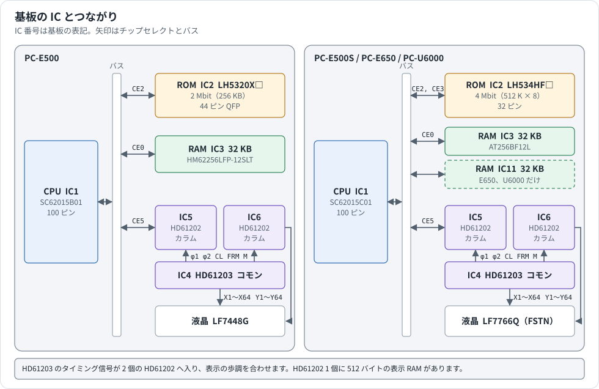
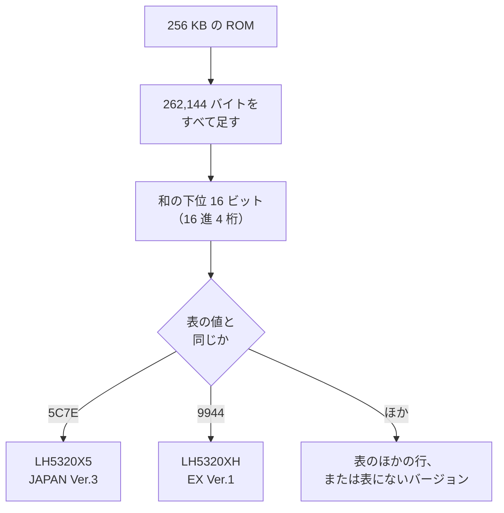
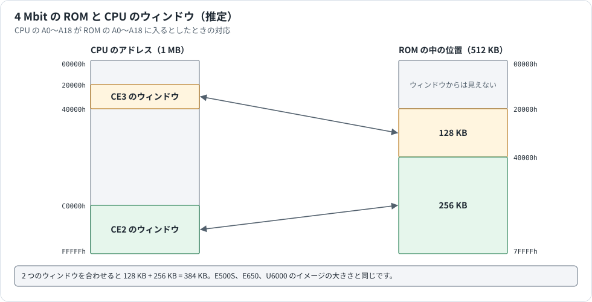
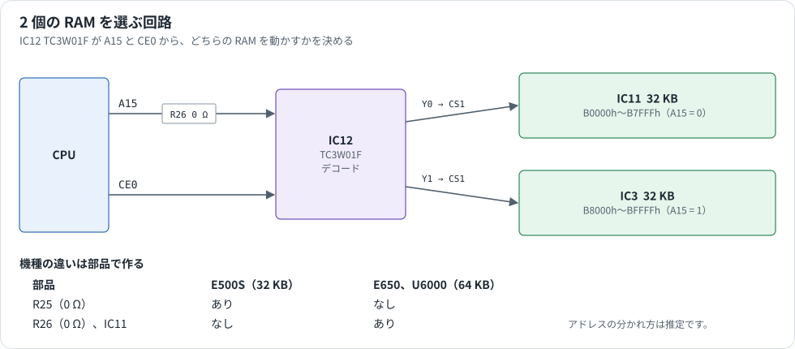
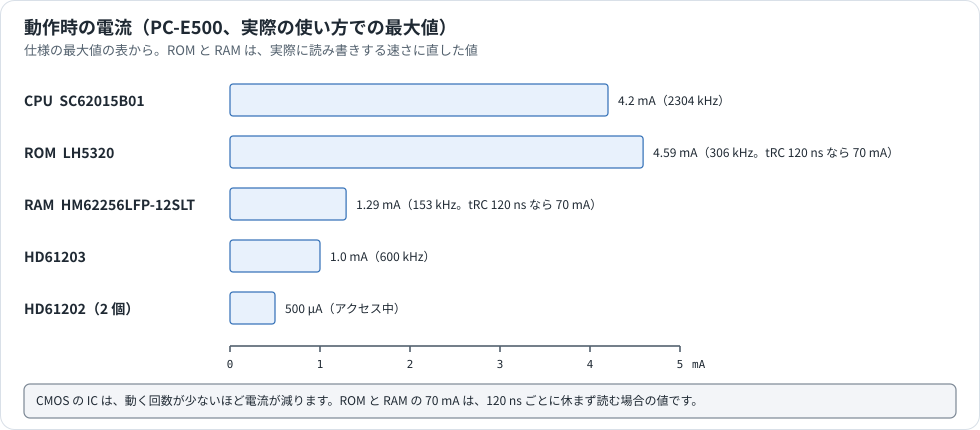
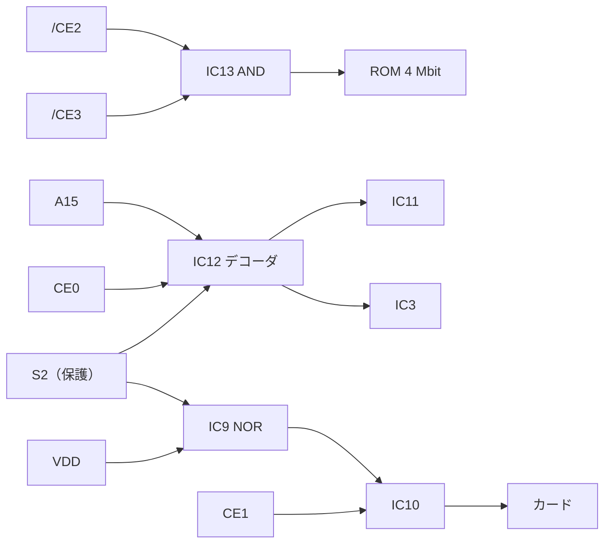

# 8. IC チップ

この章は本体を開けたときに見える黒い IC の 1 つ 1 つが、何という部品で、何をしているのかを説明します。ROM バージョンをチェックサムで見分ける方法や、64 KB の機種が 2 個の RAM をどう使い分けているかのように、型番が分かると解ける謎も扱います。

[目次へ戻る](README.md)

## この章で分かること

- 本体の主な IC（CPU、ROM、RAM、LCD のドライバ）の型番と役割
- PC-E500 と、PC-E500S、PC-E650、PC-U6000 の基板の違い
- マスク ROM の型番の末尾と、ROM バージョンの関係。チェックサムからの調べ方
- 4 Mbit の ROM が CPU の 2 つのウィンドウからどう見えるか
- 64 KB の RAM を持つ機種が 2 個の RAM をどう選んでいるか
- IC ごとの消費電流

## はじめに

ポケットコンピュータの基板に載っている大きな IC は、どの機種でも 4 種類です。

| 種類 | 役割 | 例え |
|---|---|---|
| CPU | 命令を実行し、キーやシリアルも受け持つ | 働く人 |
| ROM | 工場で書き込まれた、変えられないプログラムとデータ | 印刷された本 |
| RAM | プログラムや変数を置く、書き換えられるメモリ | ノート |
| LCD のドライバ | 画面の点を覚えて、液晶に電圧をかける | 掲示板の係 |

これらがアドレスバス（アドレスを伝える線）とデータバス（1 バイトを運ぶ線）を共有し、**チップセレクト**（CE0〜CE7）という線で、今答える IC を 1 つだけ選びます。型番が分かると、容量、速さ、電源の条件をデータシートで調べられ、修理や改造のときの手がかりになります。



使い方は次の資料にあります。

| 知りたいこと | 資料 |
|---|---|
| CPU の命令とレジスタ | [CPU（SC62015）](02_CPU.md) |
| CPU のピンの用途、チップセレクト | [回路とサービス](09_CIRCUIT.md) §9.3 |
| ROM の中身とバージョンの違い | [ROM マップ](21_ROM_MAP.md)、[ROM バージョンの違い: 配置](23_ROM_VERSIONS_MAP.md) |
| RAM の使われ方 | [メモリ](03_MEMORY.md) |
| LCD コントローラのアドレスと命令 | [液晶（LCD）](04_LCD.md) |

### 型番の読み方

シャープの ROM の型番では、末尾の文字が中身（バージョン）を表します。この章で `LH5320X□` のように書いた □ は、バージョンごとに変わる 1 文字です。部品表では `VHi…` で始まる番号で書かれています。メモリの容量は、IC の世界では bit で数えるので、2 Mbit = 256 KB、4 Mbit = 512 KB と読み替えます（8 bit = 1 バイト）。

## 8.1 一覧

IC の番号（IC1、IC2、……）は基板と回路図の表記です。PC-E500 と、PC-E500S、PC-E650、PC-U6000 の 2 つの系統に分かれます。

| 役割 | 番号 | PC-E500 | PC-E500S | PC-E650 | PC-U6000 |
|---|---|---|---|---|---|
| CPU | IC1 | SC62015B01 | SC62015C01 | SC62015C01 | SC62015C01 |
| ROM | IC2 | LH5320X□（2 Mbit） | LH534HF9（4 Mbit） | LH534HFB（4 Mbit） | LH534HF7（4 Mbit） |
| RAM | IC3 | HM62256LFP-12SLT（32 KB） | AT256BF12L（32 KB） | AT256BF12L（32 KB） | AT256BF12L（32 KB） |
| RAM の 2 個目 | IC11 | なし | なし | AT256BF12L（32 KB） | AT256BF12L（32 KB） |
| コモンドライバ | IC4 | HD61203 | HD61203 | HD61203 | HD61203 |
| カラムドライバ（LCD コントローラ） | IC5、IC6 | HD61202 | HD61202 | HD61202 | HD61202 |
| 液晶 | | LF7448G | LF7766Q（FSTN） | LF7766Q（FSTN） | LF7766Q（FSTN） |

E500S SM の「機種で違う部品」の表には、ROM、R25、R26、IC11 だけが載っています。ほかの部品は E500S、E650、U6000 で同じと読めます。

2 つの系統の主な違いは次のとおりです。RAM と液晶は型番も違います。

| 違い | PC-E500 | PC-E500S、PC-E650、PC-U6000 |
|---|---|---|
| CPU の末尾 | B01 | C01 |
| ROM の容量 | 2 Mbit | 4 Mbit |
| RAM の数 | 1 個 | E500S は 1 個、E650 と U6000 は 2 個 |

## 8.2 CPU

CPU は 1 個で、演算のほかにキーの走査、シリアル、カセットの入出力も受け持ちます。CPU の命令と動作は [CPU（SC62015）](02_CPU.md)、ここでは部品としての CPU を扱います。

| 項目 | PC-E500 | PC-E500S |
|---|---|---|
| 型番 | SC62015B01 | SC62015C01 |
| 部品表の記載 | `VHiSC62015B01` | `VHiSC62015C01` |
| ピン | 100 本。基板図では四辺にピンがある QFP | 同じ |
| クロック | セラミック発振子 2.3 MHz（部品表の記載。正確には 2.304 MHz） | 同じ |
| 動作電流（仕様の最大値） | 4.2 mA（2304 kHz） | 4.2 mA |

シャープの社内名は ESR-L です。命令とレジスタは [CPU（SC62015）](02_CPU.md) にあります。QFP は四角いパッケージの四辺から脚が出ている形です。

外部とつながるピンは次のとおりです（E500S SM）。ピンごとの用途は [回路とサービス](09_CIRCUIT.md) §9.3 にあります。

| ピン | 信号 | 内容 |
|---|---|---|
| 15〜22 | KI0〜KI7 | キー入力（マニュアルの表記は K10〜K17） |
| 23〜30 | DIO0〜DIO7 | データバス |
| 31〜49 | A0〜A18 | アドレスバス。19 本 |
| 52 | φD | 表示チップ用のクロック出力 |
| 53〜58 | KO15〜KO10 | シリアルの制御とキーストローブ |
| 61〜68 | CE7〜CE0 | チップセレクト |
| 73〜82 | KO9〜KO0 | キーストローブ |
| 83、84 | RXD、TXD | シリアル |
| 85〜100 | E15〜E0 | E ポート |

CPU のメモリ空間は 1 MB ですが、アドレスのピンは A18 までです。A19 に当たる区別はチップセレクトで行います。

**例:** 19 本のアドレス線で区別できるのは 2 の 19 乗 = 524,288 バイト（512 KB）です。`20000h`（CE3）と `A0000h`（CE0）は、A0〜A18 が同じ値になります。それでも混ざらないのは、動くチップセレクトが違うからです。

## 8.3 ROM

マスク ROM です。マスク ROM はチップを作る工程で中身を焼き付ける ROM で、あとから書き換えられません。中身は製造時に決まるので、バージョンが違うと型番の末尾が変わります。

### 8.3.1 PC-E500（2 Mbit）

| 項目 | 内容 | 根拠 |
|---|---|---|
| 型番 | `LH5320X` のあとにバージョンごとの 1 文字が付く（§8.3.2） | E500 SM |
| 容量 | 256 KB（2 Mbit） | 回路図 |
| 形 | 44 ピンの QFP | 回路図、基板図 |
| アドレス | A0〜A17 | 回路図 |
| 選択 | CE2（`C0000h`〜`FFFFFh`） | ブロック図 |
| サイクル時間（仕様） | 120 ns | 電流の表 |

マニュアルの中の表記は次のように分かれています。

| 場所 | 表記 |
|---|---|
| 部品表 | `LH5320XH`（`VHiLH5320XH-1`） |
| 回路図、基板図 | `LH5320XD` |
| ブロック図 | `LH5320 X 1` |
| 電流の表 | `LH5320x1 (2Mb ROM)`。同じ表に `HD61202 (x2)` とあるので、`x1` は「1 個」の意味です |

### 8.3.2 型番の末尾と ROM バージョン

ROM バージョンを見分けるには、ROM の全バイトを足した値（チェックサム）を使います。中身が 1 バイトでも違えば、和も変わることがほとんどだからです。

E500 SM の検査ソフト（`ROM` のメニュー）は ROM のチェックサムから型番の末尾を表示します（BASIC の 220〜310 行）。

手元の ROM イメージで 256 KB 全バイトの和の下位 16 ビットを計算すると、3 本がこの表の値と一致しました。

| チェックサム | 検査ソフトの表示 | 手元の ROM |
|---|---|---|
| `5C7E` | `JAPAN Ver.3 (LH5320X5)` | 3.2 |
| `DC70` | `JAPAN Ver.2 (LH5320X2)` | 2.2 |
| `350E` | `JAPAN Ver.1 (LH5320X1)` | |
| `A05A` | `JAPAN Ver.0 (LH5320X-)` | |
| `9944` | `EX Ver.1 (LH5320XH)` | 5.3 |
| `B0DC` | `EX Ver.0 (LH5320XD)` | |

計算の手順と、表の引き方です。



Python なら、次の 2 行で計算できます。

```python
data = open("rom.bin", "rb").read()      # 256 KB のイメージ
print(f"{sum(data) & 0xFFFF:04X}")        # 3.2 なら 5C7E
```

表から分かることは次のとおりです。

- `JAPAN` と `EX` の分かれ方は ROM の言語と合います（3.2、2.2 は日本語、5.3 は英語。[ROM バージョンの違い: 機種](27_ROM_VERSIONS_MODELS.md)）。
- `Ver.` の数字は ROM バージョンと同じとは限りません。5.3 は `EX Ver.1` です。
- 部品表の `LH5320XH` は 5.3 です。回路図と基板図の `LH5320XD` は `EX Ver.0` です。
- 手元の 6.3、7.2、7.3 などの PC-E500 のバージョンの値は、この表にありません。

### 8.3.3 PC-E500S、PC-E650、PC-U6000（4 Mbit）

この 3 機種は PC-E500 の倍の容量の ROM を積んでいます。1 個の ROM を CPU の 2 つのチップセレクトで使い分けます。

| 項目 | 内容 | 根拠 |
|---|---|---|
| 型番 | E500S `LH534HF9`、E650 `LH534HFB`、U6000 `LH534HF7` | E500S SM |
| 容量 | 4 Mbit（524,288 × 8 ビット） | 回路図、Data Book |
| 形 | 32 ピン | 回路図 |
| アドレス | A0〜A18 | 回路図 |
| 選択 | `/CE2` と `/CE3` の AND（IC13 `TC7S08F`）を `/CE` へ | 回路図 |

Data Book の表の users 番号に `LH534HXX` があり、4M（524,288 × 8）、アクセス時間 200 ns、消費電力は最大 275 mW、パッケージは 32 ピン（DIP、SOP、PLCC）です。`HF7`、`HF9`、`HFB` はこの `HXX` に当たります。

`/CE2` と `/CE3` は Low のときに選ばれる信号です（名前の前の `/` は Low で働くことを表します）。AND は「両方が High のときだけ High」なので、どちらか一方が Low になれば出力も Low になり、ROM が選ばれます。これで、2 つのウィンドウのどちらを読んでも同じ ROM が答えます。

ROM の割当ては CPU の 2 つのウィンドウから見えます（E500S SM のメモリマップ）。

| チップセレクト | アドレス | マップの表記 |
|---|---|---|
| CE2 | `C0000h`〜`FFFFFh` | 4M-ROM（2Mb） |
| CE3 | `20000h`〜`3FFFFh` | 4M-ROM（2Mb） |

CPU の A0〜A18 が ROM の A0〜A18 に入るとすると、ROM の中の位置は次のようになります（推定）。

| アドレス | ROM の中の位置 |
|---|---|
| `20000h`〜`3FFFFh` | `20000h`〜`3FFFFh` |
| `C0000h`〜`FFFFFh` | `40000h`〜`7FFFFh` |



**例:** IOCS のエントリ `FFFE8h` は、A0〜A18 だけを取り出すと `7FFE8h` です（`FFFE8h` から最上位の `80000h` を除いた値）。ROM の終わり（`80000h`）から 24 バイト手前になります。

E500S、E650、U6000 の 384 KB のイメージは、この 2 つのウィンドウを合わせた大きさです（[ROM バージョンの違い: 配置](23_ROM_VERSIONS_MAP.md)）。

## 8.4 RAM

RAM は SRAM という種類です。電源がなくなると中身が消えますが、ごくわずかな電流で中身を保てるので、基板のリチウム電池でバックアップしています。使われ方は [メモリ](03_MEMORY.md) にあります。

### 8.4.1 PC-E500

| 項目 | 内容 | 根拠 |
|---|---|---|
| 型番 | HM62256LFP-12SLT（部品表は `VHi6256LF1XSL`） | E500 SM |
| 構成 | 32,768 × 8 ビットの CMOS SRAM | HM62256A |
| 形 | 28 ピンの SOP | 回路図、HM62256A（`LFP` は 450 mil の SOP） |
| アクセス時間 | 120 ns（`-12`） | HM62256A、電流の表 |
| 電源 | 5 V | HM62256A |
| データ保持 | 2 V 以上で保持。保持電流は最大 10 µA（3 V、SL 品）、0〜40 °C で最大 3 µA | HM62256A |
| 選択 | CE0 | 回路図 |
| バックアップ | リチウム電池 CR2016 | 回路図 |

データシートは同じ系統の HM62256A のものです。

基板には内蔵 RAM の保護スイッチ S2（`RAM protection`）があります。

### 8.4.2 PC-E500S、PC-E650、PC-U6000

| 項目 | 内容 | 根拠 |
|---|---|---|
| 型番 | 部品表 `AT256BF12L`、基板図の注記 `ATT7C256BF12L`、回路図 `AT256BF` | E500S SM |
| 容量 | 32 KB × 1 個（E500S）、32 KB × 2 個（E650、U6000） | E500S SM |
| 形 | 28 ピン | 回路図、基板図 |
| アドレス | A0〜A14 | 回路図 |
| バックアップ | リチウム電池 CR2016 | 回路図 |
| バックアップ時の電流 | 1 µA | 電流の表 |

機種による違いは基板の部品で作られています（E500S SM p.17〜18）。

| 部品 | E500S | E650、U6000 |
|---|---|---|
| R25（0 Ω） | あり | なし |
| R26（0 Ω） | なし | あり |
| IC11（2 個目の RAM） | なし | あり |

R25 と R26 は 0 Ω の抵抗、つまり基板の線をつなぐか切るかを選ぶ部品です。同じ基板で、部品の有無だけで 32 KB と 64 KB の機種を作り分けています。



2 個の RAM は IC12 `TC3W01F` がデコードして選びます。入力は R26 を通った A15（A 端子）と CE0（B 端子）、出力の `/Y0` が IC11、`/Y1` が IC3 の `CS1` です。`/G` 端子にはメモリ保護スイッチ S2 の線が入り、S2 が `B` のときはどちらも選ばれません（回路図 p.17。[回路とサービス](09_CIRCUIT.md) §9.9）。A15 で 32 KB ずつに分かれるので、64 KB の機種では `B0000h`〜`B7FFFh`（A15 = 0、IC11）と `B8000h`〜`BFFFFh`（A15 = 1、IC3）に分かれると読めます（推定）。ROM 8.5 のエミュレータでは、`B0000h` と `B8000h` の内容は別で、S1 の先頭は `B0000h` でした。ROM 8.3（PC-E500S）では S1 の先頭は `B8000h` で、`B0000h` には同じ内容が見えます（実験）。PC-E500S のサービスマニュアルのメモリマップ（p.3）は `B0000h` から「RAM（32KB）」と書いていますが、プログラムが使うのは `B8000h` からの 32 KB です。

**例:** `B4000h` を 2 進で書くと `1011 0100 0000 0000 0000` で、ビット 15（A15）は 0 です。`BC000h` は `1011 1100 0000 0000 0000` で、A15 は 1 です。2 つのアドレスの違いは A15 だけで、別の RAM に入ります。

## 8.5 LCD コントローラ

液晶の画面は、縦横の電極の交点が点になる格子です。横の電極（コモン）を順に 1 本ずつ選び、そのたびに縦の電極（カラム）へ点灯と消灯の電圧を出すと、全体の絵になります。この役割を、コモンドライバとカラムドライバの IC が分担します。

LCD は 3 個の IC で動きます。CPU から命令を受けて表示 RAM を持つのが HD61202 で、本資料と [液晶（LCD）](04_LCD.md) の「LCD コントローラ」はこれを指します。

| 項目 | HD61202（IC5、IC6） | HD61203（IC4） |
|---|---|---|
| 役割 | カラムドライバ。表示 RAM を内蔵 | コモンドライバ |
| 出力 | 64 本（`Y1`〜`Y64`） | 64 本（`X1`〜`X64`） |
| 表示 RAM | 512 バイト（8 ページ × 64 バイト） | なし |
| CPU との接続 | 8 ビットのバス（DB0〜DB7）と CE5、A0〜A3、A12、A13 | なし |
| ピン | 100 本（回路図） | 100 本（回路図） |
| 電流（仕様の最大値） | アクセス中 500 µA、表示中 100 µA、停止中 15 µA | 1.0 mA（600 kHz） |

データシートによる HD61202U の仕様は次のとおりです。

| 項目 | 内容 |
|---|---|
| 表示のデューティ | 1/32〜1/64 |
| ロジックの電源 | VCC 2.7〜5.5 V |
| 液晶の駆動電圧 | VCC-VEE 8〜16 V |
| 命令 | 表示データの読み書き、表示 ON/OFF、アドレス設定、表示開始ライン、ステータスの読み出し |
| 表示 RAM と点灯 | ビットが 1 で点灯、0 で消灯 |

デューティは全体の時間のうち 1 本のコモンを選ぶ時間の割合です。1/64 なら、64 本を順に選びます。

HD61202 は 2 個あるので、表示 RAM は合わせて 1,024 バイトです。画面の割り当て、アドレス、命令は [液晶（LCD）](04_LCD.md) §4.2〜§4.5 にあります。

HD61203 のデータシートは [Crystalfontz のページ](https://www.crystalfontz.com/controllers/Hitachi/HD61203) にあります。HD61203 の `φ1`、`φ2`、`CL`、`FRM`、`M` が 2 個の HD61202 へ入り、表示のタイミングを揃えています（回路図）。

## 8.6 消費電流

CMOS の IC は、信号が変わるたびに電流を使います。同じ ROM でも、休まず読めば 70 mA、1 秒に 30 万回ほどの読み出しなら 5 mA 足らずです。次の表の「実際の使い方での最大値」は、その速さに直した値です。

11 ピンの 2 番に 5 V、3 番に 0 V を与える測定の条件です。

**PC-E500（仕様の最大値）**

| IC | 状態 | 電流 | 実際の使い方での最大値 |
|---|---|---|---|
| SC62015B01 | 動作（2304 kHz） | 4.2 mA | 同じ |
| | 表示中 | 220 µA | 同じ |
| | OFF | 3 µA | 同じ |
| LH5320 | 動作（tRC 120 ns） | 70 mA | 306 kHz で 4.59 mA |
| | HLT | 15 µA | 同じ |
| HM62256LFP-12SLT | 動作（tRC 120 ns） | 70 mA | 153 kHz で 1.29 mA |
| | HLT | 100 µA | 同じ |
| HD61203 | 600 kHz | 1.0 mA | 同じ |
| HD61202（2 個） | アクセス中 | 500 µA | 同じ |
| | 表示中 | 100 µA | 同じ |
| | HLT | 15 µA | 同じ |



tRC は読み出しを 1 回行う周期です。120 ns なら 1 秒に約 830 万回で、306 kHz の約 27 倍の回数に当たります。HLT は止まっている状態です。

**PC-E500S（参考値）**

| IC | 動作 | 表示 | OFF | バックアップ |
|---|---|---|---|---|
| CPU | 4.2 mA | 220 µA | 3 µA | |
| ROM | 6.12 mA | 139 µA | 2 µA | |
| RAM | 5.98 mA | 2 µA | 2 µA | 1 µA |
| HD61203 | 1 mA | 1 mA | | |
| HD61202 | 500 µA | 100 µA | 15 µA | |

バックアップの列は電池で中身を保っている間の電流です。RAM の 1 µA だけが載っています。

## 8.7 小さなロジック IC

大きな IC のすき間で、信号を組み合わせる 5 本足や 8 本足の IC です。1 個に 1〜2 個の論理回路が入っています。

| IC | 番号 | 中身 | 仕事 |
|---|---|---|---|
| TC4S81F | IC8 | AND 1 個 | 電池切れのとき、ON と RESET の線を止める（[回路とサービス](09_CIRCUIT.md) §9.8） |
| TC7S04F（PC-E500） | IC9 | インバータ 1 個 | VDD を反転し、カードの CE1 のスイッチを動かす |
| TC7S02F（PC-E500S） | IC9 | NOR 1 個 | VDD と S2 のどちらかが High なら、カードを切る |
| TC4S66F | IC10 | アナログスイッチ 1 個 | カードの CE1 をつなぐ、切る（[カードスロット](05_CARD_SLOT.md) §5.4） |
| TC3W01F（PC-E500S） | IC12 | 2 本の入力のデコーダ | A15 と CE0 から RAM を選ぶ |
| TC7S08F（PC-E500S） | IC13 | AND 1 個 | `/CE2` と `/CE3` をまとめて ROM を選ぶ（§8.3.3） |
| TC4S11F（PC-E500S） | IC14 | NAND 1 個 | ブザーの片側に反対の信号を出す（[回路とサービス](09_CIRCUIT.md) §9.10） |

TC4S と TC7S は 1 個の回路だけを入れた小型の CMOS です。5 V でも 3 V でも動くので、バックアップの線で RAM を守る仕事にも使えます。



（PC-E500S、PC-E650、PC-U6000 の場合）

## まとめ

| 覚えること | PC-E500 | PC-E500S、PC-E650、PC-U6000 |
|---|---|---|
| CPU | SC62015B01 | SC62015C01 |
| ROM | `LH5320X□`、2 Mbit、44 ピン、CE2 | `LH534HF□`、4 Mbit、32 ピン、CE2 と CE3 |
| RAM | HM62256LFP-12SLT、32 KB | AT256BF12L、32 KB が 1 個か 2 個 |
| LCD | HD61202 2 個と HD61203 1 個 | 同じ |
| 表示 RAM | 1,024 バイト | 同じ |

- ROM バージョンは型番の末尾の 1 文字と、256 KB の和の下位 16 ビットで見分けられます。
- 4 Mbit の ROM は CE2 と CE3 の 2 つのウィンドウ（合わせて 384 KB）から見えます。
- 64 KB の機種では A15 で 2 個の RAM を切り替えます（推定）。

## 情報源

| 表記 | 情報源 |
|---|---|
| **E500 SM** | PC-E500 Service Manual（ブロック図 p.2、電流 p.5、検査ソフト p.10、回路図 p.12、基板図 p.14、部品表 p.16） |
| **E500S SM** | PC-E500S Service Manual（ブロック図 p.2、メモリマップ p.3、CPU のピン p.3〜4、電流 p.5、回路図 p.16、部品の違い p.17、基板図 p.18）。基板は PC-E650、PC-U6000 と共通です |
| **Data Book** | [Sharp Memory Data Book 1991](https://ftp.mirrorservice.org/sites/www.bitsavers.org/components/sharp/_dataBooks/1991_Sharp_Memory_Data_Book.pdf) のマスク ROM の表 |
| **HD61202U** | [HD61202U データシート](https://www.lcd-module.de/eng/pdf/zubehoer/hd61202.pdf)（ADE-207-273） |
| **HM62256A** | [HM62256A データシート](https://www.electrokit.com/upload/product/40365/40365526/40365526.pdf) |
| **ROM** | 手元の ROM イメージで計算した値 |

## 次に読むもの

- [回路とサービス](09_CIRCUIT.md) — ピンの割り当て、電流、検査ソフト
- [メモリ](03_MEMORY.md) — RAM の使われ方
- [液晶（LCD）](04_LCD.md) — HD61202 への命令と画面の割り当て
- [ROM バージョンの違い: 機種](27_ROM_VERSIONS_MODELS.md) — バージョンごとの機種と言語
