# 9. 回路とサービス

この章は本体の回路を 2 冊のサービスマニュアル（PC-E500 は 1989 年、PC-E500S は 1993 年）から読み解きます。部品とピンの割り当てに加えて、電池の電圧がどう液晶まで届くか、電池切れをどう見つけるか、電池を替えてもなぜプログラムが消えないのか、を回路図の部品を追って説明します。修理の手順と検査の基準もまとめました。機械を開けて直したい人、回路につなぐ機器を作りたい人、端子と内部 RAM のビットの対応を知りたいプログラマのための章です。

[目次へ戻る](README.md)

## この章で分かること

- 本体の仕様（表示、計算の桁数、電源、電池の持ち）
- CPU の 100 本のピンがそれぞれ何につながるか
- チップセレクトと外部メモリの対応
- 11 ピン、15 ピン、電源の制御が、内部 RAM のどのビットに当たるか
- 消費電流の基準と、サービス用の検査ソフトの内容
- 電池から液晶までの電圧の流れと、電池切れを見つける回路
- 電池を替えても RAM の中身が消えない理由（S2 と CR2016）
- PC-E500 と PC-E500S の回路の違い（ブザー、RAM の保護、ROM）
- 修理の手順と検査の基準
- メモリの増設やクロックの変更の報告例

## はじめに

サービスマニュアルは修理する人のための資料です。仕様、回路図、部品表、電流の基準、検査の手順が載っています。プログラムを書く人にとっても、「この端子は内部 RAM のどのビットか」を知るための大事な資料になります。

この章は調べたい目的から引けるように並べています。

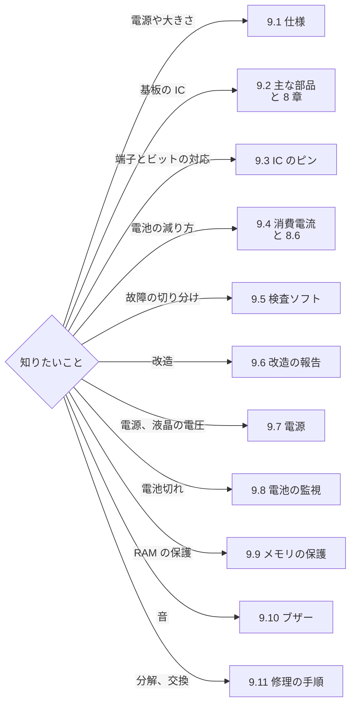

## 9.1 仕様

2 冊のサービスマニュアルの仕様（PC-E500 p.1、PC-E500S p.1）を並べました。機種は 2 つの系統に分かれ、同じ系統の機種は ROM と RAM のほかは同じ回路です。

| 系統 | 機種 |
|---|---|
| PC-E500 系 | PC-E500、PC-E550、PC-1480U、PC-1490U、PC-1490UII |
| PC-E500S 系 | PC-E500S、PC-E650、PC-U6000 |

表の値は PC-E500 と PC-E500S のものです。ROM と RAM の大きさは機種で違います（[機種ガイド](29_MODELS.md) §29.1）。

| 項目 | PC-E500 系 | PC-E500S 系 |
|---|---|---|
| 表示 | 40 桁 × 4 行（5×7 ドット）、240×32 ドット | 同じ。見やすい FSTN の液晶 |
| 計算 | 単精度 10 桁 + 指数 2 桁、倍精度 20 桁 + 指数 2 桁 | 同じ |
| CPU | CMOS 8 ビット、SC62015B01 | SC62015C01 |
| システム ROM | PC-E500 は 128 KB と記載（実際は 256 KB。下の説明）。機種で違う | PC-E500S は 512 KB。機種で違う |
| システム領域 | 約 3.8 KB | 同じ |
| 固定変数 | 312 バイト | 同じ |
| プログラムとデータ | PC-E500 は 28600 バイト（内蔵 RAM 32 KB）。RAM の大きさは機種で違う | PC-E500S は同じ。RAM の大きさは機種で違う |
| スタック | 合計 145 バイト。サブルーチン 1 段 4 バイト、FOR-NEXT 1 段 21 バイト | 加えて REPEAT-UNTIL 7、WHILE-WEND 8、SWITCH 9 バイト |
| シリアル | 300〜9600 bps、C-MOS レベル（4〜6 V） | 同じ |
| 動作温度 | 0〜40 °C | 同じ |
| 電源 | DC 6 V（単 4 形 4 本） | 同じ（アルカリ）。保護用に CR2016 |
| 電池の持ち | 約 70 時間（20 °C、1 時間に計算 10 分、表示 50 分） | 同じ |
| 消費電力 | 0.07 W | 0.09 W |
| 大きさ | 200×100×14 mm | カバーを開いて 220×202.5×14 mm、閉じて 220×104.5×19 mm |
| 重さ | 250 g（電池込み） | 340 g（電池込み） |
| 付属品 | ハードカバー、電池 4 本、説明書 | 電池 4 本、CR2016、ドライバ、説明書 |

PC-E500S は PC-E500 に FSTN の液晶を使い、樹脂のキーと、ちょうつがいで付くハードカバーにした改良型です（PC-E500S p.1）。PC-E500 のカバーはキーの面に重ねる別体のもの、PC-E500S のカバーは本体とつながったもので、大きさの欄がカバーの開閉の 2 通りになっています。
スタックの 1 段の大きさから、145 バイトで何段入るかの目安が計算できます。サブルーチンだけなら 145 ÷ 4 = 36 段、FOR-NEXT だけなら 145 ÷ 21 = 6 段です（端数は切り捨て）。

**ROM の容量。** PC-E500 のサービスマニュアルは、仕様の表（p.1）とメモリマップ（p.3、`E0000h`〜`FFFFFh`）で 128 KB と書いています。しかし同じマニュアルの回路図（p.12）は「256KB ROM」、電流の表（p.5）は「2Mb ROM」、端子の表（p.4）は CE2 を `C0000h`〜`FFFFFh`（256 KB）としています。操作説明書の仕様も 256 KB です（p.351、公式）。手元の ROM イメージはどのバージョンも 256 KB か 384 KB で、`C0000h` から中身があります（ROM）。**PC-E500 の ROM は 256 KB** で、128 KB の 2 か所は誤りです。

PC-E500S の 512 KB は 4 Mbit の ROM の IC の容量です。CPU から見えるのは、CE2 の 256 KB と CE3 の 128 KB、合わせて 384 KB です（[IC チップ](08_IC_CHIPS.md) §8.3.3）。
## 9.2 主な部品

IC には CPU やメモリのような大きなもののほかに、電池の電圧を監視する IC と、信号を組み合わせる小さなロジック IC があります。

PC-E500 の基板の IC は次のとおりです。PC-E500 系のほかの機種も、ROM と RAM のほかは同じです。型番の読み方と容量は [IC チップ](08_IC_CHIPS.md)、ピンは §9.3 にあります。

| 番号 | 型番 | 役割 | 形 | ピン |
|---|---|---|---|---|
| IC1 | SC62015B01 | CPU | QFP 100 ピン | §9.3 |
| IC2 | LH5320X□ | ROM（2 Mbit） | QFP 44 ピン | §9.3.4 |
| IC3 | HM62256LFP-12SLT | RAM（32 KB） | SOP 28 ピン | §9.3.5 |
| IC4 | HD61203 | LCD のコモンドライバ | QFP 100 ピン | §9.3.6 |
| IC5、IC6 | HD61202 | LCD のカラムドライバ（LCD コントローラ） | QFP 100 ピン | §9.3.6 |
| IC7 | MN1280Q | 電池の電圧の検出 | SIP 3 ピン | §9.3.7 |
| IC8 | TC4S81F | AND | SMV 5 ピン | §9.3.7 |
| IC9 | TC7S04F | インバータ | SMV 5 ピン | §9.3.7 |
| IC10 | TC4S66F | アナログスイッチ | SMV 5 ピン | §9.3.7 |

PC-E500S 系では、電池検出とロジックの IC が次のように違います。

| 役割 | PC-E500 系 | PC-E500S 系 |
|---|---|---|
| 電池検出 | MN1280Q（IC7） | RH5VA39A |
| ロジック | TC4S81F（IC8）、TC7S04F（IC9）、TC4S66F（IC10） | TC7S02F（IC9）、TC4S66F（IC10）、TC3W01F（IC12）、TC7S08F（IC13）、TC4S11F（IC14）、TC4S81F |

2 冊のシステム構成図の違いは次のとおりです。図にある機器は [周辺機器](16_PERIPHERALS.md) §16.1 にまとめました。

| | PC-E500（p.2） | PC-E500S（p.2） |
|---|---|---|
| カセット、プリンタ、ディスク | CE-124、CE-126P、CE-140F | 同じ |
| RAM カード | CE-212M、CE-2H16M、CE-2H32M、CE-2H64M | 同じ |
| プロッタ | CE-515P（ケーブル CE-516L） | 図にない。ただし検査（FCC、p.9）では CE-515P に 1 行印字する |
| パソコンとの間 | CE-130T | CE-130T、CE-135T（MAC の注記） |

## 9.3 IC のピン

PC-E500 の基板の IC のピンです（ROM と RAM のほかは PC-E500 系で共通）。CPU（IC1）はこの節の初めと §9.3.1〜§9.3.3、ほかの IC は §9.3.4 からです。パッケージの図は、どれも 1 番を左下に置いています。番号は反時計回りに進みます。

CPU の 100 本のピンを、サービスマニュアルの表に沿って 3 つに分けて説明します。パッケージは QFP で、上下の辺に 30 本、左右の辺に 20 本のピンがあり、番号は反時計回りに進みます。ピンを辺に並べると、次の図になります（並びは PC-E500 のサービスマニュアルの回路図 p.11、アドレス、データなどは [IC チップ](08_IC_CHIPS.md) §8.2 の表によります）。

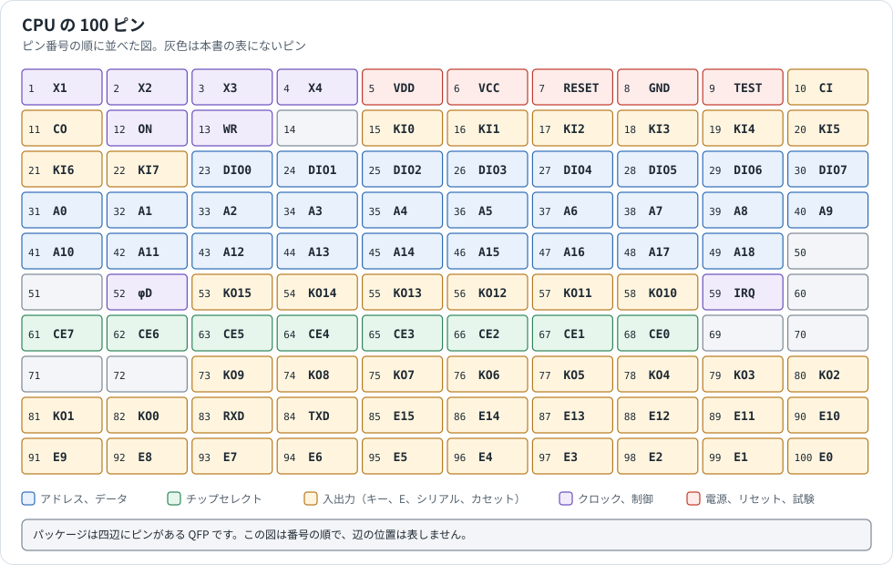

100 本の用途を番号の順にまとめると、次の表になります。「未使用」は、サービスマニュアルの表で Not used とあるピンです。

| ピン | 信号 | 用途 | 詳しく |
|---|---|---|---|
| 1、2 | X1、X2 | クロック。主クロックのセラミック発振子をつなぐ | §9.3.1 |
| 3、4 | X3、X4 | クロック。サブクロックの CR 発振 | §9.3.1 |
| 5 | VDD | 表示電源（コンバータ）の制御 | §9.3.1 |
| 6 | VCC | 電源 + | §9.3.1 |
| 7 | RESET | リセット。High でリセットする | §9.3.1 |
| 8 | GND | 電源 -（グラウンド） | §9.3.1 |
| 9 | TEST | テスト入力 | §9.3.1 |
| 10、11 | CI、CO | カセット（テープ）の入力、出力 | [カセットインターフェース](20_CASSETTE.md) |
| 12 | ON | ON キー | §9.3.1 |
| 13 | WR | 書き込みの合図（書き込みクロック） | §9.3.1 |
| 14 | MRQ | 未使用 | |
| 15〜22 | KI0〜KI7 | キーボードの入力。キーマトリクスの行を読む | [ハードウェア](01_HARDWARE.md) §1.2 |
| 23〜30 | DIO0〜DIO7 | データバス。8 本で 1 バイトを運ぶ | [IC チップ](08_IC_CHIPS.md) §8.2 |
| 31〜49 | A0〜A18 | アドレスバス。19 本 | [IC チップ](08_IC_CHIPS.md) §8.2 |
| 50、51 | VDISP、VA | 未使用 | |
| 52 | φD | 表示チップ（LCD コントローラ）へのクロック | [IC チップ](08_IC_CHIPS.md) §8.2 |
| 53 | KO15 | シリアル PRQ（未使用） | §9.3.3 |
| 54〜56 | KO14〜KO12 | シリアルの制御（ER、RR、RS） | §9.3.3、[15 ピン（シリアル）](07_PORT_15PIN.md) |
| 57 | KO11 | キーボードの出力（キーストローブ）。OFF キーをつなぐ（KI0 との間） | [ハードウェア](01_HARDWARE.md) §1.2 |
| 58 | KO10 | キーボードの出力（キーストローブ）。キーマトリクスの列を選ぶ | [ハードウェア](01_HARDWARE.md) §1.2 |
| 59 | IRQ | 電池電圧の低下の検出 | §9.8 |
| 60 | φOUT | 未使用 | |
| 61〜68 | CE7〜CE0 | チップセレクト。ROM、RAM、カード、表示から 1 つを選ぶ | §9.3.2 |
| 69〜72 | φA、DIS、HA、RD | 未使用 | |
| 73〜82 | KO9〜KO0 | キーボードの出力（キーストローブ）。キーマトリクスの列を選ぶ | [ハードウェア](01_HARDWARE.md) §1.2 |
| 83、84 | RXD、TXD | シリアルの受信、送信 | [15 ピン（シリアル）](07_PORT_15PIN.md) |
| 85〜88 | E15〜E12 | CE-140F のデータ入力 | §9.3.3 |
| 89〜94 | E11〜E6 | 11 ピンのコネクタ（DIN、DOUT、IO2、IO1、ACK、BUSY） | §9.3.3、[11 ピン（テープ、周辺機器）](06_PORT_11PIN.md) |
| 95 | E5 | 未使用 | |
| 96 | E4 | 表示電源の制御 | §9.3.3 |
| 97 | E3 | 電池電圧の検出の制御 | §9.3.3、§9.8 |
| 98、99 | E2、E1 | シリアル CS、CD | §9.3.3 |
| 100 | E0 | シリアル PAK（未使用） | |

2 冊のサービスマニュアルの表です（PC-E500 p.3〜4、PC-E500S p.3〜4）。どちらの機種も、番号と信号は同じです。

### 9.3.1 クロック、電源、制御

X1、X2 は主クロック、X3、X4 はサブクロックの発振に使います（クロックの値は [CPU（SC62015）](02_CPU.md) §2.2）。WR は書き込みの合図で、通常は High です。

| ピン | 信号 | 内容 |
|---|---|---|
| 1、2 | X1、X2 | セラミック発振 |
| 3、4 | X3、X4 | CR 発振 |
| 5 | VDD | 表示電源の制御 |
| 6 | VCC | 電源 + |
| 7 | RESET | リセット（High で動作） |
| 8 | GND | 電源 - |
| 9 | TEST | テスト入力 |
| 10 | CI | カセット信号の入力 |
| 11 | CO | カセット信号の出力 |
| 12 | ON | ON キー（通常 Low） |
| 13 | WR | 書き込みクロック（通常 High） |
| 59 | IRQ | 電池検出 |

### 9.3.2 チップセレクト

チップセレクトは、CPU が出したアドレスの範囲に応じて 1 本だけが働く信号です。Active High は「High のときに選ばれる」という意味です。

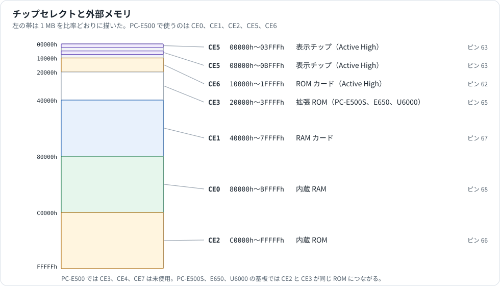

| ピン | 信号 | 範囲 | 内容 |
|---|---|---|---|
| 62 | CE6 | `10000h`〜`1FFFFh` | ROM カード（Active High）。[カードスロット](05_CARD_SLOT.md) |
| 63 | CE5 | `00000h`〜`03FFFh`、`08000h`〜`0BFFFh` | 表示チップ（Active High）。[液晶（LCD）](04_LCD.md) §4.2 |
| 66 | CE2 | `C0000h`〜`FFFFFh` | 内蔵 ROM |
| 67 | CE1 | `40000h`〜`7FFFFh` | RAM カード。[カードスロット](05_CARD_SLOT.md) |
| 68 | CE0 | `80000h`〜`BFFFFh` | 内蔵 RAM |

PC-E500 では CE3、CE4、CE7 は未使用です。`20000h`〜`3FFFFh`（CE3）は PC-E500S、PC-E650、PC-U6000 の拡張 ROM が使います（[ROM バージョンの違い: 配置](23_ROM_VERSIONS_MAP.md)）。この 3 機種の基板では、CE2 と CE3 が同じ ROM につながります（[IC チップ](08_IC_CHIPS.md) §8.3.3）。

**例: アドレスからチップセレクトを引く**

| アドレス | 範囲 | 動く CE | 答える IC |
|---|---|---|---|
| `02000h` | `00000h`〜`03FFFh` | CE5 | LCD コントローラ |
| `0A000h` | `08000h`〜`0BFFFh` | CE5 | LCD コントローラ |
| `40000h` | `40000h`〜`7FFFFh` | CE1 | RAM カード |
| `BFC00h` | `80000h`〜`BFFFFh` | CE0 | 内蔵 RAM |
| `F10BDh` | `C0000h`〜`FFFFFh` | CE2 | 内蔵 ROM |

### 9.3.3 E ポートとキーの出力

E ポートと KO の上位 4 本はコネクタと電源の制御に使われます。内部 RAM の 1 バイトを 8 本の線に対応させて描くと、次の図になります。

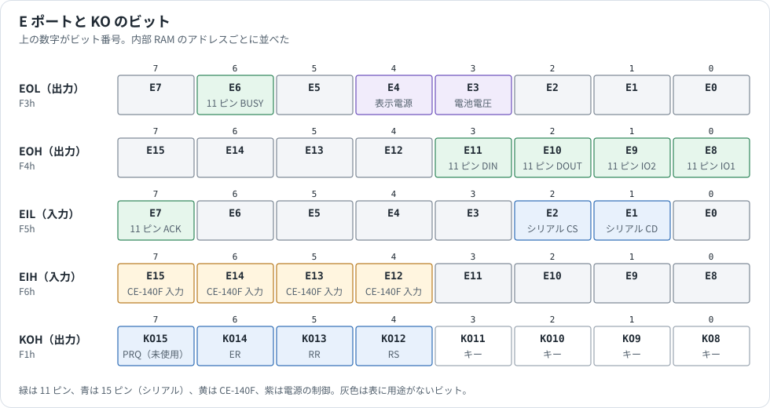

| ピン | ポート | 内部 RAM | 内容 |
|---|---|---|---|
| 85〜88 | E15〜E12 | `F6h` 上位 | CE-140F のデータ入力 |
| 89 | E11 | `F4h` | 11 ピン DIN |
| 90 | E10 | `F4h` | 11 ピン DOUT |
| 91 | E9 | `F4h` | 11 ピン IO2 |
| 92 | E8 | `F4h` | 11 ピン IO1 |
| 93 | E7 | `F5h` | 11 ピン ACK |
| 94 | E6 | `F3h` | 11 ピン BUSY |
| 96 | E4 | `F3h` | 表示電源の制御 |
| 97 | E3 | `F3h` | 電池電圧の制御 |
| 98 | E2 | `F5h` | シリアル CS |
| 99 | E1 | `F5h` | シリアル CD |

| KO | `F1h` のビット | 内容 |
|---|---|---|
| KO15 | 7 | シリアル PRQ（未使用） |
| KO14 | 6 | シリアル ER（OPEN で High） |
| KO13 | 5 | シリアル RR |
| KO12 | 4 | シリアル RS |
| KO0〜KO11 | | キーストローブ |

**例: ビットの値を求める。** E のピンの番号を 8 で割った余りがビット番号です。E4（表示電源の制御）は `F3h` のビット 4 なので値は 10h、E9（11 ピン IO2）は `F4h` のビット 1 で 02h、E2（シリアル CS）は `F5h` のビット 2 で 04h です。KO14（シリアル ER）は `F1h` のビット 6 で 40h です。

`F1h` の下位にはキーの列 KO8〜KO11 が入っています。シリアルの線だけを変えるときは、`AND` と `OR` で必要なビットだけを書き換えます（[CPU（SC62015）](02_CPU.md) §2.14.3）。

`F1h` のビットは ROM のシリアルの処理（[15 ピン（シリアル）](07_PORT_15PIN.md) §7.3）と合います。コネクタの配線は [11 ピン（テープ、周辺機器）](06_PORT_11PIN.md) と [15 ピン（シリアル）](07_PORT_15PIN.md) にあります。

### 9.3.4 ROM（IC2）

ROM は 44 ピンの QFP で、各辺に 11 本のピンがあります。回路図（PC-E500 p.12）の記号には名前だけがあり、番号がありません。番号は、同じシャープの 2 Mbit の ROM で 44 ピンの QFP の LH532000B の図によります（Data Book 1991）。回路図の 44 本の名前は、LH532000B を 8 ビットで使うときの名前と 1 本ずつすべて合うので、同じ並びと見ています（推定）。

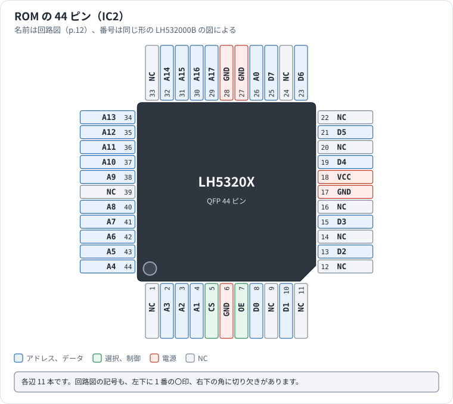

LH532000B は、16 ビットでも 8 ビットでも使える ROM です。28 番（/BYTE）を GND にすると 8 ビットになり、26 番（D15/A-1）がアドレスの最下位になります。回路図でも 28 番は GND、26 番は A0 です。8 ビットでは使わない D8〜D14 の 7 本は、回路図では NC です。

| ピン | 名前 | 用途 | LH532000B の名前 |
|---|---|---|---|
| 26 | A0 | アドレスの最下位 | D15/A-1 |
| 4、3、2 | A1、A2、A3 | アドレス | A0、A1、A2 |
| 44〜40 | A4〜A8 | アドレス | A3〜A7 |
| 38〜34 | A9〜A13 | アドレス | A8〜A12 |
| 32〜29 | A14〜A17 | アドレス | A13〜A16 |
| 8、10、13、15、19、21、23、25 | D0〜D7 | データバス | D0〜D7 |
| 5 | CS | チップセレクト。CPU の CE2 | /CE |
| 7 | OE | 出力の許可 | OE または /OE |
| 18 | VCC | 電源 + | VCC |
| 6、17、27 | GND | 電源 - | GND |
| 28 | GND | 8 ビットで使う設定 | /BYTE |
| 9、12、14、16、20、22、24 | NC | 8 ビットでは使わないデータ | D8〜D14 |
| 39 | NC | | OE1 |
| 1、11、33 | NC | | NC |

### 9.3.5 RAM（IC3）

RAM は 28 ピンの SOP で、2 列に 14 本ずつピンがあります。番号と名前は HM62256A のデータシートの SOP の図（p.2）によります。回路図の名前もこの図と同じです（データシートの I/O0〜I/O7 が、回路図の D0〜D7）。

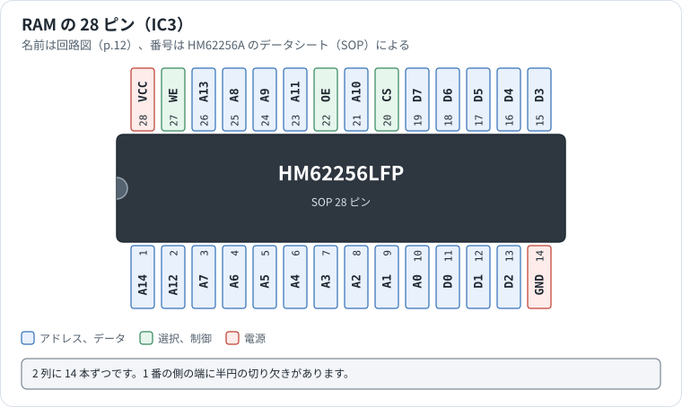

| ピン | 名前 | 用途 |
|---|---|---|
| 10〜3 | A0〜A7 | アドレス |
| 25、24、21、23、2、26、1 | A8〜A14 | アドレス |
| 11〜13、15〜19 | D0〜D7 | データバス |
| 20 | CS | チップセレクト（Low で選ぶ）。CPU の CE0 |
| 22 | OE | 出力の許可（Low で読み出す） |
| 27 | WE | 書き込みの許可（Low で書く） |
| 28 | VCC | 電源 +。リチウム電池でバックアップする（[IC チップ](08_IC_CHIPS.md) §8.4.1） |
| 14 | GND | 電源 - |

### 9.3.6 LCD の IC（IC4〜IC6）

LCD は、HD61203（IC4）1 個と HD61202（IC5、IC6）2 個で動きます（役割は [IC チップ](08_IC_CHIPS.md) §8.5）。どれも 100 ピンの QFP（FP-100）で、本体は 20 × 14 mm の横長です。長い辺に 30 本、短い辺に 20 本のピンがあります。番号と名前は、Hitachi のデータブック（LCD Data Book）の図によります。回路図（PC-E500 p.11〜12）の記号の名前も、この図と合います。

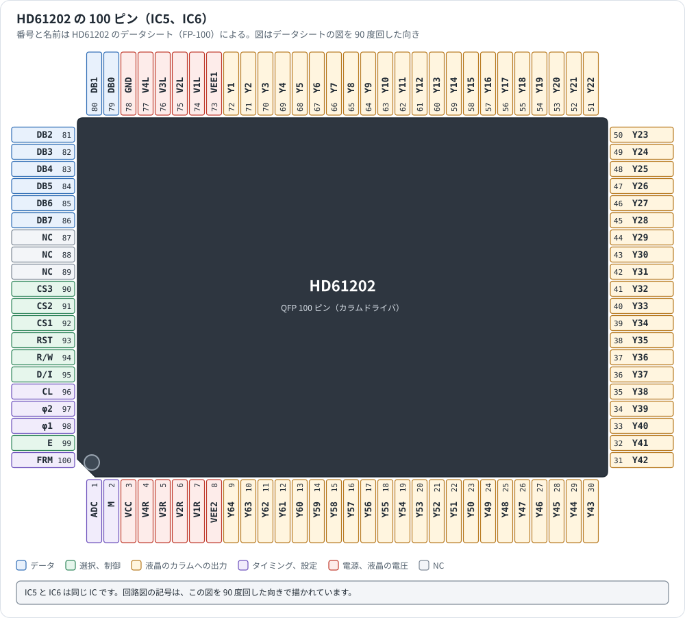

HD61202 は CPU から命令と表示データを受け取り、液晶の縦の電極（カラム）を駆動します。CPU との配線は [液晶（LCD）](04_LCD.md) §4.2 にあります。

| ピン | 名前 | 用途 | つながる先 |
|---|---|---|---|
| 79〜86 | DB0〜DB7 | データバス | CPU の DIO0〜DIO7 |
| 90 | CS3 | チップセレクト（High で選ぶ） | A13 |
| 91 | CS2 | チップセレクト（Low で選ぶ） | A12 |
| 92 | CS1 | チップセレクト（Low で選ぶ） | IC5 は A3、IC6 は A2 |
| 99 | E | イネーブル。書き込みは E が下がるときに取り込む | CE5 |
| 94 | R/W | High で読み出し、Low で書き込み | A0 |
| 95 | D/I | High で表示データ、Low で命令 | A1 |
| 93 | RST | リセット（Low で働く） | |
| 98、97 | φ1、φ2 | 動作クロック | HD61203 |
| 96 | CL | 表示データを取り込むクロック | HD61203 |
| 100 | FRM | フレームの始まりの信号 | HD61203 |
| 2 | M | 液晶を交流で駆動するための信号 | HD61203 |
| 1 | ADC | 表示 RAM と Y の出力の並びの向き。VCC か GND に固定する | |
| 9〜72 | Y64〜Y1 | 液晶のカラムへの出力 | 液晶 |
| 3、78 | VCC、GND | 電源 | |
| 8、73 | VEE2、VEE1 | 液晶の駆動電源 | |
| 74〜77、7〜4 | V1L〜V4L、V1R〜V4R | 液晶の電圧。V1、V2 は点ける点、V3、V4 は点けない点の電圧 | |
| 87〜89 | NC | | |

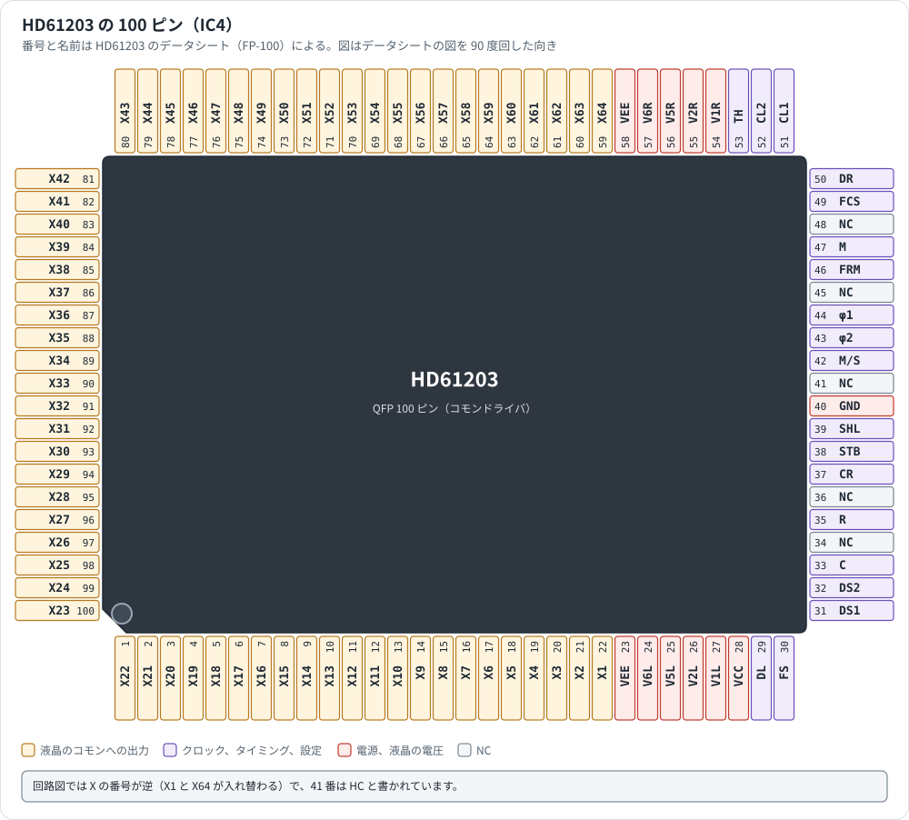

HD61203 は液晶の横の電極（コモン）を 1 本ずつ選び、表示のタイミングを作って 2 個の HD61202 に送ります。

| ピン | 名前 | 用途 |
|---|---|---|
| 1〜22、59〜100 | X22〜X1、X64〜X23 | 液晶のコモンへの出力 |
| 44、43 | φ1、φ2 | HD61202 への動作クロック |
| 52 | CL2 | HD61202 の CL へのクロック |
| 46 | FRM | HD61202 へのフレームの信号 |
| 47 | M | HD61202 への交流化の信号 |
| 42 | M/S | VCC でマスタ（自分でタイミングを作る）、GND でスレーブ |
| 31、32 | DS1、DS2 | デューティの選択 |
| 30 | FS | 発振の周波数の選択 |
| 33、35、37 | C、R、CR | 発振のための抵抗とコンデンサをつなぐ |
| 39 | SHL | コモンを選ぶ順の向き |
| 49 | FCS | クロックの位相の選択 |
| 29、50 | DL、DR | シフトレジスタの両端 |
| 38、51、53 | STB、CL1、TH | 試験用。STB は VCC、CL1 と TH は GND につなぐ |
| 28、40 | VCC、GND | 電源 |
| 23、58 | VEE | 液晶の駆動電源 |
| 27〜24、54〜57 | V1L、V2L、V5L、V6L、V1R、V2R、V5R、V6R | 液晶の電圧。V1、V2 は選ぶ行、V5、V6 は選ばない行の電圧 |
| 34、36、41、45、48 | NC | |

回路図の HD61203 の記号は、X の番号がデータシートと逆に付いています（データシートの X1 が回路図の X64）。41 番は、データシートでは NC、回路図では HC です。

### 9.3.7 小さな IC（IC7〜IC10）

電池の監視と、カードの切り離しに使う IC です。TC で始まる 3 個は SMV（SSOP5）という 5 本足のパッケージです。3 本の側の左端が 1 番で、5 番は 1 番の向かい、4 番は 3 番の向かいにあります。2 番の向かいには足がありません。MN1280Q は 1 列に 3 本の足があります。

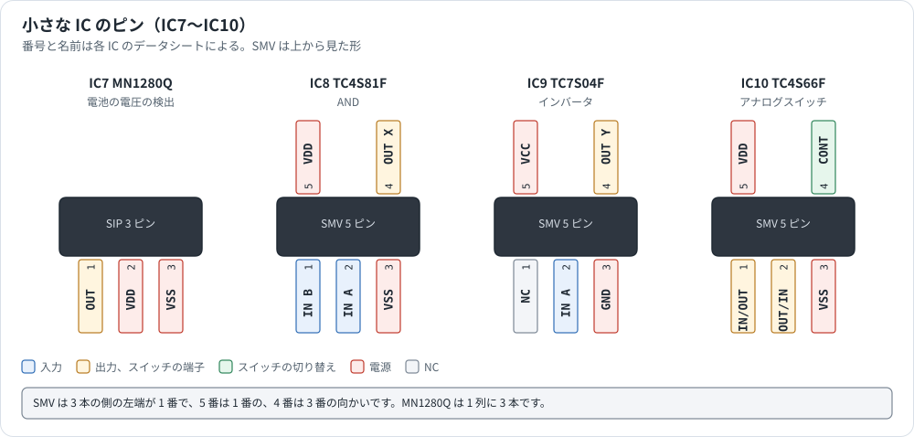

| IC | ピン | 名前 | 用途 |
|---|---|---|---|
| IC7 MN1280Q | 1 | OUT | 検出の出力。電圧が下がると Low。CPU の IRQ と IC8 へ（§9.8） |
| | 2 | VDD | 電源と、見張る電圧の入力。VCC を抵抗で分けた電圧が入る |
| | 3 | VSS | 電源 - |
| IC8 TC4S81F | 2、1 | IN A、IN B | AND の入力 |
| | 4 | OUT X | 出力。A と B がどちらも High のときだけ High。ON キーと RESET の線へ（§9.8） |
| | 5、3 | VDD、VSS | 電源 |
| IC9 TC7S04F | 2 | IN A | 入力。CPU の VDD（5 番ピン） |
| | 4 | OUT Y | 反転した出力。IC10 の CONT へ |
| | 1 | NC | |
| | 5、3 | VCC、GND | 電源 |
| IC10 TC4S66F | 1、2 | IN/OUT、OUT/IN | スイッチの両端。CPU の CE1 とカードの CERAM の間（[カードスロット](05_CARD_SLOT.md) §5.4） |
| | 4 | CONT | High でつなぎ、Low で切る |
| | 5、3 | VDD、VSS | 電源 |

MN1280Q の末尾の Q は、検出する電圧の区分です。Q は 3.8〜4.1 V です（MN1280 のデータシート）。

## 9.4 消費電流

修理のあとで、本体全体の電流がこの値に収まるかを確かめるための基準です。値が大きければ、どこかの IC が止まっていないか、ショートしている疑いがあります。

**基準。** 11 ピンの 2 番に DC 5 V、3 番に 0 V を与え、電流計を入れて測ります（PC-E500 p.5、PC-E500S p.5）。PC-E500 の電源は 5.0 ± 0.1 V です。

| 状態 | PC-E500 | PC-E500S |
|---|---|---|
| 動作（BASIC で `>` を表示） | 3.24 mA 以下 | 3.29 mA 以下 |
| 電源オフ | 64 µA 以下 | 22.8 µA 以下 |

PC-E500S には 6.3 V での検査の手順もあります（p.5）。順に進めると、動作の電流、電池切れの検出、電源オフの電流が 1 回で調べられます。

| 順 | 操作 | 確かめること |
|---|---|---|
| 1 | 6.3 V ± 0.1 V をつなぎ、ON を押しながら RESET、`Y` で内蔵 RAM を初期化する | |
| 2 | `PF1` を押して BASIC にする | `>` の表示。3.77 mA 以下 |
| 3 | 電圧を 4.1 V ± 0.05 V にする | BATT が点く |
| 4 | 3.7 V ± 0.1 V にする | 表示が消える |
| 5 | 6.3 V に戻す | 表示は消えたまま。22.8 µA 以下 |
| 6 | 11 ピンを外し、2 番と 3 番を 3.9 kΩ で 6 秒つなぐ | 残った電気を抜く |

プログラムやデータは消えるので、先に保存します。5 で電圧を戻しても電源が入らないのは、電池切れを見つけたあとは ON も効かないからです（§9.8）。

バックアップの電流は、CR2016 の端子に 3.0 V ± 0.1 V をつないで測り、0.1〜2.38 µA です（PC-E500S p.6）。

電源オフの電流は µA（100 万分の 1 A）の単位です。PC-E500S の 22.8 µA は PC-E500 の 64 µA の 3 分の 1 ほどです。

**そのほかの部品の電流**（最大値。CPU、ROM、RAM、LCD の IC は [IC チップ](08_IC_CHIPS.md) §8.6）

| 部品 | PC-E500（p.5） | PC-E500S（p.5、動作 / 表示 / オフ / バックアップ） |
|---|---|---|
| 電池検出 | MN1280Q 30 µA | RH5VA39A 3.9 µA / 3.9 µA / 3.9 µA / なし |
| DC-DC コンバータ（入力） | 1.2 mA | 1.5 mA / 1.5 mA |
| VDD（表示の電源） | 1.0 mA | 0.75 mA / 0.75 mA |
| TC4S81F | | 1 µA / 1 µA / 1 µA / なし |
| TC3W01F | | 2 µA / 2 µA / 2 µA / 1 µA |
| TC4S66F | | 0.25 µA / 0.25 µA / 0.25 µA / 0.13 µA |
| TC7S08F | | 1 µA / 1 µA / 1 µA / なし |
| TC7S02F | | 1 µA / 1 µA / 1 µA / 0.25 µA |
| TC4S11F | | 0.25 µA / 0.25 µA / 0.25 µA / なし |

電池の検出 IC を 30 µA のものから 3.9 µA のものに替えたことが、電源オフの電流が減った大きな理由です。
チップごとの電流は [IC チップ](08_IC_CHIPS.md) §8.6 にあります。

## 9.5 サービス用の検査ソフト

故障した場所を切り分けるための BASIC のプログラムで、部品を 1 つずつ試します。

サービスマニュアルに、RAM に入れて実行する検査プログラムの説明があります（PC-E500 p.7〜10。プログラムの全行が載っています。ROM の診断メニューとは別です。ROM のものは [ROM バージョンの違い: システム](26_ROM_VERSIONS_SYSTEM.md) §26.2.4）。PC-E500S では、検査は ROM の中の診断メニューに移りました。項目は `diag`、`LB`（電池）、`aging1`、`aging2`、`RAM`、`FCC`、`ESD`、`diag(menu)` の 8 個です（PC-E500S p.6〜10）。

| メニュー | 検査 | 内容 |
|---|---|---|
| 1 DISP | 液晶 | 交互の表示、全シンボルの点灯 |
| 2 ROM | マスク ROM | 約 6 秒。`EX Ver. 1 (LH5320XH)` と結果を表示（表示の一覧は [IC チップ](08_IC_CHIPS.md) §8.3.2） |
| 3 RAM | 内蔵 RAM | 読み書き |
| 4 11 PIN | 11 ピン | 治具 UKOGC3020CSZZ が必要。表の値は [11 ピン](06_PORT_11PIN.md) §6.0.3 |
| 5 15 PIN | 15 ピン | 同じ治具 |
| 6 CARD | RAM カード | 容量を選ぶ。内容は消える |

どの検査も、良いときはブザー 3 回、悪いときは 1 回鳴ります。検査を終えるには ON（BREAK）を押します。プログラムを入れる前に RAM をすべて消しておきます（p.7）。

**15 ピンの検査の値**（PC-E500 p.9、PC-E500S p.11）。出力は PRQ、ER、RR、RS、入力は CS、CD、PAK です。治具は RS を CS へ、RR を CD へ、ER または PRQ を PAK へ戻します。

| 出力（PRQ ER RR RS） | 入力（CS CD PAK） | 値 |
|---|---|---|
| 0 0 0 0 | 0 0 0 | 00 |
| 0 0 0 1 | 1 0 0 | 04 |
| 0 0 1 0 | 0 1 0 | 02 |
| 0 1 0 0 | 0 0 1 | 01 |
| 1 0 0 0 | 0 0 1 | 01 |
| 1 1 1 1 | 1 1 1 | 07 |

値は `F5h` の下位 3 ビット（CS がビット 2、CD がビット 1、PAK がビット 0）です。16 通りの表はこの 3 つの線のつなぎ方だけで説明できます。PC-E500S の表には番号 20 として SD を RD に戻す検査（値 01）と、11 ピンの XOUT を XIN に戻す検査（値 01）もあります。
> [!WARNING]
> RAM カードの検査は、カードの中身を消します。

カードの検査のメニューには 2 KB と 4 KB があり、範囲は次のとおりです。

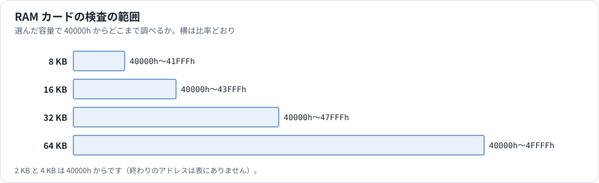

| 容量 | 範囲 |
|---|---|
| 2 KB | `40000h`〜 |
| 4 KB | `40000h`〜 |
| 8 KB | `40000h`〜`41FFFh` |
| 16 KB | `40000h`〜`43FFFh` |
| 32 KB | `40000h`〜`47FFFh` |
| 64 KB | `40000h`〜`4FFFFh` |

エラーは番号、正常値、実際の値の形で表示します（例：`1 13 0`）。例の `1 13 0` は、番号が 1、正常値が 13、実際の値が 0 です。値は 16 進で、マニュアルの例 `1 13 01` なら、`13`（10011）のはずが `01`（00001）だったので、ACK と IO2 がおかしいと読みます。

RAM カードの検査では、見つけた誤りのアドレスを `IN &H47FFF` のように表示します。PC-E500 の検査は上のアドレスから下へ（p.8）、PC-E500S の検査は下から上へ（p.11）進み、最初に見つけたアドレスを出します。

## 9.6 改造の報告

部品を替えて、メモリを増やしたり速くしたりした例です。

メーカーの資料ではなく、個人や販売店の報告です。**試していません。**

| 内容 | 報告 |
|---|---|
| 内蔵 RAM 128 KB | HM62256A を 128 KB の SRAM（M5M51008DFP）に交換。32 ピンを VCC へ、31 ピンを A15 へ、2 ピンを A16 へ。A15 と A16 は CPU の近くのパッドから |
| 内蔵 RAM 256 KB | 3 個の RAM を追加し、2 個を重ねて付ける。チップセレクトの配線を追加 |
| クロック | セラロックを 4.8 MHz に、180 kΩ を 68 kΩ に変える報告。4.00 MHz、4.55 MHz の部品も販売されている |
| 256 KB RAM カードの自作 | HC138 と 128 KB SRAM 2 個、CR1216、書き込み禁止スイッチ、基板 41.9×54.1×0.8 mm。KiCad のデータが公開されている |

増設で A15 と A16 の線が要るのは、RAM の容量が増えるとアドレスの線も増えるからです。32 KB は A0〜A14 の 15 本（2 の 15 乗 = 32,768）、128 KB は A0〜A16 の 17 本（2 の 17 乗 = 131,072）で区別します。

出典は [外部資料](28_RESOURCES.md) にあります。

## 9.7 電源と液晶の電圧

電池の 6 V がどこを通って何に使われるかを回路図から追います。

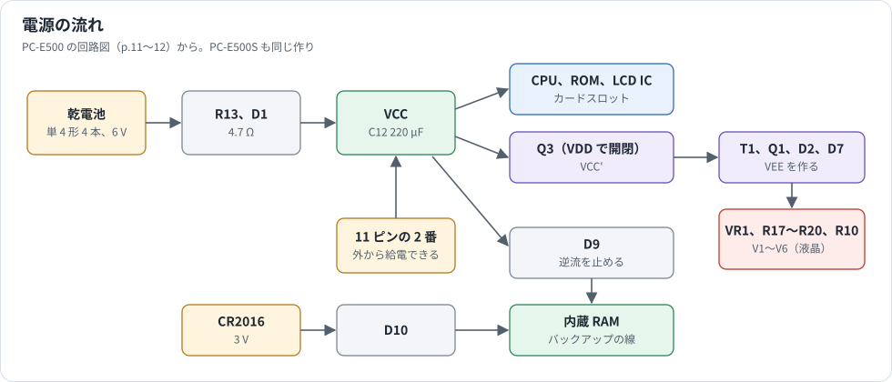

**VCC。** 乾電池 4 本の + は 4.7 Ω（R13）とダイオード D1 を通って VCC になります。C12（220 µF）が電圧の揺れを吸収します。ダイオードがあるので、11 ピンの 2 番から外の電源（CE-126P など）を入れても電池へは流れ込みません。逆に、電池が切れても外からの電源で動きます。PC-E500S は、電池の + の所にチップヒューズの場所があり、0 Ω（R22）でつないであります（p.16）。

**VCC'。** CPU の VDD 出力が Low になると PNP トランジスタ Q3（DTA114YK）が通じ、VCC' に電圧が出ます。これが表示の電源です。VDD はカードの CERAM を切り離す回路も動かします（[カードスロット](05_CARD_SLOT.md) §5.4）。

**VEE（負の電圧）。** 液晶の駆動には 5 V より大きな電圧差が要ります。トランス T1 とトランジスタ Q1（2SC2412）が自分で振動する回路（ブロッキング発振）を作り、T1 のもう一方の巻線の電圧をダイオード D2 と C14（3.3 µF）で負の直流にします。ツェナーダイオード D7（HZ9C1）が VEE の値を見て Q1 のベースへ戻し、電圧を一定に保ちます。CPU の E4 は D8 と R15（56 kΩ）を通してこの回路の動き始めと停止を決めます。E4 が「表示電源（コンバータ）の制御」と書かれているのはこのためです（回路図 p.11）。

**V1〜V6。** VEE と GND の間を可変抵抗 VR1 と 5 本の抵抗で分けて、液晶に必要な 6 段の電圧を作ります。VR1 がコントラストのつまみです。

| | PC-E500 | PC-E500S |
|---|---|---|
| コントラスト | VR1 20 kΩ | VR1 50 kΩ と R18 330 kΩ、R19 470 kΩ |
| 分ける抵抗 | 8.2 kΩ 4 本と 24 kΩ 1 本 | 同じ（精度 2 %） |
| 平らにするコンデンサ | C6〜C10、1 µF | C6〜C10、1 µF |

**例（バイアス比、計算）。** 5 本の合計は 8.2 × 4 + 24 = 56.8 kΩ で、1 段は 8.2 kΩ です。56.8 ÷ 8.2 = 約 6.9 なので、1/7 バイアスの作りです。液晶の点は、走査する線の数が増えるほど細かい段の電圧が要ります。

## 9.8 電池の監視

電池が弱ったことを知らせ（BATT の表示）、さらに弱ったら動作を止める回路です。2 つの電圧を検出 IC 1 個と抵抗 2 本で見分けます（PC-E500 p.4、PC-E500S p.5、公式）。

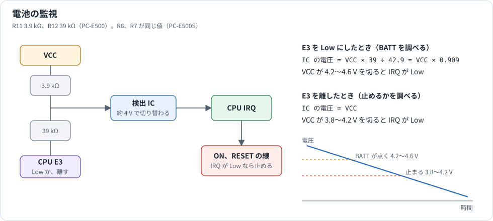

検出 IC（PC-E500 は MN1280Q、PC-E500S は RH5VA39A）は、入力の電圧が決まった値より高ければ High、低ければ Low を出します。出力は CPU の IRQ に入ります。入力には VCC を 3.9 kΩ と 39 kΩ で分けた電圧が入りますが、39 kΩ の下側は CPU の E3 につながっています。

1. BATT を調べるとき: E3 を Low にします。IC には VCC の 0.909 倍が入ります。VCC が 4.2〜4.6 V（CAU レベル）を切ると IRQ が Low になり、BATT を点けます。
2. 止めるかを調べるとき: E3 を離します（どちらでもない状態）。39 kΩ が切れるので、IC には VCC がそのまま入ります。VCC が 3.8〜4.2 V（STOP レベル）を切ると IRQ が Low のままで、本体は止まります。BATT の表示も消えます。

**例（2 つの値の関係、計算）。** IC が切り替わる電圧を 4.0 V とすると、E3 を離したときは VCC = 4.0 V、E3 が Low のときは VCC = 4.0 ÷ 0.909 = 4.4 V で切り替わります。どちらもマニュアルの範囲（3.8〜4.2 V、4.2〜4.6 V）の真ん中です。1 個の IC で 2 つのレベルを作る工夫が、計算でも確かめられます。

IC の出力は TC4S81F（IC8）を通して ON キーと RESET の線も止めます。**STOP レベルを見つけたあとは、ON も RESET も効きません**（公式）。弱った電池のまま起動を繰り返して RAM を壊さないためです。電圧が戻っても、そのままでは電源は入りません（§9.4 の検査の 5）。電池を替えれば動きます。

検出 IC には 0.1〜0.3 V の幅（ヒステリシス）があり、電圧が境目で揺れても出力がばたつきません。IRQ は、PC-E500 では電池を見るためだけに使います（端子の表 59 番）。割り込みとしての扱いは [起動、割り込み、タイマ、音](10_SYSTEM.md) §10.3 にあります。

## 9.9 メモリの保護

電源を切っても、電池を替えても、RAM の中身が残る仕組みです。

**バックアップの線。** RAM の電源は、VCC からダイオード D9 を、CR2016 から D10 を通ってつながります。VCC があるうちは VCC から、なくなれば CR2016 から電流が流れます（PC-E500 p.12、PC-E500S p.17）。PC-E500S の回路図では、この線に VP という名前が付いています。バックアップに電気を使うのは RAM（1 µA）と、RAM を守るロジック IC だけです（§9.4 の表のバックアップの列）。

**S2（メモリ保護スイッチ、`A`、`B`）。** 電池を替える間に、電源の揺れで RAM が書き換わらないように、RAM の選択を切り離すスイッチです。操作説明書と本体の裏の注意書きでは、電池交換のとき `A` から `B` にし、終わったら `A` に戻します。2 つの系統で作りが違います。

| | PC-E500 | PC-E500S、PC-E650、PC-U6000 |
|---|---|---|
| S2 の働き | CE0 の線を切る。RAM の CS は R21（100 kΩ）で High（非選択）になる | バックアップの線をつなぐ。IC12（TC3W01F）の `/G` と IC9（TC7S02F）に High が入る |
| RAM | 選ばれない | IC12 が止まり、どちらの RAM も選ばれない |
| RAM カード | 変わらない | IC9 の出力が Low になり、IC10 がカードの CE1 を切る |

PC-E500 では S2 はカードに関係しませんが、**PC-E500S などでは、S2 を `B` にするとカードも切り離されます**（回路図から）。

**カードの切り離し。** 電源を切ると、CE1 は TC4S66F（IC10）でカードから切れます（[カードスロット](05_CARD_SLOT.md) §5.4）。

**検査の手順**（PC-E500S p.6）。この手順は上の仕組みをそのまま確かめるものです。

| 順 | 操作 | 確かめること |
|---|---|---|
| 1 | RAM カードのカバーのロックを外す（電源が切れる） | |
| 2 | S2 を `B` にし、電池を 1 本外す | |
| 3 | 11 ピンの 2 番と 3 番を 3.9 kΩ で 6 秒つなぐ（残った電気を抜く） | |
| 4 | 電池を戻し、カバーをロックして RESET を押す | |
| 5 | | `NO MEMORY` と出る（S2 が RAM を切っている） |
| 6 | S2 を `A` に戻し、ON を押す | `MAIN MENU` が出る（中身が残っている） |

**例（6 秒の意味、計算）。** VCC には 220 µF のコンデンサがあります。3.9 kΩ で放電すると、電圧は 220 µF × 3.9 kΩ = 0.86 秒ごとに約 37 % になります。6 秒は 7 回分で、6 V が 0.005 V 程度まで下がります。

## 9.10 ブザー

CPU の CO がカセットの音とブザーを兼ねます。音の作り方は [起動、割り込み、タイマ、音](10_SYSTEM.md) §10.5〜§10.6 にあります。

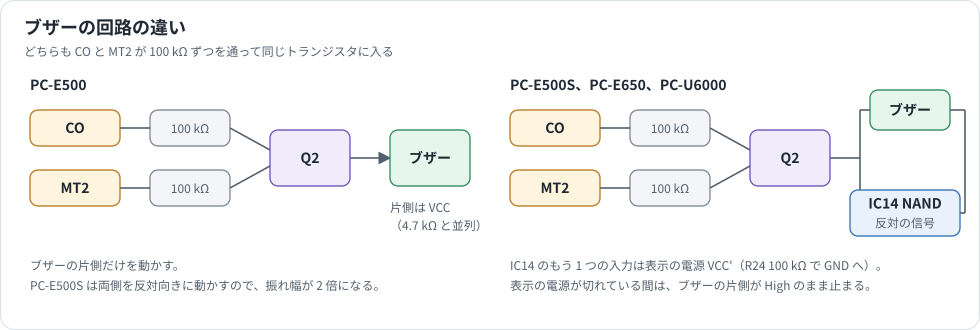

PC-E500 は Q2（2SC2412）でブザーの片側を GND へ引くだけです。PC-E500S は Q2 の出力を NAND ゲート IC14（TC4S11F）でも反転し、ブザーの両側を反対向きに動かします。IC14 のもう一方の入力は表示の電源 VCC' なので、表示の電源が切れている間は働きません（回路図 p.16）。同じプログラムでも、PC-E500S のほうがブザーの振れ幅が大きくなります。

## 9.11 修理の手順と部品

### 9.11.1 電池を替える

**乾電池**（本体の裏の注意書き、PC-E500 p.5、公式）

1. OFF を押す。RAM カードがあれば外す。
2. S2 を `A` から `B` にする。
3. 4 本とも新しい電池に替える。
4. RESET を押す。
5. S2 を `B` から `A` に戻す。RAM カードを付ける。

**CR2016**。メモリ保護用の電池を替えるときは、弱っていない乾電池 4 本を入れたままにします（PC-E500 p.6）。乾電池が RAM を保っている間に、裏の電池のふたを開けて替えます。ふたには (1)〜(6) の手順が絵で書いてあります。

基板（PWB）を替えるときも、同じ 5 つの手順です（PC-E500 p.5 の 9-5）。

> [!CAUTION]
> CR2016 を替えるときに乾電池がないと、内蔵 RAM の中身は消えます。

### 9.11.2 組み立ての注意

| 部分 | 注意 | 出典 |
|---|---|---|
| 電池のふたの押さえ（クッション） | 端から 1〜1.5 mm の位置に貼る | PC-E500 p.5 |
| 遮へいテープ A、B | 基準の位置に合わせ、ボスに沿って折り、たるみなく貼る | PC-E500 p.5 |
| 電池の絶縁シート | 4 か所の寸法がそろう中央に貼る | PC-E500 p.6 |
| 静電気よけのシート | リブに合わせ、ずれは 2 mm 以内。基板からはみ出さない | PC-E500S p.11 |
| コントラストの VR | はんだごては 3 秒以内。基板に密着させる | PC-E500S p.13 |
| C12（220 µF） | 極性に注意し、基板に密着させる。PC-E500 ではツェナーダイオードから離す | PC-E500 p.14、PC-E500S p.13 |
| カードのカバーの部品（Card cover SP） | 基板に垂直にはんだ付けし、触って外さない | PC-E500S p.13 |
| 11 ピン、15 ピンのコネクタ | 両端の足を先にはんだ付けし、すき間なく付ける | PC-E500S p.13 |
| MN1280Q（IC7） | 足を曲げずに付ける | PC-E500 p.14 |

### 9.11.3 主な部品の値

| 役割 | PC-E500 | PC-E500S |
|---|---|---|
| 主クロックの発振子 | 2.3 MHz（47 pF 2 個） | 同じ |
| サブクロックの抵抗 | R9 180 kΩ | R4 180 kΩ |
| 変圧トランス | RTRNH1004ECZZ | 同じ番号 |
| 発振のトランジスタ | Q1 2SC2412KS | 同じ |
| ブザーのトランジスタ | Q2 2SC2412K、負荷 4.7 kΩ | 同じ |
| 表示の電源のトランジスタ | Q3 DTA114YK | 同じ |
| 11 ピンの読み返し | Q4〜Q6 DTA144EK、Q7 DTC144EK、D3〜D6 DAN202K | Q4〜Q6 DTA144EU、Q7 DTC144EU |
| 電源の逆流防止 | D9、D11、D12 RB400D | 同じ |
| CR2016 の逆流防止 | D10 DAN202K | 同じ |
| ツェナー | D7 HZ9C1 | 同じ |
| ブザー | EFB-S49C02P | RALMB1030CC01 |
| カードの端子（PWB card connector） | PGUMS1549CCZZ | 同じ番号 |

PC-E500 の付属の説明書はドイツ向けとその他に分かれていました（PC-E500 p.18）。PC-E500S はドイツ、アメリカ、その他の 3 種類です（p.19）。

## まとめ

| 覚えること | 内容 |
|---|---|
| 電源 | DC 6 V（単 4 形 4 本）、約 70 時間 |
| チップセレクト | CE0 内蔵 RAM、CE1 RAM カード、CE2 内蔵 ROM、CE5 表示、CE6 ROM カード。CE3 は E500S、E650、U6000 の拡張 ROM |
| 11 ピン | E6〜E11（`F3h`、`F4h`、`F5h`） |
| 15 ピン | KO12〜KO15（`F1h`）、E1、E2（`F5h`）と UART |
| 電源の制御 | E3 電池電圧、E4 表示電源（`F3h`） |
| 電池検出 | IRQ ピン |
| 電流 | 動作 3.24 mA 以下（E500）、3.29 mA 以下（E500S） |
| 電池切れ | 4.2〜4.6 V で BATT、3.8〜4.2 V で停止。ON と RESET も効かなくなる |
| S2（`A`、`B`） | 電池交換のとき `B`。E500 は CE0 を切る。E500S はデコーダを止め、カードの CE1 も切る |
| ROM | PC-E500 は 256 KB、E500S、E650、U6000 は 512 KB（CPU から見えるのは 384 KB） |

## 情報源

| 表記 | 情報源 |
|---|---|
| **PC-E500** | PC-E500 Service Manual（1989 年 8 月。p.1〜18） |
| **PC-E500S** | PC-E500S Service Manual（1993 年 5 月。p.1〜21。PC-E650、PC-U6000 の部品の違いを含む） |
| **公式** | 上の 2 冊と操作説明書（仕様 p.351〜352） |
| **CPU 資料** | ESR-L CPU Technical Manual |
| **Data Book 1991** | [Sharp Memory Data Book 1991](https://ftp.mirrorservice.org/sites/www.bitsavers.org/components/sharp/_dataBooks/1991_Sharp_Memory_Data_Book.pdf) の LH532000B（p.6-65） |
| **HM62256A** | [HM62256A データシート](https://www.electrokit.com/upload/product/40365/40365526/40365526.pdf)（p.2） |
| **LCD Data Book** | [Hitachi U74 LCD Controller/Driver LSI Data Book（1989）](https://ftp.mirrorservice.org/sites/www.bitsavers.org/components/hitachi/_dataBooks/1989_U74_LCD_Controller-Driver_LSI_Data_Book.pdf)（FP-100 p.13、HD61202 p.330、HD61203 p.361）。[HD61202U](https://www.lcd-module.de/eng/pdf/zubehoer/hd61202.pdf)、[HD61203U](https://www.crystalfontz.com/controllers/Hitachi/HD61203) のデータシートの図も同じ並びです |
| **小さな IC** | [TC4S81F](https://docs.rs-online.com/e514/0900766b80c1e3bd.pdf)、[TC7S04F](https://www.farnell.com/datasheets/3622467.pdf)、[TC4S66F](https://toshiba.semicon-storage.com/info/TC4S66F_datasheet_en_20250826.pdf?did=20150&prodName=TC4S66F)、[MN1280](https://elparts.mekweb.eu/ds/MN1280-R.pdf) のデータシート |

## 次に読むもの

- [IC チップ](08_IC_CHIPS.md) — CPU、ROM、RAM、LCD の型番とつながり
- [11 ピン（テープ、周辺機器）](06_PORT_11PIN.md)、[15 ピン（シリアル）](07_PORT_15PIN.md) — コネクタの配線
- [カードスロット](05_CARD_SLOT.md) — CE1 と CE6 のカード
- [ROM バージョンの違い: システム](26_ROM_VERSIONS_SYSTEM.md) — ROM の診断メニュー
