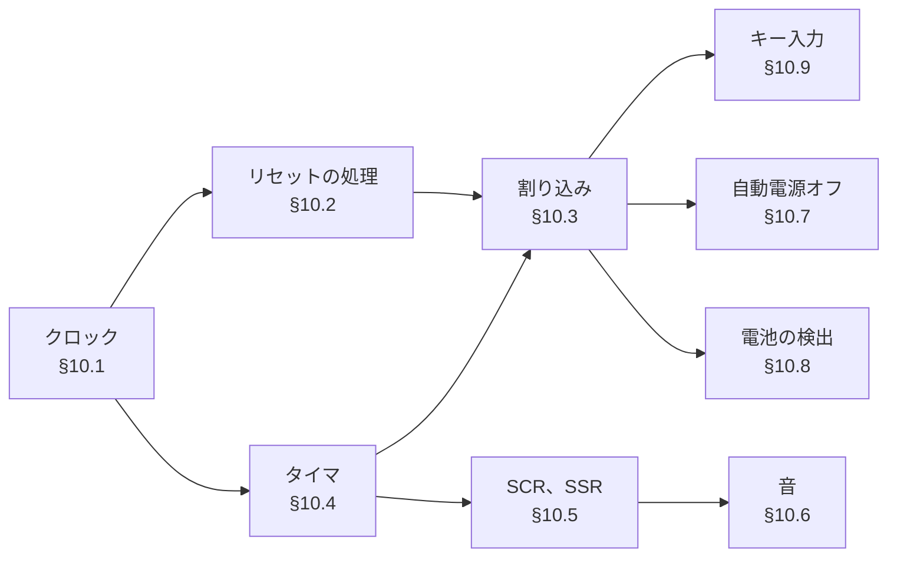
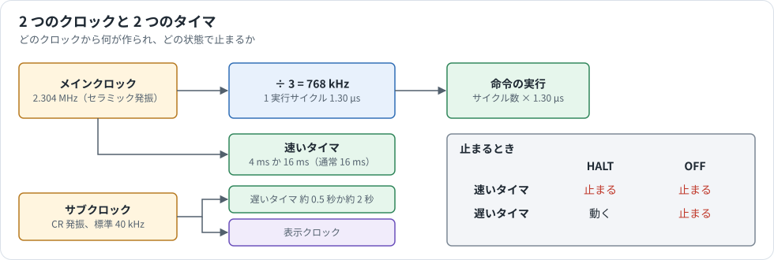
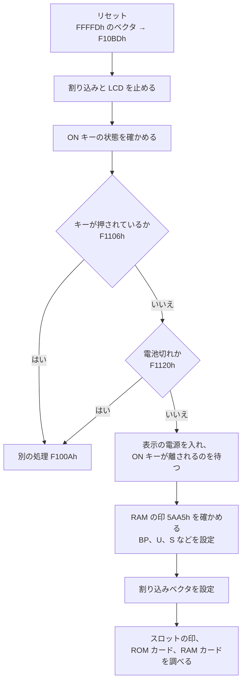
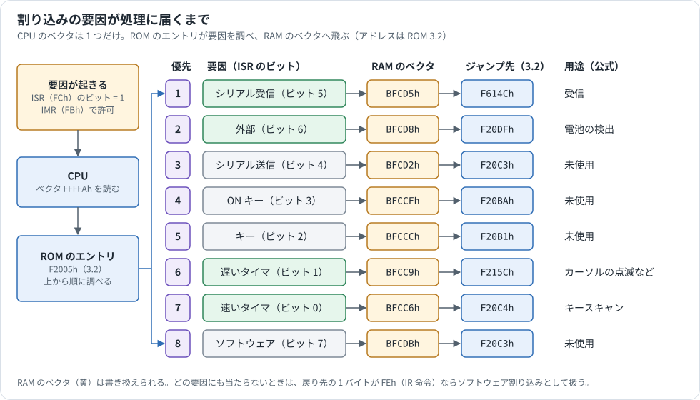
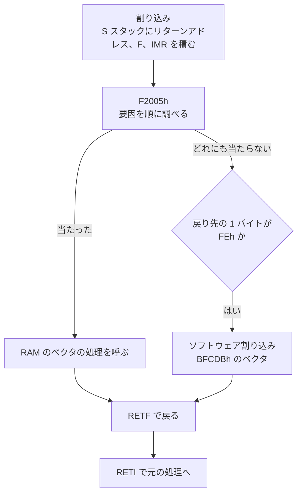
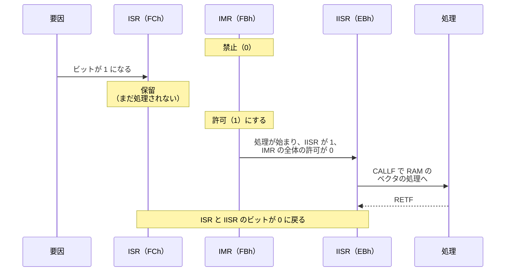
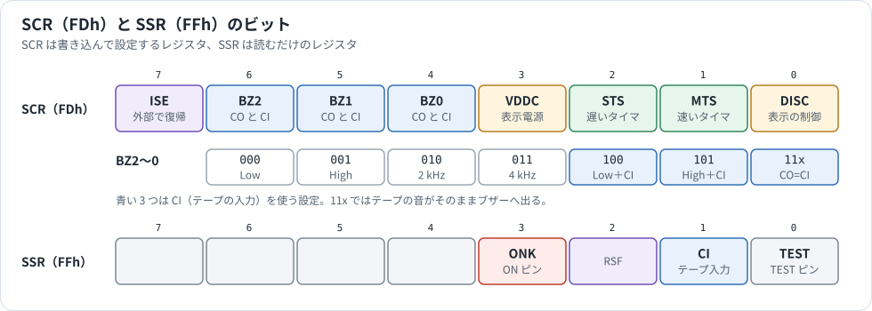
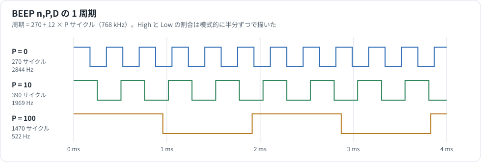
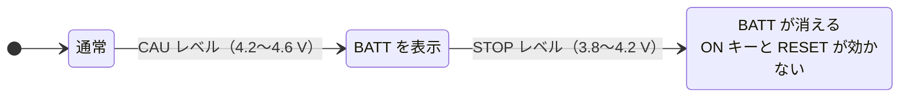

# 10. 起動、割り込み、タイマ、音

この章は電源を入れてから動くまでの処理、割り込み、タイマ、ブザーの音を説明します。キーを押していない間も、ポケコンはカーソルを点滅させ、キーを調べ、電池を監視しています。その「裏方」の時間割がこの章の内容です。自分の処理を裏方に加える方法（割り込みのフック）も、最後まで動く例で示します。CPU そのものの動作は [CPU（SC62015）](02_CPU.md) §2.9〜§2.11 を参照してください。

[目次へ戻る](README.md)

## この章で分かること

- CPU の速さの元になるクロックと、サイクル数を時間に直す方法
- リセットから BASIC が使えるようになるまでに、ROM がすること
- 割り込みがどの順番で調べられ、RAM のどのベクタを通って処理されるか
- 2 つのタイマの周期と、止まる条件
- `BEEP` の音の高さと長さの計算
- 自動電源オフ、電池の検出、キー入力の流れ
- 割り込みのベクタを書き換えて、自分の処理を裏で動かす方法

## 10.0 はじめに

ポケコンの画面でカーソルが点滅している間も、ROM は裏で多くの仕事をしています。キーを調べる、カーソルを点滅させる、電池を監視する、放っておかれた時間を数える、といった仕事です。BASIC のプログラムが計算をしている最中でも、これらは止まりません。

それを可能にしているのが**割り込み**です。割り込みは、CPU が今の処理をいったん中断し、別の短い処理をしてから元に戻る仕組みです。料理をしている途中にタイマーが鳴り、鍋を見てから元の作業に戻るのに似ています。このとき「鳴る」きっかけになるのが**タイマ**で、その元になるのが**クロック**です。この章では次の順に説明します。



アドレスや動作には、根拠を示す記号（公式、CPU 資料、コード、実験）を付けました。記号の意味は章の終わりの「情報源と確度」にあります。アドレスは、特に書いていなければ ROM 3.2 のものです。

## 10.1 クロック

クロックは、CPU が動く拍子です。この機種には命令を実行するためのメインクロックと、表示や遅いタイマのためのサブクロックがあります。



| 項目 | 値 | 根拠 |
|---|---|---|
| メインクロック | 2.304 MHz（セラミック発振） | 公式、CPU 資料 |
| 1 実行サイクル | 1.30 µs（クロック 3 周期 = **768 kHz**） | CPU 資料 |
| 別の設定 | 1.536 MHz（1.95 µs）、3.072 MHz（0.98 µs）。CPU の製造時の設定で選ぶ | CPU 資料 |
| サブクロック | CR 発振、標準 40 kHz（表示クロックとタイマ）。水晶なら 32.768 kHz | CPU 資料 |

CR 発振は抵抗とコンデンサで作る発振です。水晶より簡単ですが、周波数は正確ではありません。遅いタイマの周期が電源電圧で変わること（§10.4）や、自動電源オフの時間が計算と合わないこと（§10.7）は、この性質と関係します。

サイクル数と時間の関係は 768 kHz で換算できます。録音から求めたテープの速度（約 0.77 MHz。[11 ピン（テープ、周辺機器）](06_PORT_11PIN.md)）とも一致します。エミュレータも 768 kHz で動きます。

**例: サイクル数を時間に直す**

| サイクル数 | 計算 | 時間 |
|---|---|---|
| 1 | 1 ÷ 768000 | 約 1.30 µs |
| 270（`BEEP` の P=0 の 1 周期） | 270 ÷ 768000 | 約 0.352 ms |
| 12288 | 12288 ÷ 768000 | 16 ms（速いタイマの 1 周期にあたる） |
| 768000 | 768000 ÷ 768000 | 1 秒 |

## 10.2 リセットの処理

リセットベクタは、リセットされた CPU が最初に読む 3 バイトのアドレスです。リセットベクタは `FFFFDh` にあります。3.2 は `F10BDh`、8.5 は `F10BEh` です。

ROM はまず割り込みと表示を止めて静かな状態を作り、電池とキーを確かめ、RAM の中身が残っているかを調べてから、スタックや作業域を用意します。大きな流れは次のとおりです。



処理の流れは次のとおりです（コード、3.2）。

| 順 | アドレス | 内容 |
|---|---|---|
| 1 | `F10BDh` | `IMR` を 0 にして割り込みを止める |
| 2 | `F10C5h` | LCD の表示を止める（`0A000h` に `3Eh`） |
| 3 | `F10CFh` | ON キーの状態を確かめる（`SSR` ビット 3 を繰り返し読む） |
| 4 | `F10F8h` | `SCR`（`FDh`）を 02h にする |
| 5 | `F1106h` | キーの 1 行を読み、押されていれば別の処理（`F100Ah`）へ |
| 6 | `F1120h` | 電池の検出を有効にして（E3）、電池切れなら `F100Ah` へ |
| 7 | `F114Ch` | 表示の電源を入れる（E4） |
| 8 | `F1150h` | ON キーが離されるのを待つ |
| 9 | `F1160h` | `BE000h` に `5AA5h` を書いて RAM を確かめる |
| 10 | `F1178h` | `BP`、`U`=`BFC6Dh`、`S`=`BFC90h`、`E6h`=`BFCDEh` などを設定する |
| 11 | `F119Ah` | 割り込みベクタの一部を設定する |
| 12 | `F11C4h` | `C0000h` のスロットの印（`10 12`）を確かめる |
| 13 | `F11EAh` | `10000h`（ROM カード）で `RESET.KEY` を探し（`F1072h`）、`40000h`（RAM カード）を書き込みテストで調べる（`F0C11h`） |

順 4 の 02h は SCR のビット 1（MTS）だけを 1 にした値です（§10.5）。つまり、リセットの直後に速いタイマは 16 ms の設定になります。ブザー（BZ2〜BZ0 = 000）は Low です。

順 9 は、書いて読み返すと同じ値になるかどうかで RAM を確かめる処理です。順 13 のカードの調べ方は [カードスロット](05_CARD_SLOT.md) §5.6 にあります。

カードが新しいと `S2(CARD):NEW CARD` を表示します（[カードスロット](05_CARD_SLOT.md) §5.6）。内蔵 RAM が初期化されていないと `S1` についても同じ表示が出て、PF1 だけが選べます（実験）。

## 10.3 割り込み

割り込みは、決まった出来事（**要因**）が起きると、CPU が今の処理を中断して別の処理へ移る仕組みです。処理が終わると、中断した所から続けます。

### 10.3.1 要因

CPU の割り込みベクタは `FFFFAh` の 1 つだけで、ROM が要因を調べて RAM のベクタへ飛びます（公式 p.91、コード）。



| ビット | 要因 | RAM のベクタ | ROM 3.2 の値 | 用途（公式） |
|---|---|---|---|---|
| 0 | 速いタイマ | `BFCC6h` | `F20C4h` | BREAK キーを含むキースキャン |
| 1 | 遅いタイマ | `BFCC9h` | `F215Ch` | カーソルの点滅など |
| 2 | キー | `BFCCCh` | `F20B1h` | 未使用 |
| 3 | ON キー | `BFCCFh` | `F20BAh` | 未使用 |
| 4 | シリアル送信 | `BFCD2h` | `F20C3h` | 未使用 |
| 5 | シリアル受信 | `BFCD5h` | `F614Ch` | 受信 |
| 6 | 外部 | `BFCD8h` | `F20DFh` | 電池の検出 |
| 7 | ソフトウェア | `BFCDBh` | `F20C3h` | 未使用 |

ベクタは 1 個 3 バイトのアドレスなので、ビット番号から `BFCC6h + 3 × ビット番号` で求められます。たとえばビット 5（シリアル受信）は `BFCC6h + 15 = BFCD5h` です。

ベクタは RAM にあるので書き換えられます。ソフトウェア割り込みのベクタは、ROM のコードが `BFCDBh` を読むことで確かめました（`F2091h`）。

### 10.3.2 レジスタ

要因の発生、許可、処理中の印は、それぞれ内部 RAM の 1 バイトで表されます。

| 内部 RAM | 名前 | 内容 |
|---|---|---|
| `FCh` | ISR | 要因。1 で要求 |
| `FBh` | IMR | 許可。1 で許可。ビット 7 は全体の許可 |
| `EBh` | IISR | 処理中の要因。ビット 7 はソフトウェア割り込み |

ISR と IMR は上の表と同じビットの並びです。`FCh` と `FBh` は CPU が持つレジスタです。`EBh` は、ROM が記録に使うただの RAM です（[CPU（SC62015）](02_CPU.md) §2.6）。

**例: `IMR` = E3h を読む。** BASIC の `CALL` で機械語に入ったときの観測値です（[機械語を実機で動かす](12_MACHINE_CODE.md) §12.3.3）。E3h = `1110 0011b` なので、次のように読めます。

| ビット | 7 | 6 | 5 | 4 | 3 | 2 | 1 | 0 |
|---|---|---|---|---|---|---|---|---|
| 値 | 1 | 1 | 1 | 0 | 0 | 0 | 1 | 1 |
| 意味 | 全体を許可 | 外部 | 受信 | 送信は禁止 | ON は禁止 | キーは禁止 | 遅いタイマ | 速いタイマ |

### 10.3.3 優先順位

2 つ以上の要因が同時に起きることがあります。ROM のエントリ（3.2 `F2005h`）は次の順に要因を調べます（コード）。

**受信 → 外部 → 送信 → ON キー → キー → 遅いタイマ → 速いタイマ → ソフトウェア**

シリアルの受信が最初なのは、受け取ったデータを早く取り込まないと次のデータで失われるような、待てない要因だからだと考えると覚えやすい並びです。

どの要因にも当たらなければ、戻り先の 1 バイトが `FEh`（`IR` 命令）かどうかを調べ、そうならソフトウェア割り込みとして扱います。`IR` 命令が積むリターンアドレスが `IR` 自身を指すことを利用した判定です（[CPU（SC62015）](02_CPU.md) §2.10.4）。



**3 つのレジスタの動く順（公式 p.93〜94）。** 割り込みを禁止している間に要因が起きた場合を、順に追うと次のようになります。



禁止している間に起きた要因も、ISR に残っているので失われません。ただし 1 ビットしかないので、2 回起きても 1 回として扱われます。

| 要因 | 立つ時（公式 p.91〜92） |
|---|---|
| 速いタイマ | 4 ms か 16 ms ごと |
| 遅いタイマ | 約 0.5 秒か約 2 秒ごと |
| キー | キー入力ポート KI0〜KI7 のどれかが 1（`F2h` が 0 でない） |
| ON キー | ON キーが押された |
| シリアル送信 | 1 バイトの送信が終わった |
| シリアル受信 | 1 バイトを受け取った |
| 外部 | CPU の外からの要求。電池の検出回路につながっている |
| ソフトウェア | `IR` 命令を実行した |

### 10.3.4 割り込みの処理を書くときの注意（公式 p.92）

自分の処理を RAM のベクタに登録するときの決まりです。

- `RETF` で終わる
- U スタックと S スタックを多く使わない（数十バイトまで）
- 内部 RAM は退避して、元に戻す
- 表示の処理と重ならないようにする。横に続けて文字を出している最中に割り込んで表示すると、形が乱れることがある
- 割り込まれたプログラムと同じ作業域を使わない。同じ場所を触ってよいのは、データを受け渡すときだけ

割り込まれたプログラムが BP をスタックのように使っているときは、今の BP を基準にした場所を作業に使えます（公式 p.93）。

最初の決まりは、登録した処理が ROM の振り分けから呼ばれるためです。ハードウェアの割り込みの出口である `RETI` は、ROM の側で実行します（[CPU（SC62015）](02_CPU.md) §2.10.5）。

### 10.3.5 例: 遅いタイマに自分の処理を挟む

`BFCC9h` のアドレスを自分の処理に変え、終わったら元の処理へ飛びます。例は約 0.5 秒ごとに `BED00h` を 1 増やします。

```asm
        ORG   $BEC00
VEC     EQU   $BFCC9            ; 遅いタイマのベクタ
COUNT   EQU   $BED00
hook:   MV    X,[VEC]           ; 元のアドレスを保存する
        MV    [old+1],X         ; 下の JPF の行き先に入れる
        MV    X,mine
        MV    [VEC],X
        RC
        RETF
mine:   PUSHU BA                ; 使うレジスタを預ける
        MV    A,[COUNT]
        INC   A
        MV    [COUNT],A
        POPU  BA
old:    JPF   $00000            ; 元の処理へ（RETF はその中にある）
        END
```

`CALL &HBEC00` のあと、BASIC はふだんどおり使えます。5 秒待って `PEEK &HBED00` を見ると 10 増えていました（実験。ROM 2.2、5.3、7.2、8.3、8.5）。5 秒 ÷ 10 = 0.5 秒で、遅いタイマの周期と合います。

> [!WARNING]
> この例を 2 回呼ぶと、元のアドレスとして自分のアドレスを保存してしまい、終わらなくなります。機械語エリアを消す前には、ベクタを元の値に戻します。

## 10.4 タイマ

タイマは決まった時間ごとに割り込みの要因を立てる部品です。2 本あり、元になるクロックが違います。

| タイマ | 周期 | 選択 | 根拠 |
|---|---|---|---|
| 速いタイマ | 4 ms か 16 ms（通常 16 ms） | `SCR` ビット 1。0 で 4 ms | 公式 |
| 遅いタイマ | 約 0.5 秒か約 2 秒（通常約 0.5 秒） | `SCR` ビット 2。0 で約 0.5 秒 | 公式 |

**STS の向き。** 遅いタイマを選ぶ `SCR` ビット 2（STS）には、公式の資料が 2 つあり、書き方が逆です。技術資料 p.92 は「0 で約 0.5 秒、1 で約 2 秒」、CPU マニュアル p.18 は「0 が長い方」です。PC-E500 では **0 が約 0.5 秒**です。根拠は 2 つあります。

| 根拠 | 内容 |
|---|---|
| ROM | `SCR` を 02h（STS = 0）にして使う（§10.2、動作中に読んでも 02h。実験） |
| 実機の時間 | 自動電源オフは、遅いタイマを 1200 回数えて約 11 分（マニュアル）。1 回は約 0.55 秒になる。2 秒なら 40 分 |

技術資料 p.92 の「通常は約 5 秒」は、同じ段落の 0.5 秒と 2 秒のどちらとも違い、「.5 秒」の点が落ちたものと見られます。

速いタイマは CPU のクロックを分周するので、`HALT` と `OFF` の間は止まります。遅いタイマはサブクロックを分周するので、`OFF` の間だけ止まり、周期は電源電圧でかなり変わります（公式）。

| | 動いているとき | `HALT` | `OFF` |
|---|---|---|---|
| 速いタイマ | 動く | 止まる | 止まる |
| 遅いタイマ | 動く | 動く | 止まる |

テープの入出力の処理は速いタイマの周期を 4 ms に切り替えます（コード）。

機械語で時間を測るときは、この性質に注意します。正確な時間がいるなら速いタイマかサイクル数を、数秒以上の大まかな時間でよければ遅いタイマを数えます。

## 10.5 システム制御（SCR、FDh）

SCR はブザー、タイマの周期、表示の電源などをまとめて設定する 1 バイトです。



| ビット | 名前 | 内容 |
|---|---|---|
| 7 | ISE | 外部割り込みで `HALT` / `OFF` から戻る |
| 6〜4 | BZ2〜BZ0 | CO と CI のピン（下の表） |
| 3 | VDDC | 表示電源。SC62015B01 では 1 にするとサブクロックも止まる |
| 2 | STS | 遅いタイマの選択（0 で約 0.5 秒、§10.4） |
| 1 | MTS | 速いタイマの選択（0 で 4 ms、1 で 16 ms） |
| 0 | DISC | 表示の制御 |

CO はブザーとテープへの出力、CI はテープからの入力です。BZ2〜BZ0 の 3 ビットで、出力する信号と、入力を使うかどうかを選びます。

| BZ2〜0 | CO の出力 | CI の入力 |
|---|---|---|
| 000 | Low | 使わない |
| 001 | High | 使わない |
| 010 | 2 kHz | 使わない |
| 011 | 4 kHz | 使わない |
| 100 | Low | 使う |
| 101 | High | 使う |
| 11x | CI と同じ | 使う |

（CPU 資料。OCR の表なので確度は高くありません。）

テープの読み込みが BZ を 111 にしているのは、テープの音をそのままブザーへ返すためです。

**例: SCR の値を組み立てる**

| したいこと | 変えるビット | 命令の例 |
|---|---|---|
| ブザーの信号を止める（CO を Low） | ビット 6〜4 を 0 | `AND ($FD),$8F` |
| 2 kHz を鳴らす | 止めてからビット 5 を 1 | `OR ($FD),$20` |
| 4 kHz を鳴らす | 止めてからビット 5 と 4 を 1 | `OR ($FD),$30` |
| CO を High にする | 止めてからビット 4 を 1 | `OR ($FD),$10` |

`AND` と `OR` を使うのは、ほかのビット（タイマや表示）を変えないためです。名前の付いた定数は [INCLUDE ファイル](../manual/06_INCLUDE_FILES.md#ブザーと-onbrk) にあります。

### 10.5.1 システム状態（SSR、FFh）

SSR はピンの状態を読むためのレジスタです。読み出し専用です（CPU 資料）。

| ビット | 名前 | 内容 |
|---|---|---|
| 3 | ONK | ON ピンの状態。ROM はこれで `BREAK` を調べる |
| 2 | RSF | RESET が High で 0、HALT / OFF で 1 |
| 1 | CI | テープの入力ピンの状態 |
| 0 | TEST | TEST ピンの状態 |

たとえば `TEST ($FF),$08` を実行して Z が 0 なら、ON キーが押されています。割り込みを止めた処理の中でも使える調べ方です。

## 10.6 音（BEEP）

ROM の `BEEP` は 2 kHz と 4 kHz の設定を使わず、ソフトウェアで CO を切り替えます。CPU が High と Low を自分で切り替えるので、1 周期の長さを細かく変えられます。`BEEP n,P,D` の 1 周期のサイクル数は次のとおりです（実験）。

```text
周期 = 270 + 12 × P サイクル
```



| P | サイクル | 周波数（768 kHz） |
|---|---|---|
| 0 | 270 | 2844 Hz |
| 1 | 282 | 2723 Hz |
| 10 | 390 | 1969 Hz |
| 100 | 1470 | 522 Hz |
| 255 | 3330 | 231 Hz |

`D` は周期の数です。`BEEP 1,0,1000` は 1000 周期でした（実験）。時間は周期によって変わります。

**例: 音の高さから P を決める**

周波数を f とすると、周期のサイクル数は 768000 ÷ f です。上の式を逆に解くと、P = (768000 ÷ f − 270) ÷ 12 になります。

| 音 | f | 768000 ÷ f | P（四捨五入） | 実際の周波数 |
|---|---|---|---|---|
| ラ | 440 Hz | 1745.5 | 123 | 1746 サイクル = 439.9 Hz |
| ド | 523.25 Hz | 1467.8 | 100 | 1470 サイクル = 522.4 Hz |
| 高いラ | 880 Hz | 872.7 | 50 | 870 サイクル = 882.8 Hz |

**例: 長さから D を決める**

鳴らす時間を t 秒とすると、D = t × 768000 ÷ 周期です。P = 100 の音を 0.5 秒鳴らすなら、0.5 × 768000 ÷ 1470 = 261 周期です。同じ D でも P が大きいほど長く鳴ります。`BEEP 1,0,1000` の 1000 周期は 270000 サイクル、約 0.35 秒です。

CO は 1 ビットの出力ですが、切り替えの時間を分けて 3 音を同時に鳴らすソフトウェア（PLAY3）が知られています（[外部資料](28_RESOURCES.md)）。

## 10.7 自動電源オフ

操作しないまま放っておくと、本体は自分で電源を切ります。時間を数えるのは、遅いタイマの割り込みの処理です。

| 項目 | 内容 | 根拠 |
|---|---|---|
| 時間 | 約 11 分 | マニュアル |
| カウンタ | `[E6h]+06h`。遅いタイマのたびに 1 減らす（3.2 `F2192h`） | コード |
| 初期値 | `BFCBCh` の値（2 バイト、単位は約 0.5 秒）。起動直後は 04B0h（1200） | 公式 p.48、実験 |
| エミュレータ | 放置すると 600 秒で電源が切れた（0.5 秒 × 1200） | 実験 |

`[E6h]+06h` は、内部 RAM `E6h` が指す IOCS の作業域の 6 バイト目です。

マニュアルの約 11 分とエミュレータの 10 分の差は、実機の遅いタイマが 0.5 秒ちょうどではないためと見られます。

公式に `BFCBCh` が自動電源オフの設定として載っています。`POKE &BFCBC,&78,0` で値が変わることは確かめました。時間切れは、キーを待つ IOCS（41h）が `0Fh` を返すことでプログラムに伝わります（公式 p.44）。

時間を数えるのは、キーを待っている間だけです。エミュレータで待つ場面を変えて測ると、次のようになりました（実験、ROM 5.3）。

| 場面 | 電源が切れるまで |
|---|---|
| BASIC のプロンプト、`INPUT` の待ち | 600 秒 |
| リセット直後の選択画面 | 60 秒 |
| `INKEY$`、`INPUT$` の待ち、走っているプログラム | 切れない |

**例: 設定値の意味。** `&78,0` は下位、上位の順なので 0078h = 120 です。0.5 秒 × 120 = 60 秒にあたる値です。起動直後の 04B0h は 1200 で、0.5 秒 × 1200 = 600 秒です。

## 10.8 電池の検出

電池の検出回路はサービスマニュアルに説明があります。電池の電圧を、警告を出す高さ（CAU）と、動作を止める高さ（STOP）の 2 段階で監視します。

| 項目 | 内容 |
|---|---|
| 検出 IC | MN1280 |
| 表示 | CAU レベルで `BATT` を表示、STOP レベルで消える |
| CAU レベル | VCC - GND が 4.2〜4.6 V |
| STOP レベル | VCC - GND が 3.8〜4.2 V |
| 方法 | CPU の E3 を Low にして IRQ を見る。E3 を Hi-Z にして再度見る |
| STOP のあと | ON キーと RESET が効かなくなる |



「方法」にある Hi-Z は出力を切り離した状態のことです。

割り込みでは `ISR` のビット 6 で分かります。テープとシリアルの処理は、ループの中でこのビットを調べます（[11 ピン（テープ、周辺機器）](06_PORT_11PIN.md)、[15 ピン（シリアル）](07_PORT_15PIN.md)）。割り込みを止めている間でも、ISR のビットは立つからです。

## 10.9 キー入力の流れ

キーが押されてからプログラムが受け取るまでです（公式 p.48〜49）。

行列コードの一覧と、文字へ直す表は [IOCS と FCS](11_IOCS.md) §11.6.4 にあります。途中に 2 段の**バッファ**（受け取ったものをためておく場所）があります。1 段目はどのキーが押されたか（マトリクスコード）を、2 段目は文字に直したあとのコードをためます。CPU が忙しくて読み取れない間に押されたキーが失われないのは、このためです。

```text
タイマ割り込み    ハードコードをマトリクスコードへ変換（表は [BFCC0h]）
    |
キースキャンバッファ（16 文字）
    |  [BFCC3h] のフック
IOCS 41h、42h で読み出す
    |  CTRL、SHIFT、HYP、2nd の処理
    |  カナの処理
    |  [BFC41h] のフック
    |  CAPS、FUNCKEY の処理
キーボードバッファ（32 文字）
    |
FCS
    |
ユーザーのプログラム
```

各段階を IOCS の呼び出し（[IOCS と FCS](11_IOCS.md)）と並べると次のようになります。

| 段階 | していること | 自分の処理を入れられる所 |
|---|---|---|
| タイマ割り込み | 速いタイマごとにキーの行列を調べ、番号を決める | 表のアドレス `BFCC0h` |
| キースキャンバッファ | 押した / 離した順に 16 文字までためる | `[BFCC3h]` のフック |
| 文字への変換 | `CTRL`、`SHIFT`、`HYP`、`2ndF` とカナを処理して文字にする。カナで作った文字はキーボードバッファへ入る | `[BFC41h]` のフック |
| キーボードバッファ | 文字を 32 文字までためる。`FUNCKEY`（PF キーの内容）とカナの変換結果もここを通る | |
| FCS | ファイルとして読み出す（`STDI:`） | |

**フック**は、ROM が処理の途中で必ず通る RAM のアドレスです。そこに書かれたアドレスを差し替えると、自分の処理を挟めます。

表のアドレス `BFCC0h` を差し替えるとキーの配置を変えられます（公式）。本リポジトリでは試していません。関係するアドレスは [メモリ](03_MEMORY.md) §3.8 にあります。

## まとめ

| 覚えておくこと | 値 |
|---|---|
| 1 実行サイクル | 1.30 µs（768 kHz） |
| リセットベクタ / 割り込みベクタ | `FFFFDh` / `FFFFAh` |
| RAM の割り込みベクタ | `BFCC6h` から 3 バイトずつ、ビット 0〜7 の順 |
| ISR / IMR / IISR | `FCh` / `FBh` / `EBh` |
| 優先順位 | 受信、外部、送信、ON、キー、遅いタイマ、速いタイマ、ソフトウェア |
| 速いタイマ / 遅いタイマ | 通常 16 ms / 約 0.5 秒 |
| SCR / SSR | `FDh`（設定） / `FFh`（読むだけ） |
| `BEEP` の 1 周期 | 270 + 12 × P サイクル |
| 自動電源オフ | `BFCBCh`（2 バイト、約 0.5 秒単位） |
| 登録した割り込みの処理 | `RETF` で終わる |

## 情報源と確度

| 表記 | 情報源 |
|---|---|
| **公式** | PC-E500 Technical Reference Manual（p.44、p.48〜49、p.91〜94）、Service Manual |
| **CPU 資料** | ESR-L CPU Technical Manual（[Forth500 の resources](https://github.com/Robert-van-Engelen/Forth500/tree/main/resources) で公開されている PDF。OCR で読んだ） |
| **コード** | ROM 3.2 の逆アセンブル |
| **実験** | エミュレータで測った |

実機では測っていません。

## 次に読むもの

- [CPU（SC62015）](02_CPU.md) §2.9〜§2.11: レジスタと割り込みの詳しい動作
- [IOCS と FCS](11_IOCS.md): キー、画面、シリアルなどを呼び出す方法
- [機械語を実機で動かす](12_MACHINE_CODE.md): 割り込みのもとで動く機械語の決まり
- [メモリ](03_MEMORY.md) §3.8: この章に出てきた `BFCxxh` のアドレスの一覧
