# 11. IOCS と FCS

この章は機械語のプログラムから本体の画面、キー、ファイル、メモリを使う「窓口」を説明します。ここを読むと、液晶やテープの信号を自分で作らなくても、決まった番号を置いて 1 回呼ぶだけで仕事を頼めるようになります。PC-E500 の ROM 8.5 を解析して得た IOCS/FCS のエントリ表と、Sharp *Technical Reference Manual*（以下、技術資料）の公開 ABI をまとめ、技術資料の引数をエミュレータで 1 つずつ呼んで確かめました。ABI は、プログラムどうしが呼び合うときの規約（引数をどこに置くか、結果がどこに返るか）のことです。

[目次へ戻る](README.md)

## この章で分かること

- IOCS と FCS が何をする仕組みか、どう呼び出すか
- デバイス番号、ドライブ番号、コマンド番号の決まりと、ヘッダの読み方、自分のデバイスの足し方
- 画面、キーボード、シリアル、プリンタ、テープ、ディスクなど、デバイスごとのコマンドと引数、短い例
- 行のドットの並び（右半分が逆順）などの細かい決まり
- ファイルを名前で開いて読み書きする FCS の、名前の形、ハンドル、全関数
- エラーコードの読み方（IOCS と FCS で表が違います）
- ROM 8.5 の全コマンドのエントリのアドレス

> [!WARNING]
> この章でいう「エントリ」は ROM 上の実装アドレスで、バージョンごとに変わります。プログラムからは公開ベクタを呼びます。「残る」と書いていないレジスタは、呼んだ後に変わっているものとして扱ってください。特に `(CX)` は、RAM ディスクと FCS の呼び出しで変わります（実験）。

## 11.0 はじめに

プログラムから画面に文字を出したいとき、液晶の制御 IC に送る命令を 1 つずつ書くのは大変です。しかも、プリンタに出すときはまったく別の手順になります。そこで ROM は、「デバイスを選び、番号で仕事を頼む」という同じ形で、画面もキーもシリアルもテープも扱えるようにしています。これが **IOCS**（Input/Output Control System、入出力の制御システム）です。

役所の窓口にたとえると、デバイス番号が「何番の窓口か」、コマンド番号が「どの用件か」、引数が「申込書の中身」です。同じ用件番号でも、窓口が違えば別の仕事になります。

その上にもう 1 段、ファイルを名前で開いて読み書きするための **FCS**（File Control System、ファイル制御）があります。FCS はファイルの仕事を、対応するデバイスの IOCS のコマンドに直して頼みます。

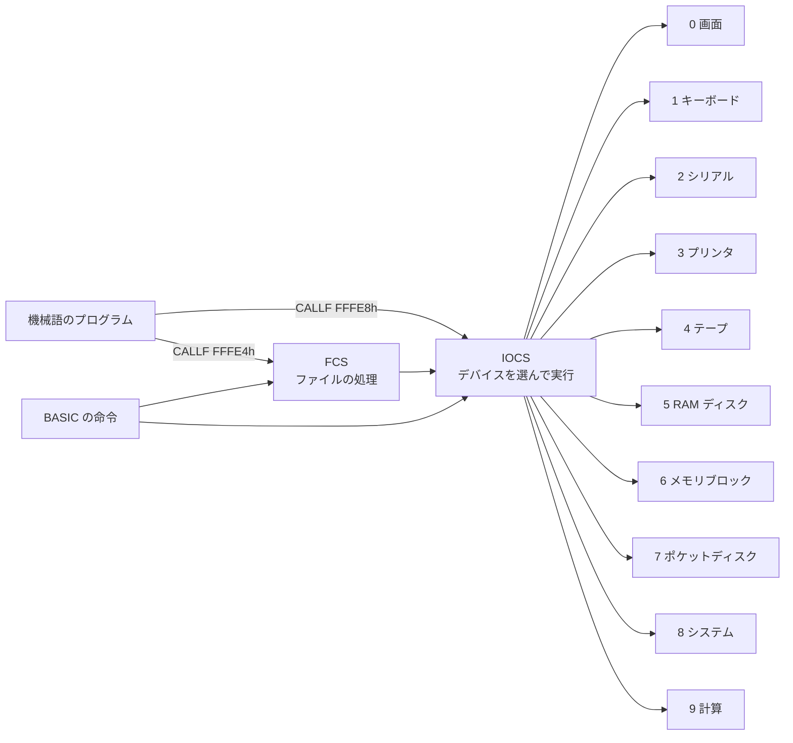

### 3 つの段

技術資料（p.1〜2）は入出力を 3 つの段に分けて説明しています。上の段ほど簡単で、機種が変わっても動きやすく、下の段ほど速くて細かいことができます。

| 段 | 使うもの | できること | 例（画面） |
|---|---|---|---|
| レベル 2 | FCS（`FFFE4h`） | どのデバイスもファイルとして開き、読み、書き、閉じる | 文字を順に送る |
| レベル 1 | IOCS（`FFFE8h`） | デバイスごとの仕事（線を引く、スクロール） | 好きな位置に文字、線 |
| レベル 0 | ポートや LCD のアドレスを直接操作 | 何でもできるが手間がかかる。とても速い | 表示 RAM に直接書く |

技術資料は、レベル 0 は速さがどうしても要るときだけにするよう勧めています。ファイルとデバイスが同じ形で扱えるので、出力先を画面からファイルへ切り替えることも、レベル 2 なら番号 1 つで済みます。

この章の例は名前を付けた定数（`SCRN_PUTS` など）を使います。定数は VS Code 拡張の `iocs.inc` にあり、一覧は [INCLUDE ファイル](../manual/06_INCLUDE_FILES.md#iocsinc) にあります。どの例も `e500asm` でアセンブルできることを確かめました。機械語の書き方や動かし方は [アセンブラ入門](../manual/03_ASSEMBLER_TUTORIAL.md) と [機械語を実機で動かす](12_MACHINE_CODE.md) を参照してください。

## 11.1 最初に: IOCS の使い方

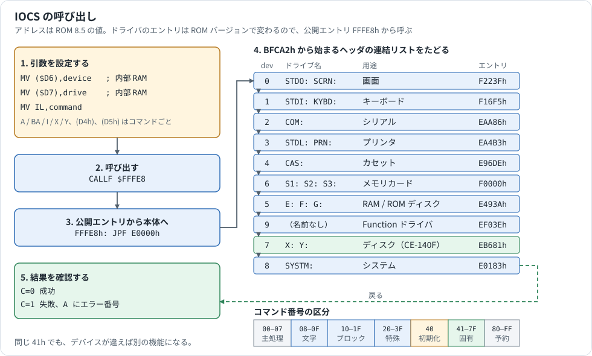

IOCS はデバイスを統一的に操作するディスパッチャ（振り分け役）です。呼び出し前に内部 RAM のデバイス番号とドライブ番号、`IL` のコマンド番号を設定し、公開ベクタ `FFFE8h` を `CALLF` します。呼び出し先を直接 `CALLF E0000h` に固定せず、互換性のため公開ベクタを用います。

手順はいつも同じ 4 段階です。

1. 対象を選ぶ（デバイスとドライブ）
2. 処理を選ぶ（コマンド番号）
3. コマンドごとの引数を置く
4. 呼び出して、キャリーと A を確認する

```asm
; 1. 対象を選ぶ: LCD/画面デバイス 0、ドライブ 0
MV   ($D6),$00                ; device
MV   ($D7),$00                ; drive

; 2. 処理を選ぶ: 指定位置へ 1 文字表示
MV   IL,$41                   ; command
MV   ($D4),$00                ; x 座標 (bl)
MV   ($D5),$03                ; y 座標 (bh)
MV   A,$41                    ; 個別コマンドの引数: 'A'

; 3. 実行し、carry と A を確認する
CALLF $FFFE8
```

`D6h`/`D7h` は CPU レジスタではなく内部 RAM のアドレスを表します。個別コマンドが使用する A/BA/I/X/Y、内部 RAM、返却値はデバイスごとに異なります。上の `41h` は device 0 の場合だけ「指定位置へ 1 文字表示」であり、同じ番号でも別デバイスでは別機能になり得ます。座標は内部 RAM `D4h`(x)/`D5h`(y) で渡します（技術資料の (bl)/(bh)）。

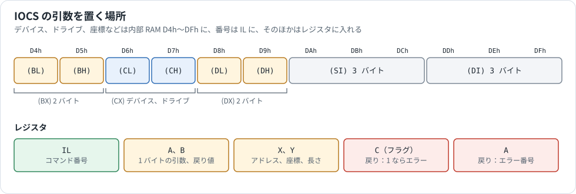

同じ例を名前で書くと、次のようになります。最後の `RETF` を除いて、作られる機械語は同じです。

```asm
        ORG   $BEC00
        INCLUDE "iocs.inc"
start:  MV    (CL),DEV_SCRN     ; デバイス: 画面
        MV    (CH),0            ; ドライブ 0
        MV    IL,SCRN_PUTC      ; 用件: 指定位置へ 1 文字
        MV    (BL),0            ; x
        MV    (BH),3            ; y
        MV    A,'A'
        CALLF IOCS
        RETF                    ; C と A をそのまま BASIC へ返す
        END
```

デバイスとドライブは `(CX)` に 2 バイトまとめて書けます。`MVW (CX),DEV_SCRN` は D6h に 00h、D7h に 00h を書きます。技術資料の `(cx)=0004h` のような書き方はこの 2 バイトの値です（D6h に 04h、D7h に 00h）。

### 11.1.1 結果の確認と注意

- 原則として成功は carry clear、失敗は carry set と A のエラー値で返ります。実際に使うコマンドのエラー値・副作用は技術資料の個別ドライバ仕様で確認します。
- `08h`–`0Fh`、`10h`–`1Fh`、`20h`–`3Fh` は file-control 用の標準領域です。ファイルや媒体を扱わない実験では、`3Fh`（format）や書き込み系を呼びません。
- 同じドライブ名を持つ IOCS ヘッダが追加された場合、後から組み込まれたデバイスが選ばれます。周辺機器のドライバ追加後は、表中の ROM 固定アドレスではなく実行時ヘッダを基準にします。
- IOCS が壊すレジスタは公開されていません。残したい値は呼び出し前後で `PUSHU` と `POPU` を使って退避します。

carry clear は「キャリーフラグ C が 0」、carry set は「C が 1」のことです。C を調べて分かれるには、`JRC`（C = 1 なら飛ぶ）を使います。

```asm
        ORG   $BEC00
        INCLUDE "iocs.inc"
start:  MVW   (CX),DEV_SCRN
        MV    IL,SCRN_CLEAR
        CALLF IOCS
        JRC   error             ; C = 1: A にエラー番号
        RC
        RETF
error:  RETF                    ; C = 1 のまま戻ると BASIC のエラーになる
        END
```

### 11.1.2 BASIC から IOCS を呼ぶ（FFFDCh）

デバイス、ドライブ、コマンドの 3 つだけで済む仕事は、BASIC から直接頼めます（技術資料 p.31）。`BFE00h` から 3 バイトに入れて `CALL &HFFFDC` です。

| アドレス | 入れるもの | 対応 |
|---|---|---|
| `BFE00h` | デバイス | `(CL)` |
| `BFE01h` | ドライブ | `(CH)` |
| `BFE02h` | コマンド | `IL` |

ROM の `FFFDCh` の中身は `IL` と `(CX)` をこのアドレスから読み、`CALLF FFFE8h` して `RETF` するだけです（ROM 7.2 では `EF2F4h`）。A や X の引数は渡せません。

```basic
POKE &HBFE00,0,0,&H51:CALL &HFFFDC      ' 画面を消す
POKE &HBFE00,8,0,&H41:CALL &HFFFDC      ' 電源を切る
```

2 つ目をエミュレータで実行すると、電源が切れました。

## 11.2 エントリポイント

| 種別 | 公開ベクタ | 実体 (ROM 8.5) | 用途 |
|---|---:|---:|---|
| IOCS | `CALLF FFFE8h` | `JPF E0000h` | デバイス IOCS の選択と実行 |
| FCS | `CALLF FFFE4h` | `JPF E06BFh` | ファイル制御の共通処理 |
| BASIC から IOCS | `CALL &HFFFDC` | バージョンごとに違う | `BFE00h` からの 3 バイトで IOCS を呼ぶ（§11.1.2） |
| 作業域の変更 | `CALL &HFFFD8` | バージョンごとに違う | 空きを詰め、`BFE03h` と `BFE06h` の値で SYSTM の 42h を実行し、メニューへ行く（[機械語を実機で動かす](12_MACHINE_CODE.md) §12.3.2） |

公開ベクタは、ROM バージョンが変わっても同じアドレスにあるエントリです。中身はそのバージョンの本体へ飛ぶ `JPF` 命令です。各バージョンのジャンプ先は [ROM バージョンの違い: 配置](23_ROM_VERSIONS_MAP.md) にあります。

### 11.2.1 選択値

| 項目 | 設定場所 | 意味 |
|---|---|---|
| device | 内部 RAM `D6h` | IOCS ヘッダのデバイス番号 |
| drive | 内部 RAM `D7h` | そのデバイス内のドライブ番号 |
| command | `IL` | 実行する IOCS コマンド |

### 11.2.2 コマンド番号の区分

コマンド番号の区分は次のとおりです。`00h`–`07h` は IOCS 主処理用で、各デバイスのエントリには飛びません。`40h` は全デバイス共通の初期化、`41h`–`7Fh` はデバイス固有、`80h`–`FFh` は予約です。

| 範囲 | 区分 |
|---|---|
| `00h`–`07h` | IOCS 主処理（00h〜05h が使える。§11.4.2） |
| `08h`–`0Fh` | 標準キャラクタデバイスの file-control |
| `10h`–`1Fh` | 標準ブロックデバイスの file-control |
| `20h`–`3Fh` | 特殊デバイスの file-control |
| `3Fh` | format |
| `40h` | 初期化 |
| `41h`–`7Fh` | デバイス固有処理 |

**キャラクタデバイス**は、1 文字ずつ順に流れるデバイス（画面、キー、プリンタ）です。**ブロックデバイス**は、決まった大きさの区画（セクタ）を番号で読み書きするデバイスです。**特殊デバイス**は、どちらとも別の番号（20h〜3Fh）で file-control を受け持つデバイスです。どの区分かは、次のヘッダの属性で分かります。

## 11.3 ROM 8.5のIOCSヘッダ

IOCS はデバイスの一覧を**ヘッダ**の連結リストとして持っています。連結リストは、各項目が「次の項目のアドレス」を持つ並べ方です。先頭のアドレスは `BFCA2h` にあり、IOCS はそこから順にたどって、デバイス番号が一致するヘッダのエントリへ飛びます。

ヘッダ形式は `[next:3][device:1][attribute:1][entry:3][NUL終端ドライブ名]` です。実行時の `BFCA2h` は `DF820h` を指しました。この章のアドレスは PC-E650 の ROM 8.5 のものです。PC-E500S（8.3）やほかの機種のエントリは [ROM バージョンの違い: 配置](23_ROM_VERSIONS_MAP.md) §23.4.2 にあります。呼び方と番号は全機種で同じです。

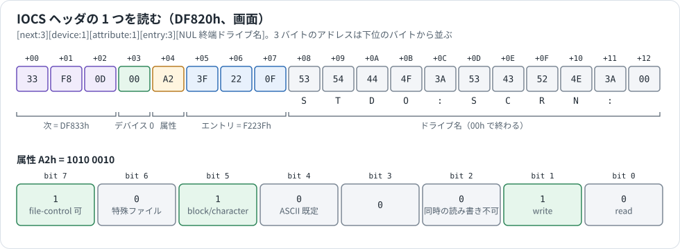

| header | next | device | attr | entry | drive names |
|---|---|---|---|---|---|
| `DF820h` | `DF833h` | 0 | A2h | `F223Fh` | STDO:SCRN: |
| `DF833h` | `DF846h` | 1 | A1h | `F16F5h` | STDI:KYBD: |
| `DF846h` | `DF853h` | 2 | D3h | `EAA86h` | COM: |
| `DF853h` | `DF865h` | 3 | A2h | `EA4B3h` | STDL:PRN: |
| `DF865h` | `DF872h` | 4 | D7h | `E96DEh` | CAS: |
| `DF872h` | `DF884h` | 6 | C3h | `F0000h` | S1:S2:S3: |
| `DF884h` | `DF893h` | 5 | 83h | `E493Ah` | E:F:G: |
| `DF893h` | `DF89Ch` | 9 | 00h | `EF03Eh` | (なし) |
| `DF89Ch` | `DF8A9h` | 7 | 00h | `EB681h` | X:Y: |
| `DF8A9h` | `FFFFFh` | 8 | 00h | `E0183h` | SYSTM: |

`next` が `FFFFFh` のヘッダが最後です。たどる順番はアドレスの順で、デバイス番号の順ではありません（6、5、9、7、8 の順に並びます）。

属性bit は bit7=file-control可、bit6=特殊ファイル、bit5=block/character、bit4=ASCII既定、bit2=同時read/write不可、bit1=write、bit0=read です。表の値を分けると、次のようになります。

| device | attr | file-control | 特殊 | bit5 | ASCII 既定 | 同時不可 | write | read |
|---|---|---|---|---|---|---|---|---|
| 0 画面 | A2h | ○ | | 1 | | | ○ | |
| 1 キーボード | A1h | ○ | | 1 | | | | ○ |
| 2 シリアル | D3h | ○ | ○ | 0 | ○ | | ○ | ○ |
| 3 プリンタ | A2h | ○ | | 1 | | | ○ | |
| 4 テープ | D7h | ○ | ○ | 0 | ○ | ○ | ○ | ○ |
| 5 RAM ディスク | 83h | ○ | | 0 | | | ○ | ○ |
| 6 メモリブロック | C3h | ○ | ○ | 0 | | | ○ | ○ |
| 7、8、9 | 00h | | | 0 | | | | |

画面とプリンタは書くだけ、キーボードは読むだけ、テープは読み書きできても同時にはできない、という性質がそのまま現れています。

ドライブ番号はドライブ名の並びの順番です（0 から数えます）。G:はdevice 5のdrive 2、S3:はdevice 6のdrive 2です。

| device | drive 0 | drive 1 | drive 2 |
|---|---|---|---|
| 5 | `E:` | `F:` | `G:` |
| 6 | `S1:` | `S2:` | `S3:` |
| 7 | `X:` | `Y:` | |

ヘッダの並びとエントリのバージョンによる違いは [ROM バージョンの違い: システム](26_ROM_VERSIONS_SYSTEM.md) §26.1.1 にあります。

### 11.3.1 自分のデバイスを足す

ヘッダは連結リストなので、先頭に 1 つ足せば新しいデバイスになります。技術資料（p.15）は、同じ名前のデバイスがあるときは後から足したほうが選ばれる、と説明しています。つまり、元からあるデバイスの働きを差し替えることもできます。

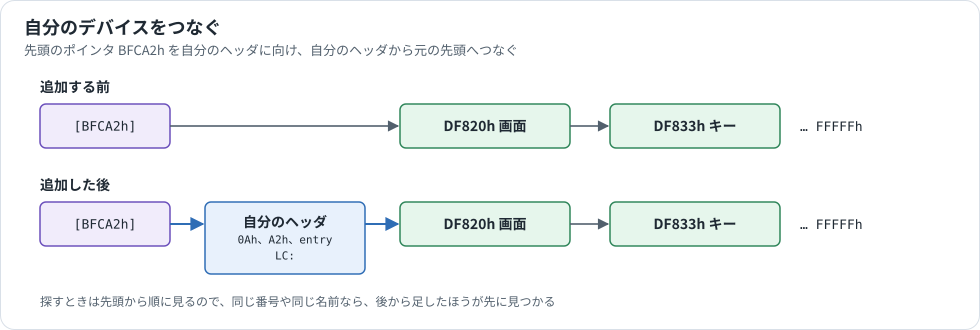

用意するものは 3 つです。

| もの | 決まり |
|---|---|
| ヘッダ | §11.3 の形。ドライブ名は 1 つ 5 文字までで `:` で区切り、最後に 00h。2 つ並べれば、ドライブ 0 と 1 になる |
| エントリ | `CALLF` で呼ばれる。`IL` がコマンド、`(CL)`、`(CH)`、A、X、Y などはそのまま渡ってくる。`RETF` で戻る |
| つなぎ方 | ヘッダの `next` に今の `[BFCA2h]` を入れ、`[BFCA2h]` を自分のヘッダにする |

キャラクタデバイスなら 08h〜0Dh、ブロックデバイスなら 10h〜17h、どちらでもなければ 20h〜2Fh に答えると、`OPEN` や `PRINT #` から使えるようになります。次の例は書いた英字を小文字にして画面へ送るデバイス `LC:` です。

```asm
        ORG   $BEC00
        INCLUDE "iocs.inc"
HEADTOP EQU   $BFCA2
start:  MV    X,[HEADTOP]       ; 今の先頭
        MV    Y,header
        MV    [Y],X             ; 次のヘッダ = 今の先頭
        MV    [HEADTOP],Y       ; 先頭 = 自分
        RC
        RETF
header: DP    0                 ; 次のヘッダ（start が入れる）
        DB    $0A               ; デバイス番号（空いている番号）
        DB    $A2               ; file-control 可、キャラクタ、書き込み
        DP    entry
        DB    "LC:",0
entry:  MV    BA,I              ; A = コマンド番号（IL）
        CMP   A,$0B             ; ブロックの書き込み
        JRZ   wblock
        CMP   A,$08             ; 開く
        JRZ   ok
        CMP   A,$09             ; 閉じる
        JRZ   ok
        CMP   A,$40             ; 初期化
        JRZ   ok
        MV    A,3               ; 処理できないコマンド
        SC
        RETF
ok:     RC
        RETF
wblock: MV    A,[X++]           ; X = データ、Y = バイト数
        CALL  out
        DEC   Y
        JRNZ  wblock
        RC
        RETF
out:    CMP   A,$41
        JRC   put               ; A より前
        CMP   A,$5B
        JRNC  put               ; Z より後
        OR    A,$20             ; 小文字に
put:    PUSHU X
        PUSHU Y
        MV    X,char
        MV    [X],A
        MVW   (CX),DEV_SCRN
        MV    Y,1
        MV    IL,IO_WRITE_BLOCK
        CALLF IOCS
        POPU  Y
        POPU  X
        RET
char:   DB    0
        END
```

`CALL &HBEC00` のあとに次の 1 行を実行すると、`hello` と表示されました（実験。ROM 2.2、5.3、7.2、8.3、8.5）。

```basic
OPEN "LC:" FOR OUTPUT AS #1:PRINT #1,"HELLO":CLOSE
```

> [!NOTE]
> ヘッダとエントリは機械語エリアに置いたままにします。機械語エリアを縮めたり、そこへ別のプログラムを入れたりするときは、先に `[BFCA2h]` を元の値に戻します。

## 11.4 IOCSコマンドエントリ

§11.5 から、デバイスごとにコマンドを説明します。各節の作りは同じです。

| 節の中の表 | 内容 |
|---|---|
| コマンドと引数 | 番号、`iocs.inc` の名前、渡すもの、返るもの。`(BL)` などは §11.1 の図の内部 RAM、`−` は「なし」 |
| エントリ（ROM 8.5） | コマンド番号ごとのエントリ表のアドレスと、処理のアドレス。drive はすべて 0 の欄の値 |

エントリ表にある「名称未確定」は、ROMのエントリアドレスは確定したが、公開資料で名称を確定できていない予約/内部処理です。

| 節 | device | デバイス | 名前 | 名前の付いたコマンド |
|---|---|---|---|---|
| [11.5](#115-画面device-0) | 0 | 画面 | `STDO:` `SCRN:` | 41h〜58h |
| [11.6](#116-キーボードdevice-1) | 1 | キーボード | `STDI:` `KYBD:` | 41h〜46h |
| [11.7](#117-シリアルdevice-2) | 2 | シリアル | `COM:` | 41h〜4Bh |
| [11.8](#118-プリンタdevice-3) | 3 | プリンタ | `STDL:` `PRN:` | 41h〜43h |
| [11.9](#119-テープdevice-4) | 4 | テープ | `CAS:` | 41h〜45h |
| [11.10](#1110-ram-ディスクdevice-5) | 5 | RAM ディスク | `E:` `F:` `G:` | 10h〜17h |
| [11.11](#1111-メモリブロックdevice-6) | 6 | メモリブロック | `S1:` `S2:` `S3:` | 41h〜48h |
| [11.12](#1112-ポケットディスクdevice-7) | 7 | ポケットディスク | `X:` `Y:` | |
| [11.13](#1113-システムdevice-8) | 8 | システム | `SYSTM:` | 41h〜46h |
| [11.14](#1114-計算ドライバdevice-9) | 9 | 計算 | （なし） | 41h〜5Bh、70h〜7Fh |

### 11.4.1 共通のコマンド

番号の意味がデバイスによらず同じコマンドです。使えるデバイスは §11.4.3 の表にあります。デバイスによっては、一部だけが使えます（たとえば画面からは読み出せません）。

| cmd | 名前 | 機能 | 渡すもの | 返るもの |
|---|---|---|---|---|
| 08h | `IO_OPEN` | 開く | X = ファイル名（12 バイト）、A = 1: 読む、2: 書く、3: 両方 | C=1 ならエラー（A = エラー番号） |
| 09h | `IO_CLOSE` | 閉じる | − | − |
| 0Ah | `IO_READ_BLOCK` | ブロックの読み出し | X = 読み込む先、Y = バイト数 | X = 次のアドレス、Y = 読めたバイト数、C=1 ならエラー（A = エラー番号） |
| 0Bh | `IO_WRITE_BLOCK` | ブロックの書き込み | X = 先頭アドレス、Y = バイト数 | X = 次のアドレス、Y = 書けたバイト数、C=1 ならエラー（A = エラー番号） |
| 0Ch | `IO_READ` | 1 バイトの読み出し | − | A = データ、C=1 ならエラー（A = エラー番号） |
| 0Dh | `IO_WRITE` | 1 バイトの書き込み | A = データ | C=1 ならエラー（A = エラー番号） |
| 0Eh | `IO_PEEK` | 1 バイトの非破壊読み出し | − | A = データ、C=1 ならエラー（A = エラー番号） |
| 3Fh | `IO_FORMAT` | フォーマット（BASIC の INIT） | X = 設定の文字列 | X = 次のアドレス、C=1 なら A = BASIC のエラー番号 |
| 40h | `IO_INIT` | 初期化 | A = 0: 全リセット、1: リセット、2: 電源 OFF、3: 電源 ON | C=1 ならエラー（A = エラー番号） |

ブロックの読み書き（0Ah、0Bh）は `X` にアドレス、`Y` にバイト数を入れ、終わると `X` が次のアドレス、`Y` が処理できたバイト数になります。1 バイトの読み書き（0Ch、0Dh）は `A` で受け渡しします。

初期化（40h）の A の値は本体の電源の状態の変化に対応します。

| A | 意味 |
|---|---|
| 0 | 全リセット |
| 1 | リセット |
| 2 | 電源 OFF |
| 3 | 電源 ON |

### 11.4.2 主処理のコマンド（00h〜05h）

デバイスへ渡さずに、IOCS の主処理が自分で答えるコマンドです（技術資料 p.20〜21）。デバイスの名前と番号を行き来するときに使います。

| cmd | 名前 | 機能 | 渡すもの | 返るもの |
|---|---|---|---|---|
| 00h | `IO_FIND_DRIVE` | ドライブ名から番号を調べる | X = ドライブ名（: まで） | (CL) = デバイス、(CH) = ドライブ、X = 名前の次、C=1 なら A = 01h: ない |
| 01h | `IO_FIND_HEADER` | デバイス番号からヘッダを調べる | (CL) = デバイス | X = ヘッダのアドレス、C=1 なら A = 01h: ない |
| 02h | `IO_FIND_HEADER_FROM` | 指定のヘッダから先を調べる | (CL) = デバイス、X = 調べ始めるヘッダ | X = ヘッダのアドレス、C=1 なら A = 01h: ない |
| 03h | `IO_DRIVE_NAME` | 番号からドライブ名を調べる | (CL) = デバイス、(CH) = ドライブ、X = 6 バイトの場所 | [X] = 名前と :（残りは 20h）、X = 次のアドレス、C=1 なら A = 01h: ない |
| 04h | `IO_FORMAT_DRIVE` | ドライブ名を指定してフォーマット | X = ドライブ名（空白で 6 文字）+ 設定の文字列 | C=1 なら A = BASIC のエラー番号 |
| 05h | `IO_INIT_ALL` | すべてのデバイスの初期化 | A = 0: 全リセット、1: リセット、2: 電源 OFF、3: 電源 ON | − |

`S3:` を 00h で調べると `(CL)` = 6、`(CH)` = 2 になり、X は名前の次（`:` の後ろ）を指しました。小文字の `scrn:` でも見つかります。03h は名前と `:` を書いたあとを空白で埋め、必ず 6 バイトにします（`G:` なら `47 3A 20 20 20 20`）。06h と 07h は C=1、A=03h でした（実験、ROM 7.2、8.5）。

04h は BASIC の `INIT` が使う番号です。`INIT "E:8K"` のとき、ROM は X に `E:    8K` + 空白 + `0Dh` の並びを渡していました（ドライブ名は空白で 6 文字にそろえる）。自分で呼ぶときは、先に空きを詰めます（§11.11 の 47h）。詰めないと C=1、A=3Ch（メモリ不足）になりました（実験）。

```asm
        ORG   $BEC00
        INCLUDE "iocs.inc"
RESULT  EQU   $BED00
start:  MV    X,drive           ; "F:" は何番のデバイスか
        MV    IL,IO_FIND_DRIVE
        CALLF IOCS
        JRC   none
        MV    A,(CL)
        MV    [RESULT],A        ; 5
        MV    A,(CH)
        MV    [RESULT+1],A      ; 1
none:   RC
        RETF
drive:  DB    "F:",0
        END
```

### 11.4.3 どのデバイスがどのコマンドに答えるか

技術資料の各ドライバのコマンド一覧をまとめた表です。○ は使える、− はエラーで戻る、を表します。

| device | 08h〜0Eh | 10h〜17h | 20h〜2Fh | 3Fh | 40h | 固有 |
|---|---|---|---|---|---|---|
| 0 画面 | 08h、09h は何もしない、0Bh、0Dh は表示。0Ah、0Ch、0Eh は − | − | − | ○ | ○ | 41h〜58h |
| 1 キーボード | 08h、09h は何もしない、0Ah、0Ch、0Eh はキー入力。0Bh、0Dh は − | − | − | ○ | ○ | 41h〜46h |
| 2 シリアル | − | − | ○（29h、2Bh、2Dh〜2Fh は −） | ○ | ○ | 41h〜4Bh |
| 3 プリンタ | 08h、09h、0Bh、0Dh ○。0Ah、0Ch、0Eh は − | − | − | ○ | ○ | 41h〜43h |
| 4 テープ | − | − | ○（29h、2Bh、2Dh〜2Fh は −） | ○ | ○ | 41h〜45h |
| 5 RAM ディスク | − | ○ | − | ○ | ○ | なし |
| 6 メモリブロック | − | − | ○ | ○ | ○ | 41h〜48h |
| 7 ポケットディスク | − | − | − | − | ○ | なし |
| 8 システム | − | − | − | − | ○（何もしない） | 41h〜46h |
| 9 計算 | − | − | − | | | 41h〜7Fh |

デバイス 7、8、9 の属性は 00h で、file-control の対象ではありません。技術資料の p.17 の表では、この 3 つの行に「使えない」という手書きの書き込みがあります。これはファイルとしては使えないという意味で、SYSTM の 41h〜46h と計算ドライバの四則演算や関数は IOCS から呼べました（§11.13、§11.14、実験）。

3Fh（フォーマット）の意味はデバイスごとに違います。

| device | 3Fh の働き（技術資料） |
|---|---|
| 0 画面 | 引数なし |
| 1 キーボード | 行列コードを文字に直す表のアドレスを `BFC2Dh`〜`BFC3Ch` に置く（§11.6.4） |
| 2 シリアル | パラメータと受信バッファを、何も受けていない状態に戻す |
| 4 テープ | パラメータを初期化する |
| 5 RAM ディスク | X の文字列の大きさで `RAMFILE` ブロックを確保、変更、解放する |
| 6 メモリブロック | X の 1 文字が `P` なら内蔵 RAM とカードをつなぎ（合わせて S1 になる）、`S` なら分ける。エラーは 0Ah（文法）、3Ch（メモリ） |

**コマンドごとのエラー（技術資料 p.22〜28）**

| コマンド | 返りうる A |
|---|---|
| 08h 開く | 00h、02h、03h、08h、09h、FEh、FFh |
| 0Ch、0Ah、0Eh 読む | 01h、02h、03h、04h、06h、09h、FEh、FFh |
| 0Dh、0Bh 書く | 01h、02h、03h、04h、05h、08h、FEh、FFh |
| 10h メディアの確認、16h 状態、アドレス 17h | 01h、02h、03h、FEh、FFh |
| 12h セクタの読み出し | 01h、02h、03h、04h、06h、09h、FEh、FFh |
| 13h セクタの書き込み | 00h、01h、02h、03h、04h、05h、08h、FEh、FFh |
| 14h 書き込みと照合 | 13h と同じ、加えて 07h |
| 15h 照合 | 01h、02h、03h、04h、07h、FEh、FFh |
| 40h 初期化 | 01h、FEh、FFh |

実際に呼ぶと、画面に 0Ah（読む）を頼めば A=09h（読み取りできないデバイス）、割り当てのない番号や他の種類の番号を頼めば A=03h でした。プリンタの 0Ch は A=0Ah、シリアルの 08h は戻りませんでした（実験、7.2）。使えない番号のエラーはデバイスによって違うので、−の所は呼ばないのが安全です。

## 11.5 画面（device 0）

240 × 32 ドットの液晶に、文字や図形を表示します。文字は 1 文字 6 × 8 ドットで、40 桁 × 4 行です。

### 11.5.1 座標

文字の座標は `(BL)`（x、0〜39）と `(BH)`（y、0〜3）、点の座標は `X`（0〜239）と `Y`（0〜31）で渡します。どちらも左上が (0, 0) です。

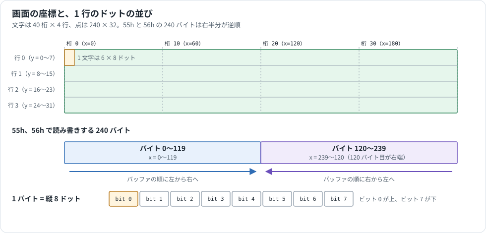

文字の桁 c、行 r の左上の点は、x = 6 × c、y = 8 × r です。たとえば桁 10、行 2 の文字は、x = 60〜65、y = 16〜23 の点です。

### 11.5.2 コマンドと引数

点の描き方は外部メモリの作業域 `DOTSOP`（`BFC96h`）と `LINPTN`（`BFC2Ah`）も使います。名前は `hardware.inc` にあります。

| cmd | 名前 | 機能 | 渡すもの | 返るもの |
|---|---|---|---|---|
| 41h | `SCRN_PUTC` | 指定位置へ 1 文字表示 | (BL) = x 座標（0〜39）、(BH) = y 座標（0〜3）、A = 文字 | (BL)(BH) = 次の位置、C=1: 範囲外 |
| 42h | `SCRN_PUTS` | 指定位置へ n 文字表示（右端で止まる） | (BL) = x 座標（0〜39）、(BH) = y 座標（0〜3）、X = 文字列の先頭、Y = 長さ | (BL)(BH) = 次の位置、X = 次のアドレス、Y = 残り、C=1: 途中で止まった |
| 44h | `SCRN_CURSOR` | カーソルの位置 | (BL) = x 座標（0〜39）、(BH) = y 座標（0〜3） | C=1: 範囲外 |
| 45h | `SCRN_CURSOR_TYPE` | カーソルの形 | A = 0: なし。ビット 5 = 表示、3 = 点滅、2〜0 = 0 下線、1 二重下線、2 ■、3 空白、4 挿入 | − |
| 46h | `SCRN_SYMBOL` | 表示シンボル | (BL) = 0: 電池、1: DBL PRO RUN BUSY、2: 2ndF CAPS hyp カナ 小文字、3: DE G RAD E PRINT。A = 点けるビット（右端がビット 0） | − |
| 47h | `SCRN_SCROLL_UP` | 上へスクロール | (BX) = 0、A = 行数 | − |
| 48h | `SCRN_SCROLL_DOWN` | 下へスクロール | (BX) = 0、A = 行数 | − |
| 49h | `SCRN_CLEAR_LINE` | 1 行を消す | (BH) = 行（0〜3） | − |
| 4Ah | `SCRN_DOTS_WRITE` | 縦 8 ドットを表示 | X = x 座標（0〜239）、Y = y 座標（0〜31）、A = 8 ドット（ビット 0 が上）、[DOTSOP] = 0: 点灯、1: 消灯、2: 反転 | − |
| 4Bh | `SCRN_DOTS_READ` | 縦 8 ドットを読む | X = x 座標（0〜239）、Y = y 座標（0〜31） | A = 8 ドット（ビット 0 が上） |
| 4Ch | `SCRN_PSET` | 1 ドットを表示 | X = x 座標（0〜239）、Y = y 座標（0〜31）、A = 0: 点灯、1: 消灯、2: 反転 | − |
| 4Dh | `SCRN_POINT` | 1 ドットを読む | X = x 座標（0〜239）、Y = y 座標（0〜31） | A = 1: 点灯 |
| 4Eh | `SCRN_LINE` | 線を引く | X, Y = 始点、(BX) = 終点の x、(DX) = 終点の y（どちらも 2 バイト）、[DOTSOP] = 0: 点灯、1: 消灯、2: 反転、[LINPTN] = 線種（2 バイト） | X, Y = 終点 |
| 4Fh | `SCRN_BOX` | 四角を塗る | X, Y = 角、(BX) = 対角の x、(DX) = 対角の y（どちらも 2 バイト）、[DOTSOP] = 0: 点灯、1: 消灯、2: 反転、[LINPTN] = 模様（2 バイト） | − |
| 50h | `SCRN_POWER` | 表示の ON / OFF | A = 0: OFF、1: ON | − |
| 51h | `SCRN_CLEAR` | 画面を消す | − | − |
| 52h | `SCRN_CLEAR_CHARS` | 指定位置から n 文字消す | (BL) = x 座標（0〜39）、(BH) = y 座標（0〜3）、A = 文字数（次の行へ続く） | − |
| 54h | `SCRN_INSERT` | 行を挿入 | (BH) = 行、A = 行数 | − |
| 55h | `SCRN_ROW_READ` | 1 行のドットを読む | (BH) = 行（0〜3）、X = 読み込む先（240 バイト。x = 0〜119、続けて 239〜120 の順） | − |
| 56h | `SCRN_ROW_WRITE` | 1 行のドットを書く | (BH) = 行（0〜3）、X = データ（240 バイト、縦 8 ドットずつ。x = 0〜119、続けて 239〜120 の順） | − |
| 57h | `SCRN_PUTC_ANY` | 表示範囲に関係なく 1 文字表示 | (BL) = x 座標（0〜39）、(BH) = y 座標（0〜3）、A = 文字 | (BL)(BH) = 次の位置、C=1: 画面の外 |
| 58h | `SCRN_GUIDE` | [ ] 付きの表示（メニュー） | (BL) = x 座標（0〜39）、(BH) = y 座標（0〜3）、A = 個数、B のビット 0 = 0: [ ]、1: ( )、ビット 7 = 1: 行を消さない、X = 文字列の並び（それぞれ FFh で終わる。7 文字まで） | − |

### 11.5.3 エントリ（ROM 8.5）

技術資料（p.32）の一覧では、43h は「使わない」、53h は「1 行を消す」がかっこ書きです。43h は C=1、A=03h で戻ります。53h のエントリは 51h の仲間ではなく、呼ぶと戻りませんでした（実験、ROM 7.2）。使わないでください。

| cmd | 機能 | 表アドレス | エントリ |
|---|---|---|---|
| 08h | OPEN | `F226Eh` | `F22B0h` |
| 09h | CLOSE | `F2270h` | `F22B0h` |
| 0Ah | ブロック読み出し | `F2272h` | `F22B2h` |
| 0Bh | ブロック書き込み | `F2274h` | `F2A70h` |
| 0Ch | 1バイト読み出し | `F2276h` | `F22B2h` |
| 0Dh | 1バイト書き込み | `F2278h` | `F2A51h` |
| 0Eh | 非破壊読み出し | `F227Ah` | `F22B2h` |
| 3Fh | フォーマット | `F227Ch` | `F254Dh` |
| 40h | 初期化 | `F227Eh` | `F24DAh` |
| 41h | 指定位置へ1文字 | `F2280h` | `F2552h` |
| 42h | 指定位置へn文字（X=先頭, Y=長さ） | `F2282h` | `F255Eh` |
| 43h | 使わない（A=03h） | `F2284h` | `F2269h` |
| 44h | カーソル位置 | `F2286h` | `F2A2Ah` |
| 45h | カーソル表示 | `F2288h` | `F25A7h` |
| 46h | シンボル表示 | `F228Ah` | `F29B0h` |
| 47h | 上スクロール | `F228Ch` | `F2984h` |
| 48h | 下スクロール | `F228Eh` | `F299Ah` |
| 49h | 行クリア | `F2290h` | `F27B6h` |
| 4Ah | 8ドット書き込み | `F2292h` | `F8172h` |
| 4Bh | 8ドット読み出し | `F2294h` | `F80E0h` |
| 4Ch | 1ドット書き込み | `F2296h` | `F7E7Fh` |
| 4Dh | 1ドット読み出し | `F2298h` | `F7E9Fh` |
| 4Eh | 線描画 | `F229Ah` | `F7BC4h` |
| 4Fh | 矩形塗潰し | `F229Ch` | `F7EF1h` |
| 50h | 表示の ON / OFF | `F229Eh` | `F2A37h` |
| 51h | 画面を消す | `F22A0h` | `F27C9h` |
| 52h | 指定位置から n 文字消す | `F22A2h` | `F2BDDh` |
| 53h | 使わない（戻らない） | `F22A4h` | `F2A00h` |
| 54h | 行挿入 | `F22A6h` | `F2C30h` |
| 55h | 1行ドット読み出し（[並び](#1156-行のドットの並びdevice-0-の-55h56h)） | `F22A8h` | `F2C66h` |
| 56h | 1行ドット書き込み（[並び](#1156-行のドットの並びdevice-0-の-55h56h)） | `F22AAh` | `F2CA7h` |
| 57h | 表示範囲に関係なく 1 文字 | `F22ACh` | `F240Ch` |
| 58h | [ ] 付きの表示 | `F22AEh` | `F2CE8h` |

### 11.5.4 例: 文字とカーソル

文字列を表示し、その次の桁にカーソルを点滅させます。42h は表示した後の位置を `(BL)`、`(BH)` に残すので、そのまま 44h に渡せます。

```asm
        ORG   $BEC00
        INCLUDE "iocs.inc"
start:  MVW   (CX),DEV_SCRN
        MV    (BL),5            ; 桁 5
        MV    (BH),2            ; 行 2
        MV    X,msg
        MV    Y,msg_end-msg     ; 長さ
        MV    IL,SCRN_PUTS
        CALLF IOCS
        JRC   done              ; 右端で止まった
        MVW   (CX),DEV_SCRN
        MV    IL,SCRN_CURSOR    ; (BL)(BH) は 42h が進めた位置
        CALLF IOCS
        MVW   (CX),DEV_SCRN
        MV    A,$2A             ; ビット 5 表示 + ビット 3 点滅 + 形 2（■）
        MV    IL,SCRN_CURSOR_TYPE
        CALLF IOCS
done:   RC
        RETF
msg:    DB    "NAME? "
msg_end:
        END
```

カーソルの形の値は `20h`（表示）、`08h`（点滅）、形 0〜4 を足したものです。`2Ah` = `20h` + `08h` + 2 です。

### 11.5.5 例: 点、線、四角

線（4Eh）は、始点を `X`、`Y` に、終点を `(BX)`、`(DX)` に入れます。線種 `LINPTN` は 2 バイトの模様で、`FFFFh` が実線です。

```asm
        ORG   $BEC00
        INCLUDE "iocs.inc"
        INCLUDE "hardware.inc"
start:  MV    A,0
        MV    [DOTSOP],A        ; 点灯
        MV    BA,$FFFF
        MV    [LINPTN],BA       ; 実線
        MVW   (CX),DEV_SCRN
        MV    X,0               ; 始点 (0,0)
        MV    Y,0
        MVW   (BX),239          ; 終点 (239,31)
        MVW   (DX),31
        MV    IL,SCRN_LINE
        CALLF IOCS
        MVW   (CX),DEV_SCRN
        MV    X,100             ; (100,10)〜(139,21) を塗る
        MV    Y,10
        MVW   (BX),139
        MVW   (DX),21
        MV    IL,SCRN_BOX
        CALLF IOCS
        RC
        RETF
        END
```

次は 1 ドットずつ横線を引く例です。IOCS が壊すレジスタは公開されていないので、座標と回数を U スタックに預けてから呼びます。

```asm
        ORG   $BEC00
        INCLUDE "iocs.inc"
start:  MV    X,0               ; x
        MV    I,240             ; 回数
loop:   PUSHU I
        PUSHU X
        MVW   (CX),DEV_SCRN
        MV    Y,15              ; y
        MV    A,0               ; 0: 点灯
        MV    IL,SCRN_PSET
        CALLF IOCS
        POPU  X
        POPU  I
        INC   X
        DEC   I
        JRNZ  loop
        RC
        RETF
        END
```

`MV IL,…` は `I` の上位を 0 にするので、回数を `I` に入れたまま呼ぶことはできません。`PUSHU I` はそのためにも必要です。

### 11.5.6 行のドットの並び（device 0 の 55h、56h）

`55h` は `(bh)`（D5h）の行（0〜3）の 240 バイトを `X` のアドレスへ読み、`56h` は `X` のアドレスの 240 バイトをその行に書きます（Technical Reference Manual p.40）。1 バイトは縦 8 ドットで、ビット 0 が上です。

**右半分は桁が逆順です。** LCD コントローラの表示 RAM の並び（[液晶（LCD）](04_LCD.md) §4.5）がそのまま出ています。

| バッファのバイト | 画面の x |
|---|---|
| 0〜119 | 0〜119 |
| 120〜239 | 239〜120（120 バイト目が右端） |

エミュレータで全 13 版の ROM を動かして確かめました。`56h` で 0〜3 バイト目に書いた値は x = 0〜3 に、236〜239 バイト目に書いた値は x = 123〜120 に表示され、`55h` は同じ並びで読み出します。

**例: x からバッファの位置を求める**

| 画面の x | バッファの位置 | 計算 |
|---|---|---|
| 0 | 0 | x |
| 119 | 119 | x |
| 120 | 239 | 359 − x |
| 180 | 179 | 359 − x |
| 239 | 120 | 359 − x |

次の例は行 0 の絵を行 3 へコピーします。読み出しと書き込みが同じ並びなので、並べ替えは要りません。

```asm
        ORG   $BEC00
        INCLUDE "iocs.inc"
start:  MVW   (CX),DEV_SCRN
        MV    (BH),0            ; 行 0 を読む
        MV    X,buffer
        MV    IL,SCRN_ROW_READ
        CALLF IOCS
        MVW   (CX),DEV_SCRN
        MV    (BH),3            ; 行 3 へ書く
        MV    X,buffer
        MV    IL,SCRN_ROW_WRITE
        CALLF IOCS
        RC
        RETF
buffer: DS    240
        END
```

### 11.5.7 動作の細部（実験）

技術資料の説明だけでは分からない所を、画面に 4 行の文字を出してから呼んで確かめました（ROM 7.2）。

| cmd | 確かめたこと |
|---|---|
| 41h | `(BL)` = 40 は C=1 で何もしない。39 に書くと `(BL)` は 40 になる（次の行へは移らない） |
| 42h | `(BL)` = 35 で 10 文字を頼むと、5 文字を出して C=1、Y = 5（残り） |
| 44h | `(BL)` = 40 でも C=0 だった |
| 47h、48h | `(BH)` に何を入れても画面全体が動く |
| 52h | 右端を越えると次の行の左端から続けて消す。終わりの位置が `(BL)`、`(BH)` に残る |
| 54h | `(BH)` の行から下が A 行だけ下がり、空いた行は空白になる |
| 57h | 41h と違い、`BFC9Dh`（表示できる桁数）を 20 に下げても 25 桁目に出せた。画面の外（`(BL)` = 41）は C=1 |
| 4Dh | 画面の外の点は C=1、A=FFh |

**58h のメニュー表示。** 文字列の並びは 1 個ずつ `FFh` で終わります。1 個は 7 文字までしか出ません。`FEh` は「ここから（ここまで）を出す」という印で、2 つの使い方があります（技術資料 p.41）。

| `FEh` の場所 | 表示される部分 |
|---|---|
| 文字列の先頭 | その後ろ。次の `FEh` があれば、そこまで |
| 先頭以外 | 文字列の先頭から、`FEh` の前まで |

`LOAD`、`SAVE`、`LONGNAME9`、`FEh` `X` `FEh` `YZ` の 4 個を並べると、`LOAD`、`SAVE`、`LONGNA`、`X` が [ ] の形の枠に入って出ました。B のビット 0 を 1 にすると枠が ( ) の形になり、ビット 7 を 1 にするとその行を消さずに重ねて描きます（技術資料はビット 8 と書いていますが、B は 8 ビットなのでビット 7 です。1 にすると実行サイクルが約 3200 減り、行の消去が省かれていました）。

**制御コードと反転。** 0Bh と 0Dh の文字は `BFC27h`、`BFC28h` の位置に出て、CR や LF などの制御コードが働きます。`BFC29h` のビット 6 を 1 にすると、制御コードも字形として表示されます。`BFCA1h` のビット 6 を 1 にすると、その後の文字が反転します（`A` の 1 列目が `7C` から `83` になりました）。

**線と四角の模様。** 4Eh と 4Fh が終わると、`LINPTN` には「最後に使った模様の次」が入ります（技術資料 p.38）。続けて線を引くと模様がつながり、毎回同じ模様から始めたければ書き直します。

## 11.6 キーボード（device 1）

キーの読み方には 2 段階あります。どのキーが押されたか、離されたか（行列コード）を読む 41h、42h と、`SHIFT` などを処理して文字にしてから読む 43h です。途中のバッファの流れは [起動、割り込み、タイマ、音](10_SYSTEM.md) §10.9 にあります。

### 11.6.1 コマンドと引数

| cmd | 名前 | 機能 | 渡すもの | 返るもの |
|---|---|---|---|---|
| 41h | `KYBD_MATRIX` | 行列コードの読み出し（押されるまで待つ） | − | B = 1: 入力あり、0: なし。A のビット 0〜6 = 行列コード、ビット 7 = 1: 離した |
| 42h | `KYBD_PEEK` | 行列コードの非破壊読み出し（待たない） | − | B = 1: 入力あり、0: なし。A のビット 0〜6 = 行列コード、ビット 7 = 1: 離した |
| 43h | `KYBD_READ` | キーの読み出し（文字） | A のビット 7 = 0: 待たない、1: 待つ | IL = 1: 入力あり、0: なし。A = 文字（00h なら B = 拡張コード）、C=1 ならエラー（A = エラー番号） |
| 44h | `KYBD_SET` | キーバッファに入れる | X = データ、A = バイト数 | − |
| 45h | `KYBD_CLEAR` | キーバッファを空にする | − | − |
| 46h | `KYBD_FKEYS` | ファンクションキーの表示 | − | C=1: 4 行表示だった |

### 11.6.2 エントリ（ROM 8.5）

| cmd | 機能 | 表アドレス | エントリ |
|---|---|---|---|
| 08h | OPEN | `F1724h` | `F1744h` |
| 09h | CLOSE | `F1726h` | `F1744h` |
| 0Ah | ブロック読み出し | `F1728h` | `F1A8Dh` |
| 0Bh | ブロック書き込み | `F172Ah` | `F1746h` |
| 0Ch | 1バイト読み出し | `F172Ch` | `F19BDh` |
| 0Dh | 1バイト書き込み | `F172Eh` | `F1746h` |
| 0Eh | 非破壊読み出し | `F1730h` | `F1A13h` |
| 3Fh | フォーマット | `F1734h` | `F1CDFh` |
| 40h | 初期化 | `F1736h` | `F1C72h` |
| 41h | 行列コード読み出し | `F1738h` | `F178Bh` |
| 42h | 行列コード非破壊読み出し | `F173Ah` | `F174Ah` |
| 43h | キー読み出し | `F173Ch` | `F17FBh` |
| 44h | バッファ設定 | `F173Eh` | `F1C3Fh` |
| 45h | キークリア | `F1740h` | `F1D20h` |
| 46h | ファンクションキー表示 | `F1742h` | `F1D52h` |

### 11.6.3 例: キーを読む

たまったキーを捨ててから、1 文字押されるまで待ちます。

```asm
        ORG   $BEC00
        INCLUDE "iocs.inc"
KEY:    DB    0                 ; 結果
start:  MVW   (CX),DEV_KYBD
        MV    IL,KYBD_CLEAR     ; たまったキーを捨てる
        CALLF IOCS
        MVW   (CX),DEV_KYBD
        MV    A,$80             ; ビット 7 = 1: 押されるまで待つ
        MV    IL,KYBD_READ
        CALLF IOCS
        MV    [KEY],A           ; 文字
        RC
        RETF
        END
```

待たずに調べるときは `A` を 0 にします。入力があれば `IL` = 1 で戻ります。`IL` は `A` へ直接移せないので、`DEC IL` で 0 になるかどうかを見ます。

```asm
        ORG   $BEC00
        INCLUDE "iocs.inc"
start:  MVW   (CX),DEV_KYBD
        MV    A,0               ; ビット 7 = 0: 待たない
        MV    IL,KYBD_READ
        CALLF IOCS
        JRC   done              ; エラー
        DEC   IL                ; 1 → 0 なら入力あり
        JRNZ  none
        CMP   A,0               ; 00h なら B に拡張コード
        JRZ   extended
        ; … A = 文字
        JR    done
extended:
        ; … B = 拡張コード
done:   RC
        RETF
none:   RC                      ; 入力なし
        RETF
        END
```

キーバッファに文字を入れると、誰かがキーを打ったのと同じになります。次の例は `PRINT 7*6` と RETURN を入れて BASIC へ戻ります。44h はそのときバッファにあったものを捨てます。

```asm
        ORG   $BEC00
        INCLUDE "iocs.inc"
start:  MVW   (CX),DEV_KYBD
        MV    X,text
        MV    A,text_end-text
        MV    IL,KYBD_SET
        CALLF IOCS
        RC
        RETF
text:   DB    "PRINT 7*6",13
text_end:
        END
```

`CALL &HBEC00` を実行した画面です（実験。ROM 2.2、5.3、7.2、8.3、8.5）。

```text
CALL &HBEC00
PRINT 7*6
                                      42
>
```

### 11.6.4 行列コードと、文字への変換表

1 個のキーはまず**行列コード**（キーの番号）になります。41h と 42h が返すのはこの番号で、押すと `31h`、離すと `B1h` のように、離したときだけビット 7 が立ちます（キー `A` の例。実験）。番号は PC-E500 シリーズの全機種で同じです。

41h は、押されるまで待っている間、CPU を止めて電力を節約します。呼ばれると自動電源オフの数え直しが始まり、何も押されないまま時間が来ると `0Fh` が返ります。電池が減ってキーを調べられないときなどは C=1 で戻ります（技術資料 p.44）。

文字に直すには、6 枚の表を引きます。表は 1 枚 62h バイト（行列コード 00h〜61h の分）で、アドレスは次のポインタにあります（技術資料 p.44。同じページの「62 バイト」は、表の間隔から 16 進の 62h と分かります）。

| ポインタ | 表 | ROM 7.2 の値 |
|---|---|---|
| `BFC2Dh` | そのまま、1 バイトの文字 | `F3472h` |
| `BFC30h` | そのまま、2 バイト目 | `F34D4h` |
| `BFC33h` | SHIFT、1 バイトの文字 | `F35FAh` |
| `BFC36h` | SHIFT、2 バイト目 | `F365Ch` |
| `BFC39h` | CTRL、1 バイトの文字 | `F3536h` |
| `BFC3Ch` | CTRL、2 バイト目 | `F3598h` |

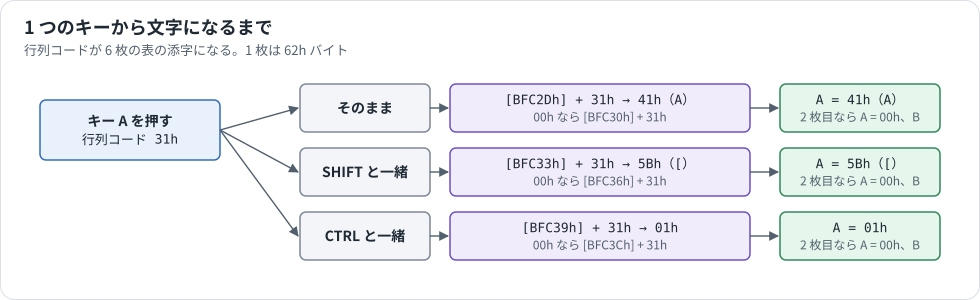

これらのポインタは 3Fh が書くだけで、ドライバ自身は見ません（技術資料 p.43）。アドレスを差し替えても文字は変わらないので、変えたいときは `BFCC0h` の表やフック（[起動、割り込み、タイマ、音](10_SYSTEM.md) §10.9）を使います。

43h は `SHIFT` などを処理した後の文字を返します。1 バイトで表せるキーは A に文字、B に 00h、それ以外は A に 00h、B に拡張コードです。`A` なら A=41h、B=00h、`PF1` なら A=00h、B=13h、`sin` なら A=00h、B=81h でした（実験）。

次の表は ROM 7.2 の 6 枚の表から作りました。8.5 も同じです。`00 22h` のような欄は、A=00h、B=22h になることを表します。英語の 5.3 では、カナキーの 3 つの値が `00 90h`、`00 B0h`、`00 D0h` です。

| 行列コード | キー | そのまま | SHIFT | CTRL |
|---|---|---|---|---|
| 01h | SHIFT | − | − | 00 22h |
| 02h | CTRL | − | − | − |
| 03h | ON/BRK | 03h | 00 23h | 00 43h |
| 04h | OFF | 00 04h | 00 24h | 00 0Fh |
| 05h | BASIC | 00 05h | 00 25h | 00 45h |
| 06h | MENU | 00 06h | 00 26h | 00 46h |
| 07h | カナ | 00 07h | 00 27h | 00 47h |
| 08h | BS | 08h | 00 28h | 00 48h |
| 09h | CAPS | 00 09h | 00 29h | 00 49h |
| 0Ah | 2ndF | − | − | − |
| 0Bh | DEL | 7Fh | 00 2Bh | 00 4Bh |
| 0Ch | C-CE | 0Ch | 00 2Ch | 00 4Ch |
| 0Dh | RETURN | 0Dh | 00 2Dh | 00 4Dh |
| 0Eh | ▲▼ | 00 0Eh | 00 2Eh | 00 4Eh |
| 0Fh | （自動電源オフ） | 00 0Fh | − | − |
| 12h | INS | 12h | 00 32h | 00 52h |
| 13h | PF1 | 00 13h | 00 33h | 00 53h |
| 14h | PF2 | 00 14h | 00 34h | 00 54h |
| 15h | PF3 | 00 15h | 00 35h | 00 55h |
| 16h | PF4 | 00 16h | 00 36h | 00 56h |
| 17h | PF5 | 00 17h | 00 37h | 00 57h |
| 1Ch | ▶ | 1Ch | 00 3Ch | 00 5Ch |
| 1Dh | ◀ | 1Dh | 00 3Dh | 00 5Dh |
| 1Eh | ↑ | 1Eh | 00 3Eh | 00 5Eh |
| 1Fh | ↓ | 1Fh | 00 3Fh | 00 5Fh |
| 20h | 0 | 30h | 30h | 00 60h |
| 21h | 1 | 31h | 31h | 00 61h |
| 22h | 2 | 32h | 32h | 00 62h |
| 23h | 3 | 33h | 33h | 00 63h |
| 24h | 4 | 34h | 34h | 00 64h |
| 25h | 5 | 35h | 35h | 00 65h |
| 26h | 6 | 36h | 36h | 00 66h |
| 27h | 7 | 37h | 37h | 00 67h |
| 28h | 8 | 38h | 38h | 00 68h |
| 29h | 9 | 39h | 39h | 00 69h |
| 2Ah | `*` | 2Ah | 2Ah | 00 6Ah |
| 2Bh | `+` | 2Bh | 2Bh | 00 6Bh |
| 2Ch | `,` | 2Ch | 3Fh | 00 6Ch |
| 2Dh | `-` | 2Dh | 2Dh | 00 6Dh |
| 2Eh | `.` | 2Eh | 00 1Eh | 00 6Eh |
| 2Fh | `/` | 2Fh | 2Fh | 00 6Fh |
| 30h | SPACE | 20h | 20h | 00 70h |
| 31h | A | 41h | 5Bh | 01h |
| 32h | B | 42h | 42h | 02h |
| 33h | C | 43h | 43h | 03h |
| 34h | D | 44h | 7Bh | 04h |
| 35h | E | 45h | 23h | 05h |
| 36h | F | 46h | 7Dh | 06h |
| 37h | G | 47h | 5Ch | 07h |
| 38h | H | 48h | 7Ch | 08h |
| 39h | I | 49h | 3Ch | 09h |
| 3Ah | J | 4Ah | 7Eh | 0Ah |
| 3Bh | K | 4Bh | 5Fh | 0Bh |
| 3Ch | L | 4Ch | 5Eh | 0Ch |
| 3Dh | M | 4Dh | 60h | 0Dh |
| 3Eh | N | 4Eh | 4Eh | 0Eh |
| 3Fh | O | 4Fh | 3Eh | 0Fh |
| 40h | P | 50h | 40h | 10h |
| 41h | Q | 51h | 21h | 11h |
| 42h | R | 52h | 24h | 12h |
| 43h | S | 53h | 5Dh | 13h |
| 44h | T | 54h | 25h | 14h |
| 45h | U | 55h | 27h | 15h |
| 46h | V | 56h | 56h | 16h |
| 47h | W | 57h | 22h | 17h |
| 48h | X | 58h | 58h | 18h |
| 49h | Y | 59h | 26h | 19h |
| 4Ah | Z | 5Ah | 5Ah | 1Ah |
| 4Bh | `=` | 3Dh | 3Dh | 1Bh |
| 4Ch | `;` | 3Bh | 3Ah | 00 71h |
| 4Dh | `(` | 28h | 00 B2h | 00 72h |
| 4Eh | `)` | 29h | 00 B3h | 00 73h |
| 50h | hyp | − | − | − |
| 51h | sin | 00 81h | 00 A1h | 00 C1h |
| 52h | cos | 00 82h | 00 A2h | 00 C2h |
| 53h | tan | 00 83h | 00 A3h | 00 C3h |
| 54h | FSE | 00 84h | 00 A4h | 00 C4h |
| 55h | →HEX | 00 85h | 00 A5h | 00 C5h |
| 56h | →DEG | 00 86h | 00 A6h | 00 C6h |
| 57h | ln | 00 87h | 00 A7h | 00 C7h |
| 58h | log | 00 88h | 00 A8h | 00 C8h |
| 59h | 1/x | 00 89h | 00 A9h | 00 C9h |
| 5Ah | ↕ | 00 8Ah | 00 AAh | 00 CAh |
| 5Bh | EXP | 00 8Bh | 00 ABh | 00 CBh |
| 5Ch | y^x | 00 8Ch | 00 ACh | 00 CCh |
| 5Dh | √ | 00 8Dh | 00 ADh | 00 CDh |
| 5Eh | x² | 00 8Eh | 00 AEh | 00 CEh |
| 5Fh | +/- | 00 8Fh | 00 AFh | 00 CFh |
| 60h | RCL | 00 90h | 00 B0h | 00 D0h |
| 61h | STO | 00 91h | 00 B1h | 00 D1h |

カナの文字は、カナの処理が作るのでこの表にはありません。英字は `CAPS` の処理で大文字と小文字が変わります。

### 11.6.5 ファンクションキーの表示（46h）

46h は画面の一番下にファンクションキーの内容を出したり消したりします。画面を 4 行使っているときは表示できず、C=1 で戻ります（技術資料 p.48、実験）。`BFC3Fh` のビット 2 を 1 にすると、表示を禁止できます。

## 11.7 シリアル（device 2）

15 ピンのシリアルポートです。信号線、`OPEN` の設定、作業域は [15 ピン（シリアル）](07_PORT_15PIN.md) にあります。41h と 42h は行末や EOF の変換をしない 1 バイトの送受信です。

### 11.7.1 コマンドと引数

| cmd | 名前 | 機能 | 渡すもの | 返るもの |
|---|---|---|---|---|
| 41h | `COM_PUT` | 1 バイト送る | A = データ | C=1 なら A = 00h: 時間切れ、FEh: 電池、FFh: BREAK |
| 42h | `COM_GET` | 1 バイト受ける | − | A = データ。C=1 なら A = 00h: 時間切れ、FEh: 電池、FFh: BREAK |
| 43h | `COM_SETUP` | 作業域の条件をハードウェアに設定 | − | − |
| 44h | `COM_RS_HIGH` | RS を High | − | − |
| 45h | `COM_RS_LOW` | RS を Low | − | − |
| 46h | `COM_RR_HIGH` | RR を High | − | − |
| 47h | `COM_RR_LOW` | RR を Low | − | − |
| 48h | `COM_ER_HIGH` | ER を High | − | − |
| 49h | `COM_ER_LOW` | ER を Low | − | − |
| 4Ah | `COM_CS` | CS を読む | − | C = 1: High |
| 4Bh | `COM_CD` | CD を読む | − | C = 1: High |

44h〜4Bh は信号線を 1 本ずつ動かしたり読んだりするコマンドです。

| 信号 | High | Low | 読む |
|---|---|---|---|
| RS（送信要求） | 44h | 45h | |
| RR（受信可） | 46h | 47h | |
| ER（OPEN 中に High） | 48h | 49h | |
| CS（送信可） | | | 4Ah |
| CD（キャリア検出） | | | 4Bh |

41h と 42h は変換をしませんが、XON/XOFF の設定があれば従います（技術資料 p.51）。送信（41h）の手順は次のとおりです（技術資料 p.57）。

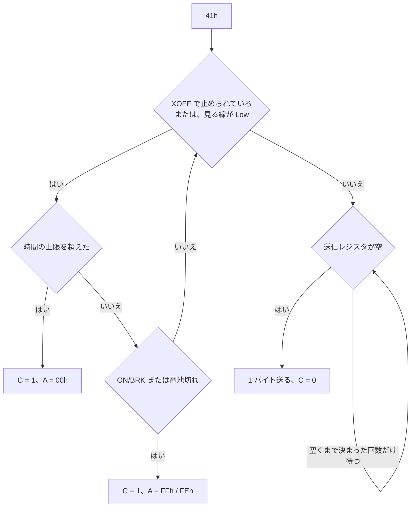

### 11.7.2 エントリ（ROM 8.5）

エントリ表の名称は、44h、45h が「RS制御1」「RS制御2」、46h〜49h も同じように「1」が High、「2」が Low にあたります。

| cmd | 機能 | 表アドレス | エントリ |
|---|---|---|---|
| 20h | 作成 | `EAA8Ah` | `EAC58h` |
| 21h | OPEN | `EAA8Ch` | `EAC58h` |
| 22h | CLOSE | `EAA8Eh` | `EAC94h` |
| 23h | ブロック読み出し | `EAA90h` | `EABC3h` |
| 24h | ブロック書き込み | `EAA92h` | `EAB0Eh` |
| 25h | 1 バイト読み出し | `EAA94h` | `EAB62h` |
| 26h | 1 バイト書き込み | `EAA96h` | `EAAD6h` |
| 27h | 照合 | `EAA98h` | `EAACCh` |
| 28h | 非破壊読み出し | `EAA9Ah` | `EAC18h` |
| 29h | 位置の移動（エラー） | `EAA9Ch` | `EACDBh` |
| 2Ah | 情報取得 | `EAA9Eh` | `EACBFh` |
| 2Bh | ディレクトリ情報（エラー） | `EAAA0h` | `EACDBh` |
| 2Ch | 名前検索 | `EAAA2h` | `E98FAh` |
| 2Dh | 名前変更（エラー） | `EAAA4h` | `EACDBh` |
| 2Eh | 削除（エラー） | `EAAA6h` | `EACDBh` |
| 2Fh | 空き容量（エラー） | `EAAA8h` | `EACDBh` |
| 3Fh | フォーマット | `EAAAAh` | `EAFD4h` |
| 40h | 初期化 | `EAAACh` | `EAAC4h` |
| 41h | 直接送信 | `EAAAEh` | `EB068h` |
| 42h | 直接受信 | `EAAB0h` | `EAD5Bh` |
| 43h | ハードウェア設定 | `EAAB2h` | `EAC5Fh` |
| 44h | RS制御1 | `EAAB4h` | `EAA0Ch` |
| 45h | RS制御2 | `EAAB6h` | `EAA16h` |
| 46h | RR制御1 | `EAAB8h` | `EAA11h` |
| 47h | RR制御2 | `EAABAh` | `EAA1Bh` |
| 48h | ER制御1 | `EAABCh` | `EAA20h` |
| 49h | ER制御2 | `EAABEh` | `EAA25h` |
| 4Ah | CS読み出し | `EAAC0h` | `EAA2Ah` |
| 4Bh | CD読み出し | `EAAC2h` | `EAA34h` |

20h〜2Fh は FCS の 00h〜0Fh と同じ仕事をそのデバイスだけで行う番号です（§11.15.6）。29h、2Bh、2Dh〜2Fh はエラーを返す同じエントリ（`EACDBh`）で、技術資料の「この 5 つはエラー」と一致します。20h と 21h も同じエントリ（`EAC58h`）です。ブロックの読み出し（23h）と照合（27h）は、終わりの決め方を選ぶ A を見ません。1Ah で終わらせたくないときは 1 バイトずつ読みます（技術資料 p.50。手書きの訂正では 25h と書かれています）。

### 11.7.3 例: 文字列を送る

条件を 9600 bps、パリティなし、8 ビット、ストップ 1（`BFD33h` = 68h）に変えて、文字列を送ります。`BFD33h` を書き換えたあとは 43h を呼びます（[15 ピン（シリアル）](07_PORT_15PIN.md) §7.8）。

```asm
        ORG   $BEC00
        INCLUDE "iocs.inc"
start:  MV    A,$68             ; 9600,N,8,1
        MV    [$BFD33],A
        MVW   (CX),DEV_COM
        MV    IL,COM_SETUP      ; ハードウェアへ反映
        CALLF IOCS
        MV    X,msg
        MV    I,msg_end-msg
loop:   MV    A,[X++]
        PUSHU I
        PUSHU X
        MVW   (CX),DEV_COM
        MV    IL,COM_PUT        ; 1 バイト送る
        CALLF IOCS
        POPU  X
        POPU  I
        JRC   error             ; A = 00h 時間切れ、FEh 電池、FFh BREAK
        DEC   I
        JRNZ  loop
        RC
error:  RETF
msg:    DB    "HELLO",13
msg_end:
        END
```

68h = `0110 1000b` の内訳は、ビット 6〜4 が `110`（9600 bps）、ビット 3〜2 が `10`（パリティなし）、ビット 1 が 0（8 ビット）、ビット 0 が 0（ストップ 1）です（[CPU（SC62015）](02_CPU.md) §2.8.1）。

## 11.8 プリンタ（device 3）

`STDL:` と `PRN:` のデバイスです。CE-126P へ送るときの文字の変換と手順は [CE-126P プリンタ](18_CE-126P_PRINTER.md) にあります。

### 11.8.1 コマンドと引数

開く、閉じる、0Bh、0Dh も使えます。`STDL:` は標準のリスト出力で、ハンドル 2 として最初から開いています（技術資料 p.60）。43h の C=1 のときの A=54h は、BASIC の printer error の番号です（技術資料 p.61）。エミュレータの CE-126P では、43h は C=0、I=18h（24 桁）でした。

| cmd | 名前 | 機能 | 渡すもの | 返るもの |
|---|---|---|---|---|
| 41h | `PRN_PUT` | 印字 | A = データ | C=1: エラー |
| 42h | `PRN_POSITION` | 印字位置 | − | A = 位置 |
| 43h | `PRN_CHECK` | プリンタの確認 | − | A = 種類、I = 桁数。C=1: つながっていない（A = 54h） |

### 11.8.2 エントリ（ROM 8.5）

| cmd | 機能 | 表アドレス | エントリ |
|---|---|---|---|
| 08h | OPEN | `EA4D0h` | `EA4ECh` |
| 09h | CLOSE | `EA4D2h` | `EA4F4h` |
| 0Ah | ブロック読み出し | `EA4D4h` | `EA4E8h` |
| 0Bh | ブロック書き込み | `EA4D6h` | `EA4F9h` |
| 0Ch | 1バイト読み出し | `EA4D8h` | `EA4E8h` |
| 0Dh | 1バイト書き込み | `EA4DAh` | `EA4FDh` |
| 0Eh | 非破壊読み出し | `EA4DCh` | `EA4E8h` |
| 3Fh | フォーマット | `EA4DEh` | `EA5AFh` |
| 40h | 初期化 | `EA4E0h` | `EA598h` |
| 41h | 印字 | `EA4E2h` | `EA650h` |
| 42h | 印字位置 | `EA4E4h` | `EA505h` |
| 43h | プリンタチェック | `EA4E6h` | `EA522h` |

表のアドレスは ROM 8.5 のものです。[CE-126P プリンタ](18_CE-126P_PRINTER.md) §18.1 には別のバージョンの ROM のエントリがあります。

### 11.8.3 例: 1 行印字する

つながっているかを 43h で確かめてから、1 文字ずつ送ります。CR（0Dh）だけでは印字されず、続く LF（0Ah）で 1 行が印字されます（[CE-126P プリンタ](18_CE-126P_PRINTER.md) §18.5）。

```asm
        ORG   $BEC00
        INCLUDE "iocs.inc"
start:  MVW   (CX),DEV_PRN
        MV    IL,PRN_CHECK      ; A = 種類、I = 桁数
        CALLF IOCS
        JRC   error             ; つながっていない
        MV    X,msg
        MV    I,msg_end-msg
loop:   MV    A,[X++]
        PUSHU I
        PUSHU X
        MVW   (CX),DEV_PRN
        MV    IL,PRN_PUT
        CALLF IOCS
        POPU  X
        POPU  I
        JRC   error
        DEC   I
        JRNZ  loop
        RC
error:  RETF
msg:    DB    "HELLO, CE-126P",13,10
msg_end:
        END
```

## 11.9 テープ（device 4）

カセットテープの読み書きです。ファイルは 48 バイトのヘッダのブロックと、本体のブロックからなります。信号、ブロック、ヘッダの形は [11 ピン（テープ、周辺機器）](06_PORT_11PIN.md) §6.2〜§6.5、引数の詳しい表は同じ章の §6.7 にあります。

### 11.9.1 コマンドと引数

| cmd | 名前 | 機能 | 渡すもの | 返るもの |
|---|---|---|---|---|
| 41h | `CAS_WRITE` | データの書き込み | X = アドレス、Y = バイト数 | X = 次のアドレス、Y = 処理したバイト数、C=1 ならエラー（A = エラー番号） |
| 42h | `CAS_READ` | データの読み出し | X = アドレス、Y = バイト数 | X = 次のアドレス、Y = 処理したバイト数、C=1 ならエラー（A = エラー番号） |
| 43h | `CAS_VERIFY` | データの照合 | X = アドレス、Y = バイト数 | X = 次のアドレス、Y = 処理したバイト数、C=1 ならエラー（A = エラー番号） |
| 44h | `CAS_WRITE_HEADER` | ヘッダの書き込み | X = ヘッダ（48 バイト）のアドレス | X = 次のアドレス、Y = 処理したバイト数、C=1 ならエラー（A = エラー番号） |
| 45h | `CAS_READ_HEADER` | ヘッダの読み出し・照合 | X = ヘッダ（48 バイト）のアドレス | X = 次のアドレス、Y = 処理したバイト数、C=1 ならエラー（A = エラー番号） |

44h、45h も、終わると X が次のアドレス、Y が処理できたバイト数になります（技術資料 p.62）。3Fh は作業域の初期化、40h は共通の初期化です。20h〜2Fh は FCS の 00h〜0Fh にあたります（§11.15.6）。29h、2Bh、2Dh〜2Fh は同じエントリ（`E98F6h`）で、エラーを返します。

### 11.9.2 エントリ（ROM 8.5）

| cmd | 機能 | 表アドレス | エントリ |
|---|---|---|---|
| 20h | 作成 | `E96E2h` | `E9791h` |
| 21h | OPEN | `E96E4h` | `E9821h` |
| 22h | CLOSE | `E96E6h` | `E9892h` |
| 23h | ブロック読み出し | `E96E8h` | `E994Ah` |
| 24h | ブロック書き込み | `E96EAh` | `E99B9h` |
| 25h | 1 バイト読み出し | `E96ECh` | `E991Ah` |
| 26h | 1 バイト書き込み | `E96EEh` | `E9995h` |
| 27h | 照合 | `E96F0h` | `E9946h` |
| 28h | 非破壊読み出し | `E96F2h` | `E9928h` |
| 29h | 位置の移動（エラー） | `E96F4h` | `E98F6h` |
| 2Ah | 情報取得 | `E96F6h` | `E98BCh` |
| 2Bh | ディレクトリ情報（エラー） | `E96F8h` | `E98F6h` |
| 2Ch | 名前検索 | `E96FAh` | `E98FAh` |
| 2Dh | 名前変更（エラー） | `E96FCh` | `E98F6h` |
| 2Eh | 削除（エラー） | `E96FEh` | `E98F6h` |
| 2Fh | 空き容量（エラー） | `E9700h` | `E98F6h` |
| 3Fh | フォーマット | `E9702h` | `E9716h` |
| 40h | 初期化 | `E9704h` | `E9712h` |
| 41h | データ書き込み | `E9706h` | `E9B16h` |
| 42h | データ読み出し | `E9708h` | `E9B5Eh` |
| 43h | データ照合 | `E970Ah` | `E9BBCh` |
| 44h | ヘッダ書き込み | `E970Ch` | `E9AB4h` |
| 45h | ヘッダ読み出し/照合 | `E970Eh` | `E9AE4h` |

### 11.9.3 例: メモリを 1 ブロック保存する

`CSAVE M` と同じ並びのヘッダ（種別 01h）を作り、`BEC00h` からの 16 バイトを保存する例です。ヘッダの読み取りに失敗したときの BASIC のエラーは 80（Tape read error）、本体の読み取りでは 72（I/O error）です（[カセットインターフェース](20_CASSETTE.md)）。ヘッダの各欄は [11 ピン（テープ、周辺機器）](06_PORT_11PIN.md) §6.4 の表のとおりで、全体は 48 バイトです。

```asm
        ORG   $BEC00
        INCLUDE "iocs.inc"
DATA    EQU   $BEC00            ; 保存する範囲の先頭
COUNT   EQU   16                ; バイト数
start:  MVW   (CX),DEV_CAS
        MV    X,header
        MV    IL,CAS_WRITE_HEADER
        CALLF IOCS
        JRC   error
        MVW   (CX),DEV_CAS
        MV    X,DATA
        MV    Y,COUNT
        MV    IL,CAS_WRITE
        CALLF IOCS
        JRC   error
        RC
error:  RETF
header: DB    $01               ; +00 種別: CSAVE M
        DB    "TEST    "        ; +01 名前（8 文字）
        DS    8,$20             ; +09 空白
        DB    13                ; +11
        DW    COUNT             ; +12 長さの下位 16 ビット
        DW    DATA&$FFFF        ; +14 開始アドレスの下位 16 ビット
        DW    $FFFF             ; +16 実行アドレス（なし）の下位 16 ビット
        DS    5                 ; +18 から
        DB    0                 ; +1D 長さの上位
        DB    BANK(DATA)        ; +1E 開始アドレスの上位
        DB    $FF               ; +1F 実行アドレスの上位
        DS    16                ; +20 から +2F まで
        ASSERT 1-($-header-48)
        END
```

`+16` と `+1F` をすべて `FFh` にすると、実行アドレスなしになります。

## 11.10 RAM ディスク（device 5）

`E:`（S1 の中）、`F:`（S2 の中）、`G:`（S3 の中）の、セクタ単位の処理です。中身は FAT12 形式のディスクです（[メモリ](03_MEMORY.md) §3.6）。ふつうのファイルの読み書きは FCS（§11.15）を使います。

### 11.10.1 コマンドと引数

技術資料では p.24〜28 の「標準ブロックデバイス」の形に従います。`(CH)` は 0 が `E:`、1 が `F:`、2 が `G:` です。

> [!WARNING]
> 呼ぶと `(CX)` が変わります（たとえば 11h のあとは 0100h = セクタの大きさ）。続けて呼ぶときは、`(CL)` と `(CH)` を毎回入れ直します。

| cmd | 名前 | 機能 | 渡すもの | 返るもの |
|---|---|---|---|---|
| 10h | `RAMDISK_MEDIA_CHECK` | メディアの確認 | (CH) = ドライブ、A = 0: 今のメディアを覚える、1: 交換を許す、2: 交換されたか調べる | C=1 ならエラー（A = エラー番号） |
| 11h | `RAMDISK_MEDIA_INFO` | メディアの情報 | (CH) = ドライブ | X = 情報（19 バイト）のアドレス、C=1 ならエラー（A = エラー番号） |
| 12h | `RAMDISK_SECTOR_READ` | セクタの読み出し | (CH) = ドライブ、X = メモリのアドレス、(BX) = 最初のセクタ、(DX) = セクタ数 | X = 次のアドレス、(BX) = 次のセクタ、(CX) は変わる、C=1 ならエラー（A = エラー番号） |
| 13h | `RAMDISK_SECTOR_WRITE` | セクタの書き込み | (CH) = ドライブ、X = メモリのアドレス、(BX) = 最初のセクタ、(DX) = セクタ数 | X = 次のアドレス、(BX) = 次のセクタ、(CX) は変わる、C=1 ならエラー（A = エラー番号） |
| 14h | `RAMDISK_SECTOR_WRITE_VERIFY` | 書き込みと照合 | (CH) = ドライブ、X = メモリのアドレス、(BX) = 最初のセクタ、(DX) = セクタ数 | X = 次のアドレス、(BX) = 次のセクタ、(CX) は変わる、C=1 ならエラー（A = エラー番号） |
| 15h | `RAMDISK_SECTOR_VERIFY` | 照合 | (CH) = ドライブ、X = メモリのアドレス、(BX) = 最初のセクタ、(DX) = セクタ数 | X = 次のアドレス、(BX) = 次のセクタ、(CX) は変わる、C=1 ならエラー（A = エラー番号） |
| 16h | `RAMDISK_STATUS` | 状態 | (CH) = ドライブ | A のビット 0 = 1: 書き込み禁止、C=1 ならエラー（A = エラー番号） |
| 17h | `RAMDISK_SECTOR_ADDRESS` | セクタのアドレス | (CH) = ドライブ、(BX) = セクタ | X = セクタのアドレス、(CX) = セクタの大きさ、(DI) = 先頭のセクタのアドレス、C=1 ならエラー（A = エラー番号） |

### 11.10.2 エントリ（ROM 8.5）

18h〜1Fh はすべて同じエントリ（`E497Dh`）で、C=1、A=03h を返します。3Fh と 40h の表アドレスはありません。

| cmd | 機能 | 表アドレス | エントリ |
|---|---|---|---|
| 10h | メディアチェック | `E491Ah` | `E499Ch` |
| 11h | メディアパラメータ取得 | `E491Ch` | `E49E3h` |
| 12h | セクタ読み出し | `E491Eh` | `E4A6Ch` |
| 13h | セクタ書き込み | `E4920h` | `E4A90h` |
| 14h | 書き込み後照合 | `E4922h` | `E4B29h` |
| 15h | 照合 | `E4924h` | `E4AE2h` |
| 16h | 状態取得 | `E4926h` | `E4B4Dh` |
| 17h | セクタアドレス取得 | `E4928h` | `E4B69h` |
| 18h | 使わない（A=03h） | `E492Ah` | `E497Dh` |
| 19h | 使わない（A=03h） | `E492Ch` | `E497Dh` |
| 1Ah | 使わない（A=03h） | `E492Eh` | `E497Dh` |
| 1Bh | 使わない（A=03h） | `E4930h` | `E497Dh` |
| 1Ch | 使わない（A=03h） | `E4932h` | `E497Dh` |
| 1Dh | 使わない（A=03h） | `E4934h` | `E497Dh` |
| 1Eh | 使わない（A=03h） | `E4936h` | `E497Dh` |
| 1Fh | 使わない（A=03h） | `E4938h` | `E497Dh` |
| 3Fh | フォーマット | - | `E4C6Ah` |
| 40h | 初期化 | - | `E4981h` |

### 11.10.3 動作（技術資料と実験）

**メディアの情報（11h）** は、X に情報の先頭のアドレスを返します。`E:` では、ブロックの先頭 + 2Ah（[メモリ](03_MEMORY.md) §3.6.2 の表の `+2A`）と同じ場所です。

| X からの位置 | 内容（技術資料 p.25） | `INIT "E:8K"` | `G:` |
|---|---|---|---|
| +0 | メディアの種類（FAT の先頭と同じ） | F2h | FFh |
| +1、2 | 1 セクタのバイト数 | 0100h | 0040h |
| +3 | 1 セクタに入るディレクトリの数 − 1 | 07h | 01h |
| +4 | その数の log2 | 03h | 01h |
| +5、+6 | 00h、01h | 00、01 | 00、01 |
| +7、8 | 予約のセクタ数（= FAT の最初のセクタ） | 1 | 1 |
| +9 | 技術資料は 08h | 01h | 01h |
| +0Ah、0Bh | ルートディレクトリの数 | 10h | 46h |
| +0Ch、0Dh | データの最初のセクタ | 4 | 52h |
| +0Eh、0Fh | 使えるセクタ数 + 1 | 1Dh | 78Fh |
| +10h | 1 つの FAT のセクタ数 | 1 | 2Eh |
| +11h、12h | ディレクトリの最初のセクタ | 2 | 2Fh |

`+9` は技術資料と ROM が食い違い、ROM では 01h です（実験、7.2）。ほかの欄の間には次の関係があります。

```text
1 セクタに入るディレクトリの数 = セクタのバイト数 ÷ 32          256 ÷ 32 = 8、+3 は 7、+4 は 3
ディレクトリの最初のセクタ     = 予約のセクタ数 + FAT のセクタ数    1 + 1 = 2
データの最初のセクタ           = 上の値 + ルートの数 ÷ 8（切り上げ） 2 + 16 ÷ 8 = 4
使えるセクタ数                 = 全部のセクタ数 − データの最初のセクタ 32 − 4 = 28（+0Eh は 29 = 1Dh）
```

| cmd | 確かめたこと（ROM 7.2） |
|---|---|
| 10h | A=0、1、2 とも C=0。`E:` がないときと、ドライブ 3 は A=01h |
| 12h | `(BX)` = 1、`(DX)` = 2 で、セクタ 1 と 2 の 512 バイトを X に読み、X は終わりの次、`(BX)` は 3 になった |
| 12h、17h | セクタの番号は調べない。8 KB（0〜31）の `E:` で 99 番を頼んでも C=0 で、そのまま計算したアドレスを使う |
| 15h | 合わないと C=1、A=07h、X は合わなかった場所 |
| 16h | `E:` は A=02h（ビット 0 = 0）、`G:` は A=03h（ビット 0 = 1、書き込み禁止）。ビット 1 の意味は技術資料も空欄 |
| 13h | `G:` へは書かれず、X も `(BX)` も進まない。それでも C=0 で戻った |
| 17h | `(DI)` にドライブの最初のセクタのアドレス、`(CX)` にセクタの大きさが返る |

```asm
        ORG   $BEC00
        INCLUDE "iocs.inc"
BUFFER  EQU   $BED00            ; 256 バイト
start:  MVW   (CX),$0005        ; E:（device 5、drive 0）
        MV    X,BUFFER
        MVW   (BX),2            ; ディレクトリの最初のセクタ
        MVW   (DX),1            ; 1 セクタ
        MV    IL,RAMDISK_SECTOR_READ
        CALLF IOCS
        RETF                    ; C = 1 ならエラー
        END
```

### 11.10.4 例: ドライブを選ぶ

`G:` は drive 2 です。`(CX)` の 2 バイトでまとめて書くと、下位がデバイス、上位がドライブになります。

```asm
        ORG   $BEC00
        INCLUDE "iocs.inc"
start:  MV    (CL),DEV_RAMDISK  ; device 5
        MV    (CH),2            ; drive 2 = G:
        ; … 引数を置いて IL に番号を入れ、CALLF IOCS
        MVW   (CX),$0205        ; 上の 2 行と同じ
        RC
        RETF
        END
```

## 11.11 メモリブロック（device 6）

内蔵 RAM とカードの中の**メモリブロック**（`TEXT`、`DATA`、`FUNCKEY` など、名前の付いた区画）を扱います。ブロックの形は [メモリ](03_MEMORY.md) §3.3 にあります。

### 11.11.1 コマンドと引数

| cmd | 名前 | 機能 | 渡すもの | 返るもの |
|---|---|---|---|---|
| 41h | `MEM_FIND` | ブロックのアドレスを探す | (CH) = スロット（0〜2）、X = ブロック名（名前 8 文字 + . + 拡張子 3 文字） | X = ブロック名の次、Y = 先頭アドレス、C=1 なら A = 01h: スロットがない、04h: ブロックがない |
| 42h | `MEM_RESIZE` | ブロックの空き領域の大きさを変える | (CH) = スロット（0〜2）、X = ブロック名（名前 8 文字 + . + 拡張子 3 文字）、A = 空き領域の番号（0、1）、Y = 空き領域のバイト数 | X = ブロック名の次、0Ch なら Y = 取れる大きさ、C=1 なら A = 00h: 書き込み禁止のスロット、01h: スロットがない、04h: ブロックがない、05h: 書き込み禁止のブロック、09h: 同じ名前がある、0Ch: メモリ不足 |
| 43h | `MEM_MOVE` | メモリの転送（重なってもよい） | X = 転送元、Y = 転送先、(SI) = バイト数（3 バイト） | X、Y = 終わりの次のアドレス |
| 44h | `MEM_RENAME` | 名前を変える | (CH) = スロット（0〜2）、X = ブロック名（名前 8 文字 + . + 拡張子 3 文字）、Y = 新しいブロック名 | X、Y = 名前の次、C=1 なら A = 00h: 書き込み禁止のスロット、01h: スロットがない、04h: ブロックがない、05h: 書き込み禁止のブロック、09h: 同じ名前がある、0Ch: メモリ不足 |
| 45h | `MEM_CREATE` | ブロックを作る（先に MEM_TIDY） | (CH) = スロット（0〜2）、X = ブロック名（名前 8 文字 + . + 拡張子 3 文字） | X = ブロック名の次、Y = 先頭アドレス、C=1 なら A = 00h: 書き込み禁止のスロット、01h: スロットがない、04h: ブロックがない、05h: 書き込み禁止のブロック、09h: 同じ名前がある、0Ch: メモリ不足 |
| 46h | `MEM_DELETE` | ブロックを消す | (CH) = スロット（0〜2）、X = ブロック名（名前 8 文字 + . + 拡張子 3 文字） | X = ブロック名の次、C=1 なら A = 00h: 書き込み禁止のスロット、01h: スロットがない、04h: ブロックがない、05h: 書き込み禁止のブロック、09h: 同じ名前がある、0Ch: メモリ不足 |
| 47h | `MEM_TIDY` | 空きを詰める | (CH) = スロット（0〜2） | − |
| 48h | `MEM_CREATE_FIRST` | 先頭にブロックを作る | (CH) = スロット（0〜2）、X = ブロック名（名前 8 文字 + . + 拡張子 3 文字）、Y = 大きさ（ROM は使わない） | X = ブロック名の次、Y = 先頭アドレス、C=1 なら A = 00h: 書き込み禁止のスロット、01h: スロットがない、04h: ブロックがない、05h: 書き込み禁止のブロック、09h: 同じ名前がある、0Ch: メモリ不足 |

### 11.11.2 エントリ（ROM 8.5）

2Dh と 2Eh は同じエントリ（`F09D8h`）です。

| cmd | 機能 | 表アドレス | エントリ |
|---|---|---|---|
| 20h | 作成 | `F002Fh` | `F0470h` |
| 21h | OPEN | `F0031h` | `F0517h` |
| 22h | CLOSE | `F0033h` | `F0570h` |
| 23h | ブロック読み出し | `F0035h` | `F0633h` |
| 24h | ブロック書き込み | `F0037h` | `F0752h` |
| 25h | 1 バイト読み出し | `F0039h` | `F05F9h` |
| 26h | 1 バイト書き込み | `F003Bh` | `F073Ah` |
| 27h | 照合 | `F003Dh` | `F067Ch` |
| 28h | 非破壊読み出し | `F003Fh` | `F061Ch` |
| 29h | 位置の移動 | `F0041h` | `F07ADh` |
| 2Ah | 情報取得 | `F0043h` | `F0821h` |
| 2Bh | ディレクトリ情報 | `F0045h` | `F0859h` |
| 2Ch | 名前検索 | `F0047h` | `F08DCh` |
| 2Dh | 名前変更 | `F0049h` | `F09D8h` |
| 2Eh | 削除 | `F004Bh` | `F09D8h` |
| 2Fh | 空き容量 | `F004Dh` | `F0948h` |
| 3Fh | フォーマット | `F004Fh` | `F0A63h` |
| 40h | 初期化 | `F0051h` | `F0460h` |
| 41h | ブロック物理アドレス検索 | `F0053h` | `F0063h` |
| 42h | サイズ変更 | `F0055h` | `F00C3h` |
| 43h | ブロック転送 | `F0057h` | `F01C1h` |
| 44h | 名前変更 | `F0059h` | `F02DFh` |
| 45h | ブロック作成 | `F005Bh` | `F039Eh` |
| 46h | ブロック削除 | `F005Dh` | `F043Eh` |
| 47h | 空き領域整理 | `F005Fh` | `F0A19h` |
| 48h | 先頭にブロック作成 | `F0061h` | `F034Bh` |

### 11.11.3 例: ブロックのアドレスを探す

41h は、ブロック名の並びのアドレスを `X` に、スロットの番号を `(CH)` に入れて呼びます。見つかれば `Y` が先頭アドレスです。名前は、名前 8 文字、`.`、拡張子 3 文字の 12 バイトで、足りない桁は空白です。

```asm
        ORG   $BEC00
        INCLUDE "iocs.inc"
FOUND   EQU   $BED10            ; 結果（3 バイト）
start:  MV    (CL),DEV_MEM
        MV    (CH),0            ; スロット 0 = S1:
        MV    X,name
        MV    IL,MEM_FIND
        CALLF IOCS
        JRC   none              ; C = 1: ない
        MV    [FOUND],Y         ; 先頭アドレス
        RC
none:   RETF
name:   DB    "TEXT    .BAS"     ; 12 バイト
        END
```

### 11.11.4 動作（技術資料と実験）

名前の桁は省けません。ROM 7.2、32 KB で 41h を呼んだ結果です。

| X の名前 | 結果 |
|---|---|
| `TEXT    .BAS` | C=0、Y = `BF154h`、X = 名前の 12 バイト後 |
| `FUNCKEY .   ` | C=0、Y = `BF18Ah` |
| `TEXT.BAS` | C=1、A=04h（ブロックがない） |
| カードなしでスロット 1 | C=1、A=01h（スロットがない） |

**作る、広げる、消す。** `S1:` はふだん、空き領域を `DATA` か `TEXT` が全部持っています（[メモリ](03_MEMORY.md) §3.3）。そのままでは余りがないので、45h は C=1、A=0Ch になります。先に 47h で全部のブロックを詰めると、余りが鎖の外（`FFh` の後ろ）に出て、作れるようになります。

| 順 | 呼び出し | 結果（ROM 7.2） |
|---|---|---|
| 1 | 45h `MYBLK   .   ` | C=1、A=0Ch |
| 2 | 47h | `DATA` の `+11` が 713Ch から 184h になり、`TEXT`、`FUNCKEY`、`AER` が前へ詰まる |
| 3 | 45h | C=0、Y = 新しいブロック（鎖の最後、大きさ 22h） |
| 4 | 42h A=0、Y=100h | 空き領域 0 が 100h になり、ブロックは 122h |
| 5 | 42h A=1、Y=40h | 空き領域 1 が 40h になり、ブロックは 162h |
| 6 | 42h Y=1F000h | C=1、A=0Ch、Y = 取れる大きさ |
| 7 | 44h `MYBLK2  .DAT` | 名前が変わる。既にある名前なら A=09h |
| 8 | 46h | 消える。もう一度呼ぶと A=04h |

42h の Y は「新しい大きさ」ではなく、その空き領域の大きさです。2 つの空き領域の場所は [メモリ](03_MEMORY.md) §3.3 にあります。

技術資料と ROM で違う点は次のとおりです。

| 点 | 技術資料 | 実験（ROM 7.2） |
|---|---|---|
| 46h で、ブロックがない | 02h（p.73） | 04h |
| 48h の Y（大きさ） | 作る大きさ（p.73）。一覧では「使えない」（p.69） | Y は使われず、22h バイトのブロックが先頭にできた |
| スロット 3 | 01h | ROM の領域を調べて 04h |

43h は重なった範囲でも正しくコピーします。`ABCDEFGH` を 4 バイト後ろへコピーすると `ABCDABCDEFGH` になりました。ブロックの動かし方は自分で考える必要があり、鎖の `+11` は直しません。

## 11.12 ポケットディスク（device 7）

CE-140F の `X:` と `Y:` です。技術資料（p.75）は、このドライバは使えないとし、40h の初期化だけを載せています。実際に 10h と 3Fh を呼ぶと C=1、A=0Ah でした（実験、7.2）。ファイルの読み書きは、BASIC の命令が別の道を通って行います。ヘッダは `DF89Ch`、エントリは `EB681h` です。属性は 00h で、file-control 可のビット 7 は立っていません。コマンドごとのエントリの表は、ほかのデバイスと違ってここにはありません。

通信は、本体の ROM のドライバが 11 ピンのコネクタを通して行います。送るコマンドと手順は [CE-140F の通信](17_CE-140F_DISK.md) にあります。エントリのバージョンによる違いは、同じ章の §17.5 にあります。

## 11.13 システム（device 8）

電源、作業域、BASIC の実行など、デバイスではない仕事をまとめたデバイスです。

### 11.13.1 コマンドと引数

| cmd | 名前 | 機能 | 渡すもの | 返るもの |
|---|---|---|---|---|
| 41h | `SYSTM_POWER_OFF` | 電源を切る | − | − |
| 42h | `SYSTM_WORK` | 作業域の大きさを変える（先に MEM_TIDY） | X = ポインタのアドレス（BFD1Ah = 機械語エリアなど）、Y = バイト数 | C=1: メモリ不足 |
| 43h | `SYSTM_BASIC` | 中間コードを実行 | X = 中間コード、A のビット 0 = 1: 1 文ずつ、1 = 1: TRON、2 = 1: 直接入力、4 = 1: RUN モード | X = 実行した所、C=1 なら B = BASIC のエラー番号 |
| 45h | `SYSTM_BASIC_STATEMENT` | BASIC の文の処理アドレス | A = 中間コード | Y = アドレス、C=1: ない |
| 46h | `SYSTM_BASIC_FUNCTION` | BASIC の関数の処理アドレス | A = 中間コード | Y = アドレス、C=1: ない |

### 11.13.2 エントリ（ROM 8.5）

| cmd | 機能 | 表アドレス | エントリ |
|---|---|---|---|
| 40h | 初期化 | `E01A3h` | `E01C0h` |
| 41h | 電源OFF | `E01A5h` | `E0214h` |
| 42h | ワーク確保 | `E01A7h` | `E04ADh` |
| 43h | BASIC実行 | `E01A9h` | `E01B1h` |
| 44h | 多項式の計算（技術資料 p.76 ではかっこ書き） | `E01ABh` | `EF287h` |
| 45h | BASIC文処理エントリ取得 | `E01ADh` | `E01B8h` |
| 46h | BASIC関数エントリ取得 | `E01AFh` | `E01BCh` |

**電源を切る（41h）。** 割り込みをすべて止め、液晶を消し、CPU を止めます。ON キーを押すと、この呼び出しの次から続きます（技術資料 p.76）。

**作業域（42h）。** 作業域はスロット 0（`S1:`）から切り取ります。空きが `DATA` などのブロックの中にあると C=1 になるので、先にメモリブロックの 47h（スロット 0）を呼びます。47h のあと 42h で機械語エリアを 800h にすると C=0、`[BFD1Ah]` は `BF400h` になりました（実験）。21 個のポインタは [メモリ](03_MEMORY.md) §3.4 にあります。

**BASIC を動かす（43h）。** X に中間コード（最後は `0Dh`）、A に動かし方を入れます（技術資料 p.78）。

| A のビット | 0 | 1 |
|---|---|---|
| 0 | 普通に実行 | 1 文ずつ |
| 1 | TROFF | TRON |
| 2 | プログラムとして | 直接入力として |
| 4 | PRO モード | RUN モード |

RUN モードの直接入力なら A=14h です。`FE 60 41 0D`（`PRINT A`）を渡すと A の値が画面に出ました。**エラー番号は A ではなく B に返りました**（実験。ROM 2.2、5.3、7.2、8.5）。技術資料は A と書いていますが、A は入れた値 14h のままです。

| 渡した中間コード | C | B |
|---|---|---|
| `B=A/A`（A = 0） | 1 | 15h（21、0 で割った） |
| `FE 29 0D`（`BEEP` の引数なし） | 1 | 0Ah（10、文法） |
| `FE 2B 1F 03 E8 0D`（`GOTO 1000`） | 1 | 28h（40、行がない） |

数値は文字のままでは通らず、中間コードの形（[BASIC の内部形式](15_BASIC_INTERNALS.md)）で渡します。

### 11.13.3 例: 作業域の大きさと、BASIC の処理のアドレス

42h は、`X` にポインタ表のアドレス、`Y` に確保するバイト数を入れて呼びます。機械語エリア（`BFD1Ah`）を 1000h バイトにするときの値は次のとおりです。BASIC から打つ 1 行（`POKE` と `CALL &HFFFD8`）は、ROM の中でこの呼び出しをします（[機械語を実機で動かす](12_MACHINE_CODE.md) §12.3.2）。

```asm
        INCLUDE "iocs.inc"
        MVW   (CX),DEV_SYSTM
        MV    X,$BFD1A          ; 機械語エリアのポインタ
        MV    Y,$1000           ; 確保したあとの大きさ
        MV    IL,SYSTM_WORK
        CALLF IOCS              ; C = 1: メモリ不足（先に MEM_TIDY を呼ぶ）
```

45h と 46h は BASIC の中間コードから処理のアドレスを求めます。中間コードの一覧は [BASIC の命令と関数](14_BASIC_REFERENCE.md) にあります。

```asm
        ORG   $BEC00
        INCLUDE "iocs.inc"
RESULT  EQU   $BED00
start:  MVW   (CX),DEV_SYSTM
        MV    A,$41             ; GRAPH の中間コード
        MV    IL,SYSTM_BASIC_STATEMENT
        CALLF IOCS
        JRC   none              ; C = 1: ない
        MV    [RESULT],Y        ; 処理のアドレス
        RC
none:   RETF
        END
```

## 11.14 計算ドライバ（device 9）

Technical Reference Manual p.79〜82 の表です。公式資料は「使えないデバイス」と書いていますが、**B=0（数値と文字列）は呼べます**。2.5 と 4 を渡して 47h を呼ぶと 6.5 が返りました（実験。ROM 2.2、5.3、7.2、8.3、8.5）。B=1（行列）と B=2（統計）は呼べません（§11.14.4）。

### 11.14.1 呼び方

呼び方は `(cl)=9`、`(ch)=B`、`i=C` です。引数 X は `(bp)`〜`(bp+14)`、引数 Y は `(bp+15)`〜`(bp+29)` に置きます。形式は [BASIC の内部形式](15_BASIC_INTERNALS.md) §15.1.2 にあります。戻りは C=0 で結果が `(bp)`〜です。`bp` は 2 変数の関数で +15、比較では +30、1 変数の比較では +15 進みます。

```text
内部 RAM
(bp)      ┌───────────────┐
          │ 引数 X 15 バイト │  符号、指数、桁上がり、仮数、補正
(bp+14)   └───────────────┘
(bp+15)   ┌───────────────┐
          │ 引数 Y 15 バイト │
(bp+29)   └───────────────┘
```

公式資料の手書きの訂正では Y の場所は `(bp+14)` からと読めますが、1 つが 15 バイトなので `(bp+15)` からです。実験もこの位置で正しい答えになりました。C=0 で戻ったときは BP が 15 進んでいて、答えは**新しい** `(bp)` からの 15 バイトです。呼び出しの形だけを書くと、次のようになります（B=0、C=47h、加算 Y+X）。

```asm
        INCLUDE "iocs.inc"
        MV    (CL),9            ; 計算ドライバ
        MV    (CH),0            ; B = 0: 数値と文字列
        MV    IL,$47            ; C = 47h: Y+X
        CALLF IOCS
```

BASIC に戻れる形にした、全体の例です。内部 RAM の 20h から 30 バイトを借ります。

```asm
        ORG   $BEC00
        INCLUDE "iocs.inc"
RESULT  EQU   $BED00            ; 答え（15 バイト）
start:  MV    A,($EC)           ; BP を保存する
        MV    [savebp],A
        MV    ($EC),$20         ; BP = 20h
        MV    I,30
        MVL   (BP+0),[args]     ; X と Y
        MVW   (CX),$0009        ; 計算ドライバ、B = 0
        MV    IL,$47            ; Y + X
        CALLF IOCS
        MV    I,15
        MVL   [RESULT],(BP+0)   ; BP は 2Fh に進んでいる
        MV    A,[savebp]
        MV    ($EC),A
        RC
        RETF
args:   DB    $00,$00,$00,$40,0,0,0,0,0,0,0,0,0,0,0   ; X = 4
        DB    $00,$00,$00,$25,0,0,0,0,0,0,0,0,0,0,0   ; Y = 2.5
savebp: DB    0
        END
```

`BED00h` からは `00 00 00 65 00 …` になりました。符号 0、指数 0、仮数 6500000000 で、6.5 です。

### 11.14.2 コマンド

**B=0（数値と文字列）**

| C | 内容 | C | 内容 |
|---|---|---|---|
| 41h | 比較 Y<>X | 53h | X→DEG |
| 42h | 比較 Y<X | 54h | X→DMS |
| 43h | 比較 Y>X | 55h | ABS |
| 44h | 比較 Y=X | 56h | INT |
| 45h | 比較 Y<=X | 57h | SGN |
| 46h | 比較 Y>=X | 58h | RND |
| 47h | Y+X | 59h | SQR |
| 48h | Y-X | 5Ah | LOG |
| 49h | Y*X | 5Bh | LN |
| 4Ah | Y/X | 70h〜75h | 文字列の比較（41h〜46h と同じ順） |
| 4Bh | Y^X | 76h | ASC |
| 4Ch | EXP | 77h | CHR$ |
| 4Dh | SIN | 78h | STR$ |
| 4Eh | COS | 79h | VAL |
| 4Fh | TAN | 7Eh | 10 進→2 進 |
| 50h | SIN⁻¹ | 7Fh | 2 進→10 進 |
| 51h | COS⁻¹ | | |
| 52h | TAN⁻¹ | | |

**B=1（行列）**

| C | 内容 | C | 内容 |
|---|---|---|---|
| 41h | 加算 | 4Ch | 行列式（結果は X） |
| 42h | 減算 | 4Dh | 符号の反転 |
| 43h | 乗算 | 4Eh | 2 乗 |
| 44h | 除算 | 4Fh | X を M へ |
| 45h | 逆行列 | 50h | M を X へ |
| 46h | スカラーの加算 | 51h | M に X を足す |
| 47h | スカラーの減算 | 52h | X を MA〜MZ へ |
| 48h | スカラーの乗算 | 53h | MA〜MZ を X へ |
| 49h | X の逆数 × スカラー | 54h | 連立方程式 |
| 4Ah | X と Y の交換 | 55h | 連立方程式の残差 |
| 4Bh | 転置 | | |

スカラーの値は X に入れて呼びます。

**B=2（統計）**: 41h 1 変数の統計、42h 直線回帰。公式資料では 43h〜47h の回帰の行は手書きで消されています。

### 11.14.3 エントリ（ROM 8.5）

| cmd | 機能 | 表アドレス | エントリ |
|---|---|---|---|
| 41h | 数値<> | `EF08Dh` | `EF5DAh` |
| 42h | 数値< | `EF08Fh` | `EF5C2h` |
| 43h | 数値> | `EF091h` | `EF5B2h` |
| 44h | 数値= | `EF093h` | `EF5D2h` |
| 45h | 数値<= | `EF095h` | `EF5CAh` |
| 46h | 数値>= | `EF097h` | `EF5BAh` |
| 47h | 加算 Y+X | `EF099h` | `ECBBEh` |
| 48h | 減算 Y-X | `EF09Bh` | `ECBC9h` |
| 49h | 乗算 Y*X | `EF09Dh` | `ECBD4h` |
| 4Ah | 除算 Y/X | `EF09Fh` | `ECBEDh` |
| 4Bh | 累乗 Y^X | `EF0A1h` | `EDB2Ah` |
| 4Ch | EXP | `EF0A3h` | `ED6C5h` |
| 4Dh | SIN | `EF0A5h` | `ECF87h` |
| 4Eh | COS | `EF0A7h` | `ECF90h` |
| 4Fh | TAN | `EF0A9h` | `ECF99h` |
| 50h | ASN | `EF0ABh` | `ED412h` |
| 51h | ACS | `EF0ADh` | `ED41Bh` |
| 52h | ATN | `EF0AFh` | `ED424h` |
| 53h | DEG | `EF0B1h` | `EE896h` |
| 54h | DMS | `EF0B3h` | `EE89Fh` |
| 55h | ABS | `EF0B5h` | `EE4E1h` |
| 56h | INT | `EF0B7h` | `EE4EAh` |
| 57h | SGN | `EF0B9h` | `EE869h` |
| 58h | RND | `EF0BBh` | `EEA13h` |
| 59h | SQR | `EF0BDh` | `ECE19h` |
| 5Ah | LOG | `EF0BFh` | `EDB12h` |
| 5Bh | LN | `EF0C1h` | `EDB09h` |
| 70h | 文字列<> | `EF0C3h` | `EF5DEh` |
| 71h | 文字列< | `EF0C5h` | `EF5C6h` |
| 72h | 文字列> | `EF0C7h` | `EF5B6h` |
| 73h | 文字列= | `EF0C9h` | `EF5D6h` |
| 74h | 文字列<= | `EF0CBh` | `EF5CEh` |
| 75h | 文字列>= | `EF0CDh` | `EF5BEh` |
| 76h | ASC | `EF0CFh` | `EF0DBh` |
| 77h | CHR$ | `EF0D1h` | `EF0E2h` |
| 78h | STR$ | `EF0D3h` | `EF0E9h` |
| 79h | VAL | `EF0D5h` | `EECE2h` |
| 7Eh | 十進→二進 | `EF0D7h` | `EFAE9h` |
| 7Fh | 二進→十進 | `EF0D9h` | `EFB84h` |

### 11.14.4 公開呼び出しの追加検証（ROM 8.5）

§11.14.2 の表は公式資料の掲載項目です。実際に FFFE8h から B=1/2、41h〜7Fh を呼ぶと、BA=I=60（10進）、carry=1、BP と入力は保持されました。MATRIX 画面で配列 X と値を用意した場合も同じです。公開ヘッダの実行と、DATA.BAS および BASIC ワークを読んでいないことをカバレッジで確認しました。画面の転置は動作しますが、公開 FUNC エントリを通っていません。表の列挙だけを根拠に、これらが公開 IOCS から実行できると判断しないでください。

行列の演算の内部は [ROM バージョンの違い: 行列演算とドライバ](25_ROM_VERSIONS_DRIVERS.md) §25.2.1 も参照してください。

## 11.15 FCSコマンド

FCS は名前の付いたファイルを扱います。ファイルを開くと**ファイルハンドル**（番号）が決まり、以後はその番号で読み書きします。ハンドルの表と FCB（開いたファイルの記録）は [メモリ](03_MEMORY.md) §3.7 にあります。呼び方は IOCS と同じ形で、`IL` に番号を入れて公開ベクタ `FFFE4h` を呼びます。

```asm
        INCLUDE "iocs.inc"
        MV    X,drive           ; "E:",0
        MV    A,0
        MV    IL,FCS_FREE       ; 空き容量
        CALLF FCS
        ; C = 0 なら (SI) に 3 バイトの空き、C = 1 なら A にエラー番号
```

### 11.15.1 ファイル名の形

名前は、ドライブ名、`:`、名前 8 文字、`.`、拡張子 3 文字、`00h` の並びです（技術資料 p.14）。ドライブ名は 1〜5 文字で、IOCS ヘッダの名前がそのまま使えます（後から足したデバイスも使えます）。

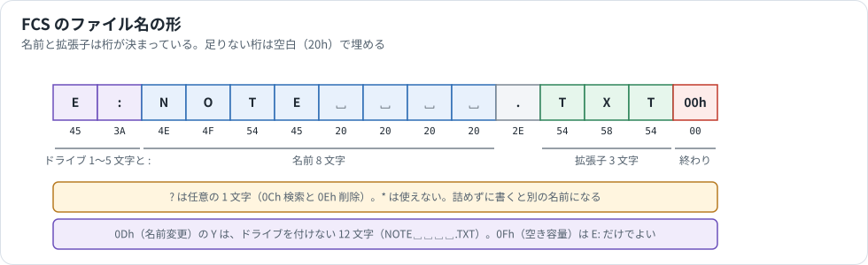

桁は省けません。`E:TEST.TXT` と詰めて書くと、名前が `TEST.TXT`、拡張子が空白のファイルとして扱われました（実験）。BASIC の命令は、打った名前を ROM がこの形に直してから FCS を呼んでいます。ドライブを省いた名前は A=0Ah です。

検索（0Ch）と削除（0Eh）では、`?` が任意の 1 文字になります。`*` は 1 文字として扱われるので、「名前は何でもよい」は `????????` と書きます。`?` が複数に当たると、削除は順に消していき、書き込み禁止のファイルに当たった所で A=05h になって止まりました（実験）。

| ドライブ名 | 開けるか |
|---|---|
| `E:`、`F:`、`G:` | 開ける。`G:` は作成と書き込みが A=05h。`F:` はカードがないと A=0Ah |
| `S1:`、`S2:`、`S3:` | メモリブロックをファイルとして開く。作成には余りが要る（47h の後） |
| `STDO:`、`SCRN:`、`STDL:`、`PRN:` | 書くだけ。ハンドル 0 と 2 が最初から開いている |
| `STDI:`、`KYBD:` | 読むだけ。ハンドル 1 が最初から開いている |
| `COM:`、`CAS:` | 開ける。`CAS:` は読みと書きを同時にはできない |
| `X:`、`Y:`、`SYSTM:` | A=0Ah |

### 11.15.2 関数の一覧

| cmd | 名前 | 機能 | 表アドレス | エントリ |
|---|---|---|---|---|
| 00h | `FCS_CREATE` | 作成 | `E06DCh` | `E0838h` |
| 01h | `FCS_OPEN` | OPEN | `E06DEh` | `E0700h` |
| 02h | `FCS_CLOSE` | CLOSE | `E06E0h` | `E0858h` |
| 03h | `FCS_READ_BLOCK` | ブロック読み出し | `E06E2h` | `E0935h` |
| 04h | `FCS_WRITE_BLOCK` | ブロック書き込み | `E06E4h` | `E08A2h` |
| 05h | `FCS_READ` | 1バイト読み出し | `E06E6h` | `E0935h` |
| 06h | `FCS_WRITE` | 1バイト書き込み | `E06E8h` | `E08A2h` |
| 07h | `FCS_VERIFY` | 照合 | `E06EAh` | `E09BFh` |
| 08h | `FCS_PEEK` | 非破壊読み出し | `E06ECh` | `E09BFh` |
| 09h | `FCS_SEEK` | ファイルポインタ移動 | `E06EEh` | `E0B38h` |
| 0Ah | `FCS_INFO` | 情報取得 | `E06F0h` | `E0B74h` |
| 0Bh | `FCS_SET_INFO` | ディレクトリ情報変更 | `E06F2h` | `E0A93h` |
| 0Ch | `FCS_FIND` | 名前検索 | `E06F4h` | `E0A93h` |
| 0Dh | `FCS_RENAME` | 名前変更 | `E06F6h` | `E0A93h` |
| 0Eh | `FCS_DELETE` | 削除 | `E06F8h` | `E0A93h` |
| 0Fh | `FCS_FREE` | 空き容量 | `E06FAh` | `E0A93h` |
| 10h | `FCS_INIT` | 初期化 | `E06FCh` | `E0BC2h` |
| 11h |  | 拡張処理（名称未確定） | `E06FEh` | `E0CC4h` |

04h と 06h、03h と 05h、07h と 08h、0Bh〜0Fh は、それぞれ同じエントリです。1 バイトの処理はブロックの処理と同じ所から始まります。

引数と結果です。`FERR_` の番号は §11.15.5 にあります。

| cmd | 名前 | 機能 | 渡すもの | 返るもの |
|---|---|---|---|---|
| 00h | `FCS_CREATE` | ファイルを作って開く | X = ファイル名（ドライブ: + 名前 8 文字 + . + 拡張子 3 文字 + 00h）、A = 属性（ビット 0: 書き込み禁止、1: 見えない） | (CL) = ハンドル、A = 属性、C=1 なら A = FERR_ の番号 |
| 01h | `FCS_OPEN` | 開く | X = ファイル名（ドライブ: + 名前 8 文字 + . + 拡張子 3 文字 + 00h）、A = 1: 読む、2: 書く、3: 両方 | (CL) = ハンドル、A = 属性、C=1 なら A = FERR_ の番号 |
| 02h | `FCS_CLOSE` | 閉じる | (CL) = ハンドル | C=1 なら A = FERR_ の番号 |
| 03h | `FCS_READ_BLOCK` | ブロックの読み出し | (CL) = ハンドル、X = 読み込む先、Y = バイト数、A のビット 0 = 0: 1Ah で終わり、1: ファイルの最後まで | X = 次のアドレス、Y = 処理したバイト数、C=1 なら A = FERR_ の番号 |
| 04h | `FCS_WRITE_BLOCK` | ブロックの書き込み | (CL) = ハンドル、X = データ、Y = バイト数（0: 今の位置から後を捨てる） | X = 次のアドレス、Y = 処理したバイト数、C=1 なら A = FERR_ の番号 |
| 05h | `FCS_READ` | 1 バイトの読み出し | (CL) = ハンドル、A のビット 0 = 0: 1Ah で終わり、1: ファイルの最後まで | A = データ、B = 読めたバイト数（0、1）、C=1 なら A = FERR_ の番号 |
| 06h | `FCS_WRITE` | 1 バイトの書き込み | (CL) = ハンドル、A = データ | B = 書けたバイト数、C=1 なら A = FERR_ の番号 |
| 07h | `FCS_VERIFY` | 照合 | (CL) = ハンドル、X = メモリのアドレス、Y = バイト数、A のビット 0 = 0: 1Ah で終わり、1: ファイルの最後まで | X = 次のアドレス、Y = 処理したバイト数、C=1 なら A = FERR_ の番号 |
| 08h | `FCS_PEEK` | 1 バイトの非破壊読み出し | (CL) = ハンドル、A のビット 0 = 0: 1Ah で終わり、1: ファイルの最後まで | A = データ、B = 読めたバイト数（0、1）、C=1 なら A = FERR_ の番号 |
| 09h | `FCS_SEEK` | 位置を動かす | (CL) = ハンドル、(SI) = バイト数（3 バイト）、A = 0: 先頭から、1: 今の位置から（符号付き）、2: 終わりから | (SI) = 位置、C=1 なら A = FERR_ の番号 |
| 0Ah | `FCS_INFO` | 開いたファイルの情報 | (CL) = ハンドル、A = 0: 大きさと位置、1: 名前（X = 19 バイトの場所） | A = 0 で呼ぶと A = 開き方、B = デバイスの属性、(SI) = 位置、(DI) = 大きさ、C=1 なら A = FERR_ の番号 |
| 0Bh | `FCS_SET_INFO` | ディレクトリの情報を読む、変える | X = ファイル名（ドライブ: + 名前 8 文字 + . + 拡張子 3 文字 + 00h）、Y = 属性 1、時刻 2、日付 2、大きさ 3 の 8 バイト、A = 0: 読む、1: 書く | C=1 なら A = FERR_ の番号 |
| 0Ch | `FCS_FIND` | 名前を探す（? が使える） | X = ファイル名（ドライブ: + 名前 8 文字 + . + 拡張子 3 文字 + 00h）、Y = 結果の場所（18 バイト）、(BX) = 始める番号、A = 0: 後ろへ、1: 前へ、+80h: 見えないものも | (BX) = 見つけた番号、[Y] = ドライブ 6、名前 8、.、拡張子 3、C=1 なら A = FERR_ の番号 |
| 0Dh | `FCS_RENAME` | 名前を変える | X = ファイル名（ドライブ: + 名前 8 文字 + . + 拡張子 3 文字 + 00h）、Y = 新しい名前（ドライブなしの 12 文字） | C=1 なら A = FERR_ の番号 |
| 0Eh | `FCS_DELETE` | 消す（? が使える） | X = ファイル名（ドライブ: + 名前 8 文字 + . + 拡張子 3 文字 + 00h） | C=1 なら A = FERR_ の番号 |
| 0Fh | `FCS_FREE` | 空き容量 | X = ドライブ名（: まで）、A = 0 | (SI) = 空き（3 バイト）、C=1 なら A = FERR_ の番号 |
| 10h | `FCS_INIT` | 初期化 | A = 0: すべて、1: 全部閉じて標準の 3 つを開く、2: 標準のほかを閉じる | C=1 なら A = FERR_ の番号 |

> [!WARNING]
> FCS は `(CX)` を残しません。ハンドルは呼ぶたびに `(CL)` へ入れ直します。

**開く、作る。** 00h は、同じ名前があれば大きさ 0 にして開き、なければ作ります。01h は作りません。どちらも位置は 0 から始まります。読むだけのデバイスを作成で開くと読む用、書くだけのデバイスなら書く用に開きます（技術資料 p.6）。01h の A に 0 や 4 を渡してもエラーにはならず、開けました（実験、7.2）。値の範囲は自分で守ります。

**読む。** A のビット 0 が 0 なら、`1Ah` を読んだ所で終わります（その `1Ah` も読み込まれ、次の呼び出しでも位置は `1Ah` の上のまま）。1 ならファイルの本当の終わりまでです。頼んだ数に足りなくても C=0 で、Y が読めた数です。1 バイトの読み出しは B が読めた数なので、終わりは「C=0 で B=0」で分かります（実験）。

**書く。** 04h の Y を 0 にすると、今の位置から後ろが捨てられ、ファイルが短くなります。容量が足りないと C=1、A=0Ch です。

**位置。** 09h の A=1 は符号付きなので、`(SI)` に FFFFFDh（−3）を入れると 3 バイト戻ります。書く用に開いたファイルは終わりを越えて動かせて、そこに書くと、間は意味のないバイトのままファイルが伸びます。読む用に開いたファイルで越えると A=01h です（実験）。

**情報（0Ah）。** A=0 では A に開き方（1 読む、2 書く、3 両方）、B にデバイスの属性（`E:` は 83h）、`(SI)` に位置、`(DI)` に大きさ。A=1 では X の場所に 19 バイトの名前と属性が書かれます。

| X からの位置 | 内容 | 例 |
|---|---|---|
| +0 | ドライブ名と `:`（6 バイト、空白で埋める） | `E:    ` |
| +6 | 名前 8 バイト | `TEST    ` |
| +0Eh | `.` | |
| +0Fh | 拡張子 3 バイト | `TXT` |
| +12h | 属性 1 バイト | 20h |

**ディレクトリの情報（0Bh）。** Y の 8 バイトは、属性、時刻 2、日付 2、大きさ 3 の順で、大きさは書いても変わりません。PC-E500 には時計がないので時刻と日付は 0 のままですが、書けばその値が残りました（実験）。開いているファイルの情報は読めますが、書くと A=08h です。

**属性。** ビット 0 が書き込み禁止（P）、ビット 1 が見えないファイルです。見えないファイルは 01h でも 0Ch（A=00h、01h）でも見つからず、0Ch の A に 80h を足すと見つかります。ところが削除（0Eh）は見えないファイルも消しました（実験）。

**検索（0Ch）。** `(BX)` の番号のディレクトリから調べ、見つけた番号が `(BX)` に返ります。続きを探すときは 1 足して呼びます。ないときは A=02h でした。技術資料（p.12）は 09h と書いていますが、02h のほうが実際です。

**名前を変える（0Dh）。** Y に渡す新しい名前には、**ドライブを付けません**。`"B       .TXT"` の 12 文字です。ドライブ付きで渡すと、`E:B     ` という名前の壊れたファイルになりました。既にある名前なら A=09h です（実験、7.2、8.5）。

**空き（0Fh）。** `E:`、`F:`、`G:` のほか、`S1:`〜`S3:` でも余りが分かります。ディスクでないものは A=0Ah です。

### 11.15.3 例: ファイルを作って読む

`E:NOTE.TXT` に 8 バイト書き、閉じ、開き直して読みます。先に `INIT "E:8K"` で `E:` を作っておきます。

```asm
        ORG   $BEC00
        INCLUDE "iocs.inc"
BUFFER  EQU   $BED00
start:  MV    X,name
        MV    A,0               ; 属性
        MV    IL,FCS_CREATE
        CALLF FCS
        JRC   error
        MV    A,(CL)            ; ハンドルを保存する
        MV    [handle],A
        MV    X,text
        MV    Y,text_end-text
        MV    IL,FCS_WRITE_BLOCK
        CALLF FCS
        JRC   error
        MV    A,[handle]
        MV    (CL),A            ; FCS は (CX) を壊すので入れ直す
        MV    IL,FCS_CLOSE
        CALLF FCS
        JRC   error
        MV    X,name
        MV    A,1               ; 読む
        MV    IL,FCS_OPEN
        CALLF FCS
        JRC   error
        MV    A,(CL)
        MV    [handle],A
        MV    X,BUFFER
        MV    Y,64
        MV    A,1               ; 終わりはファイルの最後
        MV    IL,FCS_READ_BLOCK
        CALLF FCS
        MV    [BUFFER+64],Y     ; 読めたバイト数
        MV    A,[handle]
        MV    (CL),A
        MV    IL,FCS_CLOSE
        CALLF FCS
        RC
error:  RETF
name:   DB    "E:NOTE    .TXT",0
text:   DB    "FCS OK",13,10
text_end:
handle: DB    0
        END
```

実行すると、`BED00h` から `46 43 53 20 4F 4B 0D 0A` が並び、`BED40h` の数は 8 でした。`FILES "E:"` には次の行が出ます（実験。ROM 2.2、5.3、7.2、8.3、8.5）。

```text
NOTE    .TXT          8   E:
```

### 11.15.4 ハンドルと初期化

ハンドルは 0〜0Fh の 16 個まで表があります。0、1、2 は BASIC が動いている間ずっと、画面、キー、プリンタに割り当てられています。FCB は既定で 5 個なので、自分で開けるのは 2 つまでで、3 つ目は A=04h でした（実験）。増やし方は [メモリ](03_MEMORY.md) §3.5 にあります。

ハンドルの表（`BFC6Dh`）は書き換えてもかまいませんが、次の 2 つをすると正しく動かなくなります（技術資料 p.4）。

- 開いていない FCB の番号を表に書く
- 開いている FCB の番号を表から消す

たとえばハンドル 0 の欄に、開いたファイルの FCB の番号を書くと、画面への出力がそのファイルへ行きます。`E:` に作ったファイルで試すと、ハンドル 0 へ書いた 8 バイトは画面に出ず、ファイルの大きさが 8 になりました（実験）。元の番号を保存しておき、必ず戻します。

10h（初期化）の A は、0 が作業域の初期化と 1 の仕事、1 がすべての FCB とハンドルとバッファを放して標準の 3 つを開き直すこと、2 が標準以外のハンドルを放すことです。A=1 のあとも A=2 のあとも、表は `00 01 02 FF …` に戻りました（実験）。開いたファイルの書きかけは保存されないので、ふつうは 02h で閉じます。

11h のエントリは拡張処理で、呼ぶと C=1 でした。12h 以上は A=01h です（実験）。

### 11.15.5 FCS のエラー番号

技術資料には 2 つの表があり、09h から先が 1 つずれています。p.5 の FCS の表と、p.18 のコマンド 20h〜3Eh の表です。実際に起こして比べると、**FCS は p.5 の表のとおり**でした（実験、ROM 7.2）。

| A | 内容（p.5） | p.18 の表では | 確かめた状況 |
|---|---|---|---|
| 00h | デバイスでエラーが起きて中止した | 同じ | |
| 01h | パラメータが範囲外 | 同じ | 位置の A=3、読む用で終わりを越える、番号 12h 以上 |
| 02h | 指定したファイルがない | 同じ | 開く、消す、検索 |
| 03h | 指定したパスコードがない | 同じ | |
| 04h | 開けるファイル数を超えた | 同じ | 3 つ目を開く |
| 05h | そのファイルには許されない処理 | 同じ | 書き込み禁止のファイル、`G:` への作成 |
| 06h | 無効なハンドル | 同じ | 閉じたハンドルを使う |
| 07h | 開くときに指定していない処理 | 同じ | 読む用に書く、ハンドル 0 から読む |
| 08h | ファイルは開いている | 同じ | 開いているファイルを開く、消す |
| 09h | 同じ名前がある | 対応するファイルがない | 名前の変更 |
| 0Ah | ドライブがない | 名前が重複 | `Q:`、カードなしの `F:`、`X:` |
| 0Bh | 照合の不一致 | ドライブがない | 07h で中身が違う（X は違った場所の次、Y は合った数） |
| 0Ch | 頼んだ数を処理できなかった | 照合の不一致 | 空きが足りない書き込み、`S1:` への作成 |
| 0Dh | | 頼んだ数を処理できなかった | |
| FEh、FFh | 電池切れ、BREAK | 同じ | |

メモリブロックの 41h〜48h のエラーも、00h、01h、04h、05h、09h、0Ch で p.5 と同じ並びです。

### 11.15.6 特殊デバイスの 20h〜2Fh

FCS は開くデバイスの属性を見て、頼み方を変えます。

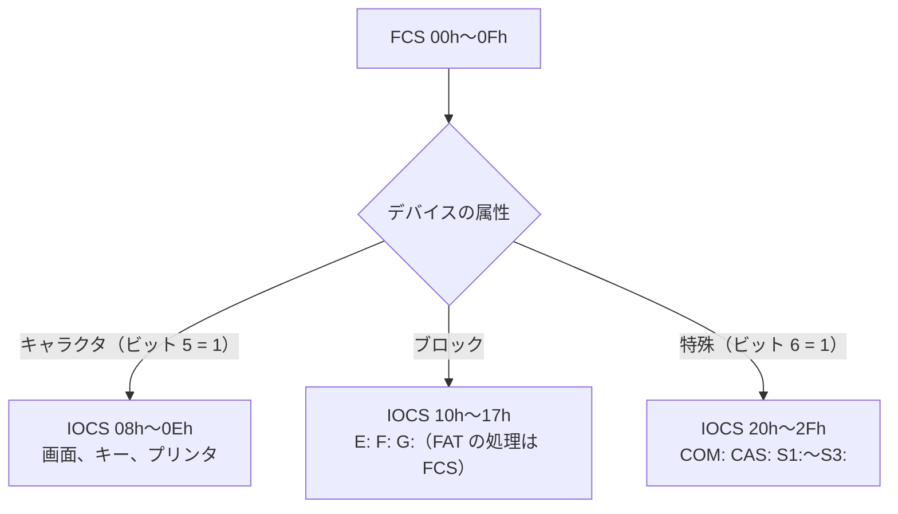

20h〜2Fh は FCS の 00h〜0Fh と同じ並びで、引数もエラーも同じです。ただし `(DL)` に FCB の番号を入れて呼ばれます（技術資料 p.29）。自分のデバイスを特殊デバイスにするときは、`(DL)` から FCB の場所が分かるので、そこを作業域にできます。

### 11.15.7 開いてから閉じるまで

順番は次のとおりです。

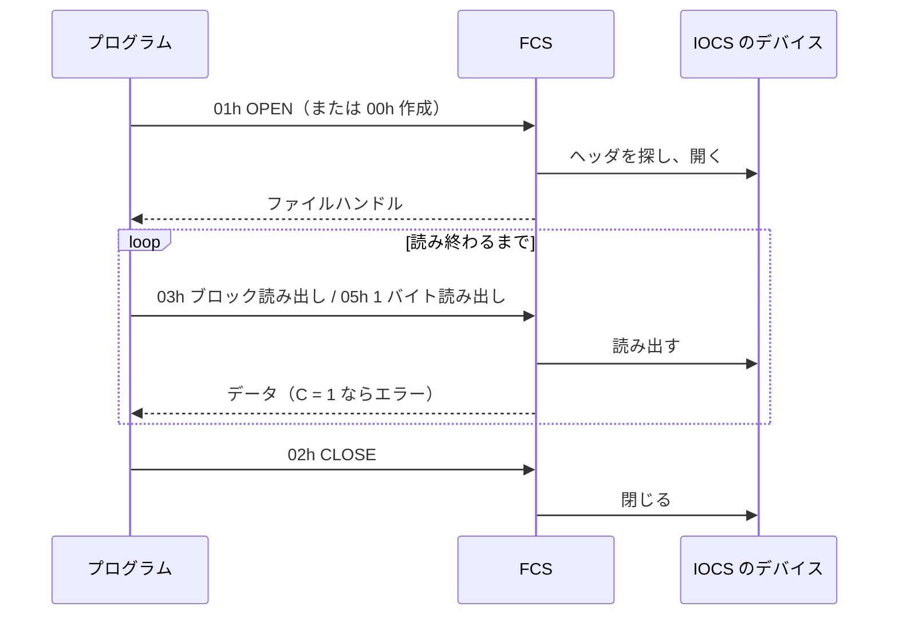

## 11.16 選択例

```asm
; LCDの指定位置に1文字を出す例（device 0, command 41h）。
; D7h は画面デバイスでのドライブ選択を明示するため 0 にする。
MV   ($D6),$00
MV   ($D7),$00
MV   ($D4),XPOS               ; x 座標
MV   ($D5),YPOS               ; y 座標
MV   IL,$41
; A = character code
CALLF $FFFE8

; G: を示す RAM ディスクドライバ選択。実行する file-control
; command とその引数は No.05 の個別仕様に従う。
MV   ($D6),$05
MV   ($D7),$02
; IL = command
CALLF $FFFE8
```

`XPOS` と `YPOS` は桁（0〜39）と行（0〜3）を表す定数です。定数の代わりにレジスタ名（`X`、`Y`）を書くと、20 ビットのレジスタをそのまま書き込む別の命令になるので注意してください。

技術資料の「No.05 RAM Disk Driver (E: F: G:)」とROMヘッダは一致します。ROM内G:データはRAM領域ではなく本体ROM `C0018h-DFFFFh` に焼かれていますが、IOCSからは同じdevice 5として扱われます。セクタのアドレスを 17h で調べると、`G:` の 1 番は `C0058h` でした（[メモリ](03_MEMORY.md) §3.6.2 の計算と同じ）。

## 11.17 エラーコード

Technical Reference Manual p.18〜19 の表です。エラーのときは C=1 で戻り、コードの意味はコマンド番号で変わります。FCS（`FFFE4h`）とメモリブロックのエラーは §11.15.5 の表を使います。右の列（20h〜3Eh）は技術資料の p.18 のままで、09h から先は実際の動作とずれています。

| A | コマンド 00h〜1Fh、40h | コマンド 20h〜3Eh（p.18 の表） |
|---|---|---|
| 00h | 書き込み禁止のメディアに書こうとした | デバイスでエラーが起きて中止した |
| 01h | ドライブがない | パラメータが範囲外 |
| 02h | ドライブの準備ができていない | ファイルがない |
| 03h | 処理できないコマンド | パスコードがない |
| 04h | メディアが交換された | 開けるファイル数を超えた |
| 05h | 書き込みエラー | ファイルの処理が許されていない |
| 06h | 読み取りエラー | 無効なファイルハンドル |
| 07h | ベリファイエラー | 開くときに指定していない処理 |
| 08h | 書き込みできないデバイス | ファイルは開いている |
| 09h | 読み取りできないデバイス | 対応するファイルがない |
| 0Ah | | ファイル名が重複している |
| 0Bh | | ドライブがない |
| 0Ch | | ベリファイエラー |
| 0Dh | | 指定のバイト数を処理できなかった |
| FEh | 電池切れ | 電池切れ |
| FFh | BREAK | BREAK |

コマンド 3Fh は BASIC と同じエラーコードを返します（BASIC のエラーは [ROM バージョンの違い: 行列演算とドライバ](25_ROM_VERSIONS_DRIVERS.md) §25.2.2）。コマンド 41h〜7Fh はデバイスごとです。

**例: 同じ A = 01h でも意味が違う。** RAM ディスクのメディアの確認（10h）が C=1、A=01h で戻れば「ドライブがない」です。メモリブロックの 20h〜2Fh が C=1、A=01h で戻れば「パラメータが範囲外」です。先にコマンド番号の列を選んでから表を引きます。

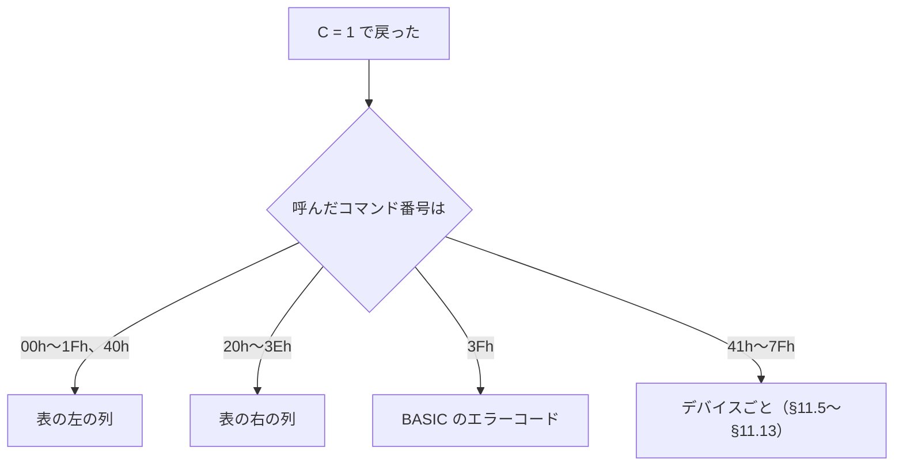

## まとめ

| 覚えておくこと | 値 |
|---|---|
| IOCS / FCS のエントリ | `CALLF FFFE8h` / `CALLF FFFE4h` |
| デバイス、ドライブ、コマンド | `(D6h)`、`(D7h)`、`IL` |
| 結果 | C = 0 成功、C = 1 失敗で A にエラー番号 |
| 番号の区分 | 08h〜0Fh 文字、10h〜1Fh ブロック、20h〜3Fh 特殊、40h 初期化、41h〜7Fh 固有 |
| ヘッダの先頭 | `BFCA2h` の指すアドレス（8.5 では `DF820h`） |
| 座標 | 文字は `(BL)` `(BH)`、点は `X` `Y` |
| 55h、56h の並び | 右半分（x = 120〜239）は逆順 |
| レジスタの破壊 | 公開されていない。必要なものは `PUSHU` / `POPU`。`(CX)` は RAM ディスクと FCS で変わる |
| BASIC から | `POKE &HBFE00,デバイス,ドライブ,コマンド:CALL &HFFFDC` |
| ファイル名 | `E:` + 8 文字 + `.` + 3 文字 + 00h。`?` だけが使える。名前変更の新しい名前はドライブなし |
| メモリブロック | 作る前、作業域を変える前に 47h |
| SYSTM の 43h | エラー番号は B |

## 根拠と更新方針

- 公開 ABI、ヘッダ構造、属性ビット、デバイス番号、コマンド番号の区分は Sharp *Technical Reference Manual PC-E500* の Chapter 2 *Outline of IOCS*（印刷ページ 15–17）による。各コマンドの引数は Chapter 1（p.1–14、FCS）、Chapter 2（p.20–30）、Chapter 3（p.31–82）による。
- **実験** は、エミュレータの BASIC が止まっている所から公開ベクタを呼び、戻ったレジスタとメモリを読んだもの。断りのないものは ROM 7.2（32 KB）で、プログラムの例は 2.2、5.3、7.2、8.3、8.5 で動かした。
- この章のヘッダ値・コマンドエントリは ROM 8.5 からの抽出結果による。周辺機器が追加した実行時ヘッダは含まれない。
- コマンドの名前と引数の表は [INCLUDE ファイル](../manual/06_INCLUDE_FILES.md#番号) と同じもの。テープの引数は [11 ピン（テープ、周辺機器）](06_PORT_11PIN.md) §6.7 による。
- 「名称未確定」はエントリアドレスのみ確定している。仕様を補う際は推測で名称を埋めず、技術資料または実機トレースを根拠として更新する。

## 次に読むもの

- [機械語を実機で動かす](12_MACHINE_CODE.md): IOCS を呼ぶ機械語を置く場所と、BASIC から呼ぶときの決まり
- [INCLUDE ファイル](../manual/06_INCLUDE_FILES.md): この章の番号に名前を付けたファイル
- [液晶（LCD）](04_LCD.md): IOCS を通さずに速く描く方法
- [ROM バージョンの違い: システム](26_ROM_VERSIONS_SYSTEM.md): ヘッダとエントリのバージョンによる違い
