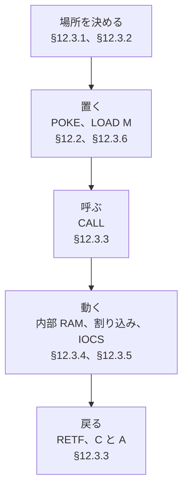
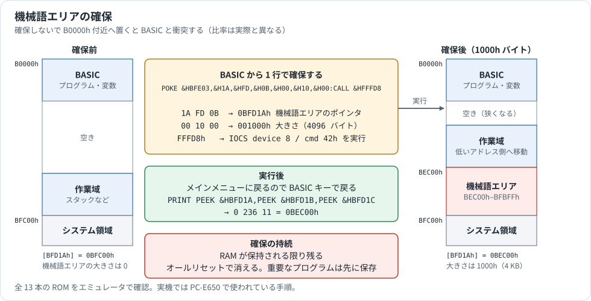
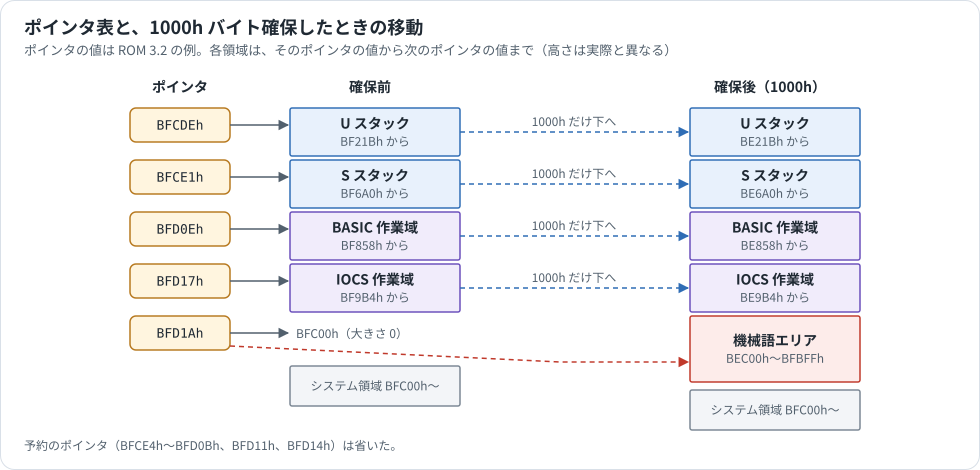
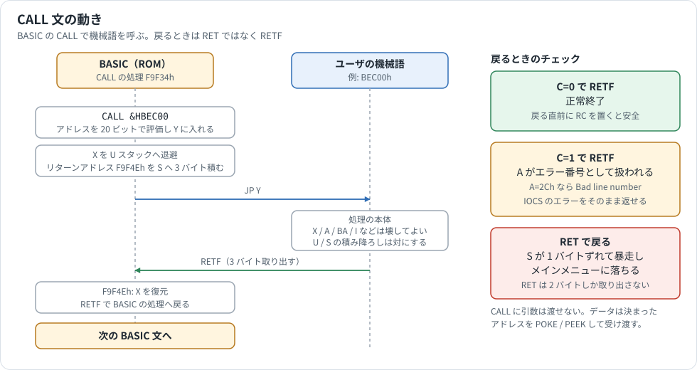
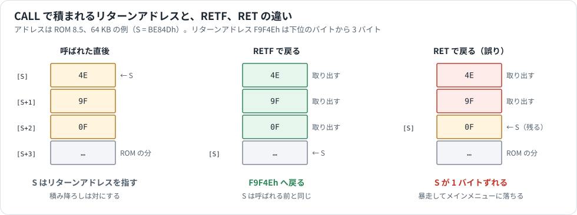
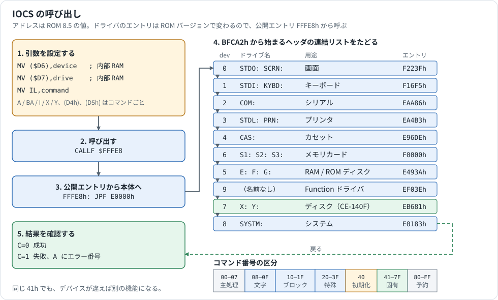
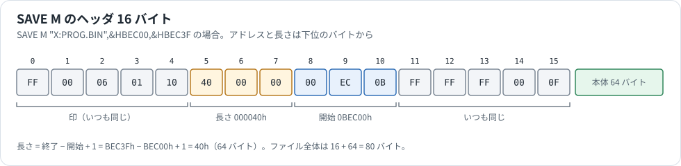
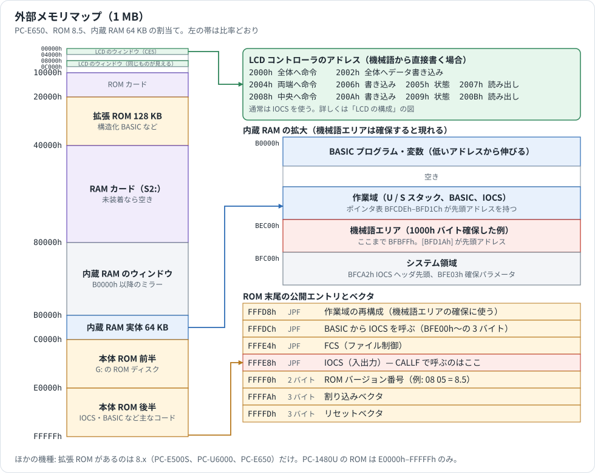

# 12. 機械語を実機で動かす

この章は、自分の機械語を BASIC から呼んで、無事に BASIC へ帰ってくるまでの規約を説明します。「計算は合っているのに、戻った瞬間にメニューへ落ちる」「あとで変数が壊れる」といった困りごとは、たいていここの規約を 1 つ破ったときに起きます。PC-E500 シリーズで機械語プログラムを動かすための、本体側の決まりをまとめた章です。`CALL` で ROM が何をするか、機械語エリアの確保、IOCS の呼び方、内部 RAM と割り込みの扱いを説明します。

[目次へ戻る](README.md)

## この章で分かること

- 機械語を置く場所（機械語エリア）を、BASIC の 1 行で確保する方法とその仕組み
- BASIC の `CALL` が ROM の中で何をするか、どう戻れば正しく終わるか
- 内部 RAM と割り込みを壊さないための決まり
- IOCS の呼び方と、よく使う画面のコマンド
- `SAVE M` と `LOAD M` のファイルの形
- 13 本の ROM で同じ結果になったサンプル 3 本と、よくある失敗

## 12.0 はじめに

BASIC のプログラムの中から `CALL` で機械語を呼ぶとき、主役は 2 人います。呼ぶ側の **ROM（BASIC）** と、呼ばれる側の**自分の機械語**です。2 人は同じメモリ、同じスタック、同じ内部 RAM を使うので、どちらが何を使ってよいかの規約が必要です。規約を守らないと、プログラムの結果が正しくても、戻った瞬間に暴走したり、あとで BASIC が壊れたりします。



この章は規約の参照用です。次のものは、ほかの章にあります。

| 知りたいこと | 章 |
|---|---|
| 機械語を初めて書く | [アセンブラ入門](../manual/03_ASSEMBLER_TUTORIAL.md) |
| `e500asm` の文法とオプションのすべて | [アセンブラの文法](../manual/04_ASSEMBLER_REFERENCE.md) |
| 実機へ送る手順 | [実機へ送る](../manual/14_TRANSFER.md) |
| レジスタ、アドレッシング、全命令、オペコード表 | [CPU（SC62015）](02_CPU.md) |

## 12.1 記法（e500asm）

この章のソースを読むための、`e500asm` の記法の要点です。詳しくは [アセンブラの文法](../manual/04_ASSEMBLER_REFERENCE.md) を参照してください。

```asm
; コメントは ; から行末まで
        ORG   $BEC00            ; 配置アドレス
COUNT   EQU   10                 ; 定数（"COUNT = 10" も可）
start:  MV    A,0                ; ラベルは行頭に置き : を付ける
loop:   ADD   A,IL
        DEC   IL
        JRNZ  loop
        RETF
table:  DB    "TEXT",13,10,0     ; 文字列と数値
        DW    $1234              ; 2 バイト（下位が先）
        DP    $B8000             ; 3 バイト
        DS    16                 ; 16 バイト確保
        END
```

| 項目 | 書き方 |
|---|---|
| 数値 | `$BEC00` / `&BEC00` / `0xBEC00` / `0BEC00h`（16 進）、`0b1010`（2 進）、`'A'`（文字）。`$` または `*` 単独は現在のアドレス。`h` で終わる数値は 16 進として読む（`0B8H` も 16 進） |
| 式 | `+ - * / % & \| ^ << >>`、単項 `- ~`、括弧、`LOW(x)`、`HIGH(x)`、`BANK(x)`（bit19–16） |
| 疑似命令 | `ORG`, `EQU`, `DB`/`DEFB`/`BYTE`, `DW`/`DEFW`/`WORD`, `DP`, `DS`/`DEFS`/`SPACE`, `ALIGN`, `INCLUDE`, `INCBIN`, `ASSERT`, `END`。先頭に `.` を付けてもよい |
| 分岐先 | `JR label` のようにラベルを書けば変位は自動計算。`JR +5` / `JR -3` の直接指定も可 |
| PRE | `PRE 21h` のように PRE を明示することもできるが、通常は不要 |
| 大文字と小文字 | 区別しない |

`(n)` は内部 RAM、`[…]` は外部メモリです。同じ `$20` でも、`(…)` と `[…]` ではまったく別の場所を指します。

コマンドラインは次のとおりです。

```text
e500asm  prog.asm -o prog.bin -l prog.lst -s prog.sym      # 生バイナリ + リスト + シンボル
e500asm  prog.asm -f hex                                    # Intel HEX
e500dasm prog.bin -f raw --org 0BEC00h -o prog.asm          # 逆アセンブル（生バイナリ）
e500dasm PROG.BIN -f ce140f -o prog.asm                     # SAVE M 形式（16 バイトヘッダ付き）
```

## 12.2 開発の流れ

1. `ORG` に配置先（機械語エリアの先頭、§12.3.2）を書いてソースを作る。VS Code に `VSCodeExtensions/` の拡張（PC-E500 開発ツール）を入れると、`.asm` の編集中に `e500asm` と同じエラー（未知の命令、オペランドの組合せ、未定義シンボル、`JR` の範囲など）が表示される。
2. `e500asm prog.asm -o prog.bin -l prog.lst` でアセンブルし、リストでバイト列を確認する。
3. 実機／エミュレータへ入れる。方法は 3 つ（下の表）。
4. `CALL 先頭アドレス` で実行する（`CALL &HBEC00` または 10 進 `CALL 781312`）。
5. 逆アセンブルで確認するときは `e500dasm`。ROM の解析には [ROM バージョンの違い: 配置](23_ROM_VERSIONS_MAP.md) のエントリ表を使う。

| 入れ方 | やり方 | 向いている場面 |
|---|---|---|
| **POKE** | 短いプログラムなら `POKE 先頭,バイト,…` を数行。リストから 10 進または `&H` 16 進で書く | 数十バイトまで |
| **LOAD M** | `ce140conv bin2bas --addr 0xBEC00 prog.bin PROG.BIN` で SAVE M 形式（16 バイトヘッダ付き）にし、CE-140F（エミュレータでは X: フォルダ）へ置いて `LOAD M "X:PROG.BIN"`。ヘッダのアドレスへ読み込まれる | ふつうはこれ |
| **エミュレータの BIN 書き込み** | メモリ欄から生バイナリを指定アドレスへ書く | エミュレータで試すとき |

画面付きの手順は [実機へ送る](../manual/14_TRANSFER.md)、本体だけで動かす手順は[ハンドブック](../handbook/22_MACHINE_CODE.md)にあります。

## 12.3 実機で機械語を動かす

この章の手順は、全機種で同じです。全 13 本の ROM（2.1、2.2、3.2、5.3、6.2、6.3、6.4、7.2、7.3、7.5、8.3、8.4、8.5）をエミュレータで動かし、機械語エリアの確保（`BEC00h` になること）と、§12.4 のサンプル 3 本の結果が同じになることを確かめました。内蔵 RAM は、256 KB の ROM では 32 KB と 64 KB、384 KB の ROM では 64 KB（8.3 は 32 KB と 64 KB）で試しています。

ROM の中のアドレス（`F9F34h` など）は、ROM バージョンで変わります。本文の値は ROM 8.5 の例です。公開エントリの `FFFD8h`、`FFFE4h`、`FFFE8h` は全機種で同じアドレスから呼べます。各 ROM の値は [ROM バージョンの違い: 配置](23_ROM_VERSIONS_MAP.md) にあります。

### 12.3.1 RAM の構成と機械語エリア

内蔵 RAM は、下の方から BASIC のプログラムと変数、上の方から ROM の作業域が使います。ROM は内蔵 RAM の上端（BFC00h 直下）に 21 個の作業域を持ち、その先頭アドレスを **BFCDEh から 3 バイトずつ** のポインタ表に置きます（技術資料 p.77）。

| ポインタのアドレス | 領域 |
|---|---|
| BFCDEh | U スタック |
| BFCE1h | S スタック |
| BFCE4h–BFD0Bh | 予約 |
| BFD0Eh | BASIC 作業域 |
| BFD11h, BFD14h | 予約 |
| BFD17h | IOCS 作業域（内部 RAM E6h にも同じ値） |
| BFD1Ah | **機械語エリア**。このアドレスの値から BFBFFh までがユーザ用 |

ある領域の大きさは、次のポインタの値との差です。最後の機械語エリアだけは、終わりが `BFBFFh` に決まっているので、ポインタの値を下げるほど広くなります。

電源投入直後は `[BFD1Ah] = 0BFC00h`、つまり機械語エリアの大きさは 0 です。BASIC プログラムや変数は RAM の下端から伸びるので、確保せずに B0000h 付近へ機械語を置くと BASIC と衝突します。

### 12.3.2 機械語エリアの確保（検証済み）



IOCS device 8（SYSTM:）command 42h「作業域確保」を、公開エントリ FFFD8h 経由で BASIC から呼びます。FFFD8h の本体（ROM 7.2 では `F9D31h`）は、4 つのことをします（コード）。メモリブロックの空きを詰める（`CALL 9DEEh`）、`[BFE03h]` を X（ポインタ表のアドレス）、`[BFE06h]` を Y（確保するバイト数）に入れる、作業域を変える（`CALL 9D57h`。SYSTM の 42h にあたる）、メインメニューへ飛ぶ（`JP A24Eh`）、です。BASIC へは戻らないので、`CALL &HFFFD8` の後ろに文を続けても実行されません。

```basic
POKE &HBFE03,&H1A,&HFD,&H0B, &H00,&H10,&H00 : CALL &HFFFD8
```

この 1 行の読み方です。アドレスも大きさも 3 バイトで、下位のバイトから並びます。

| `POKE` の値 | 入るアドレス | 意味 |
|---|---|---|
| `&H1A,&HFD,&H0B` | `BFE03h`〜 | 先頭 3 バイト `1A FD 0B` = 0BFD1Ah（機械語エリアのポインタ） |
| `&H00,&H10,&H00` | `BFE06h`〜 | 続く 3 バイト = 大きさ。例は 1000h = 4096 バイト |
| `CALL &HFFFD8` | | 上の 2 つを X と Y に入れて command 42h を実行 |

確保すると、ポインタ表の値と領域の中身が、確保した分だけ下へ移ります。



- 大きさは確保したあとの大きさの指定で、足す量ではありません（ROM 7.2、32 KB で実験）。1000h を 2 回続けても 1000h のまま、続けて 800h なら BF400h〜BFBFFh に縮み、0 で BFC00h に戻って大きさ 0 になります。そのたびに BFCDEh からのポインタ表の値も同じだけずれ、プログラムと変数は残りました。
- 実行後はメインメニューに戻るので `BASIC` キーで戻ります。
- 確認: `PRINT PEEK &HBFD1A, PEEK &HBFD1B, PEEK &HBFD1C` → `0 236 11` = 0BEC00h。機械語エリアは **BEC00h–BFBFFh** です。

**例: 表示された 3 つの数をアドレスに直す。** 0 + 236 × 256 + 11 × 65536 = 781312 = BEC00h です。大きさと先頭アドレスの関係は「先頭 = BFC00h − 大きさ」なので、800h なら BF400h、1000h なら BEC00h、2000h なら BDC00h になります。

`&H` が打ちにくい環境では 10 進で `POKE 785923,26,253,11,0,16,0:CALL 1048536` と書いても同じです。ROM はこの処理で BASIC 作業域・スタック等のポインタを確保分だけ下へずらします（U/S スタックの内容も移動します）。確保した状態は RAM が保持される限り残り、オールリセット（RAM 初期化）で消えます。既存の BASIC プログラムがある状態でも動作しますが、重要なプログラムは先に保存しておいてください。

技術資料 p.85 には同じ方法で IOCS 作業域（BFD17h）を広げる BASIC プログラム例があります。

機械語から同じことをするときは、FFFD8h を呼ばずに、メモリブロックの 47h（空きを詰める）と SYSTM の 42h を自分で呼びます。47h を省くと、空きが `DATA` ブロックの中にあるため C=1（メモリ不足）になります（実験、ROM 2.2、5.3、7.2、8.5）。

```asm
        INCLUDE "iocs.inc"
        MVW   (CX),$0006        ; メモリブロック、S1:
        MV    IL,MEM_TIDY       ; 空きを詰める
        CALLF IOCS
        MVW   (CX),$0008        ; SYSTM
        MV    X,$BFD1A          ; 機械語エリア
        MV    Y,$0800
        MV    IL,SYSTM_WORK
        CALLF IOCS              ; C = 1: メモリ不足
```

### 12.3.3 CALL 文の規約（検証済み）



`CALL addr` は次のように動きます（アドレスは ROM 8.5 の例。`F9F34h`）。

1. 引数を 20 bit アドレスとして評価し Y に入れる。
2. X を U スタックに退避し、**リターンアドレス 3 バイト**（F9F4Eh）を `MV [--S],X` で S スタックに積む。
3. `JP Y` でユーザ機械語へ飛ぶ。
4. 戻った先で X を復元し、`RETF` で BASIC へ帰る。

ROM は `CALLF` 命令を使わず、自分でリターンアドレスを積んでから `JP Y` で飛びます。積んだ形は `CALLF` と同じ 3 バイトなので、呼ばれた側は `RETF` で戻ります。



したがってユーザプログラムは次の 3 つを守ります。

- **`RETF` で戻る**（3 バイト取り出す）。`RET` だと S が 1 バイトずれて暴走し、メインメニューに落ちる（エミュレータで確認）。
- **C=0 で戻れば正常終了。C=1 で戻ると A がエラー番号として扱われ、BASIC のエラー表示になる**（A の値が `ERN` になる。メッセージの表の番号 + 9。例: A=2Ch（44）は表の 35 番 "Bad line number"、A=15h（21）は表の 12 番 "Division by Zero"。表は [ROM バージョンの違い: 行列演算とドライバ](25_ROM_VERSIONS_DRIVERS.md) §25.2.2）。演算の最後にキャリーが残っていると意図せずエラーになるので、戻る直前に `RC` を置くのが安全。IOCS のエラーをそのまま BASIC に返したいときは C と A を触らずに `RETF` する。
- 引数はない。`CALL addr` の後にカンマで値を書く形式は受け付けない。データの受渡しは決まったアドレスを `POKE`/`PEEK` する。

| 戻り方 | BASIC 側の結果 |
|---|---|
| `RC` → `RETF`（C=0） | 次の文へ進む |
| `SC`、A = 44 → `RETF` | 35 番 "Bad line number"（44 − 9 = 35） |
| `SC`、A = 21 → `RETF` | 12 番 "Division by Zero"（21 − 9 = 12） |
| `RET` | 暴走してメインメニューへ |

呼び出し時のレジスタ・内部 RAM の観測値です（ROM 8.5、64 KB、参考値であり保証されません）。

| 項目 | 値 |
|---|---|
| Y | 呼び出し先アドレス |
| X | リターンアドレス F9F4Eh |
| U / S | RAM 内（例: BE691h / BE84Dh）。そのまま使える |
| BP (ECh) | ROM の値（例: BEh）。変更したら戻す |
| IMR (FBh) | E3h（全体を許可、外部、受信、遅いタイマ、速いタイマ） |
| A, BA, I | 不定 |

E3h = `1110 0011b` のビット 2（キー割り込み）は 0 です。キーは、キー割り込みではなく速いタイマの割り込みが 16 ms ごとに行列を調べて読み取るので、これで足ります（[起動、割り込み、タイマ、音](10_SYSTEM.md) §10.3.2）。E3h は ROM 2.2、5.3、7.2、8.5 で同じでした（実験）。

ROM は X しか保存しません。他のレジスタは壊してよいですが、U/S の積み降ろしは対にします。

### 12.3.4 内部 RAM と割り込みの扱い

CPU の中にある 256 バイトの内部 RAM は、速くて便利な作業域です。しかし ROM も同じ場所を使っているので、借りたら元に戻します。

- CPU にとってはただの RAM だが、ROM は 00h–EBh を BASIC と IOCS の作業に使う。機械語が使うアドレスはエントリで外部メモリへ `MVL` で退避し、出口で戻す（§12.4.3 の例）。BP（ECh）、PX、PY を変えたら戻す。
- 割り込みは許可されたまま入ってくる。時間のかかる処理でキー割り込みを止めたいときは `PUSHU IMR`（自動で IRM=0）… `POPU IMR`。ROM の割り込み処理はタイマでキーを走査し、S スタックを 5 バイト以上使う。
- 長い `MVL`/`WAIT` は割り込みを遅らせる。
- ブザー（XOUT）は SCR（FDh）の bit6–4。`AND (0FDh),8Fh` で止まる。

使ったものと、戻るまでにすることの対応です。

| 使うもの | 入るとき | 戻るとき |
|---|---|---|
| 内部 RAM の作業域 | `MVL [退避先],(n)` | `MVL (n),[退避先]` |
| BP、PX、PY | 元の値を預ける | 元の値に戻す |
| 割り込みの禁止 | `PUSHU IMR` | `POPU IMR` |
| U、S スタック | 積む | 同じ数だけ降ろす |
| ブザー | `OR` で鳴らす | `AND (0FDh),8Fh` で止める |

`PUSHU IMR` は、IMR を U スタックに積むのと同時に、IMR のビット 7（IRM、全体の許可）を 0 にします。割り込みの要因とアドレスは [起動、割り込み、タイマ、音](10_SYSTEM.md) §10.3、SCR の値は同じ章の §10.5 にあります。

```asm
; 割り込みを止めた区間の形
        ORG   $BEC00
start:  PUSHU IMR               ; 積んで、IRM = 0（割り込みを止める）
        ; … 割り込まれたくない処理（短く）
        POPU  IMR               ; 元の許可に戻す
        RC
        RETF
        END
```

### 12.3.5 IOCS の呼び方



画面やキーなどの入出力は、ROM の IOCS に頼みます。デバイス、ドライブ、コマンドを決まった場所に入れ、公開エントリ `FFFE8h` を呼びます。

```asm
        MV   ($D6),device      ; (cl) デバイス番号
        MV   ($D7),drive       ; (ch) ドライブ番号
        MV   IL,command         ; コマンド番号
        ; A / BA / I / X / Y / ($D4),($D5) はコマンドごとの引数
        CALLF $FFFE8
        JRC  error              ; C=1: A にエラー番号
```

引数に使う内部 RAM のアドレスと、技術資料の名前の対応は次のとおりです（ROM で確認）。技術資料の `(cx) = 0008h` は「D6h に 08h、D7h に 00h」を意味します（`MVW (D6h),0008h`）。

| アドレス | 技術資料の名前 | 用途 |
|---|---|---|
| D4h | (bl) | x 座標など |
| D5h | (bh) | y 座標など |
| D6h | (cl) | IOCS デバイス番号 |
| D7h | (ch) | IOCS ドライブ番号 |

デバイス番号、コマンド範囲、各ドライバのエントリは [IOCS と FCS](11_IOCS.md) にあります。LCD（device 0）の主なコマンド（技術資料 pp.32–41）は次のとおりです。すべてのコマンドの引数と例は [IOCS と FCS](11_IOCS.md) §11.5 にあります。

| cmd | 機能 | 引数 |
|---|---|---|
| 40h | 初期化 | A = 0 全リセット / 1 リセット / 2 OFF / 3 ON |
| 41h | 1 文字表示 | (D4h)=x, (D5h)=y, A=文字。表示後 x+1 |
| 42h | 文字列表示 | (D4h)=x, (D5h)=y, X=文字列先頭, Y=長さ。右端で止まり C=1 |
| 44h | カーソル位置設定 | (D4h)=x, (D5h)=y |
| 45h | カーソル種別 | A（bit5 表示、bit3 点滅、bit2–0 形） |
| 47h / 48h | n 行スクロール上／下 | |
| 49h | 行クリア | |
| 4Ah / 4Bh | 8 ドットパターン表示／読み出し | |
| 4Ch / 4Dh | 1 ドット表示／読み出し | |
| 4Eh / 4Fh | 直線／矩形塗り | |
| 51h / 52h | 画面クリア | |
| 55h / 56h | 1 行ドットパターン読み出し／書き込み | |

IOCS が壊すレジスタは公開されていません。必要なものは呼び出し前後で `PUSHU`/`POPU` します。

機械語を書かずに、BASIC から IOCS を 1 回だけ呼ぶ方法（`CALL &HFFFDC`）は [IOCS と FCS](11_IOCS.md) §11.1.2 にあります。

### 12.3.6 SAVE M / LOAD M

機械語エリアの内容を、ディスクに保存したり戻したりします。

```basic
SAVE M "X:PROG.BIN",&HBEC00,&HBEC3F     ' 機械語エリアの内容を保存
LOAD M "X:PROG.BIN"                     ' ヘッダのアドレスへ戻す
```

ファイル先頭には 16 バイトのヘッダ（`FF 00 06 01 10 長さ3 開始3 FF FF FF 00 0F`）が付きます。`ce140conv bin2bas --addr` が同じヘッダを生成し、`e500dasm -f ce140f` がそれを読みます。詳細は `FileConverter/README.md` と [ファイル形式](../manual/19_FILE_FORMATS.md#機械語load-m--save-m) にあります。



`SAVE M` に書く 2 つのアドレスは、最初と最後です。最後のアドレスのバイトも保存されるので、長さは「最後 − 最初 + 1」になります。

### 12.3.7 外部メモリの割当て

CPU が決めていない範囲の割当ては機種の設計によります（[CPU（SC62015）](02_CPU.md) §2.5.3）。図は PC-E650（ROM 8.5、内蔵 RAM 64 KB）の例です。



| CPU アドレス | 内容 | 機種による違い |
|---|---|---|
| 00000h–03FFFh、08000h–0BFFFh | LCD ドライバのウィンドウ（CE5）。ROM も `0A000h` を使う | |
| 10000h–1FFFFh | ROM カード | |
| 20000h–3FFFFh | 拡張 ROM（128 KB） | PC-E500S、PC-E650、PC-U6000 だけ |
| 40000h–7FFFFh | RAM カード（S2:）。未装着なら空き | |
| 80000h–BFFFFh | 内蔵 RAM のウィンドウ。下位は実体のミラー | 実体は 32 KB なら B8000h–BFFFFh、64 KB なら B0000h–BFFFFh |
| BFC00h–BFFFFh | システム領域。IOCS ヘッダ先頭ポインタ BFCA2h、作業域ポインタ表 BFCDEh–BFD1Ch、機械語エリア確保用パラメータ BFE03h など | 同じアドレス |
| C0000h–DFFFFh | 本体 ROM 前半。G: の ROM ディスク | PC-1480U は G: がなく、後半のコピー |
| E0000h–FFFFFh | 本体 ROM 後半。主なコード | 中のアドレスは ROM バージョンで変わる |
| FFFD8h, FFFDCh, FFFE4h, FFFE8h | 公開エントリ。FFFE8h = IOCS、FFFE4h = FCS、FFFDCh = BASIC から IOCS（`BFE00h` の 3 バイト）、FFFD8h = 作業域の再構成 | ジャンプ先はバージョンで変わる。呼ぶアドレスは同じ |

機械語エリア（BFBFFh まで）と ROM（C0000h から）は、別の 64 KB の区画（セグメント）にあります。そのため、ROM のエントリは `CALL` ではなく `CALLF` で呼びます。

ROM の中の配置は [ROM バージョンの違い: 配置](23_ROM_VERSIONS_MAP.md)、IOCS のエントリは [IOCS と FCS](11_IOCS.md) にあります。

## 12.4 サンプルプログラム

いずれも §12.3.2 で 1000h バイト確保した BEC00h に置き、`CALL &HBEC00`（= `CALL 781312`）で実行しました。全 13 本の ROM で同じ結果になります（エミュレータ）。

| 節 | 内容 | この章のどの決まりを使うか |
|---|---|---|
| 12.4.1 | 2 バイトの加算 | `RETF`、C と A、`POKE`/`PEEK` での受渡し |
| 12.4.2 | IOCS で文字列を表示 | IOCS の引数、エラーの返し方 |
| 12.4.3 | BCD の加算 | 内部 RAM の退避と復帰 |

### 12.4.1 2 バイトの加算

BASIC が `BED00h` と `BED01h` に置いた 2 つの数を足し、`BED02h` に書きます。

```asm
; [$BED00] + [$BED01] → [$BED02]
        ORG  $BEC00
        MV   A,[$BED00]
        MV   IL,[$BED01]     ; IH は 0 になる
        ADD  A,IL
        MV   [$BED02],A
        RETF                  ; C は ADD の結果のまま返る
        END
```

```basic
POKE &HBEC00,&H88,&H00,&HED,&H0B,&H89,&H01,&HED,&H0B,&H46,&H01,&HA8,&H02,&HED,&H0B,&H07
POKE &HBED00,3,4 : CALL &HBEC00 : PRINT PEEK &HBED02      → 7
POKE &HBED00,200,100 : CALL &HBEC00                        → "Bad line number"
```

2 つ目は 300 で桁上げが出て C=1 のまま戻ったため、A=2Ch がエラー番号として表示されました（§12.3.3）。300 − 256 = 44 = 2Ch が A に残っていたからです。ゼロクリアしたければ `RETF` の前に `RC` を入れます。

`POKE` の 1 行目は、リストのバイト列そのものです。命令との対応は次のとおりです。

| バイト列 | 命令 |
|---|---|
| `88 00 ED 0B` | `MV A,[$BED00]` |
| `89 01 ED 0B` | `MV IL,[$BED01]` |
| `46 01` | `ADD A,IL` |
| `A8 02 ED 0B` | `MV [$BED02],A` |
| `07` | `RETF` |

### 12.4.2 IOCS で文字列を表示

```asm
; IOCS (device 0: LCD, command $42) で最下行に文字列を表示する
        ORG  $BEC00
IOCS    EQU  $FFFE8
BL      EQU  $D4              ; x 座標 (0-39)
BH      EQU  $D5              ; y 座標 (0-3)
CL      EQU  $D6              ; device
CH      EQU  $D7              ; drive
start:  MV   (CL),0            ; device 0 = LCD
        MV   (CH),0            ; drive 0
        MV   (BL),0            ; x = 0
        MV   (BH),3            ; y = 3
        MV   IL,$42            ; 指定位置へ n 文字表示
        MV   X,msg             ; 文字列先頭
        MV   Y,msg_end-msg     ; 長さ
        CALLF IOCS             ; C=1 なら A にエラー番号
        RETF                   ; C と A をそのまま BASIC へ返す
msg:    DB   "HELLO, PC-E500!"
msg_end:
        END
```

`CLS : CALL &HBEC00` で 4 行目に `HELLO, PC-E500!` が出ます。42h は制御コード（CR/LF）を解釈せず、そのグリフ（文字の形）を表示します。

### 12.4.3 内部 RAM を退避して BCD 加算

**BCD** は、10 進の 1 桁を 4 ビットで表す方法です。`12 34h` の 2 バイトが 10 進の 1234 を表します。`DADL` は BCD の数を何バイトもまとめて足す命令です。

```asm
; 内部 RAM $20-$2F を退避し、DADL で 4 バイト BCD 加算を行う
        ORG  $BEC00
WORK    EQU  $20               ; 内部 RAM $20-$2F を作業に使う
SAVE    EQU  $BEF00            ; 退避先（機械語エリア内）
RESULT  EQU  $BED00            ; 結果の書出し先
start:  PUSHU X
        PUSHU I
        MV   I,16
        MVL  [SAVE],(WORK)     ; 内部 RAM $20-$2F を退避
        MV   X,operands
        MV   I,8
        MVL  (WORK),[X]        ; 被加数 4 バイト + 加数 4 バイト
        MV   I,4
        DADL (WORK+3),(WORK+7) ; 10 進加算。最下位バイトを指定し、下位アドレスへ進む
        MV   I,4
        MVL  [RESULT],(WORK)   ; 結果 ($20-$23) を外部メモリへ
        MV   I,16
        MVL  (WORK),[SAVE]     ; 内部 RAM を復帰
        POPU I
        POPU X
        RC
        RETF
operands:
        DB   $00,$12,$34,$56   ; 00123456（上位桁が先頭）
        DB   $00,$00,$99,$99   ; 00009999
        END
```

`CALL &HBEC00 : PRINT PEEK &HBED00,PEEK &HBED01,PEEK &HBED02,PEEK &HBED03` → `0 19 52 85` = 00 13 34 55（00123456 + 00009999 = 00133455）。復帰後も BASIC は正常に動きます。

内部 RAM の動きを追うと、次のようになります。

```text
アドレス        20 21 22 23   24 25 26 27
MVL の後    00 12 34 56   00 00 99 99     被加数、加数
DADL の後   00 13 34 55   00 00 99 99     23h から 20h へ向かって足す
```

生成されるコードのうち注目点は次のとおりです。`MVL [SAVE],(WORK)` は `30 DB 00 EF 0B 20`（内部 RAM オペランドが 1 つなので PRE 30h）、`DADL (WORK+3),(WORK+7)` は `32 C4 23 27`（両方絶対アドレスなので PRE 32h）、`MVL (WORK),[X]` は `30 56 84 20 00`（`[X]` が `[X+0]` に置き換わる）です。

サンプルのソースは [asm_samples/](../../Samples/Assembler/Basics/) にあります。

## 12.5 よくある落とし穴

うまく動かないときは、症状から次の表を引きます。

| 症状 | 原因 | 対処 |
|---|---|---|
| CALL 後にメインメニューへ落ちる | `RET` で戻った | `RETF` |
| CALL 後に BASIC のエラーが出る | C=1 で戻った | `RC` してから `RETF`、または意図したエラー番号を A に |
| キーが効かなくなる／時計が止まる | IMR を落としたまま、または長い `MVL`/`WAIT` | `PUSHU IMR`/`POPU IMR` を対にする |
| BASIC が壊れる | 内部 RAM を戻していない、BP を変えた、確保していない領域へ書いた | §12.3.2 と §12.3.4 |
| `MV A,IL` がアセンブルできない | 命令が存在しない | 内部 RAM 経由 |
| `MV S,[X]` がアセンブルできない | S の間接指定は不可 | `MV S,[lmn]` または `MV S,(n)` |
| `JR` が範囲外 | ±255 を超えた、またはセグメントを跨いだ | `JP`/`JPF` |
| `SHR` で上位に 1 が入る | C が回り込む 9 bit 回転 | 先に `RC` |
| `ADCL` と `DADL` で結果が逆 | 進む方向が違う（2 進は上へ、10 進は下へ） | [CPU（SC62015）](02_CPU.md) §2.14.2 |
| PRE 付き命令のサイクルが表と違う | `(BP+n)` 以外は +1 | [CPU（SC62015）](02_CPU.md) §2.15 |
| `(n)` のつもりが `(BP+n)` になっている | ROM の逆アセンブル出力は BP 相対が既定 | `e500dasm` の表示どおりに読む |

アセンブルのエラーと、動かしながら調べる方法は [アセンブラ入門](../manual/03_ASSEMBLER_TUTORIAL.md#316-間違いを探す) と [デバッグ](../manual/10_DEBUG.md) にあります。

## まとめ

| 決まり | 内容 |
|---|---|
| 置く場所 | 機械語エリア。先頭 = BFC00h − 大きさ、終わり = BFBFFh |
| 確保 | `POKE &HBFE03,&H1A,&HFD,&H0B,&H00,&H10,&H00:CALL &HFFFD8`（1000h の例） |
| 戻る | `RETF`。C=0 正常、C=1 なら A = BASIC のエラー番号（`ERN` の値。表の番号 + 9） |
| 保存されるレジスタ | X だけ（ROM が保存）。U と S は積み降ろしを対にする |
| 内部 RAM | 使うなら退避して戻す。BP、PX、PY も |
| 割り込み | 許可されたまま入る。止めるなら `PUSHU IMR` … `POPU IMR` |
| IOCS | `(D6h)`、`(D7h)`、`IL` に入れて `CALLF FFFE8h` |
| アドレス | ROM の中はバージョンで変わる。公開エントリ `FFFD8h`、`FFFE4h`、`FFFE8h` は同じ |

## 次に読むもの

- [IOCS と FCS](11_IOCS.md): デバイスごとのコマンドと例
- [アセンブラ入門](../manual/03_ASSEMBLER_TUTORIAL.md): 12 の例題で順に書けるようになる
- [起動、割り込み、タイマ、音](10_SYSTEM.md): 割り込みとブザーの詳しい説明
- [CPU（SC62015）](02_CPU.md): 命令とアドレッシングの参照
