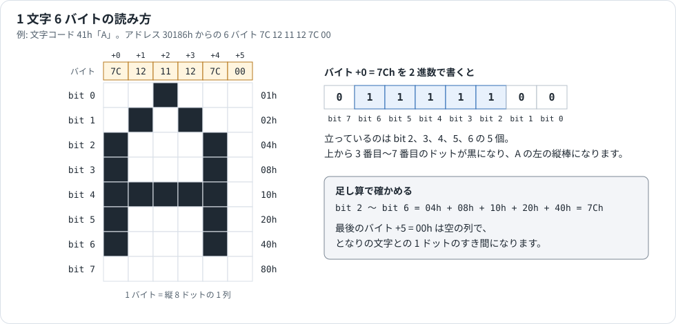
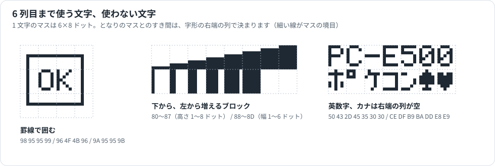
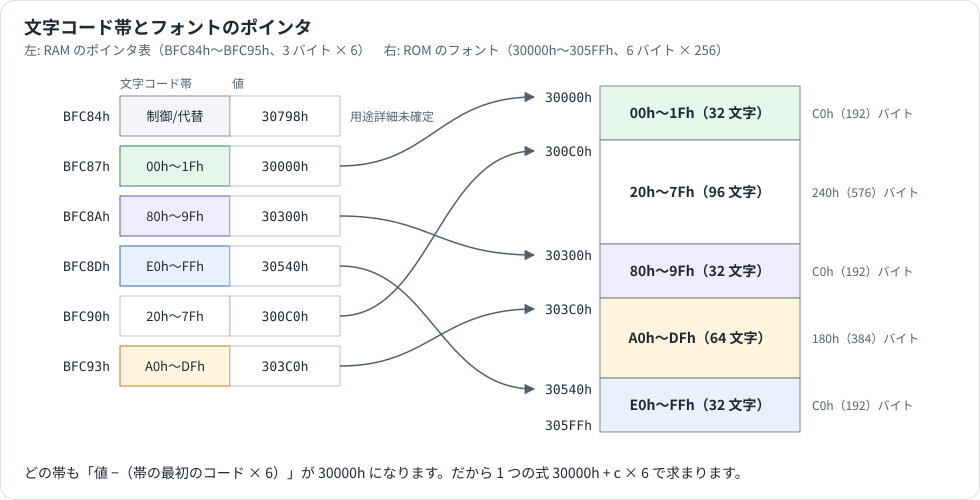
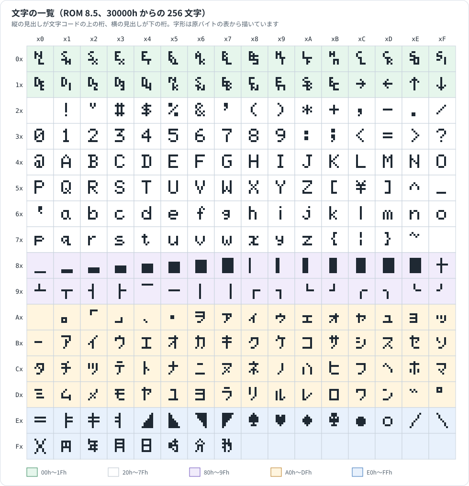

# 13. フォント

この章は、画面の文字の絵が ROM のどこに、どんな形で入っているかを説明します。自分の絵文字を出したい、別の画面に同じ字形で文字を描きたい、といったときに使います。PC-E500 シリーズの画面に出る文字は、1 文字が横 6 × 縦 8 の点（ドット）の絵です。この章では、その絵が ROM のどこに、どんな並びのバイトで入っているかを説明し、全 256 文字の原バイトを載せます。

[目次へ戻る](README.md)

## この章で分かること

- 1 文字を表す 6 バイトと、画面のドットの対応
- 文字コードから、その字形のアドレスを計算する式
- ROM が文字コード帯ごとに使い分ける 6 個のポインタ
- 全 256 文字の字形の一覧と、原バイト
- BASIC から字形を読む方法と、自分で描いた字形を表示する方法

## 13.1 字形の形式

### 13.1.1 フォントとは

**フォント**（キャラクタフォント）は、文字コードと字形の対応表です。液晶は「ここに A を出す」という命令を知りません。知っているのは「この 8 ドットをこう点ける」という命令だけです（[液晶（LCD）](04_LCD.md) §4.5）。そこで ROM は、文字コードごとに点の並びを用意しておき、表示のたびにコピーします。


通常表示で使う 6x8 ドットの字形は `30000h-305FFh` にあります（ROM 8.5）。大きさは 256 文字 x 6 bytes = 1536 バイト（600h）です。

**英語の機種**（PC-E500 の 5.3、6.3、7.3 と PC-E500S の 8.3）は、5Ch と 7Fh〜FEh の字形が違います。`\`、アクセント付きの文字、罫線、ギリシャ文字などです。PC-E500S は 8.5 と同じ `30000h` から、5.3、6.3、7.3 は `F2155h` からで、この 4 本の字形は全バイト同じです（[ROM バージョンの違い: システム](26_ROM_VERSIONS_SYSTEM.md) §26.3.1、[機種ガイド](29_MODELS.md#294-pc-e500s)）。この章の表と図は、国内の ROM 8.5 のものです。

### 13.1.2 6 バイトと 6×8 ドット

1 文字の各 byte が縦 8 ドットの 1 列で、bit 0 が上側です。6 バイトは左の列から順に並びます。



この並びは液晶の表示 RAM の 1 バイト（上から下へビット 0 → ビット 7）と同じです。ROM は字形のバイトをそのまま表示 RAM に書けます。

同じ 6 バイトを、今度は横の 1 行ずつ読むと次のようになります。`#` が点灯、`.` が消灯です。

```text
         +0 +1 +2 +3 +4 +5
         7C 12 11 12 7C 00
bit 0     .  .  #  .  .  .
bit 1     .  #  .  #  .  .
bit 2     #  .  .  .  #  .
bit 3     #  .  .  .  #  .
bit 4     #  #  #  #  #  .
bit 5     #  .  .  .  #  .
bit 6     #  .  .  .  #  .
bit 7     .  .  .  .  .  .
```

### 13.1.3 すき間は字形が作る

画面の文字のマスは 6×8 ドットで、マスの間に余分なドットはありません。240×32 ドットの画面に 40 桁 × 4 行がちょうど入ります（240 ÷ 6 = 40、32 ÷ 8 = 4）。文字どうしのすき間は、字形の右端の列（`+5`）を `00` にして作ります。



`80h` 台、`90h` 台の罫線やブロックは 6 列すべてを使うので、並べるとつながります。棒グラフ、枠、進み具合の表示に使えます。

## 13.2 アドレスの求め方

文字コード `c` の先頭は `30000h + c * 6` です。

| 文字 | 文字コード | 計算 | アドレス | 6 バイト |
|---|---|---|---|---|
| `A` | 41h（65） | 30000h + 65 × 6 = 30000h + 390 | `30186h` | 7c 12 11 12 7c 00 |
| `0` | 30h（48） | 30000h + 48 × 6 = 30000h + 288 | `30120h` | 3e 51 49 45 3e 00 |
| `ア` | B1h（177） | 30000h + 177 × 6 = 30000h + 1062 | `30426h` | 01 41 3d 09 07 00 |
| `♥` | E9h（233） | 30000h + 233 × 6 = 30000h + 1398 | `30576h` | 1e 3e 7c 3e 1e 00 |

式が使えるのは ROM 8.5 のアドレス（フォントの先頭が 30000h）のときです。ほかのバージョンは先頭のアドレスが違うので、次の節のポインタから求めます。先頭のアドレスは [ROM バージョンの違い: システム](26_ROM_VERSIONS_SYSTEM.md) にあります。

## 13.3 文字コード帯とポインタ

リセット中の `F2528h` が 6 個のポインタを `BFC84h-BFC95h` へ設定し、`F2445h` が文字コード帯ごとに選びます。ポインタは 1 個が 3 バイト（20 bit のアドレス、下位が先）なので、3 × 6 = 18 バイトです。実行時に得た値は次のとおりです。

| 文字コード帯 | RAM pointer | 値 | 実効base |
|---|---|---|---|
| （挿入カーソル） | BFC84h | 30798h | 文字の帯ではない |
| 00h-1Fh | BFC87h | 30000h | 30000h |
| 80h-9Fh | BFC8Ah | 30300h | 30000h |
| E0h-FFh | BFC8Dh | 30540h | 30000h |
| 20h-7Fh | BFC90h | 300C0h | 30000h |
| A0h-DFh | BFC93h | 303C0h | 30000h |

`BFC84h` は文字の帯ではなく、**挿入カーソルの形**を指します。カーソルを描く処理（7.2 の `F2CDFh`）は、形の番号（0〜4）が 4 のときだけ `BFC84h` のアドレスを使い、ほかの形では固定のアドレスを使います（コード）。挿入カーソルの 6 バイトは `08 1C 3E 7F 00 00` で、左を向いた三角です（ROM 7.2 の `F293Dh`）。

公式の資料（p.42）は帯を A0h〜CFh、E0h〜F0h と印刷していますが、ROM は 80h、A0h、E0h の 3 か所で分けているので、この表の A0h〜DFh、E0h〜FFh が正しい範囲です（コード、7.2 の `F2B80h` 付近と 8.5 の `F2445h`）。

「実効base」は、値から「帯の最初の文字コード × 6」を引いたものです。どの帯も同じ 30000h になるので、フォント全体が 1 続きの表だと分かります。



**例: `ア`（B1h）をポインタから求める。** B1h は A0h〜DFh の帯なので `BFC93h` を使います。

```text
アドレス = [BFC93h] + (B1h - A0h) × 6
     = 303C0h + 11h × 6
     = 303C0h + 66h
     = 30426h                    13.2 の表と同じ
```

ポインタを使う方法なら、フォントの先頭のアドレスが違うバージョンでも同じ手順で求められます。ポインタ表の並びは全バージョンで同じ構成です（[ROM バージョンの違い: システム](26_ROM_VERSIONS_SYSTEM.md)）。公式資料のアドレスと ROM 3.2 での値は [メモリ](03_MEMORY.md) §3.8 にあります。

> [!NOTE]
> ポインタは RAM にあります。欧州版は 80h 以上の文字に 2 組の文字セットを持ち、これらのアドレスの値で切り替えます（手引書、[メモリ](03_MEMORY.md) §3.8）。

## 13.4 文字の一覧

13.5 の原バイトから描いた、全 256 文字の字形です。横の 1 行が 16 文字（60h バイト）に当たります。



| 範囲 | 内容 |
|---|---|
| 00h〜1Bh | 制御コードの名前（`NUL`、`SOH` など）を小さく書いた字形 |
| 1Ch〜1Fh | 矢印 → ← ↑ ↓ |
| 20h〜7Fh | 英数字と記号。5Ch は `¥`。7Fh は空 |
| 80h〜8Eh | ブロック。80h〜87h は下から、88h〜8Dh は左から増える。8Dh と 8Eh は同じバイト |
| 8Fh〜9Fh | 罫線 |
| A0h〜DFh | 半角カナと記号。A0h は空 |
| E0h〜E7h | 二重の罫線、三角 |
| E8h〜EBh | トランプの ♠ ♥ ♦ ♣ |
| ECh〜F0h | ● ○ 斜線 × |
| F1h〜F7h | 円 年 月 日 時 分 秒 |
| F8h〜FFh | 空（全バイト 00h） |

## 13.5 全256字の原バイト

表の読み方です。

- **code**: 文字コード
- **address**: 6 バイトの先頭のアドレス（= 30000h + code × 6）
- **6 bytes**: 左の列から順に 6 バイト（16 進）
- **字形**: 字形を見分けるための名前。13.4 の一覧の見た目を文字で書いたもので、ROM にこの名前が入っているわけではありません

| code | address | 6 bytes | 字形 |
|---|---|---|---|
| 00h | `30000h` | 0f 02 74 4f 40 00 | NUL |
| 01h | `30006h` | 12 15 79 20 70 00 | SOH |
| 02h | `3000Ch` | 12 15 59 20 50 00 | STX |
| 03h | `30012h` | 1f 15 51 20 50 00 | ETX |
| 04h | `30018h` | 1f 15 11 70 10 00 | EOT |
| 05h | `3001Eh` | 1f 35 48 70 40 00 | ENQ |
| 06h | `30024h` | 0e 05 7e 20 50 00 | ACK |
| 07h | `3002Ah` | 1f 15 7a 40 40 00 | BEL |
| 08h | `30030h` | 1f 15 5e 54 74 00 | BS |
| 09h | `30036h` | 0f 02 0f 78 08 00 | HT |
| 0Ah | `3003Ch` | 0f 08 78 28 08 00 | LF |
| 0Bh | `30042h` | 07 02 77 10 70 00 | VT |
| 0Ch | `30048h` | 06 09 79 40 40 00 | FF |
| 0Dh | `3004Eh` | 06 09 79 28 50 00 | CR |
| 0Eh | `30054h` | 16 15 7d 48 78 00 | SO |
| 0Fh | `3005Ah` | 16 15 0d 00 78 00 | SI |
| 10h | `30060h` | 1f 11 0e 7c 54 00 | DLE |
| 11h | `30066h` | 1f 11 0e 00 78 00 | DC1 |
| 12h | `3006Ch` | 1f 11 0e 68 58 00 | DC2 |
| 13h | `30072h` | 1f 11 0e 54 7c 00 | DC3 |
| 14h | `30078h` | 1f 11 3e 20 78 00 | DC4 |
| 15h | `3007Eh` | 07 01 7a 27 50 00 | NAK |
| 16h | `30084h` | 12 75 29 40 70 00 | SYN |
| 17h | `3008Ah` | 1f 15 7c 54 28 00 | ETB |
| 18h | `30090h` | 0f 79 29 40 70 00 | CAN |
| 19h | `30096h` | 1f 75 15 10 70 00 | EM |
| 1Ah | `3009Ch` | 12 15 7d 54 28 00 | SUB |
| 1Bh | `300A2h` | 1f 15 78 48 48 00 | ESC |
| 1Ch | `300A8h` | 08 08 2a 1c 08 00 | → |
| 1Dh | `300AEh` | 08 1c 2a 08 08 00 | ← |
| 1Eh | `300B4h` | 04 02 7f 02 04 00 | ↑ |
| 1Fh | `300BAh` | 10 20 7f 20 10 00 | ↓ |
| 20h | `300C0h` | 00 00 00 00 00 00 | 空 |
| 21h | `300C6h` | 00 00 5f 00 00 00 | ! |
| 22h | `300CCh` | 00 03 04 03 00 00 | " |
| 23h | `300D2h` | 22 7f 22 7f 22 00 | # |
| 24h | `300D8h` | 24 2a 7f 2a 12 00 | $ |
| 25h | `300DEh` | 23 13 08 64 62 00 | % |
| 26h | `300E4h` | 36 49 55 22 50 00 | &amp; |
| 27h | `300EAh` | 00 0b 07 00 00 00 | ' |
| 28h | `300F0h` | 00 1c 22 41 00 00 | ( |
| 29h | `300F6h` | 00 41 22 1c 00 00 | ) |
| 2Ah | `300FCh` | 14 08 3e 08 14 00 | \* |
| 2Bh | `30102h` | 08 08 3e 08 08 00 | + |
| 2Ch | `30108h` | 00 58 38 00 00 00 | , |
| 2Dh | `3010Eh` | 08 08 08 08 08 00 | - |
| 2Eh | `30114h` | 00 60 60 00 00 00 | . |
| 2Fh | `3011Ah` | 20 10 08 04 02 00 | / |
| 30h | `30120h` | 3e 51 49 45 3e 00 | 0 |
| 31h | `30126h` | 00 42 7f 40 00 00 | 1 |
| 32h | `3012Ch` | 42 61 51 49 46 00 | 2 |
| 33h | `30132h` | 41 49 4d 4b 31 00 | 3 |
| 34h | `30138h` | 18 14 12 7f 10 00 | 4 |
| 35h | `3013Eh` | 27 45 45 45 39 00 | 5 |
| 36h | `30144h` | 3c 4a 49 49 30 00 | 6 |
| 37h | `3014Ah` | 01 01 79 05 03 00 | 7 |
| 38h | `30150h` | 36 49 49 49 36 00 | 8 |
| 39h | `30156h` | 06 49 49 29 1e 00 | 9 |
| 3Ah | `3015Ch` | 00 36 36 00 00 00 | : |
| 3Bh | `30162h` | 00 5b 3b 00 00 00 | ; |
| 3Ch | `30168h` | 08 14 22 41 00 00 | &lt; |
| 3Dh | `3016Eh` | 14 14 14 14 14 00 | = |
| 3Eh | `30174h` | 00 41 22 14 08 00 | &gt; |
| 3Fh | `3017Ah` | 02 01 51 09 06 00 | ? |
| 40h | `30180h` | 32 49 79 41 3e 00 | @ |
| 41h | `30186h` | 7c 12 11 12 7c 00 | A |
| 42h | `3018Ch` | 41 7f 49 49 36 00 | B |
| 43h | `30192h` | 3e 41 41 41 22 00 | C |
| 44h | `30198h` | 41 7f 41 41 3e 00 | D |
| 45h | `3019Eh` | 7f 49 49 49 41 00 | E |
| 46h | `301A4h` | 7f 09 09 09 01 00 | F |
| 47h | `301AAh` | 3e 41 41 49 39 00 | G |
| 48h | `301B0h` | 7f 08 08 08 7f 00 | H |
| 49h | `301B6h` | 00 41 7f 41 00 00 | I |
| 4Ah | `301BCh` | 20 40 41 3f 01 00 | J |
| 4Bh | `301C2h` | 7f 08 14 22 41 00 | K |
| 4Ch | `301C8h` | 7f 40 40 40 40 00 | L |
| 4Dh | `301CEh` | 7f 02 0c 02 7f 00 | M |
| 4Eh | `301D4h` | 7f 04 08 10 7f 00 | N |
| 4Fh | `301DAh` | 3e 41 41 41 3e 00 | O |
| 50h | `301E0h` | 7f 09 09 09 06 00 | P |
| 51h | `301E6h` | 3e 41 51 21 5e 00 | Q |
| 52h | `301ECh` | 7f 09 19 29 46 00 | R |
| 53h | `301F2h` | 26 49 49 49 32 00 | S |
| 54h | `301F8h` | 01 01 7f 01 01 00 | T |
| 55h | `301FEh` | 3f 40 40 40 3f 00 | U |
| 56h | `30204h` | 07 18 60 18 07 00 | V |
| 57h | `3020Ah` | 7f 20 18 20 7f 00 | W |
| 58h | `30210h` | 63 14 08 14 63 00 | X |
| 59h | `30216h` | 03 04 78 04 03 00 | Y |
| 5Ah | `3021Ch` | 61 51 49 45 43 00 | Z |
| 5Bh | `30222h` | 00 7f 41 41 00 00 | \[ |
| 5Ch | `30228h` | 15 16 7c 16 15 00 | ¥ |
| 5Dh | `3022Eh` | 00 41 41 7f 00 00 | \] |
| 5Eh | `30234h` | 18 04 02 04 18 00 | ^ |
| 5Fh | `3023Ah` | 40 40 40 40 40 00 | \_ |
| 60h | `30240h` | 00 00 07 0b 00 00 | &#96; |
| 61h | `30246h` | 38 44 44 3c 40 00 | a |
| 62h | `3024Ch` | 7f 48 44 44 38 00 | b |
| 63h | `30252h` | 38 44 44 44 20 00 | c |
| 64h | `30258h` | 38 44 44 48 7f 00 | d |
| 65h | `3025Eh` | 38 54 54 54 18 00 | e |
| 66h | `30264h` | 00 08 7e 09 02 00 | f |
| 67h | `3026Ah` | 08 54 54 3c 00 00 | g |
| 68h | `30270h` | 7f 04 04 78 00 00 | h |
| 69h | `30276h` | 00 00 7d 00 00 00 | i |
| 6Ah | `3027Ch` | 20 40 44 3d 00 00 | j |
| 6Bh | `30282h` | 7f 10 28 44 00 00 | k |
| 6Ch | `30288h` | 00 00 7f 00 00 00 | l |
| 6Dh | `3028Eh` | 78 04 78 04 78 00 | m |
| 6Eh | `30294h` | 7c 08 04 04 78 00 | n |
| 6Fh | `3029Ah` | 38 44 44 44 38 00 | o |
| 70h | `302A0h` | 7c 14 14 14 08 00 | p |
| 71h | `302A6h` | 18 24 14 7c 40 00 | q |
| 72h | `302ACh` | 7c 08 04 04 00 00 | r |
| 73h | `302B2h` | 48 54 54 54 20 00 | s |
| 74h | `302B8h` | 04 3e 44 20 00 00 | t |
| 75h | `302BEh` | 3c 40 40 20 7c 00 | u |
| 76h | `302C4h` | 1c 20 40 20 1c 00 | v |
| 77h | `302CAh` | 3c 40 30 40 3c 00 | w |
| 78h | `302D0h` | 44 24 7c 48 44 00 | x |
| 79h | `302D6h` | 0c 50 50 3c 00 00 | y |
| 7Ah | `302DCh` | 44 64 54 4c 44 00 | z |
| 7Bh | `302E2h` | 00 08 77 41 00 00 | { |
| 7Ch | `302E8h` | 00 00 77 00 00 00 | &#124; |
| 7Dh | `302EEh` | 00 41 77 08 00 00 | } |
| 7Eh | `302F4h` | 02 01 02 04 02 00 | \~ |
| 7Fh | `302FAh` | 00 00 00 00 00 00 | 空 |
| 80h | `30300h` | 80 80 80 80 80 80 | 下から 1 ドット |
| 81h | `30306h` | c0 c0 c0 c0 c0 c0 | 下から 2 ドット |
| 82h | `3030Ch` | e0 e0 e0 e0 e0 e0 | 下から 3 ドット |
| 83h | `30312h` | f0 f0 f0 f0 f0 f0 | 下から 4 ドット |
| 84h | `30318h` | f8 f8 f8 f8 f8 f8 | 下から 5 ドット |
| 85h | `3031Eh` | fc fc fc fc fc fc | 下から 6 ドット |
| 86h | `30324h` | fe fe fe fe fe fe | 下から 7 ドット |
| 87h | `3032Ah` | ff ff ff ff ff ff | 全部（8 ドット） |
| 88h | `30330h` | ff 00 00 00 00 00 | 左から 1 ドット |
| 89h | `30336h` | ff ff 00 00 00 00 | 左から 2 ドット |
| 8Ah | `3033Ch` | ff ff ff 00 00 00 | 左から 3 ドット |
| 8Bh | `30342h` | ff ff ff ff 00 00 | 左から 4 ドット |
| 8Ch | `30348h` | ff ff ff ff ff 00 | 左から 5 ドット |
| 8Dh | `3034Eh` | ff ff ff ff ff ff | 全部（6 ドット） |
| 8Eh | `30354h` | ff ff ff ff ff ff | 全部 |
| 8Fh | `3035Ah` | 08 08 ff 08 08 08 | 十字の罫線 |
| 90h | `30360h` | 08 08 0f 08 08 08 | 罫線 ┴ |
| 91h | `30366h` | 08 08 f8 08 08 08 | 罫線 ┬ |
| 92h | `3036Ch` | 08 08 ff 00 00 00 | 罫線 ┤ |
| 93h | `30372h` | 00 00 ff 08 08 08 | 罫線 ├ |
| 94h | `30378h` | 01 01 01 01 01 01 | 上端の横線 |
| 95h | `3037Eh` | 08 08 08 08 08 08 | 横線 |
| 96h | `30384h` | 00 00 ff 00 00 00 | 縦線 |
| 97h | `3038Ah` | 00 00 00 00 ff 00 | 右寄りの縦線 |
| 98h | `30390h` | 00 00 f8 08 08 08 | 罫線 ┌ |
| 99h | `30396h` | 08 08 f8 00 00 00 | 罫線 ┐ |
| 9Ah | `3039Ch` | 00 00 0f 08 08 08 | 罫線 └ |
| 9Bh | `303A2h` | 08 08 0f 00 00 00 | 罫線 ┘ |
| 9Ch | `303A8h` | 00 00 f0 08 08 08 | 角の丸い ┌ |
| 9Dh | `303AEh` | 08 08 f0 00 00 00 | 角の丸い ┐ |
| 9Eh | `303B4h` | 00 00 07 08 08 08 | 角の丸い └ |
| 9Fh | `303BAh` | 08 08 07 00 00 00 | 角の丸い ┘ |
| A0h | `303C0h` | 00 00 00 00 00 00 | 空 |
| A1h | `303C6h` | 70 50 70 00 00 00 | 。 |
| A2h | `303CCh` | 00 07 01 01 01 00 | 「 |
| A3h | `303D2h` | 40 40 40 70 00 00 | 」 |
| A4h | `303D8h` | 00 20 40 00 00 00 | 、 |
| A5h | `303DEh` | 00 18 18 00 00 00 | ・ |
| A6h | `303E4h` | 0a 4a 4a 2a 1e 00 | ヲ |
| A7h | `303EAh` | 04 44 3c 14 0c 00 | ァ |
| A8h | `303F0h` | 20 10 78 04 00 00 | ィ |
| A9h | `303F6h` | 18 08 4c 28 18 00 | ゥ |
| AAh | `303FCh` | 48 48 78 48 48 00 | ェ |
| ABh | `30402h` | 48 28 18 7c 08 00 | ォ |
| ACh | `30408h` | 08 7c 08 28 18 00 | ャ |
| ADh | `3040Eh` | 40 48 48 78 40 00 | ュ |
| AEh | `30414h` | 54 54 54 7c 00 00 | ョ |
| AFh | `3041Ah` | 18 00 58 40 38 00 | ッ |
| B0h | `30420h` | 08 08 08 08 00 00 | ー |
| B1h | `30426h` | 01 41 3d 09 07 00 | ア |
| B2h | `3042Ch` | 10 08 7c 02 01 00 | イ |
| B3h | `30432h` | 06 02 43 22 1e 00 | ウ |
| B4h | `30438h` | 42 42 7e 42 42 00 | エ |
| B5h | `3043Eh` | 22 12 0a 7f 02 00 | オ |
| B6h | `30444h` | 42 3f 02 42 3e 00 | カ |
| B7h | `3044Ah` | 0a 0a 7f 0a 0a 00 | キ |
| B8h | `30450h` | 08 46 42 22 1e 00 | ク |
| B9h | `30456h` | 04 03 42 3e 02 00 | ケ |
| BAh | `3045Ch` | 42 42 42 42 7e 00 | コ |
| BBh | `30462h` | 02 4f 22 1f 02 00 | サ |
| BCh | `30468h` | 4a 4a 40 20 1c 00 | シ |
| BDh | `3046Eh` | 42 22 12 2a 46 00 | ス |
| BEh | `30474h` | 02 3f 42 4a 46 00 | セ |
| BFh | `3047Ah` | 06 48 40 20 1e 00 | ソ |
| C0h | `30480h` | 08 46 4a 32 1e 00 | タ |
| C1h | `30486h` | 0a 4a 3e 09 08 00 | チ |
| C2h | `3048Ch` | 0e 00 4e 20 1e 00 | ツ |
| C3h | `30492h` | 04 45 3d 05 04 00 | テ |
| C4h | `30498h` | 00 7f 08 10 00 00 | ト |
| C5h | `3049Eh` | 44 24 1f 04 04 00 | ナ |
| C6h | `304A4h` | 40 42 42 42 40 00 | ニ |
| C7h | `304AAh` | 42 2a 12 2a 06 00 | ヌ |
| C8h | `304B0h` | 22 12 7b 16 22 00 | ネ |
| C9h | `304B6h` | 00 40 20 1e 00 00 | ノ |
| CAh | `304BCh` | 78 00 02 04 78 00 | ハ |
| CBh | `304C2h` | 3f 44 44 44 44 00 | ヒ |
| CCh | `304C8h` | 02 42 42 22 1e 00 | フ |
| CDh | `304CEh` | 04 02 04 08 30 00 | ヘ |
| CEh | `304D4h` | 32 02 7f 02 32 00 | ホ |
| CFh | `304DAh` | 02 12 22 52 0e 00 | マ |
| D0h | `304E0h` | 02 2a 2a 2a 20 00 | ミ |
| D1h | `304E6h` | 38 24 22 20 70 00 | ム |
| D2h | `304ECh` | 40 28 10 28 06 00 | メ |
| D3h | `304F2h` | 0a 3e 4a 4a 4a 00 | モ |
| D4h | `304F8h` | 02 7f 02 0a 06 00 | ヤ |
| D5h | `304FEh` | 40 42 42 7e 40 00 | ユ |
| D6h | `30504h` | 4a 4a 4a 4a 7e 00 | ヨ |
| D7h | `3050Ah` | 04 05 45 25 1c 00 | ラ |
| D8h | `30510h` | 0f 40 20 1f 00 00 | リ |
| D9h | `30516h` | 7c 00 7e 40 20 00 | ル |
| DAh | `3051Ch` | 7e 40 20 10 08 00 | レ |
| DBh | `30522h` | 7e 42 42 42 7e 00 | ロ |
| DCh | `30528h` | 06 02 42 22 1e 00 | ワ |
| DDh | `3052Eh` | 42 42 40 20 18 00 | ン |
| DEh | `30534h` | 02 04 02 04 00 00 | ゛ |
| DFh | `3053Ah` | 07 05 07 00 00 00 | ゜ |
| E0h | `30540h` | 14 14 14 14 14 14 | 二重の横線 |
| E1h | `30546h` | 00 00 ff 14 14 14 | 二重の ├ |
| E2h | `3054Ch` | 14 14 ff 14 14 14 | 二重の十字 |
| E3h | `30552h` | 14 14 ff 00 00 00 | 二重の ┤ |
| E4h | `30558h` | 80 e0 f0 f8 fe ff | 三角（右下が黒） |
| E5h | `3055Eh` | ff fe f8 f0 e0 80 | 三角（左下が黒） |
| E6h | `30564h` | 01 07 0f 1f 7f ff | 三角（右上が黒） |
| E7h | `3056Ah` | ff 7f 1f 0f 07 01 | 三角（左上が黒） |
| E8h | `30570h` | 1c 5e 7f 5e 1c 00 | ♠ |
| E9h | `30576h` | 1e 3e 7c 3e 1e 00 | ♥ |
| EAh | `3057Ch` | 18 3c 7e 3c 18 00 | ♦ |
| EBh | `30582h` | 1c 5b 7f 5b 1c 00 | ♣ |
| ECh | `30588h` | 38 7c 7c 7c 38 00 | ● |
| EDh | `3058Eh` | 38 44 44 44 38 00 | ○ |
| EEh | `30594h` | 80 60 10 08 06 01 | 斜線 ／ |
| EFh | `3059Ah` | 01 06 08 10 60 80 | 斜線 ＼ |
| F0h | `305A0h` | 81 66 18 18 66 81 | × |
| F1h | `305A6h` | 7e 12 1e 12 7e 00 | 円 |
| F2h | `305ACh` | 27 3a 2a 7e 2a 00 | 年 |
| F3h | `305B2h` | 7f 15 15 15 7f 00 | 月 |
| F4h | `305B8h` | 7f 49 49 49 7f 00 | 日 |
| F5h | `305BEh` | 1c 1c 2a 4f 7a 00 | 時 |
| F6h | `305C4h` | 44 3a 09 7a 04 00 | 分 |
| F7h | `305CAh` | 15 7f 04 4f 3c 00 | 秒 |
| F8h | `305D0h` | 00 00 00 00 00 00 | 空 |
| F9h | `305D6h` | 00 00 00 00 00 00 | 空 |
| FAh | `305DCh` | 00 00 00 00 00 00 | 空 |
| FBh | `305E2h` | 00 00 00 00 00 00 | 空 |
| FCh | `305E8h` | 00 00 00 00 00 00 | 空 |
| FDh | `305EEh` | 00 00 00 00 00 00 | 空 |
| FEh | `305F4h` | 00 00 00 00 00 00 | 空 |
| FFh | `305FAh` | 00 00 00 00 00 00 | 空 |

## 13.6 もう 1 つのドット群

`DFD00h-DFFFFh` にも 6 バイト単位の別ドット群があります。大きさは 300h バイトで、6 バイトずつなら 128 文字分です。通常文字ルーチンのポインタ先ではありません。これは **80h〜FFh の第 2 組の文字セット**で、`G:` の技術計算のソフトが使うときだけ、3 つのポインタをここへ向けます。

根拠は `G:` の中の BASIC プログラムです（ROM、`C19BCh`〜`C1AACh`）。元の値を `BFC8Ah`、`BFC93h`、`BFC8Dh` から読んで変数に取っておき、`POKE &BFC8A,&0,&FD,&D` のように第 2 組のアドレスを書き、終わりに元の値を書き戻す副プログラムが入っています。ROM 2.2、5.3、7.2、8.5 で同じでした。`DFD00h` からの 300h バイトは、PC-E500、PC-E500S、PC-E500PJ、PC-E550、PC-E650 の 10 本の ROM で全バイト同じです（PC-1480U、PC-1490UII、PC-U6000 は違う内容です）。

中身は、80h（`DFD00h`）が空で、81h から Α、Β、Γ、Δ、Ε、Ζ、Η のギリシャ文字が続きます。81h の Α は `7C 12 11 12 7C 00` で、ふつうの `A` と同じ形、83h の Γ は `01 7F 01 01 03 00` です（ROM 7.2）。

アドレスの分け方は、手引書が 80h 以上の第 2 組の文字セットのアドレスとして `DFD00h`（80h〜）、`DFDC0h`（A0h〜）、`DFF40h`（E0h〜）を挙げているものと同じです（[メモリ](03_MEMORY.md) §3.8）。この 3 つのアドレスの間隔を文字数に直すと、次のように 80h〜FFh の 128 文字がちょうど入ります。

| 帯 | アドレス | 大きさ | 文字数 |
|---|---|---|---|
| 80h〜9Fh | `DFD00h`〜`DFDBFh` | C0h バイト | 32 |
| A0h〜DFh | `DFDC0h`〜`DFF3Fh` | 180h バイト | 64 |
| E0h〜FFh | `DFF40h`〜`DFFFFh` | C0h バイト | 32 |

## 13.7 BASIC から使う

### 13.7.1 字形を読む

ポインタからアドレスを求めて 6 バイトを表示します。20h〜7Fh の文字（ここでは `A`）の例です。

```basic
10 P=PEEK &HBFC90+256*PEEK &HBFC91+65536*PEEK &HBFC92
20 C=ASC "A"
30 FOR I=0 TO 5
40 PRINT HEX$ (PEEK (P+(C-32)*6+I))
50 NEXT I
60 END
```

10 行で `BFC90h` の 3 バイトを下位から順に足し合わせます。ROM 8.5 なら P は 300C0h、読むアドレスは 300C0h + (65 − 32) × 6 = 30186h で、`7C`、`12`、`11`、`12`、`7C`、`0` の 6 個になります。

### 13.7.2 自分の字形を表示する

`GPRINT` は 1 列（縦 8 ドット）を 16 進 2 桁で並べて表示する命令です。下位ビットが上のドットで、フォントのバイトと同じ向きです（[BASIC の命令と関数](14_BASIC_REFERENCE.md) の `GPRINT`）。13.5 の表の 6 バイトを続けて書けば、その字形がそのまま出ます。

```basic
10 CLS
20 GCURSOR (0,15)
30 GPRINT "7C1211127C001E3E7C3E1E00"
40 IF INKEY$="" THEN 40
50 END
```

30 行の前半 12 桁は `A`（41h）、後半 12 桁は ♥（E9h）のバイトです。数字を変えれば、フォントにない字形も描けます。

### 13.7.3 第 2 組の文字を出す

3 つのポインタを書き換えると、80h 以上の文字だけが第 2 組になります。使い終わったら元へ戻します。次は機種を選ばないように、元の値を保存してから書き換える例です。

```basic
10 DIM A(8)
20 FOR I=0 TO 2
30 A(I)=PEEK (&HBFC8A+I):A(I+3)=PEEK (&HBFC93+I):A(I+6)=PEEK (&HBFC8D+I)
40 NEXT I
50 POKE &HBFC8A,0,&HFD,&HD:POKE &HBFC93,&HC0,&HFD,&HD:POKE &HBFC8D,&H40,&HFF,&HD
60 PRINT CHR$ 129;CHR$ 130;CHR$ 131
70 POKE &HBFC8A,A(0),A(1),A(2):POKE &HBFC93,A(3),A(4),A(5):POKE &HBFC8D,A(6),A(7),A(8)
80 END
```

ROM 7.2 で実行すると、次のように出て、ポインタは元の値に戻りました（実験）。

```text
ΑΒΓ
```

## まとめ

| 項目 | 値 |
|---|---|
| 1 文字 | 6 バイト。1 バイトが縦 8 ドットの 1 列、左の列から順 |
| ビットの向き | bit 0 が上、bit 7 が下。1 = 点灯 |
| フォントの場所（ROM 8.5） | `30000h-305FFh`、256 文字 |
| アドレスの式（ROM 8.5） | `30000h + c * 6` |
| ポインタ表 | `BFC84h-BFC95h`、3 バイト × 6 |
| 設定する処理、選ぶ処理 | `F2528h`（リセット中）、`F2445h` |
| 第 2 組の文字（80h〜FFh） | `DFD00h-DFFFFh`。`G:` の技術計算のソフトが使う |
| 挿入カーソルの形 | `BFC84h` の指す 6 バイト |

## 次に読むもの

- [液晶（LCD）](04_LCD.md): 表示 RAM の並びと、ドットを直接書く方法
- [メモリ](03_MEMORY.md): ポインタが入っているシステムアドレス
- [ROM バージョンの違い: システム](26_ROM_VERSIONS_SYSTEM.md): バージョンごとのフォントの先頭と字形の違い
- [CE-126P プリンタ](18_CE-126P_PRINTER.md): プリンタ側の文字との対応
