# 14. BASIC の命令と関数

この章は PC-E500 の BASIC の命令と関数をすべて引ける辞書です。プログラムを書いていて「この命令の引数は何だったか」「この書き方は通るのか」と思ったときに開きます。命令の意味と範囲は操作説明書（英語版の PC-E500 と、ドイツ語版の PC-E500S）を 1 ページずつ読んでまとめ、はっきりしない所は本物の ROM をエミュレータで動かして確かめました。辞書の部分のほかに、PC-E500 ROM 8.5 の BASIC キーワード辞書と処理表から復元した 168 キーワードの索引（中間コードと処理エントリ）もあります。

短い例を 1 つ挙げます。次の 4 行を打って `RUN` すると、

```basic
10 CLS
20 FOR I=1 TO 3
30 PRINT I;I^2;SQR I
40 NEXT I
```

画面はこうなります（実験。ROM 7.2）。

```text
 1  1  1
 2  4  1.414213562
 3  9  1.732050808
```

`CLS`、`FOR`、`PRINT`、`SQR`、`NEXT` の 1 つずつが、この章の項目です。

[目次へ戻る](README.md)

## この章で分かること

- PC-E500 BASIC の基本（モード、行番号、文、変数と型、式と優先順位、省略形）
- やりたいことから命令を探す索引
- 分岐、繰り返し、サブルーチン、エラー処理の流れ（図）
- 全命令の書式、引数、使用区分、省略形、例と実際の表示、注意
- 数値関数の一覧と計算例
- 中間コードと ROM の処理エントリの表（168 キーワード）

## 14.1 使い方

この章は初めて読む人のための前半（14.2〜14.4）と、引いて使う後半（14.5 から）でできています。

| したいこと | 読む場所 |
|---|---|
| BASIC の決まりを知る | [14.2 PC-E500 BASIC の基本](#142-pc-e500-basic-の基本) |
| やりたいことから命令を探す | [14.3 命令の索引](#143-命令の索引) |
| 分岐や繰り返しの動きを図で見る | [14.4 命令詳細: 制御構文](#144-命令詳細-制御構文) |
| 命令の意味や書き方を引く | [14.5 命令の使い方（アルファベット順）](#145-命令の使い方アルファベット順)、[14.6 数値関数](#146-数値関数)、[14.7 改訂 8 の拡張](#147-改訂-8-の拡張構造化-basic) |
| 小さなプログラムを見る | [14.8 プログラム例](#148-プログラム例) |
| 中間コードを読む・作る | [14.9 トークン化と処理エントリ](#149-トークン化と処理エントリ)、[14.10 全キーワード](#1410-全キーワード) |

中間コードを読む・作るときは「全キーワード」表で `token` と `分類` を確認します。BASIC の保存形式や逆アセンブルでは、通常 `FEh token` がそのキーワードを表します。例: `PRINT` は `FE 60`。

実装・解析時に処理を追う場合だけ、`処理エントリ` と `表アドレス` を用います。ユーザープログラムから ROM エントリを直接呼ぶための表ではありません。

```basic
10 A=1
20 PRINT A
30 END
```

この例の `PRINT` は辞書上 token `60h` で、中間コード中では通常 `FE 60` として現れます。ただし文字列リテラル中の文字列（例: `PRINT "PRINT"`）はキーワードとしてトークン化されません。

### 書式の記号

| 記号 | 意味 | 例 |
|---|---|---|
| `[ ]` | 省略可能 | `WAIT [式]` は `WAIT` だけでもよい |
| `{A \| B}` | どちらか一方 | `GOTO {行番号 \| *ラベル}` |
| `...` | 同種の指定の繰り返し | `DATA 値, 値, ...` |
| 日本語（`式`、`行番号` など） | 実際には数値や変数名に置き換える | `BEEP 回数` は `BEEP 3` と書く |

記号そのもの（`[`、`{`、`|` など）はプログラムに書きません。`WAIT [式]` は「`WAIT` と `WAIT 59` のどちらも書ける」という意味です。

共通の引数表記は次のとおりです。

| 表記 | 意味 |
|---|---|
| `式` | 数値として評価される式。定数、変数、演算式、数値関数を書ける。 |
| `文字列` | 文字列定数（`"ABC"`）、文字列変数、文字列式。 |
| `行番号` | プログラム内に存在する行番号。 |
| `*ラベル` | 行の先頭に置いた `*` 付きラベル。行番号の代わりに指定できる。`"ラベル"` の形も使えるが、`*ラベル` の方が速い（操作説明書）。`*AB` と `"AB"` は別のラベル。 |
| `d:` | デバイス名。`X:` ポケットディスク、`E:` / `F:` RAM ディスク、`CAS:` テープ、`COM:` シリアル。 |
| `"d:ファイル名"` | デバイス名付きファイル名。`SAVE` / `LOAD` などプログラムの命令では、拡張子省略時は `.BAS`。 |

## 14.2 PC-E500 BASIC の基本

### 14.2.1 モード

PC-E500 の BASIC にはプログラムを動かすモードと書くモードがあります。

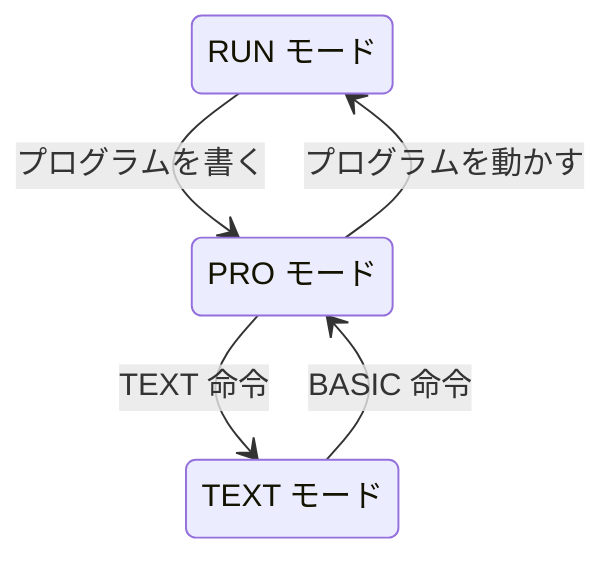

| モード | すること | このモードに関わる命令 |
|---|---|---|
| RUN | プログラムを実行する。計算や命令をその場で実行する | `RUN`。電源を入れたときの `ARUN`、`AUTOGOTO` もこのモード |
| PRO | プログラムの行を入れる、直す | `AUTO`、`LIST`、`DELETE`、`RENUM`、`NEW`、`TEXT`、`BASIC`（RUN モードでは `Mode error`） |
| TEXT | プログラムを文字のまま扱う（プロンプトが `<`） | `BASIC` で BASIC モードに戻る |

行番号を付けずに打って、その場で実行することを**直接実行**といいます。命令にはプログラムの中でだけ使うもの、直接実行でだけ使うもの、どちらでも使えるものがあります。この章の各項目の「使用区分」が操作説明書の P（プログラム）と D（直接実行）の印です。違う箇所で使うと次のエラーになります（実験。ROM 7.2）。

| 使い方 | 例 | エラー |
|---|---|---|
| 直接実行用の命令をプログラムに書く | `10 FILES "E:"`、`10 NEW`、`10 PASS "A"` | `Direct command error`（11） |
| プログラム用の命令を直接打つ | `GOSUB 10`、`INPUT A`、`END`、`RETURN`、`STOP`、`RESUME`、`ON 1 GOTO 10`、`CHAIN "E:A"` | `Direct command error` |
| RUN と PRO のモードが違う | RUN モードで `LIST`、PRO モードで `RUN` | `Mode error`（12） |

説明書では P だけの命令でも、`FOR` 〜 `NEXT`（1 行で書く）、`IF`、`DATA`、`READ`、`RESTORE`、`GCURSOR` は直接打ってもエラーになりませんでした。

### 14.2.2 行番号と文

プログラムは**行番号**の付いた行の集まりです。行番号の小さい順に実行されます。

```basic
10 CLS
20 FOR I=1 TO 5
30 PRINT "SUM";I,I*(I+1)/2
40 NEXT I
50 END
```

| 決まり | 内容 |
|---|---|
| 行番号 | 1〜65279。0 を打つと `Undefined line`、65280 以上は `Illegal line number`（実験）。`RENUM` で 65279 を超えてもエラー |
| 1 行の長さ | キーから打つときは `ENTER` を含めて 254 文字まで（操作説明書 p.187、エラー 56）。`LOAD` は 1 行が 256 バイトを超えるとエラー |
| 文の区切り | `:` で区切ると、1 行に 2 つ以上の文を書ける（`100 GOSUB 500: PRINT A`） |
| ラベル | 行の先頭に `*NAME:` か `"NAME":` と書くと、行番号の代わりに `GOTO *NAME` のように指定できる。名前は英字 1 文字とそのあと 19 文字まで（操作説明書 p.181）。行の途中のラベルは見つからず `Undefined line`（実験） |
| 大文字と小文字 | 命令、関数、変数名の小文字は大文字に直る（操作説明書 p.181、実験）。`"` の中はそのまま |
| 行を消す | 行番号だけを打って `ENTER`。同じ行番号で打ち直すと置き換わる |
| コメント | `REM` か `'` から行末まで |
| 番号なしで打った文 | その場で実行される（直接実行） |

行番号を 10 おきにしておくと、あとから間に行を足せます。足りなくなったら `RENUM` で付け直せます。

### 14.2.3 変数と型

**変数**は値を入れる名前付きのメモリ領域です。名前の最後の記号で、入れられる値の種類（型）が決まります。

| 型 | 書き方 | 入る値 | メモリの大きさ |
|---|---|---|---|
| 単精度 | `A`、`AB`（`A!` とも書ける） | 数値（10 桁、指数は -99〜99） | 7 バイト |
| 倍精度 | `A#`、`AB#` | 数値（20 桁） | 12 バイト |
| 文字列 | `A$`、`AB$` | 文字の並び（254 文字まで。手引書） | 長さの分 |

- 数値は 10 進で計算するので、`0.1` も誤差なく表せます（[BASIC の内部形式](15_BASIC_INTERNALS.md) §15.1.1）。
- 名前は 40 文字まで、先頭は英字です（操作説明書 p.169、手引書。[BASIC の内部形式](15_BASIC_INTERNALS.md) §15.2.2）。41 文字目から後は見ません。41 文字目だけが違う 2 つの名前は、同じ変数になりました（実験）。
- 名前の先頭は命令の綴りにできません。`PRINTOUT=5` は `PRINT OUT=5` と読まれます。`APRINT` のように途中にあるのはかまいません（実験）。
- `A`、`A$`、`A#`、`A( )`、`A$( )` は全部別の変数です。
- `A`〜`Z` は**固定変数**で、いつも場所が用意されています。`CLEAR` は固定変数を 0 か空文字列に戻します。
- `DEFDBL A-C` のように宣言すると、`#` を付けなくても倍精度になります。
- 同じ種類の値をたくさん扱うときは**配列**を使います。`DIM A(5)` で A(0)〜A(5) の 6 個です。

```basic
10 A=1/3
20 B#=1#/3
30 C$="PC-E500"
40 DIM D(2)
50 D(0)=10: D(1)=20: D(2)=30
60 PRINT A
70 PRINT B#
80 PRINT C$;D(1)
```

10 行は 10 桁、20 行は `1#` が倍精度の定数なので 20 桁で計算します。

### 14.2.4 数の書き方

| 書き方 | 例 | 意味 |
|---|---|---|
| 10 進 | `12`、`-1.5` | そのままの値 |
| 指数 | `1E99` | 1 × 10 の 99 乗 |
| 倍精度 | `5#`、`1.5#` | 20 桁の値 |
| 16 進 | `&H5A` | 5Ah = 90 |

この資料には `&HBFD1A` と `&BFD1A` の両方の書き方が出てきます。どちらも同じ 16 進の数です（どちらを打っても 785690 と表示されました。実験）。

倍精度の計算になるのは、11 桁以上の定数、`#` を付けた値、`D` を使った指数（`7.43D05`）、倍精度の変数が式に入ったときと、`DEFDBL` のあとです。単精度と倍精度が混じると、そこから先の計算が倍精度になります。倍精度の値を単精度の変数に入れると 10 桁に丸められます（操作説明書 p.171〜174）。

### 14.2.5 式と演算子

| 種類 | 演算子 | 例 |
|---|---|---|
| 四則 | `+` `-` `*` `/` | `I*(I+1)/2` |
| 累乗 | `^` | `2^10`（1024） |
| 累乗根 | `ROT` | `27 ROT 3`（27 の 3 乗根） |
| 文字列の連結 | `+` | `"R.100"+CHR$13` |
| 比較 | `=` `<>` `<` `>` `<=` `>=` | `A>=60`、`A$=""` |
| 論理 | `AND` `OR` `XOR` `NOT` | `ERL=30 AND ERN=53` |

- 括弧の中が先に計算されます。迷うときは括弧を付けると、読む人にも意図が伝わります。
- 関数の引数はすぐ次の値 1 つです。`PEEK &HBEC02+256*PEEK &HBEC03` は「`PEEK &HBEC02` と、256 × `PEEK &HBEC03` の和」になります。式全体を引数にするときは `SIN (A+30)` のように括弧で囲みます。
- 文字列の比較は文字コードで行います。`"A"`（41h）は `"B"`（42h）より小さくなります。
- 複数の条件は `AND` / `OR`（または `*` / `+`）でつなぎます。
- `AND` などの論理演算子は整数（-32768〜32767）のビットごとの計算です（[14.6 論理演算子](#論理演算子)）。

比較の結果は数値です。真なら -1、偽なら 0 になります。`PRINT 1=1` は -1、`PRINT 5*(2>1)` は -5 です（実験）。文字列を比べるときは先頭から 1 文字ずつ比べ、短い方の足りない所は 0 とみなします。`"AB">"A"` は真です。

`*` と `+` で条件をつなげるのは、真が -1 で偽が 0 だからです。`(A>5)*(B>1)` はどちらも真のときだけ 1、`(A>9)+(B>1)` はどちらかが真なら 0 でない値になり、`IF` は 0 でない値を真とみなします。

直接実行で `A=3` と打つと代入になります。比べるときは `3=A` の順に書きます（操作説明書 p.161）。

#### 優先順位

1 つの式に演算子がいくつもあるとき、どれから計算するかの順番です（操作説明書 p.162、p.179 と、ROM 7.2 の実験）。

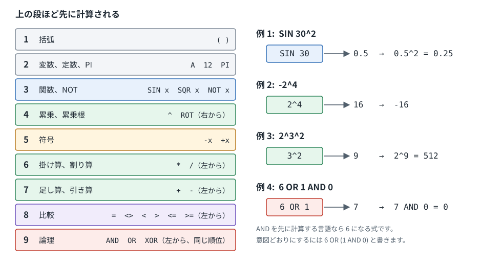

| 順位 | 演算 | 同じ順位が並んだとき |
|---|---|---|
| 1 | 括弧 `( )` | 内側から |
| 2 | 変数、定数、`PI` | |
| 3 | 関数（`SIN`、`SQR` など）、`NOT` | 右から。`SIN COS 60` は `SIN (COS 60)` |
| 4 | 累乗 `^`、累乗根 `ROT` | 右から。`2^3^2` は `2^(3^2)` |
| 5 | 符号 `-` `+` | |
| 6 | `*` `/` | 左から |
| 7 | `+` `-` | 左から |
| 8 | 比較 `=` `<>` `<` `>` `<=` `>=` | 左から |
| 9 | 論理 `AND` `OR` `XOR` | 左から（3 つは同じ順位） |

4 と 5 では、あとに書いた方が先です。`-2^4` は -(2^4)、`3^-2` は 3^(-2) になります。

| 式 | 結果 | 読み方 |
|---|---|---|
| `2+3*4` | 14 | 掛け算が先 |
| `-2^4` | -16 | 累乗が符号より先 |
| `(-2)^4` | 16 | 括弧が先 |
| `3^-2` | 1.111111111E-01 | あとに書いた符号が先 |
| `2^3^2` | 512 | 右から。2^9 |
| `2*-3` | -6 | |
| `SIN 30*2` | 1 | (SIN 30) × 2 |
| `SIN 30^2` | 0.25 | (SIN 30) の 2 乗 |
| `SQR 9+16` | 19 | (SQR 9) + 16 |
| `SQR (9+16)` | 5 | |
| `ABS -5+2` | 7 | (ABS -5) + 2 |
| `12/3/2` | 2 | 左から |
| `NOT 3+1` | -3 | (NOT 3) + 1 = -4 + 1 |
| `5>3>1` | 0 | (5>3) は -1、-1>1 は偽 |
| `6 OR 1 AND 0` | 0 | 左から。(6 OR 1) AND 0 |
| `6 XOR 3 OR 8` | 13 | (6 XOR 3) OR 8 |
| `10 AND 3=3` | 10 | 比較が先。10 AND -1 |

掛け算の `*` は省けません。`2PI` と `2A` は `Syntax error` でした（実験）。

### 14.2.6 デバイスとファイル

ファイルは「デバイス名 + 名前」で指します。

| デバイス | 内容 | 使える主な命令 |
|---|---|---|
| `E:` `F:` | RAM ディスク | `SAVE` `LOAD` `OPEN` `FILES` `COPY` `KILL` `NAME` `SET` `INIT` |
| `X:` | ポケットディスク（`COPY` のコピー先には、別のディスクを表す `Y:` も使える） | 同上 |
| `CAS:` | カセットテープ | `SAVE` `LOAD`（ASCII 形式のみ）、`OPEN`、`CHAIN`、`MERGE`、`COPY` |
| `COM:` | シリアル | `SAVE` `LOAD`（ASCII 形式のみ）、`OPEN`、`CHAIN`、`MERGE`、`COPY` |

データを読み書きするときは「開く、読み書きする、閉じる」の順です。

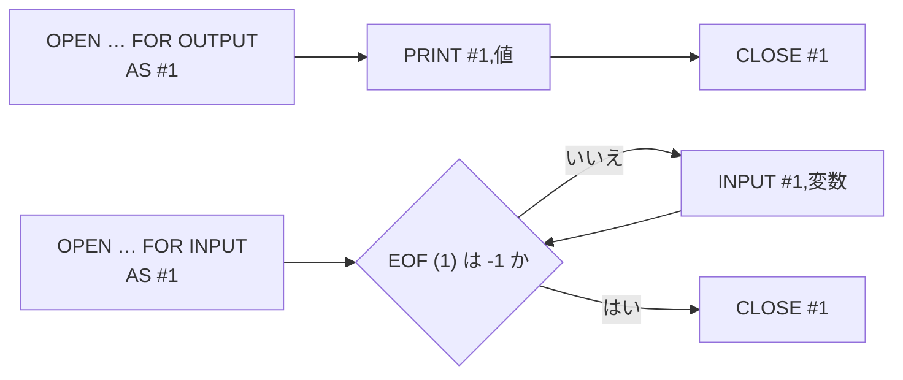

### 14.2.7 命令の省略形

命令は途中までの綴りにピリオドを付けて打てます。`P.` は `PRINT`、`GOS.` は `GOSUB` です。行を入れると、正式な綴りに直って記録されます。この章では各項目の「省略形」にいちばん短い形を書きました。それより長い形（`PR.`、`PRI.`、`PRIN.`）も使えます。

どこまで短くできるかは ROM の辞書の順番で決まっています。ROM は打たれた文字で始まるキーワードを [14.10](#1410-全キーワード) の表の上から探し、最初に見つかったものを選びます。

```text
A.    → ASC  （A で始まる最初の語）
AN.   → AND
P.    → PRINT（PRINT、PASS、PI、PEEK、POKE、POINT … の最初）
PO.   → POKE （POKE は POINT より前にある）
POI.  → POINT
LF.   → LFILES（LF はそのあとにある。LF に省略形はない）
```

この規則で 168 語の最短の形を計算すると、操作説明書の省略形とすべて一致しました。説明書にない語も同じように決まります。`PEEK` は `PE.`、`POKE` は `PO.`、`EVAL` は `EV.`、`CALL` は `CA.` です。`TEN`、`LEN`、`COS`、`CUR`、`INT`、`NEW` のように、短い綴りがどれも前の語に当たってしまう語には省略形がありません。

## 14.3 命令の索引

### 14.3.1 目的から探す

| 目的 | 命令と関数 |
|---|---|
| 画面に文字を出す | [`PRINT`](#print)、[`LOCATE`](#locate)、[`CLS`](#cls)、[`USING`](#using)、[`PAUSE`](#pause)、[`WAIT`](#wait) |
| 画面に図形を描く | [`LINE`](#line)、[`PSET`](#pset)、[`PRESET`](#preset)、[`POINT`](#point)、[`GCURSOR`](#gcursor)、[`GPRINT`](#gprint) |
| キーから入力する | [`INPUT`](#input)、[`INKEY$`](#inkey)、[`INPUT$`](#input-1)、[`KEY`](#key)、[`KEY$`](#key-1) |
| 条件分岐 | [`IF ... THEN ... ELSE`](#if--then--else)、[`ON ... GOTO`](#on--goto)、[`ON ... GOSUB`](#on--gosub)、[`IF ... THEN / ELSE / ENDIF（ブロック形式）`](#if--then--else--endifブロック形式)、[`SWITCH ... CASE ... DEFAULT ... ENDSWITCH`](#switch--case--default--endswitch) |
| ジャンプ、サブルーチン | [`GOTO`](#goto)、[`GOSUB / RETURN`](#gosub--return) |
| 繰り返し | [`FOR ... NEXT`](#for--next)、[`WHILE ... WEND`](#while--wend)、[`REPEAT ... UNTIL`](#repeat--until) |
| エラーを処理する | [`ON ERROR GOTO`](#on-error-goto)、[`RESUME`](#resume)、[`ERN`](#ern)、[`ERL`](#erl) |
| 変数、配列 | [`LET`](#let)、[`DIM`](#dim)、[`ERASE`](#erase)、[`CLEAR`](#clear)、[`DEFDBL`](#defdbl)、[`DEFSNG`](#defsng) |
| プログラム中のデータ | [`DATA`](#data)、[`READ`](#read)、[`RESTORE`](#restore) |
| 文字列 | [`LEFT$`](#left)、[`MID$`](#mid)、[`RIGHT$`](#right)、[`LEN`](#len)、[`ASC`](#asc)、[`CHR$`](#chr)、[`STR$`](#str)、[`VAL`](#val)、[`HEX$`](#hex)、[`EVAL`](#eval) |
| 式を文字列から計算する | [`EVAL`](#eval) |
| 数値の計算 | [三角関数と逆三角関数](#三角関数と逆三角関数)、[双曲線関数](#双曲線関数)、[指数、対数、累乗、根](#指数対数累乗根)、[整数と符号](#整数と符号)、[場合の数](#場合の数)、[角度、座標、進数の変換](#角度座標進数の変換)、[論理演算子](#論理演算子)、[`MDF`](#mdf)、[`AER`](#aer) |
| 角度の単位 | [`DEGREE`](#degree)、[`RADIAN`](#radian)、[`GRAD`](#grad) |
| 乱数 | [`RND`](#rnd)、[`RANDOMIZE`](#randomize) |
| ファイルの読み書き | [`OPEN`](#open)、[`CLOSE`](#close)、[`PRINT#`](#print-1)、[`INPUT#`](#input-2)、[`INPUT$`](#input-1)、[`EOF`](#eof)、[`LOC`](#loc)、[`LOF`](#lof) |
| ファイルの管理 | [`FILES`](#files)、[`LFILES`](#lfiles)、[`COPY`](#copy)、[`KILL`](#kill)、[`NAME`](#name)、[`SET`](#set)、[`INIT`](#init)、[`DSKF`](#dskf) |
| プログラムの保存と読み込み | [`SAVE`](#save)、[`LOAD`](#load)、[`LOAD?`](#load-1)、[`MERGE`](#merge)、[`CHAIN`](#chain) |
| カセットテープ | [`CSAVE`](#csave)、[`CLOAD`](#cload)、[`CLOAD?`](#cload-1) |
| シリアル | [`OPEN`](#open)、[`OPEN$`](#open-1)、[`CLOSE`](#close)、[`PRINT#`](#print-1)、[`INPUT#`](#input-2) |
| 音 | [`BEEP`](#beep) |
| 機械語、メモリ | [`CALL`](#call)、[`POKE`](#poke)、[`PEEK`](#peek)、[`FRE`](#fre)、[`MEM$`](#mem) |
| プログラムや変数を何組も持つ | [`BTEXT$` / `BDATA$`](#btext--bdata) |
| プリンタ | [`LPRINT`](#lprint)、[`LLIST`](#llist)、[`LFILES`](#lfiles)、[`CONSOLE`](#console) |
| プロッタ（CE-515P） | [`GRAPH`](#graph)、[`LTEXT`](#ltext)、[`GLCURSOR`](#glcursor)、[`SORGN`](#sorgn)、[`LLINE`](#lline)、[`RLINE`](#rline)、[`CIRCLE`](#circle)、[`PAINT`](#paint)、[`COLOR`](#color)、[`CSIZE`](#csize)、[`CROTATE`](#crotate)、[`LF`](#lf) |
| プログラムを書く | [`AUTO`](#auto)、[`DELETE`](#delete)、[`RENUM`](#renum)、[`LIST`](#list)、[`NEW`](#new)、[`PASS`](#pass)、[`TEXT`](#text)、[`BASIC`](#basic)、[`REM / '`](#rem--) |
| 実行、デバッグ | [`RUN`](#run)、[`END`](#end)、[`STOP`](#stop)、[`CONT`](#cont)、[`TRON / TROFF`](#tron--troff) |
| 電源を入れたときに動かす | [`ARUN`](#arun)、[`AUTOGOTO`](#autogoto) |

### 14.3.2 アルファベット順

数値関数（`SIN` など）は [14.6](#146-数値関数)、構造化 BASIC（`WHILE` など）は [14.7](#147-改訂-8-の拡張構造化-basic) にあります。

| 頭文字 | 命令 |
|---|---|
| A | [`AER`](#aer)、[`ARUN`](#arun)、[`ASC`](#asc)、[`AUTO`](#auto)、[`AUTOGOTO`](#autogoto) |
| B | [`BASIC`](#basic)、[`BEEP`](#beep) |
| C | [`CALL`](#call)、[`CHAIN`](#chain)、[`CHR$`](#chr)、[`CIRCLE`](#circle)、[`CLEAR`](#clear)、[`CLOAD`](#cload)、[`CLOAD?`](#cload-1)、[`CLOSE`](#close)、[`CLS`](#cls)、[`COLOR`](#color)、[`CONSOLE`](#console)、[`CONT`](#cont)、[`COPY`](#copy)、[`CROTATE`](#crotate)、[`CSAVE`](#csave)、[`CSIZE`](#csize) |
| D | [`DATA`](#data)、[`DEFDBL`](#defdbl)、[`DEFSNG`](#defsng)、[`DEGREE`](#degree)、[`DELETE`](#delete)、[`DIM`](#dim)、[`DSKF`](#dskf) |
| E | [`END`](#end)、[`EOF`](#eof)、[`ERASE`](#erase)、[`ERL`](#erl)、[`ERN`](#ern) |
| F | [`FILES`](#files)、[`FOR ... NEXT`](#for--next)、[`FRE`](#fre) |
| G | [`GCURSOR`](#gcursor)、[`GLCURSOR`](#glcursor)、[`GOSUB / RETURN`](#gosub--return)、[`GOTO`](#goto)、[`GPRINT`](#gprint)、[`GRAD`](#grad)、[`GRAPH`](#graph) |
| H | [`HEX$`](#hex) |
| I | [`IF ... THEN ... ELSE`](#if--then--else)、[`INIT`](#init)、[`INKEY$`](#inkey)、[`INPUT`](#input)、[`INPUT$`](#input-1)、[`INPUT#`](#input-2) |
| K | [`KEY`](#key)、[`KEY$`](#key-1)、[`KILL`](#kill) |
| L | [`LEFT$`](#left)、[`LEN`](#len)、[`LET`](#let)、[`LF`](#lf)、[`LFILES`](#lfiles)、[`LINE`](#line)、[`LIST`](#list)、[`LLINE`](#lline)、[`LLIST`](#llist)、[`LOAD`](#load)、[`LOAD?`](#load-1)、[`LOC`](#loc)、[`LOCATE`](#locate)、[`LOF`](#lof)、[`LPRINT`](#lprint)、[`LTEXT`](#ltext) |
| M | [`MDF`](#mdf)、[`MEM$`](#mem)、[`MERGE`](#merge)、[`MID$`](#mid) |
| N | [`NAME`](#name)、[`NEW`](#new) |
| O | [`ON ERROR GOTO`](#on-error-goto)、[`ON ... GOSUB`](#on--gosub)、[`ON ... GOTO`](#on--goto)、[`OPEN`](#open)、[`OPEN$`](#open-1) |
| P | [`PAINT`](#paint)、[`PASS`](#pass)、[`PAUSE`](#pause)、[`PEEK`](#peek)、[`POINT`](#point)、[`POKE`](#poke)、[`PRESET`](#preset)、[`PRINT`](#print)、[`PRINT#`](#print-1)、[`PSET`](#pset) |
| R | [`RADIAN`](#radian)、[`RANDOMIZE`](#randomize)、[`READ`](#read)、[`REM / '`](#rem--)、[`RENUM`](#renum)、[`RESTORE`](#restore)、[`RESUME`](#resume)、[`RIGHT$`](#right)、[`RLINE`](#rline)、[`RND`](#rnd)、[`RUN`](#run) |
| S | [`SAVE`](#save)、[`SET`](#set)、[`SORGN`](#sorgn)、[`STOP`](#stop)、[`STR$`](#str) |
| T | [`TEXT`](#text)、[`TRON / TROFF`](#tron--troff) |
| U | [`USING`](#using) |
| V | [`VAL`](#val) |
| W | [`WAIT`](#wait) |

## 14.4 命令詳細: 制御構文

プログラムは何もしなければ行番号の順に進みます。この順番を変えるのが**制御構文**です。変え方は 5 つしかありません。

| 変え方 | 命令 | 戻ってくるか |
|---|---|---|
| ジャンプ | `GOTO`、`ON ... GOTO` | 戻らない |
| 条件分岐 | `IF ... THEN ... ELSE` | 戻らない（分かれたあと合流する） |
| 呼び出し | `GOSUB` / `RETURN`、`ON ... GOSUB` | `RETURN` で戻る |
| 繰り返し | `FOR ... NEXT` | 範囲の終わりで先へ進む |
| エラーでの分岐 | `ON ERROR GOTO` / `RESUME` | `RESUME` で戻る |

### 14.4.1 ジャンプ（GOTO）

```basic
GOTO 行番号
GOTO *ラベル
```

指定先へ一方向に移ります。サブルーチン呼び出しではないため、呼び出し元に戻る必要がある処理には `GOSUB` / `RETURN` を使います。

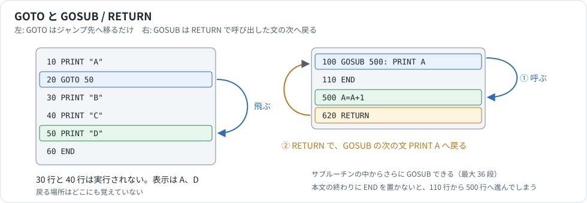

### 14.4.2 条件分岐（IF ... THEN ... ELSE）

```basic
IF 条件 THEN 文
IF 条件 THEN 行番号
IF 条件 THEN *ラベル ELSE 文
```

条件が真なら `THEN` 側、偽なら `ELSE` 側を実行します。行番号またはラベルを指定した場合はその位置へ移ります。比較には `=`, `<>`, `<`, `>`, `<=`, `>=` を使用します。

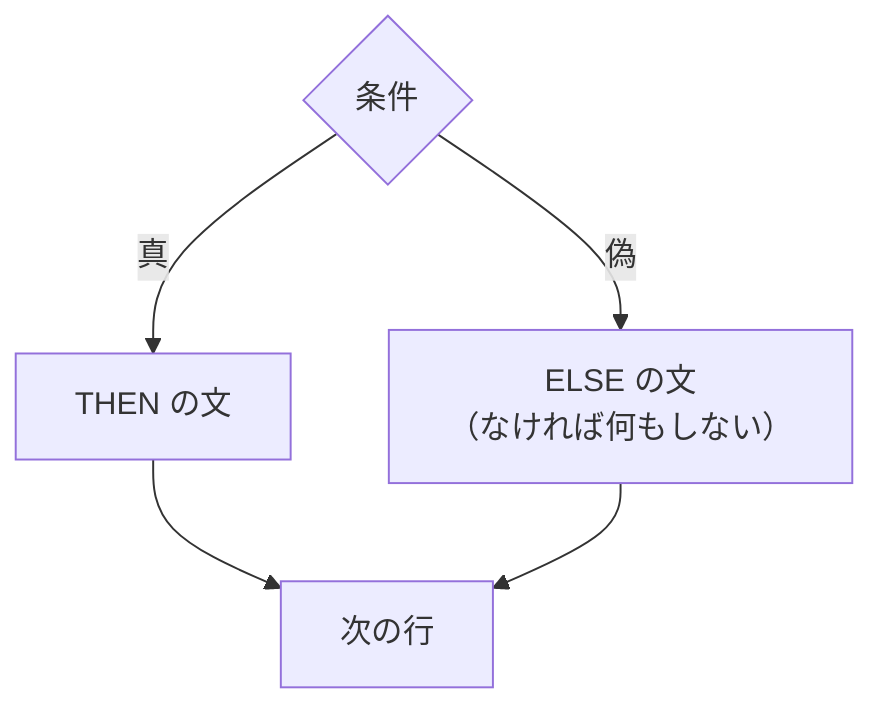

`THEN` や `ELSE` のあとに行番号かラベルを書いたときは、次の行ではなくそこへ進みます。

### 14.4.3 サブルーチン（GOSUB / RETURN）

`GOSUB` は指定したサブルーチンへ制御を移し、`RETURN` は呼び出し元の `GOSUB` の直後（同一行で `:` に続く文があればその文）へ戻ります。

```basic
GOSUB 行番号
GOSUB *ラベル
RETURN
```

| 引数 | 指定内容 |
|---|---|
| 行番号 | サブルーチン先頭の既存行番号 |
| `*ラベル` | サブルーチン先頭に置いたラベル |

例を見てみます。

```basic
100 GOSUB 500: PRINT A
110 END
500 A=A+1
620 RETURN
```

この例では `500` 行から `620` 行までを実行した後、`100` 行の `PRINT A` を実行します。サブルーチンの末尾には `RETURN` を置きます。操作説明書ではネストは最大 36 段までとされます。

時間の順に描くと、次のようになります。

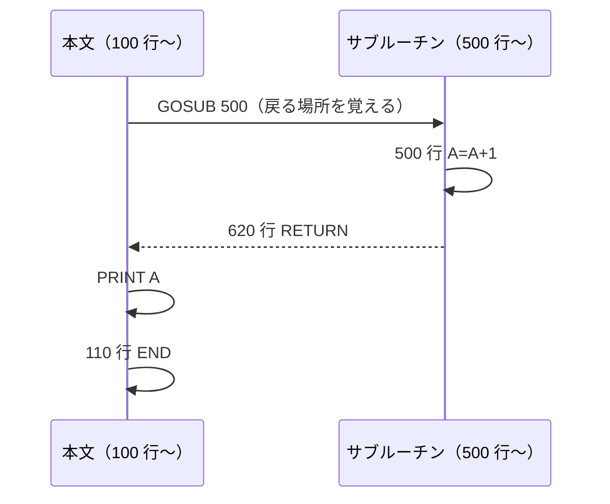

サブルーチンの中から別のサブルーチンを呼ぶと、戻る場所が積み重なります（ネスト）。`RETURN` はいちばん新しい `GOSUB` の場所へ戻ります。

### 14.4.4 値による分岐（ON ... GOSUB / ON ... GOTO）

```basic
ON 式 GOSUB 行番号1, 行番号2, ...
ON 式 GOTO  行番号1, 行番号2, ...
```

式の値で移動先を選びます。`ON ... GOSUB` の各候補は `RETURN` で戻るサブルーチンにします。ラベルも行番号の代わりに指定できます。

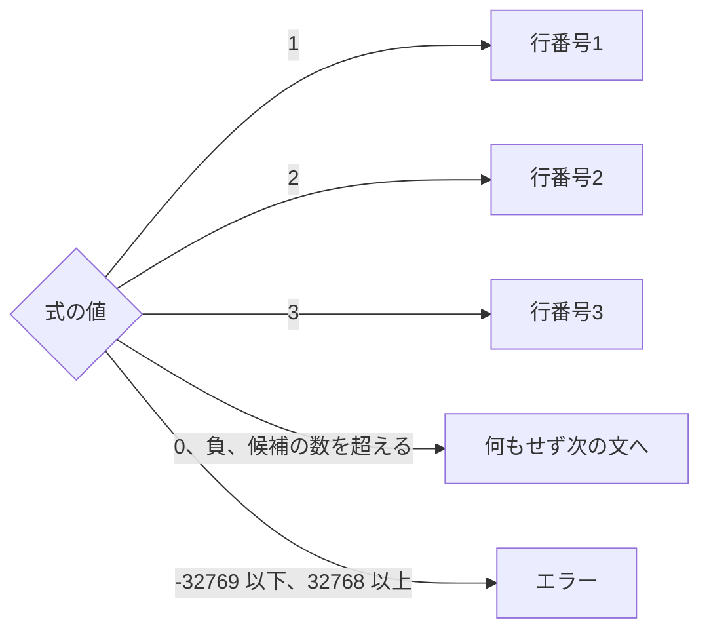

### 14.4.5 繰り返し（FOR ... NEXT）

```basic
FOR 変数 = 開始値 TO 終了値 [STEP 増分]
  ...
NEXT [変数]
```

開始値から終了値まで繰り返します。`STEP` を省略したときの増分は `1` です。ループの途中で `CLEAR`、`DIM`、`ERASE` を実行しないでください。また、通常の流れで `FOR ... NEXT` の外へ飛び出さないでください。

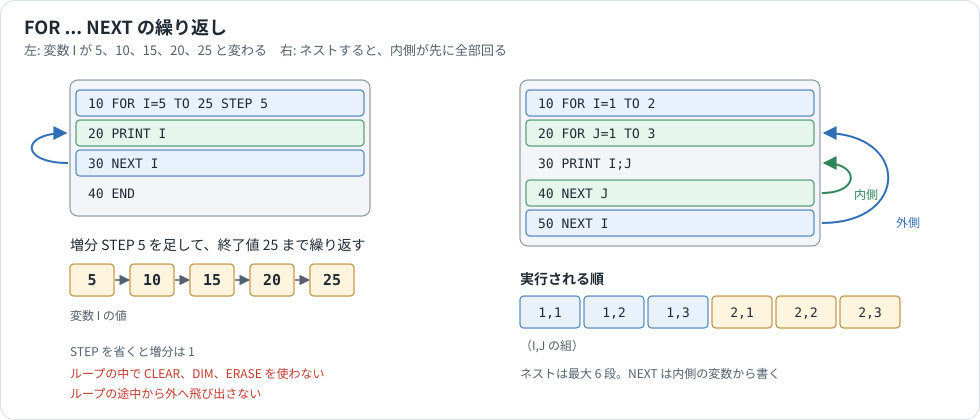

条件で繰り返すには、ROM 8.3 以降なら [`WHILE ... WEND`](#while--wend) と [`REPEAT ... UNTIL`](#repeat--until) が使えます。それより前の ROM では `IF` と `GOTO` を組み合わせます。

```basic
10 N=1
20 IF N>=100 THEN 60
30 PRINT N
40 N=N*2
50 GOTO 20
60 END
```

### 14.4.6 エラー処理（ON ERROR GOTO）

ふつう、エラーが起きるとプログラムは止まります。`ON ERROR GOTO` で行を決めておくと、止まる代わりにその行へ分岐します。分岐先では `ERN`（エラーの番号）と `ERL`（起きた行）で原因を調べ、`RESUME` で戻ります。

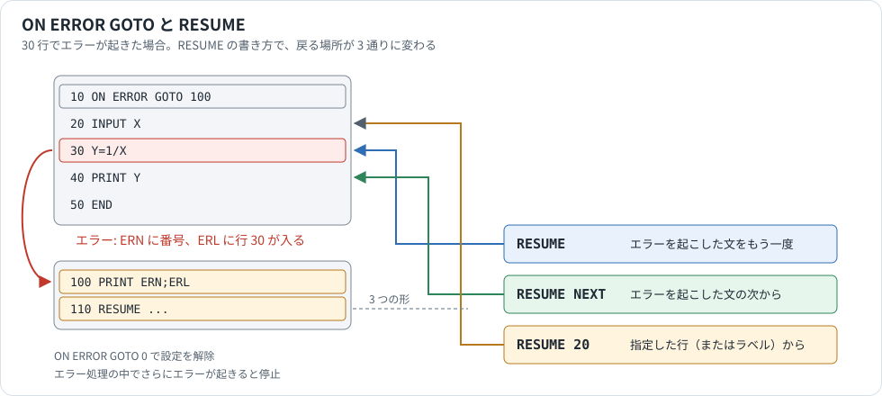

| 戻り方 | 使う場面 |
|---|---|
| `RESUME` | 原因を直してから、同じ文をもう一度実行する |
| `RESUME NEXT` | その文をあきらめて、次の文から続ける |
| `RESUME {行番号 \| *ラベル}` | 入力からやり直すなど、決まった場所へ戻る |

設定は `ON ERROR GOTO 0`、`RUN`、電源断、プログラム読み込み、`SHIFT`+`CA` で解除されます。

### 14.4.7 ネストの上限

`GOSUB` は戻る場所を、`FOR` はループ変数や終了値を覚えておかなければなりません。この機械ではそれらを全部で 145 バイトの 1 つの場所に積みます（操作説明書 p.351。PC-E500S のドイツ語版 p.337 には構造化 BASIC の分もあります）。

| 命令 | 1 段のバイト数 | それだけで使うとき |
|---|---|---|
| `GOSUB` | 4 | 36 段 |
| `FOR` | 21 | 6 段 |
| `REPEAT`（改訂 8） | 7 | 20 段 |
| `WHILE`（改訂 8） | 8 | 18 段 |
| `SWITCH`（改訂 8） | 9 | 1 段だけ |

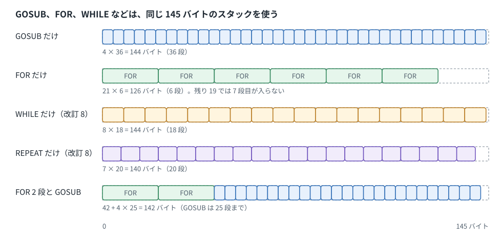

どの段数もエミュレータで 1 段ずつ増やして確かめた値と一致しました（実験。ROM 7.2、8.3）。組み合わせると足し算になります。`FOR` が 2 段あると 42 バイトなので、残り 103 バイトに `GOSUB` は 25 段入り、26 段目でエラー（50）になりました。

超えたときの表示はバージョンで変わります。

| ROM | 表示 |
|---|---|
| 7.2 | `GOSUB or FOR nesting exceeded` |
| 8.3 | `GOSUB,FOR,REPEAT,WHILE or SWITCH nesting exceeded` |

`GOTO` でループやサブルーチンから飛び出すと、積んだものが残ります。繰り返すうちに 145 バイトを使い切るので、ループの途中から飛び出さないようにします。

## 14.5 命令の使い方（アルファベット順）

各項目は次の順に並んでいます。当てはまるものがない見出しは省いています。

| 見出し | 内容 |
|---|---|
| 中間コード | プログラムの中での表し方（[14.9](#149-トークン化と処理エントリ)、[14.10](#1410-全キーワード)） |
| 使用区分 | プログラム、直接実行のどちらで使えるか（操作説明書の P と D の印。[14.2.1](#1421-モード)） |
| 省略形 | いちばん短い綴り（[14.2.7](#1427-命令の省略形)） |
| **書式** | 書き方。記号の意味は [14.1](#141-使い方) |
| **働き** | 何をする命令か |
| **引数** | 書式の中の日本語に何を書くか |
| **例** | 短い使い方。行番号のあるものはプログラム、ないものは直接入力の例です |
| **注意** | 制限、エラーになる条件、ほかの章への案内 |
| **関連** | いっしょに使う命令 |

出典は PC-E500 操作説明書（BASIC COMMAND DICTIONARY および数値関数の章、p.196〜337）と、PC-E500S の操作説明書（ドイツ語版、p.211〜324）です。「実験」と書いた結果は、とくに断りがなければ日本語の PC-E500 の ROM 7.2 をエミュレータで動かしたものです。`CALL` / `PEEK` / `POKE` は [機械語を実機で動かす](12_MACHINE_CODE.md) §12.3 の検証結果、構造化 BASIC（`WHILE` など）は [14.7](#147-改訂-8-の拡張構造化-basic) に分けて記します。

### AER

中間コード: `AER` = `FE BE`

使用区分: プログラム、直接実行 ／ 省略形: `AE.`

**書式**

```basic
AER 番号 [(式, 式, ...)]
```

**働き**: AER モードで登録した代数式（番号付き）を BASIC から実行し、その値を返します。

**引数**

| 引数 | 内容 |
|---|---|
| 番号 | AER モードで式に付けた番号。 |
| 式 | 登録した式の変数に渡す値。登録時の変数順に対応する。 |

**例**

```basic
10 X=AER 1(3,4,30)
20 PRINT X
```

AER モードで番号 1 に、3 つの変数を持つ式（たとえば 15 章の例 B\*C\*SIN A/2）を登録してあるとします。登録時の変数の順に 3、4、30 が渡り、結果が `X` に入ります。

**注意**

- 使えるのは単精度数値変数だけで、文字列変数・倍精度変数は使えません。
- 式がどう記録されるかは [BASIC の内部形式](15_BASIC_INTERNALS.md) §15.4 にあります。
- 登録されていない番号、または渡す値の数が式の変数の数と違うと、エラーになります。登録のない番号は `Illegal function call` でした（実験）。
- 番号が定数を指しているときは、`Z=AER 3` のように括弧を書きません。
- 引数には変数も書けます（`AER 5(A,AAZ)+3`）。
- 式の変数が `AA` のような固定変数でない単精度のときは、先に `AA=0` のように 1 度代入しておきます。
- AER モードで式を消すと番号がずれることがあるので、プログラムの番号も直します。

**関連**: [`EVAL`](#eval)

### ARUN

中間コード: `ARUN` = `FE 74`

使用区分: プログラム ／ 省略形: `AR.`

**書式**

```basic
ARUN [{行番号 | *ラベル}]
```

**働き**: プログラムの最初の行の最初の文に書いておきます。電源を入れて RUN モードになると、`RUN` を打ったのと同じように、プログラムが始まります。

**引数**

| 引数 | 内容 |
|---|---|
| 行番号 / `*ラベル` | 開始位置。省略時は先頭行。 |

**例**

```basic
10 ARUN
20 CLS
30 PRINT "FREE";FRE 0
40 END
```

電源を入れるたびに、空きのバイト数を表示します。`ARUN 100` と書くと 100 行から始まります。

**注意**

- `AUTOGOTO` と似ていますが、固定変数以外の変数・配列をクリアしてから実行します。
- オートパワーオフ後の再投入では自動実行されません。
- RUN、PRO、AER のどのモードで電源を切っても、次に入れたときは RUN モードです。
- メニュー、CAL、AER の各モードから `BASIC` キーで RUN モードにしたときも、自動で始まります。
- ラベルを指定するときは、そのラベルが行の最初にあることが必要です。

**関連**: [`AUTOGOTO`](#autogoto)、[`RUN`](#run)

### ASC

中間コード: `ASC` = `FE D0`

使用区分: プログラム、直接実行 ／ 省略形: `A.`

**書式**

```basic
ASC 文字列
```

**働き**: 文字列の先頭 1 文字の文字コードを返します。

**引数**

| 引数 | 内容 |
|---|---|
| 文字列 | 文字列定数または文字列変数。 |

**例**

```basic
10 PRINT ASC "A"
20 PRINT ASC "ABC"
```

どちらも 65 です。2 文字目から後は見ません。

**注意**

- 空文字列の `ASC ""` は 0 です（実験）。

**関連**: [`CHR$`](#chr)、[`VAL`](#val)

### AUTO

中間コード: `AUTO` = `FE 1A`

使用区分: 直接実行（PRO モード） ／ 省略形: なし

**書式**

```basic
AUTO [開始行番号 [,増分]]
```

**働き**: PRO モードで行番号を自動的に挿入します。

**引数**

| 引数 | 内容 |
|---|---|
| 開始行番号 | 最初に表示する行番号。省略時は 10。65279 を超えると `Illegal line number`。 |
| 増分 | 行番号の間隔。省略時は 10。 |

**例**

```basic
AUTO
AUTO 100,5
```

1 行目は 10、20、30 …、2 行目は 100、105、110 … の行番号が順に出ます。

**注意**

- `SHIFT`+`CA`、電源の切入、PRO/RUN 以外のモードへ移ると解除されます。
- 行番号だけが表示された状態で `C・CE` または `BREAK` を押しても解除されます。
- 前に `AUTO` を使っていると、省略した値には前回の値が使われます。PRO → RUN → PRO と移ったあとの `AUTO` は、最後に作った行の続きから番号を出します。

**関連**: [`RENUM`](#renum)、[`DELETE`](#delete)

### AUTOGOTO

中間コード: `AUTOGOTO` = `FE 75`

使用区分: プログラム ／ 省略形: `AU.`

**書式**

```basic
AUTOGOTO {行番号 | *ラベル}
```

**働き**: 最初の行の最初の文に書いておきます。電源を入れて RUN モードになると、`GOTO` を打ったのと同じように、指定した位置から始まります。変数と配列は消えません。

**引数**

| 引数 | 内容 |
|---|---|
| 行番号 / `*ラベル` | 開始位置。 |

**例**

```basic
10 AUTOGOTO 60
20 END
60 N=N+1
70 PRINT "POWER ON";N
80 END
```

電源を入れるたびに `N` が 1 増えます。`AUTOGOTO` は変数を消さないので、回数が残ります。

**注意**

- オートパワーオフのあとに入れ直したときは始まりません。
- メニュー、CAL、AER の各モードから `BASIC` キーで RUN モードにしたときも始まります。
- ラベルは行の最初に置きます。

**関連**: [`ARUN`](#arun)、[`RUN`](#run)

### BASIC

中間コード: `BASIC` = `FE 36`

使用区分: 直接実行（PRO モード） ／ 省略形: `BA.`

**書式**

```basic
BASIC
```

**働き**: TEXT モードを解除して BASIC モードに戻します。テキストとして保持している内容を中間コードのプログラムに変換します。

**引数**: ありません。

**注意**

- 変換中は画面右下に `*` が出ます。
- 約 600 バイトの作業領域を使い、変換後の 1 行が長すぎるとエラーになります。
- パスワードが設定されているとエラーになります。
- `"` で囲んだ文字列と `REM`（`'`）のあとを除いて、小文字は大文字に変わります。
- 操作説明書 p.216 は、`P.` や `I.` のような省略形は命令に直らないので、カーソルをその行に置いて `ENTER` を押すように書いています。ROM 7.2 の実験では、TEXT モードで打った `5 I. A` は、`BASIC` のあとの `LIST` で `5:INPUT A` になりました。
- この機械にない命令や書式は、変換されても実行できません。

**関連**: [`TEXT`](#text)

### BEEP

中間コード: `BEEP` = `FE 29`

使用区分: プログラム、直接実行 ／ 省略形: `B.`

**書式**

```basic
BEEP 回数 [,[音程][,長さ]]
```

**働き**: 内蔵スピーカーから指定した音程・長さのビープ音を指定回数鳴らします。

音程の値と周波数の対応を、書式の式で計算すると次のようになります。

| 音程 | 計算 | 周波数 |
|---|---|---|
| 0 | 256000 ÷ 90 | 約 2844 Hz |
| 12 | 256000 ÷ (90 + 48) | 約 1855 Hz |
| 50 | 256000 ÷ (90 + 200) | 約 883 Hz |
| 100 | 256000 ÷ (90 + 400) | 約 522 Hz |
| 255 | 256000 ÷ (90 + 1020) | 約 231 Hz |

長さは波の数です。鳴る時間は「長さ ÷ 周波数」秒になります。操作説明書 p.218 の式は単位を µs と書いていますが、式の形はこの割り算です。`BEEP 10,100,522` はエミュレータで約 12.8 秒、`BEEP 10,50,441` は約 7.8 秒かかりました。どちらも 1 回が「長さ ÷ 周波数」の時間と、次の音までの約 0.28 秒の間からできています（実験。ROM 7.2）。

| 音程 | 長さ | 計算 | 時間 |
|---|---|---|---|
| 12 | 583 | 583 ÷ 1855.1 | 約 0.31 秒 |
| 100 | 583 | 583 ÷ 522.4 | 約 1.12 秒 |
| 100 | 261 | 261 ÷ 522.4 | 約 0.50 秒 |
| 50 | 441 | 441 ÷ 882.8 | 約 0.50 秒 |

音階にするときの音程の値は次のとおりです。値は「周波数 = 256000 / (90 + 4 × 音程)」から、平均律（A = 440 Hz）にいちばん近い整数を計算したものです。操作説明書 p.218 の表も同じ考え方の 3 オクターブの表です。

| 音 | 低いド〜シ | 音程 | 中のド〜シ | 音程 | 高いド〜シ | 音程 |
|---|---|---|---|---|---|---|
| ド | 261.6 Hz | 222 | 523.3 Hz | 100 | 1046.5 Hz | 39 |
| レ | 293.7 Hz | 195 | 587.3 Hz | 86 | 1174.7 Hz | 32 |
| ミ | 329.6 Hz | 172 | 659.3 Hz | 75 | 1318.5 Hz | 26 |
| ファ | 349.2 Hz | 161 | 698.5 Hz | 69 | 1396.9 Hz | 23 |
| ソ | 392.0 Hz | 141 | 784.0 Hz | 59 | 1568.0 Hz | 18 |
| ラ | 440.0 Hz | 123 | 880.0 Hz | 50 | 1760.0 Hz | 14 |
| シ | 493.9 Hz | 107 | 987.8 Hz | 42 | 1975.5 Hz | 10 |

**引数**

| 引数 | 内容 |
|---|---|
| 回数 | 鳴らす回数。最大 65535。0 なら鳴らない。65536 は `Data out of range`（実験）。 |
| 音程 | 0〜255。値が大きいほど低音。省略時は 12。周波数(Hz) = 256000 / (90 + 4 × 音程)。0 で約 2844 Hz、255 で約 231 Hz。 |
| 長さ | 0〜65535。省略時は 583。同じ値でも低音ほど実時間は長くなる（長さ ÷ 周波数 秒。下の表）。 |

**例**

```basic
10 FOR I=1 TO 3
20 FOR J=5 TO 25 STEP 5
30 BEEP I,J,150
40 NEXT J
50 NEXT I
```

外側の `I` で鳴らす回数を、内側の `J` で音程を変えます。

```basic
BEEP 1
BEEP 3,50,200
```

1 行目は音程と長さを省いた約 4 kHz の音、2 行目は約 883 Hz の音を 3 回です。

```basic
10 FOR I=1 TO 7
20 READ T
30 BEEP 1,T,INT (64000/(90+4*T))
40 NEXT I
50 DATA 100,86,75,69,59,50,42
```

ドレミファソラシを、どの音も約 0.25 秒ずつ鳴らします。30 行の長さは 0.25 × 256000 / (90 + 4 × T) です。

**注意**

- 音程・長さの両方を省略すると約 4 kHz のビープになります。
- `BREAK` で停止できます。

**関連**: [`WAIT`](#wait)

### CALL

中間コード: `CALL` = `FE 31`

使用区分: プログラム、直接実行 ／ 省略形: `CA.`

**書式**

```basic
CALL アドレス
```

**働き**: 指定アドレスの機械語ルーチンを呼び出します。

**引数**

| 引数 | 内容 |
|---|---|
| アドレス | 20 bit の実行開始アドレス。`&HBEC00` のような 16 進、または 10 進で書く。 |

**例**

```basic
10 POKE &HBEC00,200,100
20 CALL &HBEC04
30 PRINT PEEK &HBEC02+256*PEEK &HBEC03
```

機械語エリアの先頭 2 バイトに引数を置いて呼び、結果の 2 バイトを読む形です（[機械語を実機で動かす](12_MACHINE_CODE.md) §12.4.1 の例題の呼び方）。§12.4.1 の機械語を先に入れておかないと、でたらめな命令を実行して暴走します。

全部を BASIC だけで試せる、いちばん小さな例です。初めに直接実行で機械語エリアを 4096 バイト確保します（メニューに戻るので `BASIC` キーを押します）。

```basic
POKE &HBFE03,&H1A,&HFD,&H0B,&H00,&H10,&H00 : CALL &HFFFD8
```

次のプログラムは `MV A,2Ah` / `MV [0BEC10h],A` / `RC` / `RETF` の 8 バイトを書いて呼び、`BEC10h` に入った値を読みます。

```basic
10 POKE &HBEC00,&H08,&H2A,&HA8,&H10,&HEC,&H0B,&H9F,&H07
20 CALL &HBEC00
30 PRINT PEEK &HBEC10
```

```text
                                      42
```

2Ah = 42 です（実験。ROM 7.2、8.5）。最後の `RC`（9Fh）を `SC`（97h）に変えると、`A` の値がエラー番号になります。`POKE &HBEC00,&H08,&H15,&H97,&H07: CALL &HBEC00` は、15h = 21 番の `Division by Zero` で止まりました（実験）。

**注意**

- ROM 8.5 の `CALL` に引数はなく、`CALL アドレス, 値` の形は受け付けません。`CALL &HBEC00,5` は ROM 7.2 と 8.5 で `Syntax error` でした（実験）。
- データの受渡しは `POKE` / `PEEK` で行います。
- 機械語側は `RETF` で戻り、C=1 で戻ると A がエラー番号として扱われます。
- 先に機械語エリアを確保しておきます。詳細は [機械語を実機で動かす](12_MACHINE_CODE.md) §12.3.2 と §12.3.3 にあります。

**関連**: [`POKE`](#poke)、[`PEEK`](#peek)

### CHAIN

中間コード: `CHAIN` = `FE 67`

使用区分: プログラム ／ 省略形: `CHA.`

**書式**

```basic
CHAIN
CHAIN "d:ファイル名" [,{行番号 | *ラベル}]
```

**働き**: 実行中のプログラムから、指定デバイス上の別プログラムを読み込んで実行を引き継ぎます。変数は保持されます。

**引数**

| 引数 | 内容 |
|---|---|
| `"d:ファイル名"` | 読み込むプログラム。`d:` は `X:`、`E:`、`F:`、`CAS:`、`COM:`。 |
| 行番号 / `*ラベル` | 開始位置。省略時は最小行番号。 |

**例**

```basic
10 A=100
20 CHAIN "E:NEXT.BAS",50
```

変数 `A` を持ったまま、`E:NEXT.BAS` の 50 行から続けます。

**注意**

- 引数なしの形はテープ専用で、最初に見つかったプログラムを読み込みます。
- `CSAVE` で保存したプログラムは `CHAIN` できません（`SAVE` を使う）。
- `CAS:` / `COM:` を使う場合はそのデバイスのファイルを閉じておきます。
- 今のプログラムは `CHAIN` を実行したところで消えます。読み込むプログラムが入りきらないとエラーです。
- `CHAIN` も 1 つのファイルを開きます（`OPEN` の同時に開ける数に入ります）。
- RUN モードで `CHAIN "E:A"` を直接打つと `Direct command error` です（実験）。

**関連**: [`LOAD`](#load)、[`SAVE`](#save)、[`RUN`](#run)

### CHR$

中間コード: `CHR$` = `FE F0`

使用区分: プログラム、直接実行 ／ 省略形: `CH.`

**書式**

```basic
CHR$ 式
```

**働き**: 文字コードに対応する 1 文字の文字列を返します。

**引数**

| 引数 | 内容 |
|---|---|
| 式 | 文字コード 0〜255。`&H5A` のような 16 進も可。255 を超えるとエラー。 |

**例**

```basic
10 PRINT CHR$ 65;CHR$ &H5A
20 PRINT CHR$ &HE8;CHR$ &HE9
```

1 行目は `AZ`、2 行目は ♠ と ♥ です。文字コードとフォントの一覧は [フォント](13_FONT.md) にあります。英語版の PC-E500 と PC-E500S では、E8h と E9h は Φ と Θ です（操作説明書 p.343）。

**注意**

- 小数は切り捨てられます（`CHR$ 65.9` は `A`）。256 以上と負の値は `Data out of range` です（実験）。

**関連**: [`ASC`](#asc)、[`HEX$`](#hex)

### CIRCLE

中間コード: `CIRCLE` = `FE 6F`

使用区分: プログラム、直接実行 ／ 省略形: `CI.`

**書式**

```basic
CIRCLE (式1, 式2), 式3 [,式4][,式5][,式6][,式7][,式8][,式9]
```

**働き**: プリンタ（CE-515P）で円・弧・扇形・楕円を描きます。GRAPH モードで使います。

**引数**

| 引数 | 内容 |
|---|---|
| 式1, 式2 | 中心座標（-999〜999）。 |
| 式3 | 半径（1〜499）。 |
| 式4 | 線の色（0〜3）。省略時は前回の値。 |
| 式5, 式6 | 開始角と終了角（-2047〜2047、単位は度）。0 が右（+X）で、正は左回り、負は右回り。省略時は 0 と 360。 |
| 式7 | 縦横比 ry/rx。1 で円、それ以外で楕円。省略時は 1。 |
| 式8 | ピッチ角（1〜2047、単位は度）。円を何度ずつの直線で描くか。省略時は 1。120 なら正三角形になる。 |
| 式9 | 0 で弧、1 で扇形。 |

**例**

```basic
10 OPEN "COM:1200,N,8,1,A,C,&H1A,N,S" AS #1
20 GRAPH
30 GLCURSOR (200,-200)
40 SORGN
50 CIRCLE (0,0),100
60 CIRCLE (0,0),80,3,0,180
70 CIRCLE (0,0),60,1,0,90,1,1,1
80 LTEXT
90 CLOSE #1
```

50 行は円、60 行は赤い半円、70 行は青い扇形です。途中の引数は `,` だけ書いて省けます。

**注意**

- プロッタはシリアルにつなぎます。`OPEN` していないと、エラーを出さずに何も送りません（[CE-515P プロッタ](19_CE-515P_PLOTTER.md) §19.1）。
- 送るコマンドと座標の計算は [CE-515P プロッタ](19_CE-515P_PLOTTER.md) §19.5 にあります。
- 角度とピッチ角は `RADIAN` や `GRAD` にしていても度です。

**関連**: [`GRAPH`](#graph)、[`GLCURSOR`](#glcursor)、[`SORGN`](#sorgn)、[`LLINE`](#lline)、[`PAINT`](#paint)

### CLEAR

中間コード: `CLEAR` = `FE 2E`

使用区分: プログラム、直接実行 ／ 省略形: `CL.`

**書式**

```basic
CLEAR [変数1, 変数2, ..., 変数n]
```

**働き**: プログラムで使った変数を消去し、固定変数を 0 または空文字列に戻します。

**引数**

| 引数 | 内容 |
|---|---|
| 変数 | 指定した場合、その変数だけを対象にする。 |

**例**

```basic
10 A=5
20 CLEAR A
30 PRINT A
```

30 行では `A` は 0 です。

**注意**

- `FOR ... NEXT` の中では使わないでください。
- 特定の配列だけを消すには `ERASE` を使います。
- 変数を並べると、その変数だけを 0（文字列は空）に戻します。`A=5: B=6: CLEAR A` のあとも `B` は 6 です（実験）。配列の名前は書けません（`CLEAR Q(*)` は `Illegal function call`）。

**関連**: [`ERASE`](#erase)、[`DIM`](#dim)、[`NEW`](#new)

### CLOAD

中間コード: `CLOAD` = `FE 16`

使用区分: 直接実行 ／ 省略形: `CLO.`

**書式**

```basic
CLOAD
CLOAD "ファイル名"
```

**働き**: テープに保存したプログラムを読み込みます。

**引数**

| 引数 | 内容 |
|---|---|
| ファイル名 | 探すプログラム名。省略時は最初に見つかったプログラムを読み込む。 |

**例**

```basic
CLOAD "TEST"
```

テープから `TEST` という名前のプログラムを探して読み込みます。

**注意**

- `CSAVE` で保存したプログラムだけが対象です。
- 機械語用の `CLOAD M` とテープの形式は [11 ピン（テープ、周辺機器）](06_PORT_11PIN.md) を参照してください。
- ファイル名が見つかるまで探し続けます。テープの終わりを過ぎても止まらないので、`BREAK` で止めます。
- 読み込みのあいだはファイル名のあとの右下に `*` が出て、終わると消えます。探しているあいだは出ません。
- 途中でエラーになると、読み込みかけのプログラムは使えません。ヘッダーの誤りは `Tape read error`（80）、本体の誤りは `I/O error`（72）です（実験）。
- ほかの機種のテープを読む `CLOAD@` は [カセットインターフェース](20_CASSETTE.md) を参照してください。

**関連**: [`CLOAD?`](#cload-1)、[`CSAVE`](#csave)、[`LOAD`](#load)

### CLOAD?

中間コード: `CLOAD` = `FE 16`

使用区分: 直接実行 ／ 省略形: `CLO.?`

**書式**

```basic
CLOAD?
CLOAD? "ファイル名"
```

**働き**: テープ上のプログラムとメモリ上のプログラムを比較します。

**引数**

| 引数 | 内容 |
|---|---|
| ファイル名 | 比較するプログラム名。省略時は最初に見つかったプログラム。 |

**例**

```basic
CSAVE "TEST"
CLOAD? "TEST"
```

保存したあとテープを巻き戻してから 2 行目を実行し、正しく書けたかを確かめます。

**注意**

- 一致しないとエラーになります。
- `CLOAD@` で読み込んだほかの機種のプログラムは、中間コードに変わっているので比較できません。

**関連**: [`CSAVE`](#csave)、[`CLOAD`](#cload)、[`LOAD?`](#load-1)

### CLOSE

中間コード: `CLOSE` = `FE 22`

使用区分: プログラム、直接実行 ／ 省略形: `CLOS.`

**書式**

```basic
CLOSE [#ファイル番号, #ファイル番号, ...]
```

**働き**: `OPEN` で開いたファイルを閉じます。

**引数**

| 引数 | 内容 |
|---|---|
| #ファイル番号 | 閉じるファイル。省略時は開いている全ファイル。 |

**例**

```basic
10 OPEN "E:A.TXT" FOR OUTPUT AS #1
20 PRINT #1,"HELLO"
30 CLOSE #1
```

書き込みが終わったら閉じます。

**注意**

- `END` / `RUN` の実行、電源断、PRO/RUN 以外のモードへの移動、`LOAD` / `CLOAD` / `MERGE` の実行でも全ファイルが閉じられます。

**関連**: [`OPEN`](#open)、[`PRINT#`](#print-1)、[`INPUT#`](#input-2)

### CLS

中間コード: `CLS` = `FE 50`

使用区分: プログラム、直接実行 ／ 省略形: なし

**書式**

```basic
CLS
```

**働き**: 画面を消去します。

**引数**: ありません。

**例**

```basic
10 CLS
20 PRINT "READY"
```

画面を消してから表示します。

**注意**

- 表示の位置は (0,0) に戻ります。

**関連**: [`LOCATE`](#locate)、[`PRINT`](#print)

### COLOR

中間コード: `COLOR` = `FE 44`

使用区分: プログラム、直接実行 ／ 省略形: `COL.`

**書式**

```basic
COLOR 式
```

**働き**: プリンタ（CE-515P）で描画・印字する色を指定します。

**引数**

| 引数 | 内容 |
|---|---|
| 式 | 0 黒、1 青、2 緑、3 赤。 |

**例**

```basic
COLOR 3
```

以後の描画、印字が赤になります。

**注意**

- プロッタはシリアルにつなぎます。`OPEN` していないと、エラーを出さずに何も送りません（[CE-515P プロッタ](19_CE-515P_PLOTTER.md) §19.1）。

**関連**: [`GRAPH`](#graph)、[`LLINE`](#lline)、[`CSIZE`](#csize)

### CONSOLE

中間コード: `CONSOLE` = `FE 24`

使用区分: プログラム、直接実行 ／ 省略形: `CONS.`

**書式**

```basic
CONSOLE [式]
```

**働き**: `LPRINT` / `LLIST` などでプリンタやシリアルへ送るときの 1 行あたりの桁数を設定します。

**引数**

| 引数 | 内容 |
|---|---|
| 式 | 1〜160。1〜7 は 7 桁、160 超は 160 桁になる。0 以下はエラー。省略時は現在値を保持。 |

**例**

```basic
CONSOLE 80
```

1 行を 80 桁にします。

**注意**

- 電池交換やリセット時は 39 桁です。
- 23 桁以下だと `LLIST` はエラーになります。
- 1 行分を送ると、`OPEN` で決めた区切り（CR、LF、CR+LF）を送ります。
- 39 桁に戻るのは、電池を替えたときと、`ON` を押しながらの RESET のときです。

**関連**: [`LPRINT`](#lprint)、[`LLIST`](#llist)

### CONT

中間コード: `CONT` = `FE 12`

使用区分: 直接実行（RUN モード） ／ 省略形: `C.`

**書式**

```basic
CONT
```

**働き**: `STOP` や `BREAK` キーで一時停止したプログラムの実行を再開します。

**引数**: ありません。

**例**

```basic
10 FOR I=1 TO 10
20 PRINT I
30 IF I=5 THEN STOP
40 NEXT I
```

5 まで表示して止まり、`CONT` で 6 から続きます。

**注意**

- `WAIT` で無限待ちになった `PRINT` / `GPRINT` の続行にも使えます。
- 止まっていないときに打つと `Can't continue` です（実験）。
- `SHIFT` + `↓` も同じ働きです。`↓` だけなら 1 文ずつ進みます。

**関連**: [`STOP`](#stop)、[`WAIT`](#wait)

### COPY

中間コード: `COPY` = `FE 3D`

使用区分: 直接実行 ／ 省略形: `COP.`

**書式**

```basic
COPY "d1:ファイル名1" TO "[d2:]ファイル名2" [,A]
```

**働き**: ファイルを別のデバイスまたは別名にコピーします。

**引数**

| 引数 | 内容 |
|---|---|
| `d1:` | コピー元。`X:`、`E:`、`F:`、`CAS:`、`COM:`。 |
| `d2:` | コピー先。上記に加え `Y:`（同じドライブで別ディスク）が使える。 |
| `,A` | コピー元を ASCII のファイルとみなし、`1Ah` をファイルの終わりとして扱う。 |

**例**

```basic
COPY "X:TEST.BAS" TO "E:TEST.BAS"
COPY "E:A.TXT" TO "B.TXT"
```

1 行目は別のデバイスへ、2 行目は別の名前への形です。

コピー元とコピー先の組み合わせです（操作説明書 p.230）。○ が使える組です。

| コピー元 | `X:` | `E:` | `F:` | `CAS:` | `COM:` | `Y:` |
|---|---|---|---|---|---|---|
| `X:` | ○ | ○ | ○ | × | × | ○ |
| `E:` | ○ | ○ | ○ | ○ | ○ | × |
| `F:` | ○ | ○ | ○ | ○ | ○ | × |
| `CAS:` | × | ○ | ○ | × | ○ | × |
| `COM:` | × | ○ | ○ | ○ | × | × |

**注意**

- ワイルドカード `*` `?` が使えます（`CAS:` / `COM:` を除く）。
- コピー先が書き込み禁止（`SET`）だとエラーになります。
- コピー先に同じ名前があると上書きされます。コピー元とコピー先がまったく同じ名前だとエラーです。
- `CAS:` / `COM:` へのコピーは ASCII ファイルになります。`CAS:` / `COM:` からのコピー元は ASCII ファイルに限ります。
- `COPY "X:*.*" TO "Y:*.*"` は、1 台のドライブで別のディスクへコピーします。`INSERT DESTINATION DISK OK?` と `INSERT SOURCE DISK OK?` が出るたびに、ディスクを入れ替えて `ENTER` を押します。
- F: のカードを別の F: のカードへ直接コピーすることはできません。容量の違いにも注意してください。
- 拡張子は空のときだけ省けます（`.BAS` も書きます）。

**関連**: [`FILES`](#files)、[`KILL`](#kill)、[`NAME`](#name)、[`SET`](#set)

### CROTATE

中間コード: `CROTATE` = `FE 6E`

使用区分: プログラム、直接実行 ／ 省略形: `CR.`

**書式**

```basic
CROTATE 式
```

**働き**: プリンタ（CE-515P）の文字の向きと印字方向を指定します。GRAPH モードで使います。

**引数**

| 引数 | 内容 |
|---|---|
| 式 | 0〜3。0 が通常（右へ）、1 は下へ、2 は左へ（上下逆さ）、3 は上へ。1 増えるごとに右回りに 90 度。 |

**例**

```basic
CROTATE 1
```

文字の向きが 90 度回ります。

**注意**

- `LTEXT` を実行すると 0 に戻ります。
- プロッタはシリアルにつなぎます。`OPEN` していないと、エラーを出さずに何も送りません（[CE-515P プロッタ](19_CE-515P_PLOTTER.md) §19.1）。

**関連**: [`CSIZE`](#csize)、[`GRAPH`](#graph)、[`LTEXT`](#ltext)

### CSAVE

中間コード: `CSAVE` = `FE 20`

使用区分: プログラム、直接実行 ／ 省略形: `CS.`

**書式**

```basic
CSAVE
CSAVE "ファイル名"
CSAVE "ファイル名", "パスワード"
CSAVE , "パスワード"
```

**働き**: メモリ上のプログラムをテープに保存します。

**引数**

| 引数 | 内容 |
|---|---|
| ファイル名 | テープ上の名前。ワイルドカードや拡張子のピリオドは使えない。 |
| パスワード | 付けると、読み込みは誰でもできるが `LIST` や変更にはパスワードが要る（8 文字まで。[`PASS`](#pass)）。 |

**例**

```basic
CSAVE "TEST"
CSAVE "TEST","ABC"
```

2 行目はパスワード `ABC` を付けて保存します。

**注意**

- プログラムが `PASS` で保護されているときは `Invisible program` になり、保存しません（実験）。
- `CSAVE ,"パスワード"` のように名前を省いてパスワードだけ書くと、テープの名前の欄が書き換えられず、前に使った名前などが残ります（実験）。名前も書いてください。
- 録音と再生の手順、エラーの切り分けは[カセットインターフェース](20_CASSETTE.md)、メモリの範囲を保存する `CSAVE M` とテープの形式は [11 ピン（テープ、周辺機器）](06_PORT_11PIN.md) を参照してください。
- 同じテープの同じ面に、同じ名前で別のプログラムを書くのは避けてください。違う方を読み込むことがあります。

**関連**: [`CLOAD`](#cload)、[`CLOAD?`](#cload-1)、[`PASS`](#pass)、[`SAVE`](#save)

### CSIZE

中間コード: `CSIZE` = `FE 43`

使用区分: プログラム、直接実行 ／ 省略形: `CSI.`

**書式**

```basic
CSIZE 式
CSIZE 式,{A | K}
```

**働き**: プリンタ（CE-515P）の文字サイズを指定します。

**引数**

| 引数 | 内容 |
|---|---|
| 式 | 1〜15。1 が最小（0.8 mm × 1.2 mm = 4 × 6 ステップ、文字の間隔 1.2 mm、行の間隔 2.4 mm）。2, 3, 4, ... はその倍数。プリンタの電源投入時は 2。 |
| A / K | 操作説明書にない指定。`A` は通常、`K` は別の文字サイズの指定（[CE-515P プロッタ](19_CE-515P_PLOTTER.md) §19.3.2）。 |

**例**

```basic
CSIZE 3
```

最小の 3 倍（2.4 mm × 3.6 mm）の文字になります。

**注意**

- プロッタはシリアルにつなぎます。`OPEN` していないと、エラーを出さずに何も送りません（[CE-515P プロッタ](19_CE-515P_PLOTTER.md) §19.1）。
- 範囲と、マニュアルにない `CSIZE n,K` の形は [CE-515P プロッタ](19_CE-515P_PLOTTER.md) §19.3.2 にあります。

**関連**: [`COLOR`](#color)、[`CROTATE`](#crotate)、[`LF`](#lf)

### DATA

中間コード: `DATA` = `FE 5E`

使用区分: プログラム ／ 省略形: `DA.`

**書式**

```basic
DATA 値, 値, ...
```

**働き**: `READ` で読み出す定数を並べておきます。

**引数**

| 引数 | 内容 |
|---|---|
| 値 | 数値（10 進、`&H` の 16 進）または文字列。文字列に `,` や前後の空白を含む場合は `"` で囲む。式は書けない。 |

**例**

```basic
10 FOR I=1 TO 3
20 READ A$,B
30 PRINT A$;B
40 NEXT I
50 DATA "TOKYO",30,"OSAKA",25,"NARA",15
```

文字列と数値を 1 組ずつ 3 回読みます。

**注意**

- 実行中に `DATA` 行に到達しても何もしないので、どこに置いてもかまいません。
- `RESTORE` で読み直せます。
- 最初の `READ` はいちばん小さい行番号の `DATA` の最初の値を読みます。あとは `DATA` 文の区切りに関係なく、プログラムに出てくる順です。
- `"` で囲まない文字列は、前後の空白が取り除かれます。`DATA HELLO, WORLD ,"A,B "` を 3 つの文字列に読むと `HELLO`、`WORLD`、`A,B ` になりました（実験）。
- `DATA 1+2` や `DATA SIN 30` のような式は、`READ` で読むと `Syntax error` です（実験）。エラーの行番号は `READ` ではなく `DATA` の行です。

**関連**: [`READ`](#read)、[`RESTORE`](#restore)

### DEFDBL

中間コード: `DEFDBL` = `FE 46`

使用区分: プログラム、直接実行 ／ 省略形: `DEF.`

**書式**

```basic
DEFDBL 文字範囲
DEFDBL
```

**働き**: 1 文字名の変数を倍精度と宣言します。引数なしの形は以後の計算をすべて倍精度で行います（画面に DBL 表示）。

**引数**

| 引数 | 内容 |
|---|---|
| 文字範囲 | `A`、`A-C`、`A,C,E-G` のような変数名の先頭文字の並び。 |

**例**

```basic
10 DEFDBL A-C
20 A=1#/3
30 PRINT A
40 B=1/3
50 PRINT B
```

`A`、`B`、`C` が倍精度になります。

```text
               3.3333333333333333333D-01
                            0.3333333333
```

40 行は、変数だけが倍精度です。右辺の `1/3` は単精度の値どうしなので 10 桁で計算され、その結果が入ります。計算も 20 桁にするには、`1#/3` のように倍精度の値を混ぜるか、引数なしの `DEFDBL` を使います。

**注意**

- 配列を倍精度にするには `DIM` より先に `DEFDBL` を実行します。
- `DEFSNG`、電源断、`RUN` / `NEW`、プログラムの読み込み（`CHAIN` を除く）で解除されます。
- 名前に付けた記号が宣言より優先されます。`DEFDBL E,F` のあとでも、`E!` と `F!` は単精度です。宣言のない変数は単精度です。
- `DIM A(3,2)` のあとに `DEFDBL A` を実行しても、その配列は単精度のままです。

**関連**: [`DEFSNG`](#defsng)、[`DIM`](#dim)

### DEFSNG

中間コード: `DEFSNG` = `FE 47`

使用区分: プログラム、直接実行 ／ 省略形: `DEFS.`

**書式**

```basic
DEFSNG 文字範囲
DEFSNG
```

**働き**: 1 文字名の変数を単精度と宣言します。引数なしの形は `DEFDBL` の倍精度モードを解除します。

**引数**

| 引数 | 内容 |
|---|---|
| 文字範囲 | `DEFDBL` と同じ。 |

**例**

```basic
10 DEFDBL
20 PRINT 1/3
30 DEFSNG
40 PRINT 1/3
```

10 行から 20 行は倍精度、30 行より後は単精度で計算します。

**注意**

- `DEFSNG E,F` のあとでも、`E#` と `F#` は倍精度です。

**関連**: [`DEFDBL`](#defdbl)

### DEGREE

中間コード: `DEGREE` = `FE 26`

使用区分: プログラム、直接実行 ／ 省略形: `DE.`

**書式**

```basic
DEGREE
```

**働き**: 三角関数の角度単位を度（10 進）にします。`GRAD` / `RADIAN` を実行するまで有効です。

**引数**: ありません。

**例**

```basic
10 DEGREE
20 PRINT SIN 30
```

30 度の正弦 0.5 です。

**関連**: [`RADIAN`](#radian)、[`GRAD`](#grad)

### DELETE

中間コード: `DELETE` = `FE 1B`

使用区分: 直接実行（PRO モード） ／ 省略形: `DEL.`

**書式**

```basic
DELETE 行番号
DELETE 行番号{, | -}
DELETE 行番号1{, | -}行番号2
DELETE {, | -}行番号
```

**働き**: 指定した範囲のプログラム行を削除します。

**引数**

| 引数 | 内容 |
|---|---|
| 行番号 | それぞれ、その行だけ / その行から最後まで / 行番号1 から行番号2 まで / 先頭からその行まで。 |

**例**

```basic
DELETE 50
DELETE 100,200
DELETE 300,
DELETE ,40
```

順に、50 行だけ、100〜200 行、300 行から最後まで、先頭から 40 行までを消します。

**注意**

- RUN モードでの使用、存在しない行、開始 > 終了はエラーになります。
- パスワード設定中は実行されません。
- プログラムを全部消すには `NEW` を使います。
- 区切りは `,` でも `-` でも同じです（`DELETE 10-30`。実験）。
- 存在しない行は `Undefined line`、開始が終了より大きいと `Bad line number`、行番号なしは `Syntax error` です（実験）。行番号の代わりに変数や式は書けません。
- RUN モードでは `Mode error` です。

**関連**: [`NEW`](#new)、[`RENUM`](#renum)、[`AUTO`](#auto)

### DIM

中間コード: `DIM` = `FE 30`

使用区分: プログラム、直接実行 ／ 省略形: `D.`

**書式**

```basic
DIM 配列名1(サイズ1[, サイズ2, ...]) [, 配列名2(サイズ1[, ...])] ...
```

**働き**: 数値配列・文字列配列の領域を確保します。

添字は 0 から始まるので、`DIM A(5)` は A(0)〜A(5) の 6 個を用意します。メモリの中での形は [BASIC の内部形式](15_BASIC_INTERNALS.md) §15.2.4 にあります。

**引数**

| 引数 | 内容 |
|---|---|
| 配列名 | 変数名。`$` を付けると文字列配列、`#` を付けると倍精度配列。 |
| サイズ | 添字の最大値（0〜65534）。要素数は サイズ+1。変数や式も書ける。小数は切り捨て。文字列配列には `A$(10)*20` のような長さの指定も書けるが、効かない（注意を参照）。 |

**例**

```basic
10 DIM A(4),N$(4)*8,M#(1,2)
20 FOR I=0 TO 4
30 A(I)=I*I
40 NEXT I
50 PRINT A(3)
```

単精度 5 個、文字列 5 個、倍精度 2 × 3 = 6 個の配列を用意します。表示は 9 です。

**注意**

- `FOR ... NEXT` の中では使わないでください。
- 文字列配列は合計 64 KB までです。
- `A$(10)*20` の要素長は記録に残らず、実験では長さをこえる文字列もそのまま入りました（[BASIC の内部形式](15_BASIC_INTERNALS.md) §15.2.4）。
- 同じ名前の配列をもう一度宣言すると `Duplicate Definition` です。作り直すときは `ERASE` を先に実行します。
- `X(5)`（`X!(5)`）、`X#(3,4)`、`X$(2)` は別の配列なので、同時に使えます。`X` という変数と `X( )` という配列も別のものです。
- 宣言せずに `A(3)=1` とすると `Array specified without DIM`、範囲の外は `Subscript out of range` です（実験）。`A(2.9)` は `A(2)` になります。
- `RUN` と `ARUN` は配列を消しますが、`GOTO` は消しません。`GOTO` で始め直すプログラムでは `DIM` を飛ばすか `ERASE` してください。
- `FOR ... NEXT` の中の `DIM` は `Illegal function call` でした（実験）。
- 次元は 120 まで書けます（操作説明書 p.169）。

**関連**: [`ERASE`](#erase)、[`CLEAR`](#clear)、[`DEFDBL`](#defdbl)

### DSKF

中間コード: `DSKF` = `FE B1`

使用区分: プログラム、直接実行 ／ 省略形: `DS.`

**書式**

```basic
DSKF ("d:")
DSKF (n)
```

**働き**: ポケットディスクまたは RAM ディスクの空き容量（バイト）を返します。

**引数**

| 引数 | 内容 |
|---|---|
| `"d:"` | `"X:"`、`"E:"`、`"F:"`。文字列なので `"` で囲む。 |
| n | 1 ポケットディスク、3 RAM ディスク E、4 RAM ディスク F。 |

**例**

```basic
PRINT DSKF ("E:")
PRINT DSKF (3)
```

どちらも RAM ディスク E: の空きです。

**注意**

- ポケットディスクは 512 バイト、RAM ディスクは 256 バイト単位で使われます。
- 操作説明書 p.242 は `DSKF (d:)` と書きますが、`DSKF(E:)` は `Syntax error`、`DSKF("E:")` と `DSKF "E:"` は 2304 を返しました（実験。ROM 7.2、8.3）。
- ないドライブは `Bad drive name`（E: を作っていない、カードがない）、応答しないデバイスは `I/O error` になります（実験）。
- 中間コードで保存したプログラムには、管理のための 20 バイトが加わります。500 バイトのプログラムはポケットディスクで 1024 バイト（512 × 2）、RAM ディスクで 768 バイト（256 × 3）を使います。

**関連**: [`FILES`](#files)、[`FRE`](#fre)、[`INIT`](#init)

### END

中間コード: `END` = `FE 5A`

使用区分: プログラム ／ 省略形: `E.`

**書式**

```basic
END
```

**働き**: プログラムの実行を終了します。

**引数**: ありません。

**例**

```basic
10 GOSUB 100
20 END
100 PRINT "SUB"
110 RETURN
```

20 行がないと、100 行へそのまま進んでしまいます。

**注意**

- 開いているファイルはすべて閉じられます。
- `END` のあとに `:` で続けた文は実行されません。

**関連**: [`STOP`](#stop)、[`RUN`](#run)

### EOF

中間コード: `EOF` = `FE B0`

使用区分: プログラム、直接実行 ／ 省略形: `EO.`

**書式**

```basic
EOF (ファイル番号)
```

**働き**: シーケンシャルファイルを末尾まで読んだかどうかを返します。

**引数**

| 引数 | 内容 |
|---|---|
| ファイル番号 | `OPEN ... FOR INPUT` で割り当てた番号。 |

**例**

```basic
10 OPEN "E:A.TXT" FOR INPUT AS #1
20 IF EOF (1)=-1 THEN 60
30 INPUT #1,A$
40 PRINT A$
50 GOTO 20
60 CLOSE #1
```

先に [`PRINT#`](#print-1) の 1 つ目の例を実行して、`E:A.TXT` を作っておきます。読む前に終わりかどうかを調べ、終わりなら閉じます。

**注意**

- 末尾なら -1、まだデータがあれば 0 です。
- `COM:` では受信バッファが空なら -1 です。
- 入力用に開いていないとエラーになります。
- `IF EOF (1) THEN 60` と書けます。-1 は真なので、`=-1` は省けます。`EOF 1` のように括弧なしでも同じです（実験）。
- `OUTPUT` で開いたファイルに使うと `Mode error` です（実験）。`COM:` の受信バッファは 10 文字（20 バイト）です。

**関連**: [`OPEN`](#open)、[`INPUT#`](#input-2)、[`LOF`](#lof)、[`LOC`](#loc)

### ERASE

中間コード: `ERASE` = `FE 3A`

使用区分: プログラム、直接実行 ／ 省略形: `ER.`

**書式**

```basic
ERASE 配列1 [, 配列2, ..., 配列n]
```

**働き**: 指定した配列を消去して領域を解放します。

**引数**

| 引数 | 内容 |
|---|---|
| 配列 | `DIM` で確保した配列名。 |

**例**

```basic
10 DIM A(100)
20 ERASE A
30 DIM A(5)
```

一度消してから、別の大きさで作り直します。

**注意**

- `FOR ... NEXT` の中では使わないでください。
- 要素を 1 つだけ消すことはできません。
- `DEFDBL` で倍精度にした配列も消せますが、`DEFDBL` の宣言は残ります。

**関連**: [`DIM`](#dim)、[`CLEAR`](#clear)

### ERL

中間コード: `ERL` = `FE C1`

使用区分: プログラム、直接実行 ／ 省略形: なし

**書式**

```basic
ERL
```

**働き**: 直前にエラーが起きた行番号を返します。

**引数**: ありません。

**例**

```basic
10 ON ERROR GOTO 100
20 PRINT 1/0
30 END
100 PRINT "LINE";ERL
110 RESUME 30
```

100 行で、エラーが起きた行 20 が分かります。

**注意**

- `RUN`、電源断、プログラム読み込みでクリアされます。
- 直接実行で起きたエラーでは変わりません。

**関連**: [`ERN`](#ern)、[`ON ERROR GOTO`](#on-error-goto)、[`RESUME`](#resume)

### ERN

中間コード: `ERN` = `FE C0`

使用区分: プログラム、直接実行 ／ 省略形: なし

**書式**

```basic
ERN
```

**働き**: 直前に起きたエラーのコード番号を返します。

**引数**: ありません。

**例**

```basic
10 ON ERROR GOTO 100
20 FOR N=1 TO 20
30 READ A
40 PRINT A
50 NEXT N
60 END
100 IF ERL=30 AND ERN=53 THEN PRINT "NO DATA"
```

`DATA` がないまま `READ` したときのエラー（53）かどうかを、起きた行と合わせて調べます。

**注意**

- `ON ERROR GOTO` のエラー処理内で `ERL` と組み合わせて使います。
- 番号と意味の一覧は操作説明書 p.340、p.341（PC-E500S で増えた分は [14.7](#147-改訂-8-の拡張構造化-basic) の表）です。ROM の中の並びでは、[ROM バージョンの違い: 行列演算とドライバ](25_ROM_VERSIONS_DRIVERS.md) §25.2.2 のエラーメッセージ表の番号に 9 を足したものです。Out of data（44 番）は 53、Division by Zero（12 番）は 21 になります（実験。ROM 7.2、8.3）。
- 機械語が `CALL` から C=1 で戻ったときは、A の値がそのまま `ERN` になります（実験。[機械語を実機で動かす](12_MACHINE_CODE.md) §12.3.3）。
- `RUN`、電源断、プログラム読み込みで 0 に戻ります。直接実行で起きたエラーでは変わりません。

**関連**: [`ERL`](#erl)、[`ON ERROR GOTO`](#on-error-goto)、[`RESUME`](#resume)

### FILES

中間コード: `FILES` = `FE 1C`

使用区分: 直接実行 ／ 省略形: `FI.`

**書式**

```basic
FILES ["[d:][ファイル名]"]
```

**働き**: RAM ディスクまたはポケットディスク上のファイル名と属性を画面に表示します。

**引数**

| 引数 | 内容 |
|---|---|
| `d:` | `X:`、`E:`、`F:`。省略時は前回のデバイス。 |
| ファイル名 | ワイルドカード `*`（任意の文字列）、`?`（任意の 1 文字）が使える。省略時は全ファイル。 |

**例**

```basic
FILES "E:"
FILES "X:*.BAS"
```

E: の全ファイルと、X: の拡張子 `BAS` のファイルです。

表示中に使えるキーです（操作説明書 p.248、p.249）。

| キー | 働き |
|---|---|
| `↑` `↓` | 左の矢印を動かす |
| `SHIFT` + `↑` / `↓` | 前のページの最後 / 次のページの最初へ |
| `L` のあと `ENTER`（または `Y`） | 矢印のファイルを読み込む。`OK?` でほかのキーを押すとやめる |
| `K` のあと `ENTER`（または `Y`） | 矢印のファイルを消す。消したファイルは戻せない |
| `C・CE`、`BREAK`、`SHIFT` + `CA` | 終わる。最後のファイルで `ENTER` を押しても終わる |

ワイルドカードの例です。

| 書き方 | 当てはまる名前 |
|---|---|
| `GAME?` | `GAME1`、`GAMEX`（`GAME` も） |
| `D??A` | `DATA`、`DORA` |
| `R*` | `R` で始まる名前すべて |

**注意**

- 一度に 4 件表示し、カーソルキーでスクロールします。
- 表示中のファイルを `↑` `↓` で選び、削除やロードの操作ができます。
- `FILES "S1:"` で、RAM のメモリブロックが見えます（[メモリ](03_MEMORY.md) §3.3）。
- RAM ディスクのファイルではバイト数も表示されます。
- 何も当てはまらないときは、何も表示せずに終わります。

**関連**: [`LFILES`](#lfiles)、[`KILL`](#kill)、[`NAME`](#name)、[`SET`](#set)、[`LOAD`](#load)

### FOR ... NEXT

中間コード: `FOR` = `FE 57`、`NEXT` = `FE 5B`

使用区分: プログラム ／ 省略形: `F.`、`N.`、`STEP STE.`

**書式**

```basic
FOR 変数 = 式1 TO 式2 [STEP 式3]
  ...
NEXT [変数]
```

**働き**: 変数を開始値から終了値まで増分ずつ変えながら、囲まれた文を繰り返します。

**引数**

| 引数 | 内容 |
|---|---|
| 変数 | ループ変数（固定変数か単精度の単純変数）。倍精度の変数と配列の要素は `Syntax error`（実験）。 |
| 式1 / 式2 / 式3 | 開始値 / 終了値 / 増分。`STEP` 省略時の増分は 1。 |

**例**

```basic
10 S=0
20 FOR I=1 TO 10
30 S=S+I
40 NEXT I
50 PRINT S
```

1 から 10 までの合計 55 を求めます。

```basic
10 FOR I=10 TO 0 STEP -2
20 PRINT I
30 NEXT I
```

増分を負にすると、10、8、6、4、2、0 と減っていきます。

終わるかどうかは `NEXT` で調べます。そのため、開始値が終了値を超えていても、中の文は 1 回は実行されます（実験）。

```basic
10 FOR J=5 TO 1
20 PRINT "BODY"
30 NEXT J
40 PRINT J
```

```text
BODY
                                       6
```

ループが終わったあとの変数は、最後の値に増分を足した値です。`FOR I=1 TO 3` のあとの `I` は 4 になります。

**注意**

- 最大 6 段までネストできます。
- ループの途中で `CLEAR`、`DIM`、`ERASE` を実行しないでください。
- 通常の流れで `FOR ... NEXT` の外へ飛び出さないでください。
- 動きの図は [14.4.5 繰り返し](#1445-繰り返しfor--next) にあります。
- 増分を 0 にすると終わりません。
- 途中でやめるにはループ変数に終了値より大きい値を入れて `NEXT` へ進みます。
- ネストにするときは、内側の `FOR` と `NEXT` を外側の中にすべて収め、変数を変えます。`NEXT J,I` のように 2 つ並べる書き方は `Syntax error` でした（実験）。
- 開始値、終了値、増分の倍精度の値は、単精度として扱われます。
- 操作説明書の段数は、PC-E500 が 6（p.250）、PC-E500S のドイツ語版が 5（p.246）です。ROM 7.2 と 8.3 のどちらでも 6 段まで動き、7 段目で nesting のエラーになりました（実験）。サブルーチンなどと同じ場所を分け合うので、組み合わせると減ります（[14.4.7](#1447-ネストの上限)）。

**関連**: [`WHILE ... WEND`](#while--wend)、[`REPEAT ... UNTIL`](#repeat--until)、[`GOTO`](#goto)

### FRE

中間コード: `FRE` = `FE AF`

使用区分: プログラム、直接実行 ／ 省略形: `FR.`

**書式**

```basic
FRE 0
FRE 1
```

**働き**: プログラム・データ領域の空きバイト数を返します。

**引数**

| 引数 | 内容 |
|---|---|
| 0 | 文字列変数の無駄領域を整理してから正確な空きを返す（時間がかかる）。 |
| 1 | 整理せず概算の空きを返す。 |

**例**

```basic
PRINT FRE 0
PRINT FRE 1
```

正確な空きと、概算の空きです。電源を入れて何も入れていない 32 KB の本体では、`FRE 0` は 28580 でした（実験。ROM 7.2）。

**注意**

- 文字列の変数には、短い文字列を入れても余裕が残してあります。`FRE 0` はそれを詰めてから数えるので、2 つの値は同じとは限りません。

**関連**: [`CLEAR`](#clear)、[`DSKF`](#dskf)

### GCURSOR

中間コード: `GCURSOR` = `FE 68`

使用区分: プログラム ／ 省略形: `GC.`

**書式**

```basic
GCURSOR (式1, 式2)
```

**働き**: `GPRINT` でドットパターンを表示する開始点を指定します。

**引数**

| 引数 | 内容 |
|---|---|
| 式1 | X 座標（0〜239）。 |
| 式2 | Y 座標（0〜31）。`GPRINT` の絵はこの点から上へ 8 ドットに入る。 |

**例**

```basic
10 CLS
20 GCURSOR (100,15)
30 GPRINT "1824458F452418"
```

(100,15) を開始点にしてドットパターンを表示します。

**注意**

- 画面は 240 × 32 ドットです。
- 範囲外の値（-32768〜32767）は画面外の仮想点になります。
- `RUN` を実行したとき、`SHIFT` + `CA` を押したときは (0,7) になります。`GOTO` で始めたときは、行だけが残り、列は 0 になります。
- 直接実行でもエラーになりません（実験。ROM 7.2）。

**関連**: [`GPRINT`](#gprint)、[`PSET`](#pset)、[`LINE`](#line)

### GLCURSOR

中間コード: `GLCURSOR` = `FE 6C`

使用区分: プログラム、直接実行 ／ 省略形: `GL.`

**書式**

```basic
GLCURSOR (式1, 式2)
```

**働き**: プリンタ（CE-515P）のペンを指定座標へ移動します。GRAPH モードで使います。

**引数**

| 引数 | 内容 |
|---|---|
| 式1, 式2 | 移動先の X, Y 座標。+Y 方向は紙を逆送りする。 |

**例**

```basic
10 OPEN "COM:1200,N,8,1,A,C,&H1A,N,S" AS #1
20 GRAPH
30 GLCURSOR (100,-50)
40 SORGN
50 LTEXT
60 CLOSE #1
```

原点から右へ 100、下へ 50 の位置にペンを動かし、そこを新しい原点にします。

**注意**

- プロッタはシリアルにつなぎます。`OPEN` していないと、エラーを出さずに何も送りません（[CE-515P プロッタ](19_CE-515P_PLOTTER.md) §19.1）。
- 1 ステップは 0.2 mm です（[CE-515P プロッタ](19_CE-515P_PLOTTER.md) §19.1）。100 なら 20 mm です。
- 座標は -999〜999 です。

**関連**: [`SORGN`](#sorgn)、[`LLINE`](#lline)、[`GRAPH`](#graph)

### GOSUB / RETURN

中間コード: `GOSUB` = `FE 62`、`RETURN` = `FE 65`

使用区分: プログラム ／ 省略形: `GOS.`、`RE.`

**書式**

```basic
GOSUB {行番号 | *ラベル}
RETURN
```

**働き**: `GOSUB` はサブルーチンを呼び出し、`RETURN` で呼び出し元の次の文へ戻ります。

**引数**

| 引数 | 内容 |
|---|---|
| 行番号 / `*ラベル` | サブルーチンの先頭。 |

**例**

```basic
10 A=1
100 GOSUB 500: PRINT A
110 END
500 A=A+1
620 RETURN
```

`500` 行から `620` 行までを実行したあと、100 行の `PRINT A` へ戻ります。

**注意**

- サブルーチンの末尾には `RETURN` を置きます。
- 最大 36 段までネストできます。
- 動きの図は [14.4.3 サブルーチン](#1443-サブルーチンgosub--return) にあります。
- `GOSUB` せずに `RETURN` に来ると `RETURN without GOSUB` です。
- 行番号の代わりに変数や式も書けます（ROM 2.2、7.2、7.3、8.3 の実験）。`RENUM` はこの形を直せません（[`GOTO`](#goto)）。
- 段数は `FOR ... NEXT` などと分け合います（[14.4.7](#1447-ネストの上限)）。

**関連**: [`GOTO`](#goto)、[`ON ... GOSUB`](#on--gosub)

### GOTO

中間コード: `GOTO` = `FE 2B`

使用区分: プログラム、直接実行 ／ 省略形: `G.`

**書式**

```basic
GOTO {行番号 | *ラベル}
```

**働き**: 指定した行へ無条件に分岐します。

**引数**

| 引数 | 内容 |
|---|---|
| 行番号 / `*ラベル` | 分岐先。存在しないとエラー。同じラベルが複数あると小さい行番号の方へ分岐する。 |

**例**

```basic
10 *LOOP
20 PRINT "A"
30 GOTO *LOOP
```

20 行を繰り返します。`BREAK` で止めます。

**注意**

- 呼び出し元に戻る必要がある処理には `GOSUB` / `RETURN` を使います。
- RUN モードで直接打つと、その行からプログラムが始まります。`RUN` と違い、変数は消えません（違いの表は [`RUN`](#run)）。
- 操作説明書 p.353 は、行番号に変数や式は使えないとしています。ROM 7.2 では `A=30: GOTO A` も `GOTO 10*3` も 30 行へ進みました（実験）。ただし `RENUM` はこの形を直せず、`Syntax error` になって何も変えません。

**関連**: [`GOSUB / RETURN`](#gosub--return)、[`ON ... GOTO`](#on--goto)、[`IF ... THEN ... ELSE`](#if--then--else)

### GPRINT

中間コード: `GPRINT` = `FE 33`

使用区分: プログラム、直接実行 ／ 省略形: `GP.`

**書式**

```basic
GPRINT "文字列"
GPRINT 式 [; 式; 式; ...]
GPRINT
```

**働き**: `GCURSOR` で指定した位置からドットパターンを表示します。

文字列の 2 桁が 1 列になります。

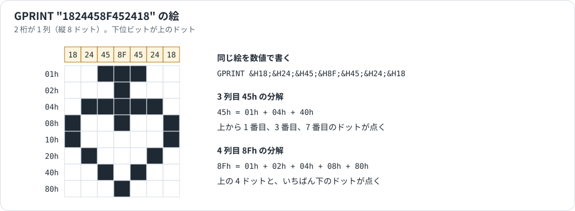

**引数**

| 引数 | 内容 |
|---|---|
| 文字列 | 16 進 2 桁を 1 列（縦 8 ドット）として並べた文字列。例: `"1824458F452418"`。 |
| 式 | 1 列分の値（0〜255）。下位ビットが上のドット。 |
| 引数なし | 現在の表示を保持する（`WAIT` と組み合わせて使う）。 |

1 列の 8 ドットは、いちばん上が 1、下へ行くほど 2 倍になります。点けるドットの数値を足したものが、その列の値です。

| ドット（上から） | 1 | 2 | 3 | 4 | 5 | 6 | 7 | 8 |
|---|---|---|---|---|---|---|---|---|
| 10 進 | 1 | 2 | 4 | 8 | 16 | 32 | 64 | 128 |
| 16 進 | 01 | 02 | 04 | 08 | 10 | 20 | 40 | 80 |

文字列で書くときは、2 桁のうち左が下の 4 ドット、右が上の 4 ドットです。下から 2 つ目と 3 つ目（64 + 32 = 96）なら `60` です。

**例**

```basic
10 CLS
20 GCURSOR (100,15)
30 GPRINT "1824458F452418"
40 IF INKEY$="" THEN 40
```


図の 7 列の絵を表示し、キーが押されるまで待ちます。

```basic
GPRINT &H18;&H24;&H45;&H8F;&H45;&H24;&H18
```

同じ絵を数値で書いた形です。

**注意**

- 文字のドットパターンも同じ向きの並びです。[フォント](13_FONT.md) の 6 バイトを続けて書くと、その文字が出ます。
- 末尾に `;` を付けると、次の `GPRINT` は続きの列から始まります。`:` や `ENTER` で終わると、次は列 0 に戻ります。
- 文字列の変数も書けます（`GPRINT A$;A$`）。

**関連**: [`GCURSOR`](#gcursor)、[`WAIT`](#wait)、[`PSET`](#pset)、[`LINE`](#line)

### GRAD

中間コード: `GRAD` = `FE 28`

使用区分: プログラム、直接実行 ／ 省略形: `GR.`

**書式**

```basic
GRAD
```

**働き**: 三角関数の角度単位をグラード（直角 = 100）にします。

**引数**: ありません。

**例**

```basic
10 GRAD
20 PRINT SIN 100
```

100 グラードは直角なので 1 です。

**注意**

- `DEGREE`、`RADIAN` を実行するまで続きます。電源を切っても残ります。

**関連**: [`DEGREE`](#degree)、[`RADIAN`](#radian)

### GRAPH

中間コード: `GRAPH` = `FE 41`

使用区分: プログラム、直接実行 ／ 省略形: `GRAP.`

**書式**

```basic
GRAPH
```

**働き**: プリンタ（CE-515P）をグラフィックモードにします。`CIRCLE`、`GLCURSOR`、`LLINE` などはこのモードで使います。

**引数**: ありません。

**例**

```basic
10 OPEN "COM:1200,N,8,1,A,C,&H1A,N,S" AS #1
20 GRAPH
30 LLINE (0,0)-(100,100)
40 LTEXT
50 CLOSE #1
```

グラフィックモードにして線を引き、テキストモードに戻します。

**注意**

- `LTEXT` でテキストモードに戻します。
- 描画中に `BREAK` した場合は、必ず `LPRINT` を実行しておきます。しないと、次の命令が正しく働かないことがあります。
- プロッタへ送るコマンドは [CE-515P プロッタ](19_CE-515P_PLOTTER.md) を参照してください。
- プロッタはシリアルにつなぎます。`OPEN` していないと、エラーを出さずに何も送りません（[CE-515P プロッタ](19_CE-515P_PLOTTER.md) §19.1）。
- `LTEXT` のあとに `LPRINT` を実行すると、ペンが左端へ戻ります。
- グラフィックモードで文字を書くには、先頭に `P` を付けて送ります（`LPRINT "PABC"`、変数なら `LPRINT "P";A$`）。
- テキストモードのままグラフィック用の命令を実行すると、命令の文字がそのまま印字されます。
- `LLIST` を実行するとテキストモードに戻ります。

**関連**: [`LTEXT`](#ltext)、[`GLCURSOR`](#glcursor)、[`LLINE`](#lline)、[`CIRCLE`](#circle)

### HEX$

中間コード: `HEX$` = `FE F2`

使用区分: プログラム、直接実行 ／ 省略形: `H.`

**書式**

```basic
HEX$ 式
```

**働き**: 10 進数を 16 進の文字列に変換します。

**引数**

| 引数 | 内容 |
|---|---|
| 式 | -9999999999〜9999999999。結果は最大 10 桁。 |

**例**

```basic
10 PRINT HEX$ 255
20 A$="&H"+HEX$ 4096
30 PRINT A$
```

`FF` と `&H1000` です。負の数は 10 桁の補数で、`HEX$ -1` は `FFFFFFFFFF` です（実験）。小数は切り捨てられます。

**注意**

- 範囲を超えると `Overflow` です（実験）。

**関連**: [`VAL`](#val)、[`CHR$`](#chr)

### IF ... THEN ... ELSE

中間コード: `IF` = `FE 56`、`THEN` = `FE 54`、`ELSE` = `FE 76`

使用区分: プログラム ／ 省略形: `THEN T.`、`ELSE EL.`

**書式**

```basic
IF 条件 THEN {文 | 行番号 | *ラベル} [ELSE {文 | 行番号 | *ラベル}]
IF 条件 GOTO 行番号 [ELSE 行番号]
IF 条件 文 [ELSE 文]
```

**働き**: 条件が真なら `THEN` 以降を、偽なら `ELSE` 以降を実行します。

**引数**

| 引数 | 内容 |
|---|---|
| 条件 | `=`、`<>`、`<`、`>`、`<=`、`>=` を使った関係式。文字列は文字コードで比較する。複数の条件は `AND` / `OR`（または `*` / `+`）でつなぐ。 |

**例**

```basic
10 INPUT A
20 IF A>=60 THEN PRINT "OK" ELSE PRINT "NG"
```

条件に合うかどうかで表示を変えます。

```basic
10 INPUT A,B
20 IF A>0 AND B>0 THEN 50
30 PRINT "NO"
40 END
50 PRINT "BOTH +"
```

2 つの条件を `AND` でつなぎ、真なら 50 行へ移ります。

**注意**

- 変数名の直後に `THEN` が続くときは間に空白を入れます（`IF A=B THEN`）。
- 行番号またはラベルを指定した場合はその位置へ移ります。
- 複数行に分ける形は [IF ... THEN / ELSE / ENDIF](#if--then--else--endifブロック形式)（ROM 8.3 以降）です。
- 動きの図は [14.4.2 条件分岐](#1442-条件分岐if--then--else) にあります。
- 条件は 0 なら偽、ほかは真です。`IF A THEN` とも書けます。真の値は -1 です（`PRINT 1=1` は -1）。
- `THEN` のあとに `:` でつないだ文は、条件が真のときだけ実行されます。`ELSE` のあとも同じです（実験）。
- 行番号へ分岐するときは、`THEN` と `GOTO` の一方だけで足ります。`THEN` を省いて文を書く形も動きました（`IF A=1 PRINT "T"`。実験）。
- `IF` の中に `IF` があるときの `ELSE` は、いちばん近い `IF` のものです（実験）。
- `FOR`、`ON ... GOTO` などでも、変数名のすぐあとに命令が続くときは空白を入れます。

**関連**: [`GOTO`](#goto)、[`ON ... GOTO`](#on--goto)、[`SWITCH ... CASE ... DEFAULT ... ENDSWITCH`](#switch--case--default--endswitch)

### INIT

中間コード: `INIT` = `FE 1D`

使用区分: 直接実行 ／ 省略形: `INI.`

**書式**

```basic
INIT "E:nK"
INIT "F:nK"
INIT "d:"
```

**働き**: RAM ディスク（E:, F:）またはポケットディスクを初期化します。

**引数**

| 引数 | 内容 |
|---|---|
| `d:` | `X:`、`E:`、`F:`。 |
| `nK` | RAM ディスクのデータファイル領域を KB 単位で指定。E: は 2〜27、F: は 2〜(RAM カード容量 - 1)。32 KB のカードなら 2〜31。`0K` を指定すると中身を消して領域そのものをなくす。`K` は省けない。 |

**例**

```basic
INIT "E:3K"
```

E: を 3 KB で作ります（ROM 7.2、8.3 の実験）。F: も同じ形です（[カードスロット](05_CARD_SLOT.md) §5.7.2 の実験）。直接実行だけの命令で、プログラムの中では `Direct command error` になります（実験）。

ROM 7.2 と 8.3 で、E: を作り、大きさを変え、なくすまでを続けて打った結果です（実験。2 つのバージョンで同じ）。

| 打ったもの | 結果 | `DSKF(3)` |
|---|---|---|
| （まだ E: がない） | | `Bad drive name` |
| `INIT "E:3K"` | 確認なしに作られる | 2304 |
| `INIT "E:5K"` のあと `N` | 変わらない | 2304 |
| `INIT "E:5K"` のあと `Y` | 5 KB に作り直す | 4096 |
| `INIT "E:"` のあと `Y` | 同じ大きさで消す | 4096 |
| `INIT "E:27K"` のあと `Y` | 27 KB に作り直す | 25344 |
| `INIT "E:28K"` のあと `Y` | `Out of memory`（ほかに何も入れていない 32 KB の本体） | |
| `INIT "E:1K"`、`INIT "E:3"` | `Syntax error` | |
| `INIT "E:",3` | `Syntax error`（E: があるときは、確認に `Y` と答えたあとで） | |
| `INIT "F:3K"`（カードなし） | `Bad drive name` | |
| `INIT "E:0K"` のあと `Y` | E: がなくなる | `Bad drive name` |

使える量は指定より少なくなります。3 KB（3072 バイト）で作ると 2304 バイトで、差は 768 バイトです。5 KB では 1024 バイト、27 KB では 2304 バイトを管理に使います（実験の値から計算）。

**注意**

- 実行時に既存内容を消してよいか確認されます（`Y` / `N`）。
- ポケットディスクは両面あり、裏面は裏返して再度 `INIT "X:"` を実行します。
- `ｼｮｷｶ OK? (Y/N)` と聞かれるのは、そのディスクがもうあるときです（実験）。英語版の PC-E500 では `INITIALIZE OK? (Y/N)` です。`N` なら中身は残ります。
- 大きさを変えると中身は消えます。先に `COPY` で逃がしてください。
- F: は先に RAM カードを使える形にしておきます（[カードスロット](05_CARD_SLOT.md) §5.7）。システムや変数が使っている分があるので、範囲の上限まで取れないことがあります。
- 新しいポケットディスクは最初に `INIT "X:"` で初期化します。

**関連**: [`DSKF`](#dskf)、[`FILES`](#files)、[`MEM$`](#mem)

### INKEY$

中間コード: `INKEY$` = `FE E9`

使用区分: プログラム ／ 省略形: `INK.`

**書式**

```basic
INKEY$
```

**働き**: 実行時点で押されているキーの文字を返します。押されていなければ空文字列です。キー入力を待ちません。

**引数**: ありません。

**例**

```basic
10 A$=INKEY$: IF A$="" THEN 10
20 PRINT ASC A$
```

キーが押されるまで 10 行を繰り返し、押された文字のコードを表示します。

押したキーと返るコードの表です。日本語の PC-E500 のキーを ROM 7.2 で 1 つずつ押した値です（実験）。字と数字のキーは大文字の文字コードです。

| コード | キー | コード | キー | コード | キー |
|---|---|---|---|---|---|
| 01h | `2ndF` | 0Bh | `INS` | 17h | `BS` |
| 02h | `C·CE` | 0Ch | `DEL` | 1Ah | `+/-` |
| 03h | `↕`（`1/x` の右） | 0Dh | `⏎` | 1Eh | `↕`（`PF1` の左） |
| 04h | `↑` | 0Eh | `►` | 1Fh | `EXP` |
| 05h | `↓` | 0Fh | `◄` | 5Eh | `yˣ` |
| 06h | `RCL` | 10h | `SHIFT` | 85h、9Bh | `→HEX`、`→DEG` |
| 07h | `STO` | 11h | `hyp` | 87h、88h | `1/x`、`x²` |
| 08h | `BASIC` | 13h | `FSE` | 91h、92h | `ln`、`log` |
| 09h | `MENU` | 14h | `カナ` | 95h〜97h | `sin`、`cos`、`tan` |
| 0Ah | `OFF` | 15h、16h | `CAPS`、`CTRL` | F1h〜F5h | `PF1`〜`PF5` |
| | | | | FCh | `√` |

- `1/x` や `sin` のコードは同じ働きの関数 `RCP`、`SIN` の中間コードと同じ番号です。
- 操作説明書 p.265 の表は PF1〜PF5 を F0h〜F4h としています。ROM 7.2 と 7.3 の実験では F1h〜F5h でした。
- 英語版の PC-E500 では、`カナ` の位置のキーが `ANS` です。コードは同じ 14h です。

**注意**

- `SHIFT` / `CAPS` 自体を読むので、それに続く記号キーは読めません。
- `ON`（`BREAK`）は読めず、プログラムが止まります。
- `RUN` の `ENTER` がまだ押されていると、最初の `INKEY$` が 13 を返すことがあります。前の例も、エミュレータでは 13 が表示されました。先に `10 IF INKEY$<>"" THEN 10` で離されるのを待ちます。

**関連**: [`INPUT`](#input)、[`INPUT$`](#input-1)

### INPUT

中間コード: `INPUT` = `FE 61`

使用区分: プログラム ／ 省略形: `I.`

**書式**

```basic
INPUT 変数 [,変数]
INPUT "プロンプト", 変数 [,["プロンプト"], 変数]
INPUT "プロンプト"; 変数 [,["プロンプト"]; 変数]
```

**働き**: キーボードから値を入力して変数に代入します。

**引数**

| 引数 | 内容 |
|---|---|
| 変数 | 代入先。数値変数と文字列変数。 |
| プロンプト | 表示する文字列。`,` で区切ると入力時にプロンプトが消えて左端から入力、`;` で区切るとプロンプトの右に続けて入力。 |

3 つの形は、入力のときの見え方が違います。

| 形 | 画面 | 打ったあと |
|---|---|---|
| `INPUT A` | `?` | `?` のところから値が入る |
| `INPUT "C=",C` | `C=` | 打ち始めると `C=` は消え、左端から値が入る |
| `INPUT "A=";A` | `A=_` | `A=` は残り、右に値が入る |

数値の変数には数だけでなく式や関数も打てます。`SIN 30` と打つと 0.5 が、`A+1` と打つと今の `A` に 1 を足した値が入ります（実験）。何も打たずに `ENTER` を押すと、変数は前の値のままです（実験）。

**例**

```basic
10 INPUT "NAME=";N$
20 INPUT "AGE=";A
30 PRINT N$;A
```

`;` なので、プロンプトの右に続けて入力します。

**注意**

- `LOCATE` で表示位置を指定できます。
- 変数を並べると、その数だけ続けて聞きます。1 回に `1,2` と打って 2 つ入れることはできません（`Syntax error`。実験）。文字列の変数なら、`,` も文字として入ります。
- 数値の変数に `"X"` と打つと `Type mismatch` です（実験）。
- 3 つの形は 1 つの文に混ぜて書けます（`INPUT "A=";A,B,"C=?",C`）。
- 直接実行では `Direct command error` です。

**関連**: [`INKEY$`](#inkey)、[`INPUT$`](#input-1)、[`INPUT#`](#input-2)、[`LOCATE`](#locate)

### INPUT$

中間コード: `INPUT` = `FE 61`

使用区分: プログラム、直接実行 ／ 省略形: `I.$`

**書式**

```basic
INPUT$ (文字数)
INPUT$ (文字数, #ファイル番号)
```

**働き**: キーボードまたはファイルから指定文字数の文字列を読み込みます。

**引数**

| 引数 | 内容 |
|---|---|
| 文字数 | 読み込む文字数。 |
| #ファイル番号 | 入力用に開いたファイル。省略時はキーボード。 |

キーボードから読むときの 2 バイト目の主なコードです（操作説明書 p.268）。文字のキーは 1 バイトの文字コードそのままで、`◄` は 1Dh、`►` は 1Ch、`↑` は 1Eh、`↓` は 1Fh、`BS` は 08h、`C・CE` は 0Ch、`DEL` は 7Fh です。

| キー | 2 バイト目 | キー | 2 バイト目 |
|---|---|---|---|
| OFF、BASIC、MENU、CAPS | 04h〜06h、09h | sin、cos、tan | 81h〜83h |
| AER、CAL、CA | 25h、26h、2Ch | FSE、→HEX、→DEG | 84h〜86h |
| PF1〜PF5 と CTRL | 53h〜57h | ln、log、1/x | 87h〜89h |
| 0〜9 と CTRL | 60h〜69h | ↕、EXP、yˣ、√、x²、+/- | 8Ah〜8Fh |
| RCL（英語版の ANS も同じ）、STO | 90h、91h | sinh、cosh、tanh | 94h〜96h |

**例**

```basic
10 A$=INPUT$ (1)
20 PRINT ASC A$
```

キーを 1 文字分だけ待って読みます。

**注意**

- ポケットディスク（`X:`）のファイルには使えません。
- 数値も文字として読みます。
- 1 文字ずつ数えるので、ファイルの CR と LF も 1 文字です。キーボードでは `ENTER` も 1 文字です。
- ファイルは `INPUT` で開いておきます。
- 関数キーや `MENU` などのキーは 2 バイトの列になります。先頭が 00h で、2 バイト目がキーの番号です。英語版の説明書（p.269）は `INPUT$ (1)` でも 2 バイト返ると書き、PC-E500S のドイツ語版（p.264）は `INPUT$ (2)` か `INPUT$ (1)` を 2 回使うように書いています。

**関連**: [`INPUT`](#input)、[`INKEY$`](#inkey)、[`OPEN`](#open)

### INPUT#

中間コード: `INPUT` = `FE 61`

使用区分: プログラム、直接実行 ／ 省略形: `I.#`

**書式**

```basic
INPUT #ファイル番号, 変数, 変数, ..., 変数
```

**働き**: シーケンシャルファイルから項目を読み込んで変数に代入します。

**引数**

| 引数 | 内容 |
|---|---|
| ファイル番号 | `OPEN ... FOR INPUT` で開いた番号。 |
| 変数 | 代入先。データと型（数値/文字列）を合わせる。 |

**例**

```basic
10 OPEN "E:A.TXT" FOR INPUT AS #1
20 INPUT #1,N$,A
30 CLOSE #1
40 PRINT N$;A
```

先に [`PRINT#`](#print-1) の 1 つ目の例を実行して、`E:A.TXT` を作っておきます。1 行から文字列と数値を 1 つずつ読みます。

**注意**

- 区切りは `,`、CR、LF、CR+LF です（数値は空白でも可）。
- `"` で始まるデータは次の `"` まで 1 項目です。
- `INPUT #1,A`、`INPUT# 1,A`、`INPUT#1,A`、`I.#1,A` はどれも同じです（実験）。
- データの前の空白は読み飛ばします。`"` で囲んだ中の `,` は区切りになりません。
- 変数の数よりデータが少ないと `Input past end`（87）、多い分は次の `INPUT #` が続きを読みます。
- 倍精度のデータは倍精度の変数で読みます。
- `COM:` から読むときは、`INPUT` で開いていなくてもかまいません。

**関連**: [`OPEN`](#open)、[`PRINT#`](#print-1)、[`EOF`](#eof)

### KEY

中間コード: `KEY` = `FE 79`

使用区分: プログラム、直接実行 ／ 省略形: `KE.`

**書式**

```basic
KEY キー番号, "文字列"
```

**働き**: プログラマブルファンクションキー（PF1〜PF10）に文字列を割り当てます。

**引数**

| 引数 | 内容 |
|---|---|
| キー番号 | 1〜10。 |
| 文字列 | 割り当てる文字列（31 文字まで。32 文字は `Illegal function call`）。`+CHR$13` を付けると `ENTER` まで含められる。文字列の変数も書ける。 |

**例**

```basic
KEY 1,"R.100"+CHR$13
```

PF1 を押すと `R.100` と `ENTER` が入ります。

```basic
10 FOR I=1 TO 10
20 PRINT I;KEY$ I
30 NEXT I
```

今の割り当てを全部表示します。

**注意**

- `CHR$ &H80`〜`&H9F`、`&HE0`〜`&HFF` は割り当てないでください。
- 割り当てがメモリの中でどう記録されるかは [BASIC の内部形式](15_BASIC_INTERNALS.md) §15.4 にあります。
- PF6〜PF10 は `SHIFT` を押しながら PF1〜PF5 です。
- 11 以上の番号は `Illegal function call` です（実験）。
- 英語版の説明書は割り当ててはいけない文字を 80h〜9Fh と E0h〜FFh（p.272）、PC-E500S のドイツ語版は 80h〜9Fh と E0h〜EFh（p.266）としています。どちらでも使えるのは、それ以外の文字です。
- 番号 0 は説明書にありません。`KEY 0,"A=5"+CHR$13` は、その文字をキーボードから打ったのと同じ働きをしました。プログラムの中に書くと、終わったあとで `A=5` が打たれて実行されます（実験。ROM 7.2、8.3）。

**関連**: [`KEY$`](#key-1)

### KEY$

中間コード: `KEY` = `FE 79`

使用区分: プログラム、直接実行 ／ 省略形: `KE.$`

**書式**

```basic
KEY$ キー番号
```

**働き**: ファンクションキーに割り当てた文字列を返します。

**引数**

| 引数 | 内容 |
|---|---|
| キー番号 | 1〜10。 |

**例**

```basic
PRINT KEY$ 1
```

PF1 の文字列です。

**注意**

- `A$=KEY$ 3` のように文字列の変数にも入れられます。11 以上は `Illegal function call` です。

**関連**: [`KEY`](#key)

### KILL

中間コード: `KILL` = `FE 3C`

使用区分: 直接実行 ／ 省略形: `K.`

**書式**

```basic
KILL "d:ファイル名"
```

**働き**: RAM ディスクまたはポケットディスク上のファイルを削除します。

**引数**

| 引数 | 内容 |
|---|---|
| `"d:ファイル名"` | 削除するファイル。`d:` は `X:`、`E:`、`F:`。拡張子は空のときだけ省ける。 |

**例**

```basic
KILL "E:A.TXT"
```

**注意**

- 存在しない、開いている、または属性 `P`（書き込み禁止）のファイルはエラーになります。

**関連**: [`FILES`](#files)、[`SET`](#set)、[`NAME`](#name)

### LEFT$

中間コード: `LEFT$` = `FE EB`

使用区分: プログラム、直接実行 ／ 省略形: `LEF.`

**書式**

```basic
LEFT$ (文字列, 式)
```

**働き**: 文字列の左端から指定文字数を取り出します。

**引数**

| 引数 | 内容 |
|---|---|
| 文字列 | 元の文字列。 |
| 式 | 取り出す文字数。元より多ければ全部、0 なら空文字列。 |

**例**

```basic
PRINT LEFT$ ("PC-E500",2)
```

`PC` です。

**注意**

- 負の文字数は `Data out of range` です（実験）。

**関連**: [`MID$`](#mid)、[`RIGHT$`](#right)、[`LEN`](#len)

### LEN

中間コード: `LEN` = `FE D2`

使用区分: プログラム、直接実行 ／ 省略形: なし

**書式**

```basic
LEN 文字列
```

**働き**: 文字列の文字数を返します。

**引数**

| 引数 | 内容 |
|---|---|
| 文字列 | 対象の文字列。 |

**例**

```basic
PRINT LEN "ABC"
```

3 です。空白や制御文字も 1 文字に数えます。

**関連**: [`LEFT$`](#left)、[`MID$`](#mid)、[`RIGHT$`](#right)

### LET

中間コード: `LET` = `FE 58`

使用区分: プログラム、直接実行 ／ 省略形: `LE.`

**書式**

```basic
[LET] 数値変数 = 式
[LET] 文字列変数 = 文字列
```

**働き**: 変数に値を代入します。`LET` は省略できます。

**引数**

| 引数 | 内容 |
|---|---|
| 変数 | 代入先。型を右辺と合わせる。 |

**例**

```basic
10 LET A=5
20 B$="ABC"
```

`LET` のあるなしで働きは同じです。

**注意**

- 数値を文字列の変数に入れるなど、型が合わないと `Type mismatch`（90）です。

**関連**: [`CLEAR`](#clear)、[`DIM`](#dim)

### LF

中間コード: `LF` = `FE 42`

使用区分: プログラム、直接実行 ／ 省略形: なし

**書式**

```basic
LF
LF 式
```

**働き**: プリンタ（CE-515P）の用紙を送ります。

**引数**

| 引数 | 内容 |
|---|---|
| 式 | 送る行数（-999〜999）。負の値で逆送り。省略時は 1 行。 |

**例**

```basic
LF 3
LF -1
```

3 行送り、1 行戻します。

**注意**

- 行送り量は `CSIZE` に従います。
- プロッタはシリアルにつなぎます。`OPEN` していないと、エラーを出さずに何も送りません（[CE-515P プロッタ](19_CE-515P_PLOTTER.md) §19.1）。
- テキストモードで使います。

**関連**: [`CSIZE`](#csize)、[`LPRINT`](#lprint)

### LFILES

中間コード: `LFILES` = `FE 3B`

使用区分: 直接実行 ／ 省略形: `LF.`

**書式**

```basic
LFILES ["[d:][ファイル名]"]
```

**働き**: ディスク上のファイル名と属性をプリンタに印字します。

**引数**

| 引数 | 内容 |
|---|---|
| `d:` | `X:`、`E:`、`F:`。 |
| ファイル名 | ワイルドカード可。拡張子は省略しない。書かなければ全部。 |

**例**

```basic
LFILES "E:*.*"
```

E: のファイルの一覧を印字します。

**注意**

- デバイスを省くと、前のファイルの命令（`FILES "E:"` など）のデバイスになります。
- 印字の形は「ファイル名.拡張子 属性」です。

**関連**: [`FILES`](#files)

### LINE

中間コード: `LINE` = `FE 69`

使用区分: プログラム、直接実行 ／ 省略形: `LIN.`

**書式**

```basic
LINE [(式1, 式2)] - (式3, 式4) [,{S | R | X}] [,線種] [,{B | BF}]
```

**働き**: 画面上の 2 点間に直線を引きます。オプションで矩形も描けます。

座標の取り方は次の図のとおりです。

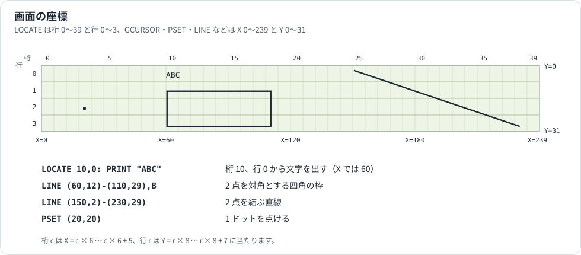

**引数**

| 引数 | 内容 |
|---|---|
| 式1, 式2 | 始点。省略時は原点 (0,0) または前回の `LINE` の終点。 |
| 式3, 式4 | 終点。X は 0〜239、Y は 0〜31（範囲外は画面内の部分だけ描く）。 |
| S / R / X | ドットをセット / リセット / 反転。省略時は S。 |
| 線種 | 16 bit のビットパターン（0〜65535）。1 のビットのドットだけに S / R / X が働き、16 ドットごとに繰り返す。省略時または `&HFFFF` で実線、`&H6666`（0110 0110 0110 0110）などで点線、0 では何も描かない。 |
| B / BF | 2 点を対角とする矩形の枠 / 塗りつぶし。 |

**例**

```basic
10 CLS
20 LINE (10,0)-(239,16)
30 LINE (24,0)-(124,31),&HF18F,B
```

20 行は左上から右下への線、30 行は破線の枠です。

```basic
10 CLS
20 LINE (0,0)-(60,31),BF
30 LINE (10,5)-(50,26),R,BF
40 LINE -(239,0),X
50 IF INKEY$="" THEN 50
```


四角を塗り、その中を消し、前回の終点 (50,26) から線を反転で引きます。

**注意**

- オプションは「S / R / X、線種、B / BF」の順に書きます。ROM 2.2 と 7.2 で `LINE (0,0)-(239,31),S,&HFFFF,B`、`…,&HFFFF,B`、`…,S,B`、`…,B`、`…,R,BF`、`…,X` が使え、`…,&HFFFF,S,B` と `…,,R,BF` は `Syntax error` でした（実験）。
- 古いバージョンの `LINE ...,B` には、座標の正負が混じると 1 ドット余分に打つ不具合があります（[ROM バージョンの違い: BASIC](24_ROM_VERSIONS_BASIC.md) §24.3.1）。
- 座標は -32768〜32767 まで書けます。

**関連**: [`PSET`](#pset)、[`PRESET`](#preset)、[`GPRINT`](#gprint)、[`CLS`](#cls)

### LIST

中間コード: `LIST` = `FE 14`

使用区分: 直接実行（PRO モード） ／ 省略形: `L.`

**書式**

```basic
LIST
LIST 行番号
LIST *ラベル
```

**働き**: プログラムを画面に表示します。

**引数**

| 引数 | 内容 |
|---|---|
| 行番号 / `*ラベル` | 表示を始める位置。省略時は先頭から。 |

**例**

```basic
LIST
LIST 100
```

先頭から、または 100 行から、画面 1 杯に表示します。100 行がなければ、その次に大きい行からです。

**注意**

- パスワード設定中は無視されます。
- `↓` で次の行へ進みます。
- 最後の行より大きい番号と、ないラベルは `Undefined line` です。`LIST 20-30` のような範囲は書けません（`Illegal line number`。実験）。
- RUN モードでは `Mode error` です。

**関連**: [`LLIST`](#llist)、[`TRON / TROFF`](#tron--troff)

### LLINE

中間コード: `LLINE` = `FE 6A`

使用区分: プログラム、直接実行 ／ 省略形: `LLIN.`

**書式**

```basic
LLINE [(式1, 式2)] - (式3, 式4) [,式5] [,式6] [,B]
LLINE [(x1, y1)] - (x2, y2) - (x3, y3) ... - (x6, y6) [,式5] [,式6]
```

**働き**: プリンタ（CE-515P）で 2 点間に線を引きます。`B` を付けると矩形を描きます。座標は `SORGN` の原点から数えます。

**引数**

| 引数 | 内容 |
|---|---|
| 式1, 式2 | 始点（座標は -999〜999）。省略時は現在のペン位置（矩形のときは省略不可）。 |
| 式3, 式4 | 終点。 |
| 式5 | 線種（0〜15）。省略時は 0（実線）。 |
| 式6 | 色（0〜3）。省略時は前回の値。 |
| B | 2 点を対角とする矩形を描く。 |

**例**

```basic
10 OPEN "COM:1200,N,8,1,A,C,&H1A,N,S" AS #1
20 GRAPH
30 LLINE (0,0)-(100,0)
40 LLINE (0,0)-(100,-60),0,2,B
50 LLINE (0,0)-(20,20)-(40,0)-(60,20)
60 LTEXT
70 CLOSE #1
```

30 行は線、40 行は緑の四角、50 行は折れ線です。

**注意**

- `LLINE (x1,y1)-(x2,y2)-(x3,y3)-...` と点を最大 6 個つなげて折れ線を描く形もあります。ROM は `-(x,y)` を数え、5 個を超えるとエラーにします（コード。ROM 8.5 の `E6A65h` `CMP A,05h`）。最初の (x1,y1) を省いたときは 5 点です。
- プロッタはシリアルにつなぎます。`OPEN` していないと、エラーを出さずに何も送りません（[CE-515P プロッタ](19_CE-515P_PLOTTER.md) §19.1）。
- 送る順序と線の種類は [CE-515P プロッタ](19_CE-515P_PLOTTER.md) §19.4 にあります。

**関連**: [`RLINE`](#rline)、[`GLCURSOR`](#glcursor)、[`SORGN`](#sorgn)、[`COLOR`](#color)、[`PAINT`](#paint)

### LLIST

中間コード: `LLIST` = `FE 15`

使用区分: 直接実行 ／ 省略形: `LL.`

**書式**

```basic
LLIST
LLIST {行番号 | *ラベル}
LLIST [行番号1], [行番号2]
```

**働き**: プログラムをプリンタに印字します。

**引数**

| 引数 | 内容 |
|---|---|
| 行番号 / `*ラベル` | 印字する範囲。行番号1 省略時は先頭から、行番号2 省略時は最後まで。 |

**例**

```basic
LLIST 100,200
LLIST 500,
```

100〜200 行、500 行から最後までを印字します。

**注意**

- 1 行の桁数は `CONSOLE` の設定に従います（23 桁以下はエラー）。
- パスワード設定中は無視されます。
- `COM:` を開いていると、シリアルへ送ります。`CLOSE` でプリンタに戻ります。
- 行番号1 と行番号2 のある形では、ない行番号は次に大きい行になります。2 つの行のあいだには 2 行以上が必要で、同じ行を指すとエラーです（PC-E500S の説明書 p.277）。

**関連**: [`LIST`](#list)、[`CONSOLE`](#console)

### LOAD

中間コード: `LOAD` = `FE 18`

使用区分: 直接実行 ／ 省略形: `LOA.`

**書式**

```basic
LOAD ["d:ファイル名" [,R]]
```

**働き**: BASIC プログラムをデバイスから読み込みます。

**引数**

| 引数 | 内容 |
|---|---|
| `"d:ファイル名"` | `d:` は `X:`、`E:`、`F:`、`CAS:`、`COM:`。全部省略するとシリアルから読む。 |
| `,R` | 読み込み後すぐ実行する。 |

**例**

```basic
LOAD "E:TEST.BAS"
LOAD "X:TEST.BAS",R
```

2 行目は読み込んですぐ実行します。

**注意**

- `SAVE M` 形式（機械語）は `LOAD M "d:ファイル名"` で読みます。`LOAD M` はプログラムの中でも使えます（実験、ROM 7.2）。`LOAD` で読むと `I/O error` です。
- 1 行が 256 バイトを超える、または行番号で始まらない行があるとエラーになります。
- 読み込みのあいだに、開いているファイルはすべて閉じられ、`USING`、`ON ERROR GOTO`、`WAIT`、`LOCATE`、`ERL`、`ERN` の設定は消えます。
- 途中でエラーになると、中間コードのファイルは何も読み込まれず、ASCII のファイルはエラーの前の行までが残ります。
- 拡張子は `.BAS` のときだけ省けます。`CAS:` と `COM:` は ASCII だけです。
- ASCII のファイルでは `P.` のような省略形も命令として読まれ、小文字は大文字になります（実験。ROM 7.2）。
- 行番号 65280 以上の行は読み込まれませんでした（実験）。

**関連**: [`SAVE`](#save)、[`LOAD?`](#load-1)、[`MERGE`](#merge)、[`CHAIN`](#chain)

### LOAD?

中間コード: `LOAD` = `FE 18`

使用区分: 直接実行 ／ 省略形: `LOA.?`

**書式**

```basic
LOAD? ["d:ファイル名"]
```

**働き**: デバイス上のプログラムとメモリ上のプログラムを比較します。

**引数**

| 引数 | 内容 |
|---|---|
| `"d:ファイル名"` | `LOAD` と同じ。 |

**例**

```basic
SAVE "X:TEST.BAS"
LOAD? "X:TEST.BAS"
```

保存したあと、同じ内容かを確かめます。

**注意**

- 同じでなければ `Verify error`（82）です。

**関連**: [`LOAD`](#load)、[`SAVE`](#save)、[`CLOAD?`](#cload-1)

### LOC

中間コード: `LOC` = `FE B3`

使用区分: プログラム、直接実行 ／ 省略形: なし

**書式**

```basic
LOC (ファイル番号)
```

**働き**: ファイルを開いてから読み書きしたレコードの数を返します。1 レコードは 256 バイトです。

**引数**

| 引数 | 内容 |
|---|---|
| ファイル番号 | 開いているファイル。 |

**例**

```basic
10 OPEN "E:A.TXT" FOR INPUT AS #1
20 INPUT #1,A$
30 PRINT LOC (1)
40 CLOSE #1
```

先に [`PRINT#`](#print-1) の 1 つ目の例を実行して、`E:A.TXT` を作っておきます。1 項目を読んだあとの位置を表示します。256 バイトより短いファイルなら 1 です。

100 個の数（592 バイト）を書いたファイルで調べると、書き終えたときは 2、読むために開いた直後は 1、60 個目を読んだあとは 2 でした（実験。ROM 7.2）。

**注意**

- `COM:` では、受信バッファ（10 文字、20 バイト）にあるデータのバイト数です。
- `LOC 1` とも書けます。開いていない番号はエラーです。

**関連**: [`LOF`](#lof)、[`EOF`](#eof)

### LOCATE

中間コード: `LOCATE` = `FE 51`

使用区分: プログラム、直接実行 ／ 省略形: `LO.`

**書式**

```basic
LOCATE [式1] [,式2]
LOCATE
```

**働き**: `PRINT` / `INPUT` などの表示開始位置を桁単位で指定します。

**引数**

| 引数 | 内容 |
|---|---|
| 式1 | 桁位置（0〜39）。省略時は今の桁。 |
| 式2 | 行位置（0〜3）。省略時は今の行。 |

**例**

```basic
10 CLS
20 LOCATE 17,1
30 PRINT "CENTER"
```

2 行目の中ほどに表示します（座標の図は `LINE` の項）。

**注意**

- 引数なしで指定を解除します。
- 指定位置に上書きするだけで他の表示は消えません（全消去は `CLS`）。
- 範囲の外は `Data out of range` です（実験）。
- 表示が画面の終わりを超えると、`LOCATE` で置いた表示も含めて上へ流れます。
- `RUN` と `SHIFT` + `CA` で解除されます。`GOTO` では残ります。

**関連**: [`PRINT`](#print)、[`INPUT`](#input)、[`CLS`](#cls)

### LOF

中間コード: `LOF` = `FE B2`

使用区分: プログラム、直接実行 ／ 省略形: なし

**書式**

```basic
LOF (ファイル番号)
```

**働き**: 開いているファイルのサイズ（バイト）を返します。

**引数**

| 引数 | 内容 |
|---|---|
| ファイル番号 | 開いているファイル。 |

**例**

```basic
10 OPEN "E:A.TXT" FOR INPUT AS #1
20 PRINT LOF (1)
30 CLOSE #1
```

先に [`PRINT#`](#print-1) の 1 つ目の例を実行して、`E:A.TXT` を作っておきます。ファイルの大きさを、実際のバイト数で表示します。数を 100 個書いたファイルは 592 でした（実験）。ディスクの使用量は 256 / 512 バイト単位なので、合計とは一致しません。

**注意**

- `COM:` では、受信バッファ（10 文字、20 バイト）の残りのバイト数です。

**関連**: [`LOC`](#loc)、[`EOF`](#eof)、[`DSKF`](#dskf)

### LPRINT

中間コード: `LPRINT` = `FE 64`

使用区分: プログラム、直接実行 ／ 省略形: `LP.`

**書式**

```basic
LPRINT {式 | 文字列} [{, | ;} {式 | 文字列}] ... [{, | ;}]
LPRINT USING "書式"; {式 | 文字列} [...]
LPRINT
```

**働き**: プリンタまたはシリアルへデータを出力します。書式は `PRINT` と同じです。

**引数**

| 引数 | 内容 |
|---|---|
| 式 / 文字列 | 出力する項目。`,` 区切りで 24 桁を 12 桁ずつの欄に分け、数値は右、文字列は左に寄せる。`;` は左から続けて出力。末尾の `,` `;` で次回の出力を続ける。 |
| 書式 | `USING` の書式文字列。 |

**例**

```basic
10 LPRINT "A=";A
20 LPRINT USING "###.##";B
```

表示の代わりに印字します。

**注意**

- 1 行の桁数は `CONSOLE` に従います。
- `PRINT=LPRINT` を実行すると以後の `PRINT` がすべて `LPRINT` として動きます（`PRINT=PRINT` で戻す）。
- `COM:` を開いていると、`LPRINT` は `COM:` へ出ます（[CE-515P プロッタ](19_CE-515P_PLOTTER.md) §19.1）。
- 1 項目だけのとき、CE-126P では数値は右端に、文字列は左端に寄ります。CE-515P とシリアルでは、どちらも左端からです。
- 12 文字を超える文字列は次の欄にはみ出し、12 桁を超える数値は仮数の後ろが切り捨てられます。24 桁を超えると次の行に回ります。
- `PRINT=LPRINT` は、`RUN`、`SHIFT` + `CA`、電源の入れ直しでも戻ります。`RUN` で戻るので、続けるにはプログラムを `GOTO` で始めます。
- 引数なしの `LPRINT` は区切りの文字だけを送ります。`;` で終わってバッファに残っている分があれば、それを印字します。

**関連**: [`PRINT`](#print)、[`CONSOLE`](#console)、[`USING`](#using)

### LTEXT

中間コード: `LTEXT` = `FE 40`

使用区分: プログラム、直接実行 ／ 省略形: `LT.`

**書式**

```basic
LTEXT
```

**働き**: プリンタ（CE-515P）をテキストモードに戻します。

**引数**: ありません。

**例**

```basic
10 OPEN "COM:1200,N,8,1,A,C,&H1A,N,S" AS #1
20 GRAPH
30 CIRCLE (0,0),50
40 LTEXT
50 LPRINT "CIRCLE"
60 CLOSE #1
```

図を描いたあと、文字の印字に戻ります。

**注意**

- `LLIST` を実行すると自動的にテキストモードになります。
- オートパワーオフ後や電源投入後は `GRAPH` / `LTEXT` でモードを設定し直します。
- プロッタはシリアルにつなぎます。`OPEN` していないと、エラーを出さずに何も送りません（[CE-515P プロッタ](19_CE-515P_PLOTTER.md) §19.1）。

**関連**: [`GRAPH`](#graph)

### MDF

中間コード: `MDF` = `FE 80`

使用区分: プログラム、直接実行 ／ 省略形: `MD.`

**書式**

```basic
MDF (式)
MDF (式, しきい値)
```

**働き**: `USING` で指定した小数桁で値を丸めます。

**引数**

| 引数 | 内容 |
|---|---|
| 式 | 丸める値。 |
| しきい値 | 切り捨て部の先頭桁がこの値より大きいと切り上げる。省略時は 4（四捨五入）。 |

**例**

```basic
10 USING "####.##"
20 A=MDF (2/3)
30 PRINT A
```

小数 2 桁に丸めた値（0.67）を `A` に入れます。

**注意**

- `USING` で小数桁が指定されているときだけ効きます。指定がなければ `MDF(1.2345)` は 1.2345 のままです（実験）。
- `USING "###.##"` では、`MDF(1.234)` は 1.23、`MDF(1.235)` は 1.24、しきい値 0 の `MDF(1.231,0)` は 1.24、しきい値 9 の `MDF(1.239,9)` は 1.23 でした（実験）。
- `USING` だけで表示すると、桁を超えた分は切り捨てです。`PRINT USING "####.##";2/3` は 0.66 になります（実験）。

**関連**: [`USING`](#using)

### MEM$

中間コード: `MEM$` = `FE 0D`

使用区分: プログラム、直接実行 ／ 省略形: `ME.`

**書式**

```basic
MEM$
```

**働き**: RAM カードの構成を示す文字列を返します。

**引数**: ありません。

**例**

```basic
PRINT MEM$
MEM$="S2"
```

今の設定を見て、`S2` に切り替えます。

**注意**

- 値は `S1`（本体だけを使う）、`S2`（カードだけを使う）、`B`（カードを本体の続きとして使う）です。
- `MEM$="S2"` のように代入して切り替えます。
- 3 つの違いは [カードスロット](05_CARD_SLOT.md) §5.7 にあります。
- カードがないときは、`MEM$="S1"` は何も起きず、`MEM$="S2"` は `Illegal function call`、`MEM$="B"` は `Out of memory`、`MEM$="X"` は `Syntax error` でした（実験。ROM 2.2、7.2、8.5）。

**関連**: [`INIT`](#init)、[`FRE`](#fre)

### MERGE

中間コード: `MERGE` = `FE 17`

使用区分: 直接実行 ／ 省略形: `MER.`

**書式**

```basic
MERGE "[d:]ファイル名"
```

**働き**: デバイス上のプログラムを読み込み、メモリ上のプログラムに合成します。同じ行番号は読み込んだ側で置き換わります。

**引数**

| 引数 | 内容 |
|---|---|
| `"d:ファイル名"` | ASCII 形式で保存したプログラム。`d:` は `X:`、`E:`、`F:`、`CAS:`、`COM:`。 |

**例**

```basic
SAVE "E:SUB.BAS",A
MERGE "E:SUB.BAS"
```

よく使うサブルーチンを ASCII 形式で保存しておき、別のプログラムに足します。

**注意**

- 合成の結果プログラム領域があふれるとエラーになります。
- テープから合成できるのは `SAVE "CAS:…"` で保存したものです。`CSAVE` のテープは使えません。
- 中間コードのファイルを読み込むと、正しく動かなくなることがあります。
- `d:` を省くと、前のファイルの命令のデバイスになります。

**関連**: [`LOAD`](#load)、[`SAVE`](#save)、[`CHAIN`](#chain)

### MID$

中間コード: `MID$` = `FE EA`

使用区分: プログラム、直接実行 ／ 省略形: `M.`

**書式**

```basic
MID$ (文字列, N, M)
```

**働き**: 文字列の N 文字目から M 文字を取り出します。

**引数**

| 引数 | 内容 |
|---|---|
| 文字列 | 元の文字列。 |
| N | 開始位置（1〜254。1 から数える）。 |
| M | 文字数（0〜254）。文字が足りなければ末尾まで。 |

**例**

```basic
PRINT MID$ ("PC-E500",4,4)
PRINT MID$ ("PC-E500",4,254)
```

どちらも `E500` です。末尾までほしいときは、大きな文字数を書きます。

**注意**

- `M` は省けません。`MID$ ("ABCDE",2)` は `Syntax error` です（実験。ROM 7.2）。
- N が文字数より大きいと空文字列、N が 1 より小さいと `Illegal function call` です。
- 小数は切り捨てられます。

**関連**: [`LEFT$`](#left)、[`RIGHT$`](#right)、[`LEN`](#len)

### NAME

中間コード: `NAME` = `FE 3E`

使用区分: 直接実行 ／ 省略形: `NA.`

**書式**

```basic
NAME "d:旧ファイル名" AS "新ファイル名"
```

**働き**: RAM ディスクまたはポケットディスク上のファイル名を変更します。

**引数**

| 引数 | 内容 |
|---|---|
| `d:` | `X:`、`E:`、`F:`。 |

**例**

```basic
NAME "E:OLD.BAS" AS "NEW.BAS"
```

**注意**

- 新しい名前にデバイスを付けた `NAME "E:OLD" AS "E:NEW"` も使えます（操作説明書 p.298）。
- 拡張子は空のときだけ省けます。
- 旧名が存在しない、新名が既にある、旧ファイルが `P` 属性または開いているときはエラーになります。

**関連**: [`FILES`](#files)、[`COPY`](#copy)、[`KILL`](#kill)

### NEW

中間コード: `NEW` = `FE 11`

使用区分: 直接実行（PRO モード） ／ 省略形: なし

**書式**

```basic
NEW
```

**働き**: メモリ上のプログラムと変数をすべて消去します。

**引数**: ありません。

**注意**

- AER メモリの内容は残ります。
- パスワードのあるプログラムは消えません。
- RUN モードでは `Mode error` です。PRO モードで使います。

**関連**: [`CLEAR`](#clear)、[`DELETE`](#delete)

### ON ERROR GOTO

中間コード: `ON` = `FE 55`、`ERROR` = `FE 78`、`GOTO` = `FE 2B`

使用区分: プログラム ／ 省略形: `O. ERR. G.`

**書式**

```basic
ON ERROR GOTO {行番号 | *ラベル}
ON ERROR GOTO 0
```

**働き**: エラー発生時に指定行へ分岐するエラー処理ルーチンを設定します。

**引数**

| 引数 | 内容 |
|---|---|
| 行番号 / `*ラベル` | エラー処理ルーチンの先頭。`0` で設定を解除。 |

**例**

```basic
10 ON ERROR GOTO 100
20 INPUT X
30 Y=1/X
40 PRINT Y
50 END
100 PRINT "ERROR";ERN;" LINE";ERL
110 RESUME 20
```

0 を入れると 30 行でエラーになり、番号と行を表示して 20 行からやり直します。

**注意**

- ルーチン内では `ERN` / `ERL` で分岐し、`RESUME` で戻ります。
- ルーチン内でさらにエラーが起きると停止します。
- `RESUME` を使わずに `GOTO` などで戻ると、次のエラーで止まります。1 回目は分岐しても、2 回目は `Division by Zero in 20` で止まりました（実験）。
- `RUN`、電源断、プログラム読み込み、`SHIFT`+`CA` でも設定は解除されます。
- 動きの図は [14.4.6 エラー処理](#1446-エラー処理on-error-goto) にあります。

**関連**: [`ERN`](#ern)、[`ERL`](#erl)、[`RESUME`](#resume)

### ON ... GOSUB

中間コード: `ON` = `FE 55`、`GOSUB` = `FE 62`

使用区分: プログラム ／ 省略形: `O. … GOS.`

**書式**

```basic
ON 式 GOSUB {行番号1 | *ラベル1}, {行番号2 | *ラベル2}, ...
```

**働き**: 式の値（1, 2, 3, ...）に応じて、並べたサブルーチンのいずれかを呼び出します。

**引数**

| 引数 | 内容 |
|---|---|
| 式 | 小数は切り捨て（1.9 は 1）。1 なら最初、2 なら 2 番目の分岐先。0、負、候補数超のときは何もせず次へ進む。-32769 以下または 32768 以上は `Data out of range`。 |

**例**

```basic
10 INPUT "1-3";N
20 ON N GOSUB 100,200,300
30 GOTO 10
100 PRINT "ONE": RETURN
200 PRINT "TWO": RETURN
300 PRINT "THREE": RETURN
```

入力した番号のサブルーチンを実行して、30 行へ戻ります。

**注意**

- 各候補は `RETURN` で戻るサブルーチンにします。
- ラベルも行番号の代わりに指定できます。
- `ON A GOSUB` のように、`GOSUB` の前に空白を入れます。ないと変数名の一部とみなされることがあります。

**関連**: [`ON ... GOTO`](#on--goto)、[`GOSUB / RETURN`](#gosub--return)

### ON ... GOTO

中間コード: `ON` = `FE 55`、`GOTO` = `FE 2B`

使用区分: プログラム ／ 省略形: `O. … G.`

**書式**

```basic
ON 式 GOTO {行番号1 | *ラベル1}, {行番号2 | *ラベル2}, ...
```

**働き**: 式の値に応じて、並べた行のいずれかへ分岐します。

**引数**

| 引数 | 内容 |
|---|---|
| 式 | `ON ... GOSUB` と同じ。 |

**例**

```basic
10 INPUT "1-2";N
20 ON N GOTO 100,200
30 PRINT "?": GOTO 10
100 PRINT "ONE": END
200 PRINT "TWO": END
```

1 なら 100 行、2 なら 200 行、ほかの値なら 30 行へ進みます。

**注意**

- `GOTO` の前に空白を入れます。

**関連**: [`ON ... GOSUB`](#on--gosub)、[`GOTO`](#goto)

### OPEN

中間コード: `OPEN` = `FE 21`

使用区分: プログラム、直接実行 ／ 省略形: `OP.`

**書式**

```basic
OPEN "d:ファイル名" FOR モード AS #ファイル番号
OPEN "ボーレート, パリティ, データ長, ストップビット, コード, デリミタ, EOF コード, XON, シフトコード" AS #ファイル番号
OPEN
```

**働き**: ファイルをファイル番号に割り当てて開きます（書式 1）。または、シリアル I/O（COM）の通信条件を設定します（書式 2, 3）。

ファイル番号は開いたファイルを指す識別番号です。以後の命令は名前の代わりにこの番号を使います。

**引数**

| 引数 | 内容 |
|---|---|
| `d:` | `X:`、`E:`、`F:`、`CAS:`。 |
| モード | `INPUT`（読み込み）、`OUTPUT`（新規書き込み。既存ファイルは消える）、`APPEND`（追記）。 |
| #ファイル番号 | 1〜255。`#` は省ける（実験）。以後の `INPUT#` / `PRINT#` / `CLOSE` で使う番号。 |
| 通信条件 | 例 `"COM:1200,N,8,1,A,C,&H1A,N,S"`。`COM:` と `AS #番号` は省ける。省略した項目は現在値を保持。 |

**例**

```basic
10 OPEN "E:A.TXT" FOR OUTPUT AS #1
20 PRINT #1,"HELLO"
30 CLOSE #1
40 OPEN "E:A.TXT" FOR INPUT AS #1
50 INPUT #1,A$
60 PRINT A$
70 CLOSE #1
```

書いて閉じ、同じファイルを開き直して読みます。

```basic
10 OPEN "COM:1200,N,8,1,A,C,&H1A,N,S" AS #1
20 PRINT #1,"HELLO"
30 CLOSE #1
```

シリアルの条件を決めて送ります。各項目の値は [15 ピン（シリアル）](07_PORT_15PIN.md) §7.2 にあります。

**注意**

- 引数なしの書式 3 は前回の条件のままシリアルを開きます（ファイル番号 1）。
- 既に開いている番号を再度開くとエラーになります。
- `INPUT` / `APPEND` でファイルが無いとエラーになります。
- モードごとの決まりです。`INPUT` は読むだけ。`OUTPUT` は新しく作る（同じ名前があれば消える）。`APPEND` は後ろに足す。`P` 属性のファイルに `OUTPUT` / `APPEND` は使えません。
- `APPEND` は、操作説明書 p.188 では「なければ新しく作る」、p.303 では「なければエラー」と書かれています。ROM 7.2 では `File not found` でした（実験）。
- 同時に開けるのは、ポケットディスクが 6 個、それ以外（E:、F:、CAS:、COM:）が合わせて 2 個です。CAS: と COM: はそれぞれ 1 個だけです。E: に 3 個目を開くと `Too many files open` でした（実験）。`SAVE`、`LOAD`、`CHAIN`、`MERGE` も 1 個使います（`CSAVE` と `CLOAD` は使いません）。
- 同じファイル、同じ番号をもう一度開くと `File already open`、番号 256 は `Data out of range` です（実験）。
- ファイル名は 8 文字 + 拡張子 3 文字です。長い分は切られます（`ABCDEFGHIJ.TXTX` は `ABCDEFGH.TXT`）。小文字は大文字に直されず、`a.txt` は `A.TXT` と別の名前になります（実験）。使える文字は英数字と `# $ % & ' ( ) { } - ^ _ @` です（操作説明書 p.174）。
- 条件を 1 つだけ変えるときは、前の `,` を書きます。`OPEN ",,,2"` でストップビットだけが 2 になります（実験）。操作説明書 p.305 の例 `OPEN "",2` は `Bad file name` でした（実験）。

**関連**: [`CLOSE`](#close)、[`PRINT#`](#print-1)、[`INPUT#`](#input-2)、[`INPUT$`](#input-1)、[`EOF`](#eof)、[`OPEN$`](#open-1)

### OPEN$

中間コード: `OPEN$` = `FE E8`

使用区分: プログラム、直接実行 ／ 省略形: `OP.$`

**書式**

```basic
OPEN$
```

**働き**: 現在設定されているシリアル I/O の通信条件を文字列で返します。

**引数**: ありません。

**例**

```basic
PRINT OPEN$
```

今の通信条件が表示されます。電池を替えたあとや RESET のあとは次のとおりです。

```text
1200,N,8,1,A,C,&H1A,N,S
```

左から、速さ（300、600、1200、2400、4800、9600）、パリティ（N / E / O）、データ長（7、8）、ストップビット（1、2）、コード（A のみ）、区切り（C = CR、F = LF、L = CR+LF）、ファイルの終わりのコード、XON（N / X）、シフトコード（S / N）です。

**関連**: [`OPEN`](#open)

### PAINT

中間コード: `PAINT` = `FE 70`

使用区分: プログラム、直接実行 ／ 省略形: `PAI.`

**書式**

```basic
PAINT 式1 [,式2]
```

**働き**: プリンタ（CE-515P）で `LLINE` / `RLINE` の `B` オプションで描いた矩形の内側を網掛けします。

**引数**

| 引数 | 内容 |
|---|---|
| 式1 | 網掛けパターン（0〜10）。 |
| 式2 | 色（0〜3）。 |

**例**

```basic
10 OPEN "COM:1200,N,8,1,A,C,&H1A,N,S" AS #1
20 GRAPH
30 LLINE (0,0)-(100,-60),0,0,B
40 PAINT 5,3
50 LTEXT
60 CLOSE #1
```

四角を描き、その内側を赤いパターン 5 で網掛けします。

**注意**

- プロッタはシリアルにつなぎます。`OPEN` していないと、エラーを出さずに何も送りません（[CE-515P プロッタ](19_CE-515P_PLOTTER.md) §19.1）。
- 網掛けが働く条件は [CE-515P プロッタ](19_CE-515P_PLOTTER.md) §19.6 にあります。

**関連**: [`LLINE`](#lline)、[`RLINE`](#rline)、[`COLOR`](#color)

### PASS

中間コード: `PASS` = `FE 13`

使用区分: 直接実行 ／ 省略形: `PA.`

**書式**

```basic
PASS "文字列"
```

**働き**: メモリ上のプログラムにパスワードを設定または解除します。

**引数**

| 引数 | 内容 |
|---|---|
| 文字列 | パスワード（8 文字まで。9 文字は `Syntax error`）。同じ文字列で再度実行すると解除。 |

**例**

```basic
PASS "ABC"
```

1 回目で設定、同じ文字列でもう一度実行すると解除です。

**注意**

- 設定中は `LIST`、`DELETE`、変更、`BASIC` / `TEXT` などができません。
- `PASS` の後に他の文を続けるとエラーになり解除できません。
- プログラムが無い状態で実行すると `Program not exist` です。
- 違うパスワードは `Password mismatch` です。
- 設定中の `LIST`、`DELETE`、`NEW`、行の入力は何も起こらず、`SAVE` と `TEXT` は `Invisible program` です（実験。ROM 7.2）。`RUN` はできます。
- パスワードのあるプログラムを `LOAD` すると、そのパスワードもいっしょに設定されます。
- パスワードの記録の形は [BASIC の内部形式](15_BASIC_INTERNALS.md) §15.3.2 にあります。

**関連**: [`CSAVE`](#csave)、[`LIST`](#list)

### PAUSE

中間コード: `PAUSE` = `FE 5F`

使用区分: プログラム、直接実行 ／ 省略形: `PAU.`

**書式**

```basic
PAUSE {式 | 文字列} [{, | ;} {式 | 文字列}] ...
PAUSE USING "書式"; ...
PAUSE
```

**働き**: `PRINT` と同じように表示した後、約 0.85 秒待ってから次へ進みます。

**引数**

`PRINT` と同じです。

**例**

```basic
10 PAUSE "READY"
20 PRINT "GO"
```

約 0.85 秒たってから 20 行へ進みます。

**注意**

- 他機種との互換のために用意された命令です。
- できるだけ `PRINT` と `WAIT` に置き換えてください。

**関連**: [`PRINT`](#print)、[`WAIT`](#wait)

### PEEK

中間コード: `PEEK` = `FE A4`

使用区分: プログラム、直接実行 ／ 省略形: `PE.`

**書式**

```basic
PEEK アドレス
```

**働き**: 指定アドレスのメモリ内容（1 バイト、0〜255）を返します。

**引数**

| 引数 | 内容 |
|---|---|
| アドレス | 20 bit アドレス。`&HBFD1A` のように書く。 |

**例**

```basic
PRINT PEEK &HBFD1A,PEEK &HBFD1B,PEEK &HBFD1C
```

機械語エリアの先頭のアドレスを、下位のバイトから順に表示します（[機械語を実機で動かす](12_MACHINE_CODE.md) §12.3.2）。

**注意**

- アドレスは 0〜FFFFFh です。`PEEK &H100000` と `PEEK -1` は `Data out of range` でした（実験）。

**関連**: [`POKE`](#poke)、[`CALL`](#call)

### POINT

中間コード: `POINT` = `FE AD`

使用区分: プログラム、直接実行 ／ 省略形: `POI.`

**書式**

```basic
POINT (式1, 式2)
```

**働き**: 画面上の指定ドットの状態を返します。

**引数**

| 引数 | 内容 |
|---|---|
| 式1 | X 座標（0〜239）。 |
| 式2 | Y 座標（0〜31）。 |

**例**

```basic
10 CLS
20 PSET (10,10)
30 A=POINT (10,10)
40 B=POINT (11,10)
50 PRINT A;B
```

`A` は 1、`B` は 0 です。

**注意**

- 点灯なら 1、消灯なら 0、画面の外なら -1 を返します（`POINT (300,5)` は -1。実験）。
- 座標は -32768〜32767 です。

**関連**: [`PSET`](#pset)、[`PRESET`](#preset)、[`LINE`](#line)

### POKE

中間コード: `POKE` = `FE 32`

使用区分: プログラム、直接実行 ／ 省略形: `PO.`

**書式**

```basic
POKE アドレス, 値 [,値, ...]
```

**働き**: 指定アドレスからメモリに値を書き込みます。

**引数**

| 引数 | 内容 |
|---|---|
| アドレス | 書き込み開始アドレス。 |
| 値 | 0〜255。複数書くと連続アドレスに順に書く。 |

**例**

```basic
POKE &HBFE03,&H1A,&HFD,&H0B,&H00,&H10,&H00 : CALL &HFFFD8
```

機械語エリアを 4096 バイト確保する例です（[機械語を実機で動かす](12_MACHINE_CODE.md) §12.3.2）。6 個の値が `BFE03h` から `BFE08h` に順に入ります。

**注意**

- システムのアドレスを書き換えると動作が止まることがあります。書くアドレスは [メモリ](03_MEMORY.md) で確かめてください。
- 値が 256 以上だと `Illegal function call` です（実験）。

**関連**: [`PEEK`](#peek)、[`CALL`](#call)

### PRESET

中間コード: `PRESET` = `FE 35`

使用区分: プログラム、直接実行 ／ 省略形: `PRE.`

**書式**

```basic
PRESET (式1, 式2)
```

**働き**: 画面上の指定ドットを消します。

**引数**

| 引数 | 内容 |
|---|---|
| 式1, 式2 | X（0〜239）、Y（0〜31）座標。範囲外（-32768〜32767）は無視される。 |

**例**

```basic
10 LINE (0,0)-(239,31),BF
20 PRESET (120,16)
30 IF INKEY$="" THEN 30
```

塗りつぶした画面の 1 ドットを消します。

**関連**: [`PSET`](#pset)、[`POINT`](#point)、[`LINE`](#line)

### PRINT

中間コード: `PRINT` = `FE 60`

使用区分: プログラム、直接実行 ／ 省略形: `P.`

**書式**

```basic
PRINT {式 | 文字列} [, {式 | 文字列}] ... [,]
PRINT {式 | 文字列} [; {式 | 文字列}] ... [;]
PRINT USING "書式"; {式 | 文字列} [{, | ;} ...]
PRINT
```

**働き**: 式や文字列を画面に表示します。

**引数**

| 引数 | 内容 |
|---|---|
| 式 / 文字列 | 表示する項目。単独の数値は右詰め、文字列は左詰め。 |
| `,` | 単精度なら 13 桁ごとの欄に分けて表示。倍精度は 1 行に 1 項目。 |
| `;` | 左端から詰めて表示。 |
| 末尾の `,` / `;` | 次の `PRINT` が続きから表示する。 |
| 書式 | `USING` の書式文字列。1 つの `PRINT` に 1 回だけ。 |
| 引数なし | 直前の表示を保持する（`WAIT` と組み合わせて使う）。 |

**例**

```basic
10 A=1234: B#=5#/9: C$="ABCDE"
20 PRINT "A=";A
30 PRINT "EFGH";B#;C$;A
```

単精度、倍精度、文字列を `;` で続けて表示します。

```basic
10 PRINT "A","B"
20 PRINT "C";"D"
30 PRINT "E";
40 PRINT "F"
```

`,` は 13 桁ごとの欄、`;` は続けて表示します。30 行は末尾が `;` なので、`F` は `E` に続きます。

表示の決まりを、ROM 7.2 で動かした結果で示します（実験）。1 行目は 1 項目なので数値は右端、2 行目は `,` で 13 桁ずつの欄です。

```basic
10 PRINT 1234
20 PRINT "AB",5,-1.5
30 PRINT 1/3,"ABCDEFGHIJKLMNOPQ",2
40 PRINT 1;2;"A";-3
```

```text
                                    1234
AB                       5         -1.5
  3.33333E-01ABCDEFGHIJKL             2
 1  2 A-3
```

- 欄に入りきらない数値は仮数の後ろが切り捨てられ、文字列は最初の 12 文字だけになります（30 行）。
- `;` で続けた数値の前には符号（正なら空白）、後ろには空白が 1 つ付きます（40 行）。
- 倍精度の値が混じる行では、1 行に 1 項目になります。

**注意**

- 表示後の待ち時間は `WAIT` で決まります。
- `LOCATE` で開始位置を指定できます。
- `PRINT=LPRINT` を実行すると以後の `PRINT` がプリンタ出力になります。
- 引数なしの `PRINT` は `WAIT` とともに今の表示を止めておくのに使います。`CLS: PRINT "A": PRINT : PRINT "B"` では、`A` と `B` のあいだが 1 行空きました（実験）。
- `PRINT=LPRINT` は、`RUN`、`SHIFT` + `CA`、電源の入れ直しでも戻ります。

**関連**: [`LPRINT`](#lprint)、[`USING`](#using)、[`LOCATE`](#locate)、[`WAIT`](#wait)、[`PAUSE`](#pause)

### PRINT#

中間コード: `PRINT` = `FE 60`

使用区分: プログラム、直接実行 ／ 省略形: `P.#`

**書式**

```basic
PRINT #ファイル番号, {式 | 文字列} [{, | ;} {式 | 文字列}] ... [{, | ;}]
```

**働き**: 開いたファイルに変数や式の値を書き込みます。

**引数**

| 引数 | 内容 |
|---|---|
| ファイル番号 | `OPEN ... FOR OUTPUT` / `APPEND` で開いた番号。 |
| 式 / 文字列 | 書き込む項目。末尾に `,` `;` が無いと CR+LF を付ける。 |

**例**

```basic
10 OPEN "E:A.TXT" FOR OUTPUT AS #1
20 FOR I=1 TO 3
30 PRINT #1,I*I
40 NEXT I
50 CLOSE #1
```

1 項目ずつ 3 回書きます。

書いたファイルの中身を 1 バイトずつ調べると、次のとおりでした（実験。ROM 7.2。`CR LF` は 0Dh 0Ah）。

| 文 | ファイルの中身 |
|---|---|
| `PRINT #1,-1.2` | `-1.2␣` CR LF |
| `PRINT #1,5` | `␣5␣` CR LF（符号の場所と、後ろの空白） |
| `PRINT #1,"ABC"` | `ABC` CR LF |
| `PRINT #1,-1.2;3` | `-1.2␣␣3␣` CR LF |
| `PRINT #1,-1.2,3` | 20 バイトの欄に右寄せの `-1.2␣`、続けて `␣3␣` CR LF |
| `PRINT #1,"AB","CD"` | `AB` と空白 18 個、続けて `CD` CR LF |
| `PRINT #1,"AB";"CD"` | `ABCD` CR LF（切れ目がなくなる） |
| `PRINT #1,1.5#` | `␣1.5␣` CR LF |

文字列を 1 行に 2 つ書くときは、`PRINT #1,A$;",";B$` のように間に `,` を書き出します。文字列の中に `,` が入りうるなら、`CHR$ 34`（`"`）で囲みます。

```basic
10 OPEN "E:A.TXT" FOR OUTPUT AS #1
20 Q$=CHR$ 34
30 PRINT #1,Q$;"A,B";Q$;",";"CD"
40 CLOSE #1
50 OPEN "E:A.TXT" FOR INPUT AS #1
60 INPUT #1,A$,B$
70 PRINT A$,B$
80 CLOSE #1
```

`A,B` と `CD` が 2 つの変数に分かれて読めます。

**注意**

- 文字列を続けて書くときは `PRINT#2,"ABC";A$` のように区切らないと境界が分からなくなります。
- 1 項目ずつ書くか、間に `","` を挟みます。
- 例のように `PRINT #1,…` とも書きます（[11 ピン（テープ、周辺機器）](06_PORT_11PIN.md) §6.5.3 の実験で使った形）。
- `PRINT #1,5`、`PRINT# 1,5`、`PRINT#1,5`、`P.#1,5` はどれも同じです（実験）。
- 引数なしの `PRINT #1` と、`PRINT #1,USING …` は `Syntax error` でした（実験）。
- 1 次元か 2 次元の配列は `PRINT #1,B(*)` で全部書けます。`C$(0,0)`、`C$(0,1)`、… の順で、1 個ごとに CR LF が付きました（実験）。
- 1 項目の大きさは 254 バイトまで（ポケットディスクは 80 バイトまで）です。
- `COM:` に書くときは、モードの指定はいりません。

**関連**: [`OPEN`](#open)、[`INPUT#`](#input-2)、[`CLOSE`](#close)

### PSET

中間コード: `PSET` = `FE 34`

使用区分: プログラム、直接実行 ／ 省略形: `PS.`

**書式**

```basic
PSET (式1, 式2)
PSET (式1, 式2), X
```

**働き**: 画面上の指定ドットを点灯（または消灯）します。

**引数**

| 引数 | 内容 |
|---|---|
| 式1, 式2 | X（0〜239）、Y（0〜31）座標。 |
| `,X` | 点灯していれば消し、消えていれば点ける（反転）。座標は -32768〜32767 で、画面の外は何もしない。 |

**例**

```basic
10 CLS
20 FOR X=0 TO 239 STEP 4
30 PSET (X,16)
40 NEXT X
50 IF INKEY$="" THEN 50
```

4 ドットおきの点線を引きます。

**関連**: [`PRESET`](#preset)、[`POINT`](#point)、[`LINE`](#line)

### RADIAN

中間コード: `RADIAN` = `FE 27`

使用区分: プログラム、直接実行 ／ 省略形: `RAD.`

**書式**

```basic
RADIAN
```

**働き**: 三角関数の角度単位をラジアンにします。

**引数**: ありません。

**例**

```basic
10 RADIAN
20 PRINT SIN (PI/2)
```

直角（π/2 ラジアン）の正弦 1 です。

**注意**

- `DEGREE`、`GRAD` を実行するまで続きます。電源を切っても残ります。

**関連**: [`DEGREE`](#degree)、[`GRAD`](#grad)

### RANDOMIZE

中間コード: `RANDOMIZE` = `FE 25`

使用区分: プログラム、直接実行 ／ 省略形: `RA.`

**書式**

```basic
RANDOMIZE
```

**働き**: `RND` の乱数の種を変更します。

**引数**: ありません。

**例**

```basic
10 RANDOMIZE
20 PRINT RND 6
```

実行するたびに違うさいころの目になります。

**注意**

- 電源投入時の種は毎回同じなので、実行しないと `RND` は同じ系列を返します。
- リセットした直後の `RND 100` を 3 回表示すると、ROM 7.2 でも 8.3 でも 72、10、17 でした（実験）。プログラムを直しているあいだは、毎回同じ系列の方が都合がよいこともあります。

**関連**: [`RND`](#rnd)

### READ

中間コード: `READ` = `FE 5D`

使用区分: プログラム ／ 省略形: `REA.`

**書式**

```basic
READ 変数, 変数, ..., 変数
```

**働き**: `DATA` 文の値を順番に読み出して変数に代入します。

**引数**

| 引数 | 内容 |
|---|---|
| 変数 | 代入先。`DATA` の値と型を合わせる。 |

**例**

```basic
10 FOR I=1 TO 4
20 READ A
30 S=S+A
40 NEXT I
50 PRINT S
60 DATA 10,20,30,40
```

合計 100 を表示します。

**注意**

- 読み出し位置は `RESTORE` で戻せます。
- データが尽きるとエラーになります（ERN 53）。
- 数値の変数で文字列を読むと `Syntax error` です（実験）。エラーの行は `DATA` の行です。

**関連**: [`DATA`](#data)、[`RESTORE`](#restore)

### REM / '

中間コード: `REM` = `FE 59`

使用区分: プログラム ／ 省略形: なし

**書式**

```basic
REM コメント
' コメント
```

**働き**: コメントを書きます。行末まで実行に影響しません。

**引数**

| 引数 | 内容 |
|---|---|
| コメント | 任意の文字列。 |

文の途中に `'` を書けば、そこから行末までがコメントです。`A=1 'C: A=2` の `A=2` は実行されません（実験）。

**例**

```basic
10 REM SUM OF 1 TO 10
20 S=0 ' CLEAR
```

### RENUM

中間コード: `RENUM` = `FE 19`

使用区分: 直接実行（PRO モード） ／ 省略形: `REN.`

**書式**

```basic
RENUM [新行番号] [,[旧行番号] [,増分]]
```

**働き**: プログラムの行番号を付け直します。`GOTO` などの参照先も書き換えます。

**引数**

| 引数 | 内容 |
|---|---|
| 新行番号 | 付け直し後の最初の行番号。省略時は 10。 |
| 旧行番号 | 付け直しを始める現在の行番号。省略時は先頭。 |
| 増分 | 省略時は 10。 |

**例**

```basic
RENUM
RENUM 100
RENUM 1000,500,20
```

順に、全体を 10、20、… に、全体を 100、110、… に、今の 500 行から後を 1000、1020、… に付け直します。

**注意**

- 行番号が 65279 を超えるとエラーになります。
- `*` 表示中は `BREAK` で中断できます（`**` 表示中は不可）。
- エラーや中断時はプログラムは変わりません。
- 直すのは、`GOTO`、`GOSUB`、`ON ...`、`RESTORE`、`THEN`（と `ELSE`）のあとの行番号です。`50 PRINT 5:IF A=1 THEN 20 ELSE 40` を含むプログラムで確かめました（実験）。
- ない旧行番号は `Undefined line`、順序が変わる指定（`RENUM 5,30`）は `Illegal line number` です（実験）。
- `GOTO A` や `GOTO 2*150` のような行番号があるとエラーです。一時的に `REM` にしておき、あとで直します。
- パスワードがあるとエラーです。

**関連**: [`AUTO`](#auto)、[`DELETE`](#delete)

### RESTORE

中間コード: `RESTORE` = `FE 66`

使用区分: プログラム ／ 省略形: `RES.`

**書式**

```basic
RESTORE {行番号 | *ラベル}
RESTORE
```

**働き**: `READ` の読み出し位置を `DATA` 文の先頭または指定行へ戻します。

**引数**

| 引数 | 内容 |
|---|---|
| 行番号 / `*ラベル` | 次に読む `DATA` 文の行。省略時は最初の `DATA` 文。 |

**例**

```basic
10 READ A,B
20 RESTORE 50
30 READ C
40 DATA 1,2
50 DATA 3
```

`C` には 50 行の 3 が入ります。

**注意**

- PC-E500S の説明書（ドイツ語、p.308）では、行番号の代わりに式も書けます。`A=20: RESTORE A` は ROM 7.2 でも動きました（実験）。

**関連**: [`READ`](#read)、[`DATA`](#data)

### RESUME

中間コード: `RESUME` = `FE 77`

使用区分: プログラム ／ 省略形: `RESU.`

**書式**

```basic
RESUME
RESUME NEXT
RESUME {行番号 | *ラベル}
```

**働き**: エラー処理ルーチンを終えて、プログラムの実行に戻ります。

**引数**

| 引数 | 内容 |
|---|---|
| 引数なし | エラーを起こした文から再実行。 |
| NEXT | エラーを起こした文の次から再開。 |
| 行番号 / `*ラベル` | 指定行から再開。 |

**例**

```basic
10 ON ERROR GOTO 100
20 A=1/0
30 PRINT "NEXT"
40 END
100 RESUME NEXT
```

エラーが起きた 20 行を飛ばし、30 行から続けます。

**注意**

- エラー処理の中でないのに実行すると `RESUME without error` です（実験）。
- 引数なしの形で原因が残っていると、また同じエラー処理へ分岐します。
- 3 つの形の違いの図は [14.4.6 エラー処理](#1446-エラー処理on-error-goto) にあります。

**関連**: [`ON ERROR GOTO`](#on-error-goto)、[`ERN`](#ern)、[`ERL`](#erl)

### RIGHT$

中間コード: `RIGHT$` = `FE EC`

使用区分: プログラム、直接実行 ／ 省略形: `RI.`

**書式**

```basic
RIGHT$ (文字列, N)
```

**働き**: 文字列の右端から N 文字を取り出します。

**引数**

| 引数 | 内容 |
|---|---|
| 文字列 | 元の文字列。 |
| N | 取り出す文字数。小数は切り捨て。1 より小さいと空文字列、元より多いと全部。 |

**例**

```basic
PRINT RIGHT$ ("PC-E500",3)
```

`500` です。

**関連**: [`LEFT$`](#left)、[`MID$`](#mid)、[`LEN`](#len)

### RLINE

中間コード: `RLINE` = `FE 6B`

使用区分: プログラム、直接実行 ／ 省略形: `RL.`

**書式**

```basic
RLINE (式1, 式2) - (式3, 式4) [,式5] [,式6] [,B]
```

**働き**: プリンタ（CE-515P）で、現在のペン位置を原点とする相対座標で線を引きます。

**引数**

`LLINE` と同じです。ただし (式1, 式2) は省略できません。

**例**

```basic
10 OPEN "COM:1200,N,8,1,A,C,&H1A,N,S" AS #1
20 GRAPH
30 RLINE (0,0)-(50,50)
40 LTEXT
50 CLOSE #1
```

ペンの位置から、右へ 50、上へ 50 の線を引きます。

**注意**

- プロッタはシリアルにつなぎます。`OPEN` していないと、エラーを出さずに何も送りません（[CE-515P プロッタ](19_CE-515P_PLOTTER.md) §19.1）。
- マニュアルでは省略できないとされる最初の座標を省いた `RLINE -(x,y)` も、ROM は受け付けます（実験、[CE-515P プロッタ](19_CE-515P_PLOTTER.md) §19.4）。
- 相対座標は 1 つ前の点から数えます。

**関連**: [`LLINE`](#lline)、[`GLCURSOR`](#glcursor)

### RND

中間コード: `RND` = `FE A0`

使用区分: プログラム、直接実行 ／ 省略形: `RN.`

**書式**

```basic
RND 式
```

**働き**: 乱数を返します。

**引数**

| 引数 | 内容 |
|---|---|
| 式 | 0 以上 1 未満（例 0.5、0）なら 0 より大きく 1 より小さい実数。1 以上の整数 n なら 1 以上 n 以下の整数。1 以上で整数でないときは、1 以上で、その値より大きい最小の整数以下（2.5 なら 1〜3）。負なら前に指定した値を使う。 |

**例**

```basic
10 RANDOMIZE
20 D=RND 6
30 R=RND 0.5
40 PRINT D,R
```

`D` は 1〜6 の整数、`R` は 0 以上 1 未満の実数です。

**注意**

- `RND 1` はいつも 1 です。

**関連**: [`RANDOMIZE`](#randomize)

### RUN

中間コード: `RUN` = `FE 10`

使用区分: 直接実行（RUN モード） ／ 省略形: `R.`

**書式**

```basic
RUN [{行番号 | *ラベル}]
```

**働き**: メモリ上のプログラムを実行します。配列と単純変数はクリアされます。固定変数 A〜Z は残ります。

**引数**

| 引数 | 内容 |
|---|---|
| 行番号 / `*ラベル` | 開始位置。省略時は先頭。 |

**例**

```basic
RUN
RUN 100
RUN *START
```

`RUN` で始めるのと、`GOTO` で始めるのでは、次の点が違います（操作説明書 p.192）。

| | `RUN` | `GOTO` |
|---|---|---|
| `WAIT`、`USING` の設定 | 消える | 残る |
| 配列と単純変数 | 消える | 残る |
| 固定変数 A〜Z | 残る | 残る |
| 倍精度の指定 | 消える | 残る |
| `READ` の位置 | 最初に戻る | 続きから |
| `PRINT=LPRINT` | 消える | 残る |
| 開いているファイル | 閉じる | 開いたまま |
| `LOCATE`、`GCURSOR` の位置 | 消える | 残る |
| `ON ERROR GOTO` | 消える | 残る |
| `ERN`、`ERL` | 0 になる | 残る |

**注意**

- 同じラベルが 2 つ以上あると、行番号の小さい方から始まります。ない行番号とラベルは `Undefined line` です。
- PRO モードでは `Mode error` です（実験）。

**関連**: [`CONT`](#cont)、[`STOP`](#stop)、[`ARUN`](#arun)、[`CHAIN`](#chain)

### SAVE

中間コード: `SAVE` = `FE 23`

使用区分: プログラム、直接実行 ／ 省略形: `SA.`

**書式**

```basic
SAVE ["d:ファイル名" [,A]]
SAVE M "d:ファイル名", 開始アドレス, 終了アドレス
```

**働き**: メモリ上の BASIC プログラムをデバイスに保存します。

**引数**

| 引数 | 内容 |
|---|---|
| `"d:ファイル名"` | `d:` は `X:`、`E:`、`F:`、`CAS:`、`COM:`。名前は 8 文字まで、拡張子は 3 文字まで。拡張子省略時は `.BAS`。すべて省略すると `COM:` へ送る。 |
| `,A` | ASCII 形式で保存。省略時は中間コード。 |
| `SAVE M` | 開始アドレスから終了アドレスまでのメモリ内容（機械語）を保存。 |

**例**

```basic
SAVE "E:TEST.BAS"
SAVE "X:TEST.BAS",A
SAVE M "X:CODE.BIN",&HBEC00,&HBECFF
```

順に、中間コードのまま、ASCII 形式、機械語（`BEC00h`〜`BECFFh`）の保存です。

**注意**

- 同名ファイルは上書きされますが、`P` 属性ならエラーになります。
- パスワード設定中のプログラムはエラーになります。
- `CAS:` / `COM:` は ASCII 形式のみです。

**関連**: [`LOAD`](#load)、[`CSAVE`](#csave)、[`MERGE`](#merge)、[`PASS`](#pass)

### SET

中間コード: `SET` = `FE 3F`

使用区分: 直接実行 ／ 省略形: `SE.`

**書式**

```basic
SET "d:ファイル名", "P"
SET "d:ファイル名", " "
```

**働き**: ファイルの書き込み禁止属性を設定・解除します。

**引数**

| 引数 | 内容 |
|---|---|
| `"d:ファイル名"` | `d:` は `X:`、`E:`、`F:`。ワイルドカード可、拡張子は省略しない。 |
| `"P"` | 書き込み・削除・改名を禁止。**`" "`**（空白）で解除。 |

**例**

```basic
SET "E:TEST.BAS","P"
SET "E:TEST.BAS"," "
```

書き込み禁止にして、解除します。

**注意**

- 開いているファイルに対して実行するとエラーになります。
- ディスク全体の書き込み禁止はディスクのつまみで行います。

**関連**: [`FILES`](#files)、[`KILL`](#kill)、[`NAME`](#name)

### SORGN

中間コード: `SORGN` = `FE 6D`

使用区分: プログラム、直接実行 ／ 省略形: `SO.`

**書式**

```basic
SORGN
```

**働き**: プリンタ（CE-515P）の現在のペン位置を座標の原点にします。

**引数**: ありません。

**例**

```basic
10 OPEN "COM:1200,N,8,1,A,C,&H1A,N,S" AS #1
20 GRAPH
30 GLCURSOR (100,-100)
40 SORGN
50 LLINE (0,0)-(30,0)
60 LTEXT
70 CLOSE #1
```

(100,-100) を新しい原点にするので、50 行の線はそこから始まります。

**注意**

- プロッタはシリアルにつなぎます。`OPEN` していないと、エラーを出さずに何も送りません（[CE-515P プロッタ](19_CE-515P_PLOTTER.md) §19.1）。

**関連**: [`GLCURSOR`](#glcursor)、[`LLINE`](#lline)、[`CIRCLE`](#circle)

### STOP

中間コード: `STOP` = `FE 5C`

使用区分: プログラム ／ 省略形: `S.`

**書式**

```basic
STOP
```

**働き**: プログラムの実行を一時停止し、`Break in 行番号` を表示します。`CONT` で再開できます。

**引数**: ありません。

**例**

```basic
10 A=5
20 STOP
30 PRINT A
```

20 行で `Break in 20` と表示して止まります。変数を調べてから `CONT` で続けられます。

**注意**

- 止まっているあいだは、変数の名前を打つと値を調べられます。`CONT` か `SHIFT` + `↓` で続き、`↓` で 1 文ずつ進みます。

**関連**: [`CONT`](#cont)、[`END`](#end)、[`TRON / TROFF`](#tron--troff)

### STR$

中間コード: `STR$` = `FE F1`

使用区分: プログラム、直接実行 ／ 省略形: `STR.`

**書式**

```basic
STR$ 式
```

**働き**: 数値を文字列に変換します。

**引数**

| 引数 | 内容 |
|---|---|
| 式 | 変換する数値。 |

**例**

```basic
10 A=500
20 B$="PC-E"+STR$ A
30 PRINT B$
```

数値を文字列に直してつなぎます。

```text
PC-E 500
```

`E` と `5` の間の空白は正の符号の場所です。`STR$ 500` は 4 文字の `" 500"` で、`LEN STR$ 500` は 4 です（実験）。空白がいらなければ `MID$ (STR$ A,2,20)` のように 2 文字目から取ります。

**注意**

- 先頭の 1 文字は符号です。正の数は空白、負の数は `-` になります。

**関連**: [`VAL`](#val)、[`HEX$`](#hex)

### TEXT

中間コード: `TEXT` = `FE 37`

使用区分: 直接実行（PRO モード） ／ 省略形: `TE.`

**書式**

```basic
TEXT
```

**働き**: TEXT モードに入ります。プログラムを文字列として扱い、他機種のプログラム入力やシリアル送信に使います。プロンプトが `<` になります。

**引数**: ありません。

**注意**

- PRO モードの直接入力でだけ有効です。
- パスワード設定中はエラーになります。
- `BASIC` で戻ります。
- 変換中は右端に `*` が出ます（PC-E500S の説明書 p.318 では `**`）。
- 打った文字はそのまま保存されます。`I.` のような省略形もそのままです。行は行番号の順に並びます。

**関連**: [`BASIC`](#basic)

### TRON / TROFF

中間コード: `TRON` = `FE 2C`、`TROFF` = `FE 2D`

使用区分: プログラム、直接実行 ／ 省略形: `TR.`、`TROF.`

**書式**

```basic
TRON
TROFF
```

**働き**: `TRON` は実行中の行番号を表示するトレースモードを開始し、`TROFF` で終了します。

**引数**: ありません。

**例**

```basic
TRON
RUN
TROFF
```

行番号を見ながら実行し、終わったらもとに戻します。

**注意**

- 行番号は右上に約 0.5 秒ずつ出ます。
- `BREAK` か `STOP` で止めると、`↓` で 1 文ずつ、`SHIFT` + `↓` か `CONT` で続けて進みます。
- `TROFF`、`SHIFT` + `CA`、電源断で終わります。プログラムの中に書くと、その文に来てから始まります。

**関連**: [`STOP`](#stop)、[`CONT`](#cont)

### USING

中間コード: `USING` = `FE 2F`

使用区分: プログラム、直接実行 ／ 省略形: `U.`

**書式**

```basic
USING "書式文字列"
USING
```

**働き**: `PRINT` / `LPRINT` / `PAUSE` で表示・印字する数値や文字列の書式を指定します。

**引数**

| 引数 | 内容 |
|---|---|
| 書式文字列 | `#` 数字（右詰め、整数部は符号込み 2〜21 桁、小数部 0〜20 桁）、`.` 小数点、`,` 3 桁区切り、`^` 指数表示、`&` 文字（左詰め）。例: `"###.##"`、`"&&&&&&"`。 |
| 引数なし | 書式を解除する。 |

**例**

```basic
10 USING "####.##"
20 PRINT 3.14159
30 USING
40 PRINT 3.14159
```

20 行は小数 2 桁、書式を解除した 40 行は元の表示です。

```basic
PRINT USING "##,###,###";1234567
```

3 桁ごとに区切ります。

書式の文字ごとの決まりです。

| 文字 | 意味 | 決まり |
|---|---|---|
| `#` | 数字 1 桁（右詰め） | 整数部は符号を含めて 2〜21 桁。22 桁以上は 21 桁とみなす。余った桁は空白 |
| `.` | 小数点 | 小数部は 0〜20 桁（指数表示では 0〜19 桁）。足りない桁は 0、超えた桁は切り捨て |
| `,` | 3 桁区切り | 整数部の途中か終わりに 1 つ。`,` も 1 桁に数える |
| `^` | 指数表示 | 仮数の整数部は符号と 1 桁、指数は `E`（倍精度は `D`）と符号と 2 桁。`,` とは使えない |
| `&` | 文字 1 桁（左詰め） | 余れば空白、超えた文字は捨てる |

ROM 7.2 で表示した結果です（実験。`␣` は空白）。

| 書式 | 値 | 表示 |
|---|---|---|
| `"###"` | 12 | `␣12` |
| `"###"` | -12 | `-12` |
| `"###"` | 1234 | `Can't print in specified format` |
| `"###."` | 12 | `␣12.` |
| `"###.##"` | 3.14159 | `␣␣3.14` |
| `"###,###."` | 1234 | `␣␣1,234.` |
| `"#######,###."` | -1234567 | `-1,234,567.`（右寄せ） |
| `"##.##^"` | 12345 | `␣1.23E+04` |
| `"##.##^"` | 12345# | `␣1.23D+04` |
| `"&&&&&&"` | `"ABCDEFGH"` | `ABCDEF` |
| `"###&&&&"` | 12 と `"AB"` | `␣12AB` |
| `"&&&###"` | `"B="` と -10 | `B=␣-10` |
| `"###"` | `"AB"` | `Type mismatch` |
| `"ABC"`、`""` | 1 | `USING format error` |

**注意**

- `PRINT USING "書式"; 式` のように 1 文の中だけで使う形もあります。
- `USING` だけの文は、`RUN`、`SHIFT` + `CA`、電源の入れ直しでも消えます。
- `RUN` モードで式だけを打つ計算には効きません。`PRINT` などとともに使います。
- 1 つの書式のあとに、書式と型の違う値を続けることはできません。ほかの機種の `PRINT USING "####.##";H;"(m)"` は、`PRINT USING "####.##";H;: PRINT "(m)"` と書き直します。

**関連**: [`PRINT`](#print)、[`LPRINT`](#lprint)、[`MDF`](#mdf)

### VAL

中間コード: `VAL` = `FE D1`

使用区分: プログラム、直接実行 ／ 省略形: `V.`

**書式**

```basic
VAL 文字列
```

**働き**: 数字の文字列を数値に変換します。

**引数**

| 引数 | 内容 |
|---|---|
| 文字列 | 10 進数（符号・小数点可）または `&H` 付き 16 進数。指数の `E` と `D` も読む。使えない文字があると、その手前までを変換する。制御コード（`&H00`〜`&H1F`）は不可。 |

**例**

```basic
10 PRINT VAL "12.5"
20 PRINT VAL "&HFF"
30 PRINT VAL "3.2*4"
```

12.5、255、3.2 です。`"3.2*4"` は `*` で止まるので、式として計算されません。式を計算するのは [`EVAL`](#eval) で、`EVAL "3.2*4"` は 12.8 です（実験。ROM 7.2）。

| 文字列 | `VAL` の値（実験） |
|---|---|
| `"-120"` | -120 |
| `"12AB"` | 12 |
| `"ABC"` | 0 |
| `"1E3"` | 1000 |
| `"&HFF"` | 255 |

**注意**

- `VAL("&HFFFFFFFFFF")` のような 16 進の負の数は、ROM 2.2 以前と 3.2 以降で結果が違います（[ROM バージョンの違い: BASIC](24_ROM_VERSIONS_BASIC.md) §24.3.1）。

**関連**: [`STR$`](#str)、[`ASC`](#asc)、[`EVAL`](#eval)

### WAIT

中間コード: `WAIT` = `FE 2A`

使用区分: プログラム、直接実行 ／ 省略形: `W.`

**書式**

```basic
WAIT 式
WAIT
```

**働き**: `PRINT` / `GPRINT` の表示後、次の文へ進むまでの待ち時間を設定します。

**引数**

| 引数 | 内容 |
|---|---|
| 式 | 0〜65535（範囲外は `Data out of range`）。1 が約 1/59 秒。電源投入時は 0（待たない）。 |
| 引数なし | 無限に待つ（`ENTER` などのキーか `CONT` で続行）。 |

**例**

```basic
10 WAIT 59
20 FOR I=1 TO 5
30 PRINT I
40 NEXT I
```

約 1 秒に 1 つずつ表示します。

**注意**

- プログラム中のすべての `PRINT` / `GPRINT` に効きます。
- ほかのコンピュータの BASIC では `FOR J=1 TO 500: NEXT J` のような空のループで待ちます。

**関連**: [`PRINT`](#print)、[`GPRINT`](#gprint)、[`PAUSE`](#pause)

## 14.6 数値関数

数値を受け取って数値を返す関数です。引数は `SIN 30` のように直接書くか、`SIN(30)` と括弧で囲みます。機能の欄の「S」は単精度専用（倍精度の引数は単精度に変換される）の印です。

式を引数にするときは `SIN (A+30)` のように括弧で囲みます。括弧がないと、関数はすぐ次の値だけを引数にします（`PEEK &HBEC02+256*PEEK &HBEC03` は 2 つの `PEEK` の和です）。

関数はプログラムの中でも、RUN モードで式を打つときでも同じように使えます。`ABS`、`CUB`、`INT`、`NCR`、`NPR`、`RND`、`SGN` は対応するキーがなく、綴りを打ちます（操作説明書 p.198〜205 の `*` の印）。角度の単位は状態の行に `DEG`、`RAD`、`GRAD` と出ます。一度決めると、変えるまで、電源を切っても残ります。

この節の例は ROM 7.2 で打って確かめた値です（実験）。計算できる引数の範囲は[この節の終わり](#計算できる範囲)の表にあります。

### 三角関数と逆三角関数

角度を扱う関数は `DEGREE` / `RADIAN` / `GRAD` の設定に従います。例は `DEGREE` のときの値です。

| 関数 | 機能 | 中間コード | 例 |
|---|---|---|---|
| `SIN x` | 正弦。 | `FE 95` | `SIN 30` → 0.5 |
| `COS x` | 余弦。 | `FE 96` | `COS 60` → 0.5 |
| `TAN x` | 正接。 | `FE 97` | `TAN 45` → 1 |
| `ASN x` | 逆正弦。 | `FE 9D` | `ASN 0.5` → 30 |
| `ACS x` | 逆余弦。 | `FE 9E` | `ACS 0.5` → 60 |
| `ATN x` | 逆正接。 | `FE 9F` | `ATN 1` → 45 |

### 双曲線関数

名前は、双曲線関数が `H` で始まり、逆双曲線関数が `AH` で始まります。`AHS` の負の引数は改訂 8 より前の ROM に不具合があります（[ROM バージョンの違い: BASIC](24_ROM_VERSIONS_BASIC.md) §24.3.5）。

| 関数 | 機能 | 中間コード | 例 |
|---|---|---|---|
| `HSN x` | 双曲線正弦。 | `FE 8A` | `HSN 0` → 0 |
| `HCS x` | 双曲線余弦。 | `FE 8B` | `HCS 0` → 1 |
| `HTN x` | 双曲線正接。 | `FE 8C` | `HTN 0` → 0 |
| `AHS x` | 逆双曲線正弦。 | `FE 8D` | `AHS 0` → 0 |
| `AHC x` | 逆双曲線余弦。 | `FE 8E` | `AHC 1` → 0 |
| `AHT x` | 逆双曲線正接。 | `FE 8F` | `AHT 0` → 0 |

### 指数、対数、累乗、根

`ROT` だけは 2 つの値の間に書きます。`y ROT x` は「y の x 乗根」で、`27 ROT 3` は 27 の 3 乗根です。

| 関数 | 機能 | 中間コード | 例 |
|---|---|---|---|
| `EXP x` | e の x 乗。 | `FE 93` | `EXP 0` → 1 |
| `LN x` | 自然対数。 | `FE 91` | `LN 1` → 0 |
| `LOG x` | 常用対数。 | `FE 92` | `LOG 1000` → 3 |
| `TEN x` | 10 の x 乗。 | `FE 86` | `TEN 3` → 1000 |
| `SQR x` | 平方根。 | `FE 94` | `SQR 16` → 4 |
| `SQU x` | 2 乗。 | `FE 88` | `SQU 5` → 25 |
| `CUB x` | 3 乗。 | `FE BF` | `CUB 3` → 27 |
| `CUR x` | 立方根。 | `FE 89` | `CUR 27` → 3 |
| `y ROT x` | y の x 乗根。 | `FE 83` | `27 ROT 3` → 3、`-27 ROT 3` → -3 |
| `y ^ x` | y の x 乗。 | 文字の `^` | `4^2.5` → 32、`(-8)^(1/3)` → -2 |
| `RCP x` | 逆数 1/x。 | `FE 87` | `RCP 4` → 0.25 |

### 整数と符号

丸めには [`MDF`](#mdf)、乱数には [`RND`](#rnd) を使います。

| 関数 | 機能 | 中間コード | 例 |
|---|---|---|---|
| `ABS x` | 絶対値。 | `FE 99` | `ABS -5` → 5 |
| `INT x` | 整数部。x を超えない最大の整数。 | `FE 98` | `INT 3.7` → 3、`INT -1.9` → -2 |
| `SGN x` | 符号（正 1、0 は 0、負 -1）。 | `FE 9A` | `SGN -7` → -1 |
| `PI` | 円周率。単精度で 10 桁、倍精度で 20 桁。 | `FE AE` | `PI/2` → 1.570796327 |

### 場合の数

`NCR (5, 2)` は 5 個から 2 個を選ぶ組み合わせの数、`NPR (5, 2)` は並べる順も区別した順列の数です。

| 関数 | 機能 | 中間コード | 例 |
|---|---|---|---|
| `FACT x` | 階乗。 | `FE 90` | `FACT 5` → 120 |
| `NCR (n, r)` | 組み合わせ nCr。 | `FE B6` | `NCR (5, 2)` → 10 |
| `NPR (n, r)` | 順列 nPr。 | `FE B7` | `NPR (5, 2)` → 20 |

### 角度、座標、進数の変換

「度分秒（dd.mmss）」は、小数点の前が度、あとの 2 桁が分、次の 2 桁が秒です。12.3045 は 12 度 30 分 45 秒を表します。そのあとの桁は秒の小数です。`DEG 30.5230` は 30.875、`DMS 124.8055` は 124.48198（124 度 48 分 19.8 秒）になります。`POL` と `REC` は結果を変数 `Y`、`Z` に入れます。例の角度は `DEGREE`、`REC` の値は ROM 8.3 以降のものです（それより前の `Y` は 1.732050807。[ROM バージョンの違い: BASIC](24_ROM_VERSIONS_BASIC.md) §24.3.5）。

| 関数 | 機能 | 中間コード | 例 |
|---|---|---|---|
| `DEG x` | 度分秒（dd.mmss）形式を 10 進の度に変換。 | `FE 9B` | `DEG 1.3` → 1.5（1 度 30 分 = 1.5 度） |
| `DMS x` | 10 進の度を度分秒（dd.mmss）形式に変換。 | `FE 9C` | `DMS 1.5` → 1.3 |
| `POL (x, y)` | 直交座標を極座標に変換。距離を Y、角度を Z に代入。S。 | `FE 82` | `POL (3, 4)` → Y は 5、Z は 53.13010235 |
| `REC (r, θ)` | 極座標を直交座標に変換。x を Y、y を Z に代入。S。 | `FE 81` | `REC (2, 30)` → Y は 1.732050808、Z は 1 |
| `DECI x` | 16 進値を 10 進に変換。S。引数は `&H` を付けずに 16 進で書く。 | `FE 84` | `DECI F82` → 3970 |
| `HEX x` | 10 進値を 16 進に変換。S。文字列で欲しいときは `HEX$`。 | `FE 85` | `HEX 255` → FF。`HEX 255+1` は 256（16 進なのは値の表示だけ） |

### 論理演算子

論理演算子 `AND`、`OR`、`XOR`、`NOT` は整数（-32768〜32767）のビット演算として働き、`IF` の条件結合にも使えます。

| 演算子 | 働き | 中間コード | 例 | 2 進数で見ると |
|---|---|---|---|---|
| `AND` | 両方が 1 のビットだけ 1 | `FE A1` | `12 AND 10` → 8 | 1100 と 1010 → 1000 |
| `OR` | どちらかが 1 なら 1 | `FE A2` | `12 OR 10` → 14 | 1100 と 1010 → 1110 |
| `XOR` | 違うときだけ 1 | `FE A5` | `12 XOR 10` → 6 | 1100 と 1010 → 0110 |
| `NOT` | 0 と 1 を入れ替える | `FE A3` | `NOT 0` → -1 | 16 ビットすべてが 1 になる |

### 計算できる範囲

範囲の外の引数は `Illegal function call`（22）、`Overflow`（20）、`Division by Zero`（21）のどれかになります。`FACT 70` は `Overflow`、`SQR -1` と `LN 0` は `Illegal function call`、`1/0` と `HSN -228` は `Division by Zero` でした（実験）。表は操作説明書 p.207、p.208 によります。数値そのものは、絶対値が 1E-99 以上 1E100 未満か 0 です。

| 関数 | 引数 x の範囲 |
|---|---|
| `SIN` `COS` `TAN`（DEG） | 絶対値が 1E10 未満（倍精度は 1E20 未満） |
| `SIN` `COS` `TAN`（RAD） | 絶対値が π/180 × 1E10 未満（倍精度は π/180 × 1E20 未満） |
| `SIN` `COS` `TAN`（GRAD） | 絶対値が 10/9 × 1E10 未満（倍精度は 10/9 × 1E20 未満） |
| `TAN` だけの制限 | 90 度、π/2、100 グラードの奇数倍は不可 |
| `ASN` `ACS` | -1 〜 1 |
| `ATN` | 絶対値が 1E100 未満 |
| `HSN` `HCS` `HTN` | -227.9559242 〜 230.2585092 |
| `AHS` / `AHC` / `AHT` | 絶対値が 1E50 未満 / 1 以上 1E50 未満 / 絶対値が 1 未満 |
| `LN` `LOG` | 1E-99 以上 1E100 未満 |
| `EXP` | 230.2585092 以下 |
| `TEN` | 100 未満 |
| `SQR` / `CUR` | 0 以上 1E100 未満 / 絶対値が 1E100 未満 |
| `SQU` / `RCP` | 絶対値が 1E50 未満 / 0 以外で絶対値が 1E100 未満 |
| `FACT` | 0 〜 69 の整数 |
| `y ^ x` | y が正: x × log y が 100 未満。y が 0: x は正。y が負: x が整数か、1/x が奇数（0 を除く） |
| `y ROT x` | x は 0 以外。y が負のときは、x か 1/x が整数 |
| `HEX` | 絶対値が 9999999999 以下の整数 |
| `DECI` | 0 〜 2540BE3FF、FDABF41C01 〜 FFFFFFFFFF |
| `POL (x, y)` | x² + y² が 1E100 未満、y/x の絶対値が 1E100 未満 |
| `REC (r, θ)` | r、r sinθ、r cosθ が 1E100 未満 |
| `NPR` `NCR` | 0 ≤ r ≤ n < 1E100 の整数。`NCR` は、r と n-r の小さい方が 69 以下 |

## 14.7 改訂 8 の拡張（構造化 BASIC）

以下のうち `WHILE` から `ENDIF` までは、英語版の PC-E500 操作説明書には無く、この ROM の拡張領域（`30000h` 台）で処理されるキーワードです。書式と決まりは PC-E500S の操作説明書（ドイツ語版 p.182、p.258、p.307、p.316、p.323）によります。動きは ROM 8.3 で確かめました（実験）。

`WHILE` から `ENDIF` までの 9 語は改訂 8 の ROM、つまり PC-E500S（8.3）、PC-U6000（8.4）、PC-E650（8.5）で加わったもので、それより前の ROM にはありません（[ROM バージョンの違い: BASIC](24_ROM_VERSIONS_BASIC.md) §24.2）。ROM 7.2 で `WHILE` や `REPEAT` の行を実行すると `Syntax error` になります（実験）。ブロック形式の `IF` だけは改訂 7 以前でもエラーにならずに動き、結果が違います。また、改訂 8 では 9 語で始まる変数名（`CASEX` など）が使えません。改訂 7 以前のプログラムを移すときに気を付けます（実験）。同じ節にある `EVAL`、`BTEXT$`、`BDATA$` は、2.2 からどのバージョンの辞書にもあります。

| 語 | 改訂 2〜7 | 改訂 8 |
|---|---|---|
| `WHILE` `WEND` `REPEAT` `UNTIL` `SWITCH` `CASE` `DEFAULT` `ENDSWITCH` `ENDIF` | ない | ある |
| `EVAL` `BTEXT$` `BDATA$` `PEEK` `POKE` `CALL` | ある | ある |

| 書きたいこと | 構造化 BASIC | 従来の BASIC |
|---|---|---|
| 条件が真のあいだ繰り返す | `WHILE` 〜 `WEND` | `IF` と `GOTO` |
| 最低 1 回は実行して繰り返す | `REPEAT` 〜 `UNTIL` | `IF` と `GOTO` |
| 値ごとに処理を分ける | `SWITCH` 〜 `ENDSWITCH` | `ON ... GOTO`、`IF` の並び |
| 条件が真のときに何行も実行する | `IF` 〜 `ENDIF` | `:` でつなぐ、`GOSUB` |

動きを図にすると次のようになります。

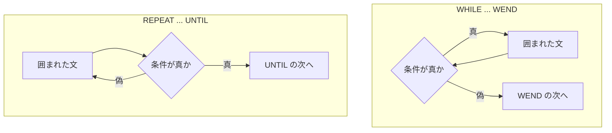

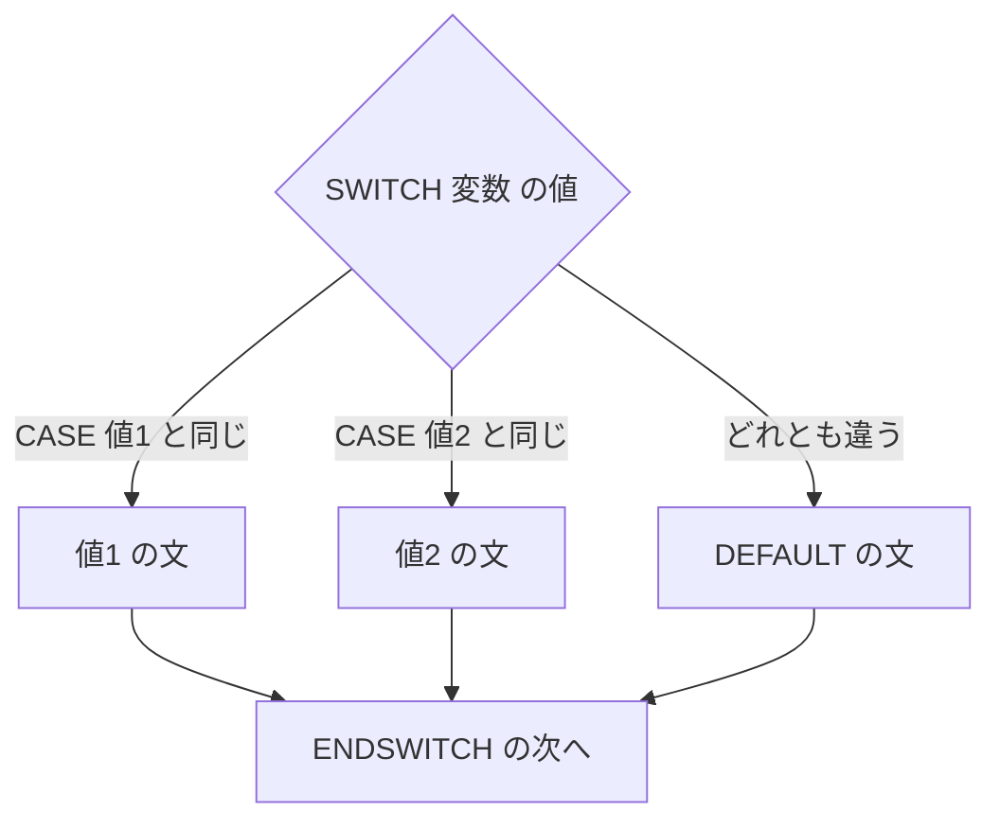

改訂 8 で増えたエラーは次のとおりです（PC-E500S の操作説明書 p.327。番号は `ERN` の値。表示は ROM 8.3 で出た文字）。

| 番号 | 表示 | 起こるとき |
|---|---|---|
| 61 | `Block IF without ENDIF` | 複数行の `IF` や `ELSE` に `ENDIF` がない |
| 62 | `UNTIL without REPEAT` | `REPEAT` なしに `UNTIL` に来た |
| 63 | `WHILE without WEND` | 対応する `WEND` がない（条件が真でも偽でも） |
| 64 | `WEND without WHILE` | `WHILE` なしに `WEND` に来た。ループの中へ `GOTO` で飛び込んだときも |
| 66 | `Illegal CASE or DEFAULT` | `DEFAULT` のあとにまた `CASE` や `DEFAULT` がある |
| 68 | `SWITCH,CASE or DEFAULT without ENDSWITCH` | `ENDSWITCH` がない。一致する `CASE` があると、エラーにならずに最後まで進むことがある |
| 69 | `CASE,DEFAULT or ENDSWITCH without SWITCH` | `SWITCH` なしに来た |

共通の決まりが 3 つあります。

- ループの中で `CLEAR`、`DIM`、`ERASE` を使わないでください。
- ループの外から中へ飛び込むとエラーです。途中で外へ飛び出すと、積んだフレームが残り、あとでネストのエラーになることがあります。`FOR` の中の `WHILE` から `GOTO` で出ると、`NEXT without FOR` になりました（実験）。
- 内側のループは外側の中にすべて収めます。`GOSUB` の中のループから `RETURN` するのはかまいません（実験）。

### WHILE ... WEND

中間コード: `WHILE` = `FE 7A`、`WEND` = `FE 7B`

使用区分: プログラム ／ 省略形: `WH.`、`WE.`

**書式**

```basic
WHILE 条件
  ...
WEND
```

**働き**: 条件が真のあいだ、囲まれた文を繰り返します。条件は先頭で判定します。

**例**

```basic
10 N=1
20 WHILE N<100
30 PRINT N
40 N=N*2
50 WEND
```

1、2、4、…、64 を表示し、128 になったところで終わります。

1 行に `:` でつないで書くこともできます（実験）。

```basic
10 N=0: WHILE N<3: PRINT N;: N=N+1: WEND: PRINT "E"
```

```text
 0  1  2 E
```

**注意**

- 条件が初めから偽なら、1 回も実行されません。
- ネストは 18 段までです（[14.4.7](#1447-ネストの上限)）。
- `WEND` は `WHILE` より大きい行番号に置きます。

**関連**: [`REPEAT ... UNTIL`](#repeat--until)、[`FOR ... NEXT`](#for--next)

### REPEAT ... UNTIL

中間コード: `REPEAT` = `FE 4E`、`UNTIL` = `FE 4F`

使用区分: プログラム ／ 省略形: `REP.`、`UN.`

**書式**

```basic
REPEAT
  ...
UNTIL 条件
```

**働き**: 囲まれた文を実行してから条件を判定し、偽のあいだ繰り返します（最低 1 回実行）。

**例**

```basic
10 REPEAT
20 INPUT "1-9";N
30 UNTIL N>=1 AND N<=9
40 PRINT N
```

1〜9 が入るまで聞き直します。

**注意**

- `UNTIL` が対応する `REPEAT` を持たないとエラー 3Eh「UNTIL without REPEAT」になります。
- 3Eh は 10 進で 62 です。[ROM バージョンの違い: 行列演算とドライバ](25_ROM_VERSIONS_DRIVERS.md) §25.2.2 の表の 53 番に 9 を足した値に当たります。
- ネストは 20 段までです。
- PC-E500S の操作説明書 p.307 の例 `50: UNTIL B>0` は、説明文では「負の値が入るまで」になっています。負の値で終わるなら `UNTIL B<0` です。

**関連**: [`WHILE ... WEND`](#while--wend)、[`FOR ... NEXT`](#for--next)

### SWITCH ... CASE ... DEFAULT ... ENDSWITCH

中間コード: `SWITCH` = `FE 7C`、`CASE` = `FE 7D`、`DEFAULT` = `FE 7E`、`ENDSWITCH` = `FE 7F`

使用区分: プログラム ／ 省略形: `SW.`、`CAS.`、`DEFA.`、`ENDS.`

**書式**

```basic
SWITCH 変数
CASE 値1
  ...
CASE 値2
  ...
DEFAULT
  ...
ENDSWITCH
```

**働き**: 変数（数値でも文字列でもよい）の値に一致する `CASE` の文を実行します。どれにも一致しなければ `DEFAULT` を実行します。

**例**

```basic
10 INPUT N
20 SWITCH N
30 CASE 1
40 PRINT "ONE"
50 CASE 2
60 PRINT "TWO"
70 DEFAULT
80 PRINT "?"
90 ENDSWITCH
```

1 なら `ONE`、2 なら `TWO`、ほかは `?` です。

文字列でも分けられます。数字でしか選べない `ON ... GOTO` との違いです。

```basic
10 INPUT "PLANET=";P$
20 SWITCH P$
30 CASE "EARTH"
40 PRINT "365.26 DAYS"
50 CASE "MARS"
60 PRINT "686.98 DAYS"
70 DEFAULT
80 PRINT "UNKNOWN"
90 ENDSWITCH
```

**注意**

- `SWITCH` のあとは変数か配列の要素だけです。`SWITCH A*1` は `Syntax error` でした。`CASE` のあとには定数のほか `1+1` や変数も書けました（実験）。
- `CASE 1,2` のように並べても、2 には一致しませんでした（実験）。
- 同じ値の `CASE` が 2 つあると、先の方だけが実行されます。
- `DEFAULT` は最後の `CASE` のあとに置きます。省けます。
- `CASE`、`DEFAULT`、`ENDSWITCH` は行の先頭に書きます。ラベルのあとでは認識されません（`30 *L:CASE 1` は飛ばされました）。`CASE 1:PRINT "1"` のように、後ろに文を続けることはできます（実験）。
- `SWITCH` も行の先頭に書きます。`10 A=1:SWITCH A` は `Syntax error` でした（実験）。
- `SWITCH` の中に別の `SWITCH` は書けません（エラー 50）。`FOR` や `GOSUB` は使えます。

**関連**: [`IF ... THEN ... ELSE`](#if--then--else)、[`ON ... GOTO`](#on--goto)

### IF ... THEN / ELSE / ENDIF（ブロック形式）

中間コード: `IF` = `FE 56`、`THEN` = `FE 54`、`ELSE` = `FE 76`、`ENDIF` = `FE 4D`

使用区分: プログラム ／ 省略形: `THEN T.`、`ELSE EL.`、`ENDI.`

**書式**

```basic
IF 条件 THEN
  ...
ELSE
  ...
ENDIF
```

**働き**: `THEN` の後に何も書かないと複数行にわたるブロック `IF` になり、`ENDIF` で閉じます。

**例**

```basic
10 INPUT A
20 IF A>=60 THEN
30 PRINT "OK"
40 BEEP 1
50 ELSE
60 PRINT "NG"
70 ENDIF
```

条件ごとに何行でも書けます。`ELSE` と中の文は省けます。

ネストの例です。

```basic
10 INPUT "SCORE=";A
20 IF A>=60 THEN
30 IF A>=90 THEN
40 PRINT "VERY GOOD"
50 ELSE
60 PRINT "OK"
70 ENDIF
80 ELSE
90 PRINT "TRY AGAIN"
100 ENDIF
```

**注意**

- `THEN` のあとに文、行番号、コメントがあると 1 行の `IF` になります。
- `IF`、`ELSE`、`ENDIF` は行の先頭に書きます（説明書）。
- `ELSE` と `ENDIF` の行の残りは実行されません。`40 ELSE PRINT "E1"` の `E1` は表示されませんでした（実験）。
- `ELSE IF 条件 THEN` という形はありません。続けて調べるときは、`ELSE` の次の行に新しい `IF` を書き、`ENDIF` を 2 つ書きます。

**関連**: [`IF ... THEN ... ELSE`](#if--then--else)

### EVAL

中間コード: `EVAL` = `FE A7`

使用区分: プログラム、直接実行 ／ 省略形: `EV.`

**書式**

```basic
EVAL 文字列
```

**働き**: 文字列に書かれた式を評価して値を返します。

**引数**

| 引数 | 内容 |
|---|---|
| 文字列 | `"A*2+1"` のような式を含む文字列。 |

**例**

```basic
10 A$="3*4"
20 PRINT EVAL A$
```

12 です（実験、[BASIC の内部形式](15_BASIC_INTERNALS.md) §15.5）。

変数の入った式も計算できます。

```basic
10 A=3
20 PRINT EVAL "A^2+1"
```

10 です（実験）。グラフを描く応用が [14.8.8](#1488-好きな関数のグラフ) にあります。

**注意**

- `EVAL` は改訂 7 までの辞書にもあります（改訂 8 で増えた 9 語には入っていません。[ROM バージョンの違い: BASIC](24_ROM_VERSIONS_BASIC.md) §24.2）。

**関連**: [`VAL`](#val)、[`AER`](#aer)

### BTEXT$ / BDATA$

中間コード: `BTEXT$` = `FE 0B`、`BDATA$` = `FE 0C`

使用区分: プログラム、直接実行 ／ 省略形: `BT.`、`BD.`

**書式**

```basic
BTEXT$
BTEXT$ = "S1:ファイル名"
BDATA$
BDATA$ = "S1:ファイル名"
```

**働き**: `BTEXT$` は BASIC が今使っているプログラムの、`BDATA$` は変数の、メモリブロックの名前です。値として読むことも、代入して切り替えることもできます。操作説明書にはない機能で、次の内容はすべてエミュレータで調べたものです（実験。代入での切り替えは ROM 2.2、7.2、7.3、8.3、8.5 で、ほかは 7.2 と 8.3 で確認）。

電源を入れてふだん使っているときの値は、次のとおりです。

```text
BTEXT$
S1:TEXT  .BAS
BDATA$
S1:DATA  .BAS
```

`S1:` は本体のメモリ、`TEXT.BAS` と `DATA.BAS` はプログラムと変数の入ったブロックです（[メモリ](03_MEMORY.md) §3.3）。名前を代入すると、そのブロックに切り替わります。なければ新しく作られます。

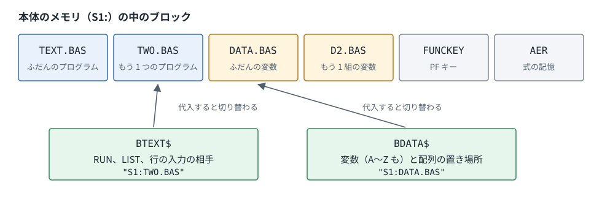

**例: 2 つのプログラムを持つ。** `10 PRINT "ONE"` が入っている状態から始めます。

```basic
BTEXT$="S1:TWO.BAS"
```

プログラムが空になったように見えます。PRO モードで `10 PRINT "TWO"` を入れて RUN すると `TWO`、`BTEXT$="S1:TEXT.BAS"` に戻して RUN すると `ONE` と表示されます。行番号が同じでも混ざりません。`FILES "S1:"` には、`TEXT.BAS` と `TWO.BAS` が並びます。

**例: 変数を切り替える。**

```basic
10 BDATA$="S1:D2.BAS": A=9
20 PRINT BDATA$;A
30 BDATA$="S1:DATA.BAS"
40 PRINT BDATA$;A
```

```text
S1:D2    .BAS 9
S1:DATA  .BAS 0
```

`A` のような固定変数もブロックごとに別です。`D2.BAS` に戻せば、入れた値はそのまま残っています。

**注意**

- 代入できるのは `S1:` のようなメモリブロックの名前です。`"E:X.BAS"` や、`:` のない名前は `Bad drive name` になります。
- プログラムの中で `BTEXT$` に代入すると、そこで実行が終わり、切り替わったままになります。切り替え先のプログラムが続けて動くことはありません。
- 今使っているプログラムを `KILL "S1:TWO.BAS"` で消すと、`TEXT.BAS` に戻りました。使わなくなったブロックも `KILL` で消します。
- 処理表の記録は `CFA305h` と `CFA336h` で、文と関数の両方の印（bit 23 と bit 22）を持ちます（[14.9](#149-トークン化と処理エントリ)）。実際、文としても値としても働きます。

**関連**: [`MEM$`](#mem)、[`FILES`](#files)、[`KILL`](#kill)、[BASIC の内部形式](15_BASIC_INTERNALS.md) §15.5

## 14.8 プログラム例

この章の命令だけで書いた短いプログラムです。

### 14.8.1 平均を求める

数を 1 つずつ入れ、0 を入れると平均を表示します。`IF` で終わりを調べ、`GOTO` で繰り返します。

```basic
10 S=0: N=0
20 INPUT "DATA=";D
30 IF D=0 THEN 60
40 S=S+D: N=N+1
50 GOTO 20
60 IF N=0 THEN 80
70 PRINT "AVERAGE=";S/N
80 END
```

60 行は 1 つも入れなかったときに 0 で割らないための判定です。

### 14.8.2 棒グラフを描く

`DATA` の値を読み、`LINE` の `BF` で棒を描きます。画面は下端が Y=31 なので、値の分だけ上へ伸ばします。

```basic
10 CLS
20 FOR I=0 TO 5
30 READ V
40 LINE (I*40,31)-(I*40+30,31-V),BF
50 NEXT I
60 IF INKEY$="" THEN 60
70 END
80 DATA 5,12,20,28,16,8
```


60 行はキーが押されるまで待ちます。これがないと、終わったあとの表示で図がくずれることがあります。

### 14.8.3 サインカーブを描く

横 240 ドットに 1 周期半（540 度）を描きます。X が 1 増えるごとに角度は 540 ÷ 240 = 2.25 度増えます。

```basic
10 CLS
20 DEGREE
30 LINE (0,15)-(239,15),&H6666
40 FOR X=0 TO 239
50 Y=15-INT (14*SIN (X*2.25))
60 PSET (X,Y)
70 NEXT X
80 IF INKEY$="" THEN 80
90 END
```


30 行は点線の X 軸です。50 行の `SIN` の引数は式なので括弧で囲みます。

### 14.8.4 ファイルに書いて読む

RAM ディスク E: に 5 組のデータを書き、終わりまで読みます。E: は先に `INIT` で用意しておきます。

```basic
10 OPEN "E:TABLE.TXT" FOR OUTPUT AS #1
20 FOR I=1 TO 5
30 PRINT #1,I
40 PRINT #1,I*I
50 NEXT I
60 CLOSE #1
70 OPEN "E:TABLE.TXT" FOR INPUT AS #1
80 IF EOF (1)=-1 THEN 120
90 INPUT #1,A,B
100 PRINT A;B
110 GOTO 80
120 CLOSE #1
130 END
```

30 行と 40 行は末尾に `,` や `;` がないので 1 項目ずつ CR+LF で区切られます。90 行はそれを 2 項目ずつ読みます。

### 14.8.5 エラーに備える

ファイルがないとき、エラーの表示で止まる代わりに、自分のメッセージを出します。

```basic
10 ON ERROR GOTO 90
20 OPEN "E:TABLE.TXT" FOR INPUT AS #1
30 IF EOF (1)=-1 THEN 70
40 INPUT #1,A
50 PRINT A
60 GOTO 30
70 CLOSE #1
80 END
90 IF ERL=20 THEN PRINT "NO FILE": END
100 PRINT "ERROR";ERN;"LINE";ERL
110 END
```

90 行は、エラーが 20 行（`OPEN`）で起きたかどうかを `ERL` で見分けます。ほかの行なら、100 行で番号と行を表示します。

### 14.8.6 反応時間を測る

ランダムな長さだけ待ってから音を鳴らし、キーを押すまでの回数を数えます。

```basic
10 RANDOMIZE
20 CLS
30 PRINT "READY"
40 FOR I=1 TO 500+RND 1000
50 NEXT I
60 BEEP 1
70 C=0
80 C=C+1
90 IF INKEY$="" THEN 80
100 PRINT "COUNT=";C
110 END
```

`RND 1000` は 1〜1000 の整数です。`INKEY$` はキー入力を待たないので、80 行と 90 行の繰り返しの回数が反応の速さになります。

### 14.8.7 構造化 BASIC で書く（ROM 8.3 以降）

14.8.1 の平均を、`REPEAT` と複数行の `IF` で書き直したものです。行番号で分岐する文がなくなり、上から下へ読めます。

```basic
10 S=0: N=0
20 REPEAT
30 INPUT "DATA=";D
40 IF D<>0 THEN
50 S=S+D: N=N+1
60 ENDIF
70 UNTIL D=0
80 IF N>0 THEN
90 PRINT "AVERAGE=";S/N
100 ENDIF
110 END
```

### 14.8.8 好きな関数のグラフ

式を文字列のまま入れ、[`EVAL`](#eval) で 1 点ずつ計算します。X は -6 〜 6、Y は 1 目盛りが 5 ドットです。

```basic
10 DEGREE
20 INPUT "Y=";F$
30 CLS
40 LINE (0,15)-(239,15),&H8888
50 LINE (120,0)-(120,31),&H8888
60 FOR P=0 TO 239
70 X=(P-120)/20
80 Y=EVAL F$
90 Q=15-INT (Y*5+0.5)
100 IF Q>=0 AND Q<=31 THEN PSET (P,Q)
110 NEXT P
120 IF INKEY$<>"" THEN 120
130 IF INKEY$="" THEN 130
```

`Y=` に `2*SIN (X*60)` と答えたときの画面です（実験。ROM 7.2）。


40 行と 50 行の `&H8888` は 4 ドットに 1 つの点線です。100 行の `IF` は画面の外の点を飛ばします。120 行で押しっぱなしのキーが離されるのを待ち、130 行で次のキーを待ちます。

### 14.8.9 素数を探す

200 までの素数を、ふるいの方法（素数の倍数を消していく）で並べます。配列 `F` は消した数に 1 を入れておく表です。

```basic
10 CLS
20 N=200: DIM F(N): C=0
30 FOR I=2 TO N
40 IF F(I)=1 THEN 110
50 C=C+1
60 PRINT USING "####";I;
70 K=I+I
80 IF K>N THEN 110
90 F(K)=1: K=K+I
100 GOTO 80
110 NEXT I
120 PRINT
130 USING
140 PRINT "COUNT=";C
150 END
```

終わりの画面です（実験）。`USING "####"` で 4 桁にそろえているので、1 行に 10 個ずつ並びます。

```text
 127 131 137 139 149 151 157 163 167 173
 179 181 191 193 197 199
COUNT= 46
```

内側の繰り返しに `FOR` でなく `GOTO` を使っているのは、`NEXT` を通らずに次の数へ進むためです。`FOR` の途中から `GOTO` で飛び出すと、積んだフレームが残ります（[14.4.7](#1447-ネストの上限)）。

### 14.8.10 はね返る点

点を動かし、枠に当たったら向きを変えて音を鳴らします。動く物を描く基本の形です。「新しい位置を点灯 → 前の位置を消灯」を繰り返します。

```basic
10 CLS: WAIT 0
20 LINE (0,0)-(239,31),B
30 X=20: Y=5: U=3: V=1
40 PSET (X,Y)
50 A=X: B=Y
60 X=X+U: Y=Y+V
70 IF X<2 OR X>237 THEN U=-U: X=X+2*U: BEEP 1,20,20
80 IF Y<2 OR Y>29 THEN V=-V: Y=Y+2*V: BEEP 1,60,20
90 PRESET (A,B)
100 IF INKEY$="" THEN 40
110 END
```


`U` と `V` は 1 回に動く量です。70 行と 80 行では、向きを逆にしてから 2 回分戻すことで、枠の内側に入り直します。

### 14.8.11 電話帳

RAM ディスクに名前と番号を書き足し、探すプログラムです。`ON ... GOSUB`、`OPEN ... FOR APPEND`、`EOF`、`ON ERROR GOTO` を組み合わせています。先に `INIT "E:3K"` で E: を作っておきます。

```basic
10 CLS
20 PRINT "1:ADD 2:FIND 3:END"
30 INPUT "NO=";M
40 ON M GOSUB 100,200,300
50 GOTO 20
100 INPUT "NAME=";N$
110 INPUT "TEL=";T$
120 ON ERROR GOTO 400
130 OPEN "E:TEL.TXT" FOR APPEND AS #1
140 PRINT #1,N$;",";T$
150 CLOSE #1
160 RETURN
200 INPUT "NAME=";N$
210 OPEN "E:TEL.TXT" FOR INPUT AS #1
220 IF EOF (1) THEN 270
230 INPUT #1,A$,B$
240 IF A$<>N$ THEN 220
250 PRINT A$;" ";B$
260 GOTO 280
270 PRINT "NOT FOUND"
280 CLOSE #1
290 RETURN
300 END
400 IF ERL<>130 OR ERN<>94 THEN PRINT ERN;ERL: END
410 OPEN "E:TEL.TXT" FOR OUTPUT AS #1
420 RESUME NEXT
```

2 件を足してから探したときの画面です（実験）。

```text
NAME=HANA
HANA 06-5678
1:ADD 2:FIND 3:END
NO=_
```

`APPEND` は、ファイルがないとエラー 94（`File not found`）になります。そこで、初めての 1 回だけ 400 行へ分岐し、410 行で新しいファイルを作って、`RESUME NEXT` で 140 行へ戻ります。140 行の `",";` は名前と番号を 2 つの項目に分けるための区切りです（[`PRINT#`](#print-1)）。

## 14.9 トークン化と処理エントリ

BASIC の行を入れると、ROM はキーワードを短い番号に置き換えてから保存します。これを**トークン化**、番号を **token** と呼びます。実行するときは、token から処理のアドレス（処理エントリ）を表で引きます。

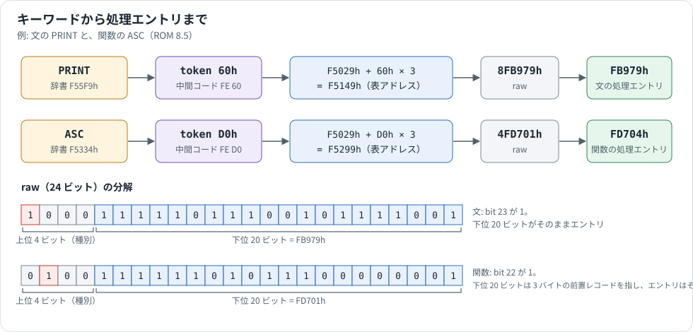

- キーワード辞書は `F5334h-F5762h` にあり、レコード形式は `[名前長][ASCII名][1-byte token]` です。この ROM では 168 項目を確認しました。
- 中間コードは通常 `FEh token` です。文字列リテラル中はトークン化しません。中間コードを復元する際は、単に `FEh` を置換せず文字列境界も扱います。
- 処理レコード表は `F5029h + token * 3` です。20-bit アドレスに上位フラグを重ねた 3 バイト値です。
- `文` は raw pointer の bit 23 が立つ項目で、下位 20 bit がエントリです。
- `関数` は bit 22 が立つ項目で、下位 20 bit は 3 バイトの前置レコードを指します。実行エントリはそのアドレス `+3` です。
- `SAVE M` / `LOAD M` は独立キーワードではありません。`SAVE` (`23h`) / `LOAD` (`18h`) の引数修飾子として解析されます。

`OPEN$` と `RESERVED` は辞書にありますが処理レコード値が 0 です。予約語または構文上の特殊項目として扱い、通常の関数と同じエントリがあるとはみなしません。構造化 BASIC の `IF`、`REPEAT`、`CASE` などは拡張 ROM `30000h` 台へ処理が渡ります。

**例: 辞書のレコードの長さ。** `ASC` のレコードは `F5334h` にあり、名前長 1 バイト + 名前 3 バイト + token 1 バイトの 5 バイトです。次の `AND` は F5334h + 5 = `F5339h` で、14.10 の名前アドレスと合います。

**例: `FE 2B` を探す。** token は 2Bh です。F5029h + 2Bh × 3 = `F50AAh` が表アドレスで、そこにある raw は 8FCE1Ch、bit 23 が 1 なので文、エントリは下位 20 bit の `FCE1Ch` です。14.10 の表では `GOTO` に当たります。

bit 23 と bit 22 の両方が立つ（raw が `C` で始まる）項目は、`BTEXT$`、`BDATA$`、`INPUT`、`KEY`、`MEM$`、`OPEN` の 6 つです。表では文に分類しています。`INPUT` と `INPUT$`、`KEY` と `KEY$` のように、文の形と値を返す形の両方を持つ命令が並んでいます。

中間コードの行の形と、数値や行番号の表し方は [BASIC の内部形式](15_BASIC_INTERNALS.md) §15.3 にあります。

## 14.10 全キーワード

### 表の読み方

| 列 | 内容 |
|---|---|
| キーワード | ROM 辞書に入っている ASCII 名。大文字小文字の表記は辞書どおり。 |
| token | 1 バイトのキーワード番号。中間コードでは通常この前に `FEh` が付く。 |
| 名前アドレス | 辞書中のキーワードレコードの位置。 |
| 表アドレス | `F5029h + token × 3` で得られる 3 バイト処理レコードの位置。 |
| raw | 処理レコードの未加工 3 バイト値。上位ビットは種別フラグを含む。 |
| 分類 | `文`、`関数`、`内部/複合`、`予約` の解析結果。 |
| 処理エントリ | ROM 上の実行エントリ。`-` は公開の実行エントリを持たない/未確定の項目。 |

アドレスは ROM 8.5 のものです。token はどのバージョンでも同じですが、アドレスはバージョンで変わります（[ROM バージョンの違い: BASIC](24_ROM_VERSIONS_BASIC.md) §24.1、§24.2）。

### 168 キーワードの表

| キーワード | token | 名前アドレス | 表アドレス | raw | 分類 | 処理エントリ |
|---|---|---|---|---|---|---|
| ASC | D0h | `F5334h` | `F5299h` | 4FD701h | 関数 | `FD704h` |
| AND | A1h | `F5339h` | `F520Ch` | 4EF2CBh | 関数 | `EF2CEh` |
| ABS | 99h | `F533Eh` | `F51F4h` | 4EE4D9h | 関数 | `EE4DCh` |
| ATN | 9Fh | `F5343h` | `F5206h` | 4ED41Ch | 関数 | `ED41Fh` |
| ASN | 9Dh | `F5348h` | `F5200h` | 4ED40Ah | 関数 | `ED40Dh` |
| ACS | 9Eh | `F534Dh` | `F5203h` | 4ED413h | 関数 | `ED416h` |
| APPEND | 72h | `F5352h` | `F517Fh` | 8F59B8h | 文 | `F59B8h` |
| AS | 73h | `F535Ah` | `F5182h` | 8F59B8h | 文 | `F59B8h` |
| ARUN | 74h | `F535Eh` | `F5185h` | 8FD083h | 文 | `FD083h` |
| AUTOGOTO | 75h | `F5364h` | `F5188h` | 8FD083h | 文 | `FD083h` |
| AUTO | 1Ah | `F536Eh` | `F5077h` | 8F8900h | 文 | `F8900h` |
| AHS | 8Dh | `F5374h` | `F51D0h` | 4EE06Ch | 関数 | `EE06Fh` |
| AHC | 8Eh | `F5379h` | `F51D3h` | 4EE075h | 関数 | `EE078h` |
| AHT | 8Fh | `F537Eh` | `F51D6h` | 4EE07Eh | 関数 | `EE081h` |
| AER | BEh | `F5383h` | `F5263h` | 4EEE5Ch | 関数 | `EEE5Fh` |
| BEEP | 29h | `F5389h` | `F50A4h` | 8F79FBh | 文 | `F79FBh` |
| BASIC | 36h | `F538Fh` | `F50CBh` | 8F8A21h | 文 | `F8A21h` |
| BTEXT$ | 0Bh | `F5396h` | `F504Ah` | CFA305h | 文 | `FA305h` |
| BDATA$ | 0Ch | `F539Eh` | `F504Dh` | CFA336h | 文 | `FA336h` |
| CONT | 12h | `F53A7h` | `F505Fh` | 8FD0C7h | 文 | `FD0C7h` |
| CONSOLE | 24h | `F53ADh` | `F5095h` | 8FE90Ah | 文 | `FE90Ah` |
| CLEAR | 2Eh | `F53B6h` | `F50B3h` | 8FB4D1h | 文 | `FB4D1h` |
| CLOAD | 16h | `F53BDh` | `F506Bh` | 8FE0D8h | 文 | `FE0D8h` |
| CSAVE | 20h | `F53C4h` | `F5089h` | 8FDFEFh | 文 | `FDFEFh` |
| COS | 96h | `F53CBh` | `F51EBh` | 4ECF88h | 関数 | `ECF8Bh` |
| CHR$ | F0h | `F53D0h` | `F52F9h` | 4FD733h | 関数 | `FD736h` |
| CLOSE | 22h | `F53D6h` | `F508Fh` | 8FE6F8h | 文 | `FE6F8h` |
| CALL | 31h | `F53DDh` | `F50BCh` | 8F9F34h | 文 | `F9F34h` |
| CLS | 50h | `F53E3h` | `F5119h` | 8FC6ABh | 文 | `FC6ABh` |
| CHAIN | 67h | `F53E8h` | `F515Eh` | 8EC330h | 文 | `EC330h` |
| COPY | 3Dh | `F53EFh` | `F50E0h` | 8FF0A7h | 文 | `FF0A7h` |
| CSIZE | 43h | `F53F5h` | `F50F2h` | 8E6721h | 文 | `E6721h` |
| COLOR | 44h | `F53FCh` | `F50F5h` | 8E67E7h | 文 | `E67E7h` |
| CROTATE | 6Eh | `F5403h` | `F5173h` | 8E68A9h | 文 | `E68A9h` |
| CIRCLE | 6Fh | `F540Ch` | `F5176h` | 8E6CAFh | 文 | `E6CAFh` |
| CUB | BFh | `F5414h` | `F5266h` | 4EE035h | 関数 | `EE038h` |
| CUR | 89h | `F5419h` | `F51C4h` | 4EDFF8h | 関数 | `EDFFBh` |
| CASE | 7Dh | `F541Eh` | `F51A0h` | 8313ABh | 文 | `313ABh` |
| DIM | 30h | `F5425h` | `F50B9h` | 8FB7BBh | 文 | `FB7BBh` |
| DEGREE | 26h | `F542Ah` | `F509Bh` | 8ECF4Bh | 文 | `ECF4Bh` |
| DEG | 9Bh | `F5432h` | `F51FAh` | 4EE88Eh | 関数 | `EE891h` |
| DMS | 9Ch | `F5437h` | `F51FDh` | 4EE897h | 関数 | `EE89Ah` |
| DATA | 5Eh | `F543Ch` | `F5143h` | 8FD083h | 文 | `FD083h` |
| DSKF | B1h | `F5442h` | `F523Ch` | 4FDE0Fh | 関数 | `FDE12h` |
| DELETE | 1Bh | `F5448h` | `F507Ah` | 8F8AF4h | 文 | `F8AF4h` |
| DEFDBL | 46h | `F5450h` | `F50FBh` | 8F8962h | 文 | `F8962h` |
| DEFSNG | 47h | `F5458h` | `F50FEh` | 8F8966h | 文 | `F8966h` |
| DEFAULT | 7Eh | `F5460h` | `F51A3h` | 8313D5h | 文 | `313D5h` |
| DECI | 84h | `F5469h` | `F51B5h` | 4EEB00h | 関数 | `EEB03h` |
| END | 5Ah | `F5470h` | `F5137h` | 8FD104h | 文 | `FD104h` |
| EXP | 93h | `F5475h` | `F51E2h` | 4ED6BDh | 関数 | `ED6C0h` |
| EOF | B0h | `F547Ah` | `F5239h` | 4FDFBCh | 関数 | `FDFBFh` |
| ERASE | 3Ah | `F547Fh` | `F50D7h` | 8FB5A9h | 文 | `FB5A9h` |
| ERL | C1h | `F5486h` | `F526Ch` | 4F9FEDh | 関数 | `F9FF0h` |
| ERN | C0h | `F548Bh` | `F5269h` | 4FA002h | 関数 | `FA005h` |
| ERROR | 78h | `F5490h` | `F5191h` | 8F59BCh | 文 | `F59BCh` |
| ELSE | 76h | `F5497h` | `F518Bh` | 830F83h | 文 | `30F83h` |
| EVAL | A7h | `F549Dh` | `F521Eh` | 4EEF67h | 関数 | `EEF6Ah` |
| FOR | 57h | `F54A4h` | `F512Eh` | 8FD131h | 文 | `FD131h` |
| FILES | 1Ch | `F54A9h` | `F507Dh` | 8F8280h | 文 | `F8280h` |
| FRE | AFh | `F54B0h` | `F5236h` | 4FA0E2h | 関数 | `FA0E5h` |
| FACT | 90h | `F54B5h` | `F51D9h` | 4EE371h | 関数 | `EE374h` |
| GOTO | 2Bh | `F54BCh` | `F50AAh` | 8FCE1Ch | 文 | `FCE1Ch` |
| GOSUB | 62h | `F54C2h` | `F514Fh` | 8FCEA3h | 文 | `FCEA3h` |
| GPRINT | 33h | `F54C9h` | `F50C2h` | 8FD3C9h | 文 | `FD3C9h` |
| GCURSOR | 68h | `F54D1h` | `F5161h` | 8FD38Bh | 文 | `FD38Bh` |
| GRAD | 28h | `F54DAh` | `F50A1h` | 8ECF5Fh | 文 | `ECF5Fh` |
| GRAPH | 41h | `F54E0h` | `F50ECh` | 8E669Ah | 文 | `E669Ah` |
| GLCURSOR | 6Ch | `F54E7h` | `F516Dh` | 8E6827h | 文 | `E6827h` |
| HEX$ | F2h | `F54F2h` | `F52FFh` | 4FD86Dh | 関数 | `FD870h` |
| HEX | 85h | `F54F8h` | `F51B8h` | 4EEB10h | 関数 | `EEB13h` |
| HSN | 8Ah | `F54FDh` | `F51C7h` | 4EE051h | 関数 | `EE054h` |
| HCS | 8Bh | `F5502h` | `F51CAh` | 4EE05Ah | 関数 | `EE05Dh` |
| HTN | 8Ch | `F5507h` | `F51CDh` | 4EE063h | 関数 | `EE066h` |
| INPUT | 61h | `F550Dh` | `F514Ch` | CF5329h | 文 | `F5329h` |
| IF | 56h | `F5514h` | `F512Bh` | 830E39h | 文 | `30E39h` |
| INT | 98h | `F5518h` | `F51F1h` | 4EE4E2h | 関数 | `EE4E5h` |
| INKEY$ | E9h | `F551Dh` | `F52E4h` | 4FA017h | 関数 | `FA01Ah` |
| INIT | 1Dh | `F5525h` | `F5080h` | 8DFC87h | 文 | `DFC87h` |
| KILL | 3Ch | `F552Dh` | `F50DDh` | 8FDB7Eh | 文 | `FDB7Eh` |
| KEY | 79h | `F5533h` | `F5194h` | CFA941h | 文 | `FA941h` |
| LIST | 14h | `F5539h` | `F5065h` | 8F9ED8h | 文 | `F9ED8h` |
| LLIST | 15h | `F553Fh` | `F5068h` | 8FCBCCh | 文 | `FCBCCh` |
| LPRINT | 64h | `F5546h` | `F5155h` | 8FB93Fh | 文 | `FB93Fh` |
| LOCATE | 51h | `F554Eh` | `F511Ch` | 8FC6C8h | 文 | `FC6C8h` |
| LOG | 92h | `F5556h` | `F51DFh` | 4EDB0Ah | 関数 | `EDB0Dh` |
| LOF | B2h | `F555Bh` | `F523Fh` | 4FDF8Dh | 関数 | `FDF90h` |
| LOC | B3h | `F5560h` | `F5242h` | 4FDEF4h | 関数 | `FDEF7h` |
| LN | 91h | `F5565h` | `F51DCh` | 4EDB01h | 関数 | `EDB04h` |
| LOAD | 18h | `F5569h` | `F5071h` | 8EC33Ah | 文 | `EC33Ah` |
| LINE | 69h | `F556Fh` | `F5164h` | 8FD483h | 文 | `FD483h` |
| LET | 58h | `F5575h` | `F5131h` | 8FB1E8h | 文 | `FB1E8h` |
| LEN | D2h | `F557Ah` | `F529Fh` | 4EECBAh | 関数 | `EECBDh` |
| LEFT$ | EBh | `F557Fh` | `F52EAh` | 4FD7BDh | 関数 | `FD7C0h` |
| LFILES | 3Bh | `F5586h` | `F50DAh` | 8F8284h | 文 | `F8284h` |
| LTEXT | 40h | `F558Eh` | `F50E9h` | 8E6681h | 文 | `E6681h` |
| LF | 42h | `F5595h` | `F50EFh` | 8E66A9h | 文 | `E66A9h` |
| LLINE | 6Ah | `F5599h` | `F5167h` | 8E6922h | 文 | `E6922h` |
| MID$ | EAh | `F55A1h` | `F52E7h` | 4FD7D0h | 関数 | `FD7D3h` |
| MEM$ | 0Dh | `F55A7h` | `F5050h` | CFA3D7h | 文 | `FA3D7h` |
| MERGE | 17h | `F55ADh` | `F506Eh` | 8EC328h | 文 | `EC328h` |
| MDF | 80h | `F55B4h` | `F51A9h` | 4EED2Dh | 関数 | `EED30h` |
| NEXT | 5Bh | `F55BAh` | `F513Ah` | 8FD2B6h | 文 | `FD2B6h` |
| NAME | 3Eh | `F55C0h` | `F50E3h` | 8FDC16h | 文 | `FDC16h` |
| NOT | A3h | `F55C6h` | `F5212h` | 4EE4A2h | 関数 | `EE4A5h` |
| NEW | 11h | `F55CBh` | `F505Ch` | 8FA124h | 文 | `FA124h` |
| NCR | B6h | `F55D0h` | `F524Bh` | 4EE507h | 関数 | `EE50Ah` |
| NPR | B7h | `F55D5h` | `F524Eh` | 4EE510h | 関数 | `EE513h` |
| ON | 55h | `F55DBh` | `F5128h` | 8FCF04h | 文 | `FCF04h` |
| OPEN | 21h | `F55DFh` | `F508Ch` | CFE282h | 文 | `FE282h` |
| OR | A2h | `F55E5h` | `F520Fh` | 4EF2CBh | 関数 | `EF2CEh` |
| OUTPUT | 71h | `F55E9h` | `F517Ch` | 8F59B8h | 文 | `F59B8h` |
| OPEN$ | E8h | `F55F1h` | `F52E1h` | 000000h | 予約 | - |
| PRINT | 60h | `F55F9h` | `F5149h` | 8FB979h | 文 | `FB979h` |
| PASS | 13h | `F5600h` | `F5062h` | 8F87FFh | 文 | `F87FFh` |
| PI | AEh | `F5606h` | `F5233h` | 4EEC86h | 関数 | `EEC89h` |
| PEEK | A4h | `F560Ah` | `F5215h` | 4F9FBAh | 関数 | `F9FBDh` |
| POKE | 32h | `F5610h` | `F50BFh` | 8F9F6Bh | 文 | `F9F6Bh` |
| POINT | ADh | `F5616h` | `F5230h` | 4FD398h | 関数 | `FD39Bh` |
| PSET | 34h | `F561Dh` | `F50C5h` | 8FD34Fh | 文 | `FD34Fh` |
| PRESET | 35h | `F5623h` | `F50C8h` | 8FD370h | 文 | `FD370h` |
| PAUSE | 5Fh | `F562Bh` | `F5146h` | 8FB910h | 文 | `FB910h` |
| PAINT | 70h | `F5632h` | `F5179h` | 8E6FC2h | 文 | `E6FC2h` |
| POL | 82h | `F5639h` | `F51AFh` | 4EE6DFh | 関数 | `EE6E2h` |
| RUN | 10h | `F563Fh` | `F5059h` | 8FD088h | 文 | `FD088h` |
| RETURN | 65h | `F5644h` | `F5158h` | 8FD019h | 文 | `FD019h` |
| READ | 5Dh | `F564Ch` | `F5140h` | 8FCA80h | 文 | `FCA80h` |
| RESTORE | 66h | `F5652h` | `F515Bh` | 8FCBA0h | 文 | `FCBA0h` |
| RND | A0h | `F565Bh` | `F5209h` | 4EEA0Bh | 関数 | `EEA0Eh` |
| RANDOMIZE | 25h | `F5660h` | `F5098h` | 8EE44Eh | 文 | `EE44Eh` |
| RIGHT$ | ECh | `F566Bh` | `F52EDh` | 4FD77Ch | 関数 | `FD77Fh` |
| RADIAN | 27h | `F5673h` | `F509Eh` | 8ECF73h | 文 | `ECF73h` |
| REM | 59h | `F567Bh` | `F5134h` | 8FA014h | 文 | `FA014h` |
| RENUM | 19h | `F5680h` | `F5074h` | 8F8C0Ah | 文 | `F8C0Ah` |
| RLINE | 6Bh | `F5687h` | `F516Ah` | 8E6BFBh | 文 | `E6BFBh` |
| ROT | 83h | `F568Eh` | `F51B2h` | 4EDB1Fh | 関数 | `EDB22h` |
| RCP | 87h | `F5693h` | `F51BEh` | 4ECBF5h | 関数 | `ECBF8h` |
| REC | 81h | `F5698h` | `F51ACh` | 4EE6D1h | 関数 | `EE6D4h` |
| RESUME | 77h | `F569Dh` | `F518Eh` | 8FD244h | 文 | `FD244h` |
| RESERVED | 00h | `F56A5h` | `F5029h` | 000000h | 予約 | - |
| REPEAT | 4Eh | `F56AFh` | `F5113h` | 83114Fh | 文 | `3114Fh` |
| STOP | 5Ch | `F56B8h` | `F513Dh` | 8FD0F5h | 文 | `FD0F5h` |
| SQR | 94h | `F56BEh` | `F51E5h` | 4ECE11h | 関数 | `ECE14h` |
| SIN | 95h | `F56C3h` | `F51E8h` | 4ECF7Fh | 関数 | `ECF82h` |
| SGN | 9Ah | `F56C8h` | `F51F7h` | 4EE861h | 関数 | `EE864h` |
| STR$ | F1h | `F56CDh` | `F52FCh` | 4FD743h | 関数 | `FD746h` |
| SAVE | 23h | `F56D3h` | `F5092h` | 8FD95Fh | 文 | `FD95Fh` |
| STEP | 53h | `F56D9h` | `F5122h` | 8F59B8h | 文 | `F59B8h` |
| SET | 3Fh | `F56DFh` | `F50E6h` | 8FDD26h | 文 | `FDD26h` |
| SORGN | 6Dh | `F56E4h` | `F5170h` | 8E6896h | 文 | `E6896h` |
| SQU | 88h | `F56EBh` | `F51C1h` | 4ECBDCh | 関数 | `ECBDFh` |
| SWITCH | 7Ch | `F56F0h` | `F519Dh` | 8311A9h | 文 | `311A9h` |
| THEN | 54h | `F56F9h` | `F5125h` | 8F59B8h | 文 | `F59B8h` |
| TAN | 97h | `F56FFh` | `F51EEh` | 4ECF91h | 関数 | `ECF94h` |
| TEXT | 37h | `F5704h` | `F50CEh` | 8F8AA1h | 文 | `F8AA1h` |
| TRON | 2Ch | `F570Ah` | `F50ADh` | 8F87F5h | 文 | `F87F5h` |
| TROFF | 2Dh | `F5710h` | `F50B0h` | 8F87FAh | 文 | `F87FAh` |
| TO | 52h | `F5717h` | `F511Fh` | 8F59B8h | 文 | `F59B8h` |
| TEN | 86h | `F571Bh` | `F51BBh` | 4ED6B4h | 関数 | `ED6B7h` |
| USING | 2Fh | `F5721h` | `F50B6h` | 8FC592h | 文 | `FC592h` |
| UNTIL | 4Fh | `F5728h` | `F5116h` | 831165h | 文 | `31165h` |
| VAL | D1h | `F5730h` | `F529Ch` | 4EECD5h | 関数 | `EECD8h` |
| WAIT | 2Ah | `F5736h` | `F50A7h` | 8FC722h | 文 | `FC722h` |
| WHILE | 7Ah | `F573Ch` | `F5197h` | 830FF4h | 文 | `30FF4h` |
| WEND | 7Bh | `F5743h` | `F519Ah` | 831081h | 文 | `31081h` |
| XOR | A5h | `F574Ah` | `F5218h` | 4EF2CBh | 関数 | `EF2CEh` |
| ENDIF | 4Dh | `F5750h` | `F5110h` | 830FE0h | 文 | `30FE0h` |
| ENDSWITCH | 7Fh | `F5757h` | `F51A6h` | 83144Ah | 文 | `3144Ah` |

## 14.11 G:内蔵BASICソース

`G:` は本体 ROM の中のドライブで、ENG などの BASIC プログラムが入っています（[G: ドライブ](22_ROM_GDRIVE.md)）。

G:から 42 プログラム、2,818行を復元しました（復元したソース自体は本リポジトリには含めていません）。`1Ch 00h 00h` はこの ROM の `*label` 参照に付く未解決ワードとして観測され、可読テキストでは省略しました。

## まとめ

| 項目 | 内容 |
|---|---|
| キーワード | 168 語（うち 9 語は改訂 8 の構造化 BASIC） |
| 中間コード | 通常 `FEh token` の 2 バイト |
| 行番号、行の長さ | 1〜65279、256 バイト以内 |
| 型 | 単精度（10 桁）、倍精度 `#`（20 桁）、文字列 `$`（254 文字まで）。名前は 40 文字まで |
| 優先順位 | 括弧、関数と `NOT`、累乗と `ROT`（右から）、符号、`*` `/`、`+` `-`、比較、`AND` `OR` `XOR`（同順） |
| 省略形 | 辞書の順で最初に当たる語。`P.` は `PRINT`、`PO.` は `POKE` |
| 画面 | 文字 40 桁 × 4 行（`LOCATE`）、ドット 240 × 32（`LINE`、`PSET`、`GCURSOR`） |
| ネストの上限 | 145 バイトを分け合う。`GOSUB` 4、`FOR` 21、`REPEAT` 7、`WHILE` 8、`SWITCH` 9 バイト（単独なら 36、6、20、18、1 段） |
| RAM ディスク | `INIT "E:nK"`（n は 2〜27）、残りは `DSKF ("E:")` か `DSKF (3)` |
| プログラムの切り替え | `BTEXT$="S1:名前"`（説明書にない） |
| エラー処理 | `ON ERROR GOTO` で分岐し、`ERN` / `ERL` で調べ、`RESUME` で戻る |
| 処理レコード | `F5029h + token * 3`（ROM 8.5） |

## 根拠と制約

- キーワード名、token、処理レコード、エントリは ROM 8.5 の固定表を抽出したものです。抽出結果はこの章の表にまとめています。
- 中間コードの基本表現と BASIC の内部データの説明は Sharp *Technical Reference Manual PC-E500* の BASIC 中間コード・内部表現の節を参照しました。ここでは ROM で再確認できる事実だけを確定値としています。
- `raw` のフラグ解釈、エントリの `+3` 規則は ROM のディスパッチ処理との照合結果です。未解析の構文規則や引数形式をこの表から導かないでください。
- 各命令の機能・書式・引数は PC-E500 操作説明書の BASIC COMMAND DICTIONARY（p.211 以降）と数値関数の章（p.198 以降）を要約したもので、PC-E500 での記述です。説明書の記述と ROM の動きが違う箇所（`DSKF (d:)`、`APPEND`、`OPEN "",2`、`BASIC` での省略形など）は、両方を示しました。`CALL` / `PEEK` / `POKE` は [機械語を実機で動かす](12_MACHINE_CODE.md) §12.3 の ROM 8.5 での検証結果、構造化 BASIC の書式は PC-E500S の操作説明書（ドイツ語版）により、動きは ROM 8.3 で確かめました（実験）。
- この章の例のプログラムは、プロッタ用のものと電源の操作が要るものを除いて、ROM 7.2（構造化 BASIC は 8.3）のエミュレータで実行し、表示を確かめました。プロッタ用の例は [CE-515P プロッタ](19_CE-515P_PLOTTER.md) の送信データの実験によります。
- `LINE` のオプションの順は ROM 2.2 と 7.2 をエミュレータで動かして確かめたものです（実験）。

## 次に読むもの

- [BASIC の内部形式](15_BASIC_INTERNALS.md): 数値、変数、プログラムのバイト列
- [ROM バージョンの違い: BASIC](24_ROM_VERSIONS_BASIC.md): バージョンと機種による違い
- [機械語を実機で動かす](12_MACHINE_CODE.md): `CALL`、`POKE`、`PEEK` の使い方
- [CE-515P プロッタ](19_CE-515P_PLOTTER.md): プロッタの命令が送るデータ
