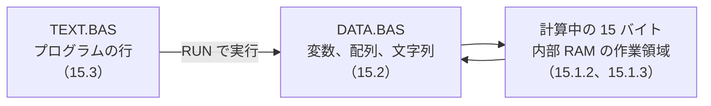
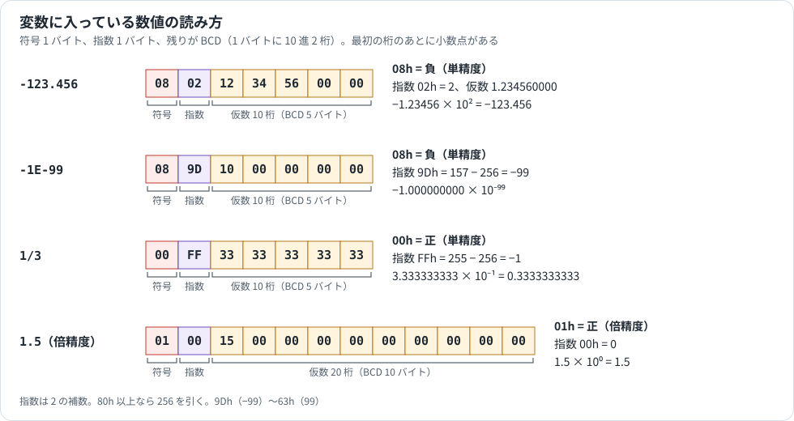
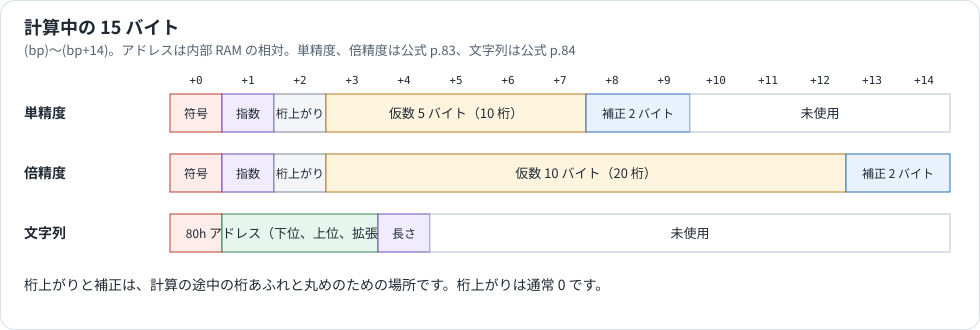
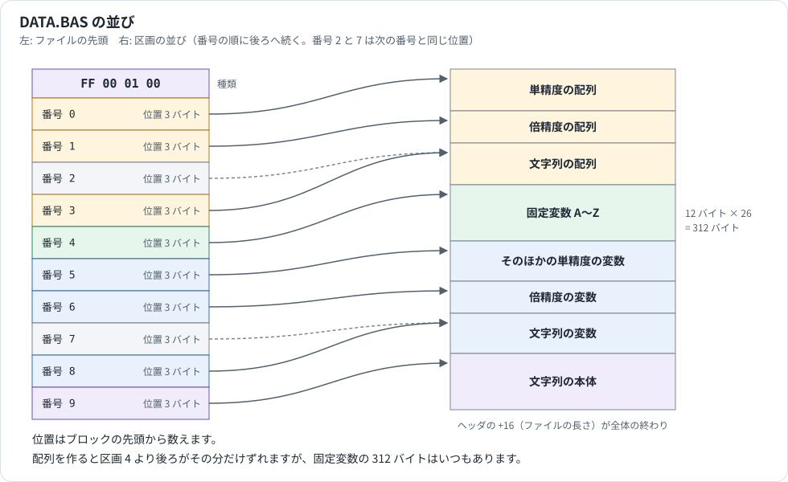
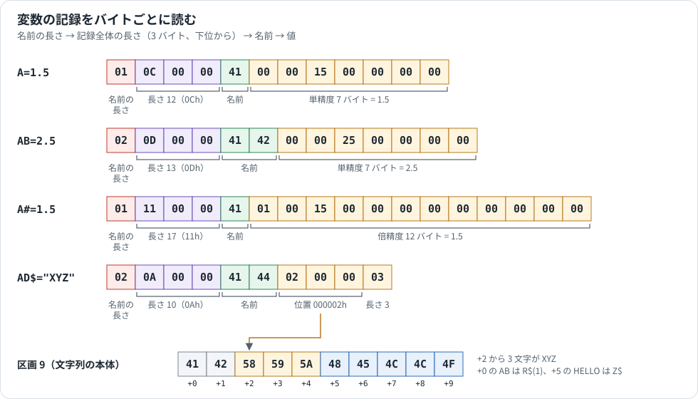
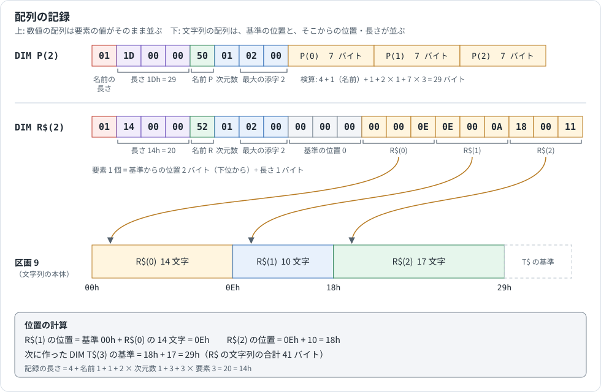
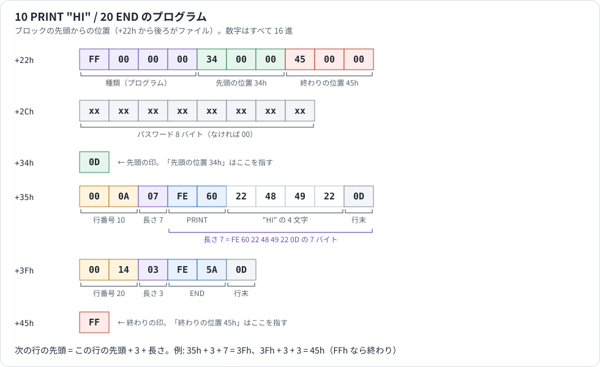
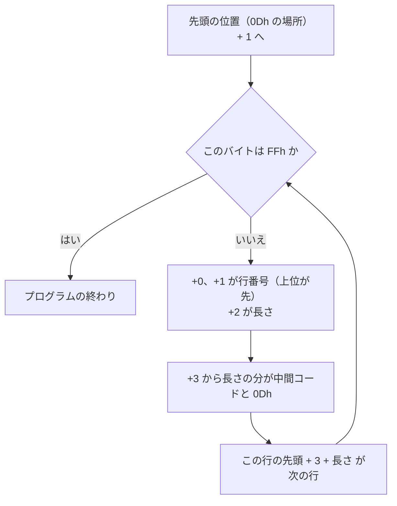
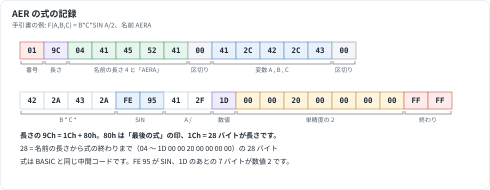

# 15. BASIC の内部形式

BASIC の数値、変数、文字列、プログラムがメモリの中でどう表されているかをまとめた資料です。命令の書式は [BASIC の命令と関数](14_BASIC_REFERENCE.md)、ブロックの構造は [メモリ](03_MEMORY.md) を参照してください。

[目次へ戻る](README.md)

## この章で分かること

- 数値 1 個が何バイトで、どんな並びになっているか（BCD と指数）
- 変数と配列が `DATA.BAS` の中でどう記録されるか
- 文字列の本体がどこに置かれ、変数がそれをどう指しているか
- `10 PRINT "HI"` のような 1 行がどんなバイト列（中間コード）になるか
- パスワード、PF キー、AER の式がどう記録されるか
- マニュアルに載っていない命令

## 15.0 はじめに

BASIC で `A=1.5` と打つと、`1.5` という値はメモリのどこかに、決まった形のバイト列で入ります。`10 PRINT "HI"` と打つと、`PRINT` という 5 文字ではなく `FE 60` という 2 バイトになって入ります。この形を知っていると、次のことができます。

- 機械語から BASIC の変数を読み書きする
- パソコンで作ったプログラムを本体が読める形に変える
- 壊れたファイルの中身を目で追って調べる

登場するのは 2 つのブロック（メモリの中のファイル）です。



| 用語 | 意味 |
|---|---|
| **BCD** | 10 進数の 1 桁を 4 ビットで表す方法。1 バイトに 2 桁入り、`12` と `34` は 16 進で見てもそのまま `12 34` と読める |
| **仮数と指数** | 数値を「仮数 × 10 の指数乗」で表したときの 2 つの部分。`123.456` は 1.23456 × 10²で、仮数が 1.23456、指数が 2 |
| **2 の補数** | 負の数を表す方法。1 バイトなら 80h 以上を負とみなし、256 を引いた値と読む。`9Dh` は 157 − 256 = -99 |
| **中間コード** | キーワードを短い番号に置き換えたプログラムの形。BASIC の行は、入力したときにこの形へ変わる |
| **下位から** | 2 バイト以上の数を、小さい桁のバイトから順に並べる置き方（リトルエンディアン）。`34 00 00` は 000034h |

## 15.1 数値

### 15.1.1 変数に入っているときの形

数値には単精度と倍精度の 2 種類があります。どちらも「符号、指数、仮数」の順に並び、仮数の桁数だけが違います。

| 種類 | 長さ | 形 |
|---|---|---|
| 単精度 | 7 バイト | 符号、指数、BCD 5 バイト（10 桁） |
| 倍精度 | 12 バイト | 符号、指数、BCD 10 バイト（20 桁） |

| 項目 | 単精度 | 倍精度 |
|---|---|---|
| 符号が正 | 00h | 01h |
| 符号が負 | 08h | 09h |
| 指数 | 10 進の指数を 1 バイトの 2 の補数で表す。`9Dh`（-99）〜`63h`（99） | 同じ |

4 つの値を並べると、ビット 3（08h）が負の印、ビット 0（01h）が倍精度の印になっています。先頭の 1 バイトを見れば、その値が 7 バイトなのか 12 バイトなのかも分かります。

実際の値です（実験）。

| 値 | バイト列 |
|---|---|
| `1.5` | `00 00 15 00 00 00 00` |
| `-123.456` | `08 02 12 34 56 00 00` |
| `1E99` | `00 63 10 00 00 00 00` |
| `-1E-99` | `08 9D 10 00 00 00 00` |
| `0` | `00 00 00 00 00 00 00` |
| `1234567890` | `00 09 12 34 56 78 90` |
| `1/3` | `00 FF 33 33 33 33 33` |
| `1.5`（倍精度） | `01 00 15 00 00 00 00 00 00 00 00 00` |
| `1/3`（倍精度） | `01 FF 33 33 33 33 33 33 33 33 33 33` |

そのうち 4 つを 1 バイトずつ読んでみます。



**例: `1234567890` を読む。** 符号 `00` は正の単精度、指数 `09` は 9、仮数は `12 34 56 78 90` なので 1.234567890 です。1.234567890 × 10⁹ = 1234567890 になります。10 桁すべてを使い切っています。

数値はすべて 10 進で持つので、`0.1` のような値も誤差なく表せます。2 進の浮動小数点では 0.1 は循環小数になって丸められますが、BCD では「1 × 10 の -1 乗」と書くだけで済みます。`1/3` のように 10 進で割り切れない値は、仮数の桁数で打ち切られます。

### 15.1.2 計算中の形

計算中はどちらも 15 バイトに広げます（公式 p.83）。`(bp)` は内部 RAM の、ベースポインタ BP が指す場所です。計算ドライバ（[IOCS と FCS](11_IOCS.md)）に値を渡すときもこの形を使います。

| 位置 | 単精度 | 倍精度 |
|---|---|---|
| `(bp)` | 符号 | 符号 |
| `(bp+1)` | 指数 | 指数 |
| `(bp+2)` | 桁上がり（通常 0） | 桁上がり（通常 0） |
| `(bp+3)`〜 | 仮数 5 バイト | 仮数 10 バイト |
| その次 | 計算の補正 2 バイト、未使用 | 計算の補正 2 バイト |



変数の形との違いは指数と仮数の間に「桁上がり」の 1 バイトが入ることです。機械語で変数の 7 バイトをこの領域にコピーするときは、ここを 1 バイト空けます。

**例: `-123.456` をコピーする。**

```text
変数     08 02    12 34 56 00 00
計算中   08 02 00 12 34 56 00 00 cc cc -- -- -- -- --
         符号、指数、桁上がり、仮数 5 バイト、補正 2 バイト（cc）、未使用 5 バイト（--）
```

### 15.1.3 文字列の計算中の形

計算中の文字列は 15 バイトの情報として扱います（公式 p.84）。文字列そのものをコピーするのではなく、どこに何文字あるかだけを持ちます。

| 位置 | 内容 |
|---|---|
| `(bp)` | `80h` |
| `(bp+1)`〜`(bp+3)` | 文字列のアドレス（下位、上位、拡張） |
| `(bp+4)` | 長さ |
| 残り | 未使用 |

先頭の 1 バイトで種類が分かります。

| 先頭 | 意味 |
|---|---|
| 00h、08h | 単精度の正、負 |
| 01h、09h | 倍精度の正、負 |
| 80h | 文字列 |

## 15.2 DATA.BAS の構造

変数はすべて `DATA.BAS` というブロックに入ります。種類ごとに**区画**に分かれ、ファイルの先頭にある 10 個の位置がそれぞれの区画を指します。

### 15.2.1 先頭

ファイルの先頭は `FF 00 01 00` で、そのあとに 10 個の 3 バイトの位置が並びます（実験）。位置はブロックの先頭からです。

| 番号 | 区画の内容 |
|---|---|
| 0 | 単精度の配列 |
| 1 | 倍精度の配列 |
| 2 | 番号 3 と同じ位置（手引書の例でも同じ。2 つある理由は不明） |
| 3 | 文字列の配列 |
| 4 | 固定変数 `A`〜`Z` |
| 5 | そのほかの単精度の変数 |
| 6 | 倍精度の変数 |
| 7 | 番号 8 と同じ位置（手引書の例でも同じ。2 つある理由は不明） |
| 8 | 文字列の変数 |
| 9 | 文字列の本体 |



ヘッダの `+16`（ファイルの長さ）が全体の終わりです。

固定変数は 12 バイト × 26 個 = 312 バイトで、区画 4 にいつもあります。サービスマニュアルの「Fixed variable area 312 Byte」と一致します。何も代入していなければ値は 0 です。配列を作ると、その分だけ後ろへずれます（手引書、実験）。

12 バイトの内訳は次の項の `A=1.5` の記録（`01 0C 00 00 41` と値 7 バイト）と同じです。

### 15.2.2 変数の記録

変数 1 個の記録は次の形です。

```text
+0    名前の長さ
+1    記録全体の長さ（3 バイト）
+4    名前
その後 値
```

| 変数 | 記録 |
|---|---|
| `A=1.5` | `01 0C 00 00 41 00 00 15 00 00 00 00` |
| `AB=2.5` | `02 0D 00 00 41 42 00 00 25 00 00 00 00` |
| `A#=1.5` | `01 11 00 00 41 01 00 15 00 00 00 00 00 00 00 00 00` |
| `AD$="XYZ"` | `02 0A 00 00 41 44 02 00 00 03` |



読むときのこつは 3 つあります。

- 名前には `#` や `$` が入りません。`A` と `A#` は名前が同じ `41` で、どの区画にあるか（番号 4 か 6 か）と、値の符号のバイト（00h か 01h か）で区別されます。
- 記録の長さは次の変数までの距離です。長さを足していけば、区画の中の変数を順にたどれます。
- 値の長さは記録の長さ − 4 − 名前の長さです。`AB` なら 13 − 4 − 2 = 7 バイトで単精度です。

制限は次のとおりです。名前、文字列、次元、添字の上限は操作説明書（p.169、p.240）と手引書が一致しています。

| 項目 | 上限 |
|---|---|
| 名前 | 40 文字。先頭は英字。41 文字目から後は見ない（実験。ROM 7.2） |
| 文字列 | 254 文字。1 文字足すと `String too long`（実験） |
| 配列の次元 | 120 |
| 添字 | 65534（FFFEh）。`DIM A(65535)` は `Illegal function call`（実験） |

### 15.2.3 文字列

文字列の変数は値の代わりに「区画 9 の先頭からの位置（3 バイト）」と「長さ（1 バイト）」を持ちます。本体は区画 9 に詰めて並びます。

```text
AD$="XYZ"  : 位置 000002h、長さ 3
Z$="HELLO" : 位置 000005h、長さ 5
区画 9     : 41 42 58 59 5A 48 45 4C 4C 4F  (R$(1)="AB" のあとに続く)
```

区画 9 の 10 バイトは `AB`（R$(1)）、`XYZ`（AD$）、`HELLO`（Z$）がすき間なく並んだものです。`AD$` の位置 2 は「`AB` の 2 文字のあと」、`Z$` の位置 5 は「`AB` と `XYZ` の 5 文字のあと」です。文字列に終わりの印はなく、長さだけで終わりが決まります。

### 15.2.4 配列

配列の記録は、名前までは変数と同じで、そのあとに次元の情報と要素が続きます。

```text
+0    名前の長さ
+1    記録全体の長さ（3 バイト）
+4    名前
その後 次元数（1 バイト）、各次元の最大の添字（2 バイトずつ）、要素
```

| 宣言 | 記録の頭 | 要素 |
|---|---|---|
| `DIM P(2)` | `01 1D 00 00 50 01 02 00` | 7 バイト × 3 個 |
| `DIM S(1,2)` | `01 34 00 00 53 02 01 00 02 00` | 7 バイト × 6 個 |
| `DIM Q#(1)` | `01 20 00 00 51 01 01 00` | 12 バイト × 2 個 |
| `DIM R$(2)` | `01 14 00 00 52 01 02 00` | 基準の位置 3 バイト + 3 バイト × 3 個 |

要素は添字の小さい順に並びます。`DIM` に書くのは添字の最大値なので、要素の数はそれぞれ 1 多くなります。`S(1,2)` なら 2 × 3 = 6 個です。

記録の長さは次のように検算できます。

| 宣言 | 計算 | 合計 |
|---|---|---|
| `DIM P(2)` | 4 + 1（名前）+ 1 + 2 × 1（次元）+ 7 × 3 | 29 = 1Dh |
| `DIM S(1,2)` | 4 + 1 + 1 + 2 × 2 + 7 × 6 | 52 = 34h |
| `DIM Q#(1)` | 4 + 1 + 1 + 2 × 1 + 12 × 2 | 32 = 20h |
| `DIM R$(2)` | 4 + 1 + 1 + 2 × 1 + 3 + 3 × 3 | 20 = 14h |

#### 文字列の配列

文字列の配列は配列ごとに基準の位置を 1 つ持ち、要素はそこからの位置と長さです（実験。手引書 §15.5.8 とも一致します）。全体の長さは 4 + 名前の長さ + 1 + 2 × 次元数 + 3 + 3 × 要素数です。

```text
DIM R$(2)、R$(0) に 14 文字、R$(1) に 10 文字、R$(2) に 17 文字を代入:
01 14 00 00 52 01 02 00   名前の長さ、記録の長さ、名前、次元数、最大の添字
00 00 00                  基準の位置（区画 9 の先頭から）
00 00 0E                  R$(0): 基準から 0、14 文字
0E 00 0A                  R$(1): 基準から 0Eh、10 文字
18 00 11                  R$(2): 基準から 18h、17 文字
```



このあとに `DIM T$(3)` を作ると、基準の位置は 29h（`R$` の文字列の合計 41 バイト）でした。

**`DIM R$(1)*5` の `*5` は記録に残りません。** 操作説明書 p.354 もほかの機種のプログラムを移すときは長さの指定を消すように書いています。実験では `R$(1)="ABCDEFGH"` がそのまま 8 文字入り、読み出しても 8 文字でした。文字列はすべて本体を区画 9 に置く可変長です。

## 15.3 プログラム（TEXT.BAS）

プログラムは `TEXT.BAS` というブロックに入ります。次は 2 行のプログラム

```basic
10 PRINT "HI"
20 END
```

のファイルの中身です。

```text
FF 00 00 00          ファイルの種類
34 00 00             プログラムの先頭の位置（ブロックの先頭から）
45 00 00             プログラムの終わりの位置
xx × 8               パスワード（なければ 00h）
0D                   プログラムの先頭の印
00 0A 07 FE 60 22 48 49 22 0D   行（10 PRINT "HI"）
00 14 03 FE 5A 0D               行（20 END）
FF                   プログラムの終わり
```



RAM の中の `TEXT` ブロックでは、34 バイトのブロックのヘッダのあと（`+22`）に、このファイルとまったく同じバイトが続きます（実験）。だから先頭の位置は 22h + 12h = 34h です。ブロックの置き場所の移り変わりと、`LOAD` を使わずに RAM へ入れる手順は [メモリ](03_MEMORY.md) §3.3 にあります。

行の形は次のとおりです（公式 p.87）。

| 位置 | 内容 |
|---|---|
| `+0`、`+1` | 行番号（上位バイトが先） |
| `+2` | 長さ（中間コードと `0Dh` の合計） |
| `+3` 〜 | 中間コード |
| 最後 | `0Dh` |

> [!WARNING]
> 行番号だけは**上位バイトが先**です。このほかの 3 バイトの位置や記録の長さは下位が先なので、読み書きするときに混同しないでください。

中間コードは `FEh` に 1 バイトを続けた 2 バイトです。分岐先の行番号は `1Fh` と 2 バイトの行番号で表します（公式 p.87）。

```text
GOTO 10 の中間コード:  FE 2B  1F 00 0A
```

**例: `30 GOTO 10` を 1 行に組み立てる。** 中間コードは 5 バイト、`0Dh` を足して長さは 6 です。行番号 30 は 001Eh なので、行全体は次の 9 バイトになります。

```text
00 1E   06   FE 2B  1F 00 0A   0D
行番号  長さ  GOTO   行番号 10   行末
```

プログラムの先頭から行をたどる手順は次のとおりです。



全キーワードの中間コードは [BASIC の命令と関数](14_BASIC_REFERENCE.md) にあります。手引書の表（157 語）と比べると、値の違いはありませんでした。手引書の `DEFSGN` は `DEFSNG` の誤記と見られます。

### 15.3.1 プログラムの中の数値

`10 A=1234567:B=-1.5:C=&FF:D#=1.5#:GOTO 10` の中身です（実験。手引書と一致します）。

```text
41 3D  1D 00 06 12 34 56 70 00                A=1234567
42 3D  2D  1D 00 00 15 00 00 00 00            B=-1.5
43 3D  26 46 46                               C=&FF
44 23 3D  1D 01 00 15 00 00 00 00 00 00 00 00 00   D#=1.5#
FE 2B  1F 00 0A                               GOTO 10
```

1 つ目を読むと、`41 3D` は文字の `A=`、`1D` は「ここから数値」の印、`00 06 12 34 56 70 00` は §15.1.1 の単精度で、1.234567 × 10⁶ = 1234567 です。

| 書き方 | 記録 |
|---|---|
| 10 進の数値 | `1Dh` のあとに §15.1.1 の形（7 バイトか 12 バイト） |
| 負の数 | 符号は `2Dh`（`-`）の文字のままで、数値は正 |
| `&` の 16 進 | 文字のまま |
| 分岐先の行番号 | `1Fh` のあとに 2 バイト |
| 変数名 | 文字のまま |

数値がすでに内部の形になっているので、実行のたびに文字から変換する必要がありません。その代わり、短い数でも場所を取ります。

| 書き方 | 記録 | 大きさ |
|---|---|---|
| `0` | `1D 00 00 00 00 00 00 00` | 8 バイト |
| `&0` | `26 30` | 2 バイト |

`&0` は 2 バイト、`0` は 8 バイトです。プログラムを小さくするなら 16 進で書くほうが得です（手引書）。

### 15.3.2 パスワード

`10 PRINT 1` だけのプログラムに `PASS "DUMP.BAS"` を実行したあとの、`TEXT` のヘッダです（実験。ROM 3.2、7.2。手引書と一致します）。終わりの位置（`43 00 00`）のすぐあとの 8 バイトがパスワードで、間に余分なバイトはありません。

```text
FB 54 45 58 54 20 20 20 20 42 41 53 22 ...    +0C の属性が 20h から 22h になる
...
FF 00 00 00  34 00 00  43 00 00  44 55 4D 50
2E 42 41 53  0D 00 0A ...                     0Dh の直前の 8 バイトが "DUMP.BAS"
```

1 行目はブロックのヘッダで、`FB` のあとに名前 `TEXT` と空白 4 個、拡張子 `BAS`、属性が並びます。`44 55 4D 50 2E 42 41 53` は文字で読むと `DUMP.BAS` です。

| 項目 | 内容 |
|---|---|
| 記録の形 | **暗号化はされません**。8 バイトの文字のままです |
| 短いとき | `PASS "AB"` は `41 42` のあとを 00h で埋めます |
| 解除 | 同じパスワードでもう一度 `PASS` を実行すると、属性は 20h、8 バイトは 00h に戻ります |
| 違うパスワード | `PASS "WRONG"` では `Password mismatch` になり、何も変わりませんでした |

## 15.4 FUNCKEY と AER

プログラムと変数のほかに、PF キーの割り当てと AER の式もそれぞれのブロックに記録されます。

`FUNCKEY` は PF キーの文字列を `FFh` で区切って並べたものです（実験）。

```text
FF 00 02 00 69 00 00 "RUN " FF "LIST " FF "CONT " FF "SAVE " FF "LOAD " FF ...
```

`KEY` で文字列を長くすると、`FUNCKEY` のブロックが伸び、前の `TEXT` などが前へずれ、`FRE 0` もその分減ります（手引書）。

`AER` は `FF 00 04 01 FF FF` で始まります（実験）。式の記録は手引書に次の例があります。

```text
AER の例 F(A,B,C) = B*C*SIN A/2、名前 AERA:
01 9C  04 41 45 52 41  00  41 2C 42 2C 43  00  42 2A 43 2A FE 95 41 2F 1D 00 00 20 00 00 00 00  FF FF
|  |   |               |   A , B , C       |   B * C * SIN A / 2
|  |   名前の長さと名前  区切り                区切り
|  長さ（1Ch）。最後の式は 80h を足す
番号
```



式は BASIC と同じ中間コードです。エミュレータでは AER の入力を試していません。

### 15.4.1 ENG のソフトと統計、行列

ENG のソフトは実行のときだけ `G:` の BASIC プログラムを RAM に読み込みます（手引書）。

| 項目 | 内容 |
|---|---|
| 場所 | `AER` のブロックとシステム領域の間に `ENG.$$$` というブロックを作る |
| 中身 | 例: 素数の計算では `G:` の `PRIME.111` と `COMN.00$` の 2 つを、合わせて 8C7h バイト |
| 空きが足りないとき | `Out of memory in program`。最大は放射性同位体の表で 16700 バイト |
| 解放 | `BREAK` でメニューへ戻ると解放される |

統計と行列の計算には専用の領域はありません。単精度の配列として変数の領域に置かれます（手引書）。`G:` のファイルの一覧は [G: ドライブ](22_ROM_GDRIVE.md) にあります。

## 15.5 マニュアルに載っていない機能

操作マニュアルに説明がないのに、ROM にあって働く機能です。

| 機能 | 内容 | 確度 |
|---|---|---|
| `CSAVE M` / `CLOAD M` | メモリの保存と読み込み（[11 ピン（テープ、周辺機器）](06_PORT_11PIN.md)） | 実験 |
| `CLOAD @` | 旧形式のテープ（[11 ピン（テープ、周辺機器）](06_PORT_11PIN.md) §6.6） | コード |
| `CSIZE n,K` | 文字サイズの別指定（[CE-515P プロッタ](19_CE-515P_PLOTTER.md) §19.3.2） | 実験 |
| `RLINE -(x,y)` | マニュアルでは省略不可の最初の座標を省く形（[CE-515P プロッタ](19_CE-515P_PLOTTER.md) §19.4） | 実験 |
| `BTEXT$`、`BDATA$` | 今のプログラムと変数のブロックの名前。`BTEXT$="S1:TWO.BAS"` のように代入すると切り替わる（[BASIC の命令と関数](14_BASIC_REFERENCE.md#btext--bdata)）。ROM 3.2 の辞書にもある（`F5B3Fh`）。中間コード 0Bh、0Ch は手引書の表と同じ | 実験、コード |
| `KEY 0,"文字列"` | 文字列をキーボードから打ったのと同じ働き（[BASIC の命令と関数](14_BASIC_REFERENCE.md#key)） | 実験 |
| `POKE`、`PEEK` | メモリの読み書き。動作を確かめた（`POKE &BFCBC,&78,0` のあと `PEEK &BFCBC` が 120） | 実験、手引書 |
| `CALL` | 機械語の呼び出し（[機械語を実機で動かす](12_MACHINE_CODE.md)） | 手引書 |
| `EVAL` | 文字列を式として計算する（操作説明書の BASIC の辞書に項目はない）。`EVAL "1+2"` は 3、`A$="3*4":EVAL A$` は 12 | 実験、手引書 |
| `NAME` | ファイル名の変更。`NAME "E:OLD.BAS" AS "NEW.BAS"` で変わった | 実験、手引書 |
| `RCP` | 逆数の関数 | [BASIC の命令と関数](14_BASIC_REFERENCE.md) |
| 診断メニュー | [ROM バージョンの違い: システム](26_ROM_VERSIONS_SYSTEM.md) §26.2.4 | コード |

全 168 キーワードをマニュアルの OCR 文字で探すと、`BTEXT$`、`BDATA$`、`PEEK`、`POKE`、`RCP`、`WEND`、`ENDIF`、`ENDSWITCH` の 8 個が見つかりませんでした。`WEND` などは ROM 8.5 の追加です。

手引書（p.39）は `POKE`、`PEEK`、`CALL`、`EVAL`、`NAME` を「マニュアルにない命令」としています。英語版の操作説明書の辞書には `NAME` の項目があり（p.298）、ほかの 4 つはありません。`EVAL` は例が 1 か所だけあります。PC-E500S のドイツ語版の辞書にも `NAME` があります（p.287）。手引書の対象はドイツ語版のマニュアルなので、バージョンによって違う可能性があります。

## まとめ

| 対象 | 形 |
|---|---|
| 単精度 | 7 バイト = 符号（00h/08h）、指数、BCD 5 バイト |
| 倍精度 | 12 バイト = 符号（01h/09h）、指数、BCD 10 バイト |
| 計算中の値 | 15 バイト。指数のあとに桁上がりが入る |
| 変数の記録 | 名前の長さ、記録の長さ（3 バイト）、名前、値 |
| 文字列の変数 | 区画 9 からの位置（3 バイト）と長さ（1 バイト） |
| 配列の記録 | 名前のあとに次元数、最大の添字、要素。文字列の配列は基準の位置が加わる |
| `DATA.BAS` | `FF 00 01 00` と 10 個の位置。固定変数の 312 バイトがいつもある |
| `TEXT.BAS` | `FF 00 00 00`、先頭と終わりの位置、パスワード 8 バイト、`0D`、行、`FF` |
| 行 | 行番号（上位が先）、長さ、中間コード、`0D` |
| 中間コード | `FEh` + 1 バイト。数値は `1Dh`、分岐先の行番号は `1Fh` が前に付く |

## 情報源と確度

| 表記 | 情報源 |
|---|---|
| **公式** | PC-E500 Technical Reference Manual（p.83、p.84、p.87） |
| **実験** | エミュレータで変数を作り、`DATA.BAS` を読んだ（ROM 3.2） |
| **手引書** | Systemhandbuch（ドイツ語、Fischel GmbH）。シャープの資料ではなく、欧州版の ROM を調べた解析書です |

実機のメモリは読んでいません。

## 次に読むもの

- [BASIC の命令と関数](14_BASIC_REFERENCE.md): 全キーワードの中間コードと書式
- [メモリ](03_MEMORY.md): `DATA`、`TEXT` などのブロックの置き場所
- [11 ピン（テープ、周辺機器）](06_PORT_11PIN.md): テープに保存したプログラムの形
- [IOCS と FCS](11_IOCS.md): 15 バイトの形で値を渡す計算ドライバ
