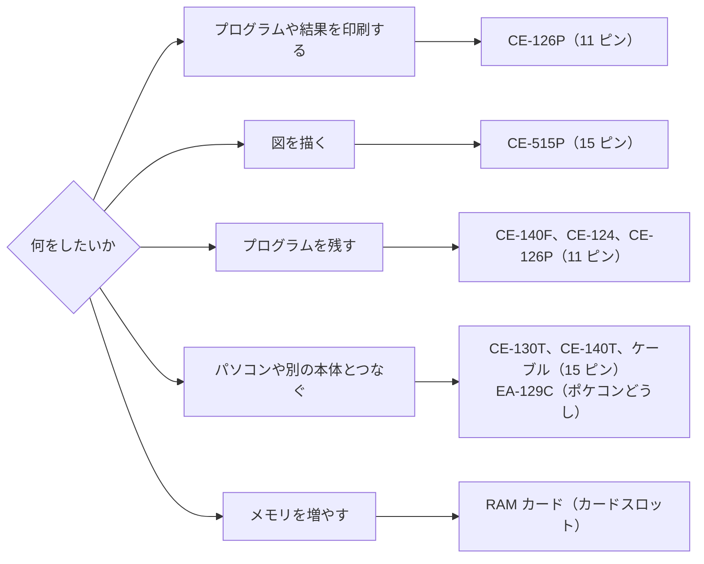
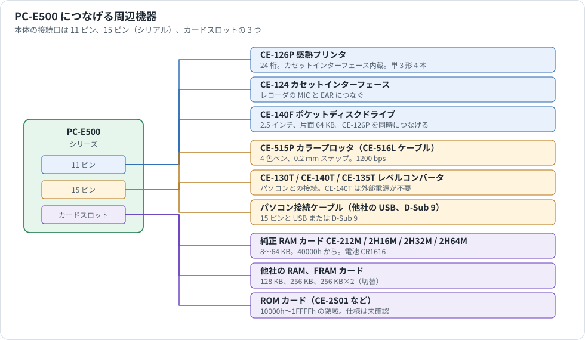
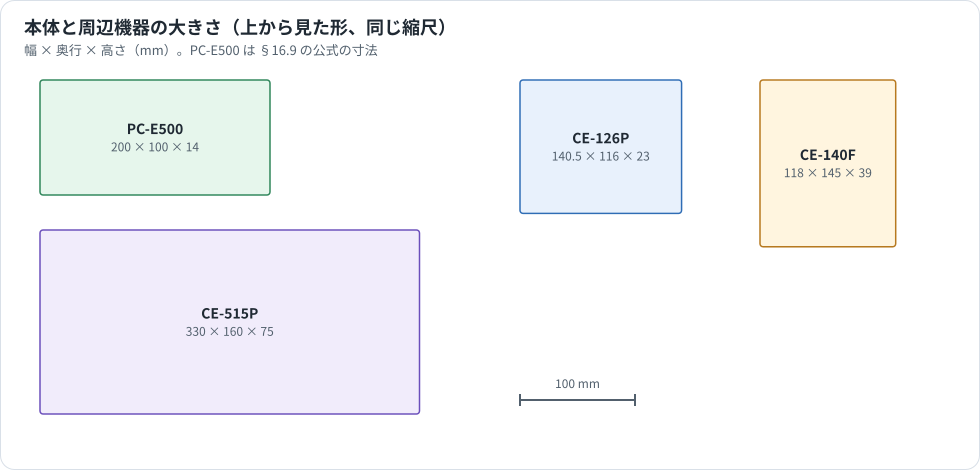
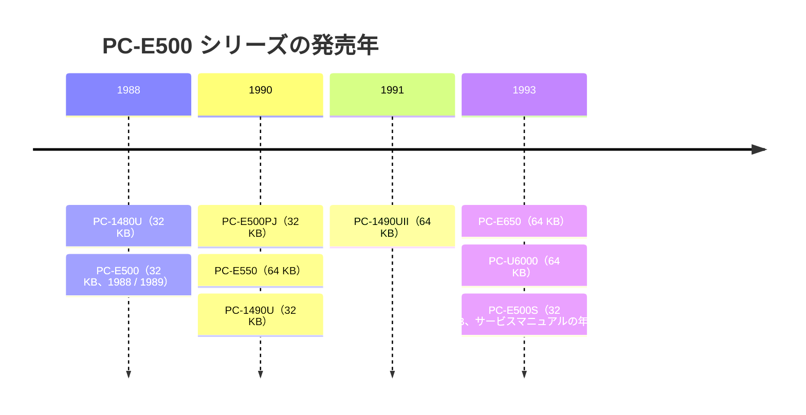
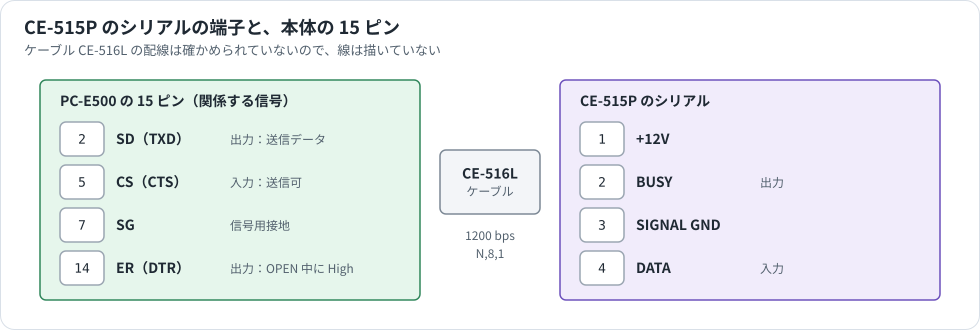
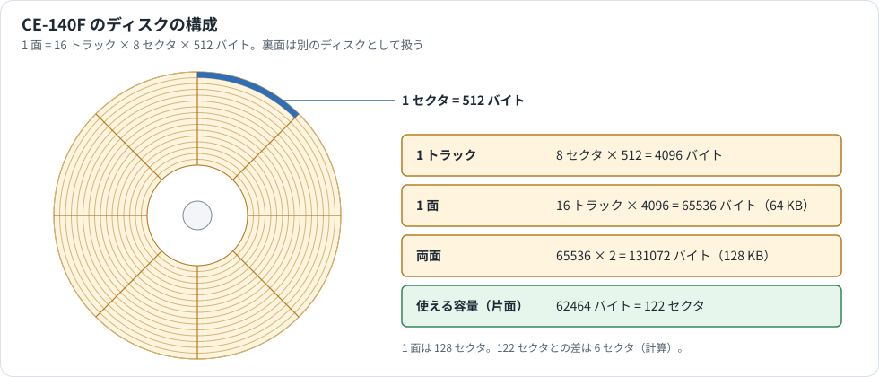
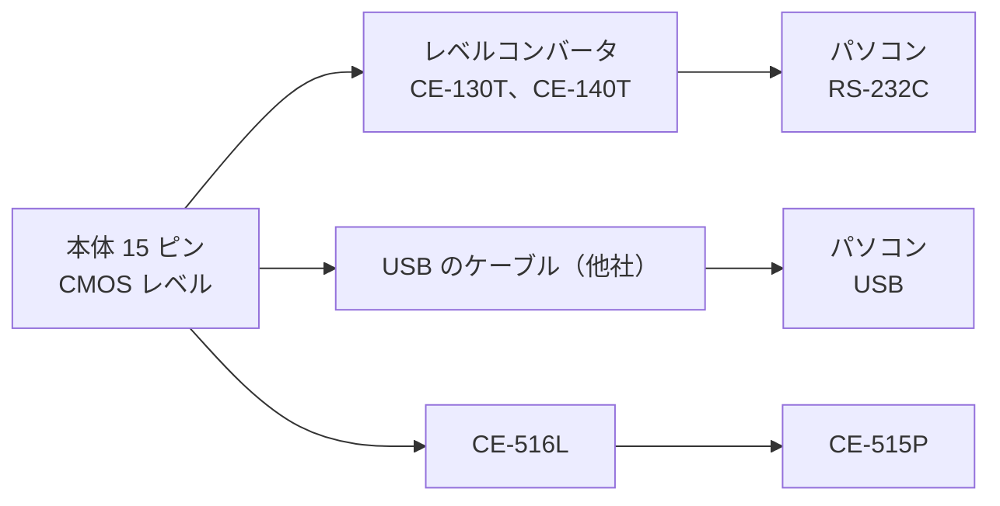

# 16. 周辺機器

この章は PC-E500 シリーズにつなげるプリンタ、ディスク、カセット、ケーブル、カードの一覧と仕様です。手元の機器が使えるか、どの接続口に挿すのか、電池は何本いるのか、といったことを調べるときに開いてください。接続口のピン配置、通信手順、データの形はそれぞれの章で説明しています。資料どうしで書いてあることが違う点は、ページの画像や実験で確かめて、どれが正しいかを §16.9 に書きました。

[目次へ戻る](README.md)

## この章で分かること

- 本体の 3 つの接続口と、それぞれにつながる機器
- プリンタ（CE-126P）、プロッタ（CE-515P）、ディスク（CE-140F）、カセット（CE-124）の仕様
- パソコンとつなぐためのレベルコンバータとケーブル
- 電池、AC アダプタ、紙、ペンなどの消耗品の型番
- 資料どうしの食い違い

## 16.0 はじめに

ポケコンは 1 台でも使えますが、作ったプログラムを残す、印刷する、図を描く、パソコンへ送る、といった仕事には外の機器が要ります。何をしたいかによって、使う機器と接続口が決まります。

この章は仕様の一覧です。通信の手順やデータの形は次の章で説明しています。

| 機器 | 解析資料 |
|---|---|
| CE-140F | [CE-140F の通信](17_CE-140F_DISK.md) |
| CE-515P | [CE-515P プロッタ](19_CE-515P_PLOTTER.md) |
| カセット（CE-124、CE-126P）のつなぎ方、操作 | [カセットインターフェース](20_CASSETTE.md) |
| 11 ピン | [11 ピン（テープ、周辺機器）](06_PORT_11PIN.md) |
| 15 ピン、シリアルポート | [15 ピン（シリアル）](07_PORT_15PIN.md) |
| RAM カード、ROM カード | [カードスロット](05_CARD_SLOT.md) |

周辺機器の実物は調べていません。**本資料の値は資料の転記で、実機で測ったものではありません。** 2026-11-06 に集めました。表の「出典」の欄の言葉（公式、公式 OCR、個人、百科事典、販売店）の意味は、章の終わりの「情報源と確度」にあります。

## 16.1 全体像

本体の接続口は 3 つです。

| 接続口 | 形 | つながる機器 |
|---|---|---|
| 11 ピン（本体の左側） | 2.54 mm ピッチ | CE-126P、CE-124、CE-140F |
| 15 ピン（シリアル） | ハーフピッチ | CE-515P、レベルコンバータ、パソコン |
| カードスロット（裏面） | 33 ピンと両端のバネ 2 個 | RAM カード、ROM カード |

本体のシステム構成図に載っている純正の機器は次のとおりです（公式）。

| 種類 | 型番 |
|---|---|
| プリンタとカセット | CE-126P |
| カセット | CE-124 |
| ディスク | CE-140F |
| プロッタ | CE-515P（ケーブル CE-516L。PC-E500 の図のみ。PC-E500S の図にはない） |
| RAM カード | CE-212M、CE-2H16M、CE-2H32M、CE-2H64M |
| レベルコンバータ | CE-130T（PC-E500 の図。RS-232C の機能を持つ MZ シリーズなどへ）、CE-135T（PC-E500S の図。「MAC」と注記） |

機器の大きさを本体と比べると、次のようになります。

### 対応する本体

周辺機器の接続口はシリーズで共通と紹介されています（販売店、個人）。

| 機種 | 内蔵 RAM | 発売年 | 備考 |
|---|---|---|---|
| PC-E500 | 32 KB | 1988 / 1989 | サービスマニュアルは 1989 年 8 月の発行 |
| PC-E500PJ | 32 KB | 1990 | |
| PC-E500S | 32 KB | 1993 | 英語版。年はサービスマニュアルの発行（1993 年 5 月）による。百科事典は 1995 |
| PC-E550 | 64 KB | 1990 | |
| PC-E650 | 64 KB | 1993 | 構造化 BASIC |
| PC-1480U | 32 KB | 1988 | |
| PC-1490U | 32 KB | 1990 | |
| PC-1490UII | 64 KB | 1991 | |
| PC-U6000 | 64 KB | 1993 | |

発売年の順に並べると、次のようになります。

内蔵 RAM は百科事典の値で、PC-E500、PC-E500S、PC-E650、PC-U6000 はサービスマニュアルの部品表と一致します。発売年は、PC-E500S のほかは百科事典の値です。PC-E500S のサービスマニュアルは 1993 年 5 月の発行で、PC-E650 と PC-U6000 の部品も載せているので、3 機種は 1993 年にはそろっていたことになります。ROM の違いは [ROM バージョンの違い: 機種](27_ROM_VERSIONS_MODELS.md) を参照してください。

## 16.2 接続口のピン配置

ピンの番号と信号の一覧は、接続口ごとの章にあります。

| 接続口 | 資料 |
|---|---|
| 11 ピン | [11 ピン（テープ、周辺機器）](06_PORT_11PIN.md) |
| 15 ピン | [15 ピン（シリアル）](07_PORT_15PIN.md) |
| カードスロット | [カードスロット](05_CARD_SLOT.md) §5.2 |

本体の電池が切れても、CE-126P をつないでいれば CE-126P から電源が供給され、本体の電池の消費が減ります（公式）。

## 16.3 プリンタ

プリンタは 11 ピンにつなぐ感熱プリンタ CE-126P と、シリアルにつなぐプロッタ CE-515P の 2 つです。文字を速く印刷するなら CE-126P、線や図を色付きで描くなら CE-515P を使います。

| | CE-126P | CE-515P |
|---|---|---|
| 方式 | 感熱の点で文字を作る | ペンで線を引く |
| 接続口 | 11 ピン | 15 ピン（CE-516L） |
| 幅 | 24 桁（紙 58 mm） | 最大 160 桁（ロール紙 114 mm） |
| 図形 | なし（固定の文字のみ） | あり（4 色） |
| 速さ | 約 0.8 行/秒 | 10 文字/秒 |
| 電源 | 単 3 形 4 本、AC アダプタ、充電池 | AC アダプタ |
| カセット | 内蔵 | |

### 16.3.1 CE-126P 感熱プリンタ / カセットインターフェース

11 ピンのプリンタです。送る信号と文字の変換は [CE-126P プリンタ](18_CE-126P_PRINTER.md) にあります。カセットインターフェースも内蔵しています。もとは PC-1250 などの時代の機器で、サービスマニュアルは 1983 年のものです（公式 OCR）。

| 項目 | 値 | 出典 |
|---|---|---|
| 印字方式 | ドットマトリクス感熱（MTP-201） | 公式 OCR |
| 桁数 | 24 桁 | 公式 |
| 文字 | 5×7 ドット、固定の文字のみ | 個人、百科事典 |
| 印字速度 | 約 0.8 行/秒 | 公式 OCR |
| 紙 | EA-1250P。幅 58 mm、外径 18 mm 以下 | 公式 OCR |
| 電源 | 単 3 形 4 本、AC アダプタ EA-23E、充電池 EA-27B | 公式 OCR |
| 消費電力 | 3 W | 公式 OCR |
| 電池での印字量 | マンガン 約 2000 行、SUM3 約 3000 行、EA-27B 約 5000 行 | 公式 OCR |
| 充電時間 | 約 15 時間（EA-27B） | 公式 OCR |
| 大きさ | 140.5（幅）×116（奥行）×23（高さ）mm | 公式 OCR |
| カセット端子 | MIC、EAR、REM | 公式、個人 |
| 接続 | 本体に固定のケーブル | 個人 |

### 16.3.2 CE-515P カラープロッタプリンタ

4 色のペンで描く X/Y プロッタです。取扱説明書の値です（公式 OCR）。BASIC の命令との関係は [CE-515P プロッタ](19_CE-515P_PLOTTER.md) にあります。

| 項目 | 値 |
|---|---|
| 方式 | X/Y プロッタ |
| ペン | 4 色（黒、青、緑、赤）。8 本付属（各色 2 本） |
| 最小移動量 | 0.2 mm |
| 文字サイズ | 15 種類（0.8×1.2 mm〜12×18 mm） |
| 桁数 | 最大 160 桁（レターサイズ、最小文字） |
| 印字速度 | 10 文字/秒（最小の英数字の平均） |
| ロール紙 | 幅 114 mm、外径 25 mm 以下、内径 8 mm。EA-515P |
| 単票 | 厚さ 70〜400 µm |
| インターフェース | シリアル（RS-232C）、パラレル（セントロニクス準拠、TTL） |
| 電源 | AC アダプタ EA-57A |
| 消費電力 | 14 W |
| 動作温度 | 5〜40 °C |
| 大きさ | 330（幅）×160（奥行）×75（高さ）mm |
| 重さ | 1.4 kg |
| 付属品 | EA-57A、カバー、ロール紙、単票 10 枚、ペン 8 本、説明書 |

**シリアルの条件**

| 項目 | 値 |
|---|---|
| 速度 | 1200 bps（ほかの値の記載なし） |
| データ | 7 または 8 ビット（DIP スイッチ SW1） |
| パリティ | なし |
| ストップ | 7 ビットのとき 2、8 ビットのとき 1 |
| 入力レベル | RS-232C か TTL（DIP スイッチ SW5） |

端子は 4 本です。

| ピン | 名前 | 向き |
|---|---|---|
| 1 | +12V | |
| 2 | BUSY | 出力 |
| 3 | SIGNAL GND | |
| 4 | DATA | 入力 |

**例: 大きさをステップに直す。** 最小移動量の 0.2 mm を 1 ステップと数えます。最小の文字 0.8×1.2 mm は 4×6 ステップ、最大の文字 12×18 mm は 60×90 ステップです。ロール紙の幅 114 mm は 570 ステップにあたります。

PC-E500 の `OPEN` の既定値 `1200,N,8,1` はこの条件と合います。行末コードは CR です。

PC-E500 とつなぐケーブルは CE-516L です（公式）。15 ピンと CE-515P のシリアル端子をつなぎます。線の中身は §16.9 にあります。

### 16.3.3 その他のプリンタ

| 機種 | 内容 | 出典 |
|---|---|---|
| SM1-21 | PC-E500 シリーズ用の小型プリンタ | 販売店 |

## 16.4 ディスク

2.5 インチのディスクに、ファイルを名前で保存する機器です。テープと違って、途中まで巻かなくても、好きなファイルを取り出せます。

### 16.4.1 CE-140F ポケットディスクドライブ

| 項目 | 値 | 出典 |
|---|---|---|
| メディア | 2.5 インチ両面ディスク CE-1650F（10 枚入り） | 公式 OCR |
| 容量 | 片面 64 KB、両面 128 KB | 公式 OCR |
| 使える容量 | 片面 62464 バイト | 公式 OCR |
| 記録方式 | GCR（4/5） | 公式 OCR |
| 構成 | 16 トラック/面、8 セクタ/トラック、512 バイト/セクタ | 公式 OCR |
| 電源 | 単 3 形 5 本（7.5 V）、AC アダプタ EA-160（8.4 V、1.0 A、センターマイナス） | 公式 OCR、個人 |
| 消費電力 | 2.5 W | 公式 OCR |
| 電池の持ち | マンガン 約 60 分、アルカリ 約 200 分 | 公式 OCR |
| 動作環境 | 10〜35 °C、湿度 20〜80 % | 公式 OCR |
| 大きさ | 118（幅）×145（奥行）×39（高さ）mm | 公式 OCR |
| 重さ | 約 650 g（電池込み） | 公式 OCR |
| 付属品 | ディスク 1 枚、電池 5 本、説明書 | 公式 OCR |
| 発売 | 1987 年、49,800 円 | 個人 |

記録の単位は面、トラック、セクタの 3 段です。トラックは同心円の 1 周、セクタはその 1 周を区切った 1 区画です。

GCR（4/5）は 4 ビットのデータを 5 ビットに置き換えて記録する方式です。

- ディスクは面ごとに扱います。裏面は別のディスクとして `INIT "X:"` します（個人）。
- 書き込み禁止の設定は面ごとにあります（個人）。
- ファイル名は 8+3 文字です。
- CE-126P をつなぐ端子があり、同時に使えます（個人）。
- PC-E500 シリーズのほか、PC-1280、PC-1360/60K、PC-1425、PC-1460、PC-1470U、PC-1475 で使えます（個人）。

メディアは現在入手しにくいとされています（個人）。

**サービスマニュアル（p.1〜2）から分かること**（公式）

- 記録方式、構成、容量、電源、電流、環境、大きさ、重さは、上の表の値をページの画像で確かめました。
- 電池の持ちは 4 KB のプログラムを 20 °C で書き読みし続けたときの値です。
- 増設コネクタがあり、CE-126P と CE-124 をつなげます。ディスクのデータはカセットより速く読み書きできます（約 1700 ビット毎秒）。
- 中身と注意は [CE-140F の通信](17_CE-140F_DISK.md) §17.6 にあります。

## 16.5 カセット

カセットテープに保存するための接続です。つなぎ方、手順、命令、エラー、パソコンを使う方法は [カセットインターフェース](20_CASSETTE.md)、信号とテープ上のデータの形は [11 ピン（テープ、周辺機器）](06_PORT_11PIN.md) にあります。

| 機器 | 内容 | 出典 |
|---|---|---|
| CE-124 | カセットインターフェース。モノラルミニプラグ 2 本。リモートの線はない（Systemhandbuch） | 公式、百科事典 |
| CE-126P | プリンタ内蔵。リモート端子あり | 公式 |

リモートは本体からレコーダのモーターを動かしたり止めたりする線です。CE-124 にはないので、レコーダのボタンを自分で操作します。

レコーダの条件はマニュアルに次のようにあります（公式）。

| 項目 | 条件 |
|---|---|
| 種類 | 標準またはマイクロカセット |
| 入力端子 | MIC ミニジャック（AUX は不可） |
| 入力インピーダンス | 200〜1000 Ω |
| 最低入力レベル | 3 mV（-50 dB）以下 |
| 出力端子 | EXT、MONITOR、EAR のミニジャック |
| 出力インピーダンス | 10 Ω 以下 |
| 出力レベル | 1 V 以上 |
| 歪み | 15 % 以内（2〜4 kHz） |
| ワウフラッター | 0.3 % 以下 |

## 16.6 シリアル接続の機器

本体の 15 ピンの信号は CMOS レベル（4〜6 V）なので、RS-232C のパソコンとは直接つなげません（[15 ピン（シリアル）](07_PORT_15PIN.md)）。電圧の違いを変換する機器がレベルコンバータです。

| 型番 | 内容 | 電源 | フロー制御 | 出典 |
|---|---|---|---|---|
| CE-130T | RS-232C レベルコンバータ。パソコン側は DB-25。RS-232C ケーブルは別途必要 | あり（下記） | 信号線あり | 公式 OCR、個人、百科事典 |
| CE-140T | RS-232C レベルコンバータ。ケーブル一体型 | 不要（DTR から取る） | XON/XOFF のみ | 個人、百科事典 |
| CE-135T | Macintosh 接続用のレベルコンバータ。ケーブル一体型 | | | 公式（型番と MAC の注記）、百科事典 |
| CE-516L | CE-515P 用のケーブル。シリアルにつなぐ（Systemhandbuch） | | | 公式 |
| EA-129C | ポケコンどうしをつなぐケーブル | | | 個人、百科事典 |

CE-130T のサービスマニュアルからは、充電池（約 15 時間充電）、AC アダプタ、88×110×62 mm という値が読めますが、OCR が崩れているので確度は低いです。

シリアルを 19200 bps で動かす例が個人サイトにあります（`BFD33h` の上位ビットを `0111` にする）。公式の仕様は 9600 bps までです。`BFD33h` のビット 6〜4 がボーレートで、`111` が 19200 bps の設定です（[CPU（SC62015）](02_CPU.md) §2.8.1）。

### 他社の製品

| 製品 | 内容 | 出典 |
|---|---|---|
| パソコン接続ケーブル（USB） | 15 ピンと USB。CE-140T 相当 | 販売店 |
| パソコン接続ケーブル（D-Sub 9） | 15 ピンと D-Sub 9 | 販売店 |
| PC-E500 - PC-E500 接続ケーブル | 15 ピンどうし、約 50 cm | 販売店 |
| ポケコン接続ケーブル | 11 ピンどうし、約 50 cm。EA-129C 相当 | 販売店 |
| PC-G850/PC-E200 接続ケーブル | 11 ピンと 15 ピン、約 1 m | 販売店 |
| 測量機接続ケーブル | ニコン、ペンタックス、ライカ、トプコン、ソキア | 販売店 |
| SYS TECH POCKET Link 500 | パソコン用のシリアルケーブル（D-Sub 9） | 個人 |

## 16.7 RAM カードと ROM カード

カードの種類、アドレス、使い方、書き込み保護は [カードスロット](05_CARD_SLOT.md) にあります。内蔵 RAM の増設は [メモリ](03_MEMORY.md) §3.9 にあります。

## 16.8 電源と消耗品

電源と消耗品の型番です。`EA-` で始まる型番はアダプタ、充電池、紙、ペンなどの付属品です。

| 型番 | 内容 | 使う機器 | 出典 |
|---|---|---|---|
| 単 4 形 4 本 | 本体の電源（DC 6 V） | 本体 | 公式 |
| CR2016 | 本体のメモリのバックアップ | 本体 | 公式 |
| CR1616 | RAM カードのバックアップ | RAM カード | 個人、百科事典 |
| EA-23E | AC アダプタ（8.5 V、350 mA） | CE-126P | 公式 OCR、百科事典 |
| EA-27B | 充電池 | CE-126P | 公式 OCR |
| EA-160 | AC アダプタ（8.4 V、1.0 A） | CE-140F | 公式 OCR、個人 |
| EA-57A | AC アダプタ | CE-515P | 公式 OCR |
| EA-1250P | 感熱紙 | CE-126P | 公式 OCR |
| EA-515P | ロール紙 | CE-515P | 公式 OCR |
| EA-850C | 4 色ペン | CE-515P | 部品の一覧 |
| CE-1650F | 2.5 インチディスク | CE-140F | 公式 OCR |

## 16.9 資料の食い違い

同じことについて、資料によって違うことが書かれている場合があります。どれが正しいか決められないものは、両方を残しました。

| 項目 | 資料の食い違い | 結論と証拠 |
|---|---|---|
| CE-516L の接続先 | 以前の本資料は、操作説明書の機器の表が 11 ピンと書いていると読んでいた | **15 ピン（シリアル）**。ページの画像では、表の CE-515P の行は「via CE-516L」で、11 ピンとは書いていない（操作説明書 p.24、公式）。本文（p.28）、PC-E500 の構成図（サービスマニュアル p.2）、ROM が `COM:` へ送ること、Systemhandbuch（p.7）も同じ |
| PC-E500S と CE-515P | システム構成図にない | **使える**。同じマニュアルの検査（FCC、p.9）が CE-515P に 1 行印字する。15 ピンの回路も PC-E500 と同じ（公式） |
| PC-E500 の大きさ | 個人サイトの実測は 199×99×15 mm | **200×100×14 mm**（サービスマニュアル p.1、操作説明書 p.352、公式）。個人の値は実物の測り方の差の範囲 |
| PC-E500S の大きさ、重さ、消費電力 | 百科事典は 340 g、0.09 W | **340 g、0.09 W**、閉じて 220×104.5×19 mm、開いて 220×202.5×14 mm（PC-E500S サービスマニュアル p.1、公式）。PC-E500 は 250 g、0.07 W |
| システム ROM | PC-E500 のサービスマニュアルは 128 KB | **256 KB**。操作説明書 p.351、回路図、端子の表、ROM イメージが一致する（[回路とサービス](09_CIRCUIT.md) §9.1） |
| CE-210M、CE-211M（2 KB、4 KB） | 操作説明書は 8〜64 KB、構成図は 4 種類。個人の一覧と百科事典は 6 種類 | 製品として案内されたのは 8 KB 以上。**本体は 2 KB、4 KB も扱える**（2 冊のサービスマニュアルの検査にアドレスがある。ROM で初期化できた。[カードスロット](05_CARD_SLOT.md) §5.11.1） |
| `10000h` のカード | PC-E500S のメモリマップは「64KB RAM card」 | **ROM カードのウィンドウ**。2 冊の端子の表がどちらも CE6 = ROM card としている（[カードスロット](05_CARD_SLOT.md) §5.3.2） |
| 11 ピンの DIN と DOUT | 個人サイトの表は 5 番 Din、8 番 Dout | **5 番 DOUT（出力）、8 番 DIN（入力）**。回路図 2 冊、ROM、検査の表が一致する（[11 ピン](06_PORT_11PIN.md) §6.0.1） |
| CE-135T の信号 | 百科事典の英語版は RS-232、日本語版は RS-422。PC-E500S の構成図は「MAC」 | Macintosh につなぐレベルコンバータであることは公式。信号の規格は、資料が食い違ったままで、公式の記載がない |
| CE-133T | 博物館のページは Sharp Organizer 用 | 2 冊のサービスマニュアルの構成図にも操作説明書にもない。PC-E500 用の一覧には入れない |
| CE-516L の配線 | PC-1350 のサービスマニュアルに回路図があるが、読める画像がない。CE-515P の説明書は別の CE-515L（PC-1500 用など）を挙げる | 配線は示せない。PC-E500 の側の信号は [15 ピン（シリアル）](07_PORT_15PIN.md)、CE-515P の側の 4 本は §16.3.2 |

読めなかった資料はシャープの 1987 年カタログ（大きすぎて取得不可）、CE-133T の仕様、高松製作所の旧サイトです。

## まとめ

| 接続口 | 機器 | くわしい章 |
|---|---|---|
| 11 ピン | CE-126P（24 桁の感熱プリンタ、カセット） | [18 章](18_CE-126P_PRINTER.md) |
| 11 ピン | CE-140F（2.5 インチ、片面 64 KB） | [17 章](17_CE-140F_DISK.md) |
| 11 ピン | CE-124（カセット） | [20 章](20_CASSETTE.md) |
| 15 ピン | CE-515P（4 色プロッタ、1200 bps、CE-516L） | [19 章](19_CE-515P_PLOTTER.md) |
| 15 ピン | CE-130T、CE-140T、CE-135T（レベルコンバータ） | [7 章](07_PORT_15PIN.md) |
| カードスロット | RAM カード、ROM カード | [5 章](05_CARD_SLOT.md) |

## 情報源と確度

| 表記 | 情報源 | 確度 |
|---|---|---|
| **公式** | シャープの操作マニュアル、テクニカルリファレンス、サービスマニュアル | 高い |
| **公式 OCR** | シャープのマニュアルのうち、ManualsLib の OCR 文字で読んだもの | 数字の読み違いがありえる |
| **個人** | 愛好家のサイト、博物館のページ | 実物に基づくものが多いが、裏付けは取っていない |
| **百科事典** | Wikipedia | 出典の確認が必要 |
| **販売店** | 高松製作所の商品ページ | 現行品の仕様 |

出典の一覧は §16.10 にあります。資料どうしの食い違いは §16.9 にまとめました。

## 16.10 出典

手元の資料（リポジトリには含まれません）:

- PC-E500 Operation Manual（p.18〜29、174〜175、351〜352）
- PC-E500 Technical Reference Manual（p.50〜66、p.91）
- PC-E500 / PC-E500S Service Manual
- CE-140F Service Manual（p.1〜5）
- Systemhandbuch（ドイツ語、Fischel GmbH。[Forth500 の resources](https://github.com/Robert-van-Engelen/Forth500/tree/main/resources)）

ネットの資料:

| 内容 | URL |
|---|---|
| CE-515P 取扱説明書 | https://www.manualslib.com/manual/3383039/Sharp-Ce-515p.html |
| CE-140F サービスマニュアル | https://www.manualslib.com/manual/3508196/Sharp-Ce-140f.html |
| CE-126P サービスマニュアル | https://www.manualslib.com/manual/2779331/Sharp-Ce-126p.html |
| CE-130T サービスマニュアル | https://www.manualslib.com/manual/1661698/Sharp-Ce-130t.html |
| PC-1350 サービスマニュアル（CE-516L を含む） | https://www.manualslib.com/manual/4372299/Sharp-Pc-1350.html |
| CE-140F の紹介 | https://arnowelzel.de/en/projects/technology-museum/pocket-computers/sharp-ce-140f |
| CE-126P の紹介 | https://arnowelzel.de/en/projects/technology-museum/pocket-computers/sharp-ce-126p |
| RAM カードの一覧 | https://sharppocketcomputers.com/ram_cards.htm |
| PC-E500 の紹介と増設の例 | https://www.thimet.de/CalcCollection/Calculators/Sharp-PC-E500/Contents.htm |
| 内蔵 RAM の増設 | https://www.oit.ac.jp/rd/labs/kobayashi-lab/~yagshi/old_web/misc/pocketcom/memup/index.html |
| 内蔵 RAM の増設 | https://g-shoes.net/blog/index.php/view/229 |
| 他社の製品 | https://tmfg.jp/products/list?category_id=17 |
| PC-E500S | https://en.wikipedia.org/wiki/Sharp_PC-E500S |
| ポケットコンピュータの製品一覧 | https://ja.wikipedia.org/wiki/%E3%83%9D%E3%82%B1%E3%83%83%E3%83%88%E3%82%B3%E3%83%B3%E3%83%94%E3%83%A5%E3%83%BC%E3%82%BF%E3%81%AE%E8%A3%BD%E5%93%81%E4%B8%80%E8%A6%A7 |
| CE-133T | https://computermuseum.uwaterloo.ca/index.php/Detail/objects/2459 |

## 次に読むもの

- [カセットインターフェース](20_CASSETTE.md): CE-124、CE-126P でのテープの使い方
- [CE-126P プリンタ](18_CE-126P_PRINTER.md)、[CE-140F の通信](17_CE-140F_DISK.md)、[CE-515P プロッタ](19_CE-515P_PLOTTER.md): 各機器との通信
- [11 ピン（テープ、周辺機器）](06_PORT_11PIN.md)、[15 ピン（シリアル）](07_PORT_15PIN.md): ピンと信号
- [カードスロット](05_CARD_SLOT.md): RAM カードと ROM カード
