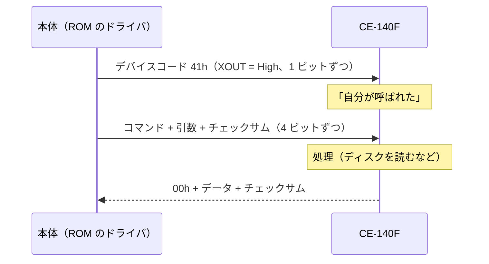
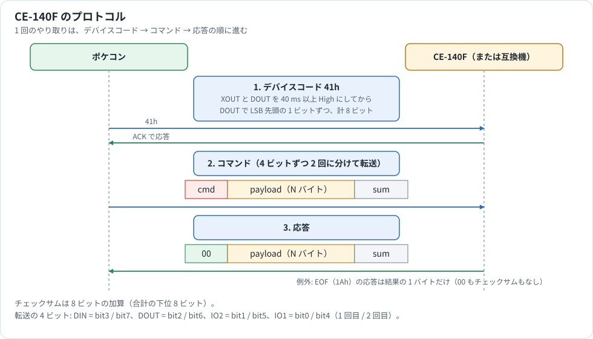
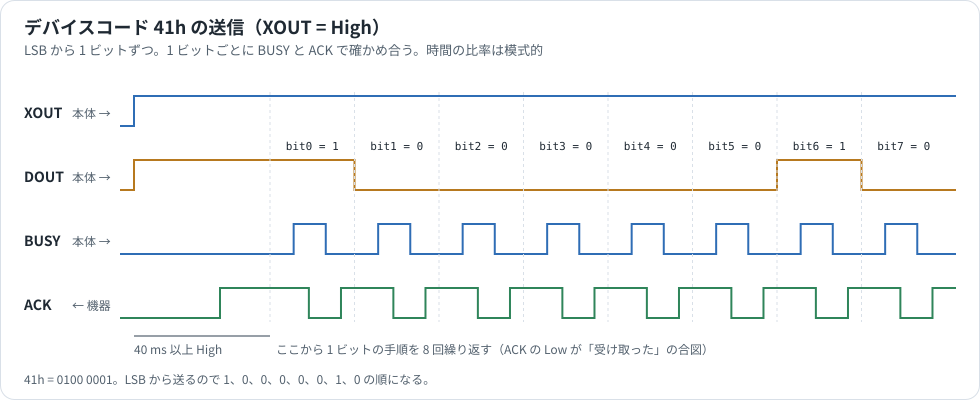
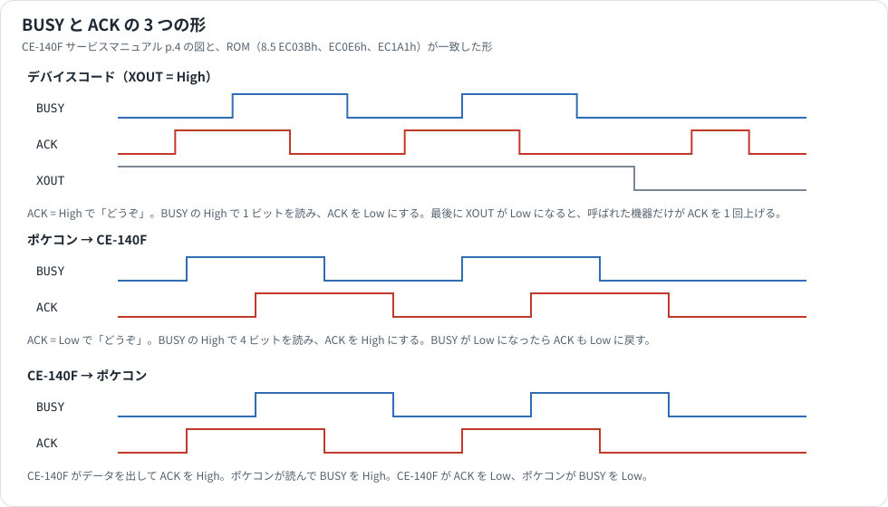
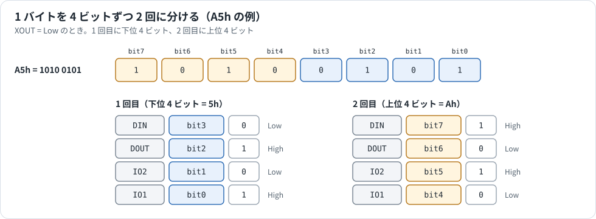
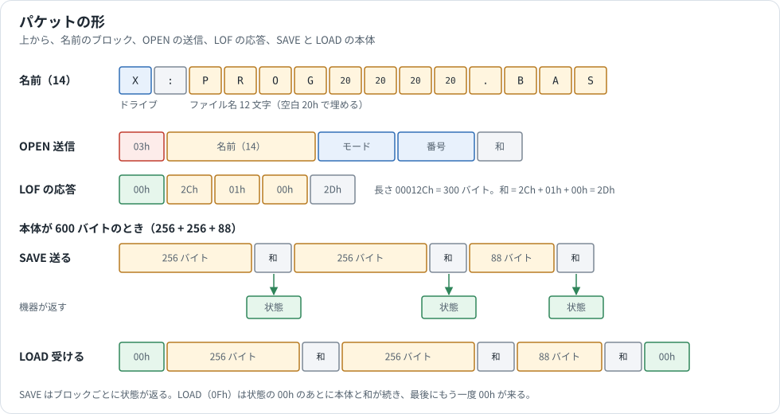
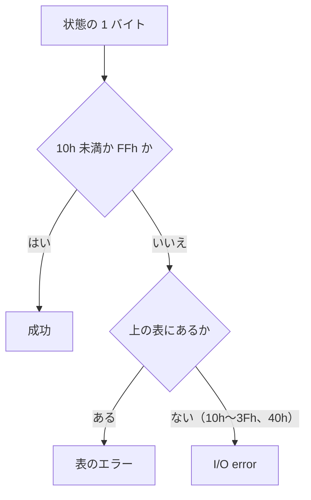
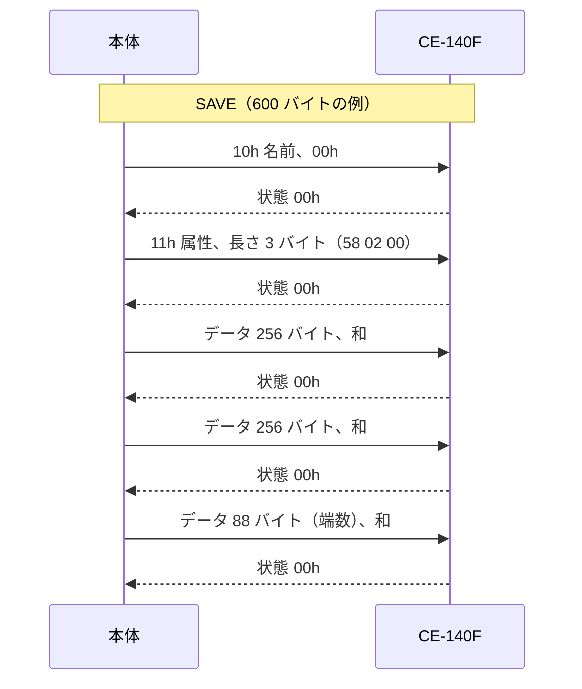
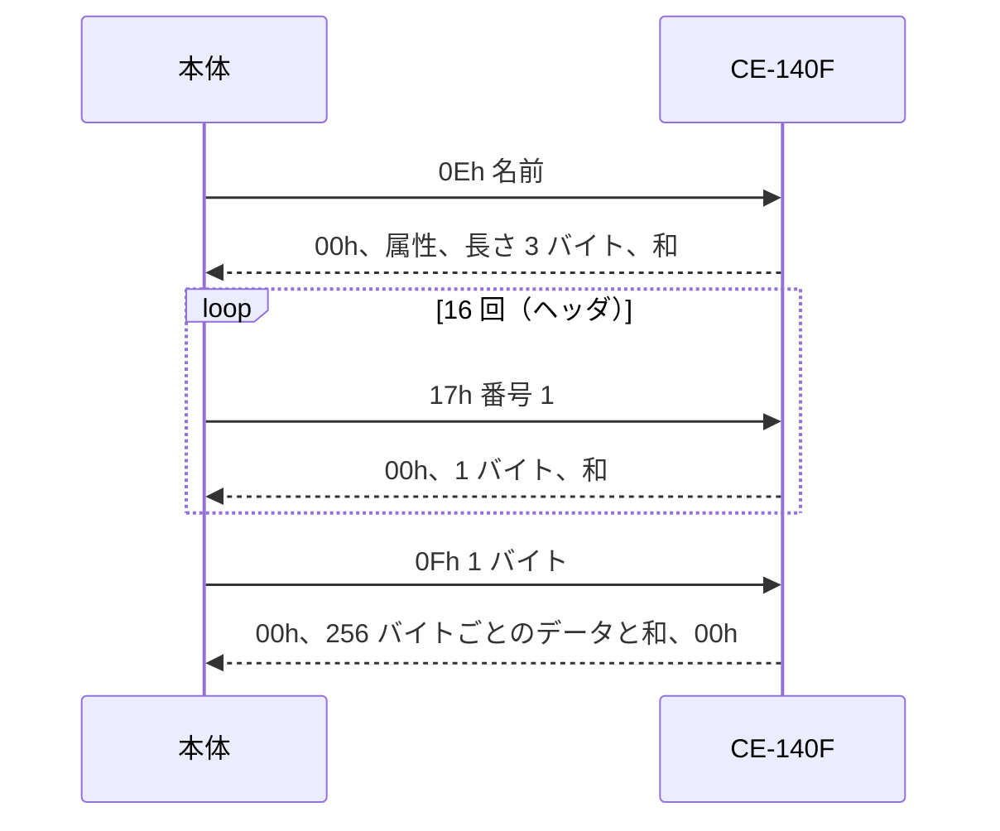
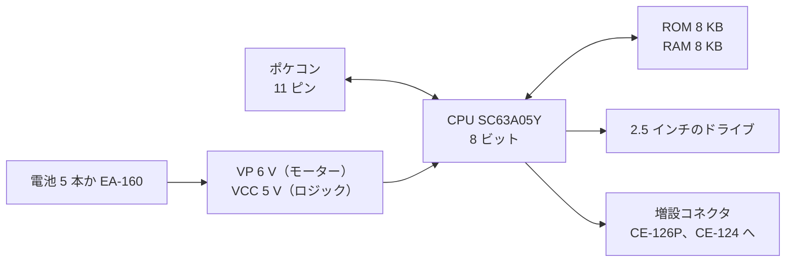

# 17. CE-140F の通信

この章はポケットディスクドライブ CE-140F と PC-E500 シリーズが 11 ピンの線の上で交わす会話を、合図の上げ下げから 1 つ 1 つのコマンドまで説明します。CE-140F の代わりになる機器を作りたい人、`LOAD` や `SAVE` の裏で何が起きているかを知りたい人のための資料です。ファイル形式は [ファイル形式](../manual/19_FILE_FORMATS.md)、BASIC の命令の書式は [BASIC の命令と関数](14_BASIC_REFERENCE.md) を参照してください。

[目次へ戻る](README.md)

## この章で分かること

- 11 ピンの線を使って、1 バイトがどう送られるか（3 つの場合で BUSY と ACK の形が違う）
- 25 個あまりのコマンドの番号、引数、応答
- `LOAD`、`SAVE`、`FILES` などを打ったときのやり取り
- エラーの番号と、BASIC に表示されるメッセージ
- 互換機を作るときに間違えやすい所（EOF の応答、`FFh` の扱い、`1Ah` の二重送信）

## 17.0 はじめに

CE-140F は電線でつながった「相手」です。本体とディスクドライブは互いの動作を直接見ることができないので、会話の決まり（プロトコル）に従って話します。会話は 3 つの層に分かれています。手紙にたとえると、次のようになります。

| 層 | 手紙にたとえると | この章の節 |
|---|---|---|
| デバイス選択 | 宛名を書く（同じ線に何台もつながっているので） | §17.1 |
| バイト転送 | 1 文字ずつ、相手がうなずくのを確かめて読み上げる | §17.1 |
| コマンド | 手紙の中身。「このファイルを読んでください」と、その返事 | §17.2〜§17.4 |

「相手がうなずくのを確かめる」やり方をハンドシェイクといいます。送る側が「出しました」（BUSY）と合図し、受ける側が「受け取りました」（ACK）と返すので、速さの違う 2 台でも取りこぼしがありません。



根拠の言葉（サービスマニュアル、SD.EXE、実機ダンプ、ROM、実験）の意味は、章の終わりの「情報源と確度」にあります。**SD.EXE から読み取ったコマンドのうち、§17.4 の EOF、LOC、LOF、OPEN、NAME、SET、COPY は実機で試していません。**

## 17.1 通信の全体像



| 層 | 内容 | 根拠 |
|---|---|---|
| デバイス選択 | 11 ピンコネクタにつながる機器のうち 1 台を、デバイスコードで選ぶ。CE-140F は `41h` | サービスマニュアル、SD.EXE |
| バイト転送 | 1 バイトを 4 ビットずつ 2 回に分け、BUSY と ACK でハンドシェイクする | サービスマニュアル |
| コマンド | コマンドコード、引数、チェックサムを送り、応答を受け取る | SD.EXE |

使う線は次のとおりです。ピン番号と CPU のポートは [11 ピン（テープ、周辺機器）](06_PORT_11PIN.md) にあります。

| 線 | デバイスコードのとき | データのとき |
|---|---|---|
| XOUT | High | Low |
| DOUT | コードを 1 ビットずつ | 4 ビットのうちの 1 本 |
| DIN、IO1、IO2 | | 4 ビットのうちの 3 本 |
| BUSY | 本体の合図 | 本体の合図 |
| ACK | 機器の返事 | 機器の返事 |

### デバイスコードの送信



1. ポケコンが XOUT と DOUT を 40 ms 以上 High にします。
2. 機器が ACK を High にします。ACK は各機器のワイヤード OR です。
3. ポケコンが DOUT にデバイスコードを LSB から 1 ビットずつ出し、BUSY を High にします。
4. 機器は BUSY の High を見て DOUT を読み、ACK を Low にします。ポケコンは ACK の Low を見て BUSY を Low にします。
5. 機器は受信を終えると ACK を High にして、次のビットを待ちます。これを 8 ビット繰り返します。

6. 8 ビットのあと XOUT が Low になると、呼ばれた機器だけが ACK をもう 1 回 High にします。呼ばれなかった機器は ACK を Low のままにします（サービスマニュアル p.4 の図）。



**「5 ms 以内に ACK」の向きについて。** サービスマニュアルの文章は「BUSY を High にしてから 5 ms 以内に ACK が High にならなければエラー」と書いていますが、同じページの図と前後の文（機器は BUSY の High を見て ACK を Low にする）では、BUSY のあとに待つのは ACK の **Low** です。ROM のコードも Low を待ちます。1 ビットについて ROM（8.5 `EC07Dh`〜`EC0BAh`）がすることは次のとおりです。

| 順 | ROM の動作 | 時間切れ |
|---|---|---|
| 1 | DOUT にビットを出し、少し待つ | |
| 2 | ACK が High になるのを待つ | 1770h（6,000）回見てだめならエラー |
| 3 | BUSY を High にする | |
| 4 | ACK が Low になるのを待つ | 同じく 6,000 回 |
| 5 | BUSY を Low にする | |

したがって、文章の「High」は「Low」の誤りで、機器は BUSY の High から 5 ms 以内に ACK を Low にすればよい、と読むのが正しい形です。同じ段落の終わりにある、XOUT と BUSY が Low になってから 5 ms 以内に ACK を High にするという文は、6 の「呼ばれた機器の返事」のことです。

ワイヤード OR は、1 本の線を何台もの機器が共有し、1 台でも High にすれば線が High になるつなぎ方です。このおかげで、本体は「誰かがつながっている」ことを 1 本の線で知ることができます。LSB は一番下のビット（bit0）のことです。

### データの転送

データ転送中の XOUT は Low です。1 バイトを次のように 2 回に分けます。

| 端子 | 1 回目 | 2 回目 |
|---|---|---|
| DIN | bit3 | bit7 |
| DOUT | bit2 | bit6 |
| IO2 | bit1 | bit5 |
| IO1 | bit0 | bit4 |



| 方向 | 手順 |
|---|---|
| ポケコン → CE-140F | ポケコンは ACK が Low なのを確かめてデータを出し、BUSY を High にする。CE-140F は 4 ビットを読んで ACK を High にする。ポケコンが BUSY を Low にし、CE-140F が ACK を Low に戻す（ROM `EC0E6h`、サービスマニュアル p.4） |
| CE-140F → ポケコン | CE-140F は処理後、ACK を 10 ms 以上 Low にしてからデータを出し、ACK を High にする。ACK を Low にしてから 50 ms 以内に送る。ポケコンは ACK の High を見て 4 ビットを読み、BUSY を High にする。CE-140F は ACK を Low にし、ポケコンが BUSY を Low に戻す（ROM `EC1A1h`） |

サービスマニュアルの文章には、受け取りの説明で「ポケコンは 4 ビットを読んで BUSY を Low にする」とありますが、すぐ次の文は「CE-140F が BUSY の High を見て」と続き、図も High です。ここも文章の誤りで、ROM は BUSY を High にします。

デバイスコードでは「ACK が High でどうぞ、Low で受け取った」、データを送るときは「Low でどうぞ、High で受け取った」と、ACK の意味が逆になることに注意してください。

同じ 4 本の線を、送るときは本体が、受けるときは CE-140F が動かします。CE-140F がポケコンへ送るとき、4 本のうち DOUT、IO2、IO1 は、本体の回路では ACK が High の間だけ読めます（[11 ピン（テープ、周辺機器）](06_PORT_11PIN.md) §6.0.2）。手順が「ACK を High にしてから読む」になっているのは、この回路と合っています。

### コマンドと応答の形式

```text
送信: コマンド(1) + 引数(N) + チェックサム(1)
応答: 00h(1) + データ(N) + チェックサム(1)
```

チェックサムは 8 ビットの加算（合計の下位 8 ビット）です。応答のチェックサムは `00h` の後のバイトだけを足します。データのない応答は `00h` の 1 バイトだけです。

**例: LOF の応答。** 長さ 300 バイト（00012Ch）のファイルなら、応答は `00 2C 01 00 2D` です。チェックサムは 2Ch + 01h + 00h = 2Dh で、先頭の `00h` は足しません。

**例: 桁があふれる場合。** `F0 20 05` の和は 115h なので、下位 8 ビットの 15h がチェックサムです。

パケットの終わりを示す印はありません。機器はバスが止まったことか、コマンドごとの長さで判断します。

応答の 1 バイト目は状態です。成功は `00h` で、エラーの値は §17.3 にあります。エラーのときは状態の 1 バイトだけを返します（ROM）。

## 17.2 コマンド一覧

`SD.EXE` のディスパッチ処理（オフセット `1D0h` 以降）から取り出した 25 個です。送信と応答の形は ROM のドライバから読みました（`08h`、`09h` は ROM にだけあります）。

「名前」は §17.3 の 14 バイトのブロックです。「番号」はファイル番号です。「和」はチェックサムです。送信と応答の欄では、最後のチェックサムと、先頭のコマンドコードを省きました。「処理の位置」は `SD.EXE` を展開したあとのコード上の位置です。

| コード | 処理の位置 | 内容 | 送信 | 応答 |
|---|---|---|---|---|
| `03h` | `0638h` | OPEN | 名前、モード、番号 | 状態 |
| `04h` | `06E3h` | CLOSE | 番号（`FFh` はすべて） | 状態 |
| `05h` | `0A24h` | FILES | 名前（パターン） | `00h`、件数、和 |
| `06h` | `0AACh` | FILES（次へ） | なし | `00h`、ドライブ、`:`、13 文字、和 |
| `07h` | `0AEFh` | FILES（前へ） | なし | `06h` と同じ |
| `08h` | | INIT | 1 バイト | 状態 |
| `09h` | | INIT | なし | 状態 |
| `0Ah` | `0E1Fh` | KILL | 名前 | 状態 |
| `0Bh` | `0DD6h` | NAME | 名前、名前 | 状態 |
| `0Ch` | `0EBCh` | SET | 名前、2 バイト | 状態 |
| `0Dh` | `0D47h` | COPY | 名前、名前 | 状態 |
| `0Eh` | `0741h` | LOAD | 名前 | `00h`、属性、長さ 3 バイト、和 |
| `0Fh` | `0867h` | LOAD（バイナリ） | 1 バイト | `00h`、データ（§17.4）、`00h` |
| `10h` | `08C1h` | SAVE | 名前、`00h` | 状態 |
| `11h` | `0970h` | SAVE（サイズとデータ） | 属性、長さ 3 バイト | 状態。続けてブロックごとに状態（§17.4） |
| `12h` | `07FEh` | LOAD（ASCII） | 番号 | `00h`、1 行、和、`00h` |
| `13h` | `0B70h` | INPUT | 番号 | `00h`、文字、`00h`、和、`00h` |
| `14h` | `0BB1h` | INPUT | 番号 | `13h` と同じ |
| `15h` | `0AF6h` | PRINT | 番号 | 状態。続けて、文字、`00h`、和 → 状態 |
| `16h` | `08F7h` | SAVE（ASCII） | 番号 | 状態。続けて、文字、和 → 状態 |
| `17h` | `07CEh` | LOAD（1 バイト読み出し） | 番号 | `00h`、1 バイト、和 |
| `1Ah` | `0FF2h` | EOF | 番号 | **結果の 1 バイトのみ** |
| `1Bh` | `0F6Eh` | LOF | 番号 | `00h`、3 バイト、和 |
| `1Ch` | `0F0Ch` | LOC | 番号 | `00h`、2 バイト、和 |
| `1Dh` | `0E46h` | DSKF | ドライブ | `00h`、3 バイト、和 |
| `1Fh` | `0BEAh` | INPUT 系 | 番号 | `13h` と同じ形 |
| `20h` | `0C5Bh` | INPUT | 番号 | `13h` と同じ形 |

仕事の種類で分けると、次のようになります。

| 仕事 | コード |
|---|---|
| ファイルを開く、閉じる | `03h`、`04h` |
| 一覧 | `05h`、`06h`、`07h` |
| ディスクの初期化 | `08h`、`09h` |
| 削除、名前の変更、属性、コピー | `0Ah`、`0Bh`、`0Ch`、`0Dh` |
| `LOAD` | `0Eh`、`0Fh`、`12h`、`17h` |
| `SAVE` | `10h`、`11h`、`16h` |
| `INPUT #`、`PRINT #` | `13h`、`14h`、`15h`、`1Fh`、`20h` |
| 位置、長さ、空き容量 | `1Ah`、`1Bh`、`1Ch`、`1Dh` |

### protocol.md の一覧との違い

| コード | 違い |
|---|---|
| `03h`、`1Bh` | `SD.EXE` にあるが、protocol.md の一覧にはない |
| `08h`、`09h`（INIT） | protocol.md と ROM にあるが、`SD.EXE` にはない |
| `FEh`、`FFh` | protocol.md の実装上の区分。`SD.EXE` では `11h` の処理の中で受信している |

## 17.3 共通の仕組み

どのコマンドにも出てくる、名前、ファイル番号、状態の決まりです。

### ドライブとファイル名

ファイル名を伴うコマンドは全体で 14 バイトのブロックを送ります（ROM `EC241h`）。

```text
ドライブ(1) + ':'(1) + ファイル名(12)
```

ファイル名は `NAME    .EXT` のように空白で埋めた 12 文字です。ブロックの先頭が `'Y'`（`59h`）なら Y:、それ以外は X: です。

**例:** `X:PROG.BAS` は次の 14 バイトになります。名前の 4 文字のあとに空白 4 個、`.`、拡張子が続きます。

```text
 X  :  P  R  O  G                 .  B  A  S
58 3A 50 52 4F 47 20 20 20 20 2E 42 41 53
```



`SD.EXE` は 14 バイトを受け取ったあと、その 3 バイト目から 12 バイトをファイル名として使います。名前が 2 つあるコマンドでは、2 つ目のブロックはすぐ後ろ（1 つ目の先頭から 14 バイト目）に続きます。

### ファイル番号

開いたファイルの表は 8 項目で、番号 `fn` は 0〜7 です。8 以上や、開いていない番号はエラーになります。

**番号 1 は `LOAD` と `SAVE` の転送用です。** `0Eh` と `10h` で開くのはこのファイルで、ROM は `17h`、`12h`、`16h` に番号 1 を付けて送ります。ASCII の `SAVE` は `03h` で番号 1 を開きます。BASIC の番号は 2 からです（実験）。

### 状態のバイト

ROM の判定（`EC26Fh`）は `10h` 未満と `FFh` を成功として扱います。`FFh` を返しても、エラーになりません。

`10h` 以上は表でエラーになります。各値を機器から返して、BASIC の表示を確かめました（実験）。表そのものは ROM 2.1〜8.5 の 7 本で同じです。

| 状態 | BASIC のエラー |
|---|---|
| `30h` | File already open |
| `21h`、`31h`、`3Ch` | Syntax error |
| `32h` | File not found |
| `15h`、`33h`、`41h` | File write protected |
| `34h`、`37h`、`39h` | Disk full |
| `35h` | NAME error |
| `3Eh` | Mode error |
| そのほかの `10h`〜`3Fh`、`40h` | I/O error |



> [!WARNING]
> 互換機でエラーを伝えるつもりで `FFh` や `01h` を返すと、本体は成功と見なして次へ進みます。

### ACK の待ち時間

機器 → ポケコンの 1 バイトのうち、最初の 4 ビットを待つ ROM の処理（`EC19Dh`、`EC1A1h`）には時間切れがなく、`BREAK` でだけ抜けます。2 回目以降の ACK は最大 `D4C0h` 回見ます。

つまり、機器が処理に何秒かかっても、本体は最初の 4 ビットが来るまで待ち続けます。いったん送り始めたら、続きは待ち時間の内に送る必要があります。`D4C0h` は 10 進で 54464 です。

## 17.4 コマンドの詳細

### LOAD と SAVE はヘッダを解釈しない

`SAVE M` / `LOAD M` 専用のコマンドはありません。`SD.EXE` は受け取ったバイト列をそのままファイルへ書き、読むときもそのまま返します。

| 操作 | 動き |
|---|---|
| `17h` | ファイルから 1 バイト読んで返す。ヘッダの生成も解釈もしない |
| `11h` | サイズ 3 バイトを受け取り、256 バイトごとに受信してファイルへ書く。ブロックごとに `00h` を返し、端数は別に処理する |

`SAVE` の本体はデバイスコードをはさまずに続きます。1 ブロックはデータ（256 バイト、最後は端数）とその和で、応答は状態です。



`0Fh` の応答の本体は 256 バイトごとにその和が入り、最後の端数のあとにも和が入ります。ちょうど 256 バイトで終わるときの和は 1 回だけです。最後に状態の `00h` が来ます。ROM は `0Fh` の状態を読んだあと、本体を何回かに分けて読むことがあり、最後まで読まないこともあります。読むのを待つ間、機器は ACK を High にしたまま止まります。

**例: 本体の大きさと和の個数**

| 本体のバイト数 | ブロック | 和の個数 |
|---|---|---|
| 88 | 88 | 1 |
| 256 | 256 | 1 |
| 600 | 256 + 256 + 88 | 3 |
| 1280 | 256 × 5 | 5 |

256 バイトちょうどと 1280 バイトの `SAVE M` と `LOAD M` は、ヘッダを含めて正しく往復しました（実験）。

つまり、**ファイル先頭の 16 バイトのヘッダは、ポケコンが作ったものです。** 構造は [ファイル形式](../manual/19_FILE_FORMATS.md#機械語load-m--save-m)にあります。TransDrive の説明には「先頭 17 バイトを削除」とありますが、実機のダンプでは 16 バイトでした。

protocol.md によると、LOAD の流れは次のとおりです。

1. `0Eh` でファイル名を送り、サイズを受け取る。
2. `17h` を 16 回送り、ヘッダを 1 バイトずつ受け取る。
3. 本体をまとめて受け取る。



### EOF（`1Ah`）

```text
送信: fn + チェックサム
応答: 現在位置がファイル末尾以上なら 1、それ以外は 0
```

**応答は結果の 1 バイトだけで、先頭の `00h` もチェックサムもありません。** ほかのコマンドと同じ形で返すと動きません。`SD.EXE` の応答処理（`486h`）は `00h` の送信とチェックサムの初期化を兼ねており、EOF だけがこれを呼ばないためです。

### LOC（`1Ch`）

現在位置を 256 バイト単位で返します。`(位置 >> 8) + 1` を 16 ビット（下位から）で送ります。

| 位置 | (位置 >> 8) + 1 | 応答 |
|---|---|---|
| 0 | 1 | `00 01 00 01` |
| 255 | 1 | `00 01 00 01` |
| 256 | 2 | `00 02 00 02` |
| 600 | 3 | `00 03 00 03` |

### LOF（`1Bh`）

ファイルの長さを 24 ビット（下位から）で返します。

### OPEN（`03h`）

```text
送信: 名前(14) + モード(1 / 2 / 3) + fn + チェックサム
```

| モード | 内容 |
|---|---|
| 1 | INPUT。読み出しで開く |
| 2 | OUTPUT。新しく作る |
| 3 | APPEND。書き込みで開いて末尾へ移動 |

### NAME（`0Bh`）と COPY（`0Dh`）

```text
送信: 名前(14) + 名前(14) + チェックサム
```

どちらもファイル名を 2 回受け取ります。NAME は旧名と新名、COPY はコピー元とコピー先です。ROM はダミーを送らず、チェックサムで終わります。SD.EXE がダミーとして受け取るのが、このチェックサムです。

### SET（`0Ch`）

```text
送信: 名前(14) + 2 バイト + チェックサム
```

2 バイト目の bit0 が 1 なら書き込み禁止です。`SET "X:FILE.BAS","P"` に対応します。

### ASCII ファイル

読むとき（`12h`）は、`0Dh` か `1Ah` までを 1 回の応答で返します。次の応答の先頭の `0Ah` は ROM が読み飛ばします（`EBDA0h`）。ファイルの終わりは機器が `1Ah` を返します。ファイルの中に `1Ah` があれば、そこを終わりとして 1 回だけ返します。`Sharp_ce140f_emul` は自分で `1Ah` を送るので、ファイルにも `1Ah` があると 2 回届いて、I/O エラーになります。

**例:** 中身が `10 END` CR LF `20 END` CR LF のファイル（`1Ah` なし）では、`12h` の応答は順に次のようになります。

| 回 | 応答に入る 1 行 |
|---|---|
| 1 | `10 END` `0Dh` |
| 2 | `0Ah` `20 END` `0Dh`（先頭の `0Ah` は読み飛ばされる） |
| 3 | `0Ah` `1Ah`（終わり） |

書くとき（`16h`）は、1 行ごとに `16h` と文字のパケットを送ります。最後は `1Ah` 1 文字のパケットで、そのあと CLOSE は来ません（実験）。

## 17.5 ROM 側のドライバ

技術資料（Technical Reference）のデバイスの章は、device 7 の「2.5 インチ FDD ドライバ（X: Y:）」を使えないデバイスとしています。しかし ROM には、次のとおりドライバがあり、`SAVE`、`LOAD`、`FILES` が動きます（ROM、実験）。「使えない」は、IOCS のコマンドを機械語から直接呼ぶ使い方が公開されていないという意味に取るのが、ROM の形（コマンドごとのエントリの表がなく、file-control のビットも立っていない）と合います（[IOCS と FCS](11_IOCS.md) §11.12。推定）。

X: と Y: は IOCS の device 7 です（[IOCS と FCS](11_IOCS.md)）。デバイスコードからコマンドの送受信まで、通信はこのドライバが本体の ROM だけで行います（ROM、実験）。

| 項目 | 内容 |
|---|---|
| ヘッダ | ROM 8.5 で `DF89Ch`、属性 `00h`、エントリ `EB681h` |
| ROM バージョンによる違い | エントリはバージョンごとに違う。2.1 `EC1DFh`、2.2 `EBA62h`、3.2 `EB965h`、5.3 `EB950h`、6.3・7.3 `EB956h`、6.2・7.2・7.5 `EB96Bh`、6.4 `EC0A0h`、8.3（PC-E500S）`EB66Ch`、8.4 `EBDA2h`、8.5 `EB681h`（データ。[ROM バージョンの違い: 配置](23_ROM_VERSIONS_MAP.md) §23.4） |
| デバイスコード | `EC03Bh` |
| 1 バイト送る | `EC0E6h` |
| 1 バイト受け取る | `EC19Dh`（チェックサムに足す）、`EC1A1h`（足さない） |
| 名前のブロックを送る | `EC241h` |
| 状態の判定 | `EC26Fh` |
| 同名のドライブ | 同じドライブ名のヘッダが追加されると、後から組み込まれたほうが選ばれる |

BASIC では、`SAVE M` / `LOAD M` はキーワードではなく、`SAVE` / `LOAD` の修飾子として解析されます。この点も、機械語専用のコマンドがないことと一致します。

## 17.6 CE-140F の中身

CE-140F はディスクドライブの中にもう 1 台の小さなコンピュータが入った機器です（サービスマニュアル p.2〜5、公式）。本体は「`PROG.BAS` を読んで」と頼むだけで、ディスクのどこにあるかは CE-140F が調べます。



- 11 ピンは 4 ビット × 2 回の並列転送で、速さは約 1700 ビット毎秒です（ESR-H の CPU を積んだポケコンのとき。p.2）。
- 増設コネクタがあり、CE-126P と CE-124 をつなげます（p.2）。ディスクとプリンタ、カセットを同時に使えるのはこのためです。
- 電池は「注意」と「致命的」の 2 段で監視します。検出の電圧は約 5.1 V と約 4.6 V（±0.15 V）です。注意では赤いランプが点きますが使えます。
- 緑の BUSY ランプが点いている間は、ドライブが動いています。電源を入れると、約 2 秒の初期化のあと、モーターが止まります。

**他の機種との受け渡し**（p.1）

| ファイル | 受け渡し |
|---|---|
| ASCII（`SAVE "…",A`） | どの機種でも使える |
| データファイル | どの機種でも使える |
| 中間コードの `SAVE "…"` | PC-1460、PC-1403、PC-1425 の間では使える。PC-1360 ではエラー |

サービスマニュアルの本体の例は PC-1360 などで、PC-E500 は挙がっていません。PC-E500 の中間コードはこれらの機種とも違います（[BASIC の内部形式](15_BASIC_INTERNALS.md)）。機種をまたぐときは ASCII を使います。

**扱いの注意**（p.1）

- ドライブにディスクを入れたまま、電源を入れたり切ったりしない。
- BUSY のランプが点いている間は、取り出しのボタンを押さない。
- つなぐときや外すときは、すべての機器の電源を切る。
- 長く使わないときは、ディスクと電池を取り出す。
- 2 枚のディスクで `COPY` しているときに `BREAK` を押したら、ドライブの電源を切り、5 秒たってから入れ直す。

## 17.7 未確定の項目

| 項目 | 状況 |
|---|---|
| 読んだもの | §17.4 の EOF、LOC、LOF、OPEN、NAME、SET、COPY は `SD.EXE` から読んだもの |
| `1Fh` | INPUT 系。ROM の受け取り方は `13h` と同じ。BASIC のどの命令が使うかは未解析 |
| `08h`、`09h` | `SD.EXE` にはない |

## まとめ

| 覚えておくこと | 値 |
|---|---|
| デバイスコード | `41h`（XOUT = High、LSB から 1 ビットずつ） |
| データ | 下位 4 ビット、上位 4 ビットの順（XOUT = Low） |
| 送信 / 応答 | コマンド + 引数 + 和 / `00h` + データ + 和 |
| 和 | 8 ビットの加算。応答では先頭の `00h` を足さない |
| 名前のブロック | 14 バイト（`X:` + 12 文字） |
| 転送用のファイル番号 | 1。BASIC は 2 から |
| 成功の状態 | `10h` 未満と `FFh` |
| ブロック | 256 バイトごとに和 |
| ACK の向き | デバイスコードは BUSY の High に Low で答える。データは High で答える |
| 例外 | EOF の応答は 1 バイトだけ |

## 情報源と確度

| 表記 | 情報源 | 確度 |
|---|---|---|
| **サービスマニュアル** | CE-140F サービスマニュアル（11 ページ、ページの画像）。6-4 節は [Sharp_ce140f_emul の protocol.md](https://github.com/ffxx68/Sharp_ce140f_emul/blob/main/protocol.md) にも抜粋がある | デバイスコードと 4 ビット転送の仕様、波形、回路、仕様。コマンドの内容は書かれていない |
| **SD.EXE** | PC 用の互換ソフト TransDrive（SL-16、1992 年 CardWare）の `SD.EXE` の逆アセンブル | コマンドの仕様。ポケコンの相手をするプログラムの実装で、CE-140F 本体の内部を読んだものではない |
| **実機ダンプ** | PC-E650 で `SAVE M` したファイル 5 本 | ヘッダの構造を確定 |
| **ROM** | ROM のドライバの逆アセンブル（アドレスは 8.5。3.2 は 2E4h 足したアドレス） | ポケコンが送るものと、応答の読み方 |
| **実験** | エミュレータの CPU で ROM 3.2、7.2、8.4、8.5 を動かし、機器の側を本資料どおりに作って動かしたもの | 手順全体と、状態のバイトの意味 |

解析した `SD.EXE` は 5,935 バイト（MD5 `6221359ccfbdf578fd615af13e275fa6`）で、LZEXE で圧縮されています。展開後は 14,928 バイトです。本文のオフセットは展開後のコード上の位置です。

## 謝辞

- Simon Lehmayr: TransDrive（SL-16）
- CardWare, Novi Sad: `SD.EXE` の開発元
- Remy: PockEmul の作者。`SD.EXE` を最初に解析した
- Fabio Fumi（ffxx68）: [Sharp_ce140f_emul](https://github.com/ffxx68/Sharp_ce140f_emul) の作者

## 次に読むもの

- [11 ピン（テープ、周辺機器）](06_PORT_11PIN.md): 線とピンと CPU のポート
- [CE-126P プリンタ](18_CE-126P_PRINTER.md): 同じ線を使う、別の手順の機器
- [ファイル形式](../manual/19_FILE_FORMATS.md): `LOAD M` と `LOAD` のファイルの中身
- [実機へ送る](../manual/14_TRANSFER.md): CE-140F 互換機を使って送る手順
