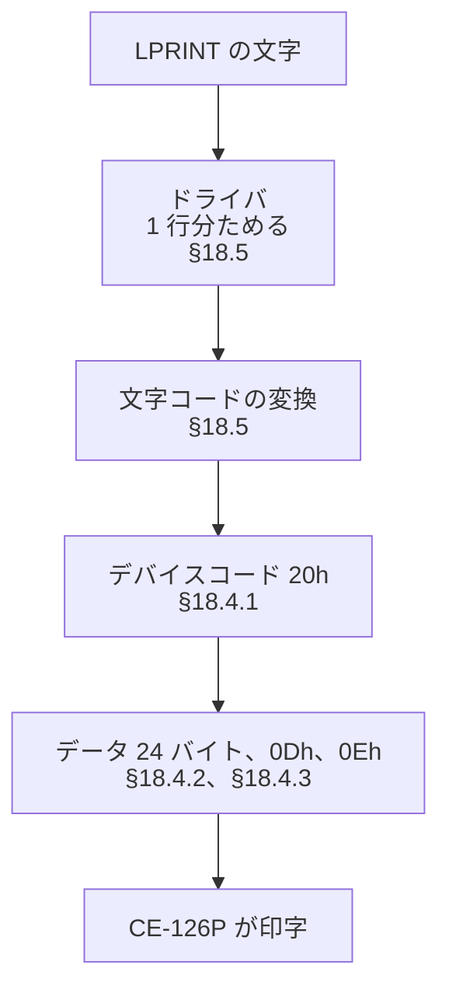
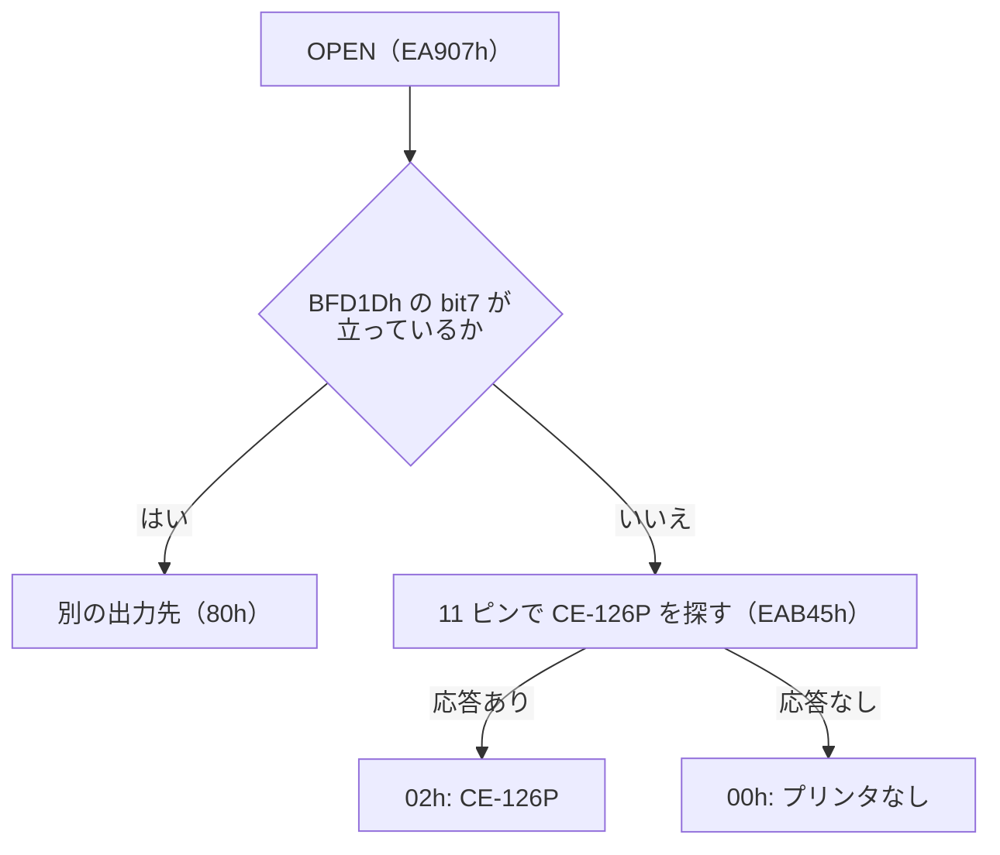
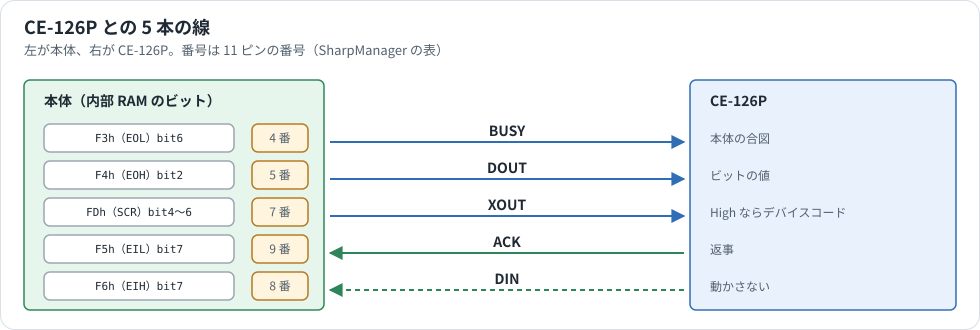
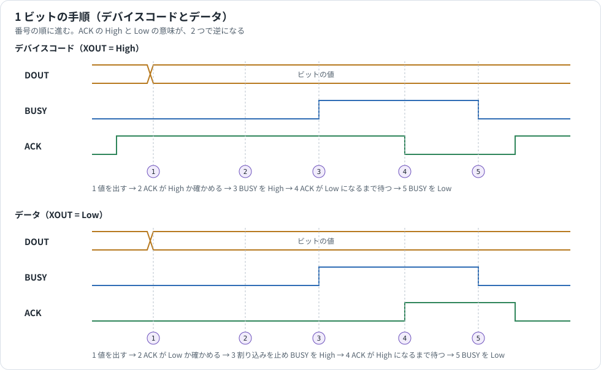
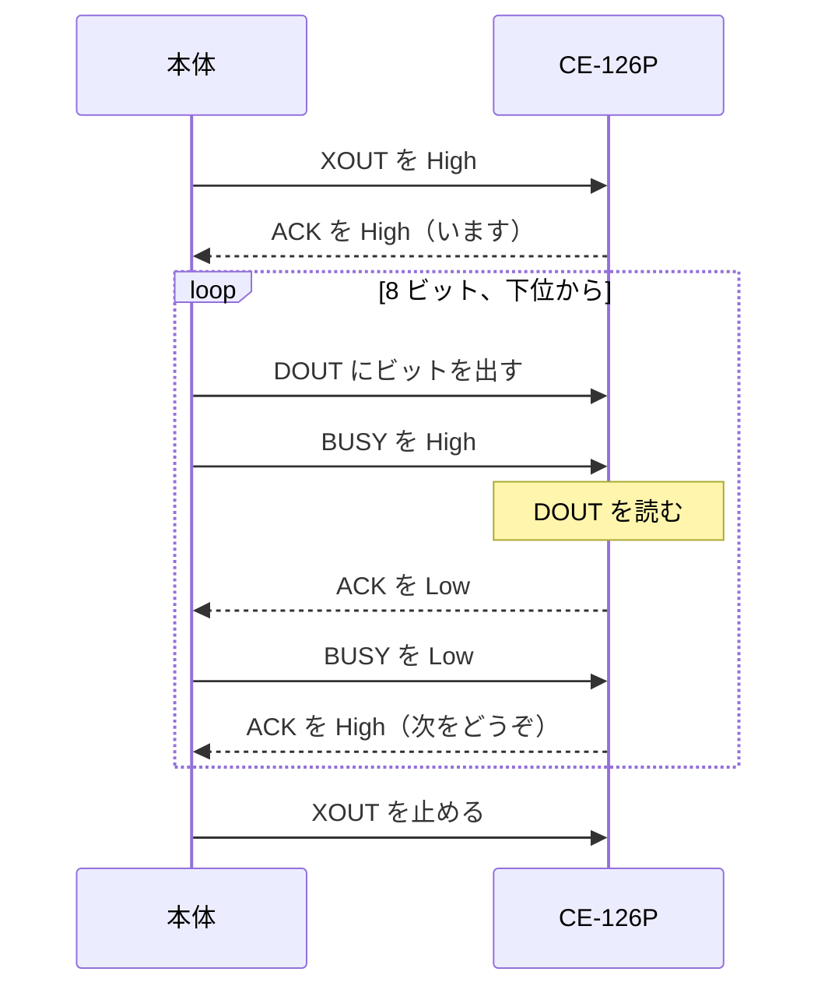
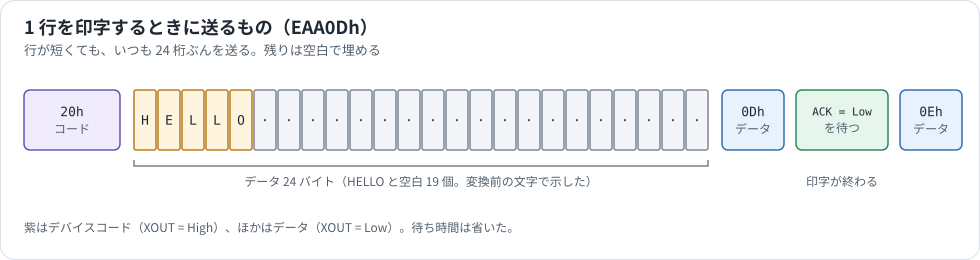
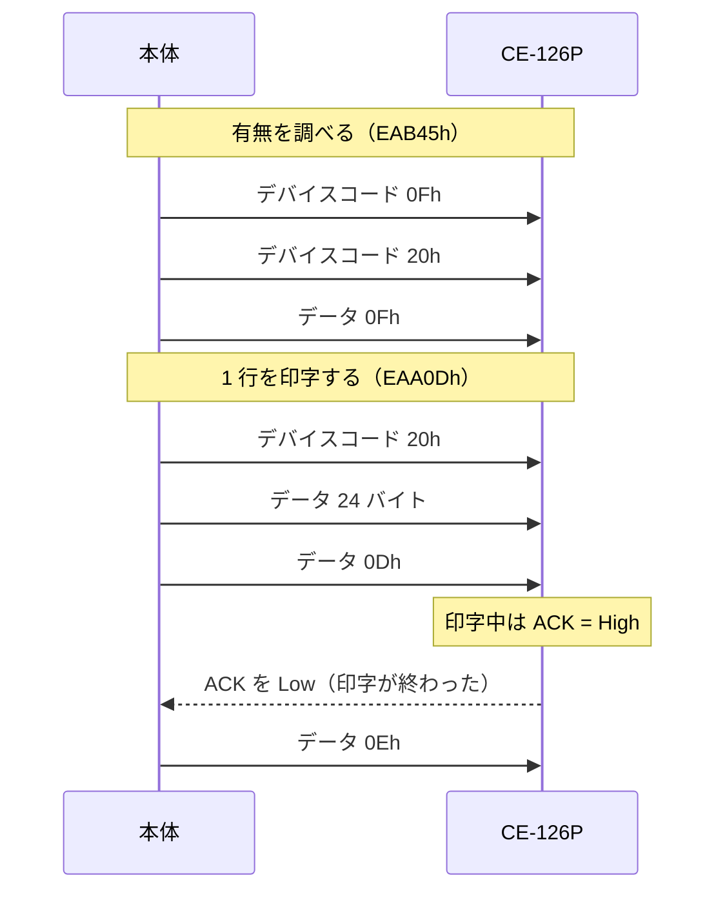
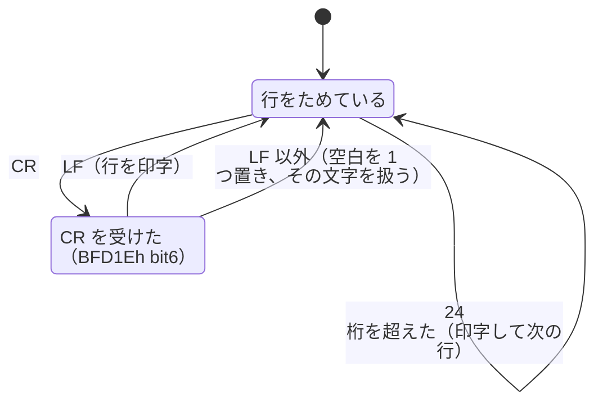
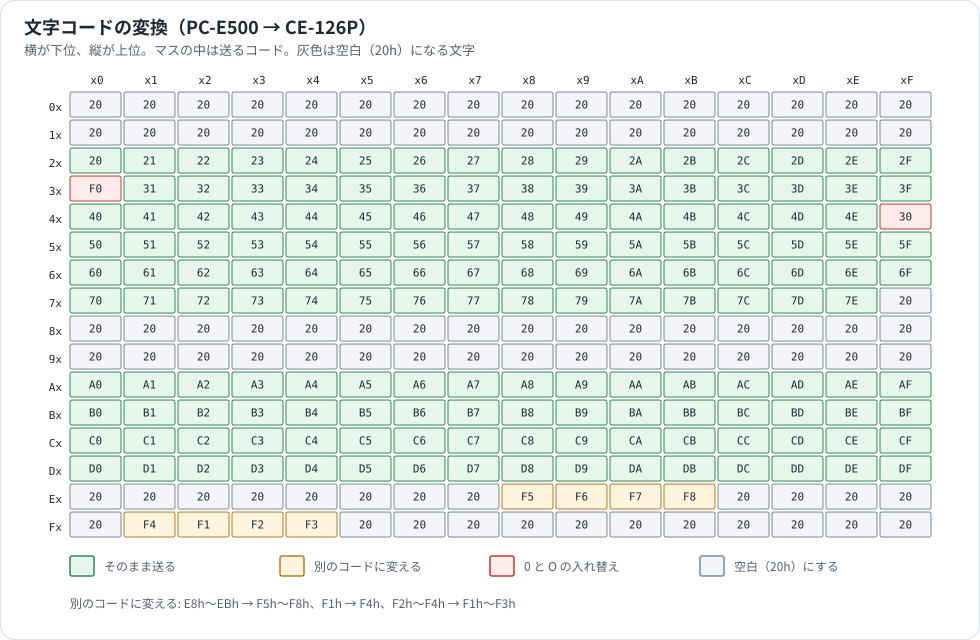
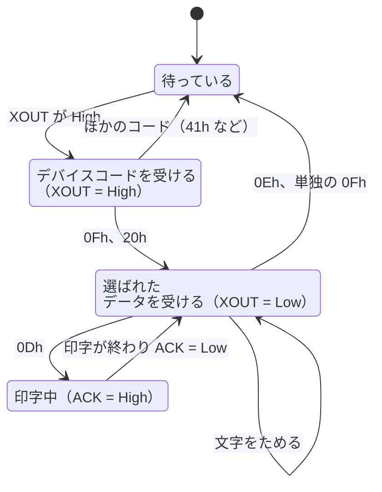

# 18. CE-126P プリンタ

この章は感熱プリンタ CE-126P を動かすために、PC-E500 が 11 ピンの線に何を流しているかを説明します。材料は PC-E500 の ROM（`Emulator/app/rom/PC-E500.rom`、256KB、C0000h〜FFFFFh）のプリンタ・ドライバの逆アセンブルです。プリンタのふりをする機器を作って、今のサーマルプリンタへ出したい人のための仕様書として読めます。プリンタの使い方そのものは §18.7 にまとめました。

[目次へ戻る](README.md)

## この章で分かること

- プリンタのドライバ（IOCS の device 3）のエントリと、プリンタの種類の見分け方
- 5 本の線と CPU のポートの対応
- デバイスコードとデータの送り方（ACK の向きが逆になる）
- 1 行を印字するときに線を流れるもの
- 改行の扱いと、文字コードの変換
- CE-126P のふりをする機器を作るための最小の動き
- プリンタがないとき、途中で切れたときの動き
- 計算の印字など、CE-126P の使い方

## 18.0 はじめに

CE-126P は 24 桁の感熱プリンタです。本体は印字する文字を 1 行分ためてから、11 ピンの線を使って CE-126P へ送ります。この線は CE-140F（[CE-140F の通信](17_CE-140F_DISK.md)）と共通なので、最初に「宛名」にあたるデバイスコードを送って相手を選びます。

CE-140F との違いは次のとおりです。

| | CE-140F | CE-126P |
|---|---|---|
| デバイスコード | `41h` | `0Fh`、`20h` など |
| データの送り方 | 4 ビットずつ 2 回 | 1 ビットずつ 8 回 |
| 使う線 | DIN、DOUT、IO1、IO2、BUSY、ACK、XOUT | DOUT、BUSY、ACK、XOUT |
| 返事 | データを返す | ACK だけ |

記述の確かさは次の 2 つに分けています。

- 「確認済み」は ROM のコードから読めたもの、または [codaris/SharpManager](https://github.com/codaris/SharpManager)（Arduino で CE-126P を再現する実装）と一致したもの。
- 「推定」はコードの形から考えたもの。機器を作るときの前提にはしない。

## 18.1 この ROM でのエントリ

プリンタのドライバは IOCS のデバイス 3（`STDL:PRN:`）です。ヘッダは `DF853h`、エントリは `EA79Dh` です。

[IOCS と FCS](11_IOCS.md) の表は ROM 8.5 のもので、エントリは `EA4B3h` です。この章のアドレスは、断らなければエントリが `EA79Dh` の ROM のもので、バージョンが違うとずれます（デバイス 0 のエントリも 8.5 は `F223Fh`、この ROM は `F2949h` です）。

エントリが `EA79Dh` なのは、6.2、7.2、7.5 の ROM です。ほかのバージョンのエントリは次のとおりです（データ。[ROM バージョンの違い: 配置](23_ROM_VERSIONS_MAP.md) §23.4）。この章のほかのアドレスもバージョンによって同じようにずれます。

| バージョン | エントリ | バージョン | エントリ |
|---|---|---|---|
| 2.1 | `EB041h` | 6.4 | `EAEFAh` |
| 2.2 | `EA894h` | 8.3（PC-E500S） | `EA4BDh` |
| 3.2 | `EA797h` | 8.4 | `EABD4h` |
| 5.3 | `EA7A1h` | 8.5 | `EA4B3h` |
| 6.3、7.3 | `EA7A7h` | | |

コマンドの表は 16 ビットの表です（上位は `E`）。08h〜0Eh は `EA7BBh` から、3Fh〜43h は `EA7C9h` から並びます。

| cmd | 機能 | エントリ | 内容 |
|---|---|---|---|
| 08h | OPEN | `EA7D6h` | プリンタの有無を調べる（`EA907h`） |
| 09h | CLOSE | `EA7DEh` | 行の途中なら印字する |
| 0Ah, 0Ch, 0Eh | 読み出し | `EA7D2h` | エラー 0Ah |
| 0Bh | ブロック書き込み | `EA7E3h` | 1 バイト書き込みを Y 回 |
| 0Dh | 1 バイト書き込み | `EA7E7h` → `EA93Ah` | §18.5 |
| 3Fh | フォーマット | `EA899h` | 端子の初期化だけ |
| 40h | 初期化 | `EA882h` | 端子の初期化 → プリンタの有無を調べる |
| 41h | 印字 | `EA93Ah` | 1 文字（0Dh と同じ処理） |
| 42h | 印字位置 | `EA7EFh` | A = いまの桁 |
| 43h | プリンタチェック | `EA80Ch` | なしなら A=54h でエラー。CE-126P なら I=24（桁数）, A=0 |

呼び方と例は [IOCS と FCS](11_IOCS.md) §11.8 にあります。

## 18.2 プリンタの種類（`BFD1Dh`）

ドライバはつながっているプリンタの種類を 1 バイトで覚えています。値は OPEN のときの確認（`EA907h`）で決まります。

| 値 | 意味 | 状態 |
|---|---|---|
| 00h | プリンタなし | 確認済み |
| 02h | CE-126P（1 行 24 桁、11 ピン） | 確認済み |
| 80h | 別の出力先（`EADC0h` へ送る。シリアルのプリンタか） | 推定 |
| 04h | 別の機種の行の扱い（`EAA50h`） | 推定 |

`BFD1Dh` の bit7 が立っていなければ、11 ピンで CE-126P を探します（`EAB45h`）。応答があれば 02h、なければ 00h です。

CE-126P のときの作業域（`(E6h)` が指す先）は次のとおりです。

| 位置 | 内容 |
|---|---|
| `+2Dh` | いまの桁（0〜） |
| `+2Eh` | 最後の桁 = 17h（24 桁） |
| `+2Fh` | 直前の文字 |
| `BFD1Eh` bit6 | CR を受け取って、まだ行を出していない |

桁は 0 から数えるので、24 桁の最後は 23 = 17h です。「直前の文字」と「CR の印」は、§18.5 の改行の判断に使います。

## 18.3 信号と E-PORT の対応（確認済み）

E-PORT は CPU の汎用の入出力ポートです（[CPU（SC62015）](02_CPU.md) §2.7.2）。使う線は 5 本です。

| 信号 | 向き | E-PORT | 11 ピンの番号（SharpManager の表） |
|---|---|---|---|
| BUSY | PC → 機器 | `F3h`（EOL）bit6 | 4 |
| DOUT | PC → 機器 | `F4h`（EOH）bit2 | 5 |
| XOUT | PC → 機器 | `FDh`（SCR）bit4〜6 = 001b で High | 7 |
| ACK | 機器 → PC | `F5h`（EIL）bit7 | 9 |
| DIN | 機器 → PC | `F6h`（EIH）bit7 | 8 |

GND は 3 番です。CE-126P は DIN を動かしません（SharpManager も入力のままです）。

XOUT はブザーと同じ出力です。SCR のビット 4〜6 の意味は [起動、割り込み、タイマ、音](10_SYSTEM.md) §10.5 にあります。001b は「CO を High」の設定です。

## 18.4 通信の手順

すべて 1 ビットずつ、下位ビットから、DOUT で送ります。CE-140F のような 4 ビットずつの転送は使いません。

2 種類の送り方があり、XOUT の高さで区別します。

| 種類 | XOUT | 「受け取った」の合図 | 何を送るか |
|---|---|---|---|
| デバイスコード | High | ACK が Low | 相手を選ぶ番号 |
| データ | Low | ACK が High | 印字する文字と、行の終わりの印 |

### 18.4.1 デバイスコード（XOUT = High）: `EABDEh`

1. XOUT を High にする。
2. ACK が High になるのを待つ。来なければ待ち時間（`EAC56h`）をはさんで最大 6 回見る。来なければ「機器なし」（carry あり、A=0）。
3. 8 ビットを下位から:
   1. DOUT にビットを出す
   2. ACK が **High** になるまで待つ
   3. BUSY を High にする
   4. ACK が **Low** になるまで待つ
   5. BUSY を Low にする
4. BUSY・DOUT を Low、XOUT を止め、待ち時間 ×4。

機器の側は：XOUT が High になったら ACK を High にする。BUSY が High になったら DOUT を読んで ACK を Low、BUSY が Low になったら次のために ACK を High。

本体と機器のやり取りを 1 ビットについて並べると次のようになります。

### 18.4.2 データの 1 バイト（XOUT = Low）: `EAB8Eh`

8 ビットを下位から:

1. DOUT にビットを出す
2. ACK が **Low** になるまで待つ
3. 割り込みを止め、BUSY を High にする
4. ACK が **High** になるまで待つ
5. 割り込みを戻し、BUSY を Low にする

8 ビットのあと DIN（`F6h` bit7）を見る。High ならエラー（A=0）。

機器の側は：BUSY が High になったら DOUT を読んで ACK を High、BUSY が Low になったら ACK を Low。
§18.4.1 とは ACK の向きが逆になる点に注意。

ACK を待つ処理（`EAC98h`・`EACCAh`）は 0D4C0h 回まで見て、その間 BREAK を見る（`BFCBEh` の bit7・bit6）。時間切れか BREAK でエラー。

**例: データ `0Dh` を送る。** 0Dh = `0000 1101b` なので、下位から 1、0、1、1、0、0、0、0 の順に DOUT へ出します。

### 18.4.3 決まった並び

| 処理 | エントリ | 送るもの |
|---|---|---|
| プリンタの有無を調べる | `EAB45h` | デバイスコード **0Fh** → デバイスコード **20h** → データ **0Fh** → 待ち ×4 |
| 1 行を印字する | `EAA0Dh` | 残りの桁を空白で埋める → デバイスコード **20h** → データ **24 バイト**（いつも 24 桁ぶん） → データ **0Dh** → ACK が Low になるまで待つ（印字が終わるのを待つ） → 待ち ×2 → データ **0Eh** |
| カセットのモーター | `EAB84h` / `EAB88h` | デバイスコード 10h（動かす） / 00h（止める）。`CSAVE` などのテープの処理が送る（実験。[カセットインターフェース](20_CASSETTE.md) §20.8.4） |

デバイスコードの意味は ROM の使われ方から読んだものです。10h と 00h は、CE-126P をつないだエミュレータで `CSAVE` を実行し、テープが動く間と止まる間に送られることを確かめました（実験）。SharpManager は 0Fh・10h のあとに 9ms の ACK を返しますが、20h・00h には返しません。ROM はデバイスコードを送ったあとの ACK を見ないので、どちらでも動きます。

## 18.5 文字の扱い（`EA93Ah`、`EA9C9h`）

文字はすぐには送られません。ドライバが 1 行分ためて、改行か 24 桁でまとめて §18.4.3 の手順で送ります。

### 改行

| 入力 | 動き |
|---|---|
| CR（0Dh） | 印を立てるだけ |
| CR の次に LF（0Ah） | 行を印字する |
| CR の次に LF 以外 | 空白を 1 つ置いてから、その文字を扱う |
| CR のない LF | 空白として置く |
| 24 桁を超えた | 自動で行を印字し、次の行へ |

**例:** `AB` CR LF を送ると、`AB` と空白 22 個の 1 行が印字されます。`AB` CR `C` と送ると、印字はされず、行は `AB`、空白、`C` になります。

### 文字コードの変換（PC-E500 → CE-126P）

CE-126P の文字の番号は PC-E500 と少し違います。ドライバは送る前に次のように変えます。

| PC-E500 の文字 | 送るコード |
|---|---|
| 00h〜1Fh、7Fh | 20h（空白） |
| `0`（30h） | F0h |
| `O`（4Fh） | 30h |
| 20h〜7Eh（上の 2 つ以外） | そのまま |
| 80h〜9Fh | 20h |
| A0h〜DFh（カナ） | そのまま |
| E0h〜E7h | 20h |
| E8h〜EBh | +0Dh（F5h〜F8h） |
| ECh〜F0h | 20h |
| F1h | F4h |
| F2h〜F4h | −1（F1h〜F3h） |
| F5h〜FFh | 20h |

`0` と `O` の入れ替えは SharpManager と一致します（受けた 30h を `O`、F0h を `0` に戻しています）。CE-126P の文字表では 30h が `O` の形、F0h が `0` の形と考えられます。

**例:** `NO.10` を印字するとき、文字コードは `4E 4F 2E 31 30` で、送るのは `4E 30 2E 31 F0` です。

再現するときは、この表の逆を引いて PC-E500 の文字に戻し、PC-E500 のフォント（[フォント](13_FONT.md)）で画像にするのが簡単です。E8h〜EBh・F1h〜F4h の記号は、CE-126P の字形の表が資料にないので、PC-E500 の字形で代用します。

## 18.6 再現する機器の最小の動き

1. XOUT が High → デバイスコードを §18.4.1 の向きで受ける。
2. 0Fh・20h を受けたら「選ばれた」とする（CE-140F の 41h とは別）。
3. XOUT が Low の間は §18.4.2 の向きでバイトを受ける。
4. 0Dh を受けたら、ためた 24 バイトを 1 行として出す。印字のあいだは ACK を High にしておけば、PC は待つ（§18.4.3）。
5. 0Eh・単独の 0Fh（有無の確認）は印字せず、そこで選択を終える（次のデバイスコードまで BUSY には応じない）。
6. DIN は Low のまま。

この動きを状態の図にすると、次のようになります。

同じ線に CE-140F（デバイスコード 41h）がつながっていても、ACK は「どれかが High なら High」（ワイヤード OR）なので共存できます。

## 18.7 使うとき

操作説明書の CE-126P の部分（p.24、p.27〜28）と、ROM の動きを合わせたものです。

| したいこと | 方法 |
|---|---|
| 計算しながら記録する | RUN モードで SHIFT と `↵`（P↔NP）を押し、印字を入れる。式を打って `RETURN` を押すと、式が 1 行、答えが次の行に印字される（公式 p.27） |
| プログラムから印字する | `LPRINT`。書き方は `PRINT` と同じ |
| プログラムの一覧を印字する | `LLIST`。行番号の範囲も指定できる。24 桁を超える行は 2 行以上に分かれ、2 行目からは字下げされるので、行番号が見分けられる（公式 p.28） |
| 紙を送る | プリンタの紙送りのボタン |

**プリンタがないとき。** `LPRINT` はエラーにならず、読み飛ばされます。ROM 2.1〜8.5 の 13 本で確かめました（実験）。印字の途中でプリンタの電源が切れると、`Printer error`（84）です。プログラムの中でプリンタがあるかを知りたいときは、IOCS の 43h を使います（§18.1）。

**強い雑音を受けたとき。** でたらめな数字を印字することがあります。`BREAK` で止め、CE-126P の電源を入れ直してから C-CE を押します（公式 p.28）。使わないときは電源を切って、電池を長持ちさせます。

## まとめ

| 覚えておくこと | 値 |
|---|---|
| 種類のアドレス | `BFD1Dh`（02h が CE-126P） |
| 送り方 | 1 ビットずつ、下位から、DOUT |
| デバイスコード | XOUT = High。受け取りの合図は ACK の Low |
| データ | XOUT = Low。受け取りの合図は ACK の High |
| 1 行 | 20h（コード）→ 24 バイト → 0Dh → ACK の Low を待つ → 0Eh |
| 改行 | CR と LF がそろって印字 |
| 文字 | `0` は F0h、`O` は 30h。カナはそのまま |

## 根拠

- ROM の逆アセンブル：`EA79Dh`〜`EAD50h`、`EC5A0h`〜`EC5C6h`（`DisAssembler/app/e500dasm.exe`、エントリごとに切り出して確認）。
- [codaris/SharpManager](https://github.com/codaris/SharpManager) の `Arduino/Sharp.h`・`Sharp.ino`・`Arduino.ino`：端子の番号、ビットの順番、ACK と BUSY の向き、30h/F0h の入れ替え。
- PockEmul の `ce126.cpp` は取得できなかった（GitHub で 404）。
- §18.6 の動きをエミュレータ（`Emulator/src/native/ce126p.cpp`）に実装し、ROM をそのまま動かして確かめた：`LPRINT`・`LLIST` が印字される、24 桁で折り返す、`0`/`O` が戻る、カナ（B1h）がそのまま通る、BEEP では選ばれない、CE-140F と同じ線で両方動く。
- プリンタがないとき：`LPRINT` の処理（ROM 7.2 の `FBF90h`）は、プリンタチェック（43h）がエラーなら、その文を読み飛ばして正常に終わる（`FBF8Bh`）。`LPRINT`・`LLIST` がエラーにならないことを、ROM 2.1〜8.5 の 13 本で確かめた（実験）。`Printer error`（84）は、印字の途中でプリンタが切れたとき（公式マニュアルのエラー表と、ROM 11 本の実験）。

## 次に読むもの

- [周辺機器](16_PERIPHERALS.md) §16.3.1: CE-126P の仕様（紙、電源、速さ）
- [CE-140F の通信](17_CE-140F_DISK.md): 同じ線を使うディスクドライブ
- [11 ピン（テープ、周辺機器）](06_PORT_11PIN.md): ピンと CPU のつながり
- [フォント](13_FONT.md): PC-E500 の文字の形
