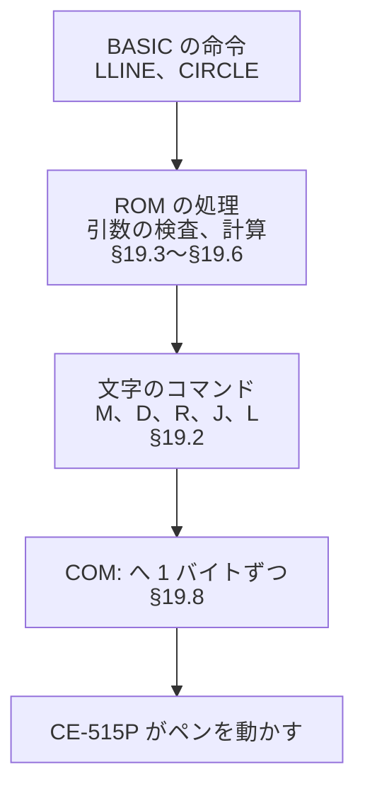
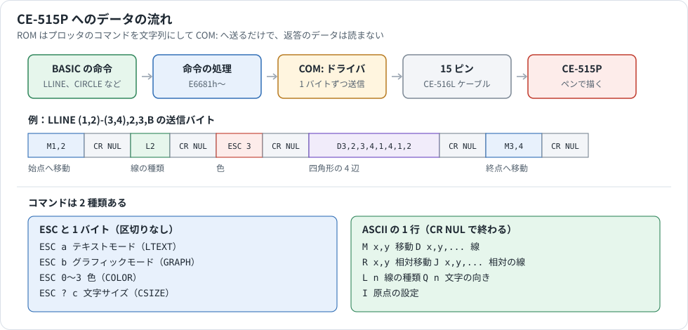
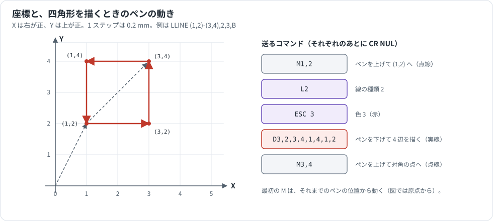
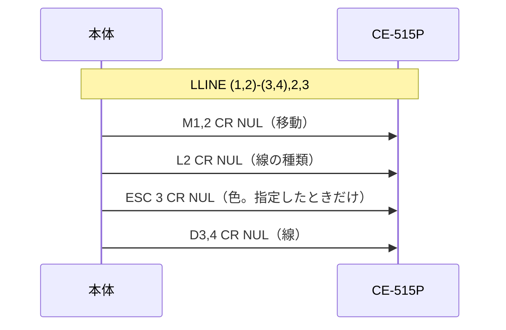
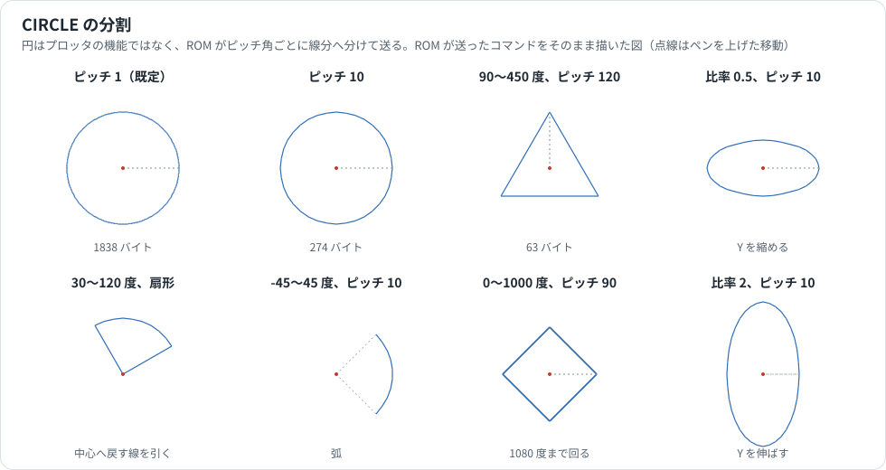
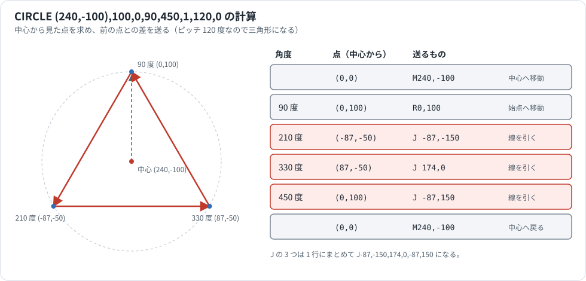
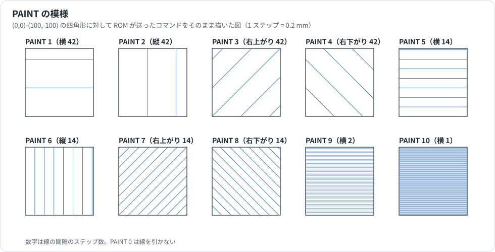
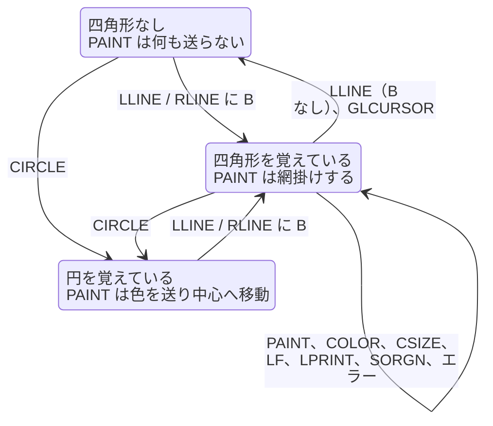
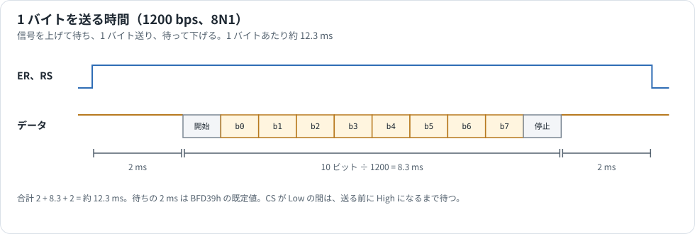

# 19. CE-515P プロッタ

この章は 4 色のペンで絵を描く CE-515P に、PC-E500 がどんな文字を送っているかを説明します。BASIC の命令（`GRAPH`、`LLINE`、`CIRCLE` など）が ROM の中で文字の列に変わるまでを追うので、CE-515P の代わりになる機器やソフトを作りたい人にも、命令の癖を知って図を速く描きたい人にも役に立ちます。ROM から分かるのは PC-E500 が送るデータまでです。CE-515P 側の意味は取扱説明書で確かめました。本体の仕様は [周辺機器](16_PERIPHERALS.md) §16.3.2 にあります。BASIC の命令の書式は [BASIC の命令と関数](14_BASIC_REFERENCE.md)、シリアルの信号線と設定は [15 ピン（シリアル）](07_PORT_15PIN.md) を参照してください。

[目次へ戻る](README.md)

## この章で分かること

- BASIC の命令がどんな文字列になってプロッタへ送られるか
- プロッタのコマンドの一覧と、座標の決まり
- `LLINE`、`RLINE` の四角形と、`CIRCLE` の点の計算
- `PAINT` が線を引いて網掛けする仕組みと、働く条件
- 1 バイトの送信にかかる時間と、`BREAK` の動作
- マニュアルにない書き方（`CSIZE n,K` など）

## 19.0 はじめに

プロッタはペンを動かして線を引くプリンタです。点の集まりで絵を作る感熱プリンタと違い、「ここへ行け」「ここまで線を引け」という命令を受け取って、人が定規で描くように動きます。

そのため、本体は絵を作る必要がありません。ペンをどう動かすかを文字で書いて送るだけです。`LLINE (1,2)-(3,4)` という命令は、`M1,2`（(1,2) へ移動）、`L0`（実線）、`D3,4`（(3,4) まで描く）という 3 行の文字になります。



円や網掛けも、プロッタに頼むのではなく、ROM が短い線に分けて送ります。この章ではその計算まで追います。

本文の根拠の言葉（マニュアル、コード、実験、説明書、推定）の意味と、試していないことは、章の終わりの「情報源と確度」にあります。アドレスは ROM 8.5 のものです。ROM 3.2 では、プロッタの命令の処理（`E6681h`〜）は 3Ch 引いたアドレスに、COM のドライバ（`EA452h`、`EAAD6h`）は 2E4h 足したアドレスにあります。

## 19.1 全体像



CE-515P はシリアルポートにつなぎます（ケーブルは CE-516L。マニュアル p.24、p.28、PC-E500 サービスマニュアル p.2 の構成図）。使う前に必ず `OPEN` を実行し、シリアルを開いておきます（マニュアル p.28）。ROM の処理は次のような作りです。

- **コマンドを文字列にして `COM:` へ送るだけです。** 返答のデータは読みません。プロッタを止める手段は `CS` 信号などのフロー制御です（[15 ピン（シリアル）](07_PORT_15PIN.md) §7.5）。
- **モードを覚えていません。** `GRAPH` は `ESC b` を送るだけで、`LTEXT` の状態でも `LLINE` は同じバイトを送ります（実験）。マニュアルには、テキストモードでグラフィックの命令を使うと、コマンドが文字として印字されるとあります。
- **`OPEN` していないと、エラーを出さずに何も送りません**（実験）。処理のエントリ（`EA452h`）は COM が閉じていると内部エラー 54h を返しますが、命令の処理はこれを無視します（`E6916h`）。プログラムは何も描かずに最後まで進みます。
- **プロッタの命令は CE-126P には送りません。** CE-126P をつないでいて COM が閉じていれば、`LPRINT` だけが CE-126P へ行きます。COM を開くと `LPRINT` も COM へ行きます（実験）。

COM の状態によって、送り先は次のようになります。

| | COM が開いている | COM が閉じている（CE-126P あり） |
|---|---|---|
| `LLINE`、`CIRCLE` など | COM へ送る | 何も送らない（エラーも出ない） |
| `LPRINT` | COM へ送る | CE-126P へ送る |

描く前の準備は COM を開いてグラフィックモードにすることです。

```basic
10 OPEN "COM:1200,N,8,1,A,C,&H1A,N,S" AS #1
20 GRAPH
30 LLINE (0,0)-(100,-100)
40 LTEXT
50 CLOSE
```

`OPEN` の各項目の意味は [15 ピン（シリアル）](07_PORT_15PIN.md) §7.2 にあります。

### 座標

1 ステップは 0.2 mm です（マニュアル）。X は右が正、Y は上が正です。用紙の外は描かずに座標だけを動かす「シザリング」はプロッタ側の機能です（マニュアル）。



| ステップ | 長さ |
|---|---|
| 1 | 0.2 mm |
| 5 | 1 mm |
| 50 | 10 mm |
| 100 | 20 mm |
| 999 | 199.8 mm |

紙の上から下へ描き進めるときは、Y を負にします。`LLINE (0,0)-(100,-100)` は右へ 20 mm、下へ 20 mm の斜めの線です。

## 19.2 コマンドの一覧

ROM が送るコマンドはこれですべてです（コード、実験）。コマンドは `ESC`（1Bh）で始まる短いコマンドと、英字 1 文字で始まる ASCII の 1 行の 2 種類に分かれます。

| コマンド | バイト | 終わり | 送る命令 | 意味 |
|---|---|---|---|---|
| `ESC a` | `1B 61` | なし | `LTEXT` | テキストモード |
| `ESC b` | `1B 62` | なし | `GRAPH` | グラフィックモード |
| `ESC 0`〜`ESC 3` | `1B 30`〜`1B 33` | なし | `COLOR` | 色 |
| 同上 | 同上 | CR NUL | `LLINE`、`RLINE`、`CIRCLE`、`PAINT` | 色 |
| `ESC ? c` | `1B 3F c` | なし | `CSIZE` | 文字サイズ（§19.3.2） |
| LF | `0A` | なし | `LF n`（n が正） | 紙を 1 行送る |
| VT | `0B` | なし | `LF n`（n が負） | 紙を 1 行戻す |
| `Mx,y` | ASCII | CR NUL | `GLCURSOR` ほか | 絶対座標へ移動 |
| `Rx,y` | ASCII | CR NUL | `RLINE`、`CIRCLE`、`PAINT` | 相対座標で移動 |
| `Dx,y[,x,y...]` | ASCII | CR NUL | `LLINE`、`CIRCLE`、`PAINT` | 絶対座標へ線を引く |
| `Jx,y[,x,y...]` | ASCII | CR NUL | `RLINE`、`CIRCLE`、`PAINT` | 相対座標で線を引く |
| `Ln` | ASCII | CR NUL | `LLINE`、`RLINE`、`CIRCLE`、`PAINT` | 線の種類（0〜15） |
| `Qn` | ASCII | CR NUL | `CROTATE` | 文字の向き（0〜3） |
| `I` | ASCII | CR NUL | `SORGN` | 今のペンの位置を原点にする |

意味は説明書と一致します。`M` と `R` はペンを上げた移動、`D` と `J` はペンを下げた移動です。

| | ペンを上げて動く | ペンを下げて描く |
|---|---|---|
| 絶対座標（原点から） | `M` | `D` |
| 相対座標（今の位置から） | `R` | `J` |

数値は 10 進数で、負なら `-` を付けます。先頭に 0 や空白は付けません（`E7B8Ch`）。

**終わりの CR NUL は OPEN の設定によりません。** `LPRINT` の行末はデリミタの設定で CR、LF、CR+LF に変わりますが、グラフィックのコマンドは常に `0D 00` です（実験）。COM ドライバはデリミタが CR か LF のとき、CR を受けても次のバイトが来るまで送りません（[15 ピン（シリアル）](07_PORT_15PIN.md) §7.4）。NUL はこの CR を押し出すために付けていると見られます（推定）。CE-515P が NUL をどう扱うかは分かりません。

**例: `GLCURSOR (10,-20)` のバイト列**

```text
 M  1  0  ,  -  2  0  CR NUL
4D 31 30 2C 2D 32 30 0D 00      9 バイト
```

説明書にはこれらのコマンドの値の範囲もあります。`M`、`D`、`R`、`J` の値は -999〜999 です。`R` や `J` を複数続けるときは -2048〜2047 まで使えます。範囲を超えると、プロッタはリセットボタンを押したときと同じ初期状態に戻ります。ROM は引数を検査しますが、`CIRCLE` の計算結果は検査しません。半径が大きく比率も大きい `CIRCLE` は範囲を超える値を送る可能性があります（推定）。

### ROM が送らないコマンド

説明書には、ROM が使わない次のコマンドもあります。`LPRINT` で送れます（§19.7）。

| コマンド | モード | 意味 |
|---|---|---|
| BS（`08`） | テキスト | 1 文字戻る |
| CR（`0D`） | テキスト | 左端へ戻る（DIP スイッチで改行も） |
| `A` | グラフィック | テキストモードへ（`ESC a` と同じ） |
| `H` | グラフィック | ペンを上げて原点へ戻る |
| `Pabc` | グラフィック | 文字を描く |

説明書によると、モードを切り替えるコマンドは CR か LF のあとで有効になります。マニュアルの例が `LTEXT` のあとに `LPRINT` を実行しているのは、このためと見られます（推定）。

## 19.3 命令ごとの動作

処理のアドレスは [BASIC の命令と関数](14_BASIC_REFERENCE.md) の表と同じです。範囲を超える引数は送る前に検査されて `Syntax error` になります。

| 命令 | 中間コード | 処理 | 範囲（超えると `Syntax error`） |
|---|---|---|---|
| `LTEXT` | 40h | `E6681h` | |
| `GRAPH` | 41h | `E669Ah` | |
| `LF [n]` | 42h | `E66A9h` | -999〜999。省略すると 1 |
| `CSIZE n[,A\|K]` | 43h | `E6721h` | §19.3.2 |
| `COLOR n` | 44h | `E67E7h` | 0〜3 |
| `GLCURSOR (x,y)` | 6Ch | `E6827h` | x、y は -999〜999 |
| `SORGN` | 6Dh | `E6896h` | |
| `CROTATE n` | 6Eh | `E68A9h` | 0〜3 |
| `LLINE` | 6Ah | `E6922h` | §19.4 |
| `RLINE` | 6Bh | `E6BFBh` | §19.4 |
| `CIRCLE` | 6Fh | `E6CAFh` | §19.5 |
| `PAINT n[,色]` | 70h | `E6FC2h` | n は 0〜10、色は 0〜3 |

小数は切り捨てて送ります。`GLCURSOR (1.9,-1.9)` は `M1,-1` です（実験）。0 に近い方へ切り捨てるので、-1.9 は -2 ではなく -1 になります。

### 19.3.1 簡単な命令の送信例

| 命令 | 送信バイト |
|---|---|
| `GRAPH` | `ESC b` |
| `LTEXT` | `ESC a` |
| `LF 2` | `0A 0A` |
| `LF -1` | `0B` |
| `COLOR 3` | `ESC 3` |
| `GLCURSOR (10,-20)` | `M10,-20 CR NUL` |
| `SORGN` | `I CR NUL` |
| `CROTATE 2` | `Q2 CR NUL` |

色は 0 黒、1 青、2 緑、3 赤です（マニュアル）。`LF n` は 1 行分を n 回送ります。`LF 999` は 999 バイトです（実験）。

### 19.3.2 CSIZE と、マニュアルにない K 指定

`ESC ?` のあとの 1 文字でサイズを送ります。マニュアルの書式は `CSIZE n`（1〜15）だけですが、コードには `,A` と `,K` の指定があります（`E6743h`〜）。

| 書き方 | n の範囲 | 3 バイト目 | 例 |
|---|---|---|---|
| `CSIZE n`、`CSIZE n,A` | 1〜15 | 60h + n（`a`〜`o`） | `CSIZE 2` は `ESC ? b` |
| `CSIZE n,K` | 0〜25 | 40h + n（`@`〜`Y`） | `CSIZE 2,K` は `ESC ? B` |

指定は覚えていて、`CSIZE 2,K` のあとの `CSIZE 3` は `ESC ? C` になり、`,A` で元に戻ります（実験。`[($D1)+47h]` のビット 7）。**`K` の意味は分かりません。** PC-E500 のマニュアルにも CE-515P の説明書の読めた範囲にも記載がなく、説明書のサイズの指定は `a`〜`o` だけです。

## 19.4 LLINE と RLINE

`LLINE` は絶対座標、`RLINE` は相対座標で線を引きます。点を続けて書けば折れ線、`B` を付ければ四角形になります。

```basic
LLINE [(x1,y1)]-(x2,y2)[-(x3,y3)...][,種類][,色][,B]
RLINE [(x1,y1)]-(x2,y2)[-(x3,y3)...][,種類][,色][,B]
```

| 項目 | 内容 | 根拠 |
|---|---|---|
| 座標 | -999〜999 | コード、実験 |
| 種類 | 0〜15。省略すると 0 | コード、実験 |
| 色 | 0〜3。省略すると前の色のまま | コード、実験 |
| 点の数 | `-(x,y)` は 5 個まで | 実験 |
| `B` | 四角形。最初の座標が必要 | コード、実験 |

送る順序は常に、移動、線の種類、色、線です。種類は省略しても `L0` を送ります。色は指定したときだけ送ります。



| 命令 | 送信バイト |
|---|---|
| `LLINE (1,2)-(3,4)` | `M1,2` `L0` `D3,4` |
| `LLINE -(5,6)` | `L0` `D5,6` |
| `LLINE (1,2)-(3,4),2,3` | `M1,2` `L2` `ESC 3` `D3,4` |
| `LLINE (0,0)-(1,1)-(2,2)-(3,3)` | `M0,0` `L0` `D1,1,2,2,3,3` |
| `LLINE (1,2)-(3,4),2,3,B` | `M1,2` `L2` `ESC 3` `D3,2,3,4,1,4,1,2` `M3,4` |
| `RLINE (1,2)-(3,4)` | `R1,2` `L0` `J3,4` |
| `RLINE (1,2)-(3,4),2,3,B` | `R1,2` `L2` `ESC 3` `J3,0,0,4,-3,0,0,-4` `R3,4` |

（各コマンドのあとに CR NUL が付きます。）

`RLINE` の `(3,4)` は今の位置から右へ 3、上へ 4 という意味です。四角形の `J3,0,0,4,-3,0,0,-4` は右へ 3、上へ 4、左へ 3、下へ 4 と読めます。

- **四角形の B** は 4 辺を 1 回で描き、最後に対角の点へペンを動かします。
- **`RLINE -(x,y)`** はマニュアルでは省略できないとされていますが、受け付けて `L0` `J x,y` を送ります（実験）。`B` を付けると、`LLINE` と同様に `Syntax error` です。
- **途中でエラーになっても、それまでの分は送られています。** `LLINE (0,0)-(1,1),16` は `Syntax error` ですが、`M0,0` はすでに送っているので、ペンは動きます（実験）。

線の種類の形はプロッタ側にあり、ROM には入っていません。マニュアルの `LLINE` の項に一覧があります。

## 19.5 CIRCLE



```basic
CIRCLE (x,y),半径[,色][,開始角][,終了角][,比率][,ピッチ][,扇形]
```

| 引数 | 範囲 | 省略時 | 根拠 |
|---|---|---|---|
| x、y | -999〜999 | | コード、実験 |
| 半径 | 1〜499 | | コード、実験 |
| 色 | 0〜3 | 前の色のまま | コード、実験 |
| 開始角、終了角 | -2047〜2047（度） | 0、360 | コード、実験 |
| 比率 | 0.01〜20.47 | 1 | コード、実験 |
| ピッチ | 1〜2047（度） | 1 | コード、実験 |
| 扇形 | 0 弧、1 扇形 | 0 | コード、実験 |

マニュアルに比率の範囲はありません。比率は 100 倍して整数で持ちます（`BFE4Ch`）。角度は `DEGREE` や `RADIAN` の設定によらず常に度です（マニュアル）。

**円はプロッタの機能ではなく、ROM が線分に分けて送ります。** プロッタに円のコマンドは送りません。ピッチは、何度ごとに点を打つかです。小さいほど滑らかな円になり、大きくすると多角形になります。

### 送る順序

```text
L0                   線の種類は常に実線
ESC c                色を指定したときだけ
Mx,y                 中心へ移動
Rdx,dy               弧の始点へ移動（扇形なら J で線を引く）
Jdx,dy,dx,dy,...     1 行に最大 10 点
J...
Dx,y                 扇形のときだけ、中心へ線を引く
Mx,y                 弧のときは中心へ戻る
```

ペンは最後に必ず中心へ戻ります。

`CIRCLE (240,-100),100,0,90,450,1,120,0` の実際の送信です（実験。CR NUL は省略）。

```text
L0 / ESC 0 / M240,-100 / R0,100 / J-87,-150,174,0,-87,150 / M240,-100
```

この 1 行を自分で計算してみると、次のようになります。



| 角度 | cos × 100 | sin × 100 | 点（四捨五入） | 前の点との差 |
|---|---|---|---|---|
| 90 | 0 | 100 | (0, 100) | 中心から (0, 100) |
| 210 | -86.6 | -50 | (-87, -50) | (-87, -150) |
| 330 | 86.6 | -50 | (87, -50) | (174, 0) |
| 450 | 0 | 100 | (0, 100) | (-87, 150) |

### 座標の計算

ROM は 0〜45 度の表を持ちます。`E73EEh` が cos、`E744Ah` が sin で、それぞれ 46 個の 16 ビット値です（値は 32768 倍。例：cos 1 度 = 32763、sin 1 度 = 572）。ほかの角度は象限で折り返します。ピッチは整数の度なので、表だけで計算できます。

2 つの表の間は `E744Ah` − `E73EEh` = 5Ch = 92 バイトで、46 個 × 2 バイトと一致します。cos 1 度の値は 0.9998477 × 32768 = 32763.0、sin 1 度は 0.0174524 × 32768 = 571.9 です。

各点の座標は次のとおりです。R は比率を 100 倍した整数です。

```text
X = 半径 × cos θ を四捨五入
Y = 半径 × sin θ を四捨五入
比率が 1 でないとき:
    M = Y × R ÷ 128（切り捨て）
    Y = M + (28 × M + 50) ÷ 100（切り捨て）
```

比率の計算は Y × R ÷ 100 を整数で近似したもの（1 / 128 × 1.28）で、少し小さめに出ます。`比率 0.5` で Y = 50 なら、正しくは 25 ですが 24 になります。

| 比率 | Y | 正しい値 | ROM の計算 | 途中の M |
|---|---|---|---|---|
| 0.5 | 10 | 5 | 4 | 3 |
| 0.5 | 50 | 25 | 24 | 19 |
| 0.5 | 100 | 50 | 50 | 39 |
| 2 | 10 | 20 | 19 | 15 |
| 2 | 50 | 100 | 100 | 78 |
| 2 | 100 | 200 | 200 | 156 |

この式で計算した点は、記録した 11 種類の `CIRCLE`（既定のピッチ 1 の 361 点を含む）で 1 点も違いませんでした（実験）。送る値は前の点からの差分です。

| 動作 | 内容 | 根拠 |
|---|---|---|
| 回る向き | 終了角が開始角より大きければ反時計回り、小さければ時計回り | コード、実験 |
| 割り切れないとき | 終了角を超えるまで進む。`0〜1000 度、ピッチ 90` は 1080 度で止まる | 実験 |
| 同じ点 | 差分が 0 の点は送らない | コード |

既定のピッチ 1 は 1 度ごとに点を送るので、データが大きくなります。半径 100 で 1838 バイトでした（実験）。§19.8 の計算では送信だけで約 23 秒です。ピッチを 10 にすると 274 バイトになります。

| ピッチ | 半径 100 のバイト数 | 送信の時間（1 バイト 12.3 ms） |
|---|---|---|
| 1 | 1838 | 約 23 秒 |
| 10 | 274 | 約 3.4 秒 |

## 19.6 PAINT



```basic
PAINT n[,色]
```

直前に `B` 付きで描いた四角形を、線を引いて網掛けします。プロッタに塗りつぶしの機能を頼むのではなく、ROM が線を 1 本ずつ送ります。

| n | 方向 | 間隔（ステップ） | 間隔（mm） |
|---|---|---|---|
| 0 | 線を引かない | | |
| 1 | 横 | 42 | 8.4 |
| 2 | 縦 | 42 | 8.4 |
| 3 | 右上がり | 42 | 8.4 |
| 4 | 右下がり | 42 | 8.4 |
| 5 | 横 | 14 | 2.8 |
| 6 | 縦 | 14 | 2.8 |
| 7 | 右上がり | 14 | 2.8 |
| 8 | 右下がり | 14 | 2.8 |
| 9 | 横 | 2 | 0.4 |
| 10 | 横 | 1 | 0.2 |

間隔の値は `E70C4h`〜`E7108h` にあります（コード）。mm はマニュアルの 0.2 mm から計算しました。

`(0,0)-(100,-100)` の四角形に `PAINT 1` を実行すると、次のように送ります（実験）。

```text
L0 / M0,-58 / D100,-58 / M0,-16 / D100,-16 / M100,-100
```

1 本目は四角形の下の辺（Y = -100）から 42 上の Y = -58、2 本目はさらに 42 上の Y = -16 です。3 本目は Y = 26 で四角形の外なので引きません。

- 線の種類は常に実線（`L0`）です。
- 色を指定すると、最初に `ESC n CR NUL` を送ります。`PAINT 0,2` は色だけを変えます。
- 最後にペンを四角形の 2 番目の点へ動かします。
- 四角形の 2 点を入れ替えて指定しても、同じ模様になります（実験）。
- `RLINE` の四角形では `R` と `J` の相対座標で送ります（実験）。

### PAINT が働く条件

四角形の座標は作業域に残り（`[($D1)+37h]` から 14 バイト）、`PAINT` はそれを使います。

| 直前の命令 | `PAINT` の動作 | 根拠 |
|---|---|---|
| `LLINE ...,B`、`RLINE ...,B` | 網掛けする | 実験 |
| `PAINT` | もう一度同じ四角形を網掛けする | 実験 |
| `COLOR`、`CSIZE`、`LF`、`LPRINT`、`SORGN` | 四角形を覚えたまま網掛けする | 実験 |
| エラーになった命令 | 四角形を覚えたまま網掛けする | 実験 |
| `LLINE`（`B` なし）、`GLCURSOR` | 何も送らない | 実験 |
| `CIRCLE` | 網掛けせず、色を送って中心へ移動する（`M`） | 実験 |



`SORGN` のあとでも、`PAINT` は覚えている座標をそのまま送ります。原点が動いているので、四角形とはずれた場所に線が引かれると見られます（推定）。

## 19.7 LPRINT、LLIST、CLOSE

`LPRINT` は文字列をそのまま送ります（実験）。グラフィックモードで文字を印字するときに `LPRINT "PABCDEF"` と書くのは（マニュアル）、`P` がプロッタの文字印字のコマンドだからで（説明書）、ROM は `P` を特別に扱いません。

| 命令 | 送信バイト（デリミタ C） |
|---|---|
| `LPRINT "PABC"` | `PABC CR` |
| `LPRINT "AB";` | `AB` |
| `LPRINT` | `CR` |
| `LPRINT 12` | `20 31 32 20 0D` |

このことから、`LPRINT` を使えば、ROM の命令にないコマンドも送れます。たとえば `LPRINT "M10,10"` は `M10,10 CR` を送ります。ただし、命令の場合の CR NUL とは違い、NUL は付きません。

- **`LPRINT` の行末はデリミタの設定に従います。** `OPEN` の設定を `L` にすると `CR LF`、`F` にすると `LF` です。説明書によると CE-515P の行末コードは CR なので、既定の `C` で使います。
- **マニュアルの注意**（p.28〜29）。グラフィックの命令の値は、`CIRCLE` の比率のほかは小数を切り捨てて使われます。図の一部だけを紙に描きたいときは、紙の外の線を描かないシザリングの機能が便利ですが、プログラムを間違えると見えない所に描き続けるので気を付けます。
- **`LLIST` はモードを切り替えません。** マニュアルには `LLIST` で自動的にテキストモードになるとありますが、ROM 3.2 と 8.5 の `LLIST` は `ESC a` を送らず、リストだけを送りました（実験）。プロッタ側で切り替わるのかは分かりません。
- **`CLOSE` は EOF コードを送ります。** 既定で `1Ah` です（実験）。`RUN` で閉じるときも同じでした（実験）。`END` でも閉じます（[15 ピン（シリアル）](07_PORT_15PIN.md) §7.2）。

## 19.8 送信の時間と BREAK

### 19.8.1 1 バイトごとの送信

プロッタの命令は 1 バイトずつ `EAAD6h` を呼んで送ります。この処理は毎回、次のことをします（コード）。

1. `BFD38h` の信号（既定で ER と RS）を上げる
2. `BFD39h`（既定で 2 ms）待つ
3. 1 バイト送る（`CS` が Low なら High になるまで待つ）
4. 送り終わるのを待ち、`BFD39h` 待つ
5. 信号を下げる



1200 bps、8N1 では、1 バイトあたり 8.3 ms（10 ビット）+ 4 ms で約 12.3 ms です（計算）。`CIRCLE` の既定のピッチでは半径 100 で 1838 バイト、約 23 秒です。プロッタが動く時間は含みません。

8N1 の 1 バイトは、開始ビット 1、データ 8、停止ビット 1 の 10 ビットです。10 ÷ 1200 = 8.33 ms になります。

ROM はコマンドの間で待ちません。CE-515P のシリアルには BUSY 出力があるので（説明書）、CE-516L を通して `CS` を下げて止めていると見られます（推定）。`BFD31h` が既定の FFFFh なら待ち時間に上限はないので、プロッタがつながっていないと `BREAK` を押すまで止まりません（[15 ピン（シリアル）](07_PORT_15PIN.md) §7.5）。

### 19.8.2 BREAK

線のコマンドの送信中に `BREAK` を押すと、`Break` を表示して止まり、ROM は少し待ってから `CR CR` を送ります（`E7572h`、実験）。行の途中で切れたコマンドを終わらせるためと見られます（推定）。マニュアルはこのあと `LPRINT` を実行するよう書いています。これも `CR` を送るだけです（実験）。

## 19.9 作業域

命令の引数や途中の値が入る RAM です。`[($D1)+n]` は、内部 RAM `D1h` が指す BASIC の作業域の先頭から n バイト目です。

| アドレス | 内容 | 根拠 |
|---|---|---|
| `BFE34h` | bit0: `LLINE`（1）か `RLINE`（0）か。bit1: 後半の処理の選択 | コード |
| `BFE40h`〜`BFE47h` | 座標（16 ビット、4 個） | コード |
| `BFE48h` / `BFE4Ah` | 開始角 / 終了角 | コード |
| `BFE4Ch` | 比率 × 100 | コード |
| `BFE4Eh` | ピッチ | コード |
| `BFE50h` | 扇形 | コード |
| `BFE52h` | バッファの点の数（10 で送る） | コード |
| `BFE5Ah` / `BFE5Ch` | 線の種類または `PAINT` の番号 / 色 | コード |
| `BFE60h` | `B` の指定（42h） | コード |
| `BFE71h` | 線のコマンドのバッファ | コード |
| `BFEB9h` | 移動のコマンドのバッファ | コード |
| `BFED2h` | 短いコマンドのバッファ | コード |
| `[($D1)+45h]` | `PAINT` の条件。bit1: 図形がある、bit2: 四角形、bit0: 絶対座標 | コード、実験 |
| `[($D1)+47h]` | bit7: `CSIZE` の K 指定 | コード、実験 |
| `[($D1)+37h]`〜 | `BFE40h` からの 14 バイトのバックアップ。`PAINT` が使う | コード |

命令の引数でエラーになると、`BFE40h`〜`BFEFEh` を 20h で埋めます（`E68FBh`）。バックアップは消えないので、次の `PAINT` は動きます。

`B` の指定の 42h は文字 `B` の文字コードです。

## 19.10 ROM バージョンによる違い

27 個の命令（§19.3〜§19.6 の主な形。エラーを含む）を 11 本の ROM で実行し、送信バイトを比べました。すべて同じでした（実験）。

コードの位置はバージョンで変わります。cos の表の位置は次のとおりです。

| ROM | cos の表 |
|---|---|
| 8.5 | `E73EEh` |
| 3.2、7.2、6.2、7.5 | `E73B2h` |
| 5.3、6.3 | `E73BCh` |
| 2.2 | `E749Bh` |
| 6.4、8.4 | `E71D8h` |
| 2.1 | `E7367h` |

ROM 2.2 から 3.2 での変更は機能を変えないコードの縮小です（[ROM バージョンの違い: BASIC](24_ROM_VERSIONS_BASIC.md)）。

ROM 3.2 と 8.5 の G: ドライブ（`C0000h`〜`DFFFFh`）には、`LLINE`、`CIRCLE` の中間コードがありません。添付ソフトはこれらの命令で CE-515P に描いていないと見られます（推定）。

### 19.10.1 別のエミュレータとの照合

[PockEmul](https://github.com/matsumo/PockEmul) の `src/machine/ce515p.cpp` の実装と比べました。これもエミュレータの実装で、実機の確認ではありません。

| 項目 | PockEmul |
|---|---|
| グラフィックのコマンド | `D`、`J`、`M`、`R`、`L`、`I`、`P`、`Q`、`A` を処理する。本資料の ROM の解析と合う |
| `H` | 処理していない。本資料はマニュアルから `H` を挙げている |
| 独自の追加 | `S`（文字サイズ）と `C`（ペンの色）。ソースの注釈は Canon X-710 用 |
| `ESC ?` | `a`〜`o` と `0`〜`3` を処理する |

`CSIZE n,K` の K の答えはここからも得られませんでした。

## 19.11 分かっていないこと

説明書の読めた範囲と ROM からは、次のことが分かりません。実機があれば確かめられます。

| 項目 | 内容 |
|---|---|
| `CSIZE n,K` | K の意味と、`ESC ? @`〜`ESC ? Y` のサイズ。説明書の読めた範囲にない |
| 線の種類 | 0〜15 の実際の寸法（説明書の表は図で、読めていない） |
| NUL | CE-515P が CR のあとの NUL をどう扱うか |
| 信号線 | CE-516L の配線と、BUSY がどの信号につながるか |
| `LLIST` | マニュアルの「自動的にテキストモードになる」がプロッタ側の動作か |

## まとめ

| 覚えておくこと | 内容 |
|---|---|
| 送るもの | 文字のコマンド。円も網掛けも線に分けて送る |
| `M` `R` / `D` `J` | ペンを上げて移動 / ペンを下げて描く（前が絶対、後が相対） |
| 1 ステップ | 0.2 mm。X は右、Y は上が正 |
| 行の終わり | グラフィックのコマンドは常に CR NUL |
| `OPEN` を忘れると | エラーなしで何も送らない |
| `CIRCLE` | 整数の度の表と、差分の `J`。1 行に最大 10 点 |
| `PAINT` | 直前の `B` 付きの四角形だけ |
| 送信の時間 | 1200 bps で 1 バイト約 12.3 ms |

## 情報源と確度

| 表記 | 情報源 | 内容 |
|---|---|---|
| **マニュアル** | PC-E500 Operation Manual | 命令の書式、色、ステップの大きさ |
| **コード** | ROM 8.5 と 3.2 の逆アセンブル | 引数の検査、計算、送る順序 |
| **実験** | エミュレータの作業用コピー | UART の送信レジスタへの書き込みをすべて記録した。ROM 11 本で試した |
| **説明書** | CE-515P の取扱説明書（[ManualsLib](https://www.manualslib.com/manual/3383039/Sharp-Ce-515p.html)。OCR の文字で読んだ） | コマンドの意味、範囲、シリアルの条件 |
| **推定** | 上の組み合わせから推し量ったもの | 本文に「推定」と書く |

**試していないこと**

- 実機の CE-515P。本資料はプロッタが動いた結果を見ていません。図は送ったコマンドを計算で描いたものです。
- 実機のシリアル接続。エミュレータの UART にはビットの波形がないので、送信の時間は計算です。
- 説明書のうち、図の中の値（線の種類の寸法など）は読めていません。

## 次に読むもの

- [周辺機器](16_PERIPHERALS.md) §16.3.2: CE-515P の仕様とシリアルの条件
- [15 ピン（シリアル）](07_PORT_15PIN.md): `OPEN` の設定とフロー制御
- [BASIC の命令と関数](14_BASIC_REFERENCE.md): プロッタの命令の書式
- [BASIC の内部形式](15_BASIC_INTERNALS.md): 中間コードと作業域
