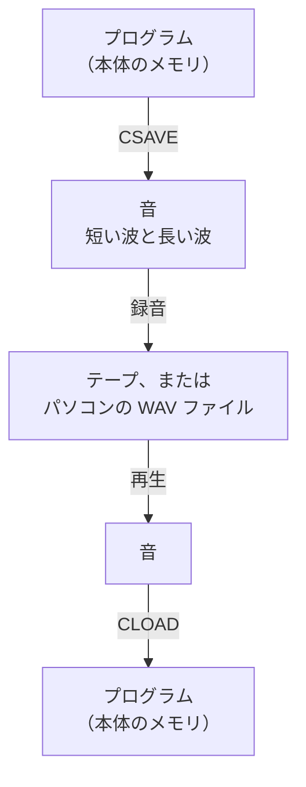
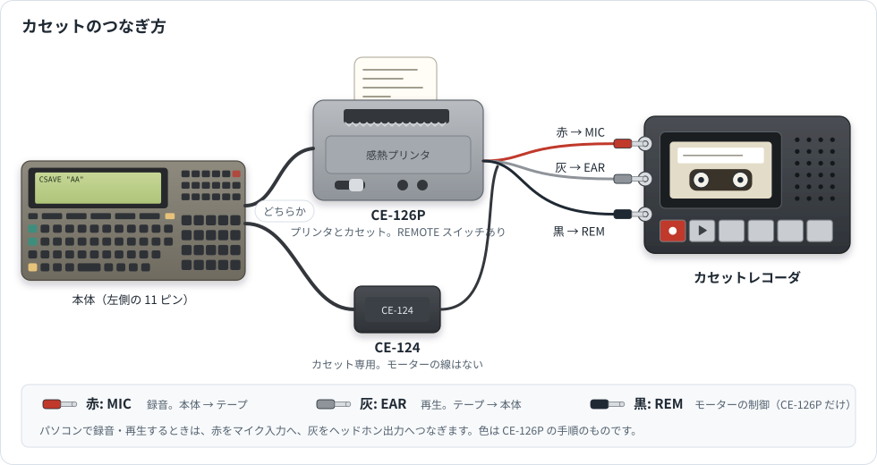
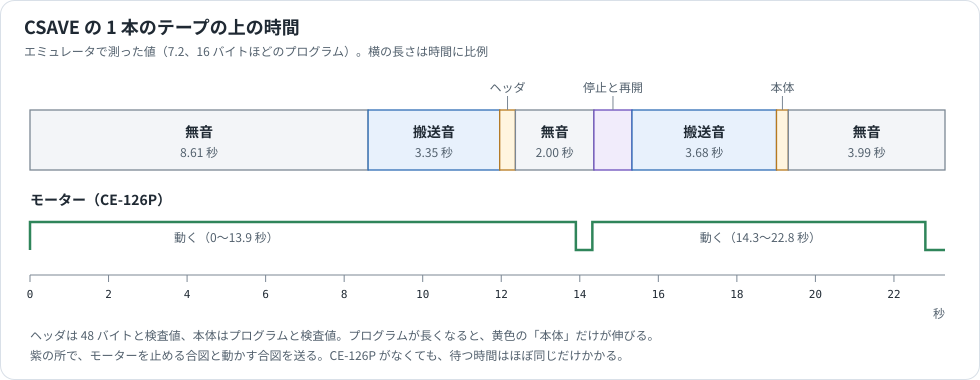
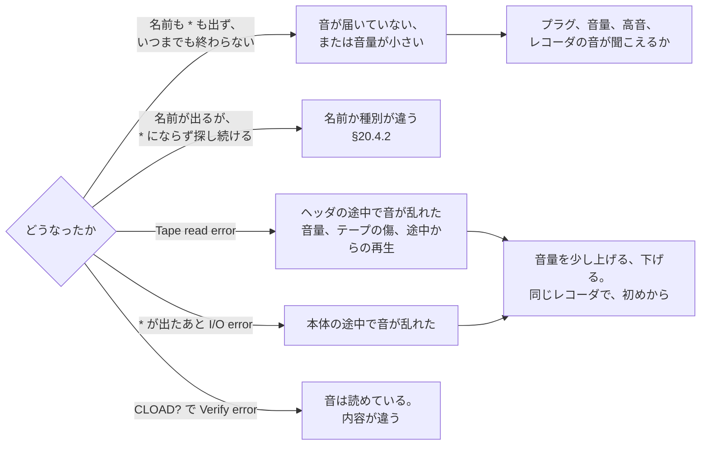
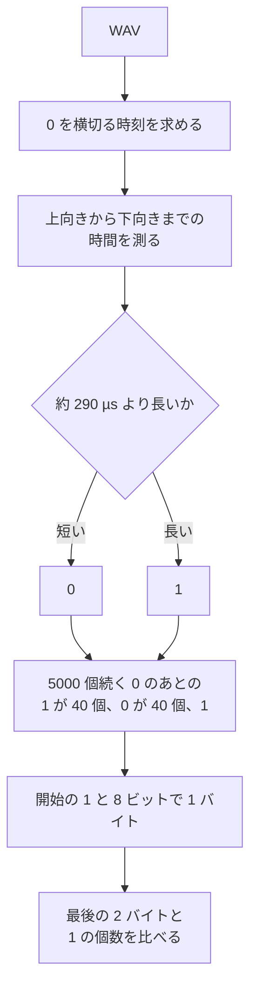
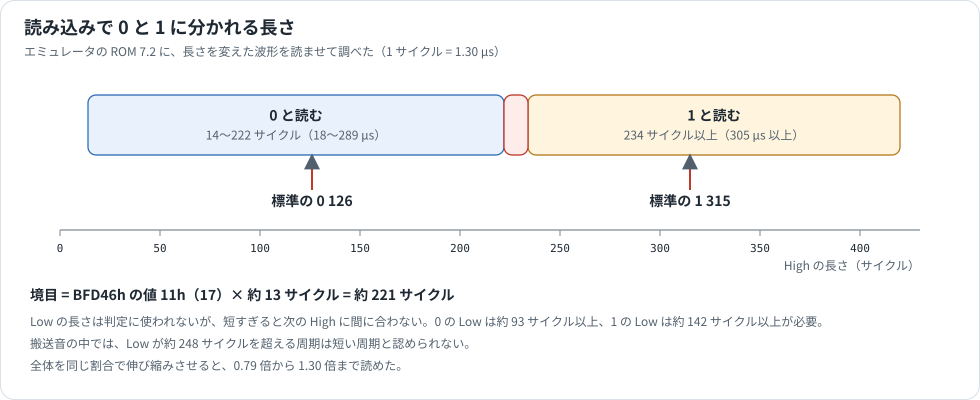
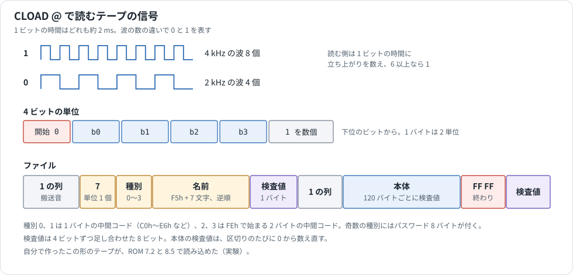
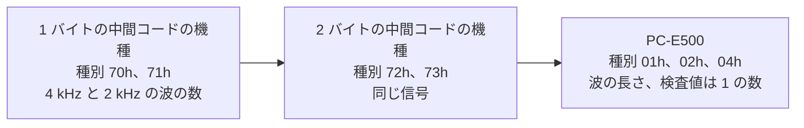

# 20. カセットインターフェース

この章は PC-E500 シリーズのプログラムやデータをカセットテープに保存し、読み戻すしくみを、使う人と機器を作る人の両方に向けて説明します。つなぎ方、録音と再生の手順、テープの命令、うまくいかないときの調べ方、レコーダの代わりにパソコンを使う方法、本体が音を作り、読み取るしくみの順に進みます。

[目次へ戻る](README.md)

## この章で分かること

- CE-124 と CE-126P の違い、MIC、EAR、REM のプラグの役割
- レコーダに求められる条件と、音量と音質の選び方
- 保存、検査、読み込みの手順と、そのとき画面に出るもの
- テープを使う命令の一覧と、互いに読めるもの、読めないもの
- エラーの表示と、その原因の切り分け
- パソコンの音声入出力で録音し、再生する方法
- 本体が音を作る回路とプログラム、読み取りの余裕の大きさ
- 以前の機種のテープを読む `CLOAD @` の信号とデータの形

## はじめに

1980 年代のポケットコンピュータにとって、カセットテープは最も手に入りやすい記憶装置でした。音楽用のレコーダとテープがあれば、専用のディスクドライブを買わなくてもプログラムを残せます。PC-E500 もその流れを引き継いでいます。

しくみは単純です。本体が「短い波」と「長い波」の 2 種類の音を出し、それをテープに録音します。読み込むときは、再生した音を本体に入れ、1 つ 1 つの波の長さを測って元のデータに戻します。声で数字を読み上げて録音し、あとで聞いて書き取るのと同じです。違うのは、1 秒に数百個から 3,000 個の波を使うことです。



音で記録するので、次の 3 つの性質があります。この章の説明の多くは、この性質から出てきます。

1. **順番にしか読めません。** 目的のファイルまでテープを送る必要があります。アドレスや一覧はテープの上にありません。
2. **時間がかかります。** 無音と準備の音だけで 20 秒あまり、データは 1 KB あたり約 5 秒です。
3. **音量、音質、速さの影響を受けます。** ただし、読む側の余裕はかなり大きく作られています（§20.9）。

まず使ってみたい人のための短い手順は、ハンドブックの [RAM カード](../handbook/04_RAM_CARD.md) §4.8.1 にもあります。信号とデータの形を 1 バイトずつ追いたいときは、[11 ピン（テープ、周辺機器）](06_PORT_11PIN.md)へ進んでください。この章では概要と、使うときに必要なことを扱います。（公式）（ROM）（実験）などの印の意味は、章末の「情報源と確度」にあります。

## 20.1 使う機器

### 20.1.1 CE-124 と CE-126P

本体にはレコーダの端子がありません。本体の左側の 11 ピンコネクタと、レコーダのミニプラグの間に、次のどちらかを置きます（公式、操作説明書 p.24〜25）。

| | CE-124 | CE-126P |
|---|---|---|
| 種類 | カセットインターフェース | プリンタとカセットインターフェース |
| 録音（MIC） | できる | できる |
| 再生（EAR） | できる | できる |
| モーターの制御（REM） | 線がない（Systemhandbuch） | できる。REMOTE スイッチがある |
| ほかの機能 | なし | 24 桁の感熱プリンタ（[CE-126P プリンタ](18_CE-126P_PRINTER.md)） |
| 電源 | | 乾電池か AC アダプタ（[周辺機器](16_PERIPHERALS.md) §16.3.1） |

CE-126P はプリンタの中にカセットの回路も入っている機器です。プリンタを使わないときは CE-124 だけで足ります。以前の機種用の CE-120 もカセットインターフェースとして紹介されています（個人）。



### 20.1.2 3 本のプラグ

| プラグの色 | レコーダの端子 | 信号の向き | 使うとき |
|---|---|---|---|
| 赤 | MIC | 本体 → レコーダ | 保存（録音） |
| 灰 | EAR（EXT、MONITOR も可） | レコーダ → 本体 | 検査と読み込み（再生） |
| 黒 | REM（リモート） | 本体 → レコーダのモーター | 保存、検査、読み込み |

色と手順は操作説明書の CE-126P の説明によります（公式、p.25〜27）。レコーダに REM の端子がないとき、あるいは CE-124 を使うときは、レコーダの PAUSE ボタンなどで自分でテープを動かしたり止めたりします。

> [!NOTE]
> MIC の代わりに AUX（ライン入力）につないではいけません（公式）。MIC は数ミリボルトの小さな信号を、AUX はその何百倍もの大きな信号を受ける端子です。本体とインターフェースの出力は MIC に合わせてあるので、AUX では録音の音が小さくなりすぎます。

### 20.1.3 レコーダの条件

操作説明書 p.25 の条件です（公式）。右の欄はその条件の意味です。

| 項目 | 条件 | 意味 |
|---|---|---|
| 種類 | 標準のカセットかマイクロカセット | |
| 入力端子 | MIC のミニジャック。AUX は不可 | |
| 入力インピーダンス | 200〜1000 Ω | 受け側の抵抗。低いほど信号は小さくなる |
| 最低入力レベル | 3 mV（−50 dB）以下 | これだけ小さな信号でも録音できること |
| 出力端子 | EXT、MONITOR、EAR のミニジャックか同等のもの | |
| 出力インピーダンス | 10 Ω 以下 | 出力の強さ。低いほど電流を取り出せる |
| 出力レベル | 1 V 以上（実用最大出力 100 mW 以上） | 本体が High と分かる大きさ |
| 歪み | 2〜4 kHz で 15 % 以内 | 波の形が崩れないこと。0 の音は約 3 kHz |
| ワウフラッター | 0.3 % 以下（WRMS） | 速さの揺れが小さいこと |
| そのほか | モーターの速さが安定していること | |

0 の音は約 3.0 kHz、1 の音は約 1.2 kHz なので、人の声を録る程度のレコーダで足ります。高音が大切なのは 3 kHz の音があるからです。音質の調整（TONE）を高音いっぱいにするという操作説明書の指示も、ここから理解できます。

## 20.2 保存の手順

操作説明書 p.25〜26 の手順を、理由とともに並べます。CE-126P と REM のあるレコーダの場合です。

| 順 | 操作 | 理由 |
|---|---|---|
| 1 | CE-126P の REMOTE スイッチを切る | モーターを自由に動かして頭出しするため |
| 2 | 本体にプログラムを入れる | |
| 3 | テープを入れ、録音を始める位置まで送る | 先頭の透明な部分には記録できない。前のファイルに重ねない |
| 4 | 赤を MIC、黒を REM につなぐ | |
| 5 | REMOTE スイッチを入れる | 以後、モーターは本体が動かす |
| 6 | レコーダの録音と再生のボタンを同時に押す | モーターは止まったままでよい |
| 7 | RUN か PRO モードで `CSAVE "AA"` と `RETURN` | モーターが動き、約 8 秒の無音のあとに音が出る |
| 8 | `>` が出て、レコーダが自動的に止まる | 保存の終わり。プログラムは本体にも残る |

REM を使わないときは、5 を飛ばし、7 で `RETURN` を押す前に録音を始め、8 で `>` が出てから止めます。

保存が終わったら、テープのカウンタの値と名前を紙に書いておきます。テープには一覧がないので、これが目次になります（公式、p.26、p.233）。

**実例（実験、ROM 7.2）。** 2 行のプログラムを名前とパスワードを付けて保存した画面です。終わるまでは BUSY の表示だけで、何も出ません。

```text
CSAVE "AB","PW"
>
```

`RETURN` から `>` までは 24.3 秒でした。機器をつながなくても、`CSAVE` はエラーを出さずに最後まで進みます（実験）。音が出ているかどうかは、本体のブザーから聞こえる音で分かります。

### 20.2.1 保存を検査する

録音が正しいかどうかは、プログラムを消す前に `CLOAD?` で確かめられます（公式、p.26）。テープを保存の手前まで巻き戻し、灰を EAR、黒を REM につないで再生し、次のように打ちます。

```text
CLOAD? "AA"
```

テープの内容と本体の中のプログラムを 1 バイトずつ比べ、同じなら `>` が出ます。違えば `Verify error` です（実験）。

`CLOAD?` が比べるのはプログラムだけです。パスワードは比べません（[11 ピン（テープ、周辺機器）](06_PORT_11PIN.md) §6.5.1）。

## 20.3 読み込みの手順

操作説明書 p.26〜27 の手順です。

| 順 | 操作 | 注意 |
|---|---|---|
| 1 | REMOTE スイッチを切り、ファイルの手前まで送る | |
| 2 | 灰を EAR、黒を REM につなぐ。REM がなければ PAUSE を使う | |
| 3 | REMOTE スイッチを入れ、再生ボタンを押す | |
| 4 | 音量を中央と最大の間、音質を高音いっぱいにする | まずここから始める |
| 5 | `CLOAD "AA"` と `RETURN` | |
| 6 | 名前が見つかると `*` が出て、終わると `>` が出る | テープは自動的に止まる |

画面は次のように変わります（実験、ROM 7.2）。見つけたファイルの名前が画面の一番下に白黒を反転して出ます。名前は 8 文字、`.`、拡張子 3 文字の 12 桁です。


名前が合えば、右下の `*` に変わります。読み込んでいる印です。


`*` が出てから音を止めたり、音量を変えたりしてはいけません。名前が合わなければ反転の表示が消え、次のファイルを探し続けます。操作説明書は `*` が入力した行に付くように書いていますが（p.27）、命令の辞書では画面の右下となっていて（p.224）、ROM の動きは後者です（実験）。

名前を省いて `CLOAD` とだけ打つと、最初に見つかった種別の合うファイルを読みます。

エラーが出たときは、巻き戻して初めからやり直します。もう一度エラーになったら、音量を少し上げるか下げて試します。エラーが出ないのに止まらないときは、`BREAK` を押して止めます（公式、p.27）。

### 20.3.1 テープの取り扱い

操作説明書 p.27 の注意をまとめます（公式）。

- 保存、検査、読み込みには同じレコーダを使います。ヘッドの傾きや速さが機械ごとに違うためです。
- 品質のよいテープを使います。
- CE-126P を AC アダプタで使うと、電源のうなり（ハム）が録音に混じることがあります。そのときは電池に替えます。
- 使い古しのテープは前の録音をすべて消してから使います。
- 同じ面に、同じ名前の違うプログラムを入れないようにします（p.233）。先に見つかったほうが読まれます。

## 20.4 テープの命令

### 20.4.1 一覧

| 命令 | 仕事 | 種別 | モード |
|---|---|---|---|
| `CSAVE ["名前"][,"パスワード"]` | プログラムを中間コードで保存 | 02h | RUN、PRO |
| `CLOAD ["名前"]` | それを読み込む | 02h | 直接実行 |
| `CLOAD? ["名前"]` | 本体のプログラムと比べる | 02h | 直接実行 |
| `CSAVE M ["名前",]開始,終了[,実行]` | メモリの範囲を保存 | 01h | |
| `CLOAD M ["名前"][,アドレス]` | それを読み込む | 01h | |
| `CLOAD @ ["名前"]` | 以前の機種のテープを読み、中間コードを変換する（§20.10） | 70h〜73h | |
| `SAVE "CAS:名前"` | プログラムを文字（ASCII）で保存 | 04h | RUN、PRO |
| `LOAD "CAS:名前"` | それを読み込む | 04h | |
| `LOAD? "CAS:名前"` | 本体のプログラムと比べる | 04h | 直接実行 |
| `MERGE "CAS:名前"`、`MERGE` | 今のプログラムに行を加える | 04h | |
| `CHAIN "CAS:名前"`、`CHAIN` | プログラムを読み込んで実行する | 04h | プログラムの中 |
| `OPEN "CAS:名前" FOR OUTPUT AS #n` | データファイルを作る | 04h | |
| `OPEN "CAS:名前" FOR INPUT AS #n` | データファイルを読む | 04h | |

書式の細部は [BASIC の命令と関数](14_BASIC_REFERENCE.md)にあります。`PRINT #`、`INPUT #`、`INPUT$`、`EOF`、`CLOSE` も使えます（公式、p.355 の命令の表）。

使えない命令もあります。`FILES "CAS:"`、`KILL "CAS:AB"`、`DSKF "CAS:"`、`OPEN "CAS:X" FOR APPEND` と、`SAVE M "CAS:…"` は `Bad drive name` になります（実験）。テープに一覧や追記の考えがないからです。`CSAVE @` は `Syntax error` です。

### 20.4.2 種別と、互いに読めるもの

テープのファイルの先頭には**種別**が書いてあり、命令は自分の種別でないファイルを読み飛ばします。読み飛ばすだけでエラーにはならないので、種別を間違えるとテープが終わっても探し続けます。

| 保存した命令 | 読める命令 | 読めない命令（探し続ける） |
|---|---|---|
| `CSAVE` | `CLOAD`、`CLOAD?` | `LOAD "CAS:"`、`MERGE`、`CHAIN`、`CLOAD M` |
| `CSAVE M` | `CLOAD M` | `CLOAD` |
| `SAVE "CAS:"` | `LOAD "CAS:"`、`MERGE`、`CHAIN`、`LOAD?` | `CLOAD` |

この表は ROM 7.2 ですべて試した結果です（実験）。操作説明書の `CHAIN` の項には、名前を省いた `CHAIN` は `CLOAD`（または `LOAD`）のあとに `RUN` するのと同じ、とありますが、`CSAVE` のテープは同じ項の注記のとおり使えません（p.219、実験）。**あとで `MERGE` や `CHAIN` に使うプログラムは、`SAVE "CAS:"` で保存します。**

> [!TIP]
> どの形で保存したか分からないテープは、`CLOAD "ZZ"` のように、ない名前で探させます。見つかったファイルの名前が順に画面の下に出ます。プログラムを `SAVE "CAS:"` で保存したものは、拡張子に `BAS` が付いて見えます。

### 20.4.3 名前の決まり

| 項目 | 決まり | 根拠 |
|---|---|---|
| 長さ | 8 文字まで。長い分は切り捨てて保存される | 公式、実験 |
| 使えないもの | `*`、`?`、拡張子の `.`（`Syntax error`） | 公式 p.233、実験 |
| 省略 | `CSAVE` だけなら空白 8 個の名前になる | 実験 |
| 拡張子 | `SAVE "CAS:"` は省くと `BAS` が付く | 公式 p.327、実験 |
| `LOAD "CAS:"` | 名前を省くと、名前のあるファイルを読み飛ばした | 実験 |

> [!WARNING]
> `CSAVE ,"パスワード"`（名前を省いてパスワードだけを付ける形）は、操作説明書の書式にありますが、名前の欄を空白で埋めません。直前に使った名前や、バッファの中のでたらめなバイトがそのまま名前になります（ROM 7.2、実験）。名前は必ず付けてください。

### 20.4.4 パスワード

`CSAVE "AB","PW"` のようにパスワードを付けると、読み込んだ本体でプログラムが保護されます。ROM 7.2 で確かめた動きは次のとおりです（実験）。

| 操作 | 結果 |
|---|---|
| `CLOAD` | だれでも読み込める |
| `RUN` | 動く |
| `LIST` | 何も出ない |
| 行の入力、`NEW` | 受け付けたように見えるが、プログラムは変わらない |
| `CSAVE "Q"`、`SAVE "CAS:Q"` | `Invisible program` |
| `PASS "Y"`（違うパスワード） | `Password mismatch` |
| `PASS "X"`（正しいパスワード） | 保護が外れる |

操作説明書は保護されたプログラムの `CSAVE` を「無視される」と書いていますが（p.233）、ROM は `Invisible program`（エラー 93）を出します。パスワードは暗号ではなく、テープに平文で入ります。

### 20.4.5 データファイル

テープのデータファイルは書くだけか読むだけで、頭から順に扱います。開けるのは同時に 1 個です（公式 p.175）。2 個目の `OPEN` は `File already open` です（実験）。`CSAVE` と `CLOAD` はファイル番号を使わないので、データファイルを開いたままでも使えます（公式 p.175）。

```basic
10 OPEN "CAS:DATA" FOR OUTPUT AS #2
20 PRINT #2,"HELLO";",";123
30 CLOSE #2
```

読む側です。

```basic
10 OPEN "CAS:DATA" FOR INPUT AS #2
20 INPUT #2,A$,B
30 PRINT A$;B
40 IF EOF(2) THEN PRINT "EOF"
50 CLOSE #2
```

```text
HELLO 123
EOF
```

`PRINT #` の区切りは自分で書きます（`";"` の間の `","`）。読み終わったあとにさらに `INPUT #` をすると、エラー 87（`Input past end`）です（実験）。

`OPEN … FOR INPUT` はヘッダに続けて最初の 256 バイトまで読みます。そのため、最初の塊に読み違いがあると、`INPUT #` ではなく `OPEN` の行でエラー 72 になります（実験）。

## 20.5 かかる時間

エミュレータで ROM 3.2、5.3、7.2、8.3、8.5 を動かし、`RETURN` から `>` までを測りました（実験）。どのバージョンも同じです。



| 内容 | 時間 |
|---|---|
| `CSAVE`、`CSAVE M`（ごく短いもの） | 約 24 秒 |
| `CSAVE`（1,040 バイト） | 29.1 秒 |
| `CSAVE M`（1,024 バイト） | 29.1 秒 |
| `SAVE "CAS:"`（256 バイトの塊 1 個） | 25.8 秒 |
| `SAVE "CAS:"`（塊 5 個、約 1,100 バイト） | 65.7 秒 |

ここから、次の見積もりができます（計算）。

- `CSAVE`: 約 24 秒 + 1 KB あたり約 5 秒。1 バイトの時間は 1 のビットの数で変わり、3.5〜7.4 ms です。
- `SAVE "CAS:"`: 約 16 秒 + 256 バイトごとに約 10 秒。塊ごとに搬送音と無音が付くからです。

| プログラムの大きさ | `CSAVE` | `SAVE "CAS:"`（同じバイト数の文字として） |
|---|---|---|
| 1 KB | 約 29 秒 | 約 56 秒 |
| 4 KB | 約 44 秒 | 約 3 分 |
| 8 KB | 約 1 分 5 秒 | 約 5 分 40 秒 |
| 16 KB | 約 1 分 46 秒 | 約 11 分 |
| 28 KB | 約 2 分 50 秒 | 約 19 分 |

ふつうの保存には `CSAVE` を使い、`MERGE` や `CHAIN`、ほかの機械とのやり取りのために文字の形が要るときだけ `SAVE "CAS:"` を使う、と考えればよいでしょう。

## 20.6 うまくいかないとき

### 20.6.1 エラーの表示

| 表示 | 番号 | 起きる場面 | 根拠 |
|---|---|---|---|
| `Tape read error` | 80 | `CLOAD` などで、**ヘッダ**に読み違いがあった | 公式 p.341、ROM、実験 |
| `I/O error` | 72 | **本体**に読み違いがあった、音が途中で切れた、データファイルの読み違い | 公式 p.341、実験 |
| `Verify error` | 82 | `CLOAD?` でプログラムが違った | 公式 p.341、実験 |
| `Break` | | `BREAK` を押した | 実験 |
| `Invisible program` | 93 | 保護されたプログラムを保存しようとした | 公式 p.341、実験 |
| `File already open` | 86 | テープのファイルを 2 個開こうとした | 実験 |
| `Input past end` | 87 | データの終わりを超えて読んだ | 実験 |
| `Bad drive name` | 75 | テープで使えない命令 | 実験 |

同じ「読めない」でも、`Tape read error` と `I/O error` が分かれています。ROM はヘッダを読む処理のエラーコード 48h を 50h（80）に置き換え、本体のエラーはそのまま 48h（72）として出します（ROM 8.5 `FE179h`）。実際に、ヘッダのビットを 1 個変えた音では `Tape read error`、本体のビットを 1 個変えた音では `I/O error` になりました（ROM 7.2、8.5、5.3。実験）。

本体の途中で読み違えた `CLOAD` では、本体のプログラムは残りません。`LIST` しても何も出ませんでした（実験）。

### 20.6.2 症状から探す



| 症状 | よくある原因 | 対処 |
|---|---|---|
| 何も起きない | EAR に挿していない、音量が 0、REM で止まっている | REMOTE スイッチを切って音が出るか聞く |
| 初めの音は聞こえるのに見つからない | 音量が小さすぎる、高音が足りない | 音量を上げ、TONE を高音へ |
| 名前の文字が化ける | 音量が大きすぎて波が歪む、テープの汚れ | 音量を下げる、ヘッドを掃除する |
| 特定のプログラムだけ読めない | 前の録音が残っている、テープの折れ | テープを全部消してから保存し直す |
| AC アダプタのときだけ失敗する | ハムの混入 | CE-126P を電池で使う |
| 自分のテープは読めるが、人のテープは読めない | ヘッドの傾き、速さの違い | 録音した機械で再生する |

テープが読めているかを本体だけで調べるには、音をブザーで聞くのが早道です。読み込みの間、本体は CI の音をそのまま CO に流すので、テープの音がブザーから聞こえます（§20.8.3）。

## 20.7 パソコンをレコーダの代わりに使う

レコーダやテープがなくても、パソコンの音声の入出力で同じことができます。インターフェース（CE-124 か CE-126P）はやはり必要です。

| 向き | つなぎ方 | 操作 |
|---|---|---|
| 保存 | 赤（MIC）のプラグを、パソコンのマイク入力へ | 録音を始めてから `CSAVE`。`>` が出たら録音を止める |
| 読み込み | 灰（EAR）のプラグを、パソコンのヘッドホン出力へ | `CLOAD` を打ってから WAV ファイルを再生する |

このつなぎ方は、以前の機種の持ち主が実際に使っています（個人。`PC-1350`、`PC-1360` の例）。PC-E500 でも 11 ピンの回路は同じ系統です。

### 20.7.1 録音の設定

読み取りの処理は波の High と Low の変わり目の時刻だけを使います。WAV ファイルの標本化の周波数が低いと、変わり目の時刻が粗くなります。そこで、保存の波形の変わり目を標本化の格子に丸めて、ROM 7.2 に読ませました（実験）。

| 標本化の周波数 | 1 標本の間隔 | 結果 |
|---|---|---|
| 48,000 Hz | 20.8 µs | 読めた |
| 44,100 Hz | 22.7 µs | 読めた |
| 22,050 Hz | 45.4 µs | 読めた |
| 16,000 Hz | 62.5 µs | 読めた |
| 11,025 Hz | 90.7 µs | 読めない |
| 8,000 Hz | 125 µs | 読めた |
| 6,000 Hz 以下 | 167 µs 以上 | 読めない |

11,025 Hz だけ読めないのは、周期の半分（約 163 µs）と標本の間隔の割り切れ方が悪く、Low が 1 標本の 91 µs まで縮む波が混じるためです（§20.9 の Low の下限 93 サイクル = 121 µs を下回ります）。実際の録音には雑音と歪みも加わるので、**44,100 Hz か 48,000 Hz、モノラル、16 ビットの非圧縮の WAV** が安全です。

| 設定 | 値 | 理由 |
|---|---|---|
| 形式 | WAV（PCM、非圧縮） | MP3 などは波の形を変える |
| 標本化 | 44,100 Hz か 48,000 Hz | 変わり目の時刻が細かいほど余裕がある |
| ビット | 16 | |
| チャンネル | 1 | 2 チャンネルでもよいが、同じ音が入るだけ |
| 加工 | 自動音量調整、雑音除去、エコー除去をすべて切る | 会議用の加工は短い音を消したり、無音のあとの音量を変えたりする |
| 録音の大きさ | 最大の 50〜80 % | 振り切れると波が歪む |
| 再生の音量 | 大きめから始め、読めなければ少し下げる | 操作説明書の「中央と最大の間」と同じ |

**極性は気にしなくて構いません。** 音声の入出力には波の上下が逆になるものがあります。High と Low を全部入れ替えた波形も、ROM 7.2 はそのまま読みました（実験）。0 は High と Low がどちらも約 130 サイクル、1 はどちらも約 314 サイクルで、ほぼ上下対称だからです。ROM には逆に読むための印（`BFD47h` の bit7）もあります。

**音の前後を切りすぎない。** 搬送音は 10,000 個（約 3.3 秒）ありますが、読み込みには 5,000 個あれば足ります。先頭の無音は 8 秒もあるので、WAV を編集するときに短くしても構いません。実際に、8 秒の無音を 0.4 秒に縮めた波形を読ませ、問題なく読めました（実験）。

### 20.7.2 変換のプログラム

WAV とプログラムを変換するパソコンのソフトもあります。以前の機種では PocketTools の `wav2bin`、`bin2wav` が使われています（個人）。PC-E500 のヘッダと本体の形は [11 ピン（テープ、周辺機器）](06_PORT_11PIN.md) §6.3〜§6.5 にあります。自分で書くなら、次の手順です。



## 20.8 本体のしくみ

### 20.8.1 線と端子

テープの信号は 11 ピンコネクタのうち 3 本を使います（回路図）。

| ピン | 回路図の名前 | CPU の端子 | 向き | 役割 |
|---|---|---|---|---|
| 7 | Xout | CO（11 番） | 出力 | 保存の音。機器の制御にも使う |
| 6 | Xin | CI（10 番） | 入力 | 読み込みの音 |
| 1 | MT2 | 抵抗を通してブザーのトランジスタ | 下の説明 | |

CO はブザーも鳴らします。CO から R3（100 kΩ）を通してトランジスタ Q2 のベースへ、MT2 から R2（100 kΩ）を通して同じベースへ入り、Q2 がブザーを動かします。MT2 は CPU のどの端子にも直接つながりません（PC-E500 と PC-E500S の回路図で同じ）。

**例（MT2 に出る電圧、計算）。** CO が High（約 6 V）のとき、Q2 のベースはおよそ 0.6 V に止まります。MT2 から見ると、0.6 V の電源が 100 kΩ を通してつながっているのと同じです。ここに 1 kΩ の MIC 入力をつなぐと、0.6 V × 1 ÷ 101 = 約 6 mV になります。レコーダの条件「3 mV 以下の信号で録音できること」と合う大きさです。信号の大きさの面では、MT2 は MIC に直接つなげる出力としても働きます（計算。実機の測定ではありません）。

### 20.8.2 音を作る

音は CPU の内部 RAM の `FDh`（SCR）のビット 4〜6 で作ります。`001` で CO が High、`000` で Low です。ROM はビットを書き換えてから決まった回数の空ループを回して待つ、という動作を繰り返します。音源の回路があるわけではないので、長さはループの回数で自由に変えられます。

ループの回数は作業域 `BFD42h`〜`BFD45h` にあります。値を変えて実際の長さを測ると、次の関係でした（実験）。

| 項目 | 式（サイクル） | 既定値 | 実際の長さ |
|---|---|---|---|
| 0 の High | 約 6 × `BFD42h` + 12 | 13h（19） | 126 |
| 1 の High | 約 6 × `BFD44h` + 9 | 33h（51） | 315 |
| 0 の Low | 約 6 × `BFD43h` + 53 | 0Dh（13） | 131 |
| 1 の Low | 約 6 × `BFD45h` + 43 | 2Dh（45） | 313 |

技術資料は「ボーレートを変えられる」とだけ書いています（p.64）。試しに `BFD42h` から順に `0A 0A 1C 1C 0A` と書くと、High が 72 と 177 サイクルになり、1,024 バイトの `CSAVE M` が 29.1 秒から 25.2 秒に縮み、同じ設定の `CLOAD M` で正しく読めました。`26 20 66 60 22`（約 2 倍）では 40.2 秒で、やはり読めました（ROM 7.2、実験）。短い時間の大半は無音と搬送音なので、速くしても全体はあまり縮みません。

> [!WARNING]
> 長さを変えたテープは、同じ値を書いた本体でしか読めません。値は `RESET` で既定に戻ります。

### 20.8.3 音を読む

読むときは、内部 RAM の `FFh`（SSR）のビット 1 で CI の高低を調べ、High が続く間ループの回数を数えます。数が `BFD46h`（11h）を超えれば 1、超えなければ 0 です。1 回のループは約 13 サイクルなので、境目は 17 × 13 = 221 サイクルになります。実験でも境目は 222〜234 サイクルの間でした（§20.9）。

このとき SCR のビット 4〜6 はすべて 1 です。この設定では CO の出力が CI と同じになり、テープの音がブザーに流れます（CPU 資料、[起動、割り込み、タイマ、音](10_SYSTEM.md) §10.5）。CI は SCR のビット 6 が 1 の間だけ読めます。

テープの入出力の間、ROM は割り込みを止めます。時計、キーの自動繰り返し、シリアルの受信は止まり、`BREAK` と電池切れだけをループの中で調べます。`OFF` キーは効きません（実験）。操作説明書も、電源が切れないときは `CSAVE` や `CLOAD` の途中かもしれないので `BREAK` を押すように書いています（p.348）。

### 20.8.4 モーターの制御

モーターはテープの音の線ではなく、プリンタと同じデバイスコードで動かします（[CE-126P プリンタ](18_CE-126P_PRINTER.md) §18.4）。Xout を High にして、DOUT に 1 ビットずつコードを送ります。

| デバイスコード | 意味 | 根拠 |
|---|---|---|
| `10h` | モーターを動かす | ROM、実験 |
| `00h` | モーターを止める | ROM、実験 |

エミュレータに CE-126P をつないで、モーターの動きを記録しました（ROM 7.2 の `CSAVE`、実験）。

| 時刻 | 出来事 |
|---|---|
| 0.0 秒 | `RETURN`。10h を送り、モーターが動く |
| 0.6 秒 | 動き始めを待つ（`BFD55h` = 78h） |
| 8.6 秒 | 8 秒の無音のあと、ヘッダの搬送音 |
| 13.9 秒 | 00h を送って止める。少し待つ（`BFD56h` = 3Ch） |
| 14.3 秒 | 10h を送って動かす |
| 22.8 秒 | 00h を送って止める |
| 23.1 秒 | `>` |

`BFD47h` のビット 0 を 0 にすると、この合図と待ち時間がなくなり、全体が 23.5 秒から 21.5 秒になりました（実験）。CE-126P がつながっていなくても、ROM は合図を送ろうとします。そのため保存した音には、ブロックの前に Xout を High にした短い音が入ります。

### 20.8.5 無音の長さの単位

作業域の無音の値は 1 増やすごとに 76,650 サイクル、つまり約 0.1 秒長くなります（実験）。モーターの待ち時間は 1 あたり 3,900 サイクル（約 5 ms）です。

| アドレス | 既定値 | 意味 | 長さ |
|---|---|---|---|
| `BFD48h` | 50h（80） | ヘッダの前の無音 | 8.0 秒 |
| `BFD49h` | 14h（20） | ヘッダのあとの無音 | 2.0 秒 |
| `BFD52h` | 28h（40） | 本体のあとの無音 | 4.0 秒 |
| `BFD55h` | 78h（120） | モーターを動かしたあとの待ち | 0.6 秒 |
| `BFD56h` | 3Ch（60） | モーターを止めたあとの待ち | 0.3 秒 |

0 を書くと 256 として数えます（実験。`BFD48h` を 0 にすると無音が 26 秒になりました）。1 が最短です。

ヘッダの前に音が出るまでの 8.6 秒は、`BFD55h` の 0.6 秒と `BFD48h` の 8.0 秒を足したものです。

## 20.9 読み込みの余裕

テープの音は録音と再生のたびに少しずつ変わります。どこまで変わっても読めるのかを、ROM 7.2 で調べました。保存した波形の一部の長さを変えて `CLOAD` し、読めた範囲を 6 サイクルほどの細かさで挟み込んだ値です（実験）。



| 変えたもの | 読めた範囲 | 標準の値 |
|---|---|---|
| 0 の High | 14〜222 サイクル（18〜289 µs） | 126 |
| 1 の High | 234〜2,900 サイクル（0.30〜3.8 ms） | 315 |
| 0 の Low | 93〜248 サイクル（121〜323 µs） | 131 |
| 1 の Low | 142 サイクル以上（185 µs 以上） | 313 |
| 全体の速さ（再生の時間の倍率） | 0.79〜1.30 倍 | 1 |
| 極性の反転 | 読める | |

- 速さは、再生が 26 % 速くても、23 % 遅くても読めることになります（1 ÷ 0.79 = 1.27、1 ÷ 1.30 = 0.77）。カセットレコーダの速さの違いは数 % なので、速さだけで失敗することはまずありません。
- 失敗の原因になりやすいのは、音量の違いで High と Low の比が変わることです。波の頭を切り取る高さが変わると、High が太り Low がやせるからです。High を 40 サイクル長く、Low を 40 サイクル短くした波形は読めませんでした（0 の Low が 91 サイクルになり、下限を割ります）。High を短く Low を長くする向きは、60 サイクルでも読めました。**音量を上げすぎるより、少し下げるほうが安全な向きです**（極性が反転していると逆になります）。

この数字は ROM の判定だけの余裕です。実物のインターフェースの回路が音を High と Low に直すときのずれは含みません。

## 20.10 以前の機種のテープ（CLOAD @）

PC-E500 には以前の機種のテープを読むための `CLOAD @` があります。操作説明書の付録 G（p.353）は、プログラムを移せる機種として次を挙げ、テープからの読み込みには `CLOAD @` を使うように書いています（公式）。

| 系列 | 機種 |
|---|---|
| PC-14xx | PC-1401、PC-1402、PC-1403、PC-1403H、PC-1425、PC-1450、PC-1460、PC-1475 |
| PC-13xx | PC-1360 |

- 読みながら、中間コードを PC-E500 のものに 1 行ずつ変換します。
- 変換した 1 行が 255 バイトを超えるか、プログラムの領域に入りきらないとエラーです。
- 変換のために、プログラムのほかに約 600 バイトの作業域が要ります。
- 変換したプログラムは元のテープと違う形になるので、`CLOAD?` では比べられません（公式 p.225）。
- 移したあとに直す点（表示の桁数、`WAIT`、論理値、配列など）は、付録 G と、ハンドブックの [ほかの機種のプログラム](../handbook/21_OTHER_MACHINES.md) にあります。

### 20.10.1 信号

PC-E500 の信号とは別物です。1 ビットの時間は 0 も 1 も同じ約 2 ms で、その中の波の数で表します（ROM 8.5 `EA3FFh`。4 kHz 相当の波 8 個が 1、2 kHz 相当の波 4 個が 0）。



| 項目 | 内容 | 根拠 |
|---|---|---|
| ビットの判定 | 約 2 ms の間の立ち上がりを数え、6 以上なら 1 | ROM |
| 単位 | 開始の 0、4 ビット（下位から）、1 を数個。2 単位で 1 バイト、上位の単位が先 | ROM、実験 |
| 頭出し | 1 の波の周期が 129 回続くのを待ち、最初の 0 で始まる | ROM |
| 最初の単位 | `7` | ROM |
| 次の単位 | 種別 0〜3。これに 70h を足したもの（70h〜73h）がヘッダの種別 | ROM |
| 名前 | `F5h` と 7 文字。後ろの文字から、4 ビットの上下を入れ替えて並ぶ | ROM、実験 |
| ヘッダの検査値 | 名前の 8 バイトの上下の 4 ビットを足し、繰り上がりも足した 8 ビット | ROM、実験 |
| パスワード | 種別が奇数なら 8 バイトと検査値が続く | ROM |
| 本体 | 行番号 2 バイト（上位が先）、長さ、中間コード、0Dh の並び | 実験 |
| 本体の検査値 | 120 バイトごとに 1 バイト。次の 120 バイトは 0 から数え直す | ROM、実験 |
| 終わり | `FFh` 2 個と検査値（1 個目の `FFh` まで足したもの） | ROM、実験 |

### 20.10.2 試した結果

この形の波形を自分で作り、ROM 7.2 と 8.5 で `CLOAD @` を実行しました。行 10 と行 20 の 2 行を入れたテープは、名前を付けても（`CLOAD @"T1"`）、付けなくても読み込め、`LIST` で見えました（実験）。

```text
LIST
10 ABC
20:A=1:B=2
```

名前が違うと、`CLOAD` と同じく探し続けます。見つけた名前は画面に出ません。検査値が合わないヘッダは `Tape read error`、本体は `I/O error` でした。

中間コードの変換も調べました。種別 70h（0）のテープに 1 バイトの中間コードだけの行を並べ、読み込んだあとのメモリを見たものです（ROM 7.2、実験）。

| テープのコード | 変換の結果 |
|---|---|
| 80h〜9Fh | FE 80〜FE 9F |
| C0h〜CDh | FE 25〜FE 32 |
| CEh〜E6h | FE 50〜FE 68 |
| E7h | FE 33 |
| E8h | FE 69 |
| E9h | FE AD |
| EAh〜EDh | FE 34〜FE 37 |
| EEh | FE 21、`$` |
| FBh / FCh | FE AE / FE 94 |

D4h と D7h の後ろには `1E 02` が付きました。行番号の参照を置く場所と見られます（推定）。A0h〜BFh の行を並べたテープは `Illegal function call` になりました。種別 72h（2）のテープでは、`FE 40`〜`FE BF` の 2 バイトのコードがそのまま残り、1 バイトのコードは変換されません（実験）。つまり、種別 70h、71h は 1 バイトの中間コードの機種、72h、73h は `FEh` で始まる 2 バイトの中間コードの機種のテープを表しています。

### 20.10.3 テープの形の移り変わり



| | 以前の形 | PC-E500 の形 |
|---|---|---|
| 0 と 1 | 2 ms の中の波の数 | 1 つの波の長さ |
| 1 バイト | 0 でも 1 でも同じ時間（12 ビット × 2 ms = 24 ms 以上） | 3.5〜7.4 ms |
| ヘッダ | 種別、名前 7 文字、パスワード | 48 バイト。種別、名前 8 文字、拡張子、長さ、アドレス |
| 検査値 | 120 バイトごとに 8 ビット | ブロックごとに 16 ビット |

PC-E500 の形は以前の形よりおよそ 5 倍速く、長さやアドレスもヘッダに入るようになりました。その代わり、PC-E500 のテープを以前の機種で読むことはできません。

## 20.11 機械語から使う

機械語からは IOCS の device 4 を呼びます（公式、技術資料 p.62〜63）。`(cx)` に 0004h、`i` に番号を入れます。

| i | 仕事 | 入力 |
|---|---|---|
| 3Fh | すべての作業域を既定に戻す | なし |
| 40h | 初期化 | a: 0 全リセット、1 リセット、2 電源オフ、3 電源オン |
| 41h | 本体を書く | x: アドレス、y: バイト数 |
| 42h | 本体を読む | x: アドレス、y: バイト数 |
| 43h | 本体を比べる | x: アドレス、y: バイト数 |
| 44h | ヘッダを書く | x: 48 バイトのアドレス |
| 45h | ヘッダを読む | x: 48 バイトの置き場所 |

- 正常なら C = 0 で、x は次のアドレス、y は処理したバイト数です。
- 異常なら C = 1 で、a にエラーコードが入ります。`FFh` は `BREAK`、`FEh` は電池切れ、`0Bh` は比較の不一致、`00h` は読み取りの失敗です（コード）。
- 文字のデバイスの命令（08h〜0Fh）とブロックのデバイスの命令（10h〜1Fh）は使えません。特殊デバイスの命令は、29h、2Bh、2Dh〜2Fh を除く 20h〜2Fh が使えます（技術資料 p.62）。
- テープは読むか書くかのどちらか一方だけを続けて行うデバイスです。1 つのファイルを読みながら別のファイルを書くことはできません（技術資料 p.62）。

ヘッダの形は [11 ピン（テープ、周辺機器）](06_PORT_11PIN.md) §6.4、呼び出しの例は [IOCS と FCS](11_IOCS.md) §11.9 にあります。

## 20.12 エミュレータで

付属のエミュレータの核は CO の変化と CI の入力をサイクル単位で扱えます。この章の実験は保存の波形を記録し、加工して読ませたものです。デスクトップバージョンの画面には、テープの操作はありません。`CSAVE` を実行すると、音はブザーの音として聞こえます。

エミュレータは実物のインターフェースの回路、テープの雑音、音量の影響を再現しません。ROM がどう判定するかは分かりますが、実物のレコーダで読めるかどうかは別の話です。

## まとめ

| 覚えること | 内容 |
|---|---|
| 機器 | CE-124（モーターの線なし）、CE-126P（あり） |
| プラグ | 赤 MIC（保存）、灰 EAR（読み込み）、黒 REM（モーター） |
| レコーダ | MIC 入力、音量は中央と最大の間、高音いっぱい |
| 保存 | `CSAVE "名前"` → `CLOAD? "名前"` で検査 |
| 読み込み | `CLOAD "名前"`。名前は下の行に反転、読み込み中は右下に `*` |
| 種別 | `CSAVE` と `SAVE "CAS:"` は互いに読めない。`MERGE`、`CHAIN` は `SAVE` |
| 時間 | `CSAVE` は 24 秒 + 1 KB あたり 5 秒 |
| エラー | ヘッダ `Tape read error`（80）、本体 `I/O error`（72） |
| パソコン | 44.1 kHz か 48 kHz の WAV。極性は問わない |
| 余裕 | 速さは 0.79〜1.30 倍。High の境目は約 222〜234 サイクル |
| `CLOAD @` | PC-14xx、PC-1360 のテープ。名前は `F5h` + 7 文字 |

## 情報源と確度

| 表記 | 情報源 | 内容 |
|---|---|---|
| **公式** | PC-E500 操作説明書（p.24〜28、174〜175、219、224〜226、233、288、307、327、341、348、353）、技術資料（p.62〜66） | 手順、レコーダの条件、命令、IOCS |
| **回路図** | PC-E500 サービスマニュアル p.11、PC-E500S サービスマニュアル p.16 | 11 ピンの配線、ブザー |
| **ROM**、**コード** | ROM 8.5 の逆アセンブル（`E9A00h`〜`EA4B2h`、`FE0D8h`〜） | エラーの置き換え、`CLOAD @` |
| **実験** | エミュレータの核で、CO の波形を記録し、加工した波形を CI に入れて ROM を動かしたもの。主に ROM 7.2、命令と時間は 3.2、5.3、8.3、8.5 でも確かめた | 時間、画面、エラー、余裕、`CLOAD @` |
| **個人** | [gymfan.de の PC-1350、PC-1360 の転送の説明](https://www.gymfan.de/sharp/sharp-datenuebertragung_e.php)、Systemhandbuch（Fischel GmbH） | CE-120、CE-124 の紹介、パソコンとのつなぎ方 |
| **計算** | 上の値からの計算 | |

## 次に読むもの

- [11 ピン（テープ、周辺機器）](06_PORT_11PIN.md): ビット、バイト、ブロック、ヘッダの形
- [CE-126P プリンタ](18_CE-126P_PRINTER.md): モーターのデバイスコードと同じ手順
- [周辺機器](16_PERIPHERALS.md): CE-126P、CE-124 の仕様
- [BASIC の命令と関数](14_BASIC_REFERENCE.md): `CSAVE`、`CLOAD`、`OPEN` の書式
