# 21. ROM マップ

この章は、ROM の中を歩くためのマップです。手元の ROM イメージ全 13 本（`Emulator/app/rom/`）の領域と主なアドレスをまとめました。領域の並びは全バージョンでほぼ共通で、アドレスがバージョンによって変わります。21 章から 27 章までの「ROM の部」のエントリにあたります。

「あの命令の処理は ROM のどこにあるのか」「自分の機械の ROM を逆アセンブルしたけれど、どこから読めばよいのか」と思ったときに開いてください。アドレスの表だけでなく、自分の ROM から目当ての処理を探し出す手順も、実際の出力つきで説明します（§21.10）。

[目次へ戻る](README.md)

## この章で分かること

- ROM の中に何が入っているか
- ROM のファイルの位置と、CPU から見たアドレスを換算する方法
- 機械語から呼んでよい固定のエントリと、直接呼んではいけないジャンプ先
- バージョン番号の読み方と、手元の機械のバージョンを知る方法
- IOCS、文字、BASIC の表、G: ドライブのアドレス（全 13 本）
- 割り込みが起きたとき、ROM が要因をどの順に調べるか
- 自分の ROM を `e500dasm` で開いて、目当ての処理を探す手順

## 21.0 はじめに

ROM（Read Only Memory）は、電源を切っても消えない、書き換えられない記憶です。この機械では、電源を入れた直後に動く処理から、BASIC、画面やキーの処理、文字の形、付属のソフトまでが ROM に入っています。パソコンでいえば、BIOS と OS と開発環境と付属アプリが 1 つの部品に詰まっているようなものです。

ROM の中身を調べる目的は、大きく 3 つあります。

| 目的 | 見るところ |
|---|---|
| 機械語から ROM の機能を呼ぶ | §21.3 の固定エントリ。[IOCS と FCS](11_IOCS.md)、[機械語を実機で動かす](12_MACHINE_CODE.md) |
| ROM の処理や表を読む | §21.2 のマップで場所の見当をつけ、§21.4〜§21.7 のアドレスを引く |
| 自分の機械のバージョンを知り、違いを調べる | 下の「バージョン番号を読む」と、[23 章](23_ROM_VERSIONS_MAP.md) 〜 [27 章](27_ROM_VERSIONS_MODELS.md) |

読み解く手順を図にすると、次のようになります。

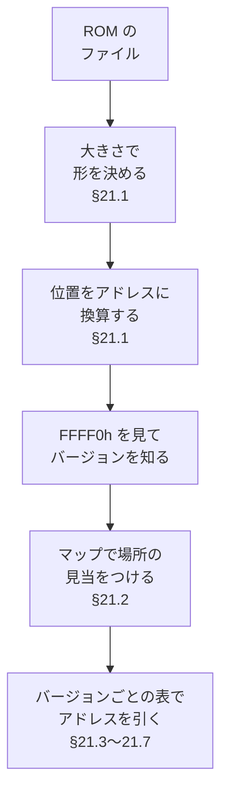

### ROM の部の歩き方

| 章 | 内容 | こんなときに |
|---|---|---|
| 21（この章） | 領域とアドレスの一覧 | アドレスを引く |
| [22 G: ドライブ](22_ROM_GDRIVE.md) | ROM に焼かれたファイルの一覧 | 付属ソフトの場所を調べる |
| [23 配置](23_ROM_VERSIONS_MAP.md) | バージョンの系統、エントリ、ベクタ、空き領域の比較 | どのバージョンにも通じる機械語を書く |
| [24 BASIC](24_ROM_VERSIONS_BASIC.md) | バージョン番号の根拠、BASIC の修正 | BASIC の結果がバージョンで違う |
| [25 行列演算とドライバ](25_ROM_VERSIONS_DRIVERS.md) | 行列、エラーメッセージ、プリンタ、RS-232C | 周辺機器の動きが違う |
| [26 システム](26_ROM_VERSIONS_SYSTEM.md) | IOCS、キー、画面、診断メニュー | 起動やキー入力を調べる |
| [27 機種](27_ROM_VERSIONS_MODELS.md) | 言語、カナ、付属ソフト | 機種を見分ける |

### バージョン番号を読む

ROM には、自分のバージョンを表す 2 バイトがあります。アドレスは全バージョンで同じです。

| アドレス | 内容 | PC-E650 の値 |
|---|---|---|
| `FFFF0h` | 改訂（上位の桁） | `08` |
| `FFFF1h` | 機種コード（下位の桁） | `05` |

この 2 つを「8.5」のように続けて書いたものを、この資料では**バージョン**と呼びます。上の桁はソフトの新しさ、下の桁は機種の種類です。たとえば 7.2 と 7.5 は改訂が同じで機種コードだけが違い、6.2 と 7.2 は機種コードが同じで改訂だけが違います。この読み方の根拠は [ROM バージョンの違い: BASIC](24_ROM_VERSIONS_BASIC.md) §24.1.1 にあります。

手元の機械では、BASIC から読めます（[ROM バージョンの違い: 機種](27_ROM_VERSIONS_MODELS.md) §27.1.1）。

```basic
PRINT PEEK &HFFFF0;PEEK &HFFFF1
```

`8  5` と出ればバージョン 8.5 です。

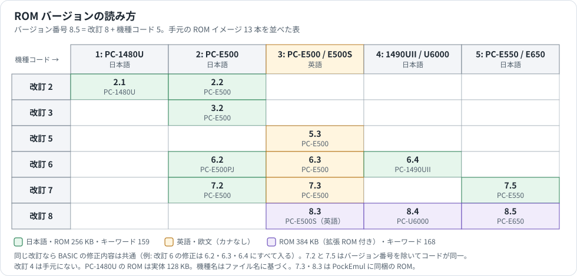

> [!TIP]
> 手元の 13 本では、上位の桁が 8 のバージョンだけが拡張 ROM を持ちます。下位の桁が 3 のバージョンだけが、画面の文言が英語です。

## 21.1 対象と物理配置

ROM のイメージとは、ROM の中身をそのままファイルにしたものです。手元の 13 本は、大きさと並びで 3 通りに分かれます。

| バージョン | 機種 | ファイルの長さ | 配置 |
|---|---|---|---|
| 2.1 | PC-1480U | 256 KB | 実体 128 KB を 2 回並べたもの。`E0000h`〜`FFFFFh` が実体で、`C0000h`〜`DFFFFh` はそのコピー |
| 2.2、3.2、5.3、6.3、7.2、7.3 | PC-E500 | 256 KB | `C0000h`〜`FFFFFh` の本体 ROM |
| 6.2 | PC-E500PJ | 256 KB | 同上 |
| 6.4 | PC-1490UII | 256 KB | 同上 |
| 7.5 | PC-E550 | 256 KB | 同上 |
| 8.3 | PC-E500S | 384 KB | 先頭 128 KB が拡張 ROM（`20000h`〜`3FFFFh`）、続く 256 KB が本体 ROM |
| 8.4 | PC-U6000 | 384 KB | 同上 |
| 8.5 | PC-E650 | 384 KB | 同上 |

384 KB のイメージは、ファイルの位置と CPU のアドレスが連続していません。ファイル位置 `20000h` がアドレス `C0000h` です。

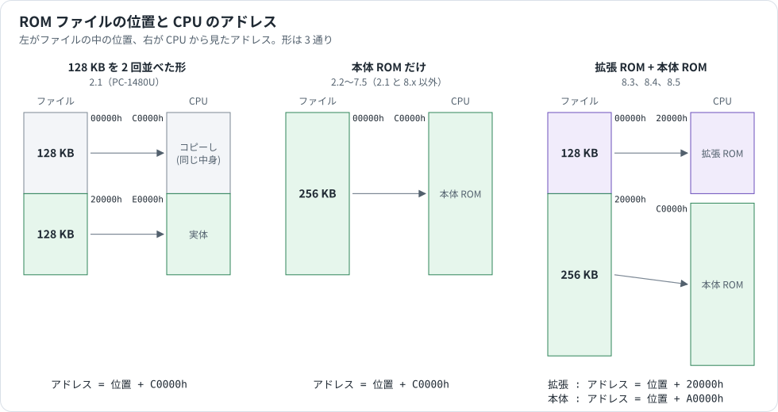

### アドレスの換算

ファイルの大きさから、次の式で換算できます。

| イメージ | ファイルの位置 → アドレス | アドレス → ファイルの位置 |
|---|---|---|
| 256 KB | アドレス = 位置 + `C0000h` | 位置 = アドレス − `C0000h` |
| 384 KB の先頭 128 KB | アドレス = 位置 + `20000h` | 位置 = アドレス − `20000h` |
| 384 KB の残り | アドレス = 位置 + `A0000h` | 位置 = アドレス − `A0000h` |

**例: アドレスからファイルの位置を求める**

| 調べたいもの | バージョン | アドレス | 計算 | ファイルの位置 |
|---|---|---|---|---|
| バージョン番号 | 7.2（256 KB） | `FFFF0h` | `FFFF0h` − `C0000h` | `3FFF0h` |
| バージョン番号 | 8.5（384 KB） | `FFFF0h` | `FFFF0h` − `A0000h` | `5FFF0h` |
| 文字の形 | 3.2（256 KB） | `F21A5h` | `F21A5h` − `C0000h` | `321A5h` |
| 文字の形 | 8.5（384 KB） | `30000h` | `30000h` − `20000h` | `10000h` |
| G: の FAT | 8.5（384 KB） | `C0058h` | `C0058h` − `A0000h` | `20058h` |
| IOCS ヘッダ | 2.1（256 KB） | `E02A6h` | `E02A6h` − `C0000h` | `202A6h`（コピーは `002A6h`） |

プログラムで書くと次のようになります。

```python
def file_to_cpu(offset, size):
    if size == 0x60000:                      # 384 KB
        return offset + (0x20000 if offset < 0x20000 else 0xA0000)
    return offset + 0xC0000                  # 256 KB

assert file_to_cpu(0x3FFF0, 0x40000) == 0xFFFF0
assert file_to_cpu(0x10000, 0x60000) == 0x30000
assert file_to_cpu(0x5FFF0, 0x60000) == 0xFFFF0
```

## 21.2 領域の並び

CPU のアドレスは 20 ビットで、上の 4 ビット（16 進の 1 桁目）が 64 KB ごとの区切り、**セグメント**を表します。本体 ROM は C、D、E、F の 4 つのセグメントを使います。おおまかには、C と D がファイル、E が IOCS とドライバ、F が起動と表示と BASIC です。

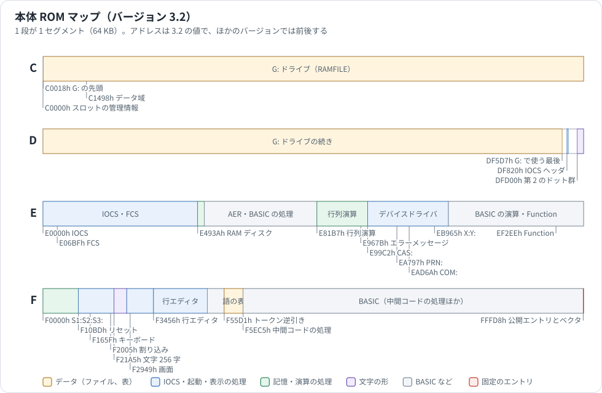

図のアドレスはバージョン 3.2 のもので、色分けの境目はおおよそです。次の表は、2.1 を除く本体 ROM の並びです。アドレスがバージョンで変わるものは §21.4、§21.5 にバージョンごとの値があります。

| 範囲 | 内容 | バージョンによる違い |
|---|---|---|
| `C0000h`〜`C0017h` | スロットの管理情報 | 先頭 3 バイトが 3 通り（[ROM バージョンの違い: 配置](23_ROM_VERSIONS_MAP.md) §23.2） |
| `C0018h`〜 | G: の `RAMFILE` ブロック（ROM に焼かれた読み出し用イメージ） | 形式 A と形式 B で中の配置が違う（§21.6） |
| `DF500h`、`DF820h` | IOCS ヘッダの連結リスト | 6.4、8.4 が `DF500h`、ほかが `DF820h` |
| `DFD00h`〜`DFFFFh` | 第 2 の 6×8 ドット群 | 形式 A のバージョンだけ（§21.6） |
| `E0000h`〜 | IOCS、FCS、デバイスドライバ | |
| `E493Ah` 付近 | RAM ディスク、メモリブロックの制御 | バージョンで前後する |
| `EF000h` 付近 | Function ドライバ | バージョンで前後する |
| `F0000h`〜 | リセット、割り込み、表示、キー入力、BASIC | |
| `FFFD8h`〜`FFFFFh` | 公開エントリ、ベクタ、バージョン番号 | アドレスは全バージョンで同じ |

2.1 は `E0000h`〜`FFFFFh` に同じ種類の領域が入り、IOCS のメインは `F33B8h` にあります。G: と第 2 のドット群はありません。

## 21.3 固定エントリ

ROM の処理は、バージョンが変わると場所が動きます。バージョンごとにアドレスを書き分けなくても呼べるように、ROM の末尾には「必ずこのアドレスを呼ぶ」というエントリが並んでいます。会社の代表電話のようなもので、番号（アドレス）は変わらず、つながる先（ジャンプ先）だけがバージョンごとに違います。

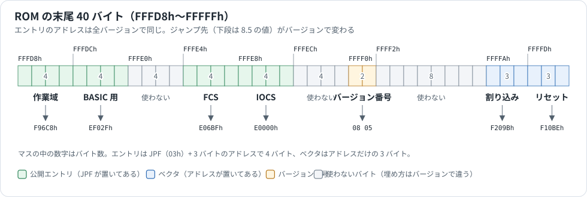

呼ぶアドレスは全バージョンで同じです。ジャンプ先がバージョンで変わるので、機械語からは左のアドレスを呼びます。エントリはどれも `JPF` で、2.1 の `FFFE8h` だけが `JP` です。`FFFFAh`、`FFFFDh` はベクタです。`JPF` は 1 MB のどこへでも飛べる命令、ベクタは割り込みやリセットのときのジャンプ先のアドレスを置く場所です。

| バージョン | `FFFD8h` 作業域の再構成 | `FFFDCh` BASIC 用 IOCS | `FFFE4h` FCS | `FFFE8h` IOCS | `FFFFAh` 割り込み | `FFFFDh` リセット |
|---|---|---|---|---|---|---|
| 2.1 | `F99BCh` | `EF378h` | `E092Fh` | `F33B8h` | `F1F56h` | `F1031h` |
| 2.2 | `F9D1Eh` | `EF383h` | `E06BFh` | `E0000h` | `F1FF8h` | `F10BDh` |
| 3.2 | `F9D31h` | `EF2EEh` | `E06BFh` | `E0000h` | `F2005h` | `F10BDh` |
| 5.3 | `F9CC0h` | `EF2D9h` | `E06BFh` | `E0000h` | `F1FB5h` | `F10C2h` |
| 6.3、7.3 | `F9CC0h` | `EF2DFh` | `E06BFh` | `E0000h` | `F1FB5h` | `F10C2h` |
| 6.2、7.2、7.5 | `F9D31h` | `EF2F4h` | `E06BFh` | `E0000h` | `F2005h` | `F10BDh` |
| 6.4 | `F9B94h` | `EF317h` | `E06BFh` | `E0000h` | `F2035h` | `F10BDh` |
| 8.3 | `F964Fh` | `EF01Ah` | `E06BFh` | `E0000h` | `F2043h` | `F10C3h` |
| 8.4 | `F951Ch` | `EF03Eh` | `E06BFh` | `E0000h` | `F20C3h` | `F10BEh` |
| 8.5 | `F96C8h` | `EF02Fh` | `E06BFh` | `E0000h` | `F209Bh` | `F10BEh` |

`FFFD8h` は、作業域の大きさを作り直すエントリです（機械語エリアの確保に使います）。`FFFF0h`、`FFFF1h` はバージョン番号です。

### 4 つのエントリの中身

ジャンプ先を逆アセンブルすると、4 つのエントリが何を受け取るかが分かります（コード）。

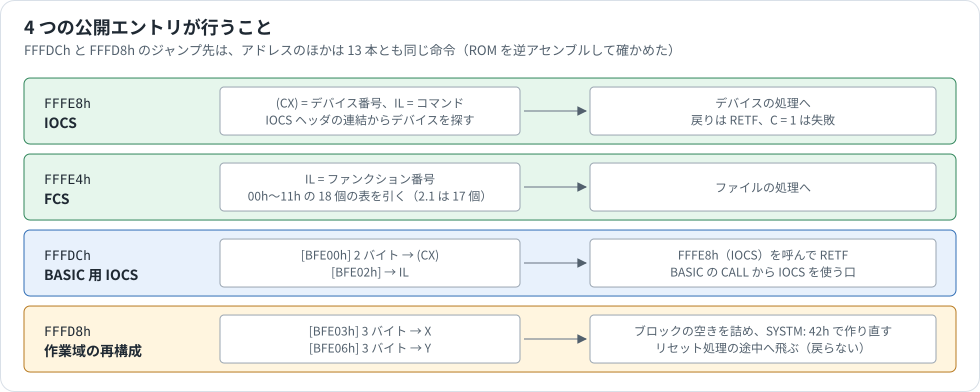

**`FFFDCh`（BASIC 用 IOCS）** は 15 バイトの短い処理で、13 本とも同じバイトです。RAM の `BFE00h` から IOCS のデバイス番号とコマンドを読み、`FFFE8h` を呼んで戻ります。内部 RAM やレジスタを直接書けない BASIC から、IOCS を 1 回呼ぶための口です。

```text
EF2F4  MV    IL,[BFE02h]     コマンド
EF2F8  MVW   (D6h),[BFE00h]  (CX) = デバイス番号（2 バイト）
EF2FE  CALLF FFFE8h
EF302  RETF
```

たとえば画面（デバイス 0）のコマンド 51h（画面を消す）は、BASIC から次の 1 行で呼べます。2.1、2.2、5.3、7.2、8.3、8.5 で実行し、画面が消えて `>` が出ることを確かめました（実験）。

```basic
POKE &HBFE00,0,0,&H51:CALL &HFFFDC
```

A や X などのレジスタに値が要るコマンドは、この口だけでは呼べません。使い方は [IOCS と FCS](11_IOCS.md) §11.1.2 にあります。

**`FFFD8h`（作業域の再構成）** は、次の順に進みます。13 本とも、ジャンプ先のアドレスのほかは同じ命令です。

1. デバイス 6（メモリブロック）のコマンド 40h を、A = 3 で呼ぶ。3 つのスロットのブロックの空きを、`S3:`、`S2:`、`S1:` の順に詰める（8.5 では `F0460h` から `F0A51h` へ進み、47h と同じ `F0A19h` を 3 回呼ぶ）。
2. `BFE03h` の 3 バイトを X（作業域のポインタのアドレス）に、`BFE06h` の 3 バイトを Y（大きさ）に読む。
3. デバイス 8（`SYSTM:`）のコマンド 42h を呼び、領域を作り直す。
4. `($D8)` を 1 にして、リセット処理の途中（3.2 は `F10F3h`）へ飛ぶ。

4 のとおり、呼んだ所へは戻りません。リセットの前半（ON キーの判定など）を飛ばした再起動になるので、`CALL &HFFFD8` のあとはメインメニューが出ます。手順と確かめ方は [機械語を実機で動かす](12_MACHINE_CODE.md) §12.3.2 にあります。

**`FFFE4h`（FCS）** は、2.2 以降では番号 00h〜11h の 18 個、2.1 では 00h〜10h の 17 個を受け付けます。先頭で IL を 12h（2.1 は 11h）と比べています。

### 割り込みのエントリ

`FFFFAh` からの 3 バイトが指す割り込みのエントリは、アドレスこそバージョンで違いますが、続く 172 バイトの処理は 13 本とも同じです（処理の中に書かれた自分の戻り先のアドレスだけが違います）。ISR と IMR を AND し、残ったビットを決まった順に調べます。

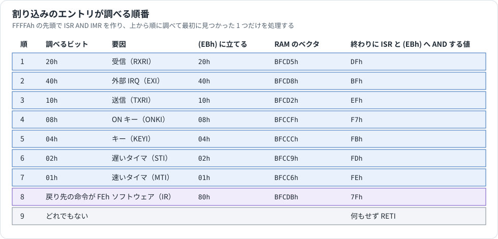

処理の流れは次のとおりです（コード、3.2 の `F2005h`〜`F20B0h`）。

1. BA、I、X、Y を U スタックに積む。
2. 上の表の順に調べ、最初に立っていた要因のビットを `($EB)` に立て、RAM のベクタ（`BFCC6h`〜）を Y に読む。
3. 戻り先を S スタックに積んで `JP Y` で飛ぶ。飛んだ先は `RETF` で戻る。
4. `($EB)` と ISR から、処理した要因のビットだけを 0 にする。
5. レジスタを戻して `RETI`。

一度に処理するのは 1 つです。ほかの要因も立っていれば、`RETI` の直後にもう一度割り込みが入り、残りが処理されます。受信がいちばん先に調べられるので、シリアルの文字を取りこぼしにくい順番になっています。

ベクタの初期値のうち、キーと ON の処理は積まれた IMR を書き換えます。たとえば 3.2 の `F20B1h` は `[S+3]`（積んだ IMR）から KEYM を落として戻るので、`RETI` のあと、キーの割り込みは禁止になります。BASIC の動作中の IMR はふつう E3h で、キーのビット（ビット 2）は 0 です（[起動、割り込み、タイマ、音](10_SYSTEM.md) §10.3.2）。

### 末尾 48 バイトの全体

`FFFD0h` から後ろを並べると、次の割り当てになります。

| アドレス | 長さ | 内容 |
|---|---|---|
| `FFFD0h`〜`FFFD7h` | 8 | 使っていない（埋め草。バージョンにより `FFh`、`9Fh`、そのほか） |
| `FFFD8h` | 4 | 作業域の再構成。`JPF` |
| `FFFDCh` | 4 | BASIC から IOCS を呼ぶ口。`JPF` |
| `FFFE0h`〜`FFFE3h` | 4 | 使っていない |
| `FFFE4h` | 4 | FCS。`JPF` |
| `FFFE8h` | 4 | IOCS。`JPF`（2.1 は `JP` の 3 バイトと `FFh`） |
| `FFFECh`〜`FFFEFh` | 4 | 使っていない（[23 章](23_ROM_VERSIONS_MAP.md) §23.3.1） |
| `FFFF0h`、`FFFF1h` | 2 | バージョン番号 |
| `FFFF2h`〜`FFFF9h` | 8 | 使っていない |
| `FFFFAh`〜`FFFFCh` | 3 | 割り込みベクタ |
| `FFFFDh`〜`FFFFFh` | 3 | リセットベクタ |

この範囲にある公開エントリは、この 4 つだけです。

**例: IOCS を呼ぶとき**

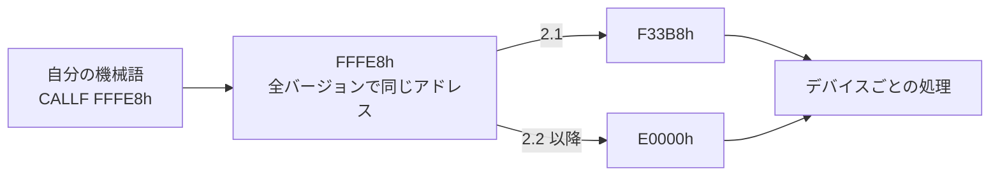

`CALLF E0000h` と直接書くと、2.2 以降では IOCS に届きますが、2.1 の IOCS は `F33B8h` なので届きません。

> [!WARNING]
> 表の右側のジャンプ先を、プログラムに直接書かないでください。同じアドレスでも、別のバージョンでは別の処理が置かれています。

## 21.4 システムの領域

IOCS（入出力の処理の窓口）は、デバイスごとのヘッダを連結リストにして持っています。デバイスの名前から処理のエントリを引くための電話帳にあたります。RAM ディスクの制御と、文字の形（ドット）の置き場所もここにまとめました。

| バージョン | IOCS ヘッダ | RAM ディスク制御 | 文字ドット選択 | 文字 256 字 |
|---|---|---|---|---|
| 2.1 | `E02A6h`〜`E033Dh` | `E4A83h`〜`E4D67h` | `F2A9Eh`〜`F2B76h` | `F20F6h`〜`F26F5h` |
| 2.2 | `DF820h`〜`DF8B7h` | `E493Ah`〜`E4C69h` | `F2B42h`〜`F2C4Eh` | `F2198h`〜`F2797h` |
| 3.2、6.2、7.2、7.5 | `DF820h`〜`DF8B7h` | `E493Ah`〜`E4C69h` | `F2B4Fh`〜`F2C5Bh` | `F21A5h`〜`F27A4h` |
| 5.3、6.3、7.3 | `DF820h`〜`DF8B7h` | `E493Eh`〜`E4C6Dh` | `F2AFFh`〜`F2C0Bh` | `F2155h`〜`F2754h` |
| 6.4 | `DF500h`〜`DF597h` | `E4910h`〜`E4C3Fh` | `F2B7Fh`〜`F2C8Bh` | `F21D5h`〜`F27D4h` |
| 8.3 | `DF820h`〜`DF8B7h` | `E493Eh`〜`E4C6Dh` | `F23EDh`〜`F24F9h` | `30000h`〜`305FFh` |
| 8.4 | `DF500h`〜`DF597h` | `E4910h`〜`E4C3Fh` | `F246Dh`〜`F2579h` | `30000h`〜`305FFh` |
| 8.5 | `DF820h`〜`DF8B7h` | `E493Ah`〜`E4C69h` | `F2445h`〜`F2551h` | `30000h`〜`305FFh` |

- **IOCS ヘッダ:** 全バージョンとも 10 個が連結しています。`BFCA2h` が先頭を指します。最後のヘッダ（`SYSTM:`）の「次のアドレス」は `FFFFFh` です。表の終わりのアドレスは、最後のヘッダの名前の後ろの `00h` までです。
- **RAM ディスク制御:** 先頭は IOCS デバイス 5 のエントリです。
- **文字ドット選択:** 文字コードの帯ごとの分岐と、`BFC84h`〜`BFC95h` へのポインタの設定をします。
- **文字 256 字:** 1 字 6 バイトで、`BFC87h` がこの先頭を指します。**8.x だけ拡張 ROM にあります。** 5.3、6.3、7.3、8.3 以外は全バイト同じで、この 4 本は英語版の文字セットです（4 本どうしは全バイト同じ）（[ROM バージョンの違い: システム](26_ROM_VERSIONS_SYSTEM.md) §26.3.1）。

**例: 文字 `A` の形の場所**

文字コードは `41h` です。1 字 6 バイトなので、先頭から 41h × 6 = 186h バイト目にあります。

| バージョン | 先頭 | `A` のアドレス | ファイルの位置 |
|---|---|---|---|
| 7.2 | `F21A5h` | `F232Bh` | `3232Bh` |
| 8.5 | `30000h` | `30186h` | `10186h` |

代替のドット列（`BFC84h` が指すもの）は 12 バイト、つまり 2 文字分（左向きの三角と、太い下線）です。8.x では `30798h`〜`307A3h` で、すぐ後ろの `307A4h` からキーの表が始まります（[23 章](23_ROM_VERSIONS_MAP.md) §23.9.1）。先頭のアドレスと、それを参照する処理のアドレスは次のとおりです。

| バージョン | 代替ドット列（`BFC84h`） | その参照 | `C0018h` を見る所 |
|---|---|---|---|
| 2.1 | `F288Eh` | `F2C37h` | なし |
| 2.2 | `F2930h` | `F2CE4h` | `E4BE8h` |
| 3.2、6.2、7.2、7.5 | `F293Dh` | `F2CF1h` | `E4BE8h` |
| 5.3、6.3、7.3 | `F28EDh` | `F2CA1h` | `E4BECh` |
| 6.4 | `F296Dh` | `F2D21h` | `E4BBEh` |
| 8.3 | `30798h` | `F258Fh` | `E4BECh` |
| 8.4 | `30798h` | `F260Fh` | `E4BBEh` |
| 8.5 | `30798h` | `F25E7h` | `E4BE8h` |

`C0018h` を見る所は、G: のときにメモリブロックの先頭を固定で参照する処理です。

## 21.5 BASIC の領域

BASIC のプログラムは、命令の名前をそのまま覚えるのではなく、1 バイトの番号（**token**）に置き換えて持ちます。ROM には、名前から番号を引く辞書、番号から名前を引く逆引き、番号から処理のエントリを引く処理レコードの 3 つの表があります。

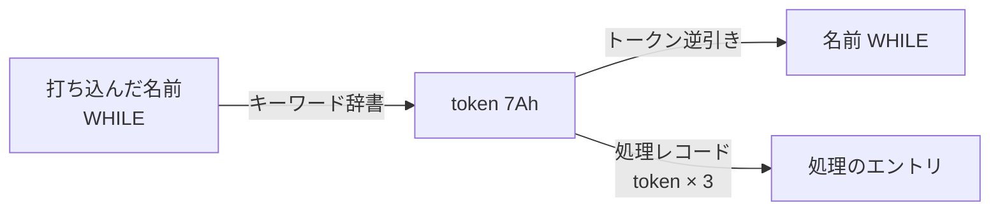

| バージョン | トークン逆引き | 処理レコード | キーワード辞書 | 語数 | 中間コードの処理 |
|---|---|---|---|---|---|
| 2.1 | `F53D0h`〜`F55CFh` | `F55D0h`〜`F58CFh` | `F58DBh`〜`F5CC3h` | 159 | `F5CC4h`〜 |
| 2.2 | `F55CFh`〜`F57CEh` | `F57CFh`〜`F5ACEh` | `F5ADAh`〜`F5EC2h` | 159 | `F5EC3h`〜 |
| 3.2、6.2、7.2、7.5 | `F55D1h`〜`F57D0h` | `F57D1h`〜`F5AD0h` | `F5ADCh`〜`F5EC4h` | 159 | `F5EC5h`〜 |
| 5.3、6.3、7.3 | `F5581h`〜`F5780h` | `F5781h`〜`F5A80h` | `F5A8Ch`〜`F5E74h` | 159 | `F5E75h`〜 |
| 6.4 | `F5601h`〜`F5800h` | `F5801h`〜`F5B00h` | `F5B0Ch`〜`F5EF4h` | 159 | `F5EF5h`〜 |
| 8.3 | `F4DD1h`〜`F4FD0h` | `F4FD1h`〜`F52D0h` | `F52DCh`〜`F570Ah` | 168 | `F570Bh`〜 |
| 8.4 | `F4E4Ch`〜`F504Bh` | `F504Ch`〜`F534Bh` | `F5357h`〜`F5785h` | 168 | `F5786h`〜 |
| 8.5 | `F4E29h`〜`F5028h` | `F5029h`〜`F5328h` | `F5334h`〜`F5762h` | 168 | `F5763h`〜 |

- **トークン逆引き:** 16 bit の項目が 256 個並びます。
- **処理レコード:** `token × 3` で引く 3 バイトの表です。直後の 11 バイトのポインタを挟んでキーワード辞書が続きます。
- **キーワード辞書:** `[長さ][ASCII 名][token]` の並びで、頭文字ごとに `00h` で区切ります。語のない頭文字は `00h` だけです。語数には、命令ではない `RESERVED`（token `00h`）の 1 語も入っています。この語だけは逆引きの表から指されません。
- **中間コードの処理:** 辞書の直後から、トークンの分類と処理エントリの選択が続きます。

**例: 8.5 の `ENDIF`（token `4Dh`）**

| 調べるもの | 計算 | 結果 |
|---|---|---|
| 辞書の中の形 | `[05][45 4E 44 49 46][4D]` | 長さ 5、`E` `N` `D` `I` `F`、token |
| トークン逆引きの項目 | `F4E29h` + 4Dh × 2 | `F4EC3h` |
| 処理レコード | `F5029h` + 4Dh × 3 | `F5110h` |
| 処理エントリ（[24 章](24_ROM_VERSIONS_BASIC.md) §24.2） | 処理レコードの下位 20 bit | `30FE0h`（拡張 ROM） |

表の大きさもアドレスから確かめられます。8.5 の処理レコードは `F5029h`〜`F5328h` の 768 バイトで、256 個 × 3 バイトです。そこから 11 バイトのポインタを挟んだ `F5334h` が辞書の先頭になります。

表を実際に引いているコードのアドレスは次のとおりです。

| バージョン | 逆引きを使う所 | 処理レコードを引く所 |
|---|---|---|
| 2.1 | `F4EE0h` | `F5E4Ch`、`F5E7Fh` |
| 2.2 | `F50DFh` | `F604Bh`、`F607Eh` |
| 3.2、6.2、7.2、7.5 | `F50E1h` | `F604Dh`、`F6080h` |
| 5.3、6.3、7.3 | `F5091h` | `F5FFDh`、`F6030h` |
| 6.4 | `F5111h` | `F607Dh`、`F60B0h` |
| 8.3 | `F48E1h` | `F58D8h`、`F590Bh` |
| 8.4 | `F495Ch` | `F5953h`、`F5986h` |
| 8.5 | `F4939h` | `F5930h`、`F5963h` |

## 21.6 G: と第 2 のドット群

G: は、ROM の中に焼かれた読み出し専用のドライブです。ファイルの並べ方に 2 通りの形式があります。第 2 のドット群は、通常の文字表とは別の、もう 1 組の文字の形です。

| バージョン | G: の形式 | `C0018h` のブロック | 第 2 のドット群（`DFD00h`〜`DFFFFh`） |
|---|---|---|---|
| 2.2、3.2、5.3、6.3、7.3、6.2、7.2、7.5、8.3、8.5 | 形式 A | `RAMFILE`。FAT `C0058h`、ルート `C0BD8h`、データ `C1498h`、最後 `DF5D7h` | あり。10 本とも全バイト同じ |
| 6.4、8.4 | 形式 B | `RAMFILE`。FAT `C0118h`、ルート `C0318h`、データ `C0B18h`、最後 `CD517h` | なし。この帯は別の内容 |
| 2.1 | なし | | なし |

第 2 のドット群は、通常の文字表示で使う表とは別のもので、欧州版が文字セットの切替えに使います（[メモリ](03_MEMORY.md) §3.8）。

G: の形式は [ROM バージョンの違い: 機種](27_ROM_VERSIONS_MODELS.md) §27.3、形式 A のファイル一覧は [G: ドライブ](22_ROM_GDRIVE.md) にあります。

## 21.7 拡張 ROM（8.3、8.4、8.5）

改訂 8 の機種は、本体 ROM のほかに 128 KB の拡張 ROM を持ちます。文字の形や、新しく加わった処理が入っています。前半の 64 KB は空で、使っているのは後半の一部だけです。

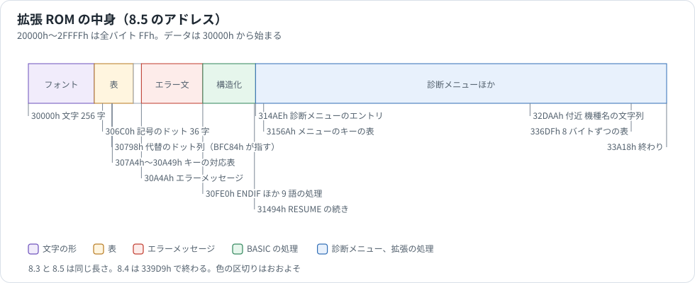

| 範囲 | 内容 |
|---|---|
| `20000h`〜`2FFFFh` | 全バイト `FFh` |
| `30000h`〜`305FFh` | 文字 256 字。8.4 と 8.5 で全バイト同じ。8.3 は英語版の文字セット（§21.4） |
| `30600h`〜`30797h` | 記号のドット 68 文字分（[23 章](23_ROM_VERSIONS_MAP.md) §23.9.1） |
| `30798h`〜`307A3h` | 代替、制御文字用のドット列（`BFC84h` が指す）2 文字分 |
| `307A4h`〜`30A49h` | キーの対応表 6 組（98 バイトずつ）と、キーの位置の表（90 バイト） |
| `30A4Ah`〜`30E38h` | BASIC のエラーメッセージ（[25 章](25_ROM_VERSIONS_DRIVERS.md) §25.2.2） |
| `30E39h`〜 | 拡張の処理（構造化構文、診断メニュー）とその文字列 |
| 終わり | 8.4 は `339D9h`、8.3 と 8.5 は `33A18h`。後ろは 8.4 と 8.5 が全バイト `FFh`、8.3 は `FFh` ではない値が `3FFFFh` まで続く |

3 本の差は [ROM バージョンの違い: 配置](23_ROM_VERSIONS_MAP.md) §23.9 にあります。

## 21.8 RAM 上のポインタ

ROM の表の場所の一部は、RAM のポインタに入っています。ポインタを見て表を引けば、バージョンで表の場所が変わっても同じ手順で済みます。BASIC を起動した後の値です（エミュレータで全バージョンを起動して読みました）。

| アドレス | 内容 | 値 |
|---|---|---|
| `BFCA2h` | IOCS ヘッダの先頭 | §21.4 の IOCS ヘッダの先頭 |
| `BFC84h` | 代替ドット列 | §21.4 の表 |
| `BFC87h` | 文字コード 00h〜 | 文字 256 字の先頭 |
| `BFC8Ah` | 80h〜 | 先頭 + `300h` |
| `BFC8Dh` | E0h〜 | 先頭 + `540h` |
| `BFC90h` | 20h〜 | 先頭 + `C0h` |
| `BFC93h` | A0h〜 | 先頭 + `3C0h` |

ポインタの差は、文字コードの差 × 6 バイトです。たとえば 20h からの文字は、先頭より 20h × 6 = C0h バイト後ろにあります。

## 21.9 ROM 8.5 のコード到達解析

ROM の中には、命令と表やデータが混ざっています。どこが命令なのかを知るために、エントリから命令をたどり、ジャンプ先や呼び先も順にたどる方法（再帰的な走査）で、8.5 のコードの範囲を調べました。

公開ベクタ、IOCS と FCS の全表、BASIC の全トークンエントリ、文字の初期化を起点に再帰的に走査し、39,310 個の命令の開始、94,090 バイトを、重複なしで到達可能なコードとして得ました。デコードが止まった所は 0 件です。間接ジャンプの先は入りません。

## 21.10 調べ方

### 自分の ROM で試す

自分の ROM イメージがあれば、この章のアドレスを自分の手で確かめられます。例として、7.2 の ROM（256 KB）から「`Syntax error` を表示する処理」を探します。

**手順 1: 全体を逆アセンブルする。** 256 KB の ROM は先頭が `C0000h` です。

```text
> e500dasm "PC-E500(7.2).ROM" --format raw --org C0000 --no-labels -o rom72.asm
OK: 262144 bytes, origin=C0000h, 111751 instructions, 34160 DB bytes
```

384 KB の ROM は、先頭 128 KB と残り 256 KB を別のファイルに分け、`--org 20000` と `--org C0000` で 1 つずつ逆アセンブルします。

**手順 2: エントリを見る。** できた一覧の右側にはアドレスと元のバイトが付くので、`; FFFE8` を検索します。

```text
        JPF    $F9D31                     ; FFFD8 | 03 31 9D 0F
        JPF    $EF2F4                     ; FFFDC | 03 F4 F2 0E
        JPF    $E06BF                     ; FFFE4 | 03 BF 06 0E
        JPF    $E0000                     ; FFFE8 | 03 00 00 0E
```

**手順 3: 手がかりの文字を探す。** バイナリエディタや Python で `Syntax error` を探すと、ファイルの位置は `29681h` です。アドレスは `29681h` + `C0000h` = `E9681h` です。

**手順 4: そのアドレスを使う命令を探す。** アドレスは命令の中に下位から並ぶので、一覧で `81 96 0E` を検索します。

```text
        MV     X,$E9681                   ; F443A | 0C 81 96 0E
        MV     (BP+$00),A                 ; F443E | A0 00
        SUB    (BP+$00),$0A               ; F4440 | 49 00 0A
        JRC    +$2B                       ; F4443 | 1C 2B
        JRZ    +$0F                       ; F4445 | 18 0F
        CMP    (BP+$00),$5A               ; F4447 | 61 00 5A
        JRNC   +$2C                       ; F444A | 1E 2C
        MV     A,[X++]                    ; F444C | 90 24
        CMP    A,$00                      ; F444E | 60 00
```

**手順 5: 読む。** A に渡された番号から 0Ah を引き、その数だけ `00h` までを読み飛ばしています。つまり、ROM の中のエラー番号は「メッセージの番号 + 9」で、5Ah（90）なら 81 番の `Type mismatch` です。

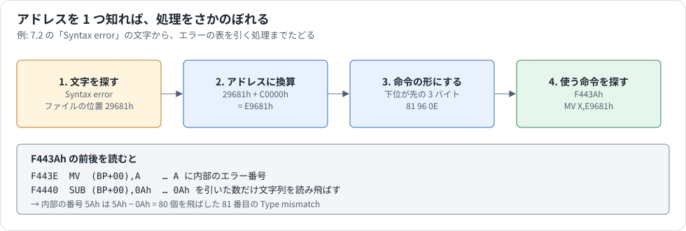

> [!TIP]
> データも命令として逆アセンブルされます。`E9681h` の行は `ADC (BP+$79),A` となっていますが、実際は文字 `S` `y`（`53 79`）です。文字列や表の所は、命令として読まないでください。

別のバージョンで同じ処理を探すには、命令のバイト列のうちアドレスを含まない部分（上の例なら `A0 00 49 00 0A`）を検索します。アドレスは動いても、命令の並びは残っていることが多いからです。

### この章の値の確かめ方

- §21.1、§21.3、§21.6、§21.7 は ROM のファイルから直接読みました。
- IOCS ヘッダは、文字列 `STDO:SCRN:` の 8 バイト前を先頭として連結をたどりました。全バージョンで 10 個です。
- キーワード辞書は頭文字の組を順にたどり、名前にならないバイトを終わりとしました。語数は 159 語（8.x は 168 語）で、[ROM バージョンの違い: BASIC](24_ROM_VERSIONS_BASIC.md) §24.1 と一致します。
- 文字 256 字は、`BFC87h` の値の位置のバイトを 8.5 の字形と比べました。
- コードの領域と参照のアドレスは、8.5 の該当のバイト列に最も近い所を各バージョンで探しました。アドレスを含むバイトはバージョンで変わるので、完全には一致しません。文字ドット選択の終わりは、バージョンによる差が大きい部分なので、前の位置からの距離で求めました。
- §21.3、§21.4 の IOCS ヘッダと文字、§21.5 の表、§21.8 の値は、バージョンごとに ROM のファイルとエミュレータの RAM から取り出し、表の値と 1 つずつ照合しました（エントリとベクタ 78 個、デバイスのエントリ 130 個、RAM の値 260 個など）。
- 8.5 の領域の根拠は、ROM の固定参照と表の構造です。IOCS メインは `FFFE8h` から `JPF`、FCS は `FFFE4h` から `JPF` で `00h`〜`11h` の 18 項目の表を参照します。

## まとめ

| 覚えること | 内容 |
|---|---|
| 大きさ | 256 KB（改訂 2〜7）と 384 KB（8.x）。2.1 の実体は 128 KB |
| 換算 | 256 KB は + `C0000h`。384 KB は先頭 128 KB が + `20000h`、残りが + `A0000h` |
| 並び | C、D = G: ドライブ、E = IOCS とドライバ、F = 起動、表示、BASIC |
| 呼ぶアドレス | `FFFE8h`（IOCS）、`FFFE4h`（FCS）、`FFFDCh`（BASIC 用 IOCS）、`FFFD8h`（作業域の再構成） |
| 割り込み | 受信 → 外部 → 送信 → ON → キー → 遅いタイマ → 速いタイマ → ソフトウェアの順に調べる。全バージョン同じ |
| バージョン番号 | `FFFF0h` が改訂、`FFFF1h` が機種コード |
| 8.x だけ | 文字の形と、追加のキーワード 9 語の処理が拡張 ROM にある |

## 次に読むもの

| 関連する内容 | 資料 |
|---|---|
| IOCS のデバイスのエントリ、割り込みのベクタ、未使用領域、バージョンごとの同一性 | [ROM バージョンの違い: 配置](23_ROM_VERSIONS_MAP.md) |
| バージョン番号の読み方、BASIC の違い | [ROM バージョンの違い: BASIC](24_ROM_VERSIONS_BASIC.md) |
| G: ドライブの形式 | [ROM バージョンの違い: 機種](27_ROM_VERSIONS_MODELS.md) §27.3 |
| バージョンの系統図 | [ROM バージョンの違い: 配置](23_ROM_VERSIONS_MAP.md) §23.13 |
