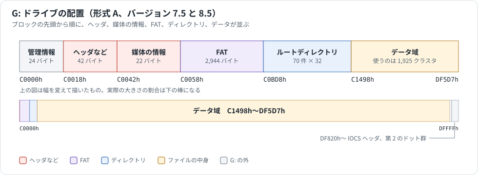
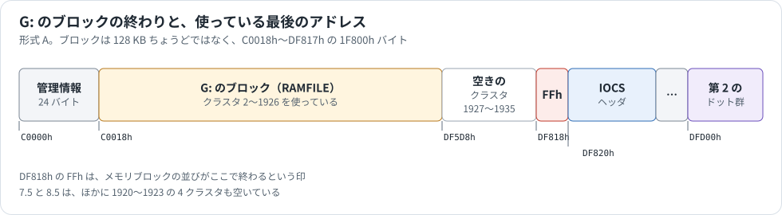
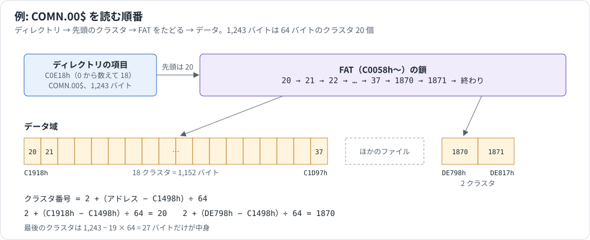
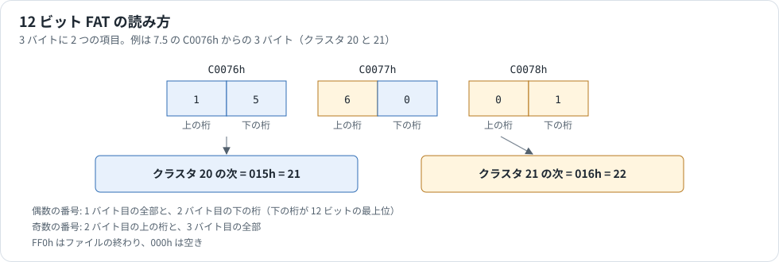
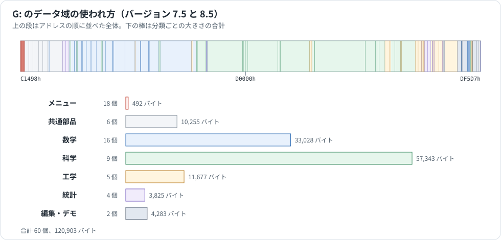
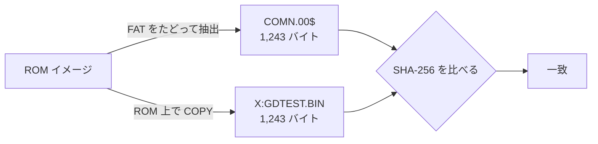

# 22. G: ドライブ

この章は ROM の中に隠れている「読むだけのディスク」G: の話です。BASIC から `FILES "G:"` と打つと出てくるファイルが、ROM のどこに、どんな形で入っているのかを、1 バイトずつたどれるように説明します。自分の ROM から付属のプログラムを取り出したい人、FAT というしくみを小さな実物で学びたい人に向いています。

扱うのは、G: の 2 つの形式のうち形式 A です。形式 A は PC-E500、PC-E500PJ、PC-E550、PC-E650 が使います（[ROM マップ](21_ROM_MAP.md) §21.6 のとおり、PC-E500S の 8.3 も形式 A です）。下の表のファイルとアドレスは 7.5 と 8.5 のものです（この 2 つのバージョンは G: の領域が全バイト同じです）。バージョンと機種による違いは [ROM バージョンの違い: 機種](27_ROM_VERSIONS_MODELS.md) §27.3 にあります。

[目次へ戻る](README.md)

## この章で分かること

- G: が ROM のどこにあり、どんな形で並んでいるか
- FAT とディレクトリからファイルを取り出す手順（計算の例つき）
- 取り出しが正しいことをどう確かめたか
- 全 60 ファイルの名前、大きさ、置き場所
- G: のブロックがどこで終わるか

## 22.0 はじめに

G: は付属のエンジニアソフト（数学、科学、工学、統計などの BASIC プログラム）が入ったドライブです。中身は ROM の一部なので、書き込んだり消したりはできません。読み方はパソコンのフロッピーディスクと同じ考え方の **FAT**（File Allocation Table）です。

FAT は次の 3 つの部品でできています。本にたとえると分かりやすくなります。

| 部品 | 役割 | 本でいえば |
|---|---|---|
| ディレクトリ | ファイルの名前、大きさ、先頭の場所 | 目次 |
| FAT | 「このページの続きは何ページ」という一覧 | 続きのページの案内 |
| データ域 | ファイルの中身。決まった大きさ（クラスタ）に区切られている | 本文のページ |

1 つのファイルの中身は連続した場所にあるとは限りません。あちこちのクラスタに分かれていても、FAT をたどれば順番につなげられます。

| 語 | 意味 |
|---|---|
| セクタ | 読み書きの単位。G: の形式 A では 64 バイト |
| クラスタ | ファイルに割り当てる単位。形式 A では 1 セクタ。番号は 2 から始まる（[メモリ](03_MEMORY.md) §3.6） |
| 12 ビット FAT | FAT の項目 1 つが 12 ビット。3 バイトに 2 つの項目が入る |

## 22.1 配置と形式

G: は本体 ROM 内の `RAMFILE` メモリブロックで、ブロック先頭は `C0018h`、終わりは `DF817h`（1F800h バイト）です。ROM の C、D セグメント（`DFFFFh` までの 128 KiB）の残りには、IOCS ヘッダなど別のものが入っています。メモリブロックは、この機械が RAM カードや内蔵 RAM の中身を名前つきで区切る単位です（[メモリ](03_MEMORY.md) §3.3）。G: は RAM ディスクと同じ仕組みを ROM の中に作ったものといえます。ROM コード `E4BE8h` が G: を選んだときに `Y=C0018h` とします。ファイルシステムは 64-byte sector、1 sector/cluster、12-bit FAT です。



| 項目 | アドレス/値 |
|---|---|
| メモリブロック先頭 | C0018h |
| media parameter block | C0042h |
| sector size | 64 bytes |
| FAT | C0058h |
| root directory | C0BD8h（70 entries x 32 bytes） |
| data area | C1498h |
| ブロックの終わり | DF817h（次の `DF818h` は終わりの印 `FFh`） |
| 使っている最後のアドレス | DF5D7h（クラスタ 1926） |
| クラスタの番号 | 2〜1935（1,934 個） |
| ファイルの終わりの印 | FF0h |
| 有効ファイル | 60 |
| 削除entry | 1 |
| 未使用entry | 9 |
| 有効データ合計 | 120,903 bytes |

ブロックの終わりはブロックのヘッダから計算できます。`C0029h`（ヘッダの `+11`）にある 3 バイト `00 F8 01` が、次のブロックまでの長さ 1F800h です。`C0018h` + 1F800h = `DF818h` で、そこには並びの終わりを示す `FFh` があります。データ域も同じ所で終わり、`C1498h` +（1935 − 1）× 64 = `DF818h` です。



`FILES "S3:"` と打つと、この長さを確かめられます。7.2 の画面は次のとおりで、128990 は 1F800h（129,024）からヘッダの 34 を引いた値です（実験）。

```text
□ RAMFILE .!   P   128990   S3:
```

ヘッダに続く `C0042h` からの 22 バイトがディスクの形を表します。10 本の形式 A で全バイト同じです。

| アドレス | バイト | 意味 | 値 |
|---|---|---|---|
| `C0042h` | `FF` | メディアの種類（FAT の先頭と同じ） | FFh |
| `C0043h` | `40 00` | セクタの大きさ | 64 |
| `C0049h` | `01 00` | FAT の最初のセクタ | 1 |
| `C004Bh` | `01` | FAT の数 | 1 |
| `C004Ch` | `46 00` | ディレクトリの項目 | 70 |
| `C004Eh` | `52 00` | データの最初のセクタ | 82 |
| `C0050h` | `8F 07` | 最後のクラスタ番号 | 1935 |
| `C0052h` | `2E` | FAT のセクタ数 | 46 |
| `C0053h` | `2F` | ディレクトリの最初のセクタ | 47 |

アドレスは「`C0018h` + セクタ × 64」です。ディレクトリは `C0018h` + 47 × 64 = `C0BD8h`、データは `C0018h` + 82 × 64 = `C1498h` になります。

アドレスどうしの関係は計算で確かめられます。

| 区間 | 計算 | 結果 |
|---|---|---|
| FAT の大きさ | `C0BD8h` − `C0058h` | B80h = 2,944 バイト |
| ルートディレクトリの大きさ | 70 件 × 32 バイト | 8C0h = 2,240 バイト |
| データ域の先頭 | `C0BD8h` + 8C0h | `C1498h` |
| 未使用の項目 | 70 − 60 − 1 | 9 |

### ファイルを 1 つ読む

例として、`COMN.00$`（1,243 バイト）を読む手順をたどります。



1. ディレクトリの項目 `C0E18h` を見ます。0 から数えて 18 番目の項目です（`C0BD8h` + 18 × 32 = `C0E18h`）。
2. 先頭のデータは `C1918h` です。クラスタ番号は 2 +（`C1918h` − `C1498h`）÷ 64 = 20 です。
3. FAT を 20、21、22、…とたどります。37 の次は 1870 に飛び、1871 で終わります。
4. クラスタの中身をつなぎます。20 個で 1,280 バイトになり、ディレクトリにある大きさの 1,243 バイトで切ります。最後のクラスタで使うのは 27 バイトです。

12 ビットの項目は番号 × 1.5 の位置から始まる 2 バイトの中にあります。クラスタ 20 の項目は FAT の先頭から 30 バイト目、アドレスでは `C0076h` です。



最後のクラスタの項目には `FF0h` が入っています。パソコンの FAT12 でよく見る `FFFh` ではないので、ほかの FAT 用のツールで読むときは「`FF0h` 以上なら終わり」と判定します。

Python で書くと次のようになります。`rom` は本体 ROM の 256 KB（先頭が `C0000h`）です。

```python
def fat(rom, n):                       # クラスタ n の次の番号
    p = 0xC0058 - 0xC0000 + n * 3 // 2
    v = rom[p] | rom[p + 1] << 8
    return v >> 4 if n & 1 else v & 0xFFF

def read(rom, first, size):            # first は先頭のクラスタ
    out, n = b"", first
    while len(out) < size:
        p = 0xC1498 - 0xC0000 + (n - 2) * 64
        out += rom[p:p + 64]
        n = fat(rom, n)
    return out[:size]
```

### データ域の使われ方



| 項目 | 値 |
|---|---|
| 使っているクラスタ | 2〜1926 の 1,925 個のうち 1,921 個 |
| 空きのクラスタ | 1920〜1923（`DF418h`〜`DF517h`、256 バイト） |
| 最後に使うクラスタ | 1926（`DF598h`〜`DF5D7h`） |
| クラスタが連続しない所 | 80 回 |

空きの 4 クラスタは、`ﾃﾞﾓ.50#` が短くなって空いた分です（[ROM バージョンの違い: 機種](27_ROM_VERSIONS_MODELS.md) §27.3）。この表の値は §22.3 の表のアドレスから計算しました。

## 22.2 検証

ROM の FAT とクラスタ鎖から全 60 ファイルを抽出しました。取り出し方が正しいかを確かめるには、ROM 自身に同じファイルを読ませて比べるのが確実です。そこで、ROM 上で `COPY "G:COMN.00$" TO "X:GDTEST.BIN"` を実行し、抽出物と全 1,243 バイトおよび SHA-256 が一致することを確かめました。13 本の ROM のうち形式 A の 10 本で、`COMN.00$` は全バイト同じです。検証値は `5f24ec704b69535f79897a31df6248f5a67b032ecf6563729190f9ab6eefa343` です。



## 22.3 全ファイル

表の読み方は次のとおりです。

| 列 | 意味 |
|---|---|
| name、ext | ファイル名と拡張子 |
| 形式 | `MF/text` はメニュー用の文字列、`BASIC` はトークン化 BASIC プログラム |
| size | 大きさ（バイト） |
| directory | ディレクトリの項目のアドレス |
| 先頭data | 中身の先頭のアドレス |
| ROM割当範囲 | 中身の置き場所。複数行のものは、上から順につなげる |
| 抽出ファイル | 取り出したときの名前。先頭の 3 桁はディレクトリの順番（0 から） |

拡張子の数字はメニューの分類です。

| 拡張子 | 分類 | 数 | 合計 |
|---|---|---|---|
| `##`、`#` で終わる（50#、51# を除く） | メニュー用の文字列 | 18 個 | 492 バイト |
| `00$`、`12$`、`42$` | 共通の部品 | 6 個 | 10,255 バイト |
| `111`〜`161` | 数学 | 16 個 | 33,028 バイト |
| `211`〜`241` | 科学 | 9 個 | 57,343 バイト |
| `311`〜`321` | 工学 | 5 個 | 11,677 バイト |
| `411`〜`414` | 統計 | 4 個 | 3,825 バイト |
| `50#`、`51#` | デモ（ENG のメニューで EDIT を選び、`▲▼` のあと PF5 で動く。[ENG](../handbook/07_ENG.md)）と編集 | 2 個 | 4,283 バイト |

分類ごとの日本語と英語の見出しは [ROM バージョンの違い: 機種](27_ROM_VERSIONS_MODELS.md) §27.3.1 にあります。

| name | ext | 形式 | size | directory | 先頭data | ROM割当範囲 | 抽出ファイル |
|---|---|---|---|---|---|---|---|
| ｽｳｶﾞｸ | 1## | MF/text | 25 | `C0BD8h` | `C1498h` | C1498h-C14D7h | 000_ｽｳｶﾞｸ.1## |
| ｾｲｽｳ | 11# | MF/text | 25 | `C0BF8h` | `C14D8h` | C14D8h-C1517h | 001_ｾｲｽｳ.11# |
| ﾎｳﾃｲｼｷ | 12# | MF/text | 26 | `C0C18h` | `C1518h` | C1518h-C1557h | 002_ﾎｳﾃｲｼｷ.12# |
| ﾋﾞｾｷ | 13# | MF/text | 28 | `C0C38h` | `C1558h` | C1558h-C1597h | 003_ﾋﾞｾｷ.13# |
| ｺｳｼｷ | 14# | MF/text | 28 | `C0C58h` | `C1598h` | C1598h-C15D7h | 004_ｺｳｼｷ.14# |
| ｸﾞﾗﾌ | 15# | MF/text | 28 | `C0C78h` | `C15D8h` | C15D8h-C1617h | 005_ｸﾞﾗﾌ.15# |
| ﾄｸｼｭ | 16# | MF/text | 27 | `C0C98h` | `C1618h` | C1618h-C1657h | 006_ﾄｸｼｭ.16# |
| ｶｶﾞｸ | 2## | MF/text | 32 | `C0CB8h` | `C1658h` | C1658h-C1697h | 007_ｶｶﾞｸ.2## |
| ﾌﾞﾂﾘ | 21# | MF/text | 25 | `C0CD8h` | `C1698h` | C1698h-C16D7h | 008_ﾌﾞﾂﾘ.21# |
| ｶｶﾞｸ | 22# | MF/text | 25 | `C0CF8h` | `C16D8h` | C16D8h-C1717h | 009_ｶｶﾞｸ.22# |
| ﾁｶﾞｸ | 23# | MF/text | 30 | `C0D18h` | `C1718h` | C1718h-C1757h | 010_ﾁｶﾞｸ.23# |
| ｾｲﾌﾞﾂ | 24# | MF/text | 27 | `C0D38h` | `C1758h` | C1758h-C1797h | 011_ｾｲﾌﾞﾂ.24# |
| ｺｳｶﾞｸ | 3## | MF/text | 25 | `C0D58h` | `C1798h` | C1798h-C17D7h | 012_ｺｳｶﾞｸ.3## |
| ﾃﾞﾝｷ | 31# | MF/text | 31 | `C0D78h` | `C17D8h` | C17D8h-C1817h | 013_ﾃﾞﾝｷ.31# |
| ｷｶｲ | 32# | MF/text | 27 | `C0D98h` | `C1818h` | C1818h-C1857h | 014_ｷｶｲ.32# |
| ﾄｳｹｲ | 4## | MF/text | 27 | `C0DB8h` | `C1858h` | C1858h-C1897h | 015_ﾄｳｹｲ.4## |
| ﾌﾞﾝﾌﾟ | 41# | MF/text | 31 | `C0DD8h` | `C1898h` | C1898h-C18D7h | 016_ﾌﾞﾝﾌﾟ.41# |
| ﾍﾝｼｭｳ | 5## | MF/text | 25 | `C0DF8h` | `C18D8h` | C18D8h-C1917h | 017_ﾍﾝｼｭｳ.5## |
| COMN | 00$ | BASIC | 1243 | `C0E18h` | `C1918h` | C1918h-C1D97h<br>DE798h-DE817h | 018_COMN.00$ |
| DISP500 | 00$ | BASIC | 1014 | `C0E38h` | `C1D98h` | C1D98h-C2197h | 019_DISP500.00$ |
| DISP501 | 00$ | BASIC | 1585 | `C0E58h` | `C2198h` | C2198h-C2797h<br>DEC98h-DECD7h | 020_DISP501.00$ |
| DISP502 | 00$ | BASIC | 1046 | `C0E78h` | `C2798h` | C2798h-C2BD7h | 021_DISP502.00$ |
| SCUBIC | 12$ | BASIC | 1313 | `C0E98h` | `C2BD8h` | C2BD8h-C3117h | 022_SCUBIC.12$ |
| SBDF | 42$ | BASIC | 4054 | `C0EB8h` | `C3118h` | C3118h-C3217h<br>C32D8h-C40D7h<br>DCE98h-DCF57h<br>DF518h-DF557h | 023_SBDF.42$ |
| ｿｲﾝｽｳ | 111 | BASIC | 990 | `C0ED8h` | `C4958h` | C4958h-C4D17h<br>DE858h-DE897h | 024_ｿｲﾝｽｳ.111 |
| GCMLCM | 112 | BASIC | 778 | `C0EF8h` | `C3218h` | C3218h-C32D7h<br>C4D58h-C4F57h<br>DE1D8h-DE217h<br>DE898h-DE8D7h | 025_GCMLCM.112 |
| 3ｼﾞ | 121 | BASIC | 1251 | `C0F18h` | `C4D18h` | C4D18h-C4D57h<br>C5058h-C5497h<br>DE8D8h-DE957h | 026_3ｼﾞ.121 |
| ｽｳﾁｶｲ1 | 122 | BASIC | 1138 | `C0F38h` | `C5558h` | C5558h-C5997h<br>DE958h-DE997h | 027_ｽｳﾁｶｲ1.122 |
| ｽｳﾁｶｲ2 | 123 | BASIC | 1274 | `C0F58h` | `C5998h` | C5998h-C5E57h<br>DE198h-DE1D7h | 028_ｽｳﾁｶｲ2.123 |
| ｾｷﾌﾞﾝ | 131 | BASIC | 1500 | `C0F78h` | `C5498h` | C5498h-C5557h<br>C5ED8h-C63D7h<br>DE998h-DE9D7h | 029_ｾｷﾌﾞﾝ.131 |
| ﾋﾞﾌﾞﾝ | 132 | BASIC | 1346 | `C0F98h` | `C63D8h` | C63D8h-C6917h<br>DE9D8h-DEA17h | 030_ﾋﾞﾌﾞﾝ.132 |
| ﾎｶﾝ | 133 | BASIC | 946 | `C0FB8h` | `C6A58h` | C6A58h-C6DD7h<br>DE218h-DE257h | 031_ﾎｶﾝ.133 |
| ｲﾝｽｳF | 141 | BASIC | 1967 | `C0FD8h` | `C5E58h` | C5E58h-C5ED7h<br>C6DD8h-C7517h | 032_ｲﾝｽｳF.141 |
| ｻﾝｶｸF | 142 | BASIC | 3106 | `C0FF8h` | `C7518h` | C7518h-C7557h<br>C7618h-C81D7h<br>C9258h-C9297h | 033_ｻﾝｶｸF.142 |
| ｾｷﾌﾞﾝF | 143 | BASIC | 2597 | `C1018h` | `C8218h` | C8218h-C8C57h | 034_ｾｷﾌﾞﾝF.143 |
| ｷﾞﾘｼｬ | 144 | BASIC | 1435 | `C1038h` | `C81D8h` | C81D8h-C8217h<br>C8C98h-C9217h | 035_ｷﾞﾘｼｬ.144 |
| ｸﾞﾗﾌF | 151 | BASIC | 2129 | `C1058h` | `C9218h` | C9218h-C9257h<br>C9298h-C9A97h<br>DEA18h-DEA57h | 036_ｸﾞﾗﾌF.151 |
| ｸﾞﾗﾌD | 152 | BASIC | 2933 | `C1078h` | `C7558h` | C7558h-C7617h<br>C9A98h-C9AD7h<br>C9B58h-CA557h<br>DEA58h-DEAD7h | 037_ｸﾞﾗﾌD.152 |
| ﾒﾝｾｷ | 153 | BASIC | 8652 | `C1098h` | `C4758h` | C4758h-C4817h<br>CA6D8h-CC797h<br>CD6D8h-CD717h<br>DE818h-DE857h | 038_ﾒﾝｾｷ.153 |
| ｶﾞﾝﾏ | 161 | BASIC | 986 | `C10B8h` | `C9AD8h` | C9AD8h-C9B57h<br>CC918h-CCC97h | 039_ｶﾞﾝﾏ.161 |
| ｼﾞｮｳｽｳ | 211 | BASIC | 2326 | `C10D8h` | `CCC98h` | CCC98h-CCD17h<br>CCD98h-CD657h | 040_ｼﾞｮｳｽｳ.211 |
| ﾀﾝｲ | 212 | BASIC | 10128 | `C10F8h` | `C6918h` | C6918h-C6A57h<br>CA658h-CA6D7h<br>CD658h-CD6D7h<br>CD7D8h-CFD17h<br>DEAD8h-DEB17h | 041_ﾀﾝｲ.212 |
| ｳﾝﾄﾞｳF | 213 | BASIC | 941 | `C1118h` | `C4818h` | C4818h-C4957h<br>CFD18h-CFDD7h<br>D0058h-D0217h | 042_ｳﾝﾄﾞｳF.213 |
| ｼｭｳｷ | 221 | BASIC | 8130 | `C1138h` | `D0218h` | D0218h-D21D7h<br>DF598h-DF5D7h | 043_ｼｭｳｷ.221 |
| ﾃﾞﾝｼ | 222 | BASIC | 8483 | `C1158h` | `D21D8h` | D21D8h-D2417h<br>D2458h-D4317h<br>DEB18h-DEB57h | 044_ﾃﾞﾝｼ.222 |
| ﾄﾞｳｲﾀｲ | 223 | BASIC | 15405 | `C1178h` | `C4F58h` | C4F58h-C5057h<br>CA558h-CA657h<br>CFDD8h-D0057h<br>D4558h-D47D7h<br>D4818h-D7D57h | 045_ﾄﾞｳｲﾀｲ.223 |
| ｷｼｮｳ | 231 | BASIC | 3809 | `C1198h` | `CCD18h` | CCD18h-CCD97h<br>D47D8h-D4817h<br>D7D58h-D8817h<br>D8858h-D8BD7h | 046_ｷｼｮｳ.231 |
| ﾜｸｾｲ | 232 | BASIC | 2726 | `C11B8h` | `D2418h` | D2418h-D2457h<br>D8818h-D8857h<br>D8BD8h-D91D7h<br>D9818h-D9C57h | 047_ﾜｸｾｲ.232 |
| ｱﾐﾉｻﾝ | 241 | BASIC | 5395 | `C11D8h` | `D9C58h` | D9C58h-DA257h<br>DA318h-DB197h<br>DEB58h-DEC17h | 048_ｱﾐﾉｻﾝ.241 |
| ﾌｸｿｽｳ | 311 | BASIC | 2435 | `C11F8h` | `D91D8h` | D91D8h-D9717h<br>DA258h-DA317h<br>DB198h-DB497h<br>DEC18h-DEC97h<br>DED18h-DED57h | 049_ﾌｸｿｽｳ.311 |
| ﾃﾞﾝｷF | 312 | BASIC | 938 | `C1218h` | `CC798h` | CC798h-CC917h<br>D4318h-D4557h | 050_ﾃﾞﾝｷF.312 |
| ﾃﾞﾝｼﾞF | 313 | BASIC | 951 | `C1238h` | `DB498h` | DB498h-DB797h<br>DB858h-DB8D7h<br>DBA58h-DBA97h | 051_ﾃﾞﾝｼﾞF.313 |
| ﾗﾌﾟﾗｽ | 314 | BASIC | 2739 | `C1258h` | `C8C58h` | C8C58h-C8C97h<br>DB7D8h-DB857h<br>DB8D8h-DBA57h<br>DBA98h-DBB57h<br>DC1D8h-DC357h<br>DC3D8h-DC517h<br>DC558h-DCA57h | 052_ﾗﾌﾟﾗｽ.314 |
| ｷｶｲF | 321 | BASIC | 4614 | `C1278h` | `D9718h` | D9718h-D9817h<br>DCA58h-DCE17h<br>DD058h-DDD97h<br>DED58h-DED97h | 053_ｷｶｲF.321 |
| ｾｲｷﾌﾞ | 411 | BASIC | 732 | `C1298h` | `C40D8h` | C40D8h-C43D7h | 054_ｾｲｷﾌﾞ.411 |
| Tﾌﾞ | 412 | BASIC | 928 | `C12B8h` | `C43D8h` | C43D8h-C4757h<br>CD718h-CD757h | 055_Tﾌﾞ.412 |
| ｶｲﾌﾞ | 413 | BASIC | 972 | `C12D8h` | `CD758h` | CD758h-CD7D7h<br>DB798h-DB7D7h<br>DBB58h-DBE97h | 056_ｶｲﾌﾞ.413 |
| Fﾌﾞ | 414 | BASIC | 1193 | `C12F8h` | `DBE98h` | DBE98h-DC1D7h<br>DC358h-DC3D7h<br>DC518h-DC557h<br>DCE18h-DCE97h<br>DF558h-DF597h | 057_Fﾌﾞ.414 |
| ｴﾃﾞｨﾀ | 51# | BASIC | 2163 | `C1318h` | `DE318h` | DE318h-DE797h<br>DED98h-DF197h | 058_ｴﾃﾞｨﾀ.51# |
| ﾃﾞﾓ | 50# | BASIC | 2120 | `C1338h` | `DCF58h` | DCF58h-DD057h<br>DDD98h-DE197h<br>DE258h-DE317h<br>DECD8h-DED17h<br>DF198h-DF417h | 059_ﾃﾞﾓ.50# |

`MF` で始まる 18 個の短い項目はメニュー用の文字列データです。`FF 00 00 00 34` で始まる 42 個はトークン化 BASIC プログラムです。

表の 60 行は、8.5 の ROM の FAT とディレクトリをスクリプトでたどり、名前、大きさ、ディレクトリのアドレス、割当範囲の全部が一致することを確かめてあります。

## まとめ

- G: は `C0018h` からの `RAMFILE` ブロックで、中身は 64 バイトのセクタの 12 ビット FAT です。
- FAT は `C0058h`、ディレクトリは `C0BD8h`、データは `C1498h` から始まります。
- クラスタ n のアドレスは `C1498h` +（n − 2）× 64 です。
- 60 ファイルのうち 18 個がメニュー、42 個が BASIC プログラムで、合計は 120,903 バイトです。
- ブロックは `DF817h` で終わり、使っている最後は `DF5D7h` です。ファイルの終わりの印は `FF0h` です。
- 取り出し方は ROM 上の `COPY` の結果と SHA-256 で比べて確かめました。

## 次に読むもの

- [ROM バージョンの違い: 機種](27_ROM_VERSIONS_MODELS.md) §27.3（形式 A と B、英語版、ソフト集）
- [メモリ](03_MEMORY.md) §3.6（RAM ディスクの形式）
- [BASIC の内部形式](15_BASIC_INTERNALS.md)（BASIC ファイルの中身）
- [ROM マップ](21_ROM_MAP.md)
