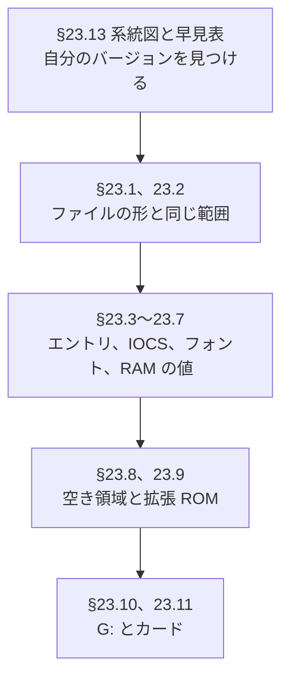
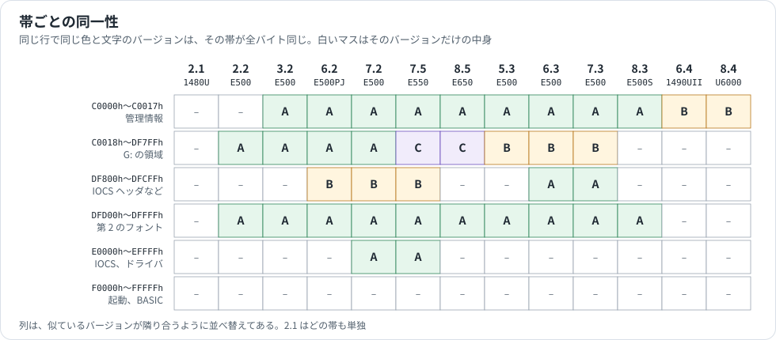
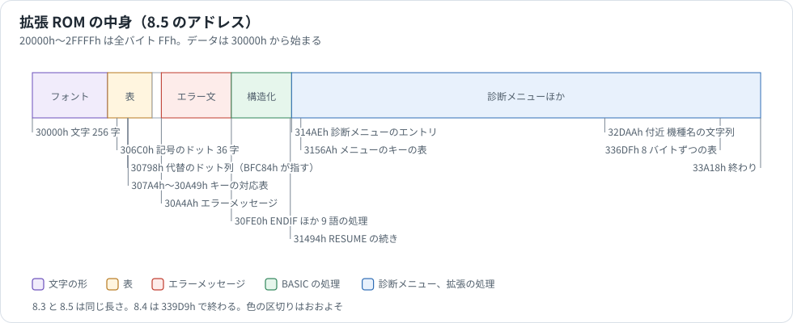
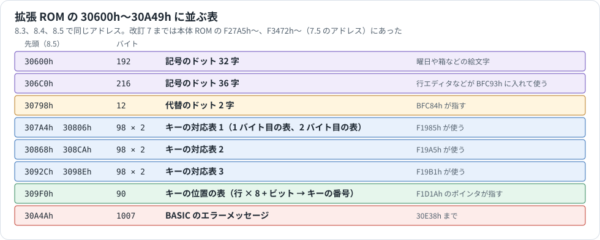
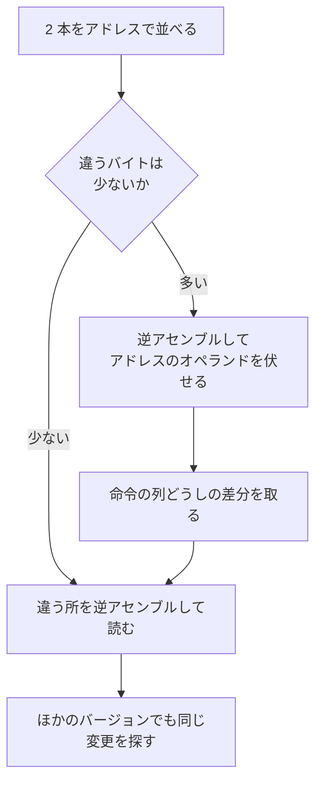
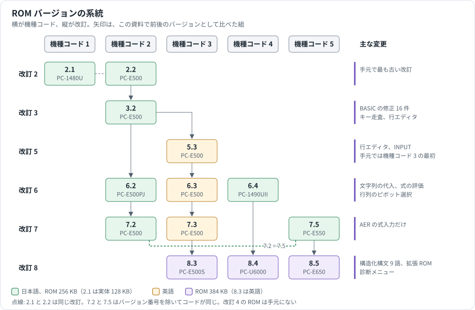

# 23. ROM バージョンの違い: 配置

この章は、13 本の ROM を横に並べて「どこが同じで、どこが違うか」を示す対照表です。手元の ROM イメージ 13 本（`Emulator/app/rom/`）について、配置と主なアドレスを 1 バイトずつ比べました。

1 台の機械だけで使うなら、違いを気にする必要はありません。けれども、雑誌の機械語プログラムを別の機種で動かしたいとき、人の ROM の解析を自分の機種に当てはめたいとき、どのバージョンでも動くプログラムを配りたいときには、この章の区別が要ります。

[目次へ戻る](README.md)

## この章で分かること

- 13 本の ROM の系統と、自分の機種がどこに位置するか
- どの範囲がどのバージョンと全バイト同じか
- 公開エントリ、ベクタ、IOCS、フォント、割り込みのアドレス（バージョンごと）
- どのバージョンでも動く機械語を書くときの規約
- 空いている領域と、拡張 ROM の中身
- バージョンどうしを比べる手順

## 23.0 はじめに

ROM バージョンが違うと、同じ処理でも置かれるアドレスが変わります。処理を 1 つ直して長さが 3 バイト変われば、その後ろにある処理はすべて 3 バイトずれるからです。一方、外から呼ばれるエントリは、バージョンが変わっても同じアドレスに残してあります。

このため、アドレスには「変わらないもの」と「変わるもの」があります。この章はその区別を付けるための資料です。

| 種類 | 例 | バージョンが変わると |
|---|---|---|
| 公開のエントリ | `FFFE4h`、`FFFE8h`、`FFFDCh`、`FFFD8h` | 変わらない |
| バージョン番号とベクタの置き場所 | `FFFF0h`、`FFFFAh`、`FFFFDh` | 変わらない |
| RAM のポインタの置き場所 | `BFC84h`〜、`BFCA2h`、`BFCC6h`〜 | 変わらない（中の値は変わる） |
| 処理や表のアドレス | `E493Ah`、`F21A5h` など | 変わる |

まず §23.13 の系統図で自分のバージョンを見つけ、次に必要な節の表でアドレスを引いてください。



特に断らない値は、ROM のファイルから読み取ったものです。（実験）、（推定）などの記号は、章の終わりの「確度の表し方」にあります。

## 23.1 イメージの形

| ROM | ファイルの大きさ | 中身 |
|---|---|---|
| 2.1（PC-1480U） | 256 KB | 実体 128 KB を 2 回並べたもの。前半と後半は全バイト同じ。`C0000h` 以降に置くと `E0000h`〜`FFFFFh` が実体 |
| 2.2、3.2、5.3、6.3、7.3、6.2、7.2（PC-E500、PC-E500PJ）、7.5（PC-E550）、6.4（PC-1490UII） | 256 KB | `C0000h`〜`FFFFFh` の本体 ROM |
| 8.3（PC-E500S）、8.4（PC-U6000）、8.5（PC-E650） | 384 KB | 先頭 128 KB が拡張 ROM（`20000h`〜`3FFFFh`）、続く 256 KB が本体 ROM（`C0000h`〜`FFFFFh`） |

384 KB のイメージは、ファイルの位置と CPU のアドレスが連続していません。ファイル位置 `20000h` がアドレス `C0000h` です。換算の式と例は [ROM マップ](21_ROM_MAP.md) §21.1 にあります。

## 23.2 帯ごとの同一性

ROM を内容の区切り（帯）に分けて、バージョンどうしを 1 バイトずつ比べました。帯の中身がまったく同じなら、その帯についての調べものは 1 つのバージョンで済みます。

同じ縦棒の区切りの中のバージョンは、その帯が全バイト同じです。2.1 はどの帯も単独です。

| 帯 | 内容 | 同じバージョンの組 |
|---|---|---|
| `C0000h`〜`C0017h` | ROM の先頭（スロットの管理情報） | 2.2 ｜ 3.2、5.3、6.3、7.3、6.2、7.2、7.5、8.3、8.5 ｜ 6.4、8.4 |
| `C0018h`〜`DF7FFh` | G: の領域 | 2.2、3.2、6.2、7.2 ｜ 5.3、6.3、7.3 ｜ 7.5、8.5 ｜ 6.4 ｜ 8.3 ｜ 8.4 |
| `DF800h`〜`DFCFFh` | IOCS ヘッダなど（先頭の 24 バイトは G: のブロックの終わり） | 6.3、7.3 ｜ 6.2、7.2、7.5 ｜ ほかは各バージョンで単独 |
| `DFD00h`〜`DFFFFh` | 第 2 のフォント | 2.2、3.2、5.3、6.3、7.3、6.2、7.2、7.5、8.3、8.5 ｜ 6.4 ｜ 8.4 |
| `E0000h`〜`EFFFFh` | IOCS、デバイスドライバ | 7.2、7.5 ｜ ほかは各バージョンで単独 |
| `F0000h`〜`FFFFFh` | 起動、表示、キー入力、BASIC | 全バージョンで単独 |

同じことを色で示したものが次の図です。



図からは、次のことが読み取れます。

- G: の領域は機種ごとに決まっていて、改訂が変わってもほとんど変わっていません。たとえば 2.2、3.2、6.2、7.2 は同じです。
- 第 2 のフォントは、形式 A の G: を持つ 10 本で同じです。
- `F0000h`〜`FFFFFh` は全バージョンで違います。バージョン番号がこの帯にあるので、少なくとも 1 バイトは違うことになります。
- 7.2 と 7.5 は `E0000h`〜`EFFFFh` まで同じです。

`C0000h` の先頭の 3 バイトは、2.2 が `02 02 40`、3.2、5.3、6.3、7.3、6.2、7.2、7.5、8.3、8.5 が `10 12 40`、6.4 と 8.4 が `10 12 3E` です。3.2 のリセットの処理は、このうち `10 12` をスロットの印として調べます（[起動、割り込み、タイマ、音](10_SYSTEM.md) §10.2）。

## 23.3 公開エントリとベクタ

公開エントリは、ROM の外のプログラムから呼ぶために用意されたアドレスです。呼ぶアドレスは全バージョンで同じです。ジャンプ先がバージョンで変わるので、機械語からは次のアドレスを呼び、ジャンプ先を直接呼ばないようにします。

| バージョン | `FFFD8h` 作業域の再構成 | `FFFDCh` BASIC 用 IOCS | `FFFE4h` FCS | `FFFE8h` IOCS | `FFFFAh` 割り込み | `FFFFDh` リセット |
|---|---|---|---|---|---|---|
| 2.1 | `F99BCh` | `EF378h` | `E092Fh` | `F33B8h` | `F1F56h` | `F1031h` |
| 2.2 | `F9D1Eh` | `EF383h` | `E06BFh` | `E0000h` | `F1FF8h` | `F10BDh` |
| 3.2 | `F9D31h` | `EF2EEh` | `E06BFh` | `E0000h` | `F2005h` | `F10BDh` |
| 5.3 | `F9CC0h` | `EF2D9h` | `E06BFh` | `E0000h` | `F1FB5h` | `F10C2h` |
| 6.3、7.3 | `F9CC0h` | `EF2DFh` | `E06BFh` | `E0000h` | `F1FB5h` | `F10C2h` |
| 6.2、7.2、7.5 | `F9D31h` | `EF2F4h` | `E06BFh` | `E0000h` | `F2005h` | `F10BDh` |
| 6.4 | `F9B94h` | `EF317h` | `E06BFh` | `E0000h` | `F2035h` | `F10BDh` |
| 8.3 | `F964Fh` | `EF01Ah` | `E06BFh` | `E0000h` | `F2043h` | `F10C3h` |
| 8.4 | `F951Ch` | `EF03Eh` | `E06BFh` | `E0000h` | `F20C3h` | `F10BEh` |
| 8.5 | `F96C8h` | `EF02Fh` | `E06BFh` | `E0000h` | `F209Bh` | `F10BEh` |

エントリはどれも `JPF`（`03h`）です。2.1 の `FFFE8h` だけが `JP`（`02h`）で同じセグメントの `F33B8h` へ飛びます。

4 つのエントリが何を受け取り、何をするかは [ROM マップ](21_ROM_MAP.md) §21.3 にあります。表を縦に見ると、エントリごとの変わり方が分かります。

| エントリ | 変わり方 |
|---|---|
| `FFFE4h` FCS | 2.1 だけ違い、ほかは全バージョンで `E06BFh` |
| `FFFE8h` IOCS | 2.1 だけ違い、ほかは全バージョンで `E0000h` |
| `FFFD8h`、`FFFDCh` | バージョンの組ごとに違う |
| 割り込み、リセット | バージョンの組ごとに違う。リセットは `F1031h`〜`F10C3h` の間 |

### 23.3.1 末尾のバイト

`FFFF0h`、`FFFF1h` はバージョン番号です。公開エントリの間とバージョン番号の後ろの埋め方はバージョンで違います。

| バージョン | 使わないバイト | `FFFECh`〜`FFFEFh` | `FFFF2h`〜 |
|---|---|---|---|
| 2.1、2.2、3.2、8.3、8.4、8.5 | `FFh` | `FF FF FF FF` | `FF`… |
| 5.3 | `00 00 FF FF` | `00 00 F8 58` | `00 00 FF FF 00 00 FF FF` |
| 6.3、7.3 | `00 00 FF FF` | `00 00 F8 7E` | `00 00 FF FF 00 00 FF FF` |
| 6.4 | `00 00 FF FF` | `00 00 FA 7E` | `00 00 FF FF 00 00 FF FF` |
| 6.2、7.5 | `9Fh` | `9F 9F 9F 9F` | `9F`… |
| 7.2 | `9Fh` | `9F 9F 9F 9F` | `77 9F 9F`… |

5.3、6.3、7.3、6.4 の `FFFEEh`、`FFFEFh` と、7.2 の `FFFF2h` の `77h` の意味は分かっていません。

## 23.4 IOCS

IOCS は、画面、キー、プリンタなどのデバイスを同じ呼び方で使うための仕組みです（[IOCS と FCS](11_IOCS.md)）。デバイスごとにヘッダがあり、ヘッダどうしが「次はここ」というアドレスでつながっています。

### 23.4.1 ヘッダの場所

ヘッダの先頭は `BFCA2h` に入ります（実験）。全バージョンとも 10 個のデバイスが同じ順で連結しています。

| バージョン | 先頭 | 最後のヘッダ |
|---|---|---|
| 2.1 | `E02A6h` | `E032Fh` |
| 2.2、3.2、5.3、6.3、7.3、6.2、7.2、7.5、8.3、8.5 | `DF820h` | `DF8A9h` |
| 6.4、8.4 | `DF500h` | `DF589h` |

名前と属性も全バージョンで同じです。例外は 2.1 で、`COM:` の属性が `C3h`（ほかは `D3h`）、`CAS:` の属性が `C7h`（ほかは `D7h`）です。

> [!TIP]
> ヘッダの場所は 3 通りしかありませんが、プログラムでは `BFCA2h` から読んだ値を使ってください。アドレスを書き込む必要がなくなります。

### 23.4.2 デバイスのエントリ

ヘッダの `entry` の値です。列の見出しの数字はデバイス番号で、連結の順に並べてあります。

| バージョン | 0 SCRN | 1 KYBD | 2 COM | 3 PRN | 4 CAS | 6 S1:〜 | 5 E:〜 | 9 | 7 X:Y: | 8 SYSTM |
|---|---|---|---|---|---|---|---|---|---|---|
| 2.1 | `F289A` | `F161F` | `EB614` | `EB041` | `EA2AE` | `F0000` | `E4A83` | `EF387` | `EC1DF` | `E033E` |
| 2.2 | `F293C` | `F165F` | `EAE67` | `EA894` | `E9ABF` | `F0000` | `E493A` | `EF392` | `EBA62` | `E0183` |
| 3.2 | `F2949` | `F165F` | `EAD6A` | `EA797` | `E99C2` | `F0000` | `E493A` | `EF2FD` | `EB965` | `E0183` |
| 5.3 | `F28F9` | `F1664` | `EAD55` | `EA7A1` | `E99CC` | `F0000` | `E493E` | `EF2E8` | `EB950` | `E0183` |
| 6.3、7.3 | `F28F9` | `F1664` | `EAD5B` | `EA7A7` | `E99D2` | `F0000` | `E493E` | `EF2EE` | `EB956` | `E0183` |
| 6.2、7.2、7.5 | `F2949` | `F165F` | `EAD70` | `EA79D` | `E99C8` | `F0000` | `E493A` | `EF303` | `EB96B` | `E0183` |
| 6.4 | `F2979` | `F1683` | `EB4A5` | `EAEFA` | `EA125` | `F0000` | `E4910` | `EF340` | `EC0A0` | `E0183` |
| 8.3 | `F21E7` | `F16F2` | `EAA71` | `EA4BD` | `E96E8` | `F0000` | `E493E` | `EF029` | `EB66C` | `E0183` |
| 8.4 | `F2267` | `F1711` | `EB1A7` | `EABD4` | `E9DFF` | `F0000` | `E4910` | `EF067` | `EBDA2` | `E0183` |
| 8.5 | `F223F` | `F16F5` | `EAA86` | `EA4B3` | `E96DE` | `F0000` | `E493A` | `EF03E` | `EB681` | `E0183` |

`S1:` などのカードのエントリは全バージョンで `F0000h`、`SYSTM:` は 2.1 のほかは `E0183h` です。ほかのデバイスはバージョンごとに動いています。

## 23.5 フォント

文字の形（フォント）は、RAM のポインタを通して引かれます。BASIC を起動した後の `BFC84h`〜`BFC95h` のポインタです（実験）。文字コードとの対応は [メモリ](03_MEMORY.md) §3.8 にあります。

| バージョン | `BFC84h` | `BFC87h` 00h〜 | `BFC8Ah` 80h〜 | `BFC8Dh` E0h〜 | `BFC90h` 20h〜 | `BFC93h` A0h〜 |
|---|---|---|---|---|---|---|
| 2.1 | `F288E` | `F20F6` | `F23F6` | `F2636` | `F21B6` | `F24B6` |
| 2.2 | `F2930` | `F2198` | `F2498` | `F26D8` | `F2258` | `F2558` |
| 3.2、6.2、7.2、7.5 | `F293D` | `F21A5` | `F24A5` | `F26E5` | `F2265` | `F2565` |
| 5.3、6.3、7.3 | `F28ED` | `F2155` | `F2455` | `F2695` | `F2215` | `F2515` |
| 6.4 | `F296D` | `F21D5` | `F24D5` | `F2715` | `F2295` | `F2595` |
| 8.3、8.4、8.5 | `30798` | `30000` | `30300` | `30540` | `300C0` | `303C0` |

**8.x だけ、フォントが拡張 ROM にあります。**

第 2 のフォント（`DFD00h`〜`DFFFFh`）は、形式 A の G: を持つバージョンの帯にあります（§23.2）。6.4 と 8.4 の同じ帯は別の内容です。欧州版がこのアドレスを文字セットの切替えに使います（[メモリ](03_MEMORY.md) §3.8）。

フォントの違いの内容は [ROM バージョンの違い: システム](26_ROM_VERSIONS_SYSTEM.md) §26.3.1 にあります。

## 23.6 RAM に置かれる値

起動の処理は、割り込みのジャンプ先や作業域の場所を RAM に書きます。機械語から割り込みを横取りするときは、RAM のこの値を書き換えることになります。

### 23.6.1 割り込みのベクタ

起動後の `BFCC6h` からの値です（実験）。要因との対応は [起動、割り込み、タイマ、音](10_SYSTEM.md) §10.3.1 にあります。

| バージョン | `BFCC6` 速いタイマ | `BFCC9` 遅いタイマ | `BFCCC` キー | `BFCCF` ON | `BFCD2` 送信 | `BFCD5` 受信 | `BFCD8` 外部 | `BFCDB` ソフト |
|---|---|---|---|---|---|---|---|---|
| 2.1 | `F2015` | `F20AD` | `F2002` | `F200B` | `F2014` | `E078F` | `F2030` | `F2014` |
| 2.2 | `F20B7` | `F214F` | `F20A4` | `F20AD` | `F20B6` | `F614A` | `F20D2` | `F20B6` |
| 3.2、6.2、7.2、7.5 | `F20C4` | `F215C` | `F20B1` | `F20BA` | `F20C3` | `F614C` | `F20DF` | `F20C3` |
| 5.3、6.3、7.3 | `F2074` | `F210C` | `F2061` | `F206A` | `F2073` | `F60FC` | `F208F` | `F2073` |
| 6.4 | `F20F4` | `F218C` | `F20E1` | `F20EA` | `F20F3` | `F617C` | `F210F` | `F20F3` |
| 8.3 | `F2102` | `F219E` | `F20EF` | `F20F8` | `F2101` | `F59D7` | `F211D` | `F2101` |
| 8.4 | `F2182` | `F221E` | `F216F` | `F2178` | `F2181` | `F5A52` | `F219D` | `F2181` |
| 8.5 | `F215A` | `F21F6` | `F2147` | `F2150` | `F2159` | `F5A2F` | `F2175` | `F2159` |

2.1 の受信の処理だけが `E` セグメントにあります。

### 23.6.2 作業域のポインタ

起動直後の値です（実験）。主なものだけを読みました。

| ポインタ | 2.1 | ほかのバージョン |
|---|---|---|
| `BFCDEh` U スタック | `BF21Bh` | `BF21Bh` |
| `BFCE1h` S スタック | `BF6A6h` | `BF6A0h` |
| `BFD0Eh` BASIC 作業域 | `BF85Eh` | `BF858h` |
| `BFD17h` IOCS 作業域 | `BF9BAh` | `BF9B4h` |
| `BFD1Ah` 機械語エリア | `BFC00h` | `BFC00h` |

2.1 だけ 6 バイト上にずれています。機械語エリアの確保の手順は 2.1 でも同じ結果でした（[機械語を実機で動かす](12_MACHINE_CODE.md) §12.3）。

## 23.7 BASIC の表

処理表と辞書のアドレスは [ROM バージョンの違い: BASIC](24_ROM_VERSIONS_BASIC.md) §24.1 にあります。8.3、8.4、8.5 だけキーワードが 168 語で、ほかは 159 語です。

## 23.8 使っていない領域

本体 ROM の中で、同じ値が 256 バイト以上続く範囲です。長く同じ値が続く所は、使われていない隙間と考えられます。

| バージョン | 範囲と値 |
|---|---|
| 2.1 | なし |
| 2.2、3.2、5.3、6.3、7.3、6.2、7.2、7.5 | `C1364h`〜`C1497h`（`00h`。G: のルートの未使用部分） |
| 6.4 | `C05F6h`〜`C0B17h`（`00h`）、`DADFFh`〜`DB7FFh`（`9Fh`）、`DF1DAh`〜`DF4FFh`（`9Fh`） |
| 8.3 | `C1364h`〜`C1497h`（`00h`）、`EFCD2h`〜`EFFFFh`（`FFh`）、`FFBE7h`〜`FFFD7h`（`FFh`） |
| 8.4 | 6.4 と同じ 3 か所、`EFCAEh`〜`EFEFFh`（`FFh`）、`FFB4Dh`〜`FFEFFh`（`FFh`） |
| 8.5 | `C1364h`〜`C1497h`（`00h`）、`EFCE7h`〜`EFFFFh`（`FFh`）、`FFC4Dh`〜`FFFD7h`（`FFh`） |

8.x は本体 ROM の `E` と `F` のセグメントの末尾に空きがあります。フォントを拡張 ROM へ移した分と見られます（推定）。

**例: 大きさを計算する**

| バージョン | 範囲 | 計算 | バイト |
|---|---|---|---|
| 2.2 など | `C1364h`〜`C1497h` | `C1498h` − `C1364h` = 134h | 308 |
| 8.5 | `EFCE7h`〜`EFFFFh` | `F0000h` − `EFCE7h` = 319h | 793 |
| 8.5 | `FFC4Dh`〜`FFFD7h` | `FFFD8h` − `FFC4Dh` = 38Bh | 907 |

## 23.9 拡張 ROM（8.3、8.4、8.5）

改訂 8 の 3 本だけが持つ 128 KB の追加の ROM です。CPU からは `20000h`〜`3FFFFh` に見えます。



### 23.9.1 配置

| 範囲 | 内容 | バージョンによる違い |
|---|---|---|
| `20000h`〜`2FFFFh` | 全バイト `FFh` | 3 本とも同じ |
| `30000h`〜`305FFh` | 6×8 ドットのフォント 256 文字 | 8.4 と 8.5 は同じ。8.3 は 5.3、6.3、7.3 と同じ欧文の字形 |
| `30600h`〜`30797h` | 6×8 ドットの記号 68 字。前半の 32 字は曜日や絵記号、`306C0h` からの 36 字は行エディタなどの記号 | 3 本とも同じ |
| `30798h`〜`307A3h` | `BFC84h` が指す代替のドット列 2 字 | 3 本とも同じ |
| `307A4h`〜`309EFh` | キーの対応表。98 バイトの表が 6 つ | 8.3 だけ 3 バイト違う（§23.9.3） |
| `309F0h`〜`30A49h` | キーの位置の表 90 バイト | 3 本とも同じ |
| `30A4Ah`〜`30E38h` | BASIC のエラーメッセージ 1,007 バイト | 3 本とも同じ |
| `30E39h`〜 | 拡張の処理とその文字列 | §23.9.2、§23.9.3 |
| 終わり | 8.4 は `339D9h`、8.3 と 8.5 は `33A18h` まで | |



キーの対応表は、2 つで 1 組です。キーの番号（0〜61h）で 1 つ目の表を引き、0 でなければそれが文字です。0 なら 2 つ目の表を引き、その値が「文字でないキー」の番号になります（コード、8.5 の `F1985h`〜`F19BCh`）。組 1 はそのまま、組 2 は CTRL、組 3 は SHIFT と一緒に押したときの表です（下の例の `Q` が、組 2 では制御コード 11h、組 3 では `!` になることから分かります）。

| 組 | 1 つ目（文字） | 2 つ目（文字でないキー） |
|---|---|---|
| 1 | `307A4h`〜`30805h` | `30806h`〜`30867h` |
| 2 | `30868h`〜`308C9h` | `308CAh`〜`3092Bh` |
| 3 | `3092Ch`〜`3098Dh` | `3098Eh`〜`309EFh` |

**例:** キーの番号 41h（`Q`）では、組 1 の値が 51h（文字 `Q`）、組 2 が 11h、組 3 が 21h（`!`）です。番号 07h は、組 1 の 1 つ目が 0 なので、2 つ目の 07h が使われます。

キーの位置の表は、行列の「行 × 8 + ビット」からキーの番号を引く表です。先頭の `0E 41 06 31 05 4A 01 02` は、行 0 の 8 つのキー（TEXT、Q、MENU、A、BASIC、Z、SHIFT、CTRL）に当たります（行列は [ハードウェアの全体](01_HARDWARE.md) §1.2）。

データの後ろは、8.4 と 8.5 では `3FFFFh` まで `FFh` です。8.3 は `33A19h`〜`33A20h` に直前の 8 バイト（`33A11h`〜`33A18h`）と同じ並びがあり、その後ろ `3FFFFh` までは `FFh` ではありません。偶数アドレスはほぼ `00h`、奇数アドレスはおもに `FFh` で、ほかの値も混じります。

### 23.9.2 8.4 と 8.5 の差

データがある範囲（8.4 で 14,810 バイト）のうち、14,226 バイトは位置をずらせば一致します。残りは次のとおりです。

| 違い | 内容 |
|---|---|
| 1〜2 バイトの置き換え（496 か所） | 本体 ROM のアドレスがバージョンで違うためと見られる（`CALLF` のジャンプ先など。推定） |
| 機種名の文字列 | `PC-U6000  Ver.XX` と `PC-E650   Ver.XX` |
| 長さの変わる違い（4 か所） | 8.4 の `31D72h` 付近、`32D8Ch`、`331ECh` 付近、`339DAh`（末尾）に当たる位置で、8.5 のバイトが増えている |

5 文字以上の文字列は、この機種名の 1 本を除いて同じです（共通 163 本）。

`KEY Menu`、`Ful key check` などの文字列は診断メニューのものです（[ROM バージョンの違い: システム](26_ROM_VERSIONS_SYSTEM.md) §26.2.4）。

### 23.9.3 8.3 と 8.5 の差

8.3 のデータのある範囲（`30000h`〜`33A18h`、14,873 バイト）は、8.5 と同じ長さです。`30600h` 以降は位置のずれがなく、§23.9.2 の長さの変わる 4 か所も 8.5 と同じ形です。違うのは次のとおりです。

| 違い | 内容 |
|---|---|
| フォント（`30000h`〜`305FFh`） | 129 文字（5Ch、7Fh〜FEh）の字形。8.3 のフォントは 5.3、6.3、7.3 のフォント（`F2155h`）と全バイト同じ |
| キー対応表（`3080Dh`、`308D1h`、`30995h`） | 3 組の「文字でないキー」の表（`30806h`、`308CAh`、`3098Eh` から）の、番号 07h（KANA キー）の 1 バイトずつ。8.5 の `07h`、`47h`、`27h` が、8.3 では `90h`、`D0h`、`B0h`。5.3、6.3、7.3 の同じ表（`F348Bh`、`F354Fh`、`F3613h`）も 8.3 と同じ値。`90h` などは番号 60h のキーと同じ値で、英語版ではこの位置のキーが ANS になる（[機種](27_ROM_VERSIONS_MODELS.md) §27.2.3） |
| 機種名の文字列（`32DAAh`〜） | `PC-E500S  Ver.XX` と `PC-E650   Ver.XX` |
| 診断メニューの処理（`314C2h`） | `MVP (BP+01h),…` の値が、8.3 は `0B8000h`、8.4 と 8.5 は `0B0000h` |
| `336DFh` から 8 バイトずつの表 | 9 バイト。診断メニューの処理（`315D8h`）がこの表のアドレスを使う |
| 1〜2 バイトの置き換え（62 か所） | `CALLF`、`JPF` のジャンプ先。本体 ROM のアドレスがバージョンで違うため |

8.3 と 8.4 の差は、§23.9.2 の 8.4 と 8.5 の差に、この表の違いを加えたものです。8.3 でも診断メニューの `ROM check` は `ROM OK!` を出します（実験、[ROM バージョンの違い: システム](26_ROM_VERSIONS_SYSTEM.md) §26.2.4）。

3 本の関係をまとめると、次のようになります。

| 比べる組 | 長さ | おもな違い |
|---|---|---|
| 8.3 と 8.5 | 同じ（14,873 バイト） | フォント、キー対応表の 3 バイト、機種名 |
| 8.4 と 8.5 | 8.4 が短い（14,810 バイト） | 機種名、アドレスを含むバイト、長さの変わる 4 か所 |
| 8.3 と 8.4 | 8.4 が短い | 上の 2 つを合わせたもの |

## 23.10 G: ドライブ

形式と構造の違いは [ROM バージョンの違い: 機種](27_ROM_VERSIONS_MODELS.md) §27.3 にあります。アドレスの要点は次のとおりです。

| 項目 | 形式 A（2.2、3.2、5.3、6.3、7.3、6.2、7.2、7.5、8.3、8.5） | 形式 B（6.4、8.4） | なし（2.1） |
|---|---|---|---|
| ブロックの先頭 | `C0018h` | `C0018h` | |
| FAT | `C0058h` | `C0118h` | |
| ルート | `C0BD8h` | `C0318h` | |
| データ | `C1498h` | `C0B18h` | |
| 使っている最後のアドレス | `DF5D7h` | `CD517h` | |
| G: のブロックの終わり | `DF817h` | `CE817h` | |
| 続く領域 | `DF818h` に並びの終わりの `FFh`、`DF820h` から IOCS ヘッダ | `CE818h` から `GRAPH.BAS` のブロック、`DADF4h` に `FFh`、`DB800h`〜`DF1D9h` に GRAPH の機械語と表、`DF500h` から IOCS ヘッダ | |

2.1 は `C0000h`〜`DFFFFh` に `E0000h`〜`FFFFFh` のコピーが見えるイメージです（§23.1）。

## 23.11 カードの処理

カードスロットの処理は、動きはどのバージョンも同じです（[カードスロット](05_CARD_SLOT.md) §5.12）。違うのはアドレスと次の点です。表示は 5.3、6.3、7.3、8.3 が英語、ほかは日本語です。

| バージョン | 書き込みテスト | 容量の測定 | ヘッダを書く | `RESET.KEY` を探す | `S3:` の場所 |
|---|---|---|---|---|---|
| 2.1 | `F0B85h` | `F0E4Fh` | `F0D8Eh` | `F0FE6h` | `10000h` |
| 2.2、3.2、6.2、6.4、7.2、7.5 | `F0C11h` | `F0EDBh` | `F0E1Ah` | `F1072h` | `C0000h` |
| 5.3、6.3、7.3 | `F0C11h` | `F0EE0h` | `F0E1Fh` | `F1077h` | `C0000h` |
| 8.3 | `F0C11h` | `F0EE0h` | `F0E1Fh` | `F1078h` | `C0000h` |
| 8.4、8.5 | `F0C11h` | `F0EDBh` | `F0E1Ah` | `F1073h` | `C0000h` |

2.1 には ROM の G: がなく（§23.10）、`S3:` は `10000h` を調べます。

## 23.12 調べ方

### 2 つのバージョンを自分で比べる

比べ方はパソコンのファイルの比較と同じで、まず「大きさをそろえ、アドレスで並べ、同じアドレスのバイトを見比べる」だけです。次の Python は、2 本のイメージを 1 MB の表に置き、違うバイトの範囲を表示します。

```python
def load(path):
    d = open(path, "rb").read()
    m = bytearray(0x100000)
    if len(d) == 0x60000:                    # 384 KB
        m[0x20000:0x40000] = d[:0x20000]
        m[0xC0000:] = d[0x20000:]
    else:                                    # 256 KB
        m[0xC0000:] = d
    return m

a, b = load("PC-E500(7.2).ROM"), load("PC-E550(7.5).ROM")
diff = [i for i in range(0xC0000, 0x100000) if a[i] != b[i]]
print(len(diff), [hex(i) for i in diff[:5]], hex(diff[-1]))
```

7.2 と 7.5 では G: の `ﾃﾞﾓ.50#` の置き場所などが違うので、`C0018h`〜`DF7FFh` を除いて比べると、違いは `FFFF1h`、`FFFF2h` の 2 バイトだけになります。6.2 と 7.2 では 85 バイト、6.3 と 7.3 では 89 バイトです。

1 か所でも処理の長さが変わると、その後ろは全部ずれるので、この比べ方ではほとんどのバイトが違って見えます。その場合は、アドレスを含むバイトを伏せた命令の列どうしを比べます（[24 章](24_ROM_VERSIONS_BASIC.md) §24.7）。



### この章の値の確かめ方


- ROM のファイルを Python で読み、§23.1〜§23.4、§23.8〜§23.10 の値を取り出しました。
- IOCS ヘッダは、文字列 `STDO:SCRN:` の 8 バイト前を先頭として連結をたどりました。
- §23.2〜§23.4、§23.8、§23.11 の表の値は、スクリプトで 13 本の ROM と照合しました。§23.11 の 5 つの処理は、どのバージョンでも先頭の 8 バイトが同じです。
- §23.5、§23.6 は、エミュレータで全 ROM を起動してメインメニューから BASIC に入り、RAM を読みました。
- §23.9.2、§23.9.3 は、データのある範囲を差分のアルゴリズムで並べて比べました。
- §23.11 は、5.3 の処理と同じバイト列の位置を各バージョンで確かめ、動きはエミュレータで試しました。
- コードの比較の方法は [ROM バージョンの違い: BASIC](24_ROM_VERSIONS_BASIC.md) §24.7 にあります。

## 23.13 版の系統と早見表

23 章から 27 章に共通する、バージョンと機種の関係です。根拠と詳しい説明は [ROM バージョンの違い: BASIC](24_ROM_VERSIONS_BASIC.md) §24.1 にあります。



矢印は「比べた組」で、縦に下りるほど新しい改訂です。横の列を移る矢印（3.2 → 5.3）には、改訂の差と機種の差が混ざっています。

### 自分のバージョンを見つける

| バージョン | 機種 | ROM | 言語 | キーワード | G: | 比べた相手 |
|---|---|---|---|---|---|---|
| 2.1 | PC-1480U | 実体 128 KB | 日本語 | 159 | なし | 2.2 |
| 2.2 | PC-E500 | 256 KB | 日本語 | 159 | 形式 A | 3.2 |
| 3.2 | PC-E500 | 256 KB | 日本語 | 159 | 形式 A | 2.2、5.3、6.2 |
| 5.3 | PC-E500 | 256 KB | 英語 | 159 | 形式 A | 3.2、6.3 |
| 6.2 | PC-E500PJ | 256 KB | 日本語 | 159 | 形式 A | 3.2、7.2 |
| 6.3 | PC-E500 | 256 KB | 英語 | 159 | 形式 A | 5.3、7.3 |
| 6.4 | PC-1490UII | 256 KB | 日本語 | 159 | 形式 B | 8.4 |
| 7.2 | PC-E500 | 256 KB | 日本語 | 159 | 形式 A | 6.2、7.5 |
| 7.3 | PC-E500 | 256 KB | 英語 | 159 | 形式 A | 6.3、8.3 |
| 7.5 | PC-E550 | 256 KB | 日本語 | 159 | 形式 A | 7.2、8.5 |
| 8.3 | PC-E500S | 384 KB | 英語 | 168 | 形式 A | 7.3、8.5 |
| 8.4 | PC-U6000 | 384 KB | 日本語 | 168 | 形式 B | 6.4、8.5 |
| 8.5 | PC-E650 | 384 KB | 日本語 | 168 | 形式 A | 7.5、8.4 |

### 改訂ごとに変わったこと

| 改訂 | BASIC（24 章） | ドライバなど（25 章） | システム（26 章） |
|---|---|---|---|
| 2 → 3 | 16 件の変更。改訂の中でいちばん多い | 変更なし | キー走査、行エディタ |
| 3 → 5 | 行エディタ、INPUT | 変更なし | 行エディタ |
| 5 → 6 | 文字列の代入、式の評価、AND・OR・XOR | 行列演算のピボット選択 | 変更なし |
| 6 → 7 | 変更なし（AER の式入力だけ） | 変更なし | 変更なし |
| 7 → 8 | 構造化構文 9 語、RETURN、RESUME、AHS、REC・POL | エラーメッセージ | 拡張 ROM への移動、診断メニュー、行エディタ |

### どのバージョンでも動く機械語を書く

| すること | しないこと |
|---|---|
| `FFFE8h` などの公開エントリを呼ぶ（§23.3） | ジャンプ先の `E0000h` や `F209Bh` を直接呼ぶ |
| ヘッダの先頭は `BFCA2h` から読む（§23.4） | `DF820h` と決めて書く（6.4、8.4、2.1 で違う） |
| フォントは `BFC87h` などのポインタから引く（§23.5） | `F21A5h` や `30000h` と決めて書く |
| バージョンで動きを変えるなら `FFFF0h`、`FFFF1h` を見る | 中身のバイトの並びだけでバージョンを決める |

## まとめ

- 公開エントリとベクタのアドレスは全バージョンで同じ、ジャンプ先はバージョンで違います。
- 帯ごとに比べると、G: は機種で決まり、`F` セグメントは全バージョンで違います。
- 2.1 は配置も IOCS の場所もほかと違います。6.4 と 8.4 は、ヘッダの先頭が `DF500h` です。
- 8.x はフォントが拡張 ROM（`30000h`）にあり、本体 ROM の `E` と `F` の末尾に空きがあります。
- 系統と改訂ごとの変更は §23.13 にあります。

## 確度の表し方

| 表記 | 意味 |
|---|---|
| **データ** | ROM のファイルから読み取った |
| **実験** | エミュレータで全 ROM を起動し、RAM の値を読んだ。内蔵 RAM は 64 KB |
| **コード** | 逆アセンブルを読んだ |

特に断らない値はデータです。

## 次に読むもの

| 関連する内容 | 資料 |
|---|---|
| バージョン番号の読み方、BASIC の違い | [ROM バージョンの違い: BASIC](24_ROM_VERSIONS_BASIC.md) |
| IOCS、表示、キー入力のコードの違い | [ROM バージョンの違い: システム](26_ROM_VERSIONS_SYSTEM.md) |
| 行列演算、周辺機器のドライバの違い | [ROM バージョンの違い: 行列演算とドライバ](25_ROM_VERSIONS_DRIVERS.md) |
| 言語、カナ、G: ドライブの違い | [ROM バージョンの違い: 機種](27_ROM_VERSIONS_MODELS.md) §27.3 |
| 領域の並びとバージョンごとの主なアドレス | [ROM マップ](21_ROM_MAP.md) |
