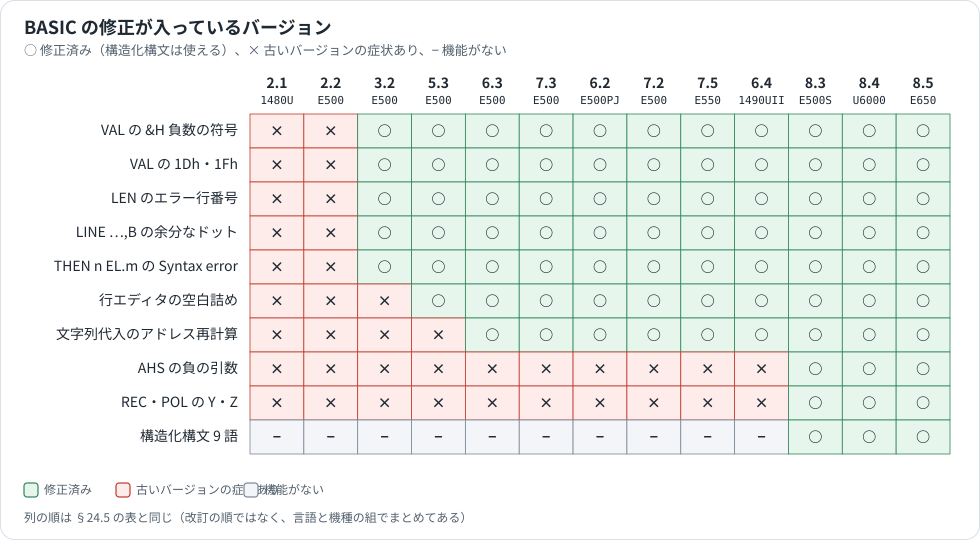
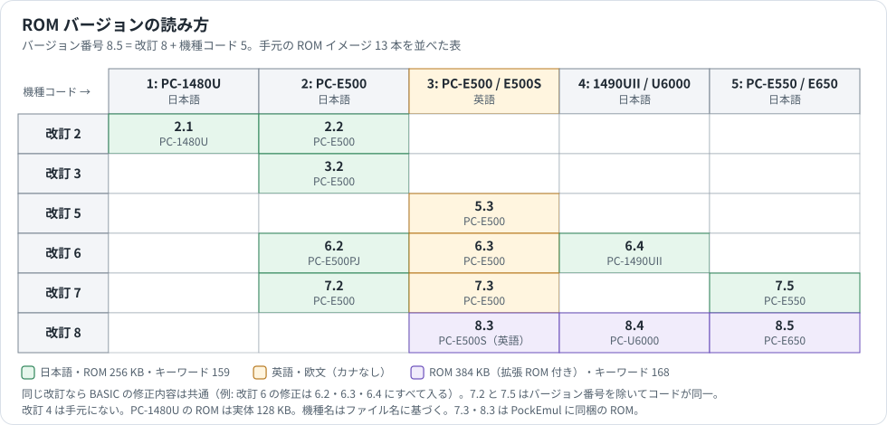
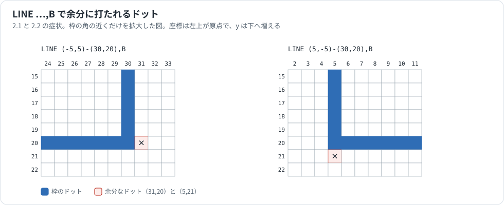
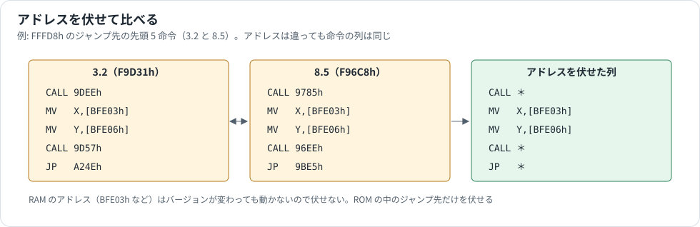

# 24. ROM バージョンの違い: BASIC

この章は、「同じ BASIC のプログラムなのに、友人の機械と結果が違う」理由を集めたものです。どのバージョンにどんな誤りがあり、いつ直ったかを、再現できる短い例と一緒に説明します。古いバージョンを使っている人は避け方を、新しいバージョンを使っている人は増えた機能を確かめるのに使えます。

手元の ROM イメージ 13 本（`Emulator/app/rom/`）を比較し、BASIC（インタプリタ、トークン化、BASIC 命令・関数）に関わる違いだけをまとめました。IOCS、表示・キー入力、AER モード、ファイルデバイスドライバの違いは扱いません（§24.6 に除外した範囲を記します）。アドレスはとくに断らない限り CPU アドレスです。

[目次へ戻る](README.md)

## この章で分かること

- バージョン番号の 2 つの数字が何を表すかと、その根拠
- 同じプログラムが、バージョンによって違う結果になる例
- 改訂 3、5、6、7、8 で BASIC の何が直り、何が加わったか
- 自分の機械のバージョンで、どの修正が入っているか（早見表）
- 違いを自分で確かめる短いプログラム

## 24.0 はじめに

BASIC のプログラムは、バージョンが違ってもほとんど同じように動きます。キーワードの番号は全バージョンで共通で、境界値を 80 項目試しても結果は同じでした（§24.3.6）。それでも、古いバージョンには特定の条件でだけ現れる誤りがあり、後の改訂で直されています。

この章では、変更を 1 件ずつ次の順で説明します。

1. **何が起きていたか**: 古いバージョンの症状
2. **何が変わったか**: ROM の処理の変更とアドレス
3. **確かめ方**: 再現するプログラム、または根拠

「実験」は動かして確かめたもの、「コード」は逆アセンブルで変更を確認したもの、「推定」は目的を推し量ったものです（章の終わりの「確度の表し方」）。

改訂ごとの変更の流れは、次のとおりです。

BASIC の変更の流れ（手元の ROM から分かるもの）です。

| 改訂 | バージョン | BASIC の変更 |
|---|---|---|
| 2 | 2.1、2.2 | 手元で最も古い |
| 3 | 3.2 | `VAL`、`LEN`、`LINE`、省略形 `EL.` など 16 件 |
| 5 | 5.3 | 行エディタ、`INPUT` の 2 件 |
| 6 | 6.2、6.3、6.4 | 文字列の代入など 4 件 |
| 7 | 7.2、7.3、7.5 | 変更なし |
| 8 | 8.3、8.4、8.5 | 構造化構文 9 語など 7 件 |

急ぐときは、§24.5 の早見表と次の図で自分のバージョンの列を見てください。



## 24.1 対象 ROM とバージョン番号

バージョン番号は本体 ROM の `FFFF0h`（上位）と `FFFF1h`（下位）にあります。例: PC-E650 は `08 05` で 8.5 です。

| ファイル | バージョン | 容量 | キーワード | 処理表 | 辞書 | リセット | 備考 |
|---|---|---|---|---|---|---|---|
| PC-1480U(2.1) | 2.1 | 256 KB | 159 | `F55D0h` | `F58DBh` | `F1031h` | 実体 128 KB を 2 回並べたイメージ。E0000h–FFFFFh のみ |
| PC-E500(2.2) | 2.2 | 256 KB | 159 | `F57CFh` | `F5ADAh` | `F10BDh` | |
| PC-E500(3.2) | 3.2 | 256 KB | 159 | `F57D1h` | `F5ADCh` | `F10BDh` | |
| PC-E500(5.3) | 5.3 | 256 KB | 159 | `F5781h` | `F5A8Ch` | `F10C2h` | |
| PC-E500PJ(6.2) | 6.2 | 256 KB | 159 | `F57D1h` | `F5ADCh` | `F10BDh` | 未使用域が `9Fh` 埋め |
| PC-E500(6.3) | 6.3 | 256 KB | 159 | `F5781h` | `F5A8Ch` | `F10C2h` | |
| PC-1490UII(6.4) | 6.4 | 256 KB | 159 | `F5801h` | `F5B0Ch` | `F10BDh` | |
| PC-E500(7.2) | 7.2 | 256 KB | 159 | `F57D1h` | `F5ADCh` | `F10BDh` | 未使用域が `9Fh` 埋め |
| PC-E500(7.3) | 7.3 | 256 KB | 159 | `F5781h` | `F5A8Ch` | `F10C2h` | PockEmul に同梱の ROM から取り出した。6.3 との違いは AER モードの修正（§24.3.4）とバージョン番号だけ |
| PC-E550(7.5) | 7.5 | 256 KB | 159 | `F57D1h` | `F5ADCh` | `F10BDh` | 未使用域が `9Fh` 埋め。コードは 7.2 と同一 |
| PC-E500S(8.3) | 8.3 | 384 KB | 168 | `F4FD1h` | `F52DCh` | `F10C3h` | 拡張 ROM（20000h–3FFFFh）付き。PockEmul に同梱の ROM から取り出した |
| PC-U6000(8.4) | 8.4 | 384 KB | 168 | `F504Ch` | `F5357h` | `F10BEh` | 拡張 ROM（20000h–3FFFFh）付き |
| PC-E650(8.5) | 8.5 | 384 KB | 168 | `F5029h` | `F5334h` | `F10BEh` | 拡張 ROM（20000h–3FFFFh）付き |

この表のアドレスは、ROM のバイトから取り出した値と全部一致します。表の語は次の意味です。処理表は `token × 3` で引く 3 バイトの処理レコード表、辞書は `[長さ][名前][token]` のキーワード辞書です（形式は [BASIC の命令と関数](14_BASIC_REFERENCE.md)）。どちらも処理表の直後 11 バイトのポインタを挟んで辞書が続く配置で、全バージョン共通です。C0000h–DFFFFh は ROM 内蔵の RAMFILE（G: ドライブ）で、BASIC の比較対象から外しました。

### 24.1.1 バージョン番号の読み方



バージョン番号の上位桁は **BASIC を含む共通ソースの改訂番号**、下位桁は **機種コード** と判断できます。根拠は、修正の入り方です。ある修正が、上位桁が同じバージョンには機種を問わず入り、それより小さいバージョンには入っていなければ、上位桁は「ソフトの新しさ」を表していることになります。

- 改訂 6 の修正（§24.3.3）は 6.2・6.3・6.4 の 3 機種すべてと 7.x・8.x に入っており、5.3 以前にはありません。
- 改訂 5 の修正（§24.3.2）は 5.3 以降の全機種に入っており、3.2 以前にはありません。
- 同じ改訂 7 の 7.2（PC-E500）と 7.5（PC-E550）は、バージョン番号を除きコードが 1 バイトも違いません。
- 6.2→7.2 の AER モードの修正（§24.3.4）は、同じ形で 6.3→7.3 にも入っています。6.3 と 7.3 の違いはこの修正とバージョン番号だけです。
- 改訂 8 の変更（§24.3.5）は 8.3・8.4・8.5 の 3 機種すべてに入っています。

機種コードとファイル名の対応は次のとおりです。どの販売機種かはファイル名に従っており、ROM の内容から確かめたものではありません。ただし 8.3 は、拡張 ROM の機種名の文字列が `PC-E500S  Ver.XX` で、診断メニューの ROM check もこの名前を表示します（[ROM バージョンの違い: システム](26_ROM_VERSIONS_SYSTEM.md) §26.2.4）。

| 機種コード | ファイル名 | 手元のバージョン |
|---|---|---|
| 1 | PC-1480U | 2.1 |
| 2 | PC-E500（6.2 は PC-E500PJ） | 2.2、3.2、6.2、7.2 |
| 3 | PC-E500、PC-E500S | 5.3、6.3、7.3（PC-E500）、8.3（PC-E500S） |
| 4 | PC-1490UII、PC-U6000 | 6.4、8.4 |
| 5 | PC-E550、PC-E650 | 7.5、8.5 |

機種コード 3 は、2 と比べて Shift-JIS の 1 バイト目を判定する処理（3.2 の `F6B75h`）を持たないなど、機種コード 2 とは別の機種向けです（§24.4）。8.3 もこの処理を持ちません（8.5 の `F645Ch` に当たる処理がありません）。

### 24.1.2 改訂の系統

縦に改訂、横に機種を並べると、手元の ROM は次の位置になります。同じ行は改訂が同じバージョン、同じ列は機種コードが同じバージョンです。矢印を付けた系統図は [ROM バージョンの違い: 配置](23_ROM_VERSIONS_MAP.md) §23.13 にあります。

| 改訂 | 機種 1 | 機種 2 | 機種 3 | 機種 4 | 機種 5 |
|---|---|---|---|---|---|
| 2 | 2.1 | 2.2 | | | |
| 3 | | 3.2 | | | |
| 4 | | | | | |
| 5 | | | 5.3 | | |
| 6 | | 6.2 | 6.3 | 6.4 | |
| 7 | | 7.2 | 7.3 | | 7.5 |
| 8 | | | 8.3 | 8.4 | 8.5 |

改訂 4 の ROM は手元にありません。改訂 3→5 の差（§24.3.2）には改訂 4 の変更も含まれている可能性があります。

## 24.2 BASIC の互換性

BASIC のプログラムは、キーワードを token という 1 バイトの番号に置き換えた形（中間コード）で保存されます。番号の付け方がバージョンで違うと、別の命令として読まれてしまいます。この機械では、番号はバージョンが変わっても保たれています。

- キーワード辞書は、改訂 2〜7 の全 10 本で 159 語（命令ではない `RESERVED`、token 00h を含む）、並び順・token 値とも完全に一致します。
- 改訂 8（8.3、8.4、8.5）は次の 9 語を追加して 168 語になります。既存 159 語の token 値は変わりません。新しい語は、頭文字ごとの並びの中に差し込まれています。8.3 の辞書は 8.5 と全バイト同じです。処理エントリは拡張 ROM にあり、3 本ともアドレスも同じです。

| キーワード | token | 処理エントリ |
|---|---|---|
| ENDIF | 4Dh | `30FE0h` |
| REPEAT | 4Eh | `3114Fh` |
| UNTIL | 4Fh | `31165h` |
| WHILE | 7Ah | `30FF4h` |
| WEND | 7Bh | `31081h` |
| SWITCH | 7Ch | `311A9h` |
| CASE | 7Dh | `313ABh` |
| DEFAULT | 7Eh | `313D5h` |
| ENDSWITCH | 7Fh | `3144Ah` |

- 処理表の各レコードの分類フラグ（上位 4 bit）は、既存の token では全バージョンで同じです（データ。改訂 8 で加わった 9 語の分だけが 0 から 8 に変わります）。処理エントリはバージョンごとのコードのずれに応じて動いています（機種 1 だけは MERGE・LOAD・CHAIN・INIT などの処理の置き場所が他機種と違います）。
- したがって中間コードの互換性は、キーワード表の上では全バージョンで保たれています。改訂 8 の 9 語を使ったプログラムだけが改訂 7 以前で動きません。

| 作ったバージョン → 使うバージョン | キーワードの互換 |
|---|---|
| 改訂 2〜7 → 改訂 2〜7 | 159 語とも同じ番号 |
| 改訂 2〜7 → 改訂 8 | 159 語とも同じ番号 |
| 改訂 8（9 語を使わない） → 改訂 2〜7 | 159 語とも同じ番号 |
| 改訂 8（9 語を使う） → 改訂 2〜7 | 動かない |

## 24.3 改訂ごとの BASIC の変更

### 24.3.1 改訂 2 → 3（2.2 → 3.2）

改訂の中でいちばん修正が多い所です。先に、症状を再現できたものを順に説明し、その後に全 16 件の表を置きます。アドレスは 3.2 のもの（括弧内は 2.2）です。

#### VAL と READ の `&H`（#1）

**何が起きていたか。** 16 進の定数は負の値も表せます。`&HFFFFFFFFFF` は −1 です。古いバージョンの VAL と READ は、読み取った値の符号をいったん消し、文字列の先頭に `-` があれば負にしていました。そのため −1 が 1 になり、`-&HFFFFFFFFFF` は 1 ではなく −1 になりました。

**何が変わったか。** 読み取った値の符号を、先頭の `-` があるときだけ反転するように変わりました（`F6663h`）。

**確かめ方。**

| 文 | 古いバージョン | 新しいバージョン |
|---|---|---|
| `VAL("&HFFFFFFFFFF")` | `1` | `-1` |
| `VAL("-&HFFFFFFFFFF")` | `-1` | `1` |

#### VAL に中間コードの印を渡す（#2、#3）

**何が起きていたか。** 中間コードの中では、`1Dh` の後ろに数値、`1Fh` の後ろに行番号が続きます。古いバージョンの VAL は、文字列の先頭にこの印があると、後ろのバイトを内部形式の数値として読みました。

**何が変わったか。** 先頭が `1Dh`／`1Fh` なら 0 を返す判定が加わりました（`EEFB7h`）。`1Fh` の経路の整数→実数変換の呼び先の誤りも直りました（`F66AEh`）。

**確かめ方。** `PRINT VAL(CHR$(29)+"ABCDEFGH")` は、新しいバージョンで `0` です。

#### LEN の引数が数値のとき（#4）

**何が起きていたか。** 直接実行で `PRINT LEN(5)` とすると、`Type mismatch in 65531` と、ありもしない行番号が付きました。エラーの出口が、評価スタックの後始末をせずに戻っていたためです。

**何が変わったか。** 後始末をする共通の出口 `EF03Fh` に統合されました。

**確かめ方。** 新しいバージョンでは `Type mismatch` だけが出ます。

#### LINE の枠（#5）

**何が起きていたか。** 座標の正負が混じる枠を描くと、1 ドット余分に打たれました。枠の 4 辺の向きを決める比較が、符号なしだったためです。符号なしで比べると、−5 は 65531 のように大きい数として扱われ、向きを取り違えます。



**何が変わったか。** 上位バイトに 80h を足してから比べる、符号付きの比較になりました（`FDCBEh`、`FDCC6h`）。80h を足すと、負の数が 0 の側、正の数が 8000h 以上の側に並び、符号なしの比較でも正しい順になります。

| 値 | 16 ビット | 符号なしで見た大きさ | 上位に 80h を足すと |
|---|---|---|---|
| −5 | FFFBh | 65531 | 7FFBh |
| 5 | 0005h | 5 | 8005h |
| 30 | 001Eh | 30 | 801Eh |

**確かめ方。** `LINE (-5,5)-(30,20),B` を実行し、(31,20) に点が出るかを見ます。

#### ELSE の省略形（#6）

**何が起きていたか。** `IF A=0 THEN 20 EL.30` のように ELSE を省略形で書くと、RUN のときに `Syntax error` になりました。THEN の後の数値の直後が ELSE かどうかを、`E` `L` `S` `E` の 4 文字で比べていたためです。

**何が変わったか。** キーワード辞書の照合（token 76h）に変わり、省略形も認識します（`F4DDBh`）。

**確かめ方。** §24.7 のプログラムの 10〜30 行を使います。

#### NPR の結果（#10）

**何が起きていたか。** 順列の数を求める NPR が、n が 70 以上のときに別の数を返しました。70 個から 2 個を並べる数は 70 × 69 = 4830 ですが、2.1 と 2.2 では `5.989285835E+99` になります。これは 70! ÷ 2! の値です。正しい式は n! ÷ (n−r)! なので、古いバージョンは (n−r)! の代わりに r! で割っていたことになります。実際、2.2 の `NPR(70,68)` は 70! ÷ 68! の `4830` です（実験）。n が 69 以下では正しく計算します（69! は 10 の 100 乗より小さく、70! は超えます）。

**何が変わったか。** 計算途中の桁あふれの判定とエラーの出口が変わりました（`EE8A6h`、`EE92Dh`）。

**確かめ方。** `PRINT NPR(70,2)` です。

| 式 | 2.1、2.2 | 3.2、5.3、7.3 |
|---|---|---|
| `NPR(70,2)` | `5.989285835E+99` | `4830` |
| `NPR(70,1)` | `Overflow` | `70` |
| `NPR(70,3)` | `1.996428612E+99` | `328440` |
| `NPR(70,68)` | `4830` | `5.989285835E+99` |
| `NPR(100,3)` | `Overflow` | `970200` |
| `NPR(69,2)` | `4692` | `4692` |

#### 全 16 件の表

| # | 対象 | アドレス | 変更 | 古いバージョンでの症状 | 確度 |
|---|---|---|---|---|---|
| 1 | VAL・READ（数値文字列の読取り） | `F6663h`（`F6661h`） | 読み取った値の符号を、先頭の `-` があるときだけ反転するよう変更。古いバージョンは値の符号をいったん消し、`-` があれば負にしていた | `VAL("&HFFFFFFFFFF")` が `1`（新しいバージョン `-1`）。`VAL("-&HFFFFFFFFFF")` が `-1`（新しいバージョン `1`）。`DATA &HFFFFFFFFFF,-&HFFFFFFFFFF` を READ しても同じく `1`・`-1`（新しいバージョン `-1`・`1`）。INPUT で `&HFFFFFFFFFF` を入れたときは全バージョン `-1` で、INPUT は別の経路である | 実験 |
| 2 | VAL | `EEFB7h`（なし） | 文字列の先頭が `1Dh` / `1Fh`（中間コードの数値定数・行番号定数の印）なら 0 を返す判定を追加 | `VAL(CHR$(29)+"ABCDEFGH")` が 2.1 で `4.3444546474813616531D+66`（後続バイトを内部形式の数値として読む）、2.2 では表示が化ける。新しいバージョンは `0` | 実験 |
| 3 | 同上 | `F66AEh`（`F66AAh`） | `1Fh` の経路の整数→実数変換を `CALL $FEEB`（同じ F セグメントの FFEEBh を呼ぶ誤り）から `CALLF EFE40h`（E セグメントの正しい処理）に修正 | `CHR$(31)` で始まる文字列を読むときに通る。`VAL(CHR$(31)+CHR$(1)+CHR$(0))` は 2.2 で表示が化ける | 実験 |
| 4 | LEN | `EEF79h`（`EF02Eh`） | 引数が数値のときのエラー出口を、評価スタック（U）の後始末（`EF3D8h`）をする共通の出口 `EF03Fh` に統合。古いバージョンの専用出口（`EF04Ch`）は後始末をせずに戻っていた | 直接実行の `PRINT LEN(5)` が `Type mismatch in 65531`（ありもしない行番号が付く）。新しいバージョンは `Type mismatch` | 実験 |
| 5 | LINE …,B | `FDCBEh`、`FDCC6h` | 枠の 4 辺の向きを決める座標の大小比較を、符号なし（`CMPW`）から符号付き（上位バイトに 80h を足してから `CMPW`）に変更 | 座標の正負が混じる枠で 1 ドット余分に打つ。`LINE (-5,5)-(30,20),B` で (31,20)、`LINE (5,-5)-(30,20),B` で (5,21) | 実験 |
| 6 | トークン化（THEN・GOTO などの後の数値を行番号定数にする判定） | `F4DDBh` | 数値の直後が ELSE かどうかを、綴り `E` `L` `S` `E` の文字比較から、キーワード辞書の照合（token 76h）に変更 | `IF A=0 THEN 20 EL.30` のように ELSE を省略形で書くと、RUN 時に `Syntax error`。新しいバージョンは正しく実行 | 実験 |
| 7 | SAVE（ASCII 形式でないとき） | `FE016h` → `EC5C1h` | 書き込み処理を新設の `EC5C1h` に置換。書き込み後、デバイスのフラグ `[BFC83h]` bit0 が立っていれば読み戻して照合し、不一致なら最大 3 回まで書き直す | — | コード |
| 8 | AND・OR・XOR の被演算子 | `EFA72h` | 被演算子の前の `-` による符号反転を、値が 0 でないときだけ行う | — | コード |
| 9 | MDF・AER | `EF09Ah` | 丸め処理に、作業値 `(BP+10h)` の bit7 が立っているときの分岐（`(BP+0Fh)` からの 3 バイトを 0 にして `ECE84h` を呼ぶ）を追加 | 試した値（`MDF(1E-99)` など）では差なし | コード |
| 10 | NPR・NCR | `EE8A6h`、`EE92Dh` | 計算途中の桁あふれ判定とエラー出口を変更 | NPR の誤り。2.1 と 2.2 では `NPR(70,2)` が `5.989285835E+99`（新しいバージョンは `4830`）、`NPR(70,1)` と `NPR(100,3)` が `Overflow`。3.2、5.3、7.3 では正しい。`NPR(70,70)`、`NCR(100,50)` では差なし（NCR は試した範囲で違いなし） | 実験 |
| 11 | EVAL | `EF231h` | 型が合わないときの出口を、#4 と同じ共通出口 `EF03Fh` に変更 | `EVAL(5)` は新旧とも `Type mismatch` | コード |
| 12 | `&H` 定数の読取り | `EFC29h` | 16 進の読取りでエラーのとき、ループに戻らずに戻る | — | コード |
| 13 | BASIC・TEXT（モード切替） | `F90CEh`、`F9155h` | U スタックの `POPU X` を、成功・失敗の両方の経路で実行される位置へ移動 | 古いバージョンは片方の経路だけで取り出していた | コード |
| 14 | FILES | `F8D68h` | 表示件数カウンタの減算を、1 件読んだ後に行うよう移動 | 9 ファイルの X: で LFILES の印字、FILES の上下スクロールを 2.2・3.2・7.2 で比べたが差なし | コード |
| 15 | BEEP | `F8089h` | 引数を読んだ後、条件によりエラーを返す判定を追加 | `BEEP 0`、`BEEP 1,256` では差なし | コード |
| 16 | トークン化 | `F5017h` | 数字の判定の前に `.`（2Eh）を特別扱いする判定を追加 | — | コード |

このほか、3.2 には **機能を変えないコード縮小** が多くあります。プロッタ命令（LTEXT・GRAPH・LF・CSIZE・COLOR・GLCURSOR・SORGN・CROTATE・LLINE・RLINE・CIRCLE・PAINT、`E66D9h`〜`E7D41h`）で `CALLF EA833h` / `CALLF FB98Eh` を近くの共通スタブへの `CALL` に置き換え、`CALL`＋`RET` を `JP` にまとめています。RENUM の ERL 比較（`F96B4h`、`JRNZ`＋`JR` を `JRZ` に）、KEY の型検査（`FAFFAh`、別の箇所での検査に一本化）も同様で、`KEY 1,5` は新旧とも `Type mismatch` になります。上の修正を入れる場所を空けるための縮小と見られます（推定）。

### 24.3.2 改訂 3 → 5（3.2 → 5.3）

5.3 は機種コードも違うため、3.2 との差の大半は機種差（§24.4）です。改訂 5 以降の **全機種** に入っている変更は次の 2 件です。

| # | 対象 | アドレス | 変更 | 確度 |
|---|---|---|---|---|
| 1 | 行エディタ（BASIC のプログラム入力にも使う） | 3.2 の `F3D52h` | 現在桁から目標の桁まで空白を出すループで、回数が 0 のとき（`SUB IL,A` の結果が 0）に抜ける判定を追加。古いバージョンは 0 回のとき `DEC IL` で 255 に回り込み、256 個の空白を出す。全機種で末尾の空き領域へ飛ぶパッチとして入っている（下表） | コード |
| 2 | INPUT の入力行解析 | 3.2 の `F5FA7h` | `[BFCBEh]` bit6 が立っているときの経路（制御スタックの種別 06h を探して続行）を削除し、エラー 63h で抜けるよう変更。6.2 では削除跡が `NOP` で埋まっている | コード |

**#1 で何が起きていたか。** 現在桁から目標の桁まで空白を出すループで、回数が 0 のときに抜ける判定がありませんでした。回数を数えるレジスタは 1 バイトなので、0 から 1 を引くと 255 に回り込み、256 個の空白を出します。**何が変わったか。** 0 のときに抜ける判定が、末尾の空き領域へ飛ぶパッチとして入りました。

#1 は `[($D1)+9Fh]` bit0 が立っているときだけ通る経路で、BASIC 専用の処理ではありません。この bit は行エディタのキー処理（3.2 の `F3926h`、キーコード 2Dh）で切り替わります。エミュレータで全キーを押して確かめると、切り替えるのは SHIFT＋ENTER（P↔NP、計算結果をプリンタにも印字する印字モード）でした（実験）。印字モードでは入力行と、24 桁に右寄せした結果を印字します。

入力が 23・24・25 文字の計算を印字モードで試しましたが、2.2・3.2・5.3・6.2・7.2 で印字内容と所要時間に違いはなく、空白が 256 個になる条件はまだ特定できていません（エミュレータの CE-126P は 24 桁を超える文字と行末の空白を記録しないため、印字内容だけでは見えない場合があります）。

パッチの位置:

| バージョン | 飛び元 | パッチ |
|---|---|---|
| 5.3 | `F3D02h` | `FFF4Dh` |
| 6.3、7.3 | `F3D02h` | `FFF5Dh` |
| 6.2、7.2、7.5 | `F3D52h` | `FFFBBh` |
| 6.4 | `F3D82h` | `FFECAh` |
| 8.3 | `F3517h` | `FF923h` |
| 8.4 | `F3592h` | `FF889h` |
| 8.5 | `F356Fh` | `FF989h` |

### 24.3.3 改訂 5 → 6（5.3 → 6.3、3.2 → 6.2）

機種 2 と機種 3 の両方で同じ修正が入っています。アドレスは 6.2 のもの（括弧内は 6.3）です。

| # | 対象 | アドレス | 変更 | 確度 |
|---|---|---|---|---|
| 1 | 文字列変数への代入（LET・READ・INPUT） | `FB24Fh`（`FB1DEh`） | 空きが足りないとき `FA467h`（文字列領域の詰め直しと見られる）を呼んだ後に変数のアドレスを求め直す処理で、配列かどうかの判定を `CMP A,40h`（値が 40h と一致）から `TEST A,40h`（bit6）に修正 | コード |
| 2 | 同上 | `FB8D1h`〜`FB8E5h`（`FB860h`〜） | `FA467h` の前後で `($D4)` を保存・復元し、`($D5)-($D4)` だけ代入元のポインタ（X）を補正する処理を追加 | コード |
| 3 | 式の評価スタックの移動 | `EF470h`（`EF45Dh`） | U スタック上の文字列を 40h バイト上へずらす転送を、前から（`[X++]`→`[Y++]`）から後ろから（`[--X]`→`[--Y]`）に変更。古いバージョンは 64 バイトを超える文字列では転送元と転送先が重なり、内容が壊れる | コード |
| 4 | AND・OR・XOR の被演算子 | `EFA73h`（`EFA5Eh`） | 被演算子の評価がエラー（C=1）なら、符号処理をせずにすぐ戻る | コード |

**#1、#2 の意味。** 文字列を変数に入れるとき、空きが足りなければ文字列の領域を詰め直します。詰め直すと文字列や変数の場所が動くので、代入先と代入元のアドレスを求め直さなければなりません。#1 は代入先、#2 は代入元のアドレスに関わる修正です。`CMP A,40h`（値がちょうど 40h か）では、ほかのビットも立っている配列を見落とします。`TEST A,40h` は bit6 だけを見ます。

**#3 の意味。** 重なった範囲をずらすコピーは、向きを間違えると、まだ読んでいない所を先に上書きしてしまいます。

```text
40h バイト上へずらす（長さ 100 バイトの文字列）

  元の場所   [ 0 ............... 63 | 64 ... 99 ]
  先の場所                          [ 0 ............... 63 | 64 ... 99 ]

  前からコピーする  0 番目を書いた先は、まだ読んでいない元の 64 番目 → 壊れる
  後ろからコピーする 99 番目から順に書けば、読む前に上書きする所はない
```

長さが 64 バイト以下なら重ならないので、どちら向きでも壊れません。

`#1`〜`#3` は、次の試験では違いが再現できませんでした。発生条件は未特定です。

- #1・#2: 3000 回の連結・切り詰めで空きを使い切る代入、文字列配列との代入の繰り返し、数値配列で空きを減らした状態での代入（2.1〜8.5 の全バージョン、または 3.2・5.3・6.2・6.3）。FRE で調べると、文字列を短くしたときの余りはその場で返される（10 文字の `A$` を空にすると FRE が 10 増える）ため、`FA467h` の詰め直しが走る状態をこの方法では作れませんでした。
- #3: 100 文字の文字列と、SIN・EVAL・POL・NCR・FACT・MDF・AND・OR・XOR・NOT・括弧を組み合わせた式 20 通り（5.3・6.3）。`EF441h` の呼び出し元には ROT・AER の処理があり、CAL・AER モード側の操作で通る経路と見られます（推定）。

### 24.3.4 改訂 6 → 7（6.2 → 7.2、6.3 → 7.3）

BASIC の変更はありません。6.2 と 7.2 の違いは AER モードの式入力処理（`E557Bh`、`E57B0h` の入力桁数 50h→4Fh、`E5601h` の `CALL` を `NOP` 3 つに、`E5712h` から空き領域 `EFFB0h` へのパッチ）だけで、BASIC 外です。7.2（PC-E500）と 7.5（PC-E550）はコードが同一で、違いはバージョン番号の 1 バイト（`FFFF1h`）と、7.2 の `FFFF2h` が `77h`（7.5 は `9Fh`）であることだけです。

6.3 と 7.3（機種コード 3）の違いは 89 バイトで、同じ AER モードの修正とバージョン番号（`FFFF0h`）だけです。アドレスは 6.3 のものです。

| 箇所 | 変更 |
|---|---|
| `E5585h`、`E57BAh` | `MV (BP+06h),50h` の入力桁数を `4Fh` に（バイトは `E5587h`、`E57BCh`） |
| `E560Bh` | `CALL E56DBh` を `NOP` 3 つに |
| `E571Ch` | `MV Y,[S++]` / `MV X,U` を `JP FFA0h` / `NOP` にし、空き領域の `EFFA0h` へ飛ぶ |
| `EFF99h`〜`EFFE9h` | パッチの本体（`EFFA0h`〜） |

パッチは、元の命令を 1 つの `JP` に置き換え、空き領域に置いた処理へ飛ばす直し方です。周りのアドレスがずれないので、小さな修正に向きます。


パッチは 7.2 の `EFFB0h` と同じ処理で、呼ぶ先（7.3 の `CALLF EF3A2h`・`CALLF F50F4h`、7.2 の `EF3B7h`・`F5144h`）もアドレスのずれを除いて同じ内容です。パッチの前の `EFF99h`〜`EFF9Fh` の 7 バイトは、パッチの後半（`EFFACh`〜）の先頭 7 バイトと同じ並びで、どこからも飛んできません。確度: コード（バイト列の比較と逆アセンブル）。§24.5 の実験の結果は 6.3 と 7.3 で同じでした（実験）。

### 24.3.5 改訂 7 → 8（7.5 → 8.5、6.4 → 8.4、7.3 → 8.3）

3 つの機種系列に同じ変更が入っています。新しい構文の追加と、関数の精度の修正が中心です。

| 分類 | 変更 |
|---|---|
| 新しい構文 | #1 の 9 語、それに合わせた #2、#3、#7 |
| 関数の修正 | #4 AHS、#5 REC・POL |
| 内部の変更 | #6 INPUT の作業域 |

アドレスは 8.5 のものです。

| # | 対象 | アドレス | 変更 | 古いバージョンでの症状 | 確度 |
|---|---|---|---|---|---|
| 1 | 構造化構文 | 拡張 ROM `30FE0h`〜 | WHILE・WEND・REPEAT・UNTIL・SWITCH・CASE・DEFAULT・ENDSWITCH・ENDIF の 9 語を追加（§24.2） | — | コード |
| 2 | RETURN | `FD028h` | GOSUB の枠（種別 04h）を探して制御スタックを遡るとき、種別 07h・08h・09h の枠を読み飛ばす判定を追加 | — | コード |
| 3 | RESUME | `FD253h`、`FD289h` | 同様に 07h・08h・09h の枠を読み飛ばす。続きの処理は拡張 ROM（`JPF 31494h`）へ | — | コード |
| 4 | AHS | `EE2D7h`、`EE2FBh` | 引数の符号を外して絶対値で計算し、最後に符号を戻す | `AHS(-1E20)` が `Illegal function call`（新しいバージョン `-46.74484904`）。`AHS(-100)` が `-5.298342367` で `AHS(100)` の `5.298342366` と符号以外も違う（新しいバージョンは `-5.298342366`） | 実験 |
| 5 | REC・POL | `EE742h`、`EE83Dh` | 結果を変数 Y・Z へ入れる前に、値を整える処理（`EF24Ah`、`EF205h`）を追加 | `A=REC(2,30)` の後の `Y` が `1.732050807`（戻り値 A は `1.732050808`）。新しいバージョンは Y も `1.732050808` | 実験 |
| 6 | INPUT の作業域 | `F605Ch`〜 | BP 相対の作業域を 1 バイト広げ、以降の項目の位置を 1 つずつずらす | — | コード |
| 7 | ELSE・GOSUB | `FCE09h`、`FCECEh` | 処理のエントリを移動・追加（構造化構文の追加に伴うもの）。ELSE の処理エントリは拡張 ROM の `30F83h`（8.3、8.5 で同じ）、GOSUB は 8.5 `FCEA3h`、8.3 `FCE2Ah`（処理表の値） | — | コード |

**AHS（#4）で何が起きていたか。** `AHS(-1E20)` は `Illegal function call` になり、`AHS(-100)` は `AHS(100)` と符号以外も違う値でした。**何が変わったか。** 絶対値で計算し、最後に符号を戻します。**確かめ方。** `PRINT AHS(-1E20)` が新しいバージョンでは `-46.74484904` です。

**REC・POL（#5）で何が起きていたか。** `A=REC(2,30)` の後、戻り値 A は `1.732050808` なのに、変数 Y は `1.732050807` で、最後の桁が違いました。**何が変わったか。** Y・Z へ入れる前に値を整えます。**確かめ方。** `A=REC(2,30):PRINT A;Y;Z` で A と Y を比べます。

**#2・#3 の意味。** GOSUB や WHILE は、戻り先を制御スタックに「枠」として積みます。WHILE の途中で RETURN すると、GOSUB の枠の上に WHILE の枠が残っているので、読み飛ばさないと戻り先が見つかりません。

`#2`・`#3` の 07h〜09h は、追加された WHILE・REPEAT・SWITCH が制御スタックに積む枠の種別と見られます（推定）。GOSUB の中で WHILE などを抜けずに RETURN するときに必要になります。

```text
制御スタック（上が新しい）

  [ WHILE などの枠  種別 07h〜09h ]  ← RETURN は読み飛ばす
  [ GOSUB の枠      種別 04h      ]  ← ここへ戻る
  [ ...                           ]
```

LINE の比較処理（§24.3.1 #5）は 8.x で別のアドレスに移っただけで、中身は同じです。表示・キー入力（F0000h〜F4FFFh 帯）にも多くの変更がありますが、BASIC 外として扱っていません。8.4 と 8.5 の拡張 ROM の差は [ROM バージョンの違い: 配置](23_ROM_VERSIONS_MAP.md) §23.9.2 にあります。

8.3 にも #1〜#7 がすべて入っています（アドレスを伏せた命令列の照合。#1・#4・#5 は実験でも確かめました）。8.3 のアドレスは #2 `FCFAFh`、#3 `FD1DAh`・`FD210h`、#4 `EE2C2h`・`EE2E6h`、#5 `EE72Dh`・`EE828h`、#6 `F5FFEh`〜、#7 `FCD90h`・`FCE55h` です。構造化構文の 9 語の処理エントリは 8.5 と同じアドレスです（§24.2）。8.3 の拡張 ROM は 8.5 と同じ並びで、違いはフォントと機種名などです（[ROM バージョンの違い: 配置](23_ROM_VERSIONS_MAP.md) §23.9.3）。

| # | 8.5 | 8.3 |
|---|---|---|
| 2 | `FD028h` | `FCFAFh` |
| 3 | `FD253h`、`FD289h` | `FD1DAh`、`FD210h` |
| 4 | `EE2D7h`、`EE2FBh` | `EE2C2h`、`EE2E6h` |
| 5 | `EE742h`、`EE83Dh` | `EE72Dh`、`EE828h` |
| 6 | `F605Ch`〜 | `F5FFEh`〜 |
| 7 | `FCE09h`、`FCECEh` | `FCD90h`、`FCE55h` |

### 24.3.6 変わっていないことの確認

上の修正以外に挙動の違いがないかを見るため、関数・演算・書式・文字列処理の境界値を 80 項目、7.3・8.3 を除く 11 本で実行して結果を比べました（実験）。違ったのはバージョン番号を読む `PRINT PEEK &HFFFF0;PEEK &HFFFF1` だけで、ほかはエラーの種類まで含めて全バージョン一致しました。

試した項目の例を、種類ごとに並べます。

| 種類 | 項目 |
|---|---|
| 関数 | `SQR 2`、三角・逆三角・対数・双曲線関数、`FACT 69`・`FACT 70`（Overflow）、`NCR(5,6)`（Illegal function call）、`AHC 1E20`、`DMS -1.5`、`EVAL`、`DECI`、`POL`・`REC`、`MDF` |
| 16 進 | `HEX$ -1`、`&H7FFFFFFFFF`（Overflow） |
| 文字列 | `VAL "1.2.3"`、`STR$ 1E-5`、`MID$`・`LEFT$`・`RIGHT$` の範囲外、`CHR$ 256`、文字列の大小比較 |
| 計算 | `1/3*3=1`、`1E99*10`、`1E-99/10`、`1/0`、`0^0`、`(-2)^0.5`、`LOG 0`、`TAN 90`（DEGREE・RADIAN・GRAD）、`SIN 1E10` |
| 論理 | `AND`・`OR`・`XOR`・`NOT` の範囲外 |
| 書式など | `PRINT USING` の各書式と書式あふれ、80 文字を超える入力行（Line buffer overflow）、配列の添字範囲外 |

演算の優先順位も、2.2、7.2、7.3、8.3、8.5 で同じでした（実験）。`AND`、`OR`、`XOR` は同じ順位で左から、`^` と `ROT` は同じ順位で右から計算し、`NOT` は関数と同じ強さで結び付きます（[BASIC の命令と関数](14_BASIC_REFERENCE.md)）。

AHS の負の引数（§24.3.5 #4）のように、引数の範囲や符号の組合せによっては、この 80 項目に入っていない違いが残っている可能性はあります。

## 24.4 機種による違い（同じ改訂の中で）

同じ改訂でも、機種コードが違えば中身が違うことがあります。BASIC では、いちばん大きいのは機種コード 3（英語版）が Shift-JIS の判定を持たないことです。Shift-JIS は 1 文字を 2 バイトで表すので、1 バイト目を見分けないと、2 バイト目を別の記号として読み違えることがあります。

| 比較 | 違い | 確度 |
|---|---|---|
| 2.1（機種 1）と 2.2（機種 2） | §24.3.1 の古いバージョンの症状はすべて 2.1 にもある。今回の試験で BASIC の結果に違いは出なかった。ROM は 128 KB で RAMFILE を持たず、MERGE・LOAD・CHAIN・INIT などの処理の置き場所が違う | 実験（症状の一致） |
| 機種 2 と機種 3 | 機種 3 は Shift-JIS の 1 バイト目（81h〜9Fh、E0h〜EFh）を判定する処理（3.2 の `F6B75h`）を持たない。機種 2 ではプログラムを走査する処理（GOSUB・ON・DATA・RESUME などが使う）がこの範囲のバイトを 2 バイト文字の先頭として扱う | コード |
| 7.2（機種 2）と 7.5（機種 5） | コード同一（§24.3.4） | コード |
| 6.2・6.3・6.4 | 今回の試験で BASIC の結果に違いは出なかった | 実験 |
| 7.2（機種 2）と 7.3（機種 3） | §24.5 の実験の結果は同じ。7.3 と 6.3 のコードの違いは、7.2 と 6.2 と同じ AER モードの修正だけ（§24.3.4） | 実験 |
| 8.4（機種 4）と 8.5（機種 5） | 今回の試験で BASIC の結果に違いは出なかった。拡張 ROM の差は [ROM バージョンの違い: 配置](23_ROM_VERSIONS_MAP.md) §23.9 | 実験 |
| 8.3（機種 3）と 8.5（機種 5） | §24.5 の実験の結果は同じ（構造化構文は WHILE〜WEND のプログラムで確認）。8.3 は機種 3 と同じく Shift-JIS の判定を持たない（§24.1.1） | 実験、コード |

## 24.5 早見表

○は修正済み、×は古いバージョンの症状あり。

| 修正 | 2.1 | 2.2 | 3.2 | 5.3 | 6.3 | 7.3 | 6.2 | 7.2 | 7.5 | 6.4 | 8.3 | 8.4 | 8.5 |
|---|---|---|---|---|---|---|---|---|---|---|---|---|---|
| VAL の `&H` 負数の符号（§24.3.1 #1） | × | × | ○ | ○ | ○ | ○ | ○ | ○ | ○ | ○ | ○ | ○ | ○ |
| VAL の 1Dh・1Fh（§24.3.1 #2） | × | × | ○ | ○ | ○ | ○ | ○ | ○ | ○ | ○ | ○ | ○ | ○ |
| LEN のエラー行番号（§24.3.1 #4） | × | × | ○ | ○ | ○ | ○ | ○ | ○ | ○ | ○ | ○ | ○ | ○ |
| LINE …,B の余分なドット（§24.3.1 #5） | × | × | ○ | ○ | ○ | ○ | ○ | ○ | ○ | ○ | ○ | ○ | ○ |
| NPR の誤った値（§24.3.1 #10） | × | × | ○ | ○ | ○ | ○ | ○ | ○ | ○ | ○ | ○ | ○ | ○ |
| `THEN n EL.m` の Syntax error（§24.3.1 #6） | × | × | ○ | ○ | ○ | ○ | ○ | ○ | ○ | ○ | ○ | ○ | ○ |
| 行エディタの空白詰め（§24.3.2 #1） | × | × | × | ○ | ○ | ○ | ○ | ○ | ○ | ○ | ○ | ○ | ○ |
| 文字列代入のアドレス再計算（§24.3.3 #1・#2） | × | × | × | × | ○ | ○ | ○ | ○ | ○ | ○ | ○ | ○ | ○ |
| AHS の負の引数（§24.3.5 #4） | × | × | × | × | × | × | × | × | × | × | ○ | ○ | ○ |
| REC・POL の Y・Z（§24.3.5 #5） | × | × | × | × | × | × | × | × | × | × | ○ | ○ | ○ |
| 構造化構文 9 語（§24.3.5 #1） | − | − | − | − | − | − | − | − | − | − | ○ | ○ | ○ |

§24.3.1 #1〜#6 と #10、§24.3.5 は実験（#10 は 2.1、2.2、3.2、5.3、7.3 で試し、ほかのバージョンは処理が新しい形であることによる）、§24.3.2・§24.3.3 の行はコード中の修正の有無で判定しました。

## 24.6 扱わなかった範囲

次の違いは BASIC 外としてこの章では扱いません。

- `E0000h`〜`E4FFFh` 帯（IOCS、デバイスドライバ）、`F0000h`〜`F4FFFh` 帯（リセット、割り込み、表示、キー入力、行エディタ。§24.3.2 #1 を除く）→ [ROM バージョンの違い: システム](26_ROM_VERSIONS_SYSTEM.md)
- `E8000h`〜`EBFFFh` 帯のうち BASIC 命令から到達しない処理、プリンタの文字変換表など → [ROM バージョンの違い: 行列演算とドライバ](25_ROM_VERSIONS_DRIVERS.md)。BASIC のエラーメッセージ表もこの帯にあり、改訂 8 での追加はそちらの §25.2.2 に記しました。
- `E5000h`〜`E66xxh` 帯の AER モードの式入力処理。2.2→3.2 で大きく書き換えられ（未調査）、6.2→7.2・6.3→7.3 でも修正があります（箇所は §24.3.4）。
- C0000h–DFFFFh の RAMFILE（G: ドライブ）の内容 → [ROM バージョンの違い: 機種](27_ROM_VERSIONS_MODELS.md)（言語・カナ・添付ソフトの違いもこちら）。

## 24.7 調べ方

1. 各 ROM の E0000h–FFFFFh を `DisAssembler/app/e500dasm.exe`（`--format raw --org E0000`）で逆アセンブルしました。
2. 命令列のうちアドレスのオペランドを伏せて、バージョンどうしの差分（Python の `difflib`）を取りました。アドレスのずれだけの違い（ジャンプ表など）は、前後の対応から求めたずれ量と一致するものを除きました。
3. 差分の箇所から呼び出し元を遡り、どの BASIC 命令の処理から使われるかを処理表（§24.1）で引きました。
4. 修正の有無はバイト列の照合で全 ROM を横断して調べました。
5. 挙動は `Emulator/tests/rom_harness.py` と同じ方法で `e500core.dll` を動かし、液晶の 6×8 ドットを文字に読み戻して比べました。起動 → PF1 で初期化 → BASIC の RUN モード、の後に直接実行またはプログラムを入れて RUN しました。

手順 2 の「アドレスを伏せる」は、ずれによる見かけの違いを消すための工夫です。

```text
  あるバージョン    CALLF アドレス1   伏せると  CALLF ＊
  別のバージョン    CALLF アドレス2   伏せると  CALLF ＊   → 同じ命令とみなす
```

実際の命令で見ると次のようになります。3.2 と 8.5 の `FFFD8h` のジャンプ先です。



§24.5 の実験の行を再現する BASIC:

```basic
PRINT VAL("&HFFFFFFFFFF")
PRINT VAL(CHR$(29)+"ABCDEFGH")
PRINT LEN(5)
LINE (-5,5)-(30,20),B
10 IF A=0 THEN 20 EL.30
20 PRINT "B":END
30 PRINT "C"
PRINT AHS(-1E20)
A=REC(2,30):PRINT A;Y;Z
```

## まとめ

- バージョン番号は、上の桁が改訂、下の桁が機種コードです。
- 159 語の token は全バージョンで同じで、改訂 8 だけが 9 語を加えています。
- 目に見える修正は、改訂 3（VAL、LEN、LINE、省略形 EL.）と改訂 8（AHS、REC・POL、構造化構文）に集まっています。
- 改訂 7 では BASIC は変わっていません。7.2 と 7.5 はコードが同じです。
- 2.1 と 2.2 の NPR は、n が 70 以上のとき、n! ÷ r! を返します。
- 境界値 80 項目の試験では、バージョン番号を読む文のほかは、試した 11 本で一致しました。

## 確度の表し方

| 表記 | 意味 |
|---|---|
| **実験** | 新旧の ROM で同じ BASIC をエミュレータ（`Emulator/bin/e500core.dll`）上で実行し、結果の違いを確認した |
| **コード** | 逆アセンブルの差分で変更を確認した。挙動の違いは再現していない、または試していない |
| **推定** | コードの形から目的を推し量ったもの |

## 次に読むもの

- [ROM バージョンの違い: 配置](23_ROM_VERSIONS_MAP.md)（系統図、アドレスの比較）
- [ROM バージョンの違い: 行列演算とドライバ](25_ROM_VERSIONS_DRIVERS.md)（エラーメッセージの追加）
- [BASIC の命令と関数](14_BASIC_REFERENCE.md)
- [BASIC の内部形式](15_BASIC_INTERNALS.md)
